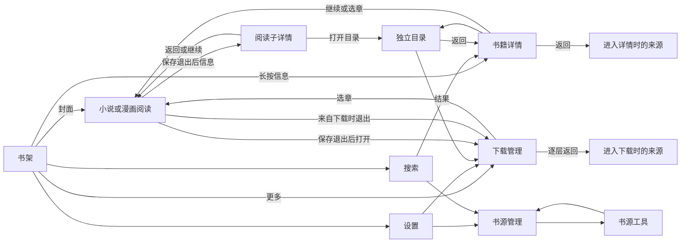

# 应用交互连线、规则及实现对照（2026-10-19）

本对照的跨平台使用范围、固定提交及页面/样式/平台适配交接见[跨平台界面参考](../../ui-design/cross-platform-reference/README.md)。下文仍保留本次接线审查的具体依据与证据层，不随交接整理升级为全部交互验收。

本次从用户反馈的下载入口、当前章节、失败按钮和详情返回错误开始，先修复具体接线，再找回旧文档按业务关系对照。结论是：**页面间的来源上下文、展示退役与业务任务、状态与动作文案存在混用，不能靠统一组件外观解决。** 本轮已修正文中列出的确定偏差；其余按当前可见入口、保留但没有可见入口、产品关闭、规则缺口和未验证行为分别记账。

这是一份当前接线基线。原来的 28 个工作流、211 个步骤没有被抹掉或重新计为通过。本轮完成静态盘点与明确范围的生产方法检查，没有动态重验全应用，更不把编译、安装或历史截图当作全部交互合格。

## 阅读入口与范围

| 文档 | 包含内容 |
|---|---|
| [导航与状态保留对照](navigation-comparison.md) | 全部 ReaderRoute 的实际入口、页面/系统返回、临时层优先级、owner、保留/退休边界，以及确定偏差和规则缺口。当前 11 个有可见入口、2 个保留但未找到可见消费者、7 个被 l0 关闭。 |
| [操作回调对照](action-comparison.md) | 按书架、搜索、详情、阅读、下载、书源、设置等家族列主要按钮 → 回调 → Index/业务 owner → 返回/失败动作；区分声明与实际消费。 |
| [原工作流对照](workflow-comparison.md) | 原 28 个 ID 逐一保留，新增下载 WF-D01～D06，补记漫画、书架更新、独立规则管理的登记粒度不足。 |
| [源码接线索引](wiring-index.json) | 官方 ETS AST 静态提取 497 个 ETS/TS 文件、3804 个站点：818 声明、1109 回调绑定、1827 事件/回调调用、50 路由赋值。每项有文件、行号、所在方法及表达式。索引包括关闭/保留代码，**不把站点数量当作已审正确数量或运行时可达性**。 |

入口范围以当前 `ReaderProductScope` 及实际可见消费者共同确定。仅有 route 分支或 callback Prop 不代表用户可进入：`bookshelfManagement` 和独立 `rulesManagement` 当前属于保留接线；RSS/发现/同步等由 l0 关闭。阅读的“完整管理”当前实际展开原阅读控制栏，不应误写成进入独立规则管理页。

## 旧文档怎样使用

| 来源 | 本轮采用的内容 | 不沿用的推断 |
|---|---|---|
| 用户本轮及此前确认 | 书架封面直接阅读、长按信息入口；组件分类和样式；下载新增入口；返回来源；图片失败粒度；不做非必要门禁。 | 不能以旧测试、旧图或重构计划覆盖后来的明确要求。 |
| [原工作流和覆盖](../../../../evidence/2026-10-02-complete-app-architecture/WORKFLOWS_AND_COVERAGE.md)、同目录 [系统合同](../../../../evidence/2026-10-02-complete-app-architecture/SYSTEM_CONTRACTS.md) 及 [UI 状态合同](../../../../evidence/2026-10-02-complete-app-architecture/UI_SPEC_AND_STATE_CONTRACTS.md) | 用户旅程、任务 owner、原操作确认、取消、进度、资源和展示身份的规则。 | 旧 implemented/partial/OPEN 及步骤统计是当时审阅结果，不是本轮完成率。 |
| [Search→Source 合同](../../../../docs/history/audits/AUDIT_P0_ADD_SOURCE_FLOW_FIGMA_2026-08-29.md)、[临时层 Back](../temporary-back-leaf-bridge-20261003.md) | 保存原入口与 SearchPresentation；返回不自动重新搜索；先关顶层；旧注册/注销不能作用于新展示。 | 专项已做不代表所有页面自动继承。 |
| [Settings owner](../general-settings-runtime-owner-20261003.md)、[Rules lease](../rules-presentation-runtime-owner-20261003.md)、[进度 producer](../reader-progress-producer-boundary-20261003.md) | 同 Runtime 原任务归属、持久写与 UI 退休分离、进度退出屏障、明确核对和继续原操作。 | 不从列表一致、页面关闭或内存值推定持久写确认。 |
| [真实应用逻辑账](../../ui-design/app-baseline/LOGIC.md)、[分类说明](../../ui-design/app-baseline/CLASSIFICATION.md) | 已采集动作、当前源码候选及证据边界。 | “当时详情返回书架”是观察，不能当正确产品规则；未证明的返回仍不能算验收。 |
| [页面框架实施计划](../../../../evidence/ui-interaction-system-review-20261001/framework/implementation/IMPLEMENTATION_PLAN.md) | 延展原壳、保留业务 owner，按旅程核对。 | proposed 的导航迁移不是当前授权。本轮没有另造 Router。 |

## 统一交互规则

以下是旧合同、本轮明确反馈及其必要导航含义的整理，不增加产品功能。涉及未保存草稿的保留时限、跨进程恢复等缺失决定单独列在后文。

| ID | 规则 | 实现检查点 |
|---|---|---|
| P01 | **进入时保存来源，返回时恢复来源。** 同一详情可以来自书架、搜索或阅读；同一下载页可以来自书架、设置、详情、目录或阅读。 | 保存实体 identity、Runtime owner 和父级；不能按离开时的瞬时 route 猜测。嵌套子旅程保存此前父级，不能覆盖最初来路。 |
| P02 | **普通返回与重新打开分开。** 返回已有页面优先恢复其筛选、选择、滚动、已加载内容。 | 搜索 `resume` 不自动重搜；下载同 Runtime 已完成快照 `resume`；明确刷新、冷进入、成员已确认变化等才读取必要范围。 |
| P03 | **系统 Back 先处理最上层，再处理页面。** 页内 Back 与系统 Back 对同一层使用同一决策。 | 原生选择/键盘、当前临时层、管理/子列表、父页面分别消费。多个关闭回调只能关闭自己那次展示。 |
| P04 | **关闭 UI 不等于取消任务。** 已受理的导入、下载、持久设置、删除或换源事务仍归原业务 owner。 | `onDisappear`/generation 只停止旧投影；明确停止/取消走对应原业务入口，不能用卸载页面假装回滚。 |
| P05 | **阅读离开先经过原退出和进度屏障。** 更多→信息/下载是明确导航目的地，普通 Back 仍先关闭阅读临时层。 | `requestExit('navigation')` → 原阅读保存 → 当前 `readerIdentity` 的 `onReaderExited` → 目的地；不先强写 route，也不由任意旧 exit 完成新请求。 |
| P06 | **每个动作只有一个业务 owner。** 页面和公共壳展示事实及派发意图，不另建业务队列/进度写入。 | UI callback → 当前 Host/Orchestrator → 原 Gateway/Runtime/Core；封面点击、目录选章、下载选章共用原阅读准入。 |
| P07 | **实际操作携带当次身份。** 当前实体、Runtime、navigation、presentation/generation 必须匹配。 | 旧按钮、旧异步完成、旧 finish/unregister 不借用后来页面的身份；写入是否已派发与能否继续投影分别判断。 |
| P08 | **原操作确认、当前读回和平台清理分开。** unknown 不推定成功或失败，取消也不伪造回滚。 | 核对只查询；明确“继续原操作”才复用原 ID/完整 DTO；已确认写后刷新失败不能重发写入。 |
| P09 | **业务状态、失败原因、可执行动作分开。** 加载依据明确 busy fact，不能靠显示文字前缀猜测。 | 如“下载失败”是状态，“请稍后重试”是兜底原因，“重试”才是短动作；投影读失败与下载任务失败不同；已完成内容不被旧失败盖住。 |
| P10 | **当前阅读位置必须有依据。** 同书真实记录与当前目录可映射时才标“当前阅读”。 | 小说使用 readingPosition；漫画使用已映射的真实阅读记录；不可导航分卷、未知位置、异书记录不标当前，标签/定位/默认目标共用判定。 |
| P11 | **页面级、章节级和资源级故障按边界承接。** | 单张漫画图片失败保留其单元几何、边界和居中图标；多张各单元显示；书源/章节根本无法准入由页面错误承接，不把所有层级做成同一消息弹窗。 |
| P12 | **完整/快捷控制栏是同一会话的两种呈现。** 展开、收回、反向、取消应保持原模块/草稿和连续交互。 | Full 下拖先沿同一帧轴回 Quick，越过 Quick 再关闭；不是另起一个很短的关闭段。原生手感需要另有设备证据。 |
| P13 | **能力是否开放与源码是否存在分开。** | 从可见控件追到实际消费者；无消费者的 Prop、保留路由、l0 禁用功能不能计为可见旅程通过。 |
| P14 | **证据分层。** | 源码对照、方法行为、本地编译/签名、安装启动、原生操作/视觉、用户验收分别记账；不靠反复全量门禁替代逻辑推导。 |

## 页面与操作的主要关系

这是主要关系图，临时选择、确认、目录内部层级及每个实际回调见两个对照分册。箭头不是动画或原生输入验收。信息页可经独立目录的下载操作进入下载管理；`Info→目录→Downloads→Reader B` 返回时先回下载、再原目录/信息、再 Reader A。有限返回逻辑也保留 detail 父级分支，不因此声称详情有独立下载按钮。Reader A 最初来自下载时，退出还要回它最初的下载父级，不能形成详情/阅读/下载循环。

## 状态保留及重新读取

| 场景 | 必须保留/恢复 | 允许读取的原因 | 已核对 / 边界 |
|---|---|---|---|
| 搜索→详情→返回 | 原关键词、结果、筛选和视口，由原 Search owner 负责。 | 明确搜索、源变化所需刷新；普通 Back 不新搜索。 | 现有 `searchHost.resume` 接线；异步所有交错未动态重演。 |
| 搜索→书源→返回 | 原 SearchPresentation 和关键词。 | 更新来源候选；明确导入后搜索才发新搜索。 | 当前消费者与旧专项合同一致。 |
| 下载章节→阅读→返回 | 已加载列表、筛选、两级滚动、所选书；同 Runtime 的完成投影。 | 下载时钟变化的书籍状态；刚读书籍已确认进度 metadata。 | 上轮保留机制与本轮有限父上下文配合；普通返回不整表/整目录重读。 |
| 上项中确认换源 | 原父级和 view state；成员事实更新。 | 确认身份改变使旧成员快照失效，必须读取新成员。 | 新 revision 阻止此前上下文复活旧 rows；这是普通返回复用的明确例外。 |
| 阅读→书籍信息→返回 | 原书、阅读来源、搜索详情父级或下载宿主；原退出保存位置。 | 需要的新事实由原 owner 获取；不靠回书架再打开。 | 本轮修复并做方法检查；原生 Back 调度仍待实际操作。 |
| 任意临时选择/确认→取消 | 父页面与 canonical 值；取消不触发新业务操作。 | 明确刷新/核对才请求。 | 各 leaf own visible state，旧 finish 不清新层。 |
| Source→Tools→Source | 后台已受理任务和原操作事实；Source 查询/筛选等保留政策尚缺完整定义。 | 当前新 presentation 会重读，不能一概当多余请求。 | 已确认局部查询/分组重置事实；未武断规定所有草稿永久保存。 |
| Tools 编辑离开/重进 | 已提交操作事实不丢；未保存文本/选择的保存或丢弃要有明确政策。 | 当前 open 清非 pending 初始 snapshot；是否应恢复草稿缺原规则。 | 规则缺口，不以“有 Host”推定草稿已经保留。 |

## 本轮确定偏差及修复

| ID | 原偏差 | 当前修正及对应规则 |
|---|---|---|
| FIX01 | 书架 More 没有下载管理入口。 | 同一受理/退场链加入第五项，规格五行；P06/P07/P13。 |
| FIX02 | 下载当前章节存在不同判定或无明确标识，目录 index 可能误作已读。 | 共享真实位置 helper 及紧凑“当前阅读”标签；P10。 |
| FIX03 | 兜底失败长文案进入状态按钮，图标/强调判断也失效。 | 有限状态、短“重试”、独立原因；读失败与任务失败分开，旧失败不盖已证明完成；P09。 |
| FIX04 | Reader→信息→Back 回书架；Search 详情经目录/下载后丢 Search。 | reader 子详情和下载保存完整实际来路，普通/header/system 返回复用原决策；P01/P03/P05。 |
| FIX05 | 换源 preview/rollback/canonical 重新准入重置父级；临时去规则页按瞬时 route 丢下载宿主。 | 新实体准入明确 reset，子旅程显式 capture/restore；不再按瞬时 route 猜起点；P01/P05/P07。独立规则路由当前没有可见入口，保留分支不算已开放功能。 |
| FIX06 | 信息 A→下载→阅读 B 清掉 A 的 reader parent；嵌套下载覆盖原下载 parent 形成错误往返。 | 有限父级快照引用，先 capture 后赋新目的地，连 view state/完成投影恢复；不创建新 Router；P01/P02。 |
| FIX07 | 已确认换源后仍恢复旧来源的下载成员。 | 仅身份变化使下载成员快照失效，旧上下文受 revision 限制；保留父级和视图；P02/P06/P07。 |

上轮已经修正的闪 read sheet、普通阅读往返重新加载、快速选择裁切、未知容量空白、Full→Quick 拖动另有原记录。本轮不重复把旧源码结果记成新原生验收。

## 仍需明确或验证的事项

1. **Source/Tools 普通返回的局部状态政策不完整。** 需要定义查询/分组、选择、未保存编辑草稿在页内子旅程、离开模块和跨进程时分别保留到哪里。已有任务/原回执保护不能替代此规则；本轮没有擅自加入全局草稿库。
2. **旧登记对新增下载和漫画粒度不足。** 下载六条旅程已补入对照；漫画图片/章节/源错误、缓存回滚和释放翻章按用户已确认规则列出，尚未逐步重验全部原生分支。
3. **声明未消费的独立入口。** 书架旧管理路由、独立规则管理回调与可见 UI 已脱节；当前保持保留状态，不伪报可进入，也不擅自新增用户未要求的按钮或删除整域代码。
4. **原生复杂交错未全面验证。** 键盘/平台 popup Back、原生面板退场、长标题和多动作尺寸、快速连续点击、进程终止恢复仍需要各自具体问题和必要范围；不以重新跑所有门禁来笼统关闭。

因此本次结论是“明确偏差已修、主连线已逐家族对照、缺失规则已列出”，不是“全应用所有逻辑均正确”。后续反馈应关联这里的旅程/规则和具体入口，避免继续只按屏幕逐个补洞。

## 本轮证据

- 源码：Harmony `5a01ec1cdbd5ec864046e1b9202963ead23a513a`、Core `b52365329f1312c7bb80605c8a74eecaf8f4bc44` 加各自现存未提交修改；不清理或提交无关 WIP。
- 静态对照：三份分册及 AST 站点索引。旧 28 ID 全保留，211 步未重新动态验收。实际 site 索引不负责调用可达性证明。
- 定向行为：`.reader-artifacts/interaction-wiring-20261019/targeted-result.json`，12 组，生产 Index 普通方法/Host 方法/共享投影，有限 IO/lifecycle 端口；PASS。不模拟 ArkUI compositor 或手势。
- 编译及签名：首次失败记录三处 ArkTS 对象展开；修正后实际开发编译及指定证书包内校验 PASS，9.446秒；`.reader-artifacts/interaction-wiring-20261019/development-build-final.log`。
- 开发 HAP SHA256：`83e2584afc2d81047e8a27d5feb10aa662c5d61ebacf21885a67aaf1f7631976`。指定 `minliny_HarmonyOS` 调试证书、包名 `io.reader.minliny`。这是本次 native DevEco 开发构建，无 immutable pipeline manifest，不是完整候选验收。
- 全量门禁：NOT_RUN。没有同步旧视觉基线或附带运行其他套件。
- 物理安装：2026-10-20 00:02（上海时间）连接恢复后，本包保数据覆盖安装、安装前后身份核对及启动 PASS；目标引用 `b1f20b88963d`，记录 `.reader-artifacts/interaction-wiring-20261019/development-physical-install.json`。没有重新构建或追加门禁；原生交互/视觉及用户验收 OPEN。

问题触发和修复过程同时记于 [问题总账](../../issues/message-ui-unification-20261019.md)。
