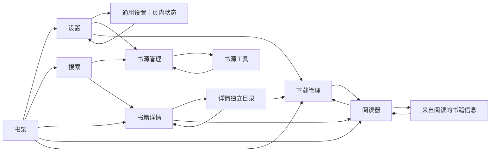

# 交互接线：导航、返回与状态保留对照（2026-10-19）

本文按“已有规则 → 逻辑联系 → 当前生产接线 → 偏差”整理。它是本轮只读审查记录，不是新的 Router 方案，也不是设备验收记录。生产修改由 Index 的唯一 writer 完成；本文作者只写本文件，没有修改产品、执行测试、构建或设备操作。

审查覆盖全部 20 个 `ReaderRoute` 声明，但不把声明等同可达：当前有实际可见入口的路由为 11 个；`bookshelfManagement` 与独立 `rulesManagement` 是产品门禁未禁用、但未找到当前可见入口的 2 个保留分支；`ReaderProductScope.ts` 明确关闭的另外 7 个路由另列，不作为本轮阻断。临时层只沿真实入口核对。源码处于本任务既有 dirty 工作树，定位同时给出文件和方法名，行号会随整合移动。当前代码修后状态只表示静态调用链已闭合，不继承旧 SDK、HAP、VM 或用户通过结果。

最后只读复核输入：`Index.ets` SHA-256 `482e2ba7722a77adb4a29e79867a6460f98b384256e6026c3ffb28698b25c3da`；`SharedDownloadHost.ts` SHA-256 `c1b0e84889a45ad4fbd57a5a6540aafb0849127e9c2333b423a701fdb51a27df`。后续源变更需要重新核对受影响条目；这些哈希不表示该源已构建或安装。最终 ArkTS 适配改为直接复用既有不可变 reader context 引用，并用 `copyDownloadViewState` 显式复制全部 9 个视图字段；已窄复核捕获／恢复两端，未改变 parent 或 snapshot 准入。

## 1. 已有文档及规则效力

| 编号 | 原文依据 | 本次采用的规则及边界 |
| --- | --- | --- |
| R0 | [唯一待开发入口](../../../../DEVELOPMENT_BACKLOG.md)，`UI 与逻辑稿重建` | 当前 UI／逻辑表达从真实应用重建；旧数量、候选设计和通过结果不能直接当作当前行为。历史缺口需重新核对，不能原样变成当前 TODO。 |
| R1 | [Search → Source 完整流程](../../../../docs/history/audits/AUDIT_P0_ADD_SOURCE_FLOW_FIGMA_2026-08-29.md)，§4 步骤 3／5、§5 导航合同 | 入口保存返回目标、关键词、SearchPresentation 和来源范围；普通 Back 恢复原 Search，不重新 open 到 Initial、不自动发新搜索。显式“用新书源搜索”才重新搜索。该文是专项合同和时点审计，不是当前整体验收结果。 |
| R2 | [临时层 Back 合同](../temporary-back-leaf-bridge-20261003.md)，Integration API／Real behavior | leaf 仍是可见状态唯一 owner；appear 注册捕获身份的处理器，disappear 先退役再按原身份注销。Index 捕获 Runtime／navigation／leaf identity；首个 Back 先交最上层。旧注销、旧 finish、旧选项不能作用于新层。 |
| R3 | [Settings Runtime owner](../general-settings-runtime-owner-20261003.md)、[Rules presentation lease](../rules-presentation-runtime-owner-20261003.md) | 页面退役停止投影，不取消已派发持久写入；新 presentation 继承同 Runtime 原 owner 的 canonical 和操作事实。实际回调捕获自己的 presentation，不能现查新身份借用。 |
| R4 | [原操作与确认](../reading-exact-operation-intents-20261003.md)、[Source 原操作恢复](../source-management-cold-recovery-20261003.md) | open／refresh 先纯核对原回执；未知写不能被返回动作自动重放。明确“继续原操作”复用原 ID／完整 DTO。列表一致不等于原操作确认，关闭 UI 不等于回滚。 |
| R5 | [ReadingEntry owner](../reading-entry-owner-audit-20261003.md)，Exact consumer interface；[系统文件打开导航](../../../tools/evidence/p6/SYSTEM_FILE_OPEN_NAVIGATION_OWNER.md) | Index 保留实际导航责任；已有 Host 保留 acquisition／原操作责任。异步导航捕获 Runtime、navigation、实体及 reader presentation；旧读页的 exit 不得确认新读页的目的地。 |
| R6 | [SourceSwitch owner](../source-switch-owner-audit-20261003.md)，P5 integration contract | 换源 effect 必须再次检查原 lease；canonical／rollback 使用新 canonical 书架事实，但导航父级仍由 Index 管理。退役不能清除已接受的事务。 |
| R7 | [公共页面框架](../ui-page-framework-20261014.md)，Finite ownership | Scaffold／StandardPage 不拥有业务状态；detail catalog、reader directory、download 和 reading 是不同类别，不能按同名页面互换。 |
| R8 | [实施后继](../../../../evidence/ui-interaction-system-review-20261001/framework/implementation/IMPLEMENTATION_PLAN.md)，§3、F02／F03、验证维度；[工作包](../../../../evidence/ui-interaction-system-review-20261001/framework/implementation/WORK_PACKAGES.md)，总范围 | 延展现有壳，不另造 Router。保留原草稿、选择及业务 owner；Back 先关闭顶层，关闭重开和旧 callback 分别检查。原 `plan/DEVELOPMENT_PLAN.md` 的 NavPathStack 迁移明确为 proposed，不能当作本轮重写授权。 |
| R9 | [应用逻辑分类账](../../ui-design/app-baseline/LOGIC.md)、[分类说明](../../ui-design/app-baseline/CLASSIFICATION.md) | 实线表示已采集动作链，虚线表示源码候选。记录“详情曾返回书架”不等于批准该返回目标；“漫画详情返回阅读器”等仍未证明项不能伪报已验收。 |

本轮没有找到一份已经冻结、覆盖全部嵌套入口的完整 parent／retention 表。下面按现有专项规则补齐对照；没有明确规则的状态丢弃，列为“规则待明确”，不包装成已批准设计。

## 2. 当前有限导航关系

图中的双向联系是当前代码意图，不代表相应原生调度、动画或触摸已经证明。Downloads 的退出目标取其进入时保存的父级；从下载条目进入 Reader 后，Reader 的退出目标仍是原下载页面。普通阅读的书架／详情／搜索父级另行保留，不得被这次子页往返覆盖。

## 3. 当前可见路由：入口、返回与保留矩阵

所有 Index 方法位于 [Index.ets](../../../entry/src/main/ets/pages/Index.ets)。系统 Back 先经过 `onBackPress` 的 Index 临时层优先级和 `consumeTemporaryBackBridge`，再进入下表路由分支。表中“已接线”均为源码审阅。

| 路由 | 正常入口／实际页面 Back | 系统 Back 与父级 | 保留数据／owner | 文档依据 | 当前代码状态 |
| --- | --- | --- | --- | --- | --- |
| `bookshelf` | 主入口；Settings 的主 tab 回调／`returnToBookshelf`；书架封面 `openShelfBook`，长按信息 `openShelfBookInfo`，Shell 搜索／设置／更多各回原 Index intent | 临时层先关；阅读准备中先退出原 reader；无临时层时 `onBackPress` 返回 false 交平台 | `BookshelfViewState`、已确认书架投影、筛选／分组／列表锚点；业务与导入 owner 不随 body loading／error 切换 | R0、R2、R3、R7 | 原书架壳保持；返回会刷新书架 canonical，不因此宣称界面所有状态应复位 |
| `settings` | `openSettings`；`SettingsShell` Home／General 是同一路由；General 顶栏 `onSectionChange('home')` | selection 先消费；General → Home；Home → `returnToBookshelf`，与页面返回含义一致 | Index `settingsSection`；SettingsHost／Orchestrator canonical、原写事实；两个 Scroller 属 Shell | R2、R3、R4 | 已接线；新入口 `openSettings` 明确 Home，子页返回 `returnToSettings` 不强制改 section |
| `bookshelfSettings` | 书架更多或 Settings；`openBookshelfSettings` 捕获 `bookshelfSettingsReturnRoute`；顶栏 `returnFromBookshelfSettings` | 同一方法按 bookshelf／settings 父级分流 | 原 Settings owner、view-mode checked receipt；操作事实不因 presentation 退役丢失 | R3、R4 | 已按两个入口分流；此页无另一个私有下拉 Back bridge |
| `bookshelfMultiSelect` | 书籍长按与书架 More 的 batch 项 `openBookshelfMultiSelect(initialBook)`；页面取消 `returnToBookshelf` | 批量移除 busy 时消费并留页；否则回 bookshelf | 页内 selected keys；Index 传 canonical books／initial key；持久批量删除由原 owner 负责 | R3、R4 | 系统 Back 有 batch busy 防线；页面取消回调本身也要求 `!busy && ready`，批量操作期间与系统返回保持一致 |
| `search` | 书架／空书架搜索 `openSearch`；页 Back `returnToBookshelf`；结果进入 detail | 系统同样回 bookshelf；从 detail 返回走 `returnToSearch`，从 Source 返回走 `returnFromSourceManagement` | 同 SearchHost 保存 publication／查询、来源范围、筛选、anchor 和 scroll；普通回程 `resume`，显式新搜索才 `search` | R1、R3、R5 | 搜索／书源普通回程符合规则；本轮修了 detail 经下载后的 Search 父级 |
| `source` | Settings `openSourceManagement()`；Search `manageSourcesFromSearch` 保存 keyword／returnTarget；页 Back `returnFromSourceManagement` | group panel 先关闭；再按 settings／search 父级返回 | Runtime Source owner 保留 list／原操作；Search 意图保留；Source 页面查询／status／category／group 目前是本地 State | R1、R2、R3、R4 | 父级已区分；Source → Tools → Back 会重挂页面，四项本地筛选复位，属代码确定、返回保留规则待明确项 |
| `sourceTools` | Source `openSourceTools`；页 Back `returnToSourceManagement` | 系统同一目标 source；编辑器是页内 card，不是另一条路由 | Runtime SourceTools owner 保存 accepted tail／original；无未知或 pending 时 `open` 重置普通 snapshot | R3、R4、R8 | 普通重开清选择／检查状态和未提交 editor draft；需明确 Back 是暂离还是显式丢弃。不可为保草稿重放持久写入 |
| `downloads` | Settings、书架更多、目录下载全书、reader 下载入口；页面 Back `back → consumeBack → onBack` | `confirmation → sheet → managing → chapters → books → returnFromDownloads`；保存 bookshelf／settings／reading／detail／directory 父级 | `SharedDownloadViewState` 保存 query／filters／sort／listScroll／chapterScroll／detailKey；同 Runtime 已加载 snapshot 可 `resume`；只刷新刚阅读书的 metadata；DownloadReturnContext 保留被子旅程遮住的原父级与快照 | R1 的入口原则、R2、R3、R5、R7 | 本轮已加 bookshelf 父级、完整 child-detail／reader context 和加载完成快照恢复；部分加载／冷进入仍 reload，不把未知 rows 冒充加载完成 |
| `detail` | 书架信息、Search 结果、Reader 更多“书籍信息”、下载父级回程；页 Back `returnFromDetail`；继续／章节走 `openReading` | 普通 parent 为 bookshelf／search；Reader 子详情以 `DetailReturnRoute='reader'` 和 `detailReaderReturn` 返回原 reader；系统准备中先走原 reader 退出 | 当前 admitted book／TOC／session；来自 reader 的 owner／originRoute／detailParent／fromDownloads context；详情目录保留详情实例 | R1、R3、R5、R7 | 原“reader 信息再 Back 回书架”已加有限 context；页 Back 和详情内重新开始阅读都由 `openReading` 消费该 context |
| `directory` | `openFullDirectory`（详情独立目录）；`openReaderControlDirectory`（阅读控制来源） | `closeDirectory`：无 active reader 回 detail；readerControl 回 reading；其余 active reader 走原退出控制器 | `directoryReturnTarget` 区分来源；详情目录不换 navigation generation；reader route 切换保留 actor／session；书签／离线操作由 Runtime owner 负责 | R4、R5、R7 | 两类目录基本分流完整；Downloads 回详情目录时本轮明确恢复 `directoryReturnTarget='detail'` |
| `reading` | 书架续读、详情／目录章节、下载已下载章节、reader 子详情返回、已确认换源 | 系统先由原 reader 处理 keyboard／temporary／control／manga panel；普通退出调用 `onReaderExited(readerIdentity)`，按目的地及原 context 分流 | 唯一 reader actor／progress／record／TTS owner；original parent 与 fromDownloads 分开保存；进度确认不由 UI 关闭猜测 | R2、R3、R4、R5、R6 | 本轮去掉按瞬时 route 清 fromDownloads；新 book admission 明确重置，子页／换源回程显式恢复。替换“完整管理”仍是 reader 内部 Full actor，不能当独立 Rules 路由 |

### 3.1 产品未禁用、当前没有可见入口的保留分支

| 保留路由 | 实际代码边界 | Back／保留事实 | 本轮处理 |
| --- | --- | --- | --- |
| `bookshelfManagement` | Index 保留 dispatcher 和 `openBookshelfManagement`，但全 ETS 当前只有该方法定义，没有调用；书架 More batch 实际回调 `openBookshelfMultiSelect` | 若由代码进入，页 Back 与 system Back 都回 Shelf，原 BookshelfHost 持久事实仍归原 owner | 不当作当前用户可达页面，不因入口缺失阻断本轮，也不擅自开放 |
| 独立 `rulesManagement` | Settings 仅声明／传入 `onOpenRulesManagement`，没有实际可见 navRow 调用；ReaderShell／LocalReadingExperience 保留转发，ReaderControlPanel 只声明并未调用该回调；替换“完整管理”走 `onExpand → expandReaderControlSession` | 保留代码有 settings／reader returnTarget 及 exact Runtime owner；同一层的静态返回问题可修，但不构成已观察用户路径 | 不画 Reader → 独立 Rules 的实线，不用该保留分支代替 reader Full actor 的行为验收 |

## 4. 临时层：关闭目标与 Back 优先级

这里核对的是实际 owner 和返回层级，不把所有 popup、native Sheet、reader actor 强行做成同一种生命周期。Index `onBackPress` 当前顺序：漫画换源选话 → 书籍移除 → JSON 导入 → 换源 → 本地导入 → 书架分组编辑 → leaf bridge → route。原生窗口可能先于 Ability 回调处理 Back，具体调度仍属平台证据边界。

| 临时层／入口 | 实际关闭／Back handler | 父级与保留内容 | 依据／代码状态 |
| --- | --- | --- | --- |
| 书架顶部 More 锚定菜单 | `BookshelfShell.consumeTemporaryBack`；mask／action 仍用本 opening identity；bridge 向 Index 注册 | 留在同一书架；关闭只清 More 可见态，不清书架视图 | R2；appear／navigation Watch 更新注册、disappear 原身份注销，已配对 |
| 书籍长按操作 native Sheet | `BookshelfPage.bookActionSheetOptions.onWillDismiss`／`dismissBookActionSheet`／native `onDisappear → finishBookActionSheet` | 保留 actionBook／presentation 至 native 退场结束；所选动作只在 finish 后执行一次 | R2、R5；原生过渡与普通 leaf bridge 分开，入场／退场期间旧 callbacks 均有身份保护 |
| 书籍移除确认 custom Dialog | Index `dismissBookRemovalDialog`／`confirmBookRemovalDialog`；系统 Back 分支只 dismiss | 取消回原页面，不执行删除；确认捕获原实体，持久 ACK 由 Bookshelf owner 负责 | R2、R4；原生 onDismiss 与 Index state 分开，未知写不由关闭推定失败 |
| 书架分组编辑／选择 | Index `closeShelfGroup`；busy 系统 Back 消费但不强行关闭 | 回书架；组写事实由 BookshelfHost，未保存输入的丢弃边界需按既有表单合同 | R2、R3；Index 层优先于 route |
| 本地导入：fileSelection／pickerOpening／importing／result | Index `closeImportDialog` → 原 Bookshelf import presentation owner；文件 picker 由平台返回 | 关闭 presentation，不移除已导入书或已派发导入；旧结果不能重新展示 | R2、R4、R8；系统 picker 不冒充应用路由 |
| JSON／在线 URL 导入 | Index `dismissJsonImport`／JsonImportDialog 的 close；Index native Alert 优先级独立 | 当前 Source 入口回原 Source；ruleBundle／RSS 导入只保留兼容代码，不能列为当前可见路径；输入属当前 presentation，Core import 原结果由对应 owner 保存 | R2、R3、R4；不能从 Search 直接开绕过 Source route 的导入 |
| Source 分组下拉 | `SourceManagementPage.consumeTemporaryBack` 设置 groupClosing；ReaderSelectPanel 原 finish 完成关闭 | 留 Source，groupValue／其他页面状态不因临时关闭改变 | R2、R8；fresh selectionId、old finish／commit guards 已接线 |
| Settings Phone／Tablet 选择层 | `SettingsPage.consumeTemporaryBack`／`retireSelection`；native mask／choice 原 identity | 留 General；取消保留 canonical setting，写入结果仍回原 Settings owner | R2、R3；注册／注销配对，Phone／Tablet 保留不同宿主 |
| SharedDownloadPage filter／sort／range／settings／book-actions／chapter-actions | `consumeBack` 先清 sheet；操作抽屉保留其退出状态至动画 finish；外侧与动作也回原 Page | 留当前 books／chapters／managing；关闭不能清原 download intent | R2、R3、R4；header 与 system 使用同一 consumeBack；read 入口本轮已直接进入 reader，不再新增 read Sheet |
| SharedDownloadPage deleteLocal／cleanup 确认 | `consumeBack` 先清 confirmation；cancel 不调用 mutation；confirm 捕获原 target／generation | 回原下载层级；删除／清理另受范围和真实 capacity 准入 | R2、R4；原操作确认与普通刷新分开 |
| Reader／Detail 的 SourceSwitch | Index 先于 route 交 `SourceSwitchHost.consumeBack` 或漫画 `closeSourceSwitch`；关闭能否完成由事务阶段决定 | 关闭回原 detail／reader；candidate、原事务、canonical anchor 各由既有 owner 负责 | R2、R4、R6；preview／target／rollback／canonical 的 parent 修后对照见 §6 |
| 漫画换源选话与目标准备 | Index `cancelMangaSourceSwitchSelection`；prepare／commit 分界保持原 cancellation guard | 取消回原换源层；已 commit 不能按 UI cancel 回滚 | R2、R4、R6；Index 最优先临时层 |
| 小说 reader 键盘、临时编辑／预览、Quick／Full／control | `LocalReadingExperience.requestExit`：实际键盘 → `dismissControlTemporaryLayers` → `backReaderControlHostSession` → `beginExit`；显式 navigation intent 走 `beginExit` | 原模块／原 reader；temporary revision 回原子模块，actor 树及草稿仍由原 owner 维护 | R2、R5、R8；普通 Back 与明确跳页的 navigation exit 有意不同，不能把二者统一成直接路由退出 |
| 漫画 directory／more／mode／settings／downloads panel、章末／缩放状态 | `MangaReadingSurface.handleBack`：边界拖动取消 → panel close → chapterEnd 清理 → zoom 复位 → controller.close → onBack | 同 reader 逐层关闭；退出才回 Index；panel closing generation 防旧 finish | R2、R5；navigation intent 可越过普通 panel 收起步骤，保留串行 controller close |
| 通用 ReaderInlineSelect | 平台 bindPopup 状态回调 → captured identity dismiss；ReaderSelectPanel commit／collapse 仍为原局部 owner | 留当前行／当前 Page；不扩大行高、不创建新的 route | R2、R8；平台 Back／焦点时序未经本轮实际验证，不用缺少 Index bridge 直接判漏接 |
| native Alert／文件选择／来源登录 Web | 原 native owner／平台宿主处理关闭；SourceOrchestrator.loginSource → ReaderRuntimeOwner.openSourceLogin → ArkWebExecutor.openInteractive | 回原业务页；登录使用原 sourceId 与 Host jar，完成后原 session 才检查来源 | R2、R3；本轮只追至实际生产委托，不声称平台 Web 历史／IME／焦点 Back 已验证 |

## 5. navigation generation、retire 与保留边界

| 状态类别 | 当前 owner／退役方式 | 审查结论 |
| --- | --- | --- |
| 页面物理回调 | Index navigation／Runtime／presentation 身份；大多数页面用该 generation 的 ForEach opening | route 替换后旧回调不能借新 Props 执行动作；不能靠去掉 guard 恢复返回 |
| 临时层 | leaf 本地 visibility／opening identity，或原生 window lifecycle；Index 只持有限 Back lease | 不增全局 overlay manager；旧 unregister 不清新 lease；nextNavigationGeneration 清当前 Back lease |
| 原持久操作 | Runtime domain owner／exact intent／serialized tail | 页面退役不撤销已派发写；恢复先读原 receipt，不在返回时自动重试写 |
| reader parent | ReaderReturnContext：captured Runtime、originRoute、detailParent、fromDownloads、可选 downloadParent | 本轮从零散瞬时 route 推断改为有限 DTO；旧 Runtime context 不准入。来自 reader 的 detail 再开始阅读与 Back 共用 openReading 的消费点。downloadParent 是旧父级的浅快照，不修改旧 context，也不 JSON 序列化 Runtime；membershipRevision 不一致时仅放弃旧 rows，父级／viewState 仍恢复 |
| downloads 视图／数据 | Index SharedDownloadViewState 与 retained snapshot；新 Host.resume 重新绑定订阅，pending clock 只读变化书 | warm completed resume 与 cold／partial reload 分开；返回并非默认清空全部 rows；当前 reader metadata 单书刷新不应重新加载全目录 |
| Source 页面过滤与 Tools 普通草稿 | SourceManagementPage 本地 State；SourceTools owner 普通 snapshot | 从 Tools 返回或普通重开会重置部分 UI。事实确定；普通 Back 的保留／丢弃规则未完整冻结，不把 canonical 重新读表直接视作违规 |
| SourceTools presentation detach | Index 页面退役有捕获 current guard；Index 自身 disappear／下次 attach 有匹配 detach；nextNavigationGeneration 未显式 detach 该 host | 当前 guard 已阻旧 UI 投影，没有据此发现错误业务执行；显式退役的一致性是待核对项，不能夸大成已发生串页 |

## 6. 原发现与修后对照

| ID | 原逻辑与影响路径 | 本轮修后对照 | 结论／未决边界 |
| --- | --- | --- | --- |
| NAV-01 | Shelf → Reader → More 信息 → Detail → Back：DetailReturnRoute 原只容纳 shelf／search，误退书架 | `ReaderBookInfoExitDestination` 捕获原 reader context；onReaderExited 临时显示 Detail 后设 parent=reader；Back／详情内阅读都经 openReading 恢复 | 源码主链已修；没有运行测试或设备验证 |
| NAV-02 | Search → Detail → 独立目录 → 下载全书 → Downloads → Back：重开详情按 origin=downloads 改成 shelf | openDownloads 保存 downloadDetailReturnRoute；returnFromDownloads 通过 retainedParent 重开，并明确目录来源 detail | 源码主链已修；保留 SearchHost 查询及原父级，不重新搜索 |
| NAV-03 | 保留代码组合 Downloads → Reader → 独立 Rules → Back：中途把 route 改 detail 后，nextNavigationGeneration 清 fromDownloads | 不再按瞬时 route 清 flag；新 book admission 明确重置，reader 子页仍继承原上下文 | 静态保留分支已修；独立 Rules 当前没有可见入口，此项不再声称是当前用户故障。Reader Full replace 是另一条实际 actor 链 |
| NAV-04 | Search → 已在架书 Reader → 换源 rollback／canonical：reopenSwitchedBook 未传 parent | reopenSwitchedBook 捕获 reader context，显式传 parent，并在重新 admission 后恢复 | 源码主链已修；canonical book 仍来自原 Host 的真实读回 |
| NAV-05 | Downloads → 未在架书 Reader → preview 换源：新 book admission 会清 fromDownloads | 最初修补只保存 detailParent；审查补报后，text previewReady 与 manga preview 均已捕获／恢复 ReaderReturnContext | 最新源码两 preview 分支已复核；targetReady seam 本身不清 parent／fromDownloads，缺 session 时委托已修 reopen |
| NAV-06 | Reader A → 子详情／目录 A → Downloads → 阅读 B → 回 Downloads → 返回 A：A 的 parent 字符串 reader 仍在，但其完整 detailReaderReturn 会被 B 的新 admission 清除 | 新增 downloadDetailReaderReturn；进入下载时保存，回原详情前恢复，再经 retainedParent admission | 最新源码已复核；原发现保留，未宣称设备路径已验收 |
| NAV-07 | Source 筛选 → Tools → Back：新 navigation key 导致 Source 本地查询／筛选复位 | 未在本轮擅自改本地状态 owner | 代码确定；需明确父页返回保留矩阵后最小接线 |
| NAV-08 | Tools 改未保存 JSON／选择／检查 → Back → 再进入：非 pending／unknown 的 open 重置普通 snapshot | accepted tail／unknown 屏障仍保留；普通 draft 的离开规则未定义完整 | 不把“无 unknown”当作“用户同意丢草稿”；先明确恢复或显式丢弃边界 |
| NAV-09 | 下载返回可能每次重新全库读取；旧 reader metadata 留在 snapshot | warm loaded snapshot 由同 Runtime owner 准入，Host.resume 重绑；单书 refreshReadingMetadata 更新当前阅读位置 | 主链已修；loading=true 的 partial snapshot 仍走 reload，属于明确分支，不能宣称所有返回都不重读 |
| NAV-10 | Shelf → Downloads → Reader A → Info A → Downloads → Reader B → Back Downloads → Back Info A → Back Reader A → 退出：全局 downloadReturnTarget 被子旅程覆盖，可能循环回 Info／Reader | ReaderReturnContext 增 downloadParent；DownloadReturnContext 保存原 target／book／detailParent／readerReturn／detailReaderReturn／viewState／snapshot／membershipRevision。requestReaderDownloads 先捕获旧 context 再覆盖当前下载目的地，restore 按同 Runtime 恢复 | 当前结构静态可回原 Downloads 再回 Shelf；捕获只引用此前 context，没有把新对象写入自身的对象环。不是通用 Router 或新持久状态 |
| NAV-11 | Downloads-origin Reader 发生 canonical 换源，新 source/book key 不在原下载快照中；resume／单书 metadata 不能更新成员集合 | performSourceSwitchSeam／reopenSwitchedBook／restoredForNextChoice 在实际 source/book identity 改变时失效 retained snapshot 并推进 downloadMembershipRevision；restore 仅在 revision 相同恢复旧 rows，仍保留 parent／viewState | 最新源码已复核；此例外返回走原 canonical reload，普通未变阅读往返仍 resume。无需给每次阅读返回增加全库重读 |

## 7. 最小整改分组与证据边界

1. **有限 parent DTO**：reader／detail／downloads／source-switch 的每一条替代 admission 都要保存同一原上下文；保持现有路由枚举和 owner，不建设第二历史栈。
2. **返回保留矩阵**：逐项规定 query、filter、scroll、draft、selection 的“暂离保留／显式丢弃／新查询复位”。canonical 读回可继续，不能顺手清展示状态；没有规定的点保持待明确。
3. **临时关闭与原操作**：沿用已有 leaf bridge、native lifecycle 和 reader exit。首 Back 消费顶层，导航 intent 保留其业务意义；关闭／取消／写确认不能互相代替。
4. **准入和回执**：Runtime／navigation／实体／opening identity guards 保持；读回失败保留原 accepted事实；仅显式继续原操作可以重新派发同一 ID。

本文未执行 SDK／测试／门禁／构建／HAP／设备操作。源码闭合不证明原生条件卸载、系统 Back 优先派发、键盘焦点、动画、滚动稳定性或用户验收。最终 Index writer 冻结后，应以该输入逐条选择必要的真实调用链验证；不复用本文件形成前的整批通过结果。

## 8. l0 关闭：不纳入本轮验收

`ReaderProductScope.ts` 当前返回 l0，RSS／Discover／Sync 没有产品准入。以下 7 个路由保留源码兼容与分支门禁，不据潜在缺口阻断当前 11 个可见路由；另 2 个未禁用但无可见入口的保留分支已在 §3.1 分开：

| 关闭路由 | 门禁／处理 |
| --- | --- |
| `discover` | openDiscover 入口与 Index dispatcher 同查 discover surface |
| `rss` | RSS family 入口与 dispatcher 查 rss surface |
| `rssSubscriptionManagement` | 同 RSS family 门禁 |
| `rssSubscriptionEditor` | 同 RSS family 门禁 |
| `rssSourceFeed` | 同 RSS family 门禁并要求真实 selected subscription |
| `rssEntryDetail` | 同 RSS family 门禁并要求真实 subscription／item |
| `sync` | openSync、owner 准入、dispatcher 查 sync surface |

来源：[ReaderProductScope.ts](../../../entry/src/main/ets/app/ReaderProductScope.ts)。保留实现不等于授权开放，不删除既有用户数据。
