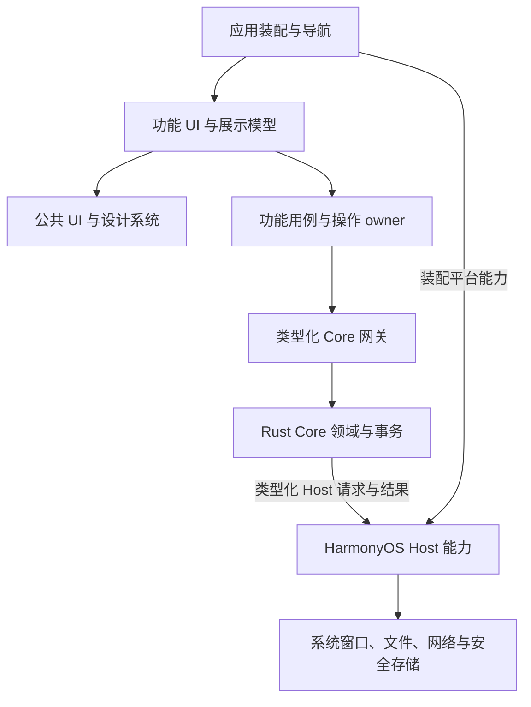

# Reader 应用目标架构

Reader 是以书架为起点的 HarmonyOS 阅读应用。本地文字、远程文字、漫画和书源管理共用一条从产品界面、系统能力到领域事务的执行链。UI 可以按阅读媒介组织内容，书籍身份、内容归属、位置和离线事实始终有唯一权威。

本文规定 Reader 的产品结构、分层职责、交互契约、数据与运行边界，以及架构验收所需的证据。页面宿主、公共组件 API 与 UI 框架是展示架构的三个配套部分，分别约束页面承载、交互语义与复用方式。其详细约定由 UI 子方案承接。[UI 目标架构](ui-target-architecture-20261105.md)

## 1. 产品范围与信息架构

书架和设置属于一级目的地，窄屏底栏和宽屏侧栏表达同一组目的地和选中状态。书架组织已收藏内容、继续阅读、导入与在线搜索。设置组织应用偏好与书源管理等可用能力。阅读器是独立的沉浸任务，返回应恢复原来旅程的实体和上下文。

| 旅程 | 产品入口与主要上下文 | 结束或返回时保留的上下文 |
| --- | --- | --- |
| 本地文字 | 书架导入文件 → 书籍详情、目录或正文 | 原文件与资源归属、目录身份、已确认位置，返回触发导入或打开的书架上下文 |
| 远程文字 | 书架搜索 → 书籍详情或目录 → 正文 | 查询、筛选、列表锚点、已打开的书和来源，及已确认阅读位置 |
| 漫画 | 书架或搜索 → 详情和章节 → 漫画阅读 | 同一章节与图片位置，已确认离线状态和任务上下文 |
| 书源管理 | 设置 → 书源列表 → 编辑、检查或工具 | 来源身份、列表筛选和锚点，已确认配置以及相应操作回执 |

产品准入同时约束入口、导航、系统意图和验证范围。可用能力具有真实入口、明确返回语义和完整旅程。关闭能力的兼容和数据读取由对应 owner 处理，深链、旧路由和宽屏分支同样执行准入。备份同步、RSS 等扩展独立准入。系统 TTS 和 HTTP TTS 以阅读附属能力接入同一正文与位置合同。[工作区产品与领域边界](../../../Reader-Core/governance/workspace/ARCHITECTURE.md)

## 2. 分层与依赖方向

| 边界 | 目标职责 |
| --- | --- |
| `app/composition` | 装配产品范围、根窗口和运行时，注入能力、功能入口和根级反馈，交接 Ability 生命周期 |
| `app/navigation` | 拥有产品路由、呈现拓扑、返回上下文和目标交付，调用功能方提供的退出或隐藏接口 |
| `features/<feature>/application` | 拥有功能意图、业务调用、长操作生命周期、操作回执与重连恢复 |
| `features/<feature>/presentation` | 将事实和操作阶段映射为屏幕状态，拥有需要跨控件共享的展示状态 |
| `features/<feature>/ui` | 组合通用控件和领域界面，拥有局部视觉与输入生命周期 |
| `ui/*` | 提供语义令牌、组件、布局、页面和表面承载的公共合同 |
| `platform` 与 HarmonyOS Host | 提供非 UI 的设备能力及安全约束，执行类型化 Host 请求并管理系统资源 |
| Reader-Core | 拥有领域模型、命令协议、来源规则、业务事实、持久事务和恢复语义 |

公共 UI 接收语义参数、内容槽位和意图回调，保持对业务功能的单向依赖边界。功能之间经有名字的接口或导航目的地交接身份，彼此的私有页面和状态由本功能维护。Root 可以选择目的地和装配 owner，跨功能用例由相应的功能或应用操作 owner 承担。传输 DTO 在网关及用例边界映射为领域对象、展示投影或可处理的错误类别。[Core 协议边界](../../../Reader-Core/ARCHITECTURE.md)

Core 内部分开协议、运行调度、书源规则与脚本执行、内容解析、领域持久化和 Native ABI。HarmonyOS 通过版本化 SDK 与 Native 适配接入，平台网络、Web、文件与媒体均在 Host 执行。Reader-UI 提供可共享的设计资产和语义合同，HarmonyOS 保有自己的原生呈现与可访问性交互。三者的兼容性在构建候选中用具体版本证明。[Reader-UI](../../../Reader-UI/README.md)

## 3. 产品导航、页面层级与交互

产品采用类型化 `ReaderRoute`。`app/navigation` 是产品导航状态的唯一写入方，装配原生窗口和返回事件，维护书架与阅读会话的同级保留关系。局部控件、系统文件选择器、输入法和系统对话框使用各自的原生生命周期。

| 层级 | 表达的含义 | Reader 中的用法 |
| --- | --- | --- |
| 一级目的地 | 应用内长期存在的入口 | 书架、设置，随窗口形态切换导航外观 |
| 子目的地 | 拥有独立任务、明确返回目标和屏幕身份 | 书籍详情、独立目录、书源管理、下载管理 |
| 全屏任务 | 拥有独立交互和资源生命周期 | 文字阅读与漫画阅读，按功能接口隐藏或退出 |
| 场景内模式 | 改变同一任务的交互方式，沿用场景身份 | 书架到搜索的头部转换、列表选择、阅读控制展开。需要从应用接线进入的搜索使用类型化目的地，交互仍由 Library 场景协调 |
| 临时表面 | 围绕触发点或所属任务完成有限操作 | 菜单、筛选、任务面板、底部面板、阻塞确认 |
| 消息与系统表面 | 消息按持续性呈现，系统表面遵守系统输入和生命周期 | 非阻塞短反馈、持续恢复提示、系统权限和文件选择 |

同一窗口按前台所有权处理返回。系统当前拥有的输入或模态先由平台处理。剩余返回由当前场景判定，依次考虑可关闭的前景表面、明确允许由返回退出的场景模式、当前目的地和产品根。顶栏返回与系统返回进入同一语义分发，顶栏的显式取消、关闭或退出应有清晰标签，并按其声明处理。每次返回只消费一层。关闭动画或退出交接未结束时，重复输入交给同一个 owner，按身份合并或忽略。

页面和表面声明触发源、前台资格、焦点起点、阻塞时的焦点范围及关闭后的恢复目标。触发源离场时，焦点回到同一场景内最近的稳定目标。被保留的页面可保存投影、锚点和必要资源，失去触摸、键盘和无障碍焦点资格。离场回调、测量、网络回包和动画完成事件都按页面、实体或操作身份过滤。窗口变化可以重测前后台实例，只有前台实例可接收交互。

旅程上下文保留、后台任务执行和前景输入分别判定。页面隐藏或应用转入后台，可以保留查询、返回来源及原 owner 允许继续的任务与回执；这些保留不授予点击、焦点或导航资格。由用户动作启动的异步读取，在完成后准备打开新目的地时，应重新核对当前实例、路由、实体与前景输入资格。失去输入资格不取消已受理的事务，也不清除仍属当前旅程的上下文；恢复前台后按原 owner 的事实继续投影。

隐藏阅读器会保留已绑定的会话，并按资源策略交接前台资格。显式退出在原阅读 owner 完成约定的保存交接后推进目标，持久写入结果和不确定状态仍由业务 owner 跟踪。替换书籍、关闭 Ability 和进程重建各自按实体及运行时身份重新取得资源，防止旧会话影响新会话。

## 4. 页面框架、设计系统与公共 API

每个页面实例有一个几何输入与测量 owner，并消费同一套公共解析合同。输入包含窗口尺寸与密度、安全区、键盘、底栏或侧栏、持续 chrome 以及可测量区域。解析结果包含内容与滚动范围、顶底避让和覆盖表面的可用区域，并关联实例与测量修订。Scaffold 负责按结果摆放槽位。标准页、原生 List、搜索转场和阅读 viewport 各自有具名宿主接入，避免嵌套滚动和重复 inset。

页面或临时表面先建立本次实例与开窗身份，再安排原生节点量测。尺寸回执必须来自当前身份、当前量测 key 的真实布局结果；在渲染开始阶段读取的新节点零矩形、缺失节点或旧布局不能作为有效回执。需要按节点读取尺寸时，在本次布局完成后确认；ArkUI 的 `onFrame` 表示渲染开始，不能仅因已经进入该回调就认定新节点已完成布局。原生 Area 回执与节点读取遵守同一身份和 key 校验，旧实例或旧 key 的迟到回执一律拒绝。

顶栏自然尺寸的 generation 只随其实际依赖变化：可用内容宽度、字体与字号缩放、密度以及所呈现的内容和样式。正文 viewport 的几何修订与顶栏自然尺寸的 generation 分开。只改变窗口高度、输入法避让或正文可视范围，而上述顶栏输入不变时，更新正文与覆盖表面的可用几何，保留同一顶栏回执和当前输入焦点；不得因此重挂顶栏或终止已受理的原生编辑。

只有相关自然尺寸输入或页面、开窗身份真正改变时，依赖该尺寸的输入区域才等待新 generation 的有效回执。量测排队状态与已确认回执分别维护；读取失败不能确认就绪，也不能让一次失败永久占住仍需量测的当前实例。尺寸相同的新 generation 仍须得到当前布局确认，不以“没有发生尺寸变化事件”代替回执。几何 owner 依照现有页面生命周期补充必要量测，标准页与领域宿主继续使用各自的具名承载合同；这些展示资格不转移 Core 或业务操作 owner，也不取消已受理的操作和事务。

| 公共家族 | 共享合同 | 由场景决定的组合 |
| --- | --- | --- |
| 顶栏与主导航 | 语义槽位、操作顺序、窗口适配、返回与焦点。首页、返回页、选择态和沉浸控制各有明确角色 | 书架和搜索共享 Library 头部与转场，详情使用同一顶栏家族表达返回与实体操作，阅读控制按媒介组合 |
| 动作、选择与输入 | 动作、选择和字段分别定义值、禁用、进行中、焦点及无障碍。优先复用满足合同的 ArkUI 原生控件 | 搜索字段、书架工具、书源筛选和下载管理以各自的业务标签和选择规则接入 |
| 语义行、卡片和状态页 | 统一行/卡的结构、状态、可点击区域、可访问文本以及空、加载、失败的表达 | 书籍、来源、章节、任务各自定义内容。阅读布局、漫画手势和长列表沿用领域交互 |
| 临时表面与消息 | 统一遮罩、材料、焦点、关闭、键盘避让和呈现所有权。消息按短反馈、页面状态、持续恢复和阻塞确认分流 | 归属触发场景的面板拥有自己的内容和意图，跨页面恢复使用可追踪的操作身份 |

设计系统统一色彩、字阶、间距、形状、材料和动效的语义，保留一级目的地、子页、阅读和模态在导航、遮罩与输入优先级上的区别。同一层级在亮暗主题、大字、减弱动效、窄屏和宽屏保持角色稳定。颜色、透明度和层叠位置分别服务于可读性、材料和交互次序。控件应在触摸、键盘和辅助技术下表达一致的可用、选中、进行中和禁用状态，动效中断后按状态恢复。

公共 API 声明角色、输入与意图、允许的状态、槽位、外框与几何 owner、辅助语义、生命周期、实际生产消费者和退役触发条件。同一语义职责有一个生产入口，领域变体共享基础合同并显式声明差异。上游控件满足角色、输入、无障碍和生命周期合同后可直接采用，适配集中处理 Reader 缺口。页面通过角色与槽位组合控件，视觉策略由令牌和具名变体管理。[消息框架规范](../message-ui/FRAMEWORK.md)

## 5. 业务状态、事务与恢复

意图沿 `UI → 展示模型 → 操作 owner → 网关 → Core` 执行。Core 发布事实和结果，展示模型据此形成新的屏幕投影。布局、按压、滚动、每帧手势和资源租约按各自的时效留在页面、控件或专用引擎内。

| 状态 | 权威与生命周期 |
| --- | --- |
| 用户与内容事实 | Core 拥有书架、书源、目录和正文身份、阅读位置、进度及离线事实，持久化和数据迁移由 Core 按版本负责 |
| 长操作与未决回执 | 原操作 owner 维护操作身份、输入修订、取消资格和阶段。需冷恢复的操作记录由原 owner 查询、重放或收束 |
| 会话投影 | 功能展示模型持有查询、筛选、展开、选择和滚动锚点。返回、同一会话隐藏及窗口重排按身份保留需要的上下文 |
| 本地瞬态 | 控件与引擎持有输入法、焦点、动效、触摸和帧状态，按所属实例停止或重建 |
| 系统与物理资源 | Host 管理凭据、设备偏好、文件、像素、播放器和可重建缓存。物理资源与领域事实之间用稳定身份、完整性证明和租约衔接 |

冷启动恢复产品必须延续的事实、已承诺的操作和阅读位置。查询、筛选、普通展开、临时选择、弹层和浏览锚点默认随进程结束。确需跨进程恢复的展示字段须由功能显式声明、版本化并限定作用域，重新校验实体和内容修订。密码、未提交的敏感输入、焦点和动画重新建立。

重要写入应能区分执行中、已确认、失败、取消和结果未决。业务回执、业务读回、物理资源物化分别有明确完成条件，界面只表达已经取得的结果。幂等标识绑定用户意图与实体修订。取消和退出期间发生竞态时由原 owner 查明最终结果，重复提交使用同一身份或明确的新意图。

本地导入把原文件的安全落位和书架事实提交纳入同一可恢复旅程。换源准备期间保护已确认的目录、正文和位置，提交时核验书籍、来源和修订，失败后能重新打开原内容。下载以可验证的物理资源和 Core 离线事实交付。删除来源、移除书籍和清理缓存属于各自独立的意图与数据范围。预览、检查和临时规则执行使用隔离身份及资源预算。

## 6. 平台能力、运行时与安全

Ability 租约管理运行时的启动、替换和关闭。同一产品实例建立文件与 Host 能力上下文，完成协议协商和启动所需恢复，再开放正常界面。未达到就绪条件时进入有界恢复入口，保留可诊断原因和重试语义。前后台切换更新窗口、音频及资源资格，操作是否继续由原 owner 及系统策略决定。

Core 与 Host 使用带版本的命令和请求合同。请求声明类型、作用域、身份、预算、取消和终止条件，所有结果可追溯到相应调用。Host 负责文件权限、网络与重定向、Cookie、ArkWeb、图片、系统音频和凭据，执行统一的能力与资源限制。CPU 密集工作、网络、解码和长时间读写经受控队列执行，避免阻塞 UI 输入。内存、像素、缓存和并发预算按资源类别管理，资源在取消、失活和异常路径正确归还。

敏感信息使用平台安全存储和最小权限。用户内容、凭据、Cookie、完整 URL 和原始异常详情遵循明确的数据分类及日志规则，公开日志只携带安全的错误类别、阶段和关联标识。故障证据关联操作和构建身份，恢复入口说明可以重试、继续使用已有内容或请求用户确认的行为。

## 7. 构建、验证与架构完成条件

发布候选绑定可追溯的源码修订与工作树状态、Core/Host/UI 合同输入、SDK 与 ABI、签名身份和 HAP 摘要。安装与升级证据绑定同一候选及其设备、窗口形态和数据前置条件。兼容性覆盖既有数据、升级恢复和显式授权的数据清理。[HAP 构建与产物合同](../../../Reader-Core/governance/workspace/HAP_BUILD_SYSTEM.md)

| 验证层 | 完成条件 |
| --- | --- |
| 源码与 API | 公共 UI 依赖方向、唯一生产入口、真实消费者、根装配职责和导航写入方可机械核对。组件能验证输入传达、原生语义和旧入口退役 |
| Core、Host 与构建 | 类型化合同双端一致，事务、旧数据和取消竞态可重复验证，应用通过 ArkTS 编译并可追溯到同一候选产物 |
| 设备交互 | 真实入口贯通关键旅程，核验窗口、输入法、返回、焦点、可访问性、前后台与资源保留。区分系统表面、场景模式、根页面与保留层 |
| 数据与故障恢复 | 覆盖断网、进程终止、重复意图、升级和未决回执。可读取此前确认内容，能追溯恢复并防止操作重复生效 |

验收使用完整旅程连接各层证据。设置从一级入口进入子页，验证几何、原生交互、配置读回和返回。书架搜索从历史、输入和结果进入详情或阅读，返回恢复查询、筛选与锚点。本地导入覆盖资源访问及正文位置的冷恢复。漫画与下载覆盖章节身份、资源预算、部分失败、离线读回及取消恢复。书源管理覆盖编辑、检查及删除的影响范围，换源覆盖原内容保护、最终确认和未决状态恢复。
