# Reader HarmonyOS UI 目标架构方案

日期：2026-11-05。状态：优化版设计；已明确几何合同、导航选择、首批候选和工程约束。生产重构、检查接入及产品验收均未实施。

依据：用户要求从架构层面决定采用什么结构、覆盖什么范围、哪些范围不应纳入。源码输入为 HarmonyOS `663c6ee59e65b6a6afe2d9fa4bb18919a63cbabe`、Core `2a301653c140eef457e786fd6ab3bb9b8e3045c8`。原审查记录 `docs/issues/ui-architecture-audit-20261105.md` 仅在 FnOS，未随本地五份文档复制；本轮相关判断按当前源码重新核对。原九类发现是架构缺口的样本，不能作为全部范围或完成清单。

本文规定目标职责、范围和完成合同。当前实现状态仍以源码及分层证据为准，实施任务进入工作区唯一待办；本文不建立另一份长期任务总账，不直接更改已批准产品范围、视觉设计或设备状态。

本方案的实施设计分为三个互补附件，均绑定上述源码输入，不是三份并行待办：

- [实际模块、接口与状态归属](ui-plan-modules-20261105.md)。
- [公共组件库存、复用决定与退役条件](ui-plan-components-20261105.md)。
- [路由、非路由入口及页面迁移范围](ui-plan-page-migration-20261105.md)。

附件采用相同决定词：`DIRECT` 沿用平台/既有上游 API 或已合适的现有实现；`ADAPT` 仅补 Reader 语义、外观、身份、投影或平台桥接；`KEEP` 保留领域/平台实现；`RETIRE` 在替代消费者全部迁出后退出旧路径；`REFERENCE_ONLY` 只借鉴外部设计；`DEFER` 保持关闭或等待注明的具体能力证据。决定词不代表已经实施或验证通过。

首版来自 Reader 源码审查及架构原则推导，当时没有完成真实开源应用的对照，不能称为已经案例验证的选型。原方案随后补充了固定提交的鸿蒙及其他平台应用研究，见 [开源应用架构对照](ui-upstream-reference-review-20261105.md)；本轮沿用该研究，没有重新联网或构建外部应用。外部源码支持部分职责划分，不替代 Reader 自身验证。

## 0. 优化后的决定与首批边界

本轮按责任清晰、现有语义保持、改动范围和可验证性取舍，不以文件最少或抽象最多作为目标。

| 议题 | 明确决定 | 退出条件 |
| --- | --- | --- |
| 页面几何 | 沿用唯一 `resolveReaderPageGeometry`，统一宿主输入/解析输出合同；每个页面实例只有一个输入与测量 owner | 标准 Scroll 由 StandardPage 组装；领域 List/阅读/搜索由具名领域适配组装；同实例无双重求解权、双框或重复避让，详见 §6 |
| 壳粒度 | 保留有用的标准页组合与低层绘制接口，不预设把七个文件合并，也不先建万能页面壳 | StandardPage 和领域适配消费同一合同；Scaffold 只画解析结果。旧 helper/公开参数只有在真实消费者迁出后才合并、内部化或删除 |
| 产品导航 | 本轮保留现有 ReaderRoute 与保留阅读层，不迁移 NavPathStack | 唯一导航状态、返回上下文和有限接线归 app/navigation；Index 只组合和转交事件。保留显式退出与隐藏的原区别 |
| 首个合并候选 | UI-01 的真实设置链 + 设置所需 UI-02 + UI-03 设置完整消费 | 壳/控件/原 owner/返回和被替代路径同批闭环，具备本批所需源码/API/编译与实际交互证据；不先展开全部 20 路由 |
| 提前消除复杂路径风险 | 在首批合同定稿前，对书架搜索、文字退出/隐藏及漫画 viewport 作有界可行性核对 | 能解释单宿主、锚点、手势/资源与退出接线；有具体证据需求才做最小原型或探针，不并行迁移三条完整旅程 |
| 后续迁移 | 设置之后依次书源/工具、下载、书架搜索/宽屏、阅读/漫画和剩余可见用途 | 每批主消费者与旧路径退出一起审阅；未取到必要证据的候选保持未验收，可进行不依赖其结果的有界准备 |
| 工程约束 | 复用 ArkTS 类型检查和现有实际消费者分析，补有界依赖规则及传播反例 | UI-01 实现并接入现有显式源码/编译流程；本轮仅规定交付，不宣称检查已落地，不新增默认全量门禁 |

完整目标仍覆盖 87 个 common 文件、20 路由和 15 类非路由入口；这些是设计分母，不是首批施工面。组件消费者、退役条件和旅程完成定义沿用并加强，不把原方案误写成没有这些约束。

## 1. 架构选择

建议采用：**产品装配层 → 业务功能层 → 公共基础层** 的模块划分；业务功能层内采用 MVVM 与单向数据流，公共基础层区分设计系统、通用模式和平台适配。阅读等领域界面保留有明确合同的专用实现。

产品装配层负责应用根、导航装配和生命周期接线；业务功能层负责原用例 owner、页面投影和业务 UI；公共基础层负责语义设计基础、完整控件、几何/承载及能力接口。下文细分的是这三层内部的职责，不要求创建同等数量的运行时框架或构建模块。外部应用的数据库/Repository 不搬入 ArkTS 重建 Reader Core 已有事实源。

这项选择同时解决四件事：

1. 业务事实、操作、页面展示和控件瞬态分别由谁拥有。
2. 顶栏、控件、内容结构、表面和页面几何分别由谁实现。
3. 页面、局部表面和保留会话怎样组合、返回、失活和释放。
4. 新入口如何从语义类别找到公共实现，怎样证明真实接入并退出旧路径。

单个屏幕的展示模型可按 MVVM 实现。View 接收投影状态并上报意图，展示模型调用既有业务 owner；持久事实的变化再形成新的投影。控件内部的焦点、按压和动画采样使用原生或局部状态，无需都经过 reducer。

官方 ArkUI MVVM 文档区分页面、业务组件、通用组件及 Model/ViewModel 的职责；本方案在该基础上补充 Reader 的 Core 事实源、长操作、保留阅读会话、设计系统和原生承载边界。[官方 MVVM V1](https://github.com/openharmony/docs/blob/master/zh-cn/application-dev/ui/state-management/arkts-mvvm.md)、[官方 MVVM V2](https://github.com/openharmony/docs/blob/master/zh-cn/application-dev/ui/state-management/arkts-mvvm-v2.md)。架构采用不自动要求全库从 V1 装饰器迁移至 V2。

### 方案取舍

| 方向 | 采用决定及理由 |
| --- | --- |
| 分业务模块 + 分层设计系统 + 单向数据流 | 采用。模块约束状态和生命周期，设计系统约束真实绘制与交互，页面宿主约束承载和几何 |
| 仅给每页加 ViewModel | 不足以完成目标；每页仍可能自行画顶栏、管理弹层和复制事实 |
| 仅扩大公共组件库 | 不足以完成目标；不能决定路由保留、写入未决、旧回调、资源释放与业务归属 |
| 全应用 Redux/MVI Store | 不采用。现有 Core 和操作 owner 已有权威状态；窗口测量、焦点和书籍事实不应合进一个全局可变对象 |
| 所有 UI 事件统一 action/reducer/effect | 不采用。仅在确有多阶段转换的流程保留显式状态机；简单控件使用明确参数和事件 |
| JSON/Schema 驱动的通用页面解释器 | 不采用。无当前产品需求，不引入 UI DSL、动态渲染引擎或万能组件工厂 |
| 跨平台统一绘制运行时 | 不采用。共享语义合同和资产，各端继续原生 UI |
| 一次性推倒现有 UI | 不采用。先建立完整目标合同，再按完整旅程迁移和删除同职责旧路径 |

## 2. 总体结构与依赖方向

```mermaid
flowchart TB
  R[应用装配与生命周期] --> N[导航与 Scene 组合]
  R --> O[既有业务操作 owner]
  R --> H[平台能力实现]
  N --> V[Feature Scene 与 Screen]
  V --> P[Feature 展示模型与投影]
  P --> O
  O --> C[Rust Core 合同与事实]
  O --> H
  V --> U[公共模式与控件]
  V --> L[页面几何与承载]
  U --> F[语义设计基础与环境合同]
  L --> F
  U --> A[ArkUI 与有限平台适配]
  L --> A
  H --> S[系统 API 与既有上游能力]
```



箭头表示允许的源码依赖，不代表事实传播的全部方向。状态通过订阅/快照向上更新，用户意图通过明确事件向下提交。

| 边界 | 责任 | 允许拥有的状态 |
| --- | --- | --- |
| 应用装配 | 创建和注入 runtime、业务 owner、平台实现；装配根视图 | 应用生命周期和注入对象的存活期 |
| 导航/Scene 组合 | 产品准入、导航目的地、实例身份、激活/隐藏/退出、返回与保留关系 | 导航与展示实例引用；不保存各业务的可变事实副本 |
| Feature application | 沿用 Host/Orchestrator/OperationOwner，用例协调与 Core/平台边界适配 | 原有任务、会话、操作及资源租约状态 |
| Feature presentation | 屏幕投影、草稿、筛选、选中、展开、视口锚点及展示动作 | 有界展示状态和带版本的业务只读投影 |
| Feature UI | 业务内容、专用渲染宿主、页面与局部表面组合 | 必要控件瞬态；复杂展示状态交给 presentation |
| 公共 UI | 基础动作、字段、选择、行、卡片、顶栏、表面与消息呈现 | 自身焦点/按压/动画等瞬态；不拥有领域操作 |
| 布局/承载 | 窗口事实、统一坐标、测量、避让、裁剪、滚动及导航占位 | 布局代次与测量，不拥有书籍或事务 |
| 平台能力 | 窗口、文件授权、网络、登录 Web、媒体、输入法、原生窗口等 | 平台会话、权限和资源，沿现有 Host 管理 |

约束：

- 公共 UI 不导入 `bookshelf/search/manga/source` 的生产实现，不按页面名查询业务状态。
- Feature View 不直接调用 Core gateway、HTTP、文件或持久化 API；它上报具名意图。
- Presentation 的类型独立于 View 文件；例如展示模型不能为了获得数据类型反向 import 页面实现。
- Feature 间通过有界接口和应用装配协作，禁止直接操作兄弟页面或共享其私有可变对象。
- 各层是职责边界；不要求为每个按钮增加 repository/use-case/effect 文件，也不强制每个模块具备所有目录。
- 不封装每个 `Row/Text/List` 平台原语。公共合同存在的语义控件和表面由公共层提供；领域内容仍可使用原生布局组合。

## 3. 四类状态与数据流

| 状态类别 | 权威 owner | 例子及规则 |
| --- | --- | --- |
| 持久业务事实 | Rust Core，及既定权威偏好/凭据存储 | 书架成员、来源、正文/离线数据、阅读位置、已保存偏好；UI 只投影和提交意图 |
| 业务操作状态 | 原 runtime/session/operation owner | 已受理导入、换源、下载、写入未决、清理未完成；可跨页面继续 |
| Scene 展示状态 | 本 Scene 的有界展示模型 | 输入草稿、筛选、展开、暂选项、滚动锚点、局部表面选择；明确何时保留/清除 |
| 控件瞬态 | View/ArkUI | 按下、焦点、光标、拖动采样、动画插值；局部处理 |

主数据流：

```text
Core/业务 owner 的事实快照
          ↓ 纯投影 + 本 Scene 的展示状态
      ScreenState / 动作可用条件
          ↓
     Screen → 业务组件 → 公共控件
          ↑ 用户意图：实体标识 + 请求值
       展示模型 → 原业务 owner → Core / 平台能力
```

ScreenState 可以保存不可变业务快照、版本和实体身份，不能形成另一份可独立修改的书架、章节、下载或进度模型。输入草稿可以双向更新，本地草稿不等于写入已经成功。已经由权威存储持久化的筛选、显示模式或偏好仍保留原 owner；只有未提交草稿和纯展示状态归 Scene，不能按字段名称机械迁移所有权。

内容可用性、读取状态和写操作事实分别保留：已有内容刷新失败继续显示旧内容；读取到预期值不自动确认原写入；未知写入不退化成普通失败。页面局部转换可以采用明确状态机，操作事务不重新实现于展示模型。

AppStorage 等共享机制只用于有明确 owner 的环境观察和必要桥接，不成为全局业务数据库。高频滚动、焦点和手势采样不广播为全应用 revision；列表按稳定实体 key 与内容修订更新，主题/测量变化不应重新创建任务或清空锚点。

展示状态的恢复分两种寿命。同进程往返沿用现有书架/搜索/下载/目录 view state 与返回上下文；重新挂载时原本要关闭的临时面板仍关闭。进程重建后，未持久化的查询草稿、暂选、展开、滚动锚点、焦点、测量和局部表面默认初始化，不自动重放搜索或写入。原来已保存的显示模式/设置、Core 搜索历史、阅读进度及已受理操作由原权威 owner 恢复；不能按字段名称将持久偏好一起清空。新增跨进程展示恢复必须单独列字段、版本、有效身份和失效回退，不增加 UI 状态数据库或序列化 owner/Scroller/资源租约。

## 4. 导航、Scene 与原生窗口

Scene 是具有独立展示生命周期和保留策略的组合单元，不等同于每个 Page 文件或每个 Sheet。书架与搜索可以由同一个 Library Scene 管理共用顶栏和过渡；阅读会话具有独立保留边界。普通菜单、确认和局部表单通常属于触发它的 Scene。

Scene 在本方案中只是描述展示归属的设计术语，不建设通用 SceneManager、另一套生命周期调度器或完整导航栈。实际实现使用当前宿主、ArkUI 组件生命周期和少量 Reader 保存/返回适配；外部 Android 应用使用的 AndroidX SceneStrategy 也不能作为自研鸿蒙框架的依据。

每个 Scene 声明：实体/runtime 身份、输入和返回上下文、展示状态保留条件、激活/隐藏/退休规则、订阅/测量/资源释放、局部表面的返回顺序，以及跨 Scene 继续的业务操作。

**本轮保留现有 ReaderRoute 与保留阅读层，不迁移 NavPathStack。** 20 路由的唯一状态、导航代次、有限返回上下文、退出后目的地与系统文件交付接线归 `app/navigation`；Index 仅消费只读投影、组合根视图和转交最高层事件。原模块附件已确定这一职责方向，本次进一步锁定“不同时更换承载”的范围。

这项选择控制职责提取和 UI 收敛的回归面，不是认定 ArkUI 原生导航无法支持 Reader。未来如有独立替换目标，先证明真实可达旅程、退出和资源合同等价，再切换唯一事实源；UI-04 不边迁页面边重选导航。禁止新增通用路由匹配器/栈算法，原生交互、焦点、窗口和生命周期继续复用。

这里的保存退出沿用当前文字阅读的实际合同：手势/页面收束后同步把进度与时长交给 Runtime，随后交付退出；后台 ACK/恢复由原 owner 继续。它不表示等待磁盘/Native ACK 才能返回。漫画的关闭与资源释放按 `MangaSessionController` 的原合同处理，不能套用文字会话的实现细节。

现有书架搜索过渡、隐藏阅读会话和嵌套返回关系保持原语义；同一导航事实只有一个权威。保留层不表示任意阅读→详情/下载都会保留同一个活跃 reader：原来执行 `exit('navigation')` 的路径仍 handoff 后退出，并按返回上下文重新准入；原合同允许隐藏/准备的路径才保留实例。底部导航与侧轨只是同一导航状态的不同展示。

生命周期分开处理：

- 挂载不等于激活；隐藏会话停用交互、焦点和不适用的局部反馈，按合同保留正文/session。
- Scene 退休解除展示订阅和局部窗口，不自动取消已经受理的写入、下载或后台朗读。
- 异步回调仅检查相关的 runtime/session/scene/entity/operation/layout 身份；不要给每个同步动作机械附加所有代次。
- 窗口/字号变化作废相关测量；换书作废旧实体回调；两者不能互相替代，更不能作废已受理的事务。
- 返回键处理顺序由 Scene 与平台能力明确协作；IME、原生 popup、确认、业务面板、页面退出各有明确 owner。

文件选择、系统登录、原生确认、系统媒体和输入法通过已有平台边界承接。它们纳入调用、关闭、返回、失效和用户反馈合同；系统内部 UI 绘制不由 Reader 组件库复制。

## 5. 分层设计系统

| 层 | 完整职责和组件族 |
| --- | --- |
| Foundations | App/Reader 语义主题域；文字角色、字体与资产来源；间距/形状/描边；表面材料/抬升；动作状态；动效/减少动态效果；环境事实与坐标单位 |
| Controls | Button/IconAction/TextAction、Toggle、Radio/Checkbox、短枚举、SelectTrigger/Choice、SearchField、单/多行输入及字段标签/说明/错误 |
| Patterns | 导航/开关/选择/只读/动作行、字段组、内容分区/卡片、筛选与排序、选择管理栏、菜单/选择面板、表面标题与动作区、状态/任务呈现合同 |
| Chrome 与 Layout | 主导航、有限顶栏家族、底部动作/dock、页面骨架、List/Scroll 适配、键盘/安全区/导航避让、局部表面承载 |
| Feature UI | 书籍卡、来源行、章节行、任务结果、阅读控制、漫画资源与专用过渡；组合公共能力并保留领域差异 |

设计基础使用语义角色。布局关系 `in-flow/attached/overlay`、材料 `page/embedded/docked/raised/modal/none/inherit`、交互能力分别表达；覆盖内容不自动要求阴影。App 与 Reader 共用控件行为，Reader 正文和阅读控制保留自身配色与材质域。

变体按语义、结构或真实承载差异划分。动作强调、选中状态、密度、表面关系相互独立；不能用 `primary=true` 同时表达“主要动作”和“已选择”。不把每个页面历史外观永久扩展为新的公共 spec。

内容 slot 允许业务组合；公共外框、标题/动作槽、焦点、按压和几何仍归公共实现。leading/trailing 优先采用受限动作模型；确需 Builder 的区域须声明宽度/溢出/命中/焦点 owner。禁止任意 styleBag 或外部 modifier 重新绘制已归属公共层的同层外框。

对于未被已有公共类别完整覆盖的领域内容，允许 feature 组件组合原生布局；提取公共能力依据是语义和职责一致，不机械等待复制三次，也不把一次性内容强行抽象为公共模式。

### 每个公共家族的八项合同

1. **用途与语义**：动作、导航、互斥选择、多选、输入、只读或消息；适用条件与禁止用途。
2. **输入事实**：稳定标识、文本/资源、当前值、enabled/busy/selected 等；不从文案猜状态。
3. **输出意图**：传递实体/值及具名事件，不执行持久化、重试或路由决策。
4. **结构与绘制**：内容槽、外框、材料/阴影、遮罩、裁剪的唯一职责；允许的嵌套关系。
5. **几何与内容**：最小目标及真实布局占位、不重叠、字体增长、长文本、宽高上限、换行/溢出/滚动。
6. **交互语义**：焦点、读屏角色/名称/值/选中/展开/禁用，键盘与必要指针行为、焦点恢复和装饰图标隐藏。
7. **生命周期**：挂载/激活/退休、回调与测量失效、关闭与取消区别、动画中断、资源释放。
8. **生产接入**：真实消费者、必要状态、原生/自绘路径、例外原因与按需验证依据。

## 6. 顶栏、页面与浮层的职责

顶栏是完整组件家族，至少覆盖首页标题、返回标题、搜索、选择管理、目录工具等当前所需结构。共同部分持有动作基座、标题排版、动作溢出、测量、表面和交互合同；业务提供标题、动作意图、可用条件和有限变体。

书架↔搜索保留单宿主及专用变形 compositor，复用公共动作、文字、材料与几何端点。目录/阅读可以通过专用布局适配消费相同基础合同；无需所有场景强制经过一个含大量布尔参数的 TopBar。

页面几何由同一环境事实和实测回执产生。背景、安全区、header/footer、底栏/rail、内容区域、滚动避让、键盘与覆盖层采用明确的坐标和分工。原生 List/Grid/Scroller 与领域锚点继续由原宿主拥有，公共层不替换成统一大 Scroll，也不重新实现虚拟化。

### 统一几何合同，保留两种必要适配

当前 MainTabShell 与 StandardPage 已调用同一个 `resolveReaderPageGeometry`。G-L1 的已证实问题是 `MainTabShell.ets:93–97` 传入 `onViewportChange/contentLeadingRail/contentEndInset`，而 `ReaderStandardPage.ets:18–28` 未声明，且 `81–84` 只测宽。设置首页实际经过这条链。源码证据不等于已经运行编译或确定全部可见故障范围，也不能据七个文件认定存在七套几何算法。

| 职责 | 唯一 owner / 合同 | 约束 |
| --- | --- | --- |
| 环境事实 | 现有 ReaderWindowCoordinator 的只读 metrics/revision | 不新建全局窗口/环境 store；本地宿主实测不能由全屏尺寸替代 |
| 主导航占位 | MainTabShell / MainNavigationSpec 提供 rail/底栏等有限输入 | 在 StandardPage 分支只提供输入和导航槽，不另组一份竞争的完整页面几何 |
| 普通 Scroll 页面 | ReaderStandardPage 拥有本地宽高、header/footer 测量、相关布局身份及输入归一 | 只用原 resolver；同一有效输入版本的内容、外框、滚动和 overlay 消费同一只读结果；onViewportChange 回报实际宿主宽高 |
| 领域 List/阅读/书架搜索 | 现有具名领域组合适配拥有其页面实例的输入与测量，遵守同一输入/输出合同 | 保留原生列表、锚点、正文树和专用 compositor；使用同一 resolver，不强制经 StandardPage 或套 Scroll，不新增 PageRuntime |
| 绘制与局部测量 | Scaffold 只消费已解析 geometry/frameStyle；FixedHeaderHost、ScrollHost 等只负责其局部承载 | 不反向改写输入、不另解完整页面；受限局部复用不等于第二个完整壳 owner |

一页只能选择一种输入组装/测量 owner。StandardPage 调用方不得同时以另一份已解析 geometry 覆盖内部结果；领域路径则由其具名适配向 Scaffold 和原生内容提供同一解析结果。两种路径共享合同，使用不同内容宿主，不要求压成一个万能组件。PageShell/FrameStyle 等纯规则和数据类型按真实职责保留，只有失去独立消费者的重复 helper/外框/参数出口才内部化、合并或退役。

### 组件外框、测量与页面占位

页面几何决定槽位、安全边界和避让；组件家族拥有槽位内的内容排版及最终外框。两者分别负责自己的尺度，不把所有控件尺寸汇入页面 resolver。组件的设计圆角、最小尺寸和字号增长都是输入意图，不能冒充原生布局完成后的几何事实。

同一表面的材料 owner 按当前 border box 解析一次有效形状，至少包含逻辑单位下的宽、高、有效圆角及测量身份。背景、边框、裁切以及必要的自绘阴影和镂空消费同一份解析结果。胶囊按实际短边确定有效圆角，不能依赖不同绘制后端各自解释一个超大圆角值。固定圆角同样受实际外框约束。透明装饰宿主不增加布局占位或命中范围；原生表面已经完整承载外框时，内容不再附加竞争的外框。

测量身份由原组件或页面 owner 持有，覆盖相关挂载、导航和布局输入。过期回执不能覆盖当前形状；首帧尺寸未知时使用同一规则产生的有效回退，未取得有效尺寸的装饰层可以等待测量。页面往返、字体变化和内容变化不另建全局测量 store。

表面必须区分三种范围：参与页面避让的实际占位、允许超出占位的装饰绘制范围，以及真实可交互范围。常驻 header/footer/dock 的实际占位应回传所属页面的测量 owner，滚动避让和原生内容边界消费该回执。设计公式可作首帧回退，不能在实测已知后继续以另一份预测值定义同一占位。底部安全距离只计入一次，阴影不自动增加正文避让，扩大命中范围也不自动扩大可视外框。

可用空间是布局的硬边界，内容最小空间是可行性要求。二者冲突时，组件按其具名合同选择重排、内部滚动或替代承载；不得静默返回一个超过可用空间的“最大尺寸”，也不得拉伸图标或压扁控件来伪造适配。领域阅读控制继续遵守下文已约定的两态比例与内容测量合同。

UI-01 的验收必须贯通声明、调用、真实 viewport/rail/尾部预算、测量失效和内容避让。补三个字段可以是实现的一部分，不能独自作为完成证据；也不能为了修一个调用边界先重排全库或强迁阅读。首批冻结的是受控参数和 owner 合同，具体字段是否分组在实现时沿现有类型选最小改动。

浮层分为 popup/menu、sheet/drawer、dialog/原生确认以及消息类别。每种明确外框、阴影、遮罩、裁剪、显示/关闭、触发源和焦点 owner。原生 popup/sheet 可以持有外框和窗口语义，内容只消费槽；自绘场景明确划分相同职责。相同事实不同时交给原生和自绘两个活跃宿主。

局部协调只解决当前宿主的层级、避让和返回顺序，不建立拥有业务取消/重试权的全局 ModalManager 或跨页面消息队列。消息沿用 [既有分类与生命周期规范](../message-ui/FRAMEWORK.md)，整体 UI 架构不重新解释其业务事实。

### 常规手机竖屏的文字阅读控制栏比例

快捷态覆盖控制首页和各快捷模块，完整态覆盖展开后的模块面板。两态共用同一外框宽度和底部锚点。比例按可见面板外框计算，宽高占比以阅读宿主实测窗口宽高为分母。外框落位使用扣除安全区、持续遮挡和键盘后的可用区域。

| 状态 | 外框宽高比 | 占窗口宽度 | 占窗口高度 |
| --- | --- | --- | --- |
| 快捷态 | 1.05∶1 至 1.15∶1 | 91% 至 96% | 37% 至 42% |
| 完整态 | 0.49∶1 至 0.55∶1 | 91% 至 96% | 80% 至 87% |

布局先测内容和关键动作的最小可操作空间，再在比例与占比的交集里为两态选取共同宽度和各自高度。图标保持原比例，文字随系统字号排版，滑轨长度随槽位变化。空间不足时先重排，再使用该模块登记的内滚或替代承载。可操作性和可用边界优先于常规比例，受限窗口的承载另行验收。

验收分别在快捷态和完整态稳定后核对可见外框比例、共同宽度、底部锚点以及控制项可达性。绘制、裁切、命中与动效端点消费同一份布局结果。本次控制栏比例的实施和验收范围是常规手机竖屏的文字阅读。

### 文字阅读控制栏的排版与空间取舍

一次布局联合求出快捷态和完整态的外框。先以实测空间验证模块的内容排法，为每个候选宽度计算两态各自所需的最小高度。常规手机竖屏以最接近窗口宽度 93.3% 的可行物理像素宽度作为两态共同宽度，同距取较窄值。快捷和完整态分别从各自可行高度中选最接近手机实测基准的高度，基准宽高比约为 1.10∶1 和 0.52∶1。可行尺寸同时满足本节比例、内容最小空间和安全边界，折行后的高度以该候选宽度下的测量为准。

内容 minimum provider 按真实内容、实体/开窗身份、字体和窗口输入幂等发布，并在各候选宽度下测量。派生选中宽度、选中 key 和展开进度 p 不得反向触发 provider 重新发布或内容失效。

控件的自然最小空间分别依据真实绘制、命中范围和文字排版要求；透明参考外框不自动构成必须保留的可操作尺寸。已允许单行省略的元数据按原省略合同测量，不得按必须完整显示一行的标题撑大最小宽度。

以下列出快捷态直接操作与完整态的分工，沿用[阅读控制交互合同](../READER_CONTROL_BAR_EXECUTION_REFERENCE_2026-09-05.md)。直接操作须在当前快捷态完整显示且可命中。目录、书签和搜索结果允许通过原列表滚动触达各项，列表具备空间时至少完整显示一项。

| 模块 | 快捷态直接可用 | 可滚动内容与完整态 |
| --- | --- | --- |
| 控制首页 | 上下章、阅读进度、亮度与自动亮度、搜索、自动翻页、替换、底部四个模块入口 | 首页按可用空间调整分组和排列，展开行为归各模块 |
| 目录与书签 | 两个标签、当前列表的选章或选书签 | 原生列表保留章节与书签身份和锚点。目录查询工具与当前章脚栏归完整态 |
| 朗读 | 播放／暂停、停止、上下句、快捷定时和语速，按播放状态表达可用性 | 详细定时、语音、引擎与后台设置归完整态，可在面板内滚动 |
| 界面 | 主题与字体选择 | 扩展主题或字体集合沿用本模块的滚动区，字体导入与完整排版配置归完整态 |
| 设置 | 屏幕方向、翻页样式、屏幕超时 | 状态栏、排版和其他控制选项归完整态滚动区 |
| 正文搜索 | 查询、提交和快捷返回 | 两态沿用原生结果列表，保留查询、结果锚点和焦点上下文 |
| 自动翻页 | 启停／继续、上下章、速度加减 | 定时轮、速度滑杆和跟随高亮归完整态。返回沿系统返回与原模块导航 |
| 替换 | 快捷规则开关、预览效果、完整管理 | 完整管理展开同一规则集合，列表内滚，并提供原有新增、编辑、删除、导入和导出 |

空间不足时先重排槽位，按宽高分别判断可用空间。随后收缩可滚动区，保持固定动作可达。若仍无可行矩形，使用该模块预先登记的完整态或替代承载，保存原模块、草稿、选择和返回目标。快捷动作的呈现路径发生改变时，单列交互决定和验证条件。两个端点因短窗得到相同外框高度时，展开与收起仍通过具名动作表达。

完整态因持续提示挤压而需要安全例外时，若已测候选宽度中仍有满足快捷态比例、内容最小空间和安全边界的共同交集，必须保留该快捷态可行解，不得将两态一起降级。

窗口变化产生新的布局修订。稳定态恢复逻辑焦点、列表锚点和当前模块。过渡中以当前可见位置接续，按新布局同步更新绘制与命中。按住拖柄或滑杆时，若新布局仍能保持同一目标和坐标映射，则接续当前输入；否则结束本次拖动，保留最后确认的阅读位置或设定值。窗口重排本身只改变布局投影，业务提交仍由原操作触发。

首次测量未知时可以阻止新交互；纯测量间隙不得截断已接收指针的 UP/CANCEL 等终结事件或当前有效编辑，终结仍交原输入 owner 收束。真正失活、换书或换模块时，仍按原 owner 合同终止或转交，不因测量等待延续失效输入。

朗读或自动翻页启动、恢复时，若转场保留非交互的视觉副本，副本须沿用触发源已接受的身份、文字排版、自然尺寸和几何端点。副本不重新测量、注册输入或启动媒体与任务；原页面和原业务 owner 继续负责交接。冻结投影随原转场生命周期释放，失效身份不得作为后继会话的测量或恢复依据。

验收以常规手机竖屏的真实界面为准，使用同一书籍和章节对照顶栏、控制栏与露出的正文。先核对两态外框比例及底部锚点，再核对控件形状、可达性和实际命中。沿快捷、完整、收起走一遍，核对模块、选中态与阅读位置。系统字号、搜索键盘和减弱动效分别核对有效布局、返回与焦点。

## 7. 范围矩阵

“完整”以当前真实产品入口、有效状态、适配与生命周期为边界；路由文件、临时窗口、内部模式分别登记，不能只列页面名称。

| 范围 | 纳入的 UI 架构职责 | 保留于领域/平台的职责 |
| --- | --- | --- |
| 启动与应用根 | 准备/恢复/失败、根场景、产品准入、前后台与系统文件入口 | runtime 初始化、恢复事务和系统文件受理 |
| 书架/多选 | 空态、列表/网格、分组、管理、刷新、未决操作、锚点保留、选择/底栏 | 书架事实、更新检查和批量操作语义 |
| 书架↔搜索 | idle、输入/历史、搜索中/停止、部分结果/空/失败、筛选、任务面板、过渡中断 | 搜索执行、结果身份和发布预算 |
| 文字/漫画详情 | 准备/失败、入架状态、动作与换源、面板与返回 | 书籍获取/入架、目录事实和事务确认 |
| 独立/阅读目录 | 来源上下文、卷组、筛选/排序、定位、无锚点浏览、离线与规则面板的 UI 合同 | 章节身份、位置证明、目录结构和锚点算法 |
| 小说/漫画阅读 | 专用宿主接口、主题、控制/目录/搜索/外观/TTS 面板、资源状态、反馈和生命周期 | 排版分页、翻页、缩放/平移、图条/tile、位置、资源租约与业务会话 |
| 下载管理 | 书籍/章节/选择管理、任务状态、筛选、存储投影、sheet/确认/恢复 | 调度、暂停/取消、存储清理与任务事实 |
| 书源管理/工具 | 分组/搜索、启停、检查、登录、导入/导出、编辑/调试、字段与操作状态 | Core 规则/准入、事务，Host 登录/网络/文件 |
| 设置家族 | 首页/通用/书架、主题/外观、实际开发预览、恢复默认、保存未决/失败 | 已批准偏好语义、凭据及原写入 owner |
| 临时入口 | JSON/本地导入选择、进度/逐项结果、分组、移除确认、菜单/popup/sheet/抽屉和消息 | 文件任务、原操作继续/重试/取消与事务事实 |
| 系统表面 | 调用边界、展示准入、返回、关闭、错误和焦点恢复合同 | 系统窗口内部绘制、文件权限、OS 媒体/后台与 IME |
| 关闭模块 | Discover/RSS/Sync/未开放设置的源码归属、共用依赖、准入和开放条件 | 保持关闭；不借架构工作开放或补齐完整产品体验 |
| 未证实入口模块 | `bookshelfManagement/rulesManagement` 等保留分支的归属与入口核对 | 未证实前不纳入当前可见体验的完成分母，不擅自删除用户数据或可恢复代码 |

所有适用行还须声明：昼夜/阅读主题、字号与长文本、窗口尺寸与分屏/旋转、底栏/rail、安全区、键盘与密度、焦点/读屏、减少动态效果，以及 active/hidden/retired 的回调规则。只展开真实可达组合，不执行所有维度的笛卡尔积；不适用项说明原因。

资源字符串、可读文案、方向/换行及错误呈现属于 UI 合同；增加新的语言翻译与产品语言范围不自动纳入。性能合同包括稳定 key、局部更新、虚拟化、测量去重和隐藏态停止无用渲染；重建全新缓存/解码引擎不在 UI 公共层。

### 三种纳入方式

- **统一实现**：普通动作、输入/选择、行、卡片、顶栏基础、材料、几何/承载和消息类别，迁移完成后退出同职责的页面平行实现。
- **统一合同，领域专用实现**：阅读、漫画、复杂目录、任务内容和书架搜索过渡；承担共同的交互、可访问、适配、主题、层级和生命周期义务，保留有依据的算法与宿主。
- **边界接入**：Core、平台 I/O、系统原生窗口、开源算法、关闭模块及其他平台；声明调用与状态边界，不把内部实现吸入公共 UI。

## 8. 明确不纳入本次架构重构

| 不纳入项 | 仍须遵守的边界 |
| --- | --- |
| Core 规则/解析、持久化、事务、缓存策略、目录/进度算法重写 | UI 使用原合同；发生接口变更另行界定业务工作 |
| HTTP/Cookie、文件授权、凭据、解码与系统媒体的通用算法重建 | 复用原 Host 和成熟上游；UI 只接能力与事实 |
| 阅读分页/翻页、漫画缩放/图条、手势阻尼等引擎替换 | 专用实现满足 UI 接入合同，不将整个阅读/漫画界面排除在架构之外 |
| 全局状态框架、万能弹窗管理器、UI DSL、插件化页面运行时 | 无当前需求，使用现有 ArkUI 与有限 Reader 适配 |
| 新视觉风格、品牌重设计、重定全部色值/圆角/字体 | 先统一 owner 与语义；具体视觉改变需有产品依据 |
| 自动开放 RSS/Discover/Sync，新增平台产品端或迁移全部历史页面 | 关闭模块维持边界，各端继续原生实现 |
| 默认升级 SDK/状态管理版本、拆成大量 HAR/HSP、全库目录搬迁 | 只有实际依赖/构建边界需要才引入；逻辑分层先成立 |
| 签名/打包/CI 流水线重构、自动全量门禁或默认占用设备 | 仍按具体动作和风险选择，源码、构建、设备与用户验收分账 |

## 9. 既有资产及开源复用决定

本地 `oh-package.json5` 无额外 UI 依赖，entry 依赖 `@reader/core-harmony`。现有 UI 的平台基础为 ArkUI，Reader 已有大量可复用组件和 owner。

| 当前资产 | 目标处理 |
| --- | --- |
| ThemeRegistry/Typography/字体与资产来源 | 保留单一权威；平台无关主题/资产归原 Reader-UI 载体，不手改生成副本 |
| WindowCoordinator/Metrics/Geometry/Measurements/ScrollLayout | 保留与完善实际输入输出；避免另一套窗口或布局计算 |
| Button/IconButton/Toggle/ChoiceRow/FormField/Select/Card | 按家族补完整合同和真实消费者，消除历史页面名规格与同职责旧实现 |
| PageScaffold/FixedHeaderHost/StandardPage/主导航 | 固定统一输入/输出和每实例唯一 owner；StandardPage 组合普通 Scroll，Scaffold 只绘制解析结果，领域宿主沿同一合同适配；不预设文件必须合并 |
| Message/Recovery/PageState/NativeAlert/BoundedSurface | 保留既有分类与事实 owner，统一其基础动作/材料与平台承载分工 |
| SearchHost/Orchestrator/Publication、各 OperationOwner | 按实际职责归入 feature application/presentation，保留有效能力，不换名重写业务 |
| ReaderLibrarySearchSurface、阅读/漫画/目录/任务宿主 | 保留领域组合，抽回重复基础能力；专用模型和动作移出 common |
| PhotoView/PullToRefresh 等固定 vendor | 保留来源、版本、许可证、Reader 补丁和具体适配边界，不重写其已提供的算法 |
| 页面私有普通外框、重复按钮/顶栏、失效兼容 API | 对应公共家族覆盖全部真实消费者后退役，不长期保留双实现 |

引入新能力前，先核对现有依赖、ArkUI 原生能力与成熟上游的实际覆盖、目标平台、许可、数据保护及资源限制。能完整覆盖时使用上游，Reader 只保留业务/平台薄适配；不足时记录具体缺口和复评条件。完整第三方组件库是否可替换本应用的全部语义、主题和保留会话，当前没有充分证据，本文不作已可替换的断言，也不因此批准自建通用引擎。

`Reader-UI` 继续承载平台无关角色、字体/资产和数据合同；Core 持有业务协议；ArkUI 绘制、测量、焦点、原生窗口和生命周期留在 HarmonyOS。其他平台按相同语义合同实现原生 UI，不依赖 ArkUI 类或装饰器。

## 10. 逻辑目录与现有代码的归属

```text
app/
  composition/                 装配、注入、应用生命周期
  navigation/                  有限导航、Scene 实例和返回/保留合同
ui/
  foundation/                  语义设计基础、合同类型
  layout/                      几何、测量、滚动和承载
  controls/                    基础动作、字段、选择
  patterns/                    顶栏、行、卡片、表面结构
  messages/                    既有消息类别与呈现
  platform/                    原生 UI 宿主和有限适配
features/<feature>/
  application/                 现有用例协调与操作 owner（确有需要时）
  presentation/                状态类型、投影、有界展示模型
  ui/                          Scene、Screen、业务组件和领域适配
platform/                      现有文件/HTTP/媒体/资源等 Host 能力
```

目录表达目标依赖，不要求提前创建空层。`Index` 最终保留根装配与组合；现有协调职责按 owner 分出，不能把整个文件原样搬成一个巨型 Coordinator。命名为 Host 的类按实际职责归属，不因名字统一删除。

可参考 Now in Android 的组件目录做法，为公共家族提供独立、无业务副作用的可视化展示入口，集中展示必要状态与适配样本；优先扩展既有开发预览，而非另建产品或运行时渲染器。它用于审查公共实现，不能替代真实页面消费和原生交互验证。

## 11. 三条端到端结构验证

### 书架搜索、入架、开始阅读

Library Scene 统一管理书架↔搜索顶栏与过渡。查询/筛选归展示模型，搜索执行和发布归现有 Search owner。结果保持预览；用户明确入架后由业务 owner 提交 Core 事务，未决事实继续由该 owner 管理。导航到阅读使用实体身份与已确认准入，不传可修改的整份书籍作为新事实源。返回恢复原查询、筛选和锚点，主题/窗口变化不重新发起搜索。

### 书源管理、确认删除与结果未知

Screen 上报删除意图，原操作 owner 准备目标与允许动作，当前 Scene 使用既定确认呈现。确认回到原 owner 提交事务；关闭确认或结果提示不冒充取消已受理删除。Core 保留书架/缓存/进度的规则不搬进展示模型。结果未知投影为恢复类别，核对/继续仍绑定原 operation，消息组件没有重发删除权限。

### 阅读中打开目录、切换表面与 TTS

Reading Scene 保留当前 session 和专用正文/漫画宿主。目录/搜索/外观为局部表面，关面板返回相同会话；选章由原阅读 owner 决定内容和位置提交。TTS 使用现有会话与 OS 资源 owner，页面隐藏不自动停止。换书后旧目录/TTS 回调无权修改新实体；窗口变化仅刷新相关几何。公共控件提供相同动作语义，纸面和渲染算法保持领域归属。

## 12. 覆盖登记与完成定义

实现时维护一份架构合同及当前覆盖矩阵。矩阵至少包含：真实入口/产品准入、Scene 与实体、有效状态、组件家族/有限变体、实际生产实现、绘制/测量/交互 owner、状态/资源生命周期、保留例外、选定证据。

该矩阵是设计与核对输入，不是运行时 UI Schema，不生成页面。历史源码快照和调用数量不作为正确性。登记采用两个独立轴：产品可达性为当前可见/关闭/入口未证实；接入方式为公共实现/领域专用合同/平台边界。迁移进度和证据另列；当前可见的阅读、漫画可以同时采用领域专用合同，仍进入完整产品的范围。

一个家族或旅程完成必须同时满足：

1. 目标合同覆盖其全部实际用途和有效状态，未知/不适用/专用项有明确依据。
2. 需要统一实现的消费者调用公共实现，共同参数变化能到达实际绘制与行为；领域专用及平台边界路径接入所规定的基础能力与合同，保留具名专用实现。不能只有 spec/import/登记。
3. 导航、锚点、原业务 owner、未决操作、隐藏会话及回调退休语义保留。
4. 被替代的同职责生产分支和兼容入口退出；关闭模块保留有依据的恢复/开放条件。
5. 当前输入的必要验证有结果；源码、编译、运行/交互、视觉、产物和用户验收分别记录，未执行保持未完成。

最终完整性以当前可见产品的真实入口和用途为分母；不把关闭模块的源码归属计为已完成体验，也不因专用渲染器未使用普通 Scroll 就判未接入。

### 12.1 将既有完成定义变成有界工程约束

以下是 UI-01 应实现并接入的约束，**本轮没有新增或运行这些工程检查**。复用现有 ArkTS 类型检查、实际 producer/consumer 分析及显式选择/回执机制；不再建设公共 API 检查框架或全量默认门禁。

| 不变量 | 可核对结果 | 迁移规则 |
| --- | --- | --- |
| 公共层依赖方向 | 目标公共 UI 不导入 feature 实现/私有类型；检查真实 import、re-export、可解析动态目标与别名，不按文案/路径表面猜职责 | 当前 common 直接反向依赖基线为 6 源文件、11 条模块边、17 个绑定；领域 popup 迁回漫画后仍有 5 文件/9 边。逐边注明 owner/后继/退出批次，新增边禁止，旧集合只减不换；17 条 common→app 声明及同目录 DOWNLOAD_VISUAL 等隐藏领域依赖另列 |
| 真实公共 API | 实际声明与消费者无未知/缺失字段；ArkTS 核对类型，相关反例证明 enabled/busy/viewport/rail 真正传到动作、求解和布局 | 现有 AST helper 只证明字段/调用绑定，不替代类型或运行传播；不以 import、spec 或关闭管理页样例冒充可见设置接入 |
| 每实例唯一几何 owner | 壳/内容/头尾/overlay 绑定相同有效输入版本；测量有身份，避让和外框各施加一次 | 标准页和领域适配均按 §6 选定 owner；不锁 resolver 的字面调用次数或强制一个运行时对象，不新增同职责求解器 |
| 同语义家族的权威入口 | 当前迁移用途的基础行为/外框来自共同实现，具名领域差异说明保留理由 | 允许必要的文字/图标动作、密度和结构变体；每批被替代生产分支同批退出，不能永久保留完整双实现 |
| Index 残留职责 | 仅根组合、runtime/导航只读引用、必要生命周期/最高层事件转交；完成迁出的职责在 Index 无遗留业务写点/请求构造/私有状态 | 记录当前 7,681 行、52 Builder、50 route 赋值作为观察基线；按职责清除并核对真实调用，不设无依据的最终行数硬上限，也不以压缩行或整搬 RootController 达标 |
| 库存与寿命闭环 | 87 项沿用真实消费者、职责去向和退役条件，实施时展开全部实际消费者；每条旅程注明同进程/进程重建策略 | 无消费者项保留明确 DEFER 或处置依据；保留资产和持久数据不按引用数自动删；已受理操作不随 UI 退休取消 |

结构检查在现有 `scripts/check-local.mjs` 的显式源码检查路径登记必要 definition/case、资源声明和输入指纹；选定编译及源码 CI 消费同一范围，不把 actionlint/gitleaks 的生成 source-hygiene action 改成架构框架。先覆盖当前变更及相关债务，不扫描全应用就自动宣称保证全部路径。至少用反向导入/别名转发、未知或错误类型 prop、丢失 rail/viewport 传播、旧测量身份等反例检验各自能力；无法解释的输入不能默认为通过。

涉及已迁公共边界的候选必须具备上述当前结果；尚未实现/接入或检查失败时不宣称该约束完成。编译、源码、交互/视觉与产物证据分开，结构检查通过不等于设备行为通过。治理执行状态仍以原唯一入口为准，本轮不创建新总账或改写其完成标记。

## 13. 实施路线与验证边界

| 阶段 | 交付结果 | 进入下一阶段的依据 |
| --- | --- | --- |
| A：全范围设计 | 完整覆盖矩阵、依赖/状态/生命周期合同、公共家族及专用边界、现有实现去向 | 对当前入口与临时表面无无主职责；设计能解释复杂场景，不能只覆盖设置样例 |
| B：首批设置候选与复杂合同预核对 | UI-01 + 设置所需 UI-02 + UI-03 设置首页/通用/书架设置；首批定稿前有界核对书架搜索单宿主、文字退出/隐藏及漫画 viewport 合同 | 设置形成一个可合并闭环；复杂路径先确认合同可表达，不同时全量迁移。当前源码/API、必要编译和所选交互证据有结果，缺口明确记账 |
| C：按旅程扩展可见范围 | 依次书源/工具、下载、书架搜索/宽屏、阅读/漫画及剩余用途 | 每批必要公共补足、真实消费者和旧路径删除一起审阅；书架搜索与阅读/漫画仍各自完成实际纵切，不由设置结果替代 |
| D：保留范围与治理收口 | 关闭/入口未证实模块归属、有限开放条件、过时活动规范/检查与兼容层处理 | 未开放状态保留；当前架构和实际生产/验证绑定一致 |
| E：所选平台候选验证 | 对固定候选执行经逐项说明必要性的验证与验收 | 根据具体交付目标补证；不把方案完成等同于编译、HAP 或设备验收完成 |

实施按依赖形成完整纵切，不以修掉九个样本问题作为结束点。全范围设计不代表并行施工全部路由。UI-01/UI-02/UI-03 是设计工作包引用，首批只拉取设置必需部分；目录重排随职责迁移，三种纵切逐批建立，不要求一个 PR 完成全部公共库。

每批先具备本批必要源码/API/编译证据；交互、视觉或设备证据按实际改变和风险选择，在固定候选上取得。缺少所需设备证据的候选保持未验收，依赖该结论的后续消费者不能据此宣称可推进；不依赖该结果的代码审查、合同核对和有界准备可继续。需要设备操作时沿既有授权及准确目标执行，不新增重复审批或默认部署。

验证选择：公共控件变化核对真实方法和必要交互状态；几何/壳变化核对输入、测量回执、导航/滚动消费及失效回调；页面迁移核对该旅程正常、失败、未决、隐藏与返回的实际组合。检查应允许有依据的视觉变体，以职责传播和反例验证为主，不锁历史数字或函数位置。

每次执行前仍列实际入口、嵌套范围、具体风险及不可省略的依据。修复已过期检查后才能使用其结果。§12.1 的轻量约束及当前编译绑定由 UI-01 实现；其余检查不默认扩成全量、签名或流水线重构。只有明确的整体验收或发布目标才制定对应集合。需要设备证据时遵守代码侧先定位、准确目标和保数据规则。

## 14. 本次方案交付边界

本次优化明确了统一几何合同与每实例唯一 owner、保留现有导航、设置首批和复杂合同预核对、工程约束接入及展示状态冷恢复规则。没有实施生产重构或检查工具/CI 变更，没有运行产品测试、构建、签名或设备操作。目标目录/API 表示拟定职责，不表示已创建；唯一待办及治理投影本轮未改，不能由文档优化推定实施状态已同步。

## 15. 实施设计总表与复用裁定

### 15.1 当前技术输入

当前 Host `build-profile.json5` 声明 compatible/target 为 `6.1.0(23)`，entry 仅引入既有 `@reader/core-harmony`。唯一待办中的 API 26 编译/target、API 23 minimum 是未来能力规划，不能当作本次 SDK 已升级。本文不给现有 HAP、SDK 工具或设备增加新通过结论。

开源应用源码以对照报告中的固定 SHA 为准。平台高级组件补充核对的是 OpenHarmony 文档 `f41b9345badd47c7ab0c263344cd7f4b5a549afb`，它提供公共 API 的来源证据，不能替代本机 Harmony SDK 的导出、版本和行为验证。

### 15.2 按能力决定复用方式

| 能力 | 处理决定与真实提供者 | Reader 需要保留/补足的内容 |
| --- | --- | --- |
| 基础按钮、开关、输入、选择、滑块 | `DIRECT` ArkUI 对应完整控件；`ADAPT` 现有 ReaderButton/IconButton/Toggle/FormField/Choice 等公共入口 | 统一语义、文字/图标角色、实际目标占位、disabled/busy、原 owner 意图；不自建焦点或点击分发系统 |
| List/Grid/Scroll 和懒加载 | `DIRECT` ArkUI 原生承载；`KEEP` 当前稳定实体 key、数据源和锚点 owner | 公共几何提供避让，原列表保留滚动与虚拟化，不改为全局大 Scroll 或第二个列表引擎 |
| 产品导航 | `KEEP/ADAPT` 现有 ReaderRoute、保留层和有限返回/退出；原生生命周期继续 `DIRECT` | 本轮不迁 NavPathStack，唯一状态和接线归 app/navigation；Index 只组合，显式退出与隐藏继续区分，不建新通用栈 |
| 普通系统顶栏 | `DEFER` ComposeTitleBar 等高级组件的具体适用路径；有完整覆盖证据时必须采用 | 核对左侧 item 的公开 action 能否转交原返回/保存退出 owner，并逐用途核对字体、测量、veil/material 和变形；缺少名为 Reader onBack 的字段本身不是不适用依据。已证明不足的部分才用平台控件组合和有限 Reader 布局 |
| 设置/操作行 | `ADAPT` 现有 CategoryRow 与原生控件；ComposeListItem 为有条件复用候选 | 核实行与内部操作唯一 owner、禁用/忙碌、Reader 字体及外框控制；不克隆上游整套列表组件 |
| 短枚举与分段选择 | `ADAPT` 既有 ReaderSegmentedControl；原生 SegmentButton V1/V2 均进入用途核对 | V1 的字体与高度限制不能代表整个家族；API 23 范围内也核对 V2 的 TextModifier、单项 enabled、itemMinHeight 和受控选择。稳定业务 ID、实际命中范围、选中外框及“选择意图不冒充持久 ACK”仍须逐项保留，完整覆盖的用途采用原生实现 |
| popup/sheet/确认及焦点/IME | `DIRECT` 原生能力；`ADAPT/KEEP` ReaderInlineSelect/BoundedSurface/NativeAlertOwner 等入口 | 只补当前宿主、触发源、焦点恢复、业务关闭/取消和有限材料合同；不建立万能全局窗口管理器 |
| 主题/字型/几何/动效 | `KEEP` Reader-UI 主题与资产权威、现有 Geometry/Metrics/MotionPolicy；`ADAPT` 真实消费和边界 | 不另建色板、字体注册器、布局求解或动画时间轴引擎；旧页面名规格按语义迁移 |
| 消息类别与操作恢复 | `KEEP/ADAPT` 既有消息框架与入口登记 | 展示层只表达事实和转交允许动作，不拥有重试/取消或事务确认 |
| 漫画缩放策略 | `KEEP/DIRECT` 当前固定 PhotoView 2.1.0 的 scale model，提交 `b4273167bf7b87330655f02e9e856fdb1591efa2` | 保留 Reader 的原图坐标、长图资源预算和原生滚动适配，不复制上游全图加载模式 |
| 漫画边界拉动 | `KEEP/DIRECT` 当前 PullToRefresh 2.1.1，提交 `f4829f0913472cac588abd3e70d4edf58cf2d34a` | 保留已记录的短内容/固定视口/Reader阈值与失效补丁，继续复用上游阻尼和手势接入 |
| 文字/漫画会话与资源 | `KEEP` LocalReadingExperience、ReadingSurface、MangaSessionController 和现有资源 Host | 本次仅调整 UI 接线，排版、翻页、图条、进度、任务和资源算法不重写 |
| 京墨、轻页、NIA、Read You、Readest 等应用代码 | `REFERENCE_ONLY` 对照报告所列固定版本 | 模块划分、公共家族和内容/chrome 边界可参考；不把 Kotlin/React 代码改写成另一个通用框架，不复制其数据库或私有依赖 |
| 独立 foliate-js 等阅读实现 | `DEFER` 本次不换引擎 | 需要单独证明原生/Web目标、格式、位置迁移、资源边界与保数据，不能借 UI 整合改变阅读引擎 |

高级组件的公开接口依据：[ComposeTitleBar](https://github.com/openharmony/docs/blob/f41b9345badd47c7ab0c263344cd7f4b5a549afb/zh-cn/application-dev/reference/apis-arkui/arkui-ts/ohos-arkui-advanced-ComposeTitleBar.md)、[ComposeListItem](https://github.com/openharmony/docs/blob/f41b9345badd47c7ab0c263344cd7f4b5a549afb/zh-cn/application-dev/reference/apis-arkui/arkui-ts/ohos-arkui-advanced-ComposeListItem.md)、[SegmentButton](https://github.com/openharmony/docs/blob/f41b9345badd47c7ab0c263344cd7f4b5a549afb/zh-cn/application-dev/reference/apis-arkui/arkui-ts/ohos-arkui-advanced-SegmentButton.md)。既有 vendor 的版本/许可/补丁以 `features/manga/vendor/*/UPSTREAM.md` 和 source-lock 为准，不重新拍版本。

### 15.3 有条件复用的明确缺口

| 缺口 | 最小需要回答的问题 | 通过后的处理；不通过时的有限边界 |
| --- | --- | --- |
| G-L1 | StandardPage 与领域适配是否遵守同一输入/解析结果合同，各实例是否只有一个测量/输入 owner；设置 viewport/rail/尾部预算是否真实传播 | 首批修真实设置调用边并取得类型/传播/测量失效证据；复杂路径先做有界可行性核对，不先指定万能壳或按文件数量合并 |
| G-NAV | 提取既有路由/返回/系统文件接线后，是否保持单一状态、书架搜索单宿主、退出/隐藏与旧身份失效 | 验证已选的保留方案，不将 UI-04 变成导航框架重选，不写新的通用导航引擎 |
| G-ACTION | 现有API23控件是否满足文字/图标主题、禁用/忙碌、44vp实际目标、焦点和必要大字布局 | 采用原生控件加有限语义桥；禁止将样式困难扩大成自建基础交互系统 |
| G-TITLE | 原生高级标题栏能否表达 Reader 返回意图、尾槽溢出、字体与 veil/material、实际测量和必要变形 | 满足的普通路径必须使用；不满足的具名路径只组合公共原生动作、文字和 Reader 几何/材料 |
| G-ROW | ComposeListItem 等是否能覆盖当前行的导航/选择/开关语义、整行/内部动作归属、禁用/忙碌及 Reader 外观 | 满足路径采用；其余由 Reader 行布局薄组合原生控件，不复制平台列表算法 |
| G-CHOICE | 分别核对 API 23 内 SegmentButton V1/V2 的字体/最小目标/稳定 ID 与受控选择；modifier 是否作用于所需外框按真实节点判定。不能将 V1 的缺项套给 V2，也不能使用24/26新增属性假称23已覆盖 | 满足则采用；差异保留于必要布局与选择事实适配，不另建通用选择状态引擎 |
| G-SURFACE | 原生 popup/sheet/alert 对当前表面的关闭、焦点、键盘、阻断及层级能否完整接线 | 沿原生宿主复用；自绘只保留已说明不能覆盖的边界和材料，不并行显示双宿主 |

这些是实施时的准入问题，不是本次已经执行的测试；其中 UI-01 的轻量工程约束按 §12.1 接入，其余按当前候选影响选择，不扩成全量默认前置。任何 `DEFER` 必须在对应迁移前作出采用或有证据的差异适配决定，不能永久用“未评估”保留重复实现。

### 15.4 工作包与退出条件

| 工作包 | 具体交付 | 依赖与退出条件 |
| --- | --- | --- |
| UI-00 | 三个实施附件覆盖当前文件、组件与实际入口，明确复用/适配/保留/退役及owner | 方案交付；不等于实施完成，后续源码变化按影响更新 |
| UI-01 | 固定统一几何输入/结果与每实例 owner；修设置 G-L1；实现方向/API 有界约束，校准过时绑定 | 真实声明、类型、参数传播、宽高/rail/尾预算和测量失效成立；提前核对搜索/阅读/漫画合同可表达性，不全量迁移或建万能壳 |
| UI-02 | 按当前旅程补动作/字段/选择与行卡，并裁定该用途所需原生缺口 | 首批只补设置实际需要；每批基础语义/单 owner 与消费者迁移闭环，领域内容保留 |
| UI-03 | 先交付设置完整纵切；后续书架搜索和阅读/漫画按序分别完成真实代表纵切 | 源码/必要编译及所选交互证据绑定固定候选；预核对不冒充实际迁移，设置结果不替代复杂路径 |
| UI-04 | 依次完成书源/工具、下载、书架搜索/宽屏、阅读/漫画及剩余可见用途 | 每批依赖补足、主消费者与旧路径退出同批；不凭未验收前置宣称完成，独立有界准备可继续 |
| UI-05 | 关闭/未证实入口、领域适配、过时规范与兼容入口收口 | 保持产品准入；关闭模块不计已完成体验，不清空用户数据 |
| UI-06 | 固定候选的分层验收及实际采用回执归并 | 所选源码/编译/交互/视觉/产物分别记账；各批必要证据随批取得，不全部拖至最后，也不默认每批做全量/打包 |

工作包是唯一待办所引用的设计分解，执行状态由该入口维护。当前交付仅 UI-00 的方案内容，其他工作包均未实施。

### 15.5 公共 API 的收口方式

具体接口沿用当前组件名和已有效字段，先在适用的家族上补缺口，不开展纯改名迁移。下表是实施时的输入/输出约束，不是已经新增的代码类型：

| 家族与现有入口 | 必须保留/补齐的公开合同 | 禁止吸收的职责 |
| --- | --- | --- |
| ReaderButton/ReaderIconButton | label/图标资源、动作强调变体、actionEnabled/isBusy、必要可访问名称，具名 onAction；视觉尺寸与实际目标占位分开 | 按页面名决定业务可用性，自己开始请求，点击即把业务值标为已提交 |
| ReaderToggle/ReaderSegmentedControl/ReaderChoiceRow | 受控 value 或稳定 optionId、enabled/busy、独立 selected、onToggle/onChoose；暂选与已保存事实分别传入 | 用标签文本充当持久标识，用 primary 兼作选中；创建第二套设置存储 |
| ReaderSelect/ReaderInlineSelect/ReaderSelectPanel | label/value/isOpen/actionEnabled、选项稳定标识、trigger identity；开关与选择回到原 owner | 由面板默认重试读取/写入，外观禁用但不传禁用事实，通用层持有 feature DTO |
| ReaderFormField 与字段组 | 当前文本或草稿、字段类别、label/hint/error、editable/busy、onChange；验证事实由原模块投影 | 在基础输入内实现业务校验、凭据存储、导入或源规则解析 |
| CategoryRow/有限设置行、ReaderCard | 行语义/内容角色、必要可访问事实、唯一交互 owner、受限 trailing；卡内容槽不拥有外框 | 任意 trailing 重画同层外框/交互区，整行与内部开关重复派发不同动作 |
| AppTopBar/PageBackBar 及专用顶栏适配 | 标题、有限结构、leading/trailing 动作意图与显式可用条件，真实测量回执和表面角色 | 默认决定 router.back、按页名取色，替业务决定返回/取消，内部查询任意全局 feature 状态 |
| ReaderPageScaffold | 受限的解析结果绘制接口：只消费该页面唯一 owner 提供的 geometry/frameStyle、测量 key/回执与内容槽；StandardPage 或具名领域适配均按同一合同接入 | 自行组装竞争输入/重算完整几何、改写 List/Scroller/锚点、以槽重画同层框或触发业务重载 |
| ReaderStandardPage | 普通 Scroll 的输入/测量 owner；接收导航占位与有限配方，测真实宽高；用原 resolver 向 Scaffold/Scroll/overlay 传同一版本结果并回报 viewport | 允许另一份 geometry/frameStyle 覆盖内部权威、遗漏 rail/尾预算、强制所有领域宿主经它或套第二个 Scroll |
| ReaderBoundedSurface/Dialog/NativeAlertOwner | 有限宿主/材料、内容/动作、触发源与关闭事实、focus/IME 接入；原 operation 的 action 回传 | 通过 dismiss 取消事务，跨页面排队，固定全屏层级覆盖所有场景 |
| ReaderPageState/Recovery/TransientFeedback | 原内容是否可用、明确读取/操作事实、当前宿主身份及允许动作 | 从文案推断 loading，把读取成功当写入确认，把原未决降为普通 toast |

低层视图与公共组件可以订阅既有主题/窗口环境事实；环境只包含主题、字体缩放、viewport/安全区、密度、输入方式和动效偏好。业务实体、操作结果、导航决定不进入环境容器。保留的高频采样继续局部发布，避免让每次滚动重建全应用。
