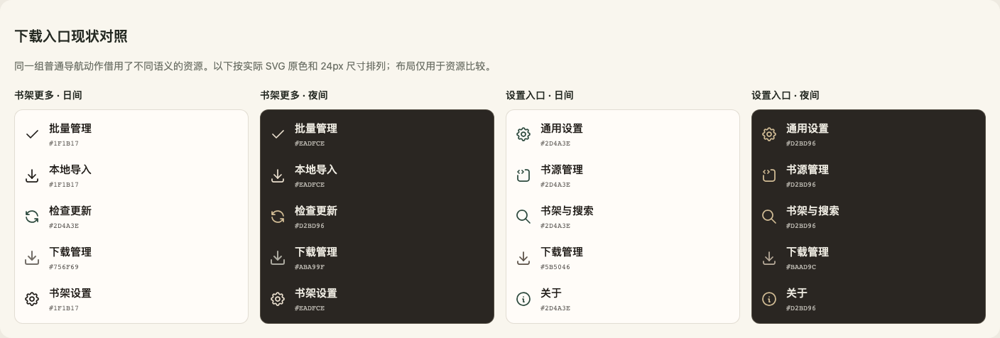

# 全应用交互与显示图标审计

2026-10-20。范围为当前 HarmonyOS 应用源码、公共载体、主题登记和媒体资源。用户反馈“下载入口图标颜色不一致”，并要求审计所有交互图标和显示图标。下文的数量、图册、问题表是**修复前盘点快照**，初次盘点没有修改生产输入或执行测试、构建、设备操作。用户随后授权修复；当前进展与证据另见[修复状态](repair-status.md)，不能把历史问题表直接当作修复后状态。

直接结论：**书架和设置里的下载入口都复用了不适合该导航场景的颜色资源。公共组件统一了部分尺寸和交互，却没有全面接管图标的颜色语义。** 同一个图形被用于状态、普通动作和设置入口时，SVG 原色被直接带过去，是这次色差的直接原因。其他不同色、不同大小不全是问题，需要按图标角色、表面和状态判定。

## 可直接查看的结果

- [修复状态与证据](repair-status.md)：逐项对应 ICON/RULE，区分源码、有限验证、开发构建与设备结果。
- [重复资源与重复绘制审计](duplicate-audit.md)：区分同字节、同几何换色、不同语义及多套箭头/筛选图形。
- [朗读上一项/下一项候选](tts-options/index.html)：用户已选 C，折角与单竖线分离留白；其他候选仅保留为比较资料。
- [高分辨率精度定位](precision-analysis.md)：原截图像素、颜色矩阵与原生 SVG 能力边界。
- [全量图标图册](gallery.html)：224 组基础媒体，日间/夜间并列；支持按资源名、组件名、文件路径搜索、按前缀筛选、只看有直接代码引用的资源。预览原资源字节，未重新绘制图形。
- [下载入口现状对照图](download-comparison.png)：书架 More 和设置两组，日间/夜间并列。它是源码资源对照，不是真机截图，布局仅为比较资源。
- [公共体系与资源/主题](foundation.md)：全部公共图标载体、着色机制、来源、变体及正常例外。
- [书架/下载/搜索/设置/书源及保留页面](pages.md)：逐组件/文件的全部图标族、状态和实际调用，包括通过公共组件间接呈现的页面。
- [阅读/漫画/换源及导航壳](reading.md)：34 个语义/状态家族、160 个静态落点及相关字面资源参数；旧模块与未挂载分支分开。
- 可检索数据：[资源 CSV](resources.csv)、[渲染落点 CSV](render-sites.csv)、[完整源码索引](source-index.json)、[完整资源索引](resource-index.json)。

## 全量清点口径

| 层级 | 本轮清点 | 数量的实际含义 |
|---|---:|---|
| 生产源码 | 497 个 ETS/TS 文件 | 覆盖 `entry/src/main/ets` 全部文件，不只检索当前几张页面。每文件记录 SHA256。 |
| 全部媒体 | 419 个 | 413 SVG + 6 PNG；PNG 包含标题、纸纹和启动图，不能将419都称作交互图标。 |
| SVG 分组 | 218 基础 + 195 夜版 | 所有 SVG 与413个来源 recipe 名称集合对齐；这里只核对登记/存在性，未执行来源哈希或几何门禁。 |
| 图册分组 | 224 组 | 218 基础 SVG + 6 PNG。每组展示已有夜版；无夜版不自动判错。 |
| 资源引用 | 570 处 / 333 个不同名字 | 官方 ETS AST 提取完整 `$r('app.media.…')` 字面引用；含夜版、旧组件和关闭分支，不等于570个可见图标。未找到指向不存在文件的字面媒体引用。 |
| 原生叶节点 | 239 Image、14 LoadingProgress、2 Progress | 含封面/正文/纹理和历史节点；Image不是图标数量。原生 Select/Checkbox/Toggle 的内部图形按组件协议检查，不伪造为本地SVG。 |
| 自定义图标/加载组件使用 | 18 处 | ReaderIconButton、ReaderLabeledIconAction、SearchSpinner、SourceSwitchSpinner；组件内部叶节点另记，不能重复计成18个独立资源。 |
| 字符候选 | 8 个直接 Text、120 个短符号字面候选 | 补查 Button('‹')、helper 返回字符等非 Image 路径。省略号、分隔点、破折号等不是图标问题；候选不等于缺陷。 |
| 绘制候选 | 10 个节点 | 含换源两段 Path，另有菜单指针、scrim Rect、正文/调试 Canvas。后者不误当自绘图标或加载图。 |

资源索引使用标准 XML 解析，记录显式 fill/stroke、线宽、linecap/join、opacity、viewBox、引用点和内容哈希；排除 clipPath/defs 蒙版。`paintDeclarations` 是属性声明，不冒充屏幕像素；`implicitFillCandidates` 单列隐式填充，开放直线的默认fill不能据此判出额外黑色图形。线宽按 viewBox 换算至24vp用于同组比较，48坐标下3.5与24坐标下1.75相同，不能按原数值误判。

当前11个有可见入口的路由、2个仅保留分支及7个l0关闭路由沿[交互连线基线](../../architecture/interaction-wiring-20261019/README.md)区分。关闭模块和死方法仍在清单中，未混入当前可见问题统计。网站自己的图标、书籍封面、漫画正文是内容，不按Reader的UI图标统一改色。

## 可以由源码确定的问题

下面按5组收敛，分册编号用于查证；这不是“5个图标”或“全应用只有5处问题”的设备结论。

| ID | 当前问题 / 证据 | 判定与具体修正边界 |
|---|---|---|
| ICON-01 | **书架下载入口借用状态灰。** [BookshelfMoreMenu:181](../../../entry/src/main/ets/features/bookshelf/BookshelfMoreMenu.ets:181) 传 `download_visual_download`；日/夜 `#756F69 / #ABA99F`。同组批量/导入/设置为 `#1F1B17 / #EADFCE`。[菜单渲染器:81](../../../entry/src/main/ets/features/common/ReaderActionMenuSurface.ets:81)只控制尺寸/透明度。 | 确定跨场景颜色语义误用；下载还为24坐标stroke2，同组为实际1.75。应给菜单普通动作自己的颜色/线重配方；**不能全局改下载列表的 muted 资源**。对应 PAGE-01/FND-01。 |
| ICON-02 | **设置下载入口借用阅读目录标记。** [SettingsPage:201](../../../entry/src/main/ets/features/settings/SettingsPage.ets:201) 传 `reader_directory_marker_download`；日/夜 `#5B5046 / #BAAD9C`，兄弟设置入口为 `#2D4A3E / #D2BD96`。[CategoryRow:28](../../../entry/src/main/ets/features/settings/CategoryRow.ets:28)不染色。 | 同一15vp leading/28vp圆底中混入其他语义资源；应按设置导航族处理，保留目录状态标记原色。对应 PAGE-02。 |
| ICON-03 | **书架检查更新也混用了强调色。** [BookshelfMoreMenu:180](../../../entry/src/main/ets/features/bookshelf/BookshelfMoreMenu.ets:180)借 `settings_gen_refresh` 的绿/夜间金色，和同组普通菜单不同。 | 这是新增下载前已存在的同组不一致；没有单独的此项强调规则，正常态不能用disabled解释。建议连同ICON-01按菜单普通动作规范收口，不能只修新增项。对应FND-02。 |
| ICON-04 | **TTS停止同控件夜间不同色。** [ReaderControlTtsContent:627](../../../entry/src/main/ets/features/reading/ReaderControlTtsContent.ets:627)固定图标 `#A8543A`；[:633](../../../entry/src/main/ets/features/reading/ReaderControlTtsContent.ets:633)文字和语义底色使用TOK_TTS_CLAY夜间`#DC9E53`。 | 日间一致，夜间图标脱离同一clay主题链；应复用既有clay夜间规则，不新增色板。对应RD-01。 |
| ICON-05 | **部分纯图动作没有同一语义声明协议。** [PageBackBar:46](../../../entry/src/main/ets/features/common/PageBackBar.ets:46)返回Stack缺显式名称/role/focus；[MangaReadingSurface:2174](../../../entry/src/main/ets/features/manga/MangaReadingSurface.ets:2174)、[:2190](../../../entry/src/main/ets/features/manga/MangaReadingSurface.ets:2190)为`‹/›`，未声明“上一页/下一页”。 | 源码可确认缺少明确动作名/公共按钮声明。应补语义及当前真实准入，不改变返回路径；尚不能声称设备辅助服务必然完全不可操作。source新增/漫画排序的role/focus差异也列于PAGE-08。对应RD-02/PAGE-08。 |

## 未统一、规则缺口及需要确认的风险

这些项目有明确源码事实，但没有把“与另一处不同”直接升级为不合格，或据此自动改造全部控件。

| ID | 当前事实 / 位置 | 缺什么、如何处理 |
|---|---|---|
| RULE-01 | 任意Resource接口没有icon角色。[ReaderIconButton](../../../entry/src/main/ets/features/common/ReaderIconButton.ets:10)、[ReaderLabeledIconAction](../../../entry/src/main/ets/features/common/ReaderLabeledIconAction.ets:104)、ReaderMenuActionView允许调用方任意借图。顶部menu保留原色；底部sheet才用colorFilter。 | 公共框架缺普通/次要/强调/onPrimary/危险/状态图的有限配方关联。这是ICON-01/02容易反复出现的机制原因。沿现有公共组件与来源配方补齐，不另造一套全局SVG渲染器。 |
| RULE-02 | 图标和文字主题链独立。旧SVG夜版为生成时的具体色，文字/底为运行时role；如`#EADFCE`和`#EAE7DE`、`#BAAD9C`和`#ABA99F`。 | 不能从“已登记主题”推出图文完全一致，也不能全局搜索替换近似色。先确定每个有限家族采用的role与表面。具体同控件错误见ICON-04；其余是结构风险。对应FND-05。 |
| RULE-03 | **纸面书签主题来源混合。** [LocalReadingExperience:13051](../../../entry/src/main/ets/features/reading/LocalReadingExperience.ets:13051)书签按app scheme；旁边文字/箭头按实际阅读纸色。 | 应按实际承载纸面决定图标上下文。app日间/阅读夜间及反向组合尚未原生确认；可对照已按阅读chrome选择图的ReaderChapterLoadingState。对应RD-R01。 |
| RULE-04 | **漫画图与按下反馈主题不一致。** [MangaReadingSurface:2168](../../../entry/src/main/ets/features/manga/MangaReadingSurface.ets:2168)按独立纸色选图，ReaderIconButton按全局app scheme做press背景。 | 静态图分支本身已按纸色处理，风险在按下表面；不要误判整张静态图错色。对应RD-R05。 |
| RULE-05 | 书架多选`Text('✓')`和橙色选态；下载使用主题green原生Checkbox。书架移除固定红图无独立夜版。 | 不存在完整跨家族选中标记/危险图规则；需定义保留橙色基线还是统一。当前字形/基线随字体与SVG无共同约束，不能悄悄把所有勾/橙色替换。对应PAGE-03。 |
| RULE-06 | 漫画独立目录排序用阅读`#2F6373 / #D2BD96`，定位用漫画`#425D45 / #B9CEB1`。 | 同工具区混了两套强调来源，统一目标待明确；不是功能接线错误。对应PAGE-04。 |
| RULE-07 | 源新增40vp、漫画独立目录排序32vp；另有公共44vp策略，且有限返回配方本身允许32vp。禁用弱化还存在.45/.48/.4/.38或无图标弱化等不同处理。 | 需要按有限控件族定义命中范围和enabled视觉；**不能把所有32都判错、所有图标都放大到44，或一律套一个透明度**。可见图大小与点击区分开；小触区实际可用性和native默认效果未验证。对应PAGE-07/FND-04。 |
| RULE-08 | 下载Checkbox仅指定selectedColor，mark/unselected走系统；原生Radio/Toggle与公共封装配置不同。 | 夜间浅底上的mark实际颜色/contrast不能由这一段源码确认。先明确组件协议，设备取证只回答剩余native绘制问题；本轮未取证。对应PAGE-05。 |
| RULE-09 | 恢复默认行危险文字、绿色刷新图及普通圆底；部分固定危险资源在保留RSS也未随夜间映射。 | 危险动作允许独立语义，但图/字/底各自采用什么tone缺调用约束。保留RSS不算当前l0用户问题；不能仅按“绿图”说动作错接。对应PAGE-06。 |
| RULE-10 | 换源仍有两处SourceSwitchSpinner自绘Path旋转，其他不定量等待已使用LoadingProgress。 | 与原生加载方向存在差异，但上一批批准范围明确保留播放器/正常控件/换源结构。需明确该例外后再替换，不能把此前保留解释为本次已完成原生化。对应RD-R02。 |
| RULE-11 | [ReaderDirectoryToolbar:38](../../../entry/src/main/ets/features/reading/ReaderDirectoryToolbar.ets:38)和[:43](../../../entry/src/main/ets/features/reading/ReaderDirectoryToolbar.ets:43)同一工具按钮叠绘helper与显式资源两个Image；注释包含设备fallback/旧probe兼容原因。 | 重复节点由源码确认，是否双层实际可见/边缘加重仍未证明。生产渲染不应以满足旧探针为长期依据；收敛到一个可靠资源分支，不改变业务动作，不据此跑全门禁。对应RD-R03。 |
| RULE-12 | TTS快捷定时画下拉箭头，点击却循环预设；完整态才是实际选择列表。 | 图标暗示与动作不一致的旧保留交互。需决定维持循环并改表达，或使用现有选择模式；本次不擅自加流程。对应RD-R04。 |
| RULE-13 | 历史foundation/F01文档仍描述6类RSS/5声明4spec；当前公共labeled为8variant，IconButton为6spec。 | 旧资料不是当前全量合格证明；本审计保留它的来源效力及历史边界。对应FND-07。 |

## 已确认应保持区分的情况

1. **普通操作与状态标记。** 下载列表未下载态的muted图、已下载check、当前阅读标签各代表不同事实。普通菜单入口不应直接继承状态灰，但列表的灰色资源应保留。
2. **普通图与onPrimary图。** 主按钮白色、深底导航选中图、底部面板统一前景均有其背景条件。无独立night不自动失败，23个基础SVG无night的完整例外在foundation分册。
3. **多色资源。** 显式多色基础SVG有6个：bookshelf_more、reader_tts_make_engine_check、reader_tts_speed_thumb、search_clear、search_empty、search_error。不可无差别套全局单色tint；命名颜色white也计入，不只数十六进制。
4. **资源图与内容。** 空态插画可以80vp、失效漫画图可32vp、操作图15–24vp、忙态18/32/36vp均可能是已有有限配方。书封、纸纹、正文图片、数值标签不按操作图标准重做。
5. **方向与动作。** 前进右箭头、真实展开下箭头/收起旋转、章节边界方向、阅读书签拖动过阈值后的反向各有含义，不能统一成全部下箭头。漫画目录折叠的−90°和详情简介180°已有对应状态。
6. **不同上游。** Tabler、Lucide、Radix已有固定来源和许可证。混用本身不是缺陷；同一菜单/控件族的线重、视觉尺度和颜色必须有有限一致配方。继续复用已登记上游及现有SVG生成机制，不重新手绘通用图标。

## 建议修正顺序与范围

建议第一批只处理ICON-01～05及其直接公共配方边界：菜单普通动作/设置导航分别使用本组已有色；TTS沿既有clay夜色；纯图动作补明确语义。资源新增/变体经现有来源登记与主题生成，不改下载列表状态图、不改阅读目录标记，不一刀切多色资源。

第二批按RULE表明确选中、危险、禁用、纸面主题、加载例外和箭头语义，再改对应家族。范围一旦明确，就以调用点和实际状态复核；不靠跑全部历史门禁推导是否美观，也不为审计结果自动更换整套UI。

## 记录与证据边界

- Harmony HEAD `5a01ec1cdbd5ec864046e1b9202963ead23a513a` 加现存dirty WIP；Core未改。本次新增本目录审计文档/索引/图册及忽略目录中的盘点脚本；没有修改生产输入。
- 497源码/419媒体逐文件哈希在索引中；权威颜色来源为 `Reader-UI/theme/registry.json`，Host `ReaderThemeRegistry.ts`为生成投影，不建议直接编辑生成副本。
- 图册由本地Chromium加载实际资源离线渲染，无网络资源；224组、搜索到单一下载资源、清除后恢复224组的图册自身检查已完成。它不执行Reader应用或原生业务测试。
- 没有运行业务测试/门禁、构建/签名、安装或设备操作；旧检查结果不转记本轮PASS。
- 全量指当前源码及资源盘点、当前可见家族的语义/状态对照，并纳入保留/关闭分支索引；不意味着所有设备像素、每个运行时组合及辅助服务都动态验收。待原生确认项已明确列出，不把未知写成合格。
