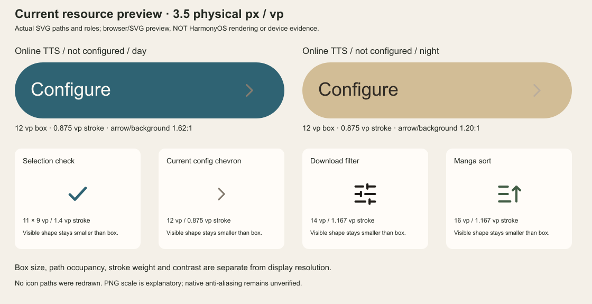

# 当前图标清晰度与可读性（2026-10-20）

本次只读核对当前 **429 个 SVG**、少量实际消费者的图标尺寸/前景/背景/禁用透明度，并复用[精度诊断](precision-analysis.md)。未改生产源码，未执行应用测试、门禁、构建或设备操作。另由现有 SVG 生成一张静态资源接触图，不能当成 HarmonyOS 原生结果。

结论：需要分别看渲染质量、图形实际占位、线宽和对比度。当前源码已移除操作面板的错误颜色矩阵；这不等于真机抗锯齿已经恢复。另发现一个明确的当前低对比入口，以及几处小尺寸/线重风险；不能把所有小图都判为不合格。

## 明确的当前低对比入口

`ReaderControlTtsContent.ets:1101–1115`，在线朗读服务尚未配置时，**“立即配置”胶囊右箭头**仍使用普通次要色资源 `reader_appearance_make_chevron`，而胶囊切换为强调色底，文字已用 onPrimary。

| 状态 | SVG 箭头 | 胶囊实际背景 | 箭头/背景亮度对比 |
| --- | --- | --- | ---: |
| 日间、未配置 | `#857C70` | `TOK_TTS_TEAL = #2F6373` | 约 **1.62 : 1** |
| 夜间、未配置 | `#BAAD9C` | `TOK_TTS_TEAL = #D2BD96` | 约 **1.20 : 1** |

两种背景均不透明，计算无需猜测父层颜色。比值按 sRGB 通道线性化后相对亮度计算，未模拟边缘覆盖率、屏幕亮度或设备色彩管理，不冒称实测。这里箭头形状正确，问题是普通次要前景被放到强调底，尤其夜间几乎融入底色。已配置状态使用淡底，不因此一并判错。

该箭头布局为 12 × 12 vp，但 SVG 的中心线路径为 `M4.5 3 L7.5 6 L4.5 9`、线宽 0.875。因此中心线只占 **3 × 6 vp**；计入圆端描边的包围范围约 **3.875 × 6.875 vp**，分别占 Image 框宽 32.3%、高 57.3%。只看 12 vp 框会高估实际可辨识形状。

此项本次仅记录，未在正在构建的工作树中追加修改。

## 当前可见的小尺寸与线宽风险

下列物理线宽以已有参考图几何对应的 `density = 3.5 px/vp` **举例**，不是重新读取的手机参数，也不是要求所有设备都使用 3.5。实际应为有效 vp 线宽乘该设备 density。

| 实际入口/资源 | Image 布局 | 有效线宽 | 3.5 下约 px | 可确认的风险/边界 |
| --- | --- | ---: | ---: | --- |
| 当前阅读外观配置 `ReaderControlAppearanceContent.selectField → ReaderSelect.appearanceLibraryTrigger`，普通右 chevron | 12 × 12 vp | 0.875 vp | 3.06 | 中心形状仅 3 × 6 vp；次要色+细线让它比同框的实心图更小。不是位图分辨率不足。 |
| 下载状态/来源等 `ReaderInlineSelect → ReaderSelect.defaultTrigger`，下 chevron | 12 × 8 vp | 约 0.875 vp | 3.06 | 48 方形 viewBox 中带空白，实际中心形状约 6 × 3 vp；触控区大不代表箭头形状大。 |
| 阅读搜索/替换/自动翻页模块的返回，例如 `ReaderControlSearchContent:421`、`ReaderControlReplaceContent:342`、`ReaderControlAutoPageContent:286` | 11 × 11 vp | 约 0.802 vp | 2.81 | 作为带语境的次级返回可以保留，但缩小后更依赖抗锯齿与足够对比；不能把所有返回图当成顶部 24 vp 看待。 |
| 朗读快捷定时循环 `ReaderControlTtsContent:685–687`，`reader_tts_timer_cycle` | 12 × 12 vp | 0.875 vp | 3.06 | 两段圆弧+两个转角挤在小框内，细节比单 chevron 复杂。是图形密度风险，没有原生证据时不宣称已经看不清。 |
| 下载筛选/状态，`DOWNLOAD_VISUAL.listToolIconSize/statusIconSize` | 14 × 14 vp | 2/24×14 = 1.167 vp | 4.08 | 下载现有 Lucide 线族比 1.75@24 家族粗约 14.3%；是尚存线重差异，不是像素解析度低。筛选形状仍按用户当前选择保持原 sliders。 |
| 书架多选勾，`reader_action_check` | 14 × 14 vp | 1.75/24×14 = 1.021 vp | 3.57 | 选中底/前景已经按公共角色配对，简单勾形且对比充足，不因为“14”就判错。 |
| 漫画目录排序，`manga_directory_sort_*` | 16 × 16 vp | 3.5/48×16 = 1.167 vp | 4.08 | 与下载 14 vp 的 2@24 线族恰好有效线宽相同。不同原始 stroke 数字不等于可见粗细不同。 |
| 朗读选择列表勾 `ReaderTtsConfigOverlay:245`，`reader_appearance_make_check` | 11 × 9 vp | 1.4 vp | 4.90 | 这是一份按 11×9 编写的专用路径，形状占位较满；虽框小，线不薄。`opacity=0` 是未选时有意隐藏。 |

## `ReaderSelect` 的 fit 与可达性

这些分支没有显式调用 `.objectFit(...)`，按本机 SDK/官方 Image API 的默认值为 **Cover**。分析只按该声明的几何计算，不声称已观察到 HarmonyOS 的最终 path 光栅。

- 当前 `appearanceLibrary` 使用 12×12 的专用 chevron，比例相同，无跨比例放大问题。
- 当前 default 使用 12×8 的 Image 框和 48×48 down SVG。按 Cover 的等比缩放，中心线约 6×3 vp，计入描边约 6.875×3.875 vp；正中裁剪范围仍容纳该中心图形。这里的实际小占位来自资源留白，不能误称已发生路径裁断。
- **保留分支** `appearanceCompact` 的 8×4 下箭头有效线宽约 0.583 vp（3.5 下约 2.04 px），中心线约 4×2 vp，含描边约 4.583×2.583 vp。本轮搜索只找到 `ReaderAppearanceFullPanel → ReaderAppearanceMotionStage` 的定义链，未见当前主入口构造它；当前外观内容走 `appearanceLibrary`。因此不把 8×4 混成当前可见缺陷。

ImageFit/解码参数的官方边界与本机 SDK 位置见[精度诊断第 3 节](precision-analysis.md#3-sdk-支持边界)。

## 禁用态与复杂细节

- `ReaderIconButton` 对禁用图标使用 0.45 透明度，业务准入同时关闭。它会降低可读性，但用于表达不可操作，并不是活动态被误调淡。要评价其合适程度应看具体底色；不把一项示例对比值套到所有按钮。
- 下载存储清理在不可清理时使用 `trash_disabled`、soft 底及 0.5 总透明度，原事件/无障碍禁用仍在独立 Button。它确实更淡，且这是被明确编写的禁用状态；本次不把它当成下载主入口色差。
- 会话圆点暂停/播放图形虽只有 8×8 vp，但采用专用实心路径；暂停条实际约 1.33 vp 宽，示例密度下约 4.66 px。其风险是整个视觉目标很小，不是 8 px 资源上采样。真实操作范围属于外层会话控件，不能用内图尺寸冒充点击热区。
- 已检查的 429 个 SVG 均未包含 `<image>` 位图引用；本轮没有找到图标被小 PNG 嵌入 SVG 的路径。SVG 的 viewBox、原始 width/height 不是像素精度上限，增加这两个数字不等于提高可读性。

## 静态资源对照

此图以 **3.5 图像像素/vp** 展示现有资源路径，胶囊布局用于比较而非还原原生完整页面；上下例保留实际 12、14、16 以及 11×9 vp 图形尺寸。没有绘制新图标或改色假装修复。PNG 由普通 SVG 栅格器产生，**不能证明 HarmonyOS 抗锯齿、物理命中或帧耗时**。

现有参考截图的“仅两色硬边”仍是历史原生证据；新代码中滤镜移除、原生加载替换与有限本地准入通过，只能分别记为源码/本地行为结果，不能写成所有图标清晰度已经通过。
