# Reader 模块逻辑与路线

本稿由当前模块规范和原生证据分类账生成。实线只表示已抓到起点、实际操作与落点的动作链；虚线表示当前源码候选路线仍需正常入口取证。确认调整方向独立列出，不混入当前应用路线。

实景证明某个画面出现，不自动证明全部回调、后台结果或跨平台实现完成。图中模块索引节点用于组织路线，不代表额外应用页面。

读取原生图 85 张；已准入状态 64 个；模块索引 37 个。manifestBinding OPEN；原生视觉对照与iOS/Android验收 OPEN。

## 路线图图例

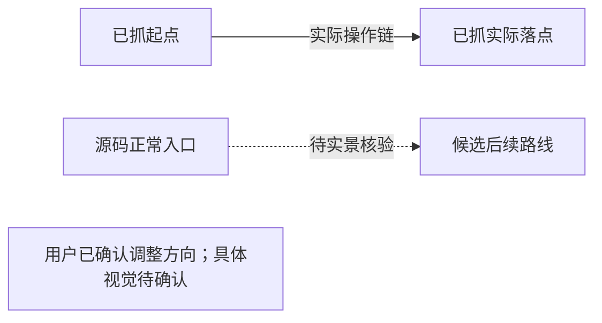

## 书架 · bookshelf

归属：existing-app（仅已观察画面）。规范：[library-spec.json](/Users/minliny/Documents/Reader/Reader-for-HarmonyOS/docs/ui-design/app-baseline/library-spec.json)。
源码候选：[entry/src/main/ets/features/bookshelf/BookshelfPage.ets](/Users/minliny/Documents/Reader/Reader-for-HarmonyOS/entry/src/main/ets/features/bookshelf/BookshelfPage.ets)。

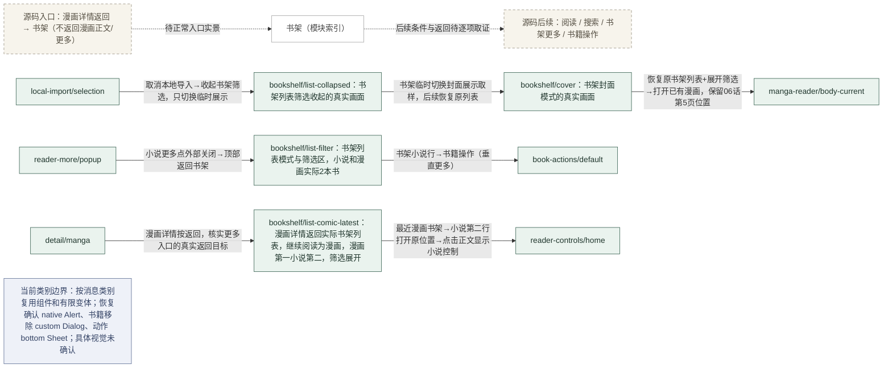

实际画面：[reader-control-redo-034-bookshelf](/Users/minliny/Documents/Reader/Reader-for-HarmonyOS/evidence/2026-10-06-native-ui-redo/captures/reader-control-redo-034-bookshelf.png)（书架列表模式与筛选区，小说和漫画实际2本书）；[reader-control-redo-060-bookshelf-collapsed](/Users/minliny/Documents/Reader/Reader-for-HarmonyOS/evidence/2026-10-06-native-ui-redo/captures/reader-control-redo-060-bookshelf-collapsed.png)（书架列表筛选收起的真实画面）；[reader-control-redo-061-bookshelf-cover](/Users/minliny/Documents/Reader/Reader-for-HarmonyOS/evidence/2026-10-06-native-ui-redo/captures/reader-control-redo-061-bookshelf-cover.png)（书架封面模式的真实画面）；[reader-control-redo-078-comic-detail-back](/Users/minliny/Documents/Reader/Reader-for-HarmonyOS/evidence/2026-10-06-native-ui-redo/captures/reader-control-redo-078-comic-detail-back.png)（漫画详情返回实际书架列表，继续阅读为漫画，漫画第一小说第二，筛选展开）。

仍未证明：封面模式；漫画详情返回漫画阅读器。

## 书架更多 · shelf-more

归属：existing-app（仅已观察画面）。规范：[library-spec.json](/Users/minliny/Documents/Reader/Reader-for-HarmonyOS/docs/ui-design/app-baseline/library-spec.json)。
源码候选：[entry/src/main/ets/features/bookshelf/BookshelfMoreMenu.ets](/Users/minliny/Documents/Reader/Reader-for-HarmonyOS/entry/src/main/ets/features/bookshelf/BookshelfMoreMenu.ets)。

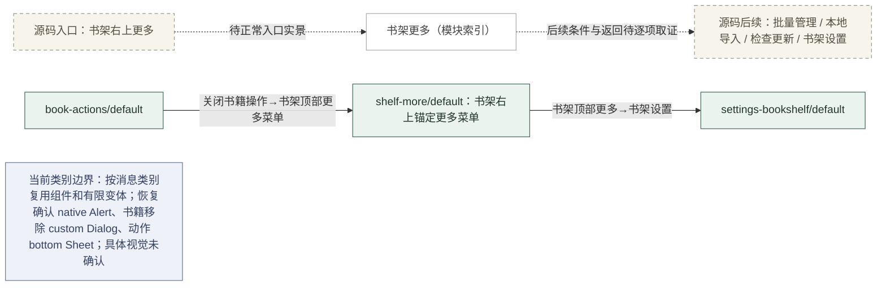

实际画面：[reader-control-redo-038-bookshelf-more](/Users/minliny/Documents/Reader/Reader-for-HarmonyOS/evidence/2026-10-06-native-ui-redo/captures/reader-control-redo-038-bookshelf-more.png)（书架右上锚定更多菜单）。

## 书籍操作 · book-actions

归属：existing-app（仅已观察画面）。规范：[library-spec.json](/Users/minliny/Documents/Reader/Reader-for-HarmonyOS/docs/ui-design/app-baseline/library-spec.json)。
源码候选：[entry/src/main/ets/features/common/ReaderSheetActionList.ets](/Users/minliny/Documents/Reader/Reader-for-HarmonyOS/entry/src/main/ets/features/common/ReaderSheetActionList.ets)。

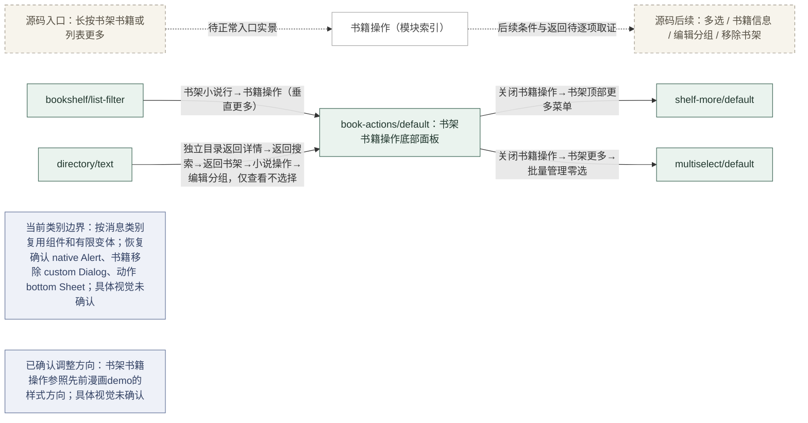

实际画面：[reader-control-redo-035-book-actions](/Users/minliny/Documents/Reader/Reader-for-HarmonyOS/evidence/2026-10-06-native-ui-redo/captures/reader-control-redo-035-book-actions.png)（书架书籍操作底部面板）；[reader-control-redo-036-book-detail](/Users/minliny/Documents/Reader/Reader-for-HarmonyOS/evidence/2026-10-06-native-ui-redo/captures/reader-control-redo-036-book-detail.png)（点击书籍信息后仍是原书籍操作面板，未进入详情）；[reader-control-redo-037-book-detail-open](/Users/minliny/Documents/Reader/Reader-for-HarmonyOS/evidence/2026-10-06-native-ui-redo/captures/reader-control-redo-037-book-detail-open.png)（再次点击书籍信息后仍是原操作面板）；[reader-control-redo-055-book-group](/Users/minliny/Documents/Reader/Reader-for-HarmonyOS/evidence/2026-10-06-native-ui-redo/captures/reader-control-redo-055-book-group.png)（编辑分组后仍是书籍操作面板，没有进入分组页）。

仍未证明：书籍信息落点；detail；group-select。

## 书架多选 · multiselect

归属：existing-app（仅已观察画面）。规范：[library-spec.json](/Users/minliny/Documents/Reader/Reader-for-HarmonyOS/docs/ui-design/app-baseline/library-spec.json)。
源码候选：[entry/src/main/ets/features/bookshelf/BookshelfMultiSelectPage.ets](/Users/minliny/Documents/Reader/Reader-for-HarmonyOS/entry/src/main/ets/features/bookshelf/BookshelfMultiSelectPage.ets)。

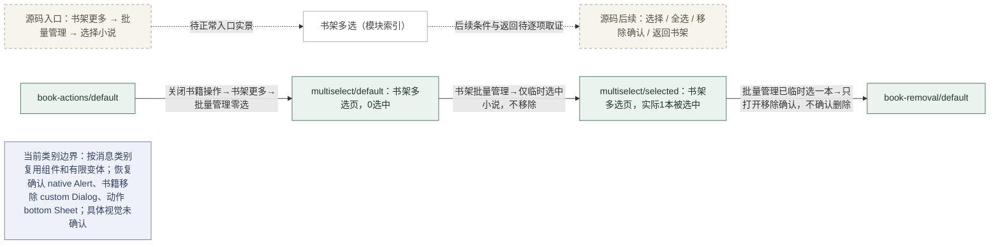

实际画面：[reader-control-redo-056-library-multiselect](/Users/minliny/Documents/Reader/Reader-for-HarmonyOS/evidence/2026-10-06-native-ui-redo/captures/reader-control-redo-056-library-multiselect.png)（书架多选页，0选中）；[reader-control-redo-057-library-selected](/Users/minliny/Documents/Reader/Reader-for-HarmonyOS/evidence/2026-10-06-native-ui-redo/captures/reader-control-redo-057-library-selected.png)（书架多选页，实际1本被选中）。

## 移除书架确认 · book-removal

归属：existing-app（仅已观察画面）。规范：[library-spec.json](/Users/minliny/Documents/Reader/Reader-for-HarmonyOS/docs/ui-design/app-baseline/library-spec.json)。
源码候选：[entry/src/main/ets/features/bookshelf/BookshelfManagementPage.ets](/Users/minliny/Documents/Reader/Reader-for-HarmonyOS/entry/src/main/ets/features/bookshelf/BookshelfManagementPage.ets)。

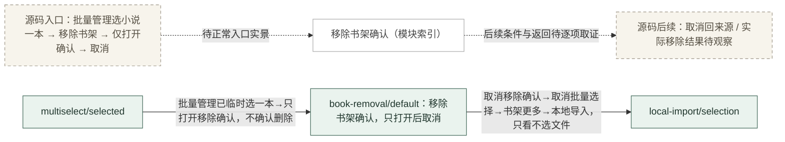

实际画面：[reader-control-redo-058-book-removal-confirm](/Users/minliny/Documents/Reader/Reader-for-HarmonyOS/evidence/2026-10-06-native-ui-redo/captures/reader-control-redo-058-book-removal-confirm.png)（移除书架确认，只打开后取消）。

仍未证明：实际移除结果。

## 书架分组 · group-select

归属：待取证（classificationStatus:pending，candidateCategory:existing-app）。规范：[library-spec.json](/Users/minliny/Documents/Reader/Reader-for-HarmonyOS/docs/ui-design/app-baseline/library-spec.json)。
源码候选：[entry/src/main/ets/features/bookshelf/BookshelfManagementPage.ets](/Users/minliny/Documents/Reader/Reader-for-HarmonyOS/entry/src/main/ets/features/bookshelf/BookshelfManagementPage.ets)。

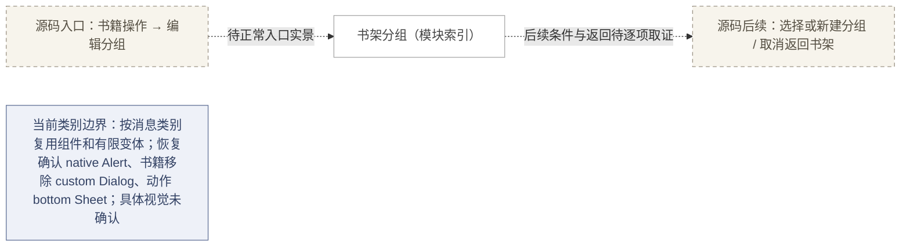

缺口：本模块尚无当前应用正常入口实景，不绘制可见状态页。

## 本地导入 · local-import

归属：existing-app（仅已观察画面）。规范：[library-spec.json](/Users/minliny/Documents/Reader/Reader-for-HarmonyOS/docs/ui-design/app-baseline/library-spec.json)。
源码候选：[entry/src/main/ets/features/bookshelf/LocalImportDialog.ets](/Users/minliny/Documents/Reader/Reader-for-HarmonyOS/entry/src/main/ets/features/bookshelf/LocalImportDialog.ets)。

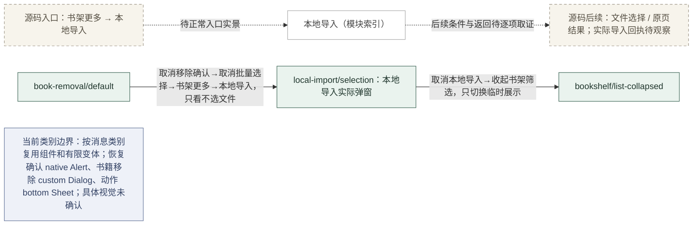

实际画面：[reader-control-redo-059-local-import](/Users/minliny/Documents/Reader/Reader-for-HarmonyOS/evidence/2026-10-06-native-ui-redo/captures/reader-control-redo-059-local-import.png)（本地导入实际弹窗）。

仍未证明：文件选择器；导入结果。

## 书籍搜索 · search

归属：existing-app（仅已观察画面）。规范：[library-spec.json](/Users/minliny/Documents/Reader/Reader-for-HarmonyOS/docs/ui-design/app-baseline/library-spec.json)。
源码候选：[entry/src/main/ets/features/search/SearchPage.ets](/Users/minliny/Documents/Reader/Reader-for-HarmonyOS/entry/src/main/ets/features/search/SearchPage.ets)。

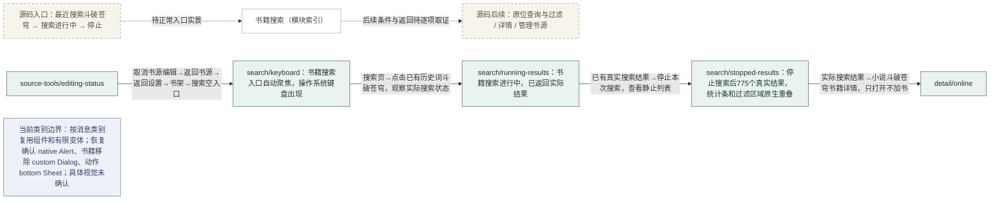

实际画面：[reader-control-redo-050-library-search](/Users/minliny/Documents/Reader/Reader-for-HarmonyOS/evidence/2026-10-06-native-ui-redo/captures/reader-control-redo-050-library-search.png)（书籍搜索入口自动聚焦，操作系统键盘出现）；[reader-control-redo-051-library-search-results](/Users/minliny/Documents/Reader/Reader-for-HarmonyOS/evidence/2026-10-06-native-ui-redo/captures/reader-control-redo-051-library-search-results.png)（书籍搜索进行中，已返回实际结果）；[reader-control-redo-052-library-search-stopped](/Users/minliny/Documents/Reader/Reader-for-HarmonyOS/evidence/2026-10-06-native-ui-redo/captures/reader-control-redo-052-library-search-stopped.png)（停止搜索后775个真实结果，统计条和过滤区域原生重叠）。

仍未证明：搜索完成；布局重叠根因。

## 书籍详情 · detail

归属：existing-app（仅已观察画面）。规范：[library-spec.json](/Users/minliny/Documents/Reader/Reader-for-HarmonyOS/docs/ui-design/app-baseline/library-spec.json)。
源码候选：[entry/src/main/ets/features/bookshelf/LocalBookDetail.ets](/Users/minliny/Documents/Reader/Reader-for-HarmonyOS/entry/src/main/ets/features/bookshelf/LocalBookDetail.ets)。

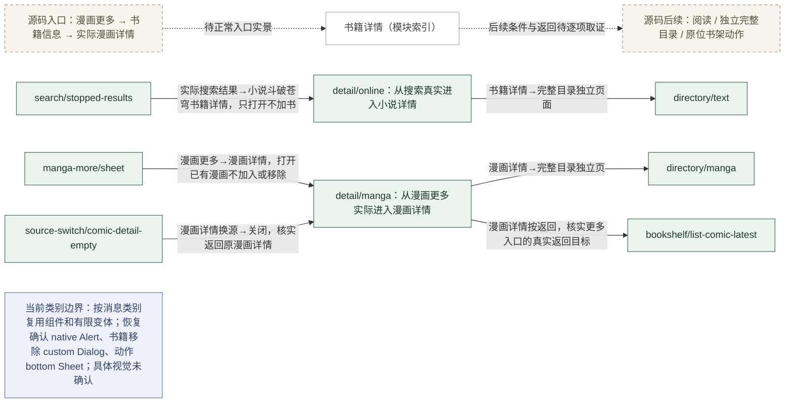

实际画面：[reader-control-redo-053-book-detail-search](/Users/minliny/Documents/Reader/Reader-for-HarmonyOS/evidence/2026-10-06-native-ui-redo/captures/reader-control-redo-053-book-detail-search.png)（从搜索真实进入小说详情）；[reader-control-redo-072-comic-detail](/Users/minliny/Documents/Reader/Reader-for-HarmonyOS/evidence/2026-10-06-native-ui-redo/captures/reader-control-redo-072-comic-detail.png)（从漫画更多实际进入漫画详情）；[reader-control-redo-077-comic-source-close](/Users/minliny/Documents/Reader/Reader-for-HarmonyOS/evidence/2026-10-06-native-ui-redo/captures/reader-control-redo-077-comic-source-close.png)（关闭漫画详情换源全页后回到漫画详情）。

仍未证明：其他详情类型；书架书籍信息按钮无响应根因。

## 详情独立目录 · directory

归属：existing-app（仅已观察画面）。规范：[library-spec.json](/Users/minliny/Documents/Reader/Reader-for-HarmonyOS/docs/ui-design/app-baseline/library-spec.json)。
源码候选：[entry/src/main/ets/features/bookshelf/BookDirectoryPage.ets](/Users/minliny/Documents/Reader/Reader-for-HarmonyOS/entry/src/main/ets/features/bookshelf/BookDirectoryPage.ets)。

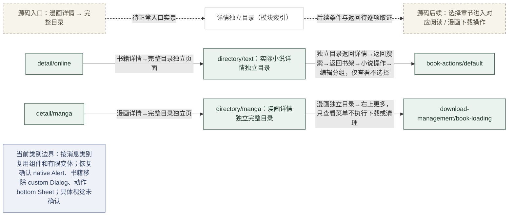

实际画面：[reader-control-redo-054-detail-directory](/Users/minliny/Documents/Reader/Reader-for-HarmonyOS/evidence/2026-10-06-native-ui-redo/captures/reader-control-redo-054-detail-directory.png)（实际小说详情独立目录）；[reader-control-redo-073-comic-detail-directory](/Users/minliny/Documents/Reader/Reader-for-HarmonyOS/evidence/2026-10-06-native-ui-redo/captures/reader-control-redo-073-comic-detail-directory.png)（漫画详情独立完整目录）。

仍未证明：漫画独立目录；选择章节后结果；选择漫画章节后的阅读结果。

## 漫画目录下载操作 · download-management

归属：existing-app（仅已观察画面）。规范：[library-spec.json](/Users/minliny/Documents/Reader/Reader-for-HarmonyOS/docs/ui-design/app-baseline/library-spec.json)。
源码候选：[entry/src/main/ets/features/bookshelf/BookDirectoryPage.ets](/Users/minliny/Documents/Reader/Reader-for-HarmonyOS/entry/src/main/ets/features/bookshelf/BookDirectoryPage.ets)。

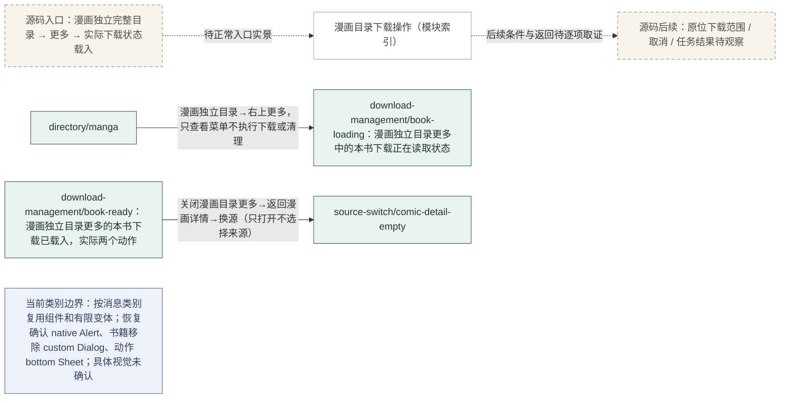

实际画面：[reader-control-redo-074-comic-directory-more](/Users/minliny/Documents/Reader/Reader-for-HarmonyOS/evidence/2026-10-06-native-ui-redo/captures/reader-control-redo-074-comic-directory-more.png)（漫画独立目录更多中的本书下载正在读取状态）；[reader-control-redo-075-comic-directory-more-loaded](/Users/minliny/Documents/Reader/Reader-for-HarmonyOS/evidence/2026-10-06-native-ui-redo/captures/reader-control-redo-075-comic-directory-more-loaded.png)（漫画独立目录更多的本书下载已载入，实际两个动作）。

仍未证明：PNG中两个已载入动作；下载任务执行结果。

## 小说正文 · reader

归属：existing-app（仅已观察画面）。规范：[reading-spec.json](/Users/minliny/Documents/Reader/Reader-for-HarmonyOS/docs/ui-design/app-baseline/reading-spec.json)。
源码候选：[entry/src/main/ets/features/reading/ReadingSurface.ets](/Users/minliny/Documents/Reader/Reader-for-HarmonyOS/entry/src/main/ets/features/reading/ReadingSurface.ets)。

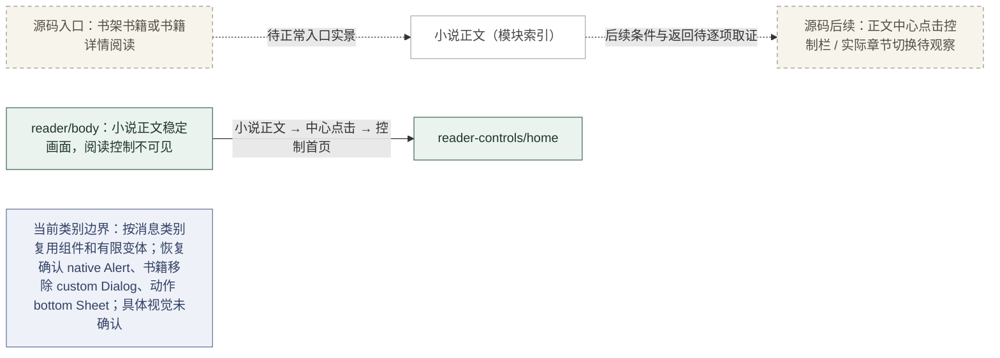

实际画面：[reader-control-redo-003-novel-controls-stable](/Users/minliny/Documents/Reader/Reader-for-HarmonyOS/evidence/2026-10-06-native-ui-redo/captures/reader-control-redo-003-novel-controls-stable.png)（小说正文稳定画面，阅读控制不可见）。

仍未证明：reader-controls/home。

## 阅读控制 · reader-controls

归属：existing-app（仅已观察画面）。规范：[reading-spec.json](/Users/minliny/Documents/Reader/Reader-for-HarmonyOS/docs/ui-design/app-baseline/reading-spec.json)。
源码候选：[entry/src/main/ets/features/reading/ReaderControlPanel.ets](/Users/minliny/Documents/Reader/Reader-for-HarmonyOS/entry/src/main/ets/features/reading/ReaderControlPanel.ets)。

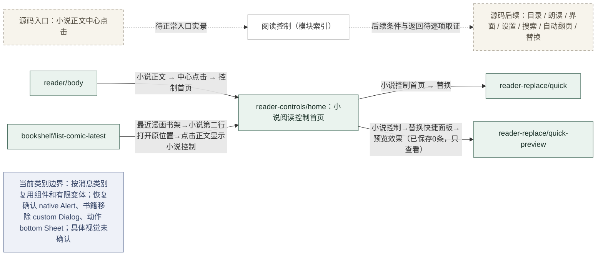

实际画面：[reader-control-redo-004-novel-home](/Users/minliny/Documents/Reader/Reader-for-HarmonyOS/evidence/2026-10-06-native-ui-redo/captures/reader-control-redo-004-novel-home.png)（小说阅读控制首页）；[reader-control-redo-079-novel-controls-return](/Users/minliny/Documents/Reader/Reader-for-HarmonyOS/evidence/2026-10-06-native-ui-redo/captures/reader-control-redo-079-novel-controls-return.png)（回到已观察的小说阅读控制首页）。

## 替换 · reader-replace

归属：existing-app（仅已观察画面）。规范：[reading-spec.json](/Users/minliny/Documents/Reader/Reader-for-HarmonyOS/docs/ui-design/app-baseline/reading-spec.json)。
源码候选：[entry/src/main/ets/features/reading/ReaderControlReplaceContent.ets](/Users/minliny/Documents/Reader/Reader-for-HarmonyOS/entry/src/main/ets/features/reading/ReaderControlReplaceContent.ets)。

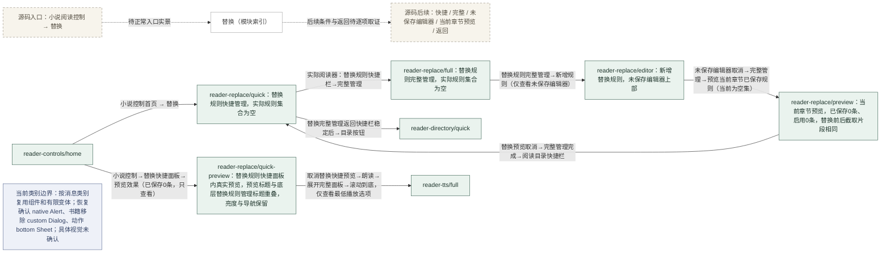

实际画面：[reader-control-redo-005-replace-quick](/Users/minliny/Documents/Reader/Reader-for-HarmonyOS/evidence/2026-10-06-native-ui-redo/captures/reader-control-redo-005-replace-quick.png)（替换规则快捷管理，实际规则集合为空）；[reader-control-redo-006-replace-full](/Users/minliny/Documents/Reader/Reader-for-HarmonyOS/evidence/2026-10-06-native-ui-redo/captures/reader-control-redo-006-replace-full.png)（替换规则完整管理，实际规则集合为空）；[reader-control-redo-007-replace-editor](/Users/minliny/Documents/Reader/Reader-for-HarmonyOS/evidence/2026-10-06-native-ui-redo/captures/reader-control-redo-007-replace-editor.png)（新增替换规则，未保存编辑器上部）；[reader-control-redo-008-replace-editor-options](/Users/minliny/Documents/Reader/Reader-for-HarmonyOS/evidence/2026-10-06-native-ui-redo/captures/reader-control-redo-008-replace-editor-options.png)（同一新增规则编辑器滚动后的下部选项）；[reader-control-redo-009-replace-preview](/Users/minliny/Documents/Reader/Reader-for-HarmonyOS/evidence/2026-10-06-native-ui-redo/captures/reader-control-redo-009-replace-preview.png)（当前章节预览，已保存0条、启用0条，替换前后截取片段相同）；[reader-control-redo-010-novel-directory-quick](/Users/minliny/Documents/Reader/Reader-for-HarmonyOS/evidence/2026-10-06-native-ui-redo/captures/reader-control-redo-010-novel-directory-quick.png)（仍为替换规则快捷管理，目录尚未打开）；[reader-control-redo-080-replace-quick-preview](/Users/minliny/Documents/Reader/Reader-for-HarmonyOS/evidence/2026-10-06-native-ui-redo/captures/reader-control-redo-080-replace-quick-preview.png)（替换规则快捷面板内真实预览，预览标题与底层替换规则管理标题重叠，亮度与导航保留）。

仍未证明：reader-directory/quick；标题重叠的源码或产物根因；用户确认的修复设计；预览后的实际替换执行结果。

## 目录 · reader-directory

归属：existing-app（仅已观察画面）。规范：[reading-spec.json](/Users/minliny/Documents/Reader/Reader-for-HarmonyOS/docs/ui-design/app-baseline/reading-spec.json)。
源码候选：[entry/src/main/ets/features/reading/ReaderControlDirectoryContent.ets](/Users/minliny/Documents/Reader/Reader-for-HarmonyOS/entry/src/main/ets/features/reading/ReaderControlDirectoryContent.ets)。

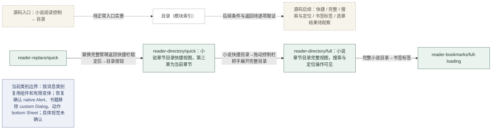

实际画面：[reader-control-redo-011-novel-directory-quick](/Users/minliny/Documents/Reader/Reader-for-HarmonyOS/evidence/2026-10-06-native-ui-redo/captures/reader-control-redo-011-novel-directory-quick.png)（小说章节目录快捷视图，第三章为当前章节）；[reader-control-redo-012-novel-directory-full](/Users/minliny/Documents/Reader/Reader-for-HarmonyOS/evidence/2026-10-06-native-ui-redo/captures/reader-control-redo-012-novel-directory-full.png)（小说章节目录完整视图，搜索与定位操作可见）。

## 书签 · reader-bookmarks

归属：existing-app（仅已观察画面）。规范：[reading-spec.json](/Users/minliny/Documents/Reader/Reader-for-HarmonyOS/docs/ui-design/app-baseline/reading-spec.json)。
源码候选：[entry/src/main/ets/features/reading/ReaderBookmarkList.ets](/Users/minliny/Documents/Reader/Reader-for-HarmonyOS/entry/src/main/ets/features/reading/ReaderBookmarkList.ets)。

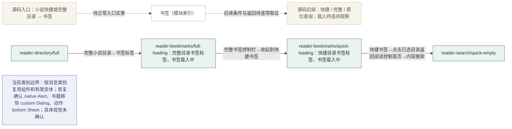

实际画面：[reader-control-redo-013-novel-directory-bookmarks](/Users/minliny/Documents/Reader/Reader-for-HarmonyOS/evidence/2026-10-06-native-ui-redo/captures/reader-control-redo-013-novel-directory-bookmarks.png)（完整目录书签标签，书签载入中）；[reader-control-redo-014-novel-bookmarks-settled](/Users/minliny/Documents/Reader/Reader-for-HarmonyOS/evidence/2026-10-06-native-ui-redo/captures/reader-control-redo-014-novel-bookmarks-settled.png)（后续完整书签画面仍为书签载入中）；[reader-control-redo-015-novel-bookmarks-quick](/Users/minliny/Documents/Reader/Reader-for-HarmonyOS/evidence/2026-10-06-native-ui-redo/captures/reader-control-redo-015-novel-bookmarks-quick.png)（快捷目录书签标签，书签载入中）。

仍未证明：书签空列表；书签载入完成；书签载入错误；原生缺陷。

## 正文搜索 · reader-search

归属：existing-app（仅已观察画面）。规范：[reading-spec.json](/Users/minliny/Documents/Reader/Reader-for-HarmonyOS/docs/ui-design/app-baseline/reading-spec.json)。
源码候选：[entry/src/main/ets/features/reading/ReaderControlSearchContent.ets](/Users/minliny/Documents/Reader/Reader-for-HarmonyOS/entry/src/main/ets/features/reading/ReaderControlSearchContent.ets)。

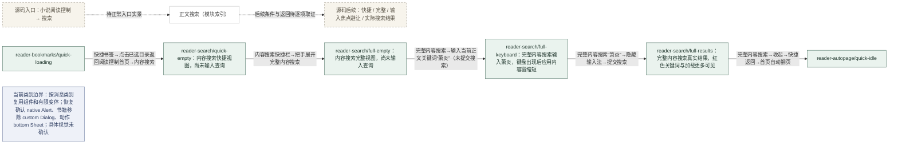

实际画面：[reader-control-redo-016-content-search-quick](/Users/minliny/Documents/Reader/Reader-for-HarmonyOS/evidence/2026-10-06-native-ui-redo/captures/reader-control-redo-016-content-search-quick.png)（内容搜索快捷视图，尚未输入查询）；[reader-control-redo-017-content-search-full](/Users/minliny/Documents/Reader/Reader-for-HarmonyOS/evidence/2026-10-06-native-ui-redo/captures/reader-control-redo-017-content-search-full.png)（内容搜索完整视图，尚未输入查询）；[reader-control-redo-018-content-search-keyboard](/Users/minliny/Documents/Reader/Reader-for-HarmonyOS/evidence/2026-10-06-native-ui-redo/captures/reader-control-redo-018-content-search-keyboard.png)（完整内容搜索输入萧炎，键盘出现后应用内容窗缩短）；[reader-control-redo-019-content-search-results](/Users/minliny/Documents/Reader/Reader-for-HarmonyOS/evidence/2026-10-06-native-ui-redo/captures/reader-control-redo-019-content-search-results.png)（完整内容搜索真实结果，红色关键词与加载更多可见）。

仍未证明：加载更多后的结果；点选结果后的跳转。

## 自动翻页 · reader-autopage

归属：existing-app（仅已观察画面）。规范：[reading-spec.json](/Users/minliny/Documents/Reader/Reader-for-HarmonyOS/docs/ui-design/app-baseline/reading-spec.json)。
源码候选：[entry/src/main/ets/features/reading/ReaderControlAutoPageContent.ets](/Users/minliny/Documents/Reader/Reader-for-HarmonyOS/entry/src/main/ets/features/reading/ReaderControlAutoPageContent.ets)。

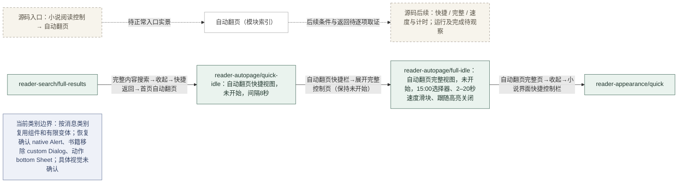

实际画面：[reader-control-redo-020-autopage-quick](/Users/minliny/Documents/Reader/Reader-for-HarmonyOS/evidence/2026-10-06-native-ui-redo/captures/reader-control-redo-020-autopage-quick.png)（自动翻页快捷视图，未开始，间隔8秒）；[reader-control-redo-021-autopage-full](/Users/minliny/Documents/Reader/Reader-for-HarmonyOS/evidence/2026-10-06-native-ui-redo/captures/reader-control-redo-021-autopage-full.png)（自动翻页完整视图，未开始，15:00选择器、2–20秒速度滑块、跟随高亮关闭）。

仍未证明：运行中状态；实际自动翻页结果；计时完成结果。

## 阅读界面 · reader-appearance

归属：existing-app（仅已观察画面）。规范：[reading-preferences-spec.json](/Users/minliny/Documents/Reader/Reader-for-HarmonyOS/docs/ui-design/app-baseline/reading-preferences-spec.json)。
源码候选：[entry/src/main/ets/features/reading/ReaderControlAppearanceContent.ets](/Users/minliny/Documents/Reader/Reader-for-HarmonyOS/entry/src/main/ets/features/reading/ReaderControlAppearanceContent.ets)。

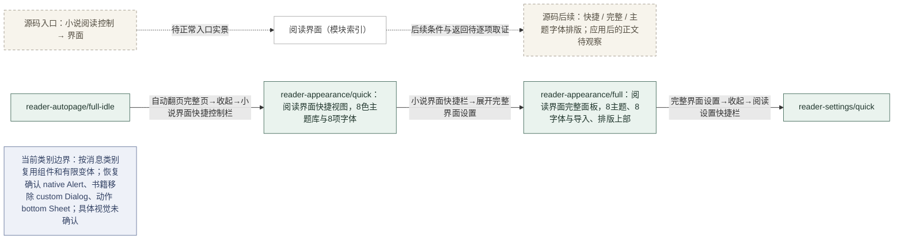

实际画面：[reader-control-redo-022-appearance-quick](/Users/minliny/Documents/Reader/Reader-for-HarmonyOS/evidence/2026-10-06-native-ui-redo/captures/reader-control-redo-022-appearance-quick.png)（阅读界面快捷视图，8色主题库与8项字体）；[reader-control-redo-023-appearance-full](/Users/minliny/Documents/Reader/Reader-for-HarmonyOS/evidence/2026-10-06-native-ui-redo/captures/reader-control-redo-023-appearance-full.png)（阅读界面完整面板，8主题、8字体与导入、排版上部）；[reader-control-redo-024-appearance-layout](/Users/minliny/Documents/Reader/Reader-for-HarmonyOS/evidence/2026-10-06-native-ui-redo/captures/reader-control-redo-024-appearance-layout.png)（同一完整界面面板滚动至排版全部内容）。

仍未证明：选择主题或字体后的正文效果；主题或字体改变后正文；字体重排；缩进/简繁弹层；排版修改后正文。

## 小说阅读设置 · reader-settings

归属：existing-app（仅已观察画面）。规范：[reading-preferences-spec.json](/Users/minliny/Documents/Reader/Reader-for-HarmonyOS/docs/ui-design/app-baseline/reading-preferences-spec.json)。
源码候选：[entry/src/main/ets/features/reading/ReaderControlSettingsContent.ets](/Users/minliny/Documents/Reader/Reader-for-HarmonyOS/entry/src/main/ets/features/reading/ReaderControlSettingsContent.ets)。

```mermaid
flowchart LR
  N1["小说阅读设置（模块索引）"]:::module
  N2["源码入口：小说阅读控制 → 设置"]:::pending
  N3["源码后续：快捷 / 完整 / 原位设置；操作效果待观察"]:::pending
  N2 -.->|待正常入口实景| N1
  N1 -.->|后续条件与返回待逐项取证| N3
  N4["reader-settings/quick：阅读设置快捷面板，方向跟随系统、滑动翻页、超时跟随系统"]:::observed
  N5["reader-settings/full：阅读设置完整面板，屏幕样式、导航状态栏、排版与控制上部"]:::observed
  N6["reader-appearance/full"]:::observed
  N6 -->|完整界面设置→收起→阅读设置快捷栏| N4
  N4 -->|阅读设置快捷栏→展开完整阅读设置| N5
  N7["reader-tts/quick"]:::observed
  N5 -->|阅读设置完整页→收起→朗读快捷栏（未启动朗读）| N7
  N8["当前类别边界：按消息类别复用组件和有限变体；恢复确认 native Alert、书籍移除 custom Dialog、动作 bottom Sheet；具体视觉未确认"]:::confirmed
  classDef observed fill:#eaf3ee,stroke:#42695a,color:#20362d
  classDef pending fill:#f7f4ec,stroke:#9d9587,color:#554f43,stroke-dasharray:5 4
  classDef confirmed fill:#eef1f8,stroke:#65759a,color:#334264
  classDef module fill:#fff,stroke:#aaa,color:#444
```

实际画面：[reader-control-redo-025-reader-settings-quick](/Users/minliny/Documents/Reader/Reader-for-HarmonyOS/evidence/2026-10-06-native-ui-redo/captures/reader-control-redo-025-reader-settings-quick.png)（阅读设置快捷面板，方向跟随系统、滑动翻页、超时跟随系统）；[reader-control-redo-026-reader-settings-full](/Users/minliny/Documents/Reader/Reader-for-HarmonyOS/evidence/2026-10-06-native-ui-redo/captures/reader-control-redo-026-reader-settings-full.png)（阅读设置完整面板，屏幕样式、导航状态栏、排版与控制上部）；[reader-control-redo-027-reader-settings-controls](/Users/minliny/Documents/Reader/Reader-for-HarmonyOS/evidence/2026-10-06-native-ui-redo/captures/reader-control-redo-027-reader-settings-controls.png)（同一完整阅读设置面板滚动至控制全部选项）。

仍未证明：配置修改后的实际行为。

## 朗读 · reader-tts

归属：existing-app（仅已观察画面）。规范：[reading-spec.json](/Users/minliny/Documents/Reader/Reader-for-HarmonyOS/docs/ui-design/app-baseline/reading-spec.json)。
源码候选：[entry/src/main/ets/features/reading/ReaderControlTtsContent.ets](/Users/minliny/Documents/Reader/Reader-for-HarmonyOS/entry/src/main/ets/features/reading/ReaderControlTtsContent.ets)。

```mermaid
flowchart LR
  N1["朗读（模块索引）"]:::module
  N2["源码入口：小说阅读控制 → 朗读"]:::pending
  N3["源码后续：快捷 / 完整 / 配置；播放及终态待观察"]:::pending
  N2 -.->|待正常入口实景| N1
  N1 -.->|后续条件与返回待逐项取证| N3
  N4["reader-tts/quick：朗读快捷面板，当前未播放"]:::observed
  N5["reader-tts/full：朗读完整面板上部，当前未播放"]:::observed
  N6["reader-tts/voice-picker：朗读音色选择弹层，仅实际当前1个音色，未选择"]:::observed
  N7["reader-settings/full"]:::observed
  N7 -->|阅读设置完整页→收起→朗读快捷栏（未启动朗读）| N4
  N4 -->|朗读快捷栏→展开完整朗读设置（未启动）| N5
  N5 -->|完整朗读播放配置→查看音色选择窗口（不选择新音色）| N6
  N8["reader-more/popup"]:::observed
  N6 -->|朗读音色窗口点击外部关闭→完整页收起→已选朗读返回首页→小说更多| N8
  N9["reader-replace/quick-preview"]:::observed
  N9 -->|取消替换快捷预览→朗读→展开完整面板→滚动到底，仅查看最低播放选项| N5
  N10["当前类别边界：按消息类别复用组件和有限变体；恢复确认 native Alert、书籍移除 custom Dialog、动作 bottom Sheet；具体视觉未确认"]:::confirmed
  classDef observed fill:#eaf3ee,stroke:#42695a,color:#20362d
  classDef pending fill:#f7f4ec,stroke:#9d9587,color:#554f43,stroke-dasharray:5 4
  classDef confirmed fill:#eef1f8,stroke:#65759a,color:#334264
  classDef module fill:#fff,stroke:#aaa,color:#444
```

实际画面：[reader-control-redo-028-tts-quick](/Users/minliny/Documents/Reader/Reader-for-HarmonyOS/evidence/2026-10-06-native-ui-redo/captures/reader-control-redo-028-tts-quick.png)（朗读快捷面板，当前未播放）；[reader-control-redo-029-tts-full](/Users/minliny/Documents/Reader/Reader-for-HarmonyOS/evidence/2026-10-06-native-ui-redo/captures/reader-control-redo-029-tts-full.png)（朗读完整面板上部，当前未播放）；[reader-control-redo-030-tts-engine](/Users/minliny/Documents/Reader/Reader-for-HarmonyOS/evidence/2026-10-06-native-ui-redo/captures/reader-control-redo-030-tts-engine.png)（朗读完整面板引擎配置区域）；[reader-control-redo-031-tts-playback-options](/Users/minliny/Documents/Reader/Reader-for-HarmonyOS/evidence/2026-10-06-native-ui-redo/captures/reader-control-redo-031-tts-playback-options.png)（朗读完整面板播放选项区域，末尾始终亮屏项尚不可见）；[reader-control-redo-032-tts-voice-picker](/Users/minliny/Documents/Reader/Reader-for-HarmonyOS/evidence/2026-10-06-native-ui-redo/captures/reader-control-redo-032-tts-voice-picker.png)（朗读音色选择弹层，仅实际当前1个音色，未选择）；[reader-control-redo-081-tts-bottom](/Users/minliny/Documents/Reader/Reader-for-HarmonyOS/evidence/2026-10-06-native-ui-redo/captures/reader-control-redo-081-tts-bottom.png)（同一完整朗读面板引擎与播放配置视口，最低部常亮配置仍未完整可见）；[reader-control-redo-082-tts-lowest](/Users/minliny/Documents/Reader/Reader-for-HarmonyOS/evidence/2026-10-06-native-ui-redo/captures/reader-control-redo-082-tts-lowest.png)（再次观察仍为相同完整朗读面板播放配置视口，最低部未完整可见）。

仍未证明：播放结果；配置保存与连接结果；始终亮屏项；实际播放；选择音色后结果；最低部常亮配置完整布局；修改配置后的播放结果。

源码候选定位（tts-full-detail-scroll-clipped，对应总账UI-TTS-LOWEST-015）：当前源码detail高度270vp、contentHeight1159.5vp；子内容366vp，超出content extent约80vp（相对detail actor多96vp）。081/082实际maxScroll约559.143vp。纯函数本地验证仅支持源码候选；installed/source绑定OPEN，不宣称原生根因闭合，完整最低配置继续未观察。详见[reading-spec.json](/Users/minliny/Documents/Reader/Reader-for-HarmonyOS/docs/ui-design/app-baseline/reading-spec.json)的问题字段与[总账问题](/Users/minliny/Documents/Reader/Reader-for-HarmonyOS/evidence/2026-10-06-native-ui-redo/issues.json)。

## 小说当前更多 · reader-more

归属：existing-app（仅已观察画面）。规范：[reading-spec.json](/Users/minliny/Documents/Reader/Reader-for-HarmonyOS/docs/ui-design/app-baseline/reading-spec.json)。
源码候选：[entry/src/main/ets/features/reading/ReadingSurface.ets](/Users/minliny/Documents/Reader/Reader-for-HarmonyOS/entry/src/main/ets/features/reading/ReadingSurface.ets)。

```mermaid
flowchart LR
  N1["小说当前更多（模块索引）"]:::module
  N2["源码入口：小说顶部阅读条 → 更多"]:::pending
  N3["源码后续：当前3项锚定菜单 / 三项执行结果待观察 / 漫画菜单风格调整方向已确认"]:::pending
  N2 -.->|待正常入口实景| N1
  N1 -.->|后续条件与返回待逐项取证| N3
  N4["reader-more/popup：小说顶部锚定更多弹层，书籍信息/刷新本章/下载全部章节"]:::observed
  N5["reader-tts/voice-picker"]:::observed
  N5 -->|朗读音色窗口点击外部关闭→完整页收起→已选朗读返回首页→小说更多| N4
  N6["bookshelf/list-filter"]:::observed
  N4 -->|小说更多点外部关闭→顶部返回书架| N6
  N7["当前类别边界：按消息类别复用组件和有限变体；恢复确认 native Alert、书籍移除 custom Dialog、动作 bottom Sheet；具体视觉未确认"]:::confirmed
  N8["已确认调整方向：小说更多菜单参照漫画更多菜单的样式方向；具体视觉未确认"]:::confirmed
  classDef observed fill:#eaf3ee,stroke:#42695a,color:#20362d
  classDef pending fill:#f7f4ec,stroke:#9d9587,color:#554f43,stroke-dasharray:5 4
  classDef confirmed fill:#eef1f8,stroke:#65759a,color:#334264
  classDef module fill:#fff,stroke:#aaa,color:#444
```

实际画面：[reader-control-redo-033-novel-more](/Users/minliny/Documents/Reader/Reader-for-HarmonyOS/evidence/2026-10-06-native-ui-redo/captures/reader-control-redo-033-novel-more.png)（小说顶部锚定更多弹层，书籍信息/刷新本章/下载全部章节）。

仍未证明：三项操作结果；第三项是否不可用。

## 漫画 · manga-reader

归属：existing-app（仅已观察画面）。规范：[reading-spec.json](/Users/minliny/Documents/Reader/Reader-for-HarmonyOS/docs/ui-design/app-baseline/reading-spec.json)。
源码候选：[entry/src/main/ets/features/manga/MangaReadingSurface.ets](/Users/minliny/Documents/Reader/Reader-for-HarmonyOS/entry/src/main/ets/features/manga/MangaReadingSurface.ets)。

```mermaid
flowchart LR
  N1["漫画（模块索引）"]:::module
  N2["源码入口：书架或详情漫画阅读"]:::pending
  N3["源码后续：正文中心点击控制 / 换源 / 更多 / 目录 / 阅读方式 / 设置"]:::pending
  N2 -.->|待正常入口实景| N1
  N1 -.->|后续条件与返回待逐项取证| N3
  N4["manga-reader/body：漫画正文，第06话第5/24页"]:::observed
  N5["manga-reader/controls：漫画顶部与底部阅读控制"]:::observed
  N6["manga-reader/body-current：当前漫画正文实景"]:::observed
  N7["manga-reader/controls-current：当前漫画阅读控制实景，没有左右chevrons"]:::observed
  N8["bookshelf/cover"]:::observed
  N8 -->|恢复原书架列表+展开筛选→打开已有漫画，保留06话第5页位置| N6
  N6 -->|漫画实际正文点击中心→控制栏| N7
  N9["manga-more/sheet"]:::observed
  N7 -->|漫画控制栏→右上更多底部面板| N9
  N4 -->|轻点正文显示控制| N5
  N10["当前类别边界：按消息类别复用组件和有限变体；恢复确认 native Alert、书籍移除 custom Dialog、动作 bottom Sheet；具体视觉未确认"]:::confirmed
  classDef observed fill:#eaf3ee,stroke:#42695a,color:#20362d
  classDef pending fill:#f7f4ec,stroke:#9d9587,color:#554f43,stroke-dasharray:5 4
  classDef confirmed fill:#eef1f8,stroke:#65759a,color:#334264
  classDef module fill:#fff,stroke:#aaa,color:#444
```

实际画面：[reader-control-nui-001-entry](/Users/minliny/Documents/Reader/Reader-for-HarmonyOS/evidence/2026-10-05-native-ui-reset/captures/reader-control-nui-001-entry.png)（漫画正文，第06话第5/24页）；[reader-control-nui-002-manga-controls](/Users/minliny/Documents/Reader/Reader-for-HarmonyOS/evidence/2026-10-05-native-ui-reset/captures/reader-control-nui-002-manga-controls.png)（漫画顶部与底部阅读控制）；[reader-control-nui-003-manga-more](/Users/minliny/Documents/Reader/Reader-for-HarmonyOS/evidence/2026-10-05-native-ui-reset/captures/reader-control-nui-003-manga-more.png)（仍为漫画阅读控制，没有展开更多）；[reader-control-redo-062-comic-entry](/Users/minliny/Documents/Reader/Reader-for-HarmonyOS/evidence/2026-10-06-native-ui-redo/captures/reader-control-redo-062-comic-entry.png)（当前漫画正文实景）；[reader-control-redo-063-comic-controls](/Users/minliny/Documents/Reader/Reader-for-HarmonyOS/evidence/2026-10-06-native-ui-redo/captures/reader-control-redo-063-comic-controls.png)（当前漫画阅读控制实景，没有左右chevrons）。

仍未证明：manga-more；左右翻页chevrons可见状态。

## 漫画章节目录 · manga-directory

归属：existing-app（仅已观察画面）。规范：[reading-spec.json](/Users/minliny/Documents/Reader/Reader-for-HarmonyOS/docs/ui-design/app-baseline/reading-spec.json)。
源码候选：[entry/src/main/ets/features/manga/MangaReadingSurface.ets](/Users/minliny/Documents/Reader/Reader-for-HarmonyOS/entry/src/main/ets/features/manga/MangaReadingSurface.ets)。

```mermaid
flowchart LR
  N1["漫画章节目录（模块索引）"]:::module
  N2["源码入口：漫画阅读控制 → 目录"]:::pending
  N3["源码后续：实际漫画章节sheet / 选章结果待观察"]:::pending
  N2 -.->|待正常入口实景| N1
  N1 -.->|后续条件与返回待逐项取证| N3
  N4["manga-directory/sheet：漫画目录实际sheet"]:::observed
  N5["manga-downloads/book-actions"]:::observed
  N5 -->|关闭本书下载→漫画阅读控制目录底部面板| N4
  N6["manga-mode/sheet"]:::observed
  N4 -->|关闭漫画目录→阅读方式底部面板，不修改模式| N6
  N7["当前类别边界：按消息类别复用组件和有限变体；恢复确认 native Alert、书籍移除 custom Dialog、动作 bottom Sheet；具体视觉未确认"]:::confirmed
  classDef observed fill:#eaf3ee,stroke:#42695a,color:#20362d
  classDef pending fill:#f7f4ec,stroke:#9d9587,color:#554f43,stroke-dasharray:5 4
  classDef confirmed fill:#eef1f8,stroke:#65759a,color:#334264
  classDef module fill:#fff,stroke:#aaa,color:#444
```

实际画面：[reader-control-redo-068-comic-directory](/Users/minliny/Documents/Reader/Reader-for-HarmonyOS/evidence/2026-10-06-native-ui-redo/captures/reader-control-redo-068-comic-directory.png)（漫画目录实际sheet）。

仍未证明：选话后结果。

## 漫画阅读方式 · manga-mode

归属：existing-app（仅已观察画面）。规范：[reading-spec.json](/Users/minliny/Documents/Reader/Reader-for-HarmonyOS/docs/ui-design/app-baseline/reading-spec.json)。
源码候选：[entry/src/main/ets/features/manga/MangaReadingSurface.ets](/Users/minliny/Documents/Reader/Reader-for-HarmonyOS/entry/src/main/ets/features/manga/MangaReadingSurface.ets)。

```mermaid
flowchart LR
  N1["漫画阅读方式（模块索引）"]:::module
  N2["源码入口：漫画阅读控制 → 阅读方式"]:::pending
  N3["源码后续：原位阅读模式选择；应用结果待观察"]:::pending
  N2 -.->|待正常入口实景| N1
  N1 -.->|后续条件与返回待逐项取证| N3
  N4["manga-mode/sheet：漫画阅读方式实际sheet"]:::observed
  N5["manga-directory/sheet"]:::observed
  N5 -->|关闭漫画目录→阅读方式底部面板，不修改模式| N4
  N6["manga-settings/sheet"]:::observed
  N4 -->|关闭阅读方式→漫画阅读设置底部面板，不修改开关| N6
  N7["当前类别边界：按消息类别复用组件和有限变体；恢复确认 native Alert、书籍移除 custom Dialog、动作 bottom Sheet；具体视觉未确认"]:::confirmed
  classDef observed fill:#eaf3ee,stroke:#42695a,color:#20362d
  classDef pending fill:#f7f4ec,stroke:#9d9587,color:#554f43,stroke-dasharray:5 4
  classDef confirmed fill:#eef1f8,stroke:#65759a,color:#334264
  classDef module fill:#fff,stroke:#aaa,color:#444
```

实际画面：[reader-control-redo-069-comic-mode](/Users/minliny/Documents/Reader/Reader-for-HarmonyOS/evidence/2026-10-06-native-ui-redo/captures/reader-control-redo-069-comic-mode.png)（漫画阅读方式实际sheet）。

仍未证明：修改模式后阅读效果。

## 漫画阅读设置 · manga-settings

归属：existing-app（仅已观察画面）。规范：[reading-spec.json](/Users/minliny/Documents/Reader/Reader-for-HarmonyOS/docs/ui-design/app-baseline/reading-spec.json)。
源码候选：[entry/src/main/ets/features/manga/MangaReadingSurface.ets](/Users/minliny/Documents/Reader/Reader-for-HarmonyOS/entry/src/main/ets/features/manga/MangaReadingSurface.ets)。

```mermaid
flowchart LR
  N1["漫画阅读设置（模块索引）"]:::module
  N2["源码入口：漫画阅读控制 → 设置"]:::pending
  N3["源码后续：原位设置项及返回；实际效果待观察"]:::pending
  N2 -.->|待正常入口实景| N1
  N1 -.->|后续条件与返回待逐项取证| N3
  N4["manga-settings/sheet：漫画阅读设置实际sheet"]:::observed
  N5["manga-mode/sheet"]:::observed
  N5 -->|关闭阅读方式→漫画阅读设置底部面板，不修改开关| N4
  N6["manga-more/sheet"]:::observed
  N4 -->|关闭漫画设置→重开更多，确认可见漫画详情入口位置| N6
  N7["当前类别边界：按消息类别复用组件和有限变体；恢复确认 native Alert、书籍移除 custom Dialog、动作 bottom Sheet；具体视觉未确认"]:::confirmed
  classDef observed fill:#eaf3ee,stroke:#42695a,color:#20362d
  classDef pending fill:#f7f4ec,stroke:#9d9587,color:#554f43,stroke-dasharray:5 4
  classDef confirmed fill:#eef1f8,stroke:#65759a,color:#334264
  classDef module fill:#fff,stroke:#aaa,color:#444
```

实际画面：[reader-control-redo-070-comic-settings](/Users/minliny/Documents/Reader/Reader-for-HarmonyOS/evidence/2026-10-06-native-ui-redo/captures/reader-control-redo-070-comic-settings.png)（漫画阅读设置实际sheet）。

仍未证明：修改设置后阅读效果。

## 漫画更多 · manga-more

归属：existing-app（仅已观察画面）。规范：[reading-spec.json](/Users/minliny/Documents/Reader/Reader-for-HarmonyOS/docs/ui-design/app-baseline/reading-spec.json)。
源码候选：[entry/src/main/ets/features/manga/MangaReadingSurface.ets](/Users/minliny/Documents/Reader/Reader-for-HarmonyOS/entry/src/main/ets/features/manga/MangaReadingSurface.ets)。

```mermaid
flowchart LR
  N1["漫画更多（模块索引）"]:::module
  N2["源码入口：漫画顶部阅读条 → 更多"]:::pending
  N3["源码后续：实际7项可滚动菜单 / 动作执行结果待观察；旧错名截图不能证明展开"]:::pending
  N2 -.->|待正常入口实景| N1
  N1 -.->|后续条件与返回待逐项取证| N3
  N4["manga-more/sheet：漫画更多可滚动sheet，实际7项，上部视口"]:::observed
  N5["manga-reader/controls-current"]:::observed
  N5 -->|漫画控制栏→右上更多底部面板| N4
  N6["manga-downloads/loading"]:::observed
  N4 -->|漫画更多→下载管理，只查看当前既有任务，不开始或取消任务| N6
  N7["manga-settings/sheet"]:::observed
  N7 -->|关闭漫画设置→重开更多，确认可见漫画详情入口位置| N4
  N8["detail/manga"]:::observed
  N4 -->|漫画更多→漫画详情，打开已有漫画不加入或移除| N8
  N9["当前类别边界：按消息类别复用组件和有限变体；恢复确认 native Alert、书籍移除 custom Dialog、动作 bottom Sheet；具体视觉未确认"]:::confirmed
  classDef observed fill:#eaf3ee,stroke:#42695a,color:#20362d
  classDef pending fill:#f7f4ec,stroke:#9d9587,color:#554f43,stroke-dasharray:5 4
  classDef confirmed fill:#eef1f8,stroke:#65759a,color:#334264
  classDef module fill:#fff,stroke:#aaa,color:#444
```

实际画面：[reader-control-redo-064-comic-more](/Users/minliny/Documents/Reader/Reader-for-HarmonyOS/evidence/2026-10-06-native-ui-redo/captures/reader-control-redo-064-comic-more.png)（漫画更多可滚动sheet，实际7项，上部视口）；[reader-control-redo-065-comic-more-lower](/Users/minliny/Documents/Reader/Reader-for-HarmonyOS/evidence/2026-10-06-native-ui-redo/captures/reader-control-redo-065-comic-more-lower.png)（同一漫画更多sheet下部视口）；[reader-control-redo-071-comic-more-return](/Users/minliny/Documents/Reader/Reader-for-HarmonyOS/evidence/2026-10-06-native-ui-redo/captures/reader-control-redo-071-comic-more-return.png)（重开漫画更多，仍为已观察的同一7项sheet）。

仍未证明：全部菜单业务结果；菜单动作业务结果。

## 漫画本书下载 · manga-downloads

归属：existing-app（仅已观察画面）。规范：[reading-spec.json](/Users/minliny/Documents/Reader/Reader-for-HarmonyOS/docs/ui-design/app-baseline/reading-spec.json)。
源码候选：[entry/src/main/ets/features/manga/MangaReadingSurface.ets](/Users/minliny/Documents/Reader/Reader-for-HarmonyOS/entry/src/main/ets/features/manga/MangaReadingSurface.ets)。

```mermaid
flowchart LR
  N1["漫画本书下载（模块索引）"]:::module
  N2["源码入口：漫画实际可达下载动作"]:::pending
  N3["源码后续：实际本书下载载入中及2个动作 / 操作与任务结果待观察"]:::pending
  N2 -.->|待正常入口实景| N1
  N1 -.->|后续条件与返回待逐项取证| N3
  N4["manga-downloads/loading：漫画本书下载加载中；PNG尚未显示按钮但JSON已到后续态"]:::observed
  N5["manga-downloads/book-actions：漫画本书下载已载入，实际2个动作按钮，没有任务列表"]:::observed
  N6["manga-more/sheet"]:::observed
  N6 -->|漫画更多→下载管理，只查看当前既有任务，不开始或取消任务| N4
  N7["manga-directory/sheet"]:::observed
  N5 -->|关闭本书下载→漫画阅读控制目录底部面板| N7
  N8["当前类别边界：按消息类别复用组件和有限变体；恢复确认 native Alert、书籍移除 custom Dialog、动作 bottom Sheet；具体视觉未确认"]:::confirmed
  classDef observed fill:#eaf3ee,stroke:#42695a,color:#20362d
  classDef pending fill:#f7f4ec,stroke:#9d9587,color:#554f43,stroke-dasharray:5 4
  classDef confirmed fill:#eef1f8,stroke:#65759a,color:#334264
  classDef module fill:#fff,stroke:#aaa,color:#444
```

实际画面：[reader-control-redo-066-download-manager](/Users/minliny/Documents/Reader/Reader-for-HarmonyOS/evidence/2026-10-06-native-ui-redo/captures/reader-control-redo-066-download-manager.png)（漫画本书下载加载中；PNG尚未显示按钮但JSON已到后续态）；[reader-control-redo-067-comic-download-settled](/Users/minliny/Documents/Reader/Reader-for-HarmonyOS/evidence/2026-10-06-native-ui-redo/captures/reader-control-redo-067-comic-download-settled.png)（漫画本书下载已载入，实际2个动作按钮，没有任务列表）。

仍未证明：PNG中的两个下载按钮；任务列表；下载操作结果。

## 漫画章节结束 · manga-end

归属：待取证（classificationStatus:pending，candidateCategory:existing-app）。规范：[reading-spec.json](/Users/minliny/Documents/Reader/Reader-for-HarmonyOS/docs/ui-design/app-baseline/reading-spec.json)。
源码候选：[entry/src/main/ets/features/manga/MangaReadingSurface.ets](/Users/minliny/Documents/Reader/Reader-for-HarmonyOS/entry/src/main/ets/features/manga/MangaReadingSurface.ets)。

```mermaid
flowchart LR
  N1["漫画章节结束（模块索引）"]:::module
  N2["源码入口：漫画阅读到实际章节末尾"]:::pending
  N3["源码后续：下一章 / 返回；结束画面待观察"]:::pending
  N2 -.->|待正常入口实景| N1
  N1 -.->|后续条件与返回待逐项取证| N3
  N4["当前类别边界：按消息类别复用组件和有限变体；恢复确认 native Alert、书籍移除 custom Dialog、动作 bottom Sheet；具体视觉未确认"]:::confirmed
  classDef observed fill:#eaf3ee,stroke:#42695a,color:#20362d
  classDef pending fill:#f7f4ec,stroke:#9d9587,color:#554f43,stroke-dasharray:5 4
  classDef confirmed fill:#eef1f8,stroke:#65759a,color:#334264
  classDef module fill:#fff,stroke:#aaa,color:#444
```

缺口：本模块尚无当前应用正常入口实景，不绘制可见状态页。

## 换源 · source-switch

归属：existing-app（仅已观察画面）。规范：[reading-spec.json](/Users/minliny/Documents/Reader/Reader-for-HarmonyOS/docs/ui-design/app-baseline/reading-spec.json)。
源码候选：[entry/src/main/ets/features/source/SourceSwitchWindow.ets](/Users/minliny/Documents/Reader/Reader-for-HarmonyOS/entry/src/main/ets/features/source/SourceSwitchWindow.ets)。

```mermaid
flowchart LR
  N1["换源（模块索引）"]:::module
  N2["源码入口：阅读器顶部 → 换源"]:::pending
  N3["源码后续：重查 / 候选选择 / 关闭；小说34无可见行与漫画0明确空反馈分别记录"]:::pending
  N2 -.->|待正常入口实景| N1
  N1 -.->|后续条件与返回待逐项取证| N3
  N4["source-switch/completed-no-visible-candidates：换源窗口：查找完成34个来源，当前可见候选区域为空"]:::observed
  N5["source-switch/comic-detail-empty：漫画详情换源全页，查找完成0个来源并有明确空反馈"]:::observed
  N6["download-management/book-ready"]:::observed
  N6 -->|关闭漫画目录更多→返回漫画详情→换源（只打开不选择来源）| N5
  N7["detail/manga"]:::observed
  N5 -->|漫画详情换源→关闭，核实返回原漫画详情| N7
  N8["当前类别边界：按消息类别复用组件和有限变体；恢复确认 native Alert、书籍移除 custom Dialog、动作 bottom Sheet；具体视觉未确认"]:::confirmed
  classDef observed fill:#eaf3ee,stroke:#42695a,color:#20362d
  classDef pending fill:#f7f4ec,stroke:#9d9587,color:#554f43,stroke-dasharray:5 4
  classDef confirmed fill:#eef1f8,stroke:#65759a,color:#334264
  classDef module fill:#fff,stroke:#aaa,color:#444
```

实际画面：[reader-control-redo-001-resumed](/Users/minliny/Documents/Reader/Reader-for-HarmonyOS/evidence/2026-10-06-native-ui-redo/captures/reader-control-redo-001-resumed.png)（换源窗口：查找完成34个来源，当前可见候选区域为空）；[reader-control-redo-076-comic-source-switch](/Users/minliny/Documents/Reader/Reader-for-HarmonyOS/evidence/2026-10-06-native-ui-redo/captures/reader-control-redo-076-comic-source-switch.png)（漫画详情换源全页，查找完成0个来源并有明确空反馈）。

仍未证明：候选源行样式；选择源后的切换结果；原因诊断；候选源列表。

## 设置 · settings

归属：existing-app（仅已观察画面）。规范：[settings-spec.json](/Users/minliny/Documents/Reader/Reader-for-HarmonyOS/docs/ui-design/app-baseline/settings-spec.json)。
源码候选：[entry/src/main/ets/features/settings/SettingsPage.ets](/Users/minliny/Documents/Reader/Reader-for-HarmonyOS/entry/src/main/ets/features/settings/SettingsPage.ets)。

```mermaid
flowchart LR
  N1["设置（模块索引）"]:::module
  N2["源码入口：书架主底栏 → 设置"]:::pending
  N3["源码后续：通用设置 / 书源管理 / 书架设置"]:::pending
  N2 -.->|待正常入口实景| N1
  N1 -.->|后续条件与返回待逐项取证| N3
  N4["settings/home：当前设置首页，仅通用设置/书源管理/书架设置3行和主底栏"]:::observed
  N5["settings-bookshelf/default"]:::observed
  N5 -->|书架设置返回→底部设置tab| N4
  N6["settings-general/default"]:::observed
  N4 -->|设置主页→通用设置| N6
  N7["当前类别边界：按消息类别复用组件和有限变体；恢复确认 native Alert、书籍移除 custom Dialog、动作 bottom Sheet；具体视觉未确认"]:::confirmed
  classDef observed fill:#eaf3ee,stroke:#42695a,color:#20362d
  classDef pending fill:#f7f4ec,stroke:#9d9587,color:#554f43,stroke-dasharray:5 4
  classDef confirmed fill:#eef1f8,stroke:#65759a,color:#334264
  classDef module fill:#fff,stroke:#aaa,color:#444
```

实际画面：[reader-control-redo-040-app-settings](/Users/minliny/Documents/Reader/Reader-for-HarmonyOS/evidence/2026-10-06-native-ui-redo/captures/reader-control-redo-040-app-settings.png)（当前设置首页，仅通用设置/书源管理/书架设置3行和主底栏）。

仍未证明：源码门控的RSS/同步/其他设置入口。

## 通用设置 · settings-general

归属：existing-app（仅已观察画面）。规范：[settings-spec.json](/Users/minliny/Documents/Reader/Reader-for-HarmonyOS/docs/ui-design/app-baseline/settings-spec.json)。
源码候选：[entry/src/main/ets/features/settings/SettingsPage.ets](/Users/minliny/Documents/Reader/Reader-for-HarmonyOS/entry/src/main/ets/features/settings/SettingsPage.ets)。

```mermaid
flowchart LR
  N1["通用设置（模块索引）"]:::module
  N2["源码入口：设置首页 → 通用设置"]:::pending
  N3["源码后续：原位主题 / 自动更新 / 减少动态效果 / 缓存 / 恢复确认"]:::pending
  N2 -.->|待正常入口实景| N1
  N1 -.->|后续条件与返回待逐项取证| N3
  N4["settings-general/default：通用设置：App主题跟随、自动更新开启、减少动态关闭、缓存清理和恢复默认"]:::observed
  N5["settings-general/restore-confirm：恢复界面与阅读设置确认，对话框仅打开查看后取消"]:::observed
  N6["settings/home"]:::observed
  N6 -->|设置主页→通用设置| N4
  N4 -->|通用设置→恢复默认确认窗口（只查看，不确认）| N5
  N7["source-management/default"]:::observed
  N5 -->|恢复默认窗口取消→通用设置返回→书源管理| N7
  N8["当前类别边界：按消息类别复用组件和有限变体；恢复确认 native Alert、书籍移除 custom Dialog、动作 bottom Sheet；具体视觉未确认"]:::confirmed
  classDef observed fill:#eaf3ee,stroke:#42695a,color:#20362d
  classDef pending fill:#f7f4ec,stroke:#9d9587,color:#554f43,stroke-dasharray:5 4
  classDef confirmed fill:#eef1f8,stroke:#65759a,color:#334264
  classDef module fill:#fff,stroke:#aaa,color:#444
```

实际画面：[reader-control-redo-041-general-settings](/Users/minliny/Documents/Reader/Reader-for-HarmonyOS/evidence/2026-10-06-native-ui-redo/captures/reader-control-redo-041-general-settings.png)（通用设置：App主题跟随、自动更新开启、减少动态关闭、缓存清理和恢复默认）；[reader-control-redo-042-general-restore-dialog](/Users/minliny/Documents/Reader/Reader-for-HarmonyOS/evidence/2026-10-06-native-ui-redo/captures/reader-control-redo-042-general-restore-dialog.png)（恢复界面与阅读设置确认，对话框仅打开查看后取消）。

仍未证明：主题变更/缓存清理/恢复实际结果；恢复执行结果。

## 书架设置 · settings-bookshelf

归属：existing-app（仅已观察画面）。规范：[settings-spec.json](/Users/minliny/Documents/Reader/Reader-for-HarmonyOS/docs/ui-design/app-baseline/settings-spec.json)。
源码候选：[entry/src/main/ets/features/bookshelf/BookshelfSettingsPage.ets](/Users/minliny/Documents/Reader/Reader-for-HarmonyOS/entry/src/main/ets/features/bookshelf/BookshelfSettingsPage.ets)。

```mermaid
flowchart LR
  N1["书架设置（模块索引）"]:::module
  N2["源码入口：设置首页或书架更多 → 书架设置"]:::pending
  N3["源码后续：原位自动检查更新 / 封面列表；返回来源"]:::pending
  N2 -.->|待正常入口实景| N1
  N1 -.->|后续条件与返回待逐项取证| N3
  N4["settings-bookshelf/default：独立书架设置，自动检查更新开启、显示方式列表"]:::observed
  N5["shelf-more/default"]:::observed
  N5 -->|书架顶部更多→书架设置| N4
  N6["settings/home"]:::observed
  N4 -->|书架设置返回→底部设置tab| N6
  N7["当前类别边界：按消息类别复用组件和有限变体；恢复确认 native Alert、书籍移除 custom Dialog、动作 bottom Sheet；具体视觉未确认"]:::confirmed
  classDef observed fill:#eaf3ee,stroke:#42695a,color:#20362d
  classDef pending fill:#f7f4ec,stroke:#9d9587,color:#554f43,stroke-dasharray:5 4
  classDef confirmed fill:#eef1f8,stroke:#65759a,color:#334264
  classDef module fill:#fff,stroke:#aaa,color:#444
```

实际画面：[reader-control-redo-039-bookshelf-settings](/Users/minliny/Documents/Reader/Reader-for-HarmonyOS/evidence/2026-10-06-native-ui-redo/captures/reader-control-redo-039-bookshelf-settings.png)（独立书架设置，自动检查更新开启、显示方式列表）。

仍未证明：改变显示方式后的书架封面模式。

## 书源管理 · source-management

归属：existing-app（仅已观察画面）。规范：[settings-spec.json](/Users/minliny/Documents/Reader/Reader-for-HarmonyOS/docs/ui-design/app-baseline/settings-spec.json)。
源码候选：[entry/src/main/ets/features/source/SourceManagementPage.ets](/Users/minliny/Documents/Reader/Reader-for-HarmonyOS/entry/src/main/ets/features/source/SourceManagementPage.ets)。

```mermaid
flowchart LR
  N1["书源管理（模块索引）"]:::module
  N2["源码入口：设置首页或搜索来源 → 书源管理"]:::pending
  N3["源码后续：原位搜索筛选 / 分组 / 检测启停 / 导入 / 工具"]:::pending
  N2 -.->|待正常入口实景| N1
  N1 -.->|后续条件与返回待逐项取证| N3
  N4["source-management/default：书源管理919源/137启用，全部过滤/全部分组/全部类型，真实书源行"]:::observed
  N5["settings-general/restore-confirm"]:::observed
  N5 -->|恢复默认窗口取消→通用设置返回→书源管理| N4
  N6["source-import/default"]:::observed
  N4 -->|书源管理搜索栏旁加号→导入入口| N6
  N7["当前类别边界：按消息类别复用组件和有限变体；恢复确认 native Alert、书籍移除 custom Dialog、动作 bottom Sheet；具体视觉未确认"]:::confirmed
  classDef observed fill:#eaf3ee,stroke:#42695a,color:#20362d
  classDef pending fill:#f7f4ec,stroke:#9d9587,color:#554f43,stroke-dasharray:5 4
  classDef confirmed fill:#eef1f8,stroke:#65759a,color:#334264
  classDef module fill:#fff,stroke:#aaa,color:#444
```

实际画面：[reader-control-redo-043-sources](/Users/minliny/Documents/Reader/Reader-for-HarmonyOS/evidence/2026-10-06-native-ui-redo/captures/reader-control-redo-043-sources.png)（书源管理919源/137启用，全部过滤/全部分组/全部类型，真实书源行）。

仍未证明：过滤后的结果；检测与启停后的结果。

## 导入书源 · source-import

归属：existing-app（仅已观察画面）。规范：[settings-spec.json](/Users/minliny/Documents/Reader/Reader-for-HarmonyOS/docs/ui-design/app-baseline/settings-spec.json)。
源码候选：[entry/src/main/ets/features/common/JsonImportDialog.ets](/Users/minliny/Documents/Reader/Reader-for-HarmonyOS/entry/src/main/ets/features/common/JsonImportDialog.ets)。

```mermaid
flowchart LR
  N1["导入书源（模块索引）"]:::module
  N2["源码入口：书源管理 → 导入或新增"]:::pending
  N3["源码后续：原位URL校验 / 本地选择 / 实际结果；关闭回原页"]:::pending
  N2 -.->|待正常入口实景| N1
  N1 -.->|后续条件与返回待逐项取证| N3
  N4["source-import/default：导入书源对话框，本地JSON/在线链接，共用Core导入校验文案"]:::observed
  N5["source-management/default"]:::observed
  N5 -->|书源管理搜索栏旁加号→导入入口| N4
  N6["source-tools/default"]:::observed
  N4 -->|导入书源关闭→书源管理顶部更多| N6
  N7["当前类别边界：按消息类别复用组件和有限变体；恢复确认 native Alert、书籍移除 custom Dialog、动作 bottom Sheet；具体视觉未确认"]:::confirmed
  classDef observed fill:#eaf3ee,stroke:#42695a,color:#20362d
  classDef pending fill:#f7f4ec,stroke:#9d9587,color:#554f43,stroke-dasharray:5 4
  classDef confirmed fill:#eef1f8,stroke:#65759a,color:#334264
  classDef module fill:#fff,stroke:#aaa,color:#444
```

实际画面：[reader-control-redo-044-source-import](/Users/minliny/Documents/Reader/Reader-for-HarmonyOS/evidence/2026-10-06-native-ui-redo/captures/reader-control-redo-044-source-import.png)（导入书源对话框，本地JSON/在线链接，共用Core导入校验文案）；[reader-control-redo-045-source-editor](/Users/minliny/Documents/Reader/Reader-for-HarmonyOS/evidence/2026-10-06-native-ui-redo/captures/reader-control-redo-045-source-editor.png)（底部新增书源实际仍打开导入书源对话框）。

仍未证明：导入结果；系统文件选择器；source-tools编辑卡。

## 批量管理与书源工具 · source-tools

归属：existing-app（仅已观察画面）。规范：[settings-spec.json](/Users/minliny/Documents/Reader/Reader-for-HarmonyOS/docs/ui-design/app-baseline/settings-spec.json)。
源码候选：[entry/src/main/ets/features/source/SourceToolsPage.ets](/Users/minliny/Documents/Reader/Reader-for-HarmonyOS/entry/src/main/ets/features/source/SourceToolsPage.ets)。

```mermaid
flowchart LR
  N1["批量管理与书源工具（模块索引）"]:::module
  N2["源码入口：书源管理 → 更多或批量管理"]:::pending
  N3["源码后续：原页选择与检测 / JSON编辑卡 / 调试卡 / 导出删除确认"]:::pending
  N2 -.->|待正常入口实景| N1
  N1 -.->|后续条件与返回待逐项取证| N3
  N4["source-tools/default：书源工具顶端：已读取Core数据、导出/批量0选中/书源编辑列表"]:::observed
  N5["source-tools/editing-status：点击编辑后仍在书源工具顶端，状态改为编辑原始BookSource JSON"]:::observed
  N6["source-import/default"]:::observed
  N6 -->|导入书源关闭→书源管理顶部更多| N4
  N4 -->|书源工具→电线看书（优）编辑（只查看，不保存）| N5
  N7["search/keyboard"]:::observed
  N5 -->|取消书源编辑→返回书源→返回设置→书架→搜索空入口| N7
  N8["当前类别边界：按消息类别复用组件和有限变体；恢复确认 native Alert、书籍移除 custom Dialog、动作 bottom Sheet；具体视觉未确认"]:::confirmed
  classDef observed fill:#eaf3ee,stroke:#42695a,color:#20362d
  classDef pending fill:#f7f4ec,stroke:#9d9587,color:#554f43,stroke-dasharray:5 4
  classDef confirmed fill:#eef1f8,stroke:#65759a,color:#334264
  classDef module fill:#fff,stroke:#aaa,color:#444
```

实际画面：[reader-control-redo-046-source-tools](/Users/minliny/Documents/Reader/Reader-for-HarmonyOS/evidence/2026-10-06-native-ui-redo/captures/reader-control-redo-046-source-tools.png)（书源工具顶端：已读取Core数据、导出/批量0选中/书源编辑列表）；[reader-control-redo-047-source-edit-existing](/Users/minliny/Documents/Reader/Reader-for-HarmonyOS/evidence/2026-10-06-native-ui-redo/captures/reader-control-redo-047-source-edit-existing.png)（点击编辑后仍在书源工具顶端，状态改为编辑原始BookSource JSON）；[reader-control-redo-048-source-editor-lower](/Users/minliny/Documents/Reader/Reader-for-HarmonyOS/evidence/2026-10-06-native-ui-redo/captures/reader-control-redo-048-source-editor-lower.png)（工具页外层滚动后原位JSON编辑卡上部真实可见）；[reader-control-redo-049-source-editor-actions](/Users/minliny/Documents/Reader/Reader-for-HarmonyOS/evidence/2026-10-06-native-ui-redo/captures/reader-control-redo-049-source-editor-actions.png)（工具页同一JSON编辑卡下部取消/校验保存，下面调试搜索/列表/我的与空日志）。

仍未证明：导出/批量/调试结果；下方JSON编辑卡可见布局；保存结果；调试操作结果；调试选择器展开。

## 小说更多·漫画风格适配提案 · reader-more-target

归属：confirmed-demo-unimplemented（方向已确认，具体视觉与原生实现未验收）。规范：[reading-spec.json](/Users/minliny/Documents/Reader/Reader-for-HarmonyOS/docs/ui-design/app-baseline/reading-spec.json)。
源码路线待补。

```mermaid
flowchart LR
  N1["小说更多·漫画风格适配提案（模块索引）"]:::module
  N2["reader-more/popup（参照来源或提案节点）"]:::pending
  N3["reader-more-target/comic-style（具体视觉/动作待确认）"]:::confirmed
  N2 -.->|确认方向：用户确认参照漫画样式方向| N3
  N4["reader-controls/home（具体视觉/动作待确认）"]:::pending
  N3 -.->|demo提案：关闭适配提案| N4
  N5["此图为调整提案关系，不是当前应用可达路线"]:::confirmed
  N6["当前类别边界：按消息类别复用组件和有限变体；恢复确认 native Alert、书籍移除 custom Dialog、动作 bottom Sheet；具体视觉未确认"]:::confirmed
  N7["已确认调整方向：小说更多菜单参照漫画更多菜单的样式方向；具体视觉未确认"]:::confirmed
  classDef observed fill:#eaf3ee,stroke:#42695a,color:#20362d
  classDef pending fill:#f7f4ec,stroke:#9d9587,color:#554f43,stroke-dasharray:5 4
  classDef confirmed fill:#eef1f8,stroke:#65759a,color:#334264
  classDef module fill:#fff,stroke:#aaa,color:#444
```

提案边界：此模块没有当前应用实景；方向确认不等于具体视觉与交互验收。

## 跨模块边界

- 详情独立目录与阅读器快捷/完整目录分别记账；小说与漫画不凭同名组件互相补证。
- 漫画详情换源076为0来源明确空反馈，关闭077实际回漫画详情072；漫画详情Back078实际回最近阅读漫画的书架列表。返回关系按这条原生链记录。
- 新增替换规则上部和下部是同一未保存编辑器的滚动视图，不是两页；取消后才查看已保存规则预览。
- 替换规则080为真正Quick预览：区域内滚动，亮度和快捷导航保留，预览标题与管理标题可见重叠。重叠根因和修复设计仍未决。
- 完整书签013与014是相同载入中状态的两次观察，015为快捷载入中；无空列表终态。
- 内容搜索键盘捕获只准入应用避让几何，操作系统键盘/状态栏/导航条不纳入应用画布。
- 书源工具046顶端、047编辑状态、048/049下部编辑与调试为同一外层Scroll；内部书源List限高420。JSON编辑不是独立页面，保存/调试结果尚未观察。
- 043/046布局树仍前一页、066/074主布局树已经是后续态；按PNG实际画面准入，不由树替代像素。
- 恢复确认保留 native Alert、书籍移除保留 custom Dialog、动作使用 bottom Sheet；保留实测正文与动作，不把旧截图升级为当前产物验收。无实测内容不得生成提交成功、取消中等额外页面。

## 未采集与未确认清单

- 书架分组 (group-select)：正常入口和后续可见状态待取证。
- 漫画章节结束 (manga-end)：正常入口和后续可见状态待取证。
- 小说更多·漫画风格适配提案 (reader-more-target)：调整提案的具体视觉、交互与原生实现待验收。
- 阅读规范保留缺口：漫画阅读入口换源/退出/末尾；目录选章/搜索/排序/下载；模式/设置改变；更多其余动作后续。
- 阅读规范保留缺口：漫画seek/换章结果。
- 阅读规范保留缺口：小说替换保存/导入/导出；Quick预览标题重叠修复后的原生状态。
- 阅读规范保留缺口：目录选章/搜索/排序/定位结果。
- 阅读规范保留缺口：书签加载终态。
- 阅读规范保留缺口：搜索更多/其他query/选结果。
- 阅读规范保留缺口：自动翻页运行/暂停/停止/结束。
- 阅读规范保留缺口：TTS播放/试听/引擎切换/最底配置。
- 阅读规范保留缺口：亮度/外观/设置修改后的读页。
- 阅读规范保留缺口：跨平台/夜间/横屏。
- 阅读规范保留缺口：漫画更多风格用于小说的最终视觉。
- 源码产品门控：RSS；当前安装构建入口仍需实际确认。
- 源码产品门控：同步与备份；当前安装构建入口仍需实际确认。
- 源码产品门控：发现；当前安装构建入口仍需实际确认。
- 源码产品门控：关于与反馈、语言、启动页、权限等；当前安装构建入口仍需实际确认。

如模块规范的缺口说明落后于新捕获，须更新规范后重新运行生成器；新PNG未经审看保持UNREVIEWED，不自动关闭缺口。
