# Reader · 逻辑稿

本稿记录 `/Users/minliny/Documents/Reader/Reader-for-HarmonyOS` 当前工作区已接通的应用逻辑，配套 [UI 稿](index.html)。它依据页面调用、产品开关、组件和业务回调重建。书名、章节正文和书源数据为演示样本；没有沿用旧设计的状态编号或流程结论。

Host 基线为 `main / e7c9e93ca923052a7fc7a8235ef7d6580459aa4c`，包括当前未提交的搜索与 Index 源码修改。具体输入指纹见 [baseline.json](baseline.json)。这是源码派生稿；原生视觉、安装包和设备行为尚未在本次核验。

## 入口与页面关系

读图：矩形表示实际界面、弹窗或控制模块；控制模块仍属于阅读页。圆角节点表示原位反馈或内部处理，菱形表示条件。箭头标明现有动作与去向，虚线表示原位变化或内部调用；反馈和提交过程不构成新页面。下方各业务章节给出总路线，逐页规格为全部 39 个界面/组件分别给出入口与动作路线。

当前产品配置为 L0。主导航只有 **书架、设置**；发现、RSS、同步及未实现设置受开关关闭。只有定义、没有可达调用的页面不进入本稿，例如分组管理页面、独立规则管理页面和独立的阅读设置 Full/Module 面板。阅读内目录的 Quick / Full 展开是同模块形态；当前没有从控制栏打开独立完整目录的已调用控件，独立完整目录从书籍详情进入。

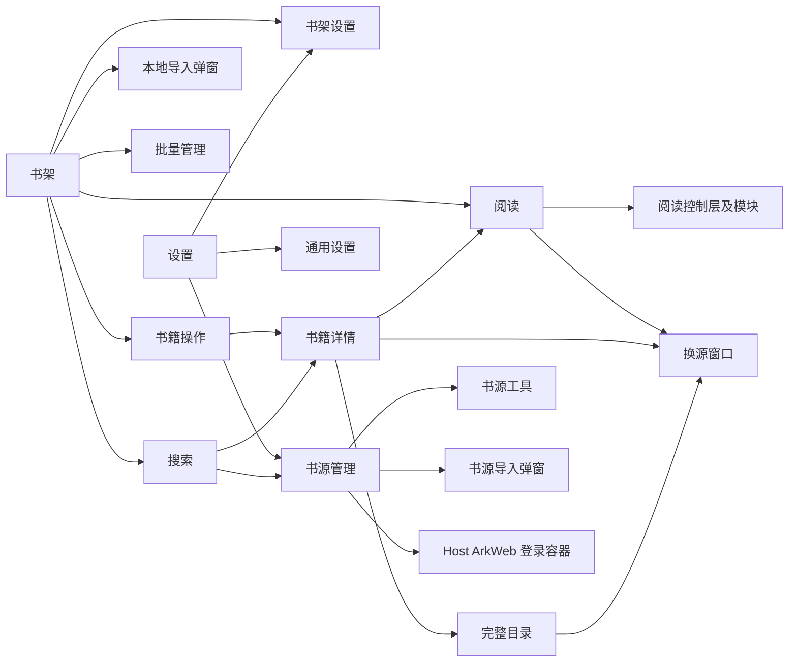

来源：[ReaderProductScope.ts:16](/Users/minliny/Documents/Reader/Reader-for-HarmonyOS/entry/src/main/ets/app/ReaderProductScope.ts:16)、[MainTabBar.ets:41](/Users/minliny/Documents/Reader/Reader-for-HarmonyOS/entry/src/main/ets/features/shell/MainTabBar.ets:41)、[Index.ets:872](/Users/minliny/Documents/Reader/Reader-for-HarmonyOS/entry/src/main/ets/pages/Index.ets:872)。

## 书架、导入与移除

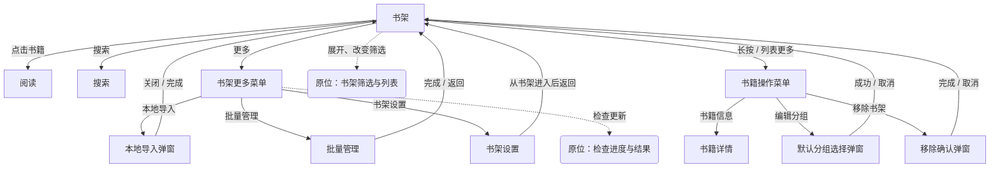

| 用户动作 / 条件 | 页面实际行为 | 结果与失败处理 |
|---|---|---|
| 首次读取书架 | 保留书架壳；内容区显示“正在加载书架…” | 读取失败在原内容区显示“书架加载失败”及重试。已有内容的短暂刷新不改成空书架 |
| 没有书籍 | 显示空书架卡，“导入本地书籍”“搜索并加入书架” | 空态顶部工具图标保留弱化外观，不承担有书操作 |
| 有书籍 | 继续阅读卡（满足条件时）＋“我的书架”＋封面 / 列表 | 点击书籍进入阅读；长按或列表更多打开书籍操作 |
| 展开筛选 | 在书架内部展开；阅读状态：全部 / 未读 / 在读 / 已读；来源：全部 / 本地 / 在线 | 筛选无匹配时显示“没有符合条件的书籍”及清除条件；没有接入分组筛选 |
| 书架更多 | 检查更新、批量管理、本地导入、书架设置 | 检查进度在该入口原位更新；不跳转提交或完成页面 |
| 书籍操作 | 多选、书籍信息、编辑分组、移除书架 | 当前编辑分组只接通“默认”；没有从此入口打开新建、编辑、删除分组页 |
| 批量管理 | 已选择数量、全选、原封面 / 列表、底部移除 | 正在加载完整书架时禁用选择；移除中按钮原位显示忙碌，完成后返回书架 |
| 书架设置 | 自动检查更新、封面 / 列表显示方式 | 从设置或书架进入，返回各自来源；显示方式保存失败回到已确认值，并提供原位重试 |
| 本地导入 | “导入本地书籍”→系统选文件→同一弹窗“正在导入”→“导入结果” | 支持 TXT、EPUB、MOBI、AZW、AZW3、KF8；逐文件显示真实结果。导入提交与书架重新读取分开，读取失败不能把已导入书籍说成未导入 |
| 移除书籍 | 一次“取消 / 移除”确认 | 在线书保留书源、进度和缓存；本地书移除应用内解析数据、进度及离线任务，保留原始文件。批量部分失败重新读取书架事实 |

来源：[BookshelfPage.ets:406](/Users/minliny/Documents/Reader/Reader-for-HarmonyOS/entry/src/main/ets/features/bookshelf/BookshelfPage.ets:406)、[BookshelfStatusContent.ets:21](/Users/minliny/Documents/Reader/Reader-for-HarmonyOS/entry/src/main/ets/features/bookshelf/BookshelfStatusContent.ets:21)、[BookshelfEmptyCard.ets:84](/Users/minliny/Documents/Reader/Reader-for-HarmonyOS/entry/src/main/ets/features/bookshelf/BookshelfEmptyCard.ets:84)、[BookshelfGroupSelector.ets:16](/Users/minliny/Documents/Reader/Reader-for-HarmonyOS/entry/src/main/ets/features/bookshelf/BookshelfGroupSelector.ets:16)、[LocalImportDialog.ets:134](/Users/minliny/Documents/Reader/Reader-for-HarmonyOS/entry/src/main/ets/features/bookshelf/LocalImportDialog.ets:134)、[ReaderLocalBookFormatAdmission.ts:26](/Users/minliny/Documents/Reader/Reader-for-HarmonyOS/entry/src/main/ets/app/ReaderLocalBookFormatAdmission.ts:26)、[BookRemovalDialog.ets:23](/Users/minliny/Documents/Reader/Reader-for-HarmonyOS/entry/src/main/ets/features/bookshelf/BookRemovalDialog.ets:23)、[Index.ets:3862](/Users/minliny/Documents/Reader/Reader-for-HarmonyOS/entry/src/main/ets/pages/Index.ets:3862)。

## 搜索、详情与返回

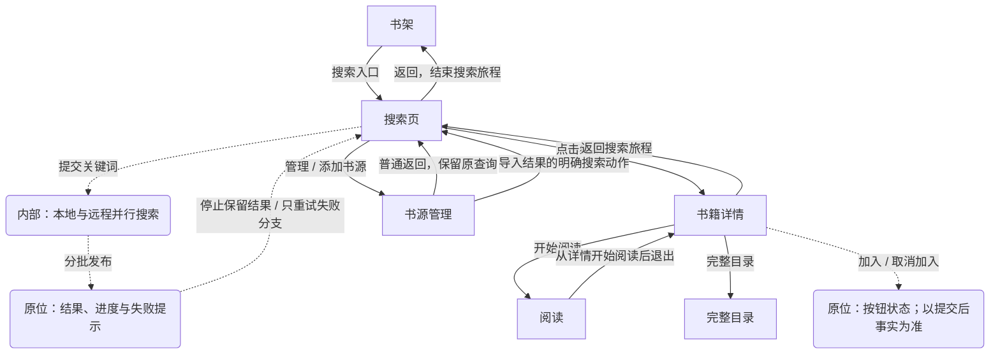

| 用户动作 / 条件 | 页面实际行为 | 结果与失败处理 |
|---|---|---|
| 打开搜索 | 返回、输入框、搜索按钮、最近搜索与清空记录 | 历史记录加载、读取、清理失败留在本区域；重试仅重试历史记录 |
| 搜索书名或作者 | 本地与远程分支并行；按钮原位变为“停止” | 没有可用远程书源仍可搜索本地书籍；当前页面没有接通按书源分组限定查询的入口 |
| 部分分支失败 | 保留已得到的有效结果与错误提示 | 重试失败或未完成分支；不清空成功分支后重新整页搜索 |
| 停止搜索 | 结束当前搜索工作，留在搜索页 | 保留已发布的结果；停止不是另一个等待或完成页面 |
| 有结果 | 显示数量、全部 / 本地 / 在线筛选、结果卡 | 卡片保留来源、最新章节、简介、已在书架等信息；同作品候选的来源身份保留 |
| 没有结果 / 没有书源 | 原内容区说明并给重新搜索、添加或管理书源入口 | 书源引导与历史记录仍属于搜索页；不新增全屏“操作已确认” |
| 点击结果 | 进入书籍详情 | 详情显示封面、书名、作者、最新章节、来源及换源、默认分组、简介、最多 20 条目录预览和完整目录 |
| 开始阅读 | 直接进入阅读页 | 读取正文的失败由阅读页承接；没有用户需要通过的预验证页面 |
| 加入书架 | 详情按钮显示“加入书架 / 取消加入 / 正在取消…” | 取消与提交竞争时，以 Core 重新读取的事实为准；已经写入的书籍及阅读位置保留 |
| 从详情 / 阅读返回搜索 | 阅读退出回进入来源；搜索旅程中的详情再返回搜索，恢复原查询与已发布结果 | 搜索旅程内允许后续有效结果继续发布；退出到书架后结束该旅程 |
| 搜索页进入书源管理再返回 | 保留原搜索内容 | 普通返回不自动重新搜索；导入完成且已有关键词时，结果弹窗提供明确的“用新书源搜索”动作 |

来源：[SearchPage.ets:398](/Users/minliny/Documents/Reader/Reader-for-HarmonyOS/entry/src/main/ets/features/search/SearchPage.ets:398)、[SearchPage.ets:580](/Users/minliny/Documents/Reader/Reader-for-HarmonyOS/entry/src/main/ets/features/search/SearchPage.ets:580)、[SearchOrchestrator.ets:318](/Users/minliny/Documents/Reader/Reader-for-HarmonyOS/entry/src/main/ets/features/search/SearchOrchestrator.ets:318)、[LocalBookDetail.ets:99](/Users/minliny/Documents/Reader/Reader-for-HarmonyOS/entry/src/main/ets/features/bookshelf/LocalBookDetail.ets:99)、[Index.ets:2813](/Users/minliny/Documents/Reader/Reader-for-HarmonyOS/entry/src/main/ets/pages/Index.ets:2813)、[Index.ets:3810](/Users/minliny/Documents/Reader/Reader-for-HarmonyOS/entry/src/main/ets/pages/Index.ets:3810)、[Index.ets:5846](/Users/minliny/Documents/Reader/Reader-for-HarmonyOS/entry/src/main/ets/pages/Index.ets:5846)。

## 阅读、目录与换源

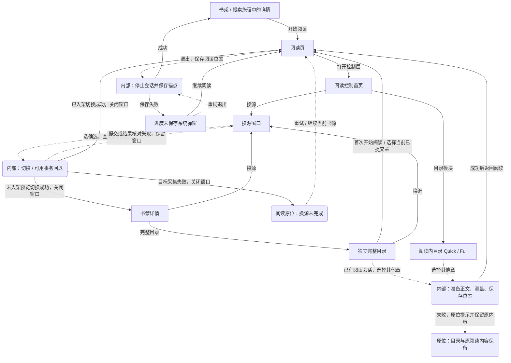

| 用户动作 / 条件 | 页面实际行为 | 结果与失败处理 |
|---|---|---|
| 进入阅读 | 同一个阅读壳承接本地、远程正文与正文图片片段 | 换章、主题、控制层开闭不因同一本书而重新挂载整个阅读壳 |
| 打开阅读控制层 | 顶部返回、书名、章节、书源、换源、更多；底部换章、进度、搜索、自动翻页、替换、亮度及目录 / 朗读 / 界面 / 设置 | 模块使用现有 Quick / Full 层级；返回依当前键盘、弹出菜单、模块层级处理 |
| 拖动阅读进度 | 拖动期间显示预览 | 拖动结束或明确点击才提交位置；优先整书位置，无法使用时回退到可确认的章节与章节比例 |
| 快速目录 / 完整目录 | 使用已有目录结构；完整目录有搜索、到顶 / 到底、排序、当前章节位置和书签页 | 卷组按实际目录结构展开；不凭标题猜测卷 / 话身份 |
| 从完整目录选择章节 | 没有阅读会话时直接进入阅读，由阅读壳读取正文；选择当前已提交章直接返回阅读 | 已有阅读会话选择其他章时保留目录和原阅读内容，新章完成首屏测量并保存位置后返回阅读 |
| 跳转书签 | 依据来源、书籍、章节及正文处理版本解析 | 不能确认位置时保留书签记录，提示并拒绝错误跳转 |
| 选择目标书源 | 换源窗口直接开始现有切换调用 | 未入架预览切换成功后关闭窗口并展示目标详情；已入架切换成功后关闭窗口并进入阅读。没有首图验证、换源已提交或成功后再确认步骤 |
| 换源失败 | 目标采集失败关闭窗口，由阅读页“换源未完成”承接；Core 提交或结果核对失败留在换源窗口 | 切换中、撤销中及仍有待回退事务时阻止关闭。具备回退事务时提供撤销；阅读页提供重试和继续当前书源 |
| 刷新本章 | 关闭更多菜单，在当前阅读身份和可操作条件下刷新 | 保留原正文直到新内容就绪；失败使用“刷新本章失败”系统对话框，重试或关闭 |
| 正文读取失败 | 原阅读区域显示“正文暂时无法显示”、原因、重试和阅读设置；远程书另有换源 | 没有跳转独立错误页 |
| 正文图片片段失败 | 清除该片段像素，已知几何保留 | 当前主工作区没有接通单图错误卡、单图重试或离线缺页页面。本稿不绘制这些未实现反馈 |
| 退出阅读 | 处理未决翻页、朗读、阅读记录与当前锚点保存 | 保存失败留在阅读页，系统弹窗“阅读进度尚未保存”：重试退出 / 继续阅读 |

来源：[ReaderShell.ets:140](/Users/minliny/Documents/Reader/Reader-for-HarmonyOS/entry/src/main/ets/features/shell/ReaderShell.ets:140)、[ReaderControlPanel.ets:844](/Users/minliny/Documents/Reader/Reader-for-HarmonyOS/entry/src/main/ets/features/reading/ReaderControlPanel.ets:844)、[ReaderFullDirectory.ets:121](/Users/minliny/Documents/Reader/Reader-for-HarmonyOS/entry/src/main/ets/features/reading/ReaderFullDirectory.ets:121)、[Index.ets:4196](/Users/minliny/Documents/Reader/Reader-for-HarmonyOS/entry/src/main/ets/pages/Index.ets:4196)、[Index.ets:5136](/Users/minliny/Documents/Reader/Reader-for-HarmonyOS/entry/src/main/ets/pages/Index.ets:5136)、[SourceSwitchWindow.ets:238](/Users/minliny/Documents/Reader/Reader-for-HarmonyOS/entry/src/main/ets/features/source/SourceSwitchWindow.ets:238)、[LocalReadingExperience.ets:2359](/Users/minliny/Documents/Reader/Reader-for-HarmonyOS/entry/src/main/ets/features/reading/LocalReadingExperience.ets:2359)、[ReadingSurface.ets:405](/Users/minliny/Documents/Reader/Reader-for-HarmonyOS/entry/src/main/ets/features/reading/ReadingSurface.ets:405)、[ReadingSessionFlowGateway.ts:1036](/Users/minliny/Documents/Reader/Reader-for-HarmonyOS/entry/src/main/ets/features/reading/ReadingSessionFlowGateway.ts:1036)、[LocalReadingExperience.ets:6102](/Users/minliny/Documents/Reader/Reader-for-HarmonyOS/entry/src/main/ets/features/reading/LocalReadingExperience.ets:6102)。

## 阅读模块与离线内容

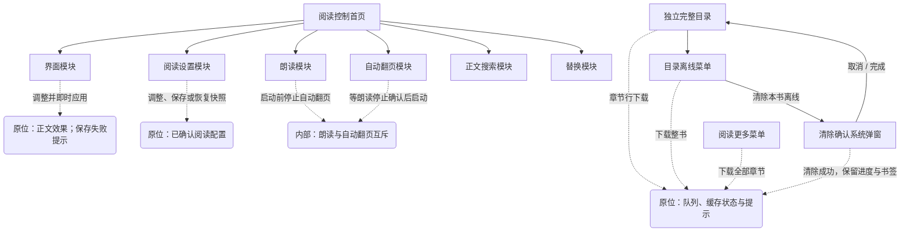

| 模块 / 动作 | 当前接通内容 | 持久化或互斥行为 |
|---|---|---|
| 界面 | 阅读主题、日夜默认主题、字体与导入、字号、行 / 段 / 字间距、首行缩进、简繁转换 | 即时应用；保存失败提示，当前可见效果保留 |
| 阅读设置 | 跟随 / 竖屏 / 横屏；覆盖 / 滑动 / 仿真 / 滚动 / 无动画；保持亮屏时间；沉浸区域、对齐、音量翻页、息屏停止朗读、长按文字等实际开关 | 仿真按能力准入；保存失败恢复上次保存快照。连续阅读转分页先保存位置，失败拒绝切换 |
| 朗读 | 播放 / 暂停、上下句、进度、停止、定时、语速、系统 / 在线引擎及配置；收起为会话胶囊 | 与自动翻页互斥；启动朗读停止自动翻页 |
| 自动翻页 | 开始 / 暂停 / 继续、停止、计时、2–20 秒间隔、高亮、上下章 | 启动前等朗读停止确认；停止失败则提示并拒绝启动。手动触摸暂停自动翻页 |
| 正文搜索与替换 | 控制层内的搜索、结果定位及现有替换管理 / 导入 / 导出入口 | 仍在阅读身份和现有模块内处理，没有新建独立主导航页面 |
| 下载章节 | 完整目录章节行的现有下载动作 | 同类写操作避免重复；显示真实排队、完成、失败投影 |
| 下载整书 | 阅读更多“下载全部章节”；完整目录离线菜单“下载整书” | 使用现有提示开始、进度、完成或部分失败；没有接通下载暂停 / 继续 / 取消控件或下载中心 |
| 清除本书离线 | 完整目录离线菜单，系统“取消 / 清除”确认 | 保留书架、阅读进度和书签；成功后目录更新为未缓存。本地书禁用此入口 |

来源：[ReaderControlAppearanceContent.ets:356](/Users/minliny/Documents/Reader/Reader-for-HarmonyOS/entry/src/main/ets/features/reading/ReaderControlAppearanceContent.ets:356)、[ReaderControlSettingsContent.ets:132](/Users/minliny/Documents/Reader/Reader-for-HarmonyOS/entry/src/main/ets/features/reading/ReaderControlSettingsContent.ets:132)、[ReaderControlTtsContent.ets:343](/Users/minliny/Documents/Reader/Reader-for-HarmonyOS/entry/src/main/ets/features/reading/ReaderControlTtsContent.ets:343)、[ReaderControlAutoPageContent.ets:201](/Users/minliny/Documents/Reader/Reader-for-HarmonyOS/entry/src/main/ets/features/reading/ReaderControlAutoPageContent.ets:201)、[LocalReadingExperience.ets:7879](/Users/minliny/Documents/Reader/Reader-for-HarmonyOS/entry/src/main/ets/features/reading/LocalReadingExperience.ets:7879)、[Index.ets:3498](/Users/minliny/Documents/Reader/Reader-for-HarmonyOS/entry/src/main/ets/pages/Index.ets:3498)、[Index.ets:3634](/Users/minliny/Documents/Reader/Reader-for-HarmonyOS/entry/src/main/ets/pages/Index.ets:3634)。

## 设置与书源管理

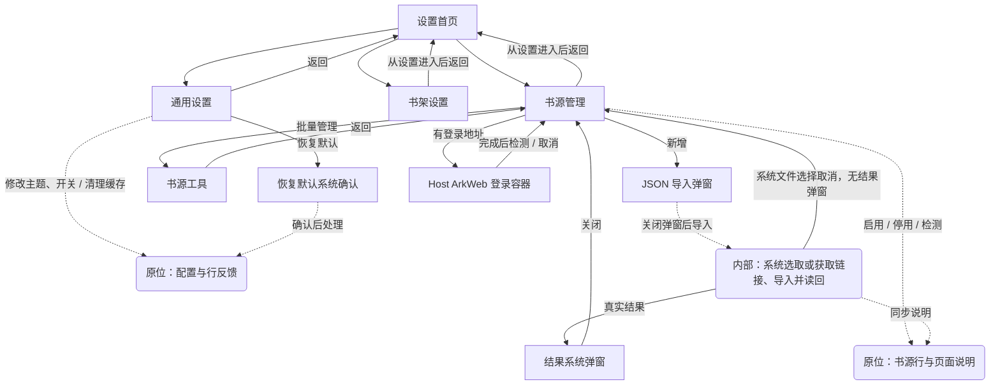

| 用户动作 / 条件 | 页面实际行为 | 结果与失败处理 |
|---|---|---|
| 设置首页 | 通用设置、书源管理、书架设置，保留书架 / 设置底栏 | 通用设置子页不带主底栏 |
| App 主题 | 跟随、浅色、深色 | 保存失败恢复配置，并提示“主题保存失败，已恢复原配置” |
| 自动检查更新 / 减少动态效果 | 当前开关即时更新，按 Host 偏好队列保存 | 失败重新读取实际配置并恢复；当前这两个入口没有统一错误弹窗 |
| 缓存清理 | “清理文字缓存”在同一行变为“清理中 / 已清理 / 清理失败” | 禁止重复执行；没有确认、等待和结果页面 |
| 恢复默认 | 系统确认“恢复界面与阅读设置” | 操作时设置壳禁用；结果在原页说明。保留书籍、书源、进度、书签、字体和凭据；失败保留恢复记录，允许原入口重试 |
| 读取书源 | 原页搜索、数量、状态筛选、分组、类别、列表与底部批量管理 / 新增书源 | 加载 / 读取失败 / 空列表显示在同页；“自定义”筛选当前可见但禁用 |
| 启用 / 停用书源 | 经 `source.update` 确认后变更行状态；写操作排队 | 失败保留原值并显示同页说明；停用清理对应 cookies；离开页面不取消已排队写入 |
| 单书源检测 | 行按钮原位“检测 / 检测中” | 当前默认执行 L1＋L2；重复点击受限，结果留在书源行 |
| 书源登录 / 验证 | 有 loginUrl 才打开现有 Host ArkWeb 登录容器，取消 / 完成 | 取消记录已取消；完成关闭后触发默认检测，不直接宣告登录成功 |
| 新增书源 | 本地 JSON 文件或在线链接导入弹窗 | 弹窗关闭后交由 Host / Core；系统选取取消不输出虚构取消结果。部分成功、导入失败及提交后读取失败分别说明 |
| 导入完成 | 同页结果提示与系统结果弹窗 | 有搜索关键词时才提供明确的“用新书源搜索”按钮 |
| 书源工具 | 选择 / 全选 / 清空、批量启用 / 停用 / 删除、导出、检测模式 / 深度 / 进度、编辑 JSON 和实际调试区 | 忙碌期间限制冲突动作；停止检测原位显示停止中，保留已完成检测结果 |
| 导出 / 删除 | 导出先提示文件含登录凭据；删除先确认数量和 cookies 清理 | 系统选保存位置后回同页说明导出或取消；删除完成重新读取列表 |
| 编辑 JSON | 同一工具页内编辑，取消 / 校验并保存 | 保留书源身份。失败保留草稿；写入已确认但读取失败时，提供“重新读取已保存书源”，不重复导入 |

来源：[SettingsPage.ets:134](/Users/minliny/Documents/Reader/Reader-for-HarmonyOS/entry/src/main/ets/features/settings/SettingsPage.ets:134)、[SettingsPage.ets:351](/Users/minliny/Documents/Reader/Reader-for-HarmonyOS/entry/src/main/ets/features/settings/SettingsPage.ets:351)、[LocalConfigurationReset.ts:66](/Users/minliny/Documents/Reader/Reader-for-HarmonyOS/entry/src/main/ets/features/settings/LocalConfigurationReset.ts:66)、[SourceManagementPage.ets:181](/Users/minliny/Documents/Reader/Reader-for-HarmonyOS/entry/src/main/ets/features/source/SourceManagementPage.ets:181)、[SourceOrchestrator.ets:129](/Users/minliny/Documents/Reader/Reader-for-HarmonyOS/entry/src/main/ets/features/source/SourceOrchestrator.ets:129)、[SourceGateway.ts:470](/Users/minliny/Documents/Reader/Reader-for-HarmonyOS/entry/src/main/ets/features/source/SourceGateway.ts:470)、[ArkWebExecutionHost.ets:118](/Users/minliny/Documents/Reader/Reader-for-HarmonyOS/entry/src/main/ets/app/ArkWebExecutionHost.ets:118)、[SourceToolsPage.ets:200](/Users/minliny/Documents/Reader/Reader-for-HarmonyOS/entry/src/main/ets/features/source/SourceToolsPage.ets:200)、[SourceToolsOrchestrator.ets:466](/Users/minliny/Documents/Reader/Reader-for-HarmonyOS/entry/src/main/ets/features/source/SourceToolsOrchestrator.ets:466)。

## 当前反馈与视觉复用

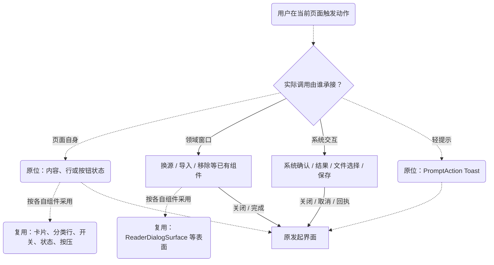

| 当前承担者 | 已接通用途 |
|---|---|
| 页面内容和按钮 | 搜索分支状态、书源行检测、书源管理说明、书源工具状态、设置清理与恢复、书架设置保存反馈 |
| 领域组件 | 书架读取状态、空书架、书签状态、阅读正文失败、换源窗口、导入弹窗、移除确认与 Host ArkWeb 登录容器 |
| 公共表面组件 | ReaderCard、CategorySection / CategoryRow、ReaderDialogSurface、Toggle、Select、SegmentedControl、StatusBadge、PressFeedback |
| 原生系统反馈 | PromptAction Toast；UIContext 系统确认 / 结果弹窗；文件选择与保存 |

ReaderDialogSurface 统一的是弹窗框架，未成为所有加载、错误、离线和结果的全局状态组件。当前主工作区没有接通此前补稿假设的 GlobalError / GlobalLoading 等统一入口，因此新稿只表达上表已有的复用关系。

应用主题与字体来自 [主题注册表](/Users/minliny/Documents/Reader/Reader-UI/theme/registry.json)、[ReaderTypography.ets](/Users/minliny/Documents/Reader/Reader-for-HarmonyOS/entry/src/main/ets/features/common/ReaderTypography.ets)。首页标题、两项主导航、设置行、对话框和书架 / 阅读布局分别转写各原组件；深色资源使用应用已有 `_theme_night` SVG。书架有书时的宽屏侧栏遵从当前组件准入；其他页面不自动套用该侧栏。

来源：[AppTopBar.ets:24](/Users/minliny/Documents/Reader/Reader-for-HarmonyOS/entry/src/main/ets/features/common/AppTopBar.ets:24)、[MainTabBar.ets:98](/Users/minliny/Documents/Reader/Reader-for-HarmonyOS/entry/src/main/ets/features/shell/MainTabBar.ets:98)、[ReaderDialogSurface.ets:50](/Users/minliny/Documents/Reader/Reader-for-HarmonyOS/entry/src/main/ets/features/common/ReaderDialogSurface.ets:50)。

## 清理及稿件边界

按用户确认的全工作区范围，旧原型、Android 旧 UI 稿、本轮状态补稿、漫画设计归档及其预览 / 设计专属压缩包已清理。清理路径记录在 [cleanup.json](cleanup.json)，没有另存一份旧稿。生产应用资源、字体、主题注册表、回归夹具、代码快照（含混合源码压缩包）和原生运行证据保留；远端 Figma 未在本次操作。

新稿只有本 UI 入口和本文两个阅读入口。页面外的来源、状态选择、示例数据和动作说明属于评审工具；应用画布内只放现有用户界面。预览不调用 Core、不写偏好、不运行搜索 / 下载 / 登录。系统弹窗只是布局与文案转写，未声称浏览器能复刻系统像素或 ArkUI 排版。新稿已检查浏览器脚本、资源和主要布局；原生外观与设备业务结果仍未在本次验证。

<!-- delivery:start -->

## 跨平台交付范围与参数来源

本节与 UI 稿底部的实现规格由同一份参数生成，覆盖 39 个可达界面/组件、173 个已有状态；不新增产品页面。

逐页尺寸和动效注明源码事实；iOS / Android 的安全区、字体缩放、触摸与系统界面映射是本次补充的移植决定。它们可供原生实现，尚未取得两端原生截图及业务验收。

### 单位、公共组件与平台映射

| 公共布局（源码） | 值 |
| --- | --- |
| 首页顶栏 | 高58；左右max(20,S.left/right)，顶内距6；标题29/38、700、Noto Serif Bold；单行省略。 |
| 返回顶栏 | 高58；返回命中44×44、图标24、圆角22；标题24/33、700；左右max(20,S.left/right)，标题占剩余宽度。 |
| 主导航 | 底栏最大宽360、高68、圆角24、边框1；2项均分；项高54、图标24、文字11/18 700。宽书架侧栏82×332，项66×58。 |
| 弹窗 | 按 ReaderSurfaceSpecs / 各领域组件分别实现，不能统一套352宽/16圆角。book-removal上限306/边距20/padding17/r12；JSON导入上限520/边距20/padding16/r14；默认分组75%宽/padding20/r20。 |
| 按压 | ReaderPressFeedback：TOK_ACCENT的12%alpha混合到本色；按下/取消/松开由控件事件恢复；不擅加缩放或Material波纹。禁用透明度沿各组件值。 |
| 资源 | 使用资产清单对应SVG与主题变体，contain保持viewBox比例；选中主导航仍用outline，禁止替成filled。字体与OFL许可一起打包。 |

| 移植决定 | 规则 |
| --- | --- |
| 单位 | 尺寸：1 vp 对应 1 iOS pt / Android dp；基准字号：1 fp 对应 1 pt / sp。像素按屏幕密度换算，禁止把整张 390 稿缩放铺满。 |
| 坐标 | W/H 为当前应用窗口；S=(top,right,bottom,left) 为运行时安全区。普通页上界避开 S.top；背景铺满窗口。横向边距 max(原边距,S.left/right)，不重复相加。 |
| 底部 | 浮动主导航底距 B=max(15,S.bottom)，内容尾部留白=68+B+16；没有主导航的操作条用 max(原底距,S.bottom)。内容能滚到最后一项。 |
| 键盘 | K 是键盘遮挡的底部高度；可编辑页有效底界 H-max(S.bottom,K)。输入框、确认按钮和错误文案在此范围内；浮动键盘按遮挡矩形滚动避让。安全区只能消费一次。 |
| 阅读 | 纸面背景及图片绘制可延伸至窗口边缘；正文、元信息、控制栏与命中区按阅读几何和实时安全区定位。全屏切换重新测量，保留文本锚点。 |
| 宽度 | 书架源码按W≥600进入宽版；搜索源码由deviceInfo的tablet决定。移植决定统一以可用窗口W≥600选择搜索宽版，避免分屏仍套设备大屏布局；只有有书书架显示侧栏。其他页面不自动改双栏。 |
| 触摸 | 保持图标视觉尺寸；移植的最小触摸目标 iOS 44×44、Android 48×48。优先整行/整卡命中；紧邻小控件重排间距，禁止命中区相互重叠。 |
| 返回 | 系统键盘→最上层临时菜单/弹窗→模块 Full→同模块 Quick→控制首页→隐藏控制层→页面退出。忙状态阻止关闭，未保存进度沿现有确认；交互式返回提交前不写业务结果。 |
| 系统界面 | 文件选择/保存、系统确认、登录 Web 容器、语音服务和亮度由各端 Host 实现相同意图及结果。系统弹窗与键盘使用本端外观；应用自绘表面保留当前主题/字体/SVG。 |
| 系统栏 | 自绘顶栏/浮动导航不叠加目标系统默认导航栏；系统状态栏/导航区背景延续当前paper。浅色背景使用深色系统glyph、深色使用浅色glyph，主题/全屏变化由Host重新应用并测量。 |
| 可访问性 | 整行开关作为一个语义节点，暴露名称/开关值/禁用/选中；装饰SVG不单独朗读，纯图标动作有完整中文名称。弹窗焦点进入标题及第一项，关闭返回原触发控件；异步失败读原提示，不抢走草稿焦点。 |
| 减少动态效果 | 移植effectiveReduceMotion=应用已存偏好 OR 系统减少动态效果。移除非必要位移/周期波形，保留颜色与状态反馈；业务计时/取消/回滚仍按回执处理。 |
| 语言与输入 | 交付基准为当前zh-CN文案与简体中文字形；保留书名/来源/正文中的其他Unicode字符。URL/JSON/密钥沿原字段输入语义；输入法composition期间不提交半成品查询，原未开放语言设置不新增入口。 |
| 生命周期 | 进入后台、旋转、分屏、键盘切换不重新执行导入/删除/换源；草稿、选中项、原结果与阅读锚点归 owner 保留。迟到回调按原调用链拒绝覆盖新上下文。 |


平台依据：[Apple safeAreaLayoutGuide](https://developer.apple.com/documentation/uikit/uiview/safearealayoutguide)、[Apple UIFontMetrics](https://developer.apple.com/documentation/uikit/uifontmetrics)、[Apple 触摸与可访问性](https://developer.apple.com/design/human-interface-guidelines/accessibility)、[Apple keyboard layout guide](https://developer.apple.com/documentation/uikit/adjusting-your-layout-with-keyboard-layout-guide)、[Android WindowInsets](https://developer.android.com/develop/ui/compose/system/insets)、[Android 字体非线性缩放](https://developer.android.com/about/versions/14/features#non-linear-font-scaling)、[Android 触摸与语义](https://developer.android.com/develop/ui/compose/accessibility/api-defaults)。

安全区/键盘预览使用下列测试输入，不绑定实际设备型号；上线读取 OS 实时值。

| 样本 | 窗口 | 上 / 右 / 下 / 左 |
| --- | --- | --- |
| 基准内容窗 390 × 844 | 390×844 | 0 / 0 / 0 / 0 |
| 窄窗 320 × 640 | 320×640 | 0 / 0 / 0 / 0 |
| iOS 安全区样本 393 × 852 | 393×852 | 59 / 0 / 34 / 0 |
| Android 手势样本 360 × 800 | 360×800 | 24 / 0 / 24 / 0 |
| Android 三键样本 360 × 800 | 360×800 | 24 / 0 / 48 / 0 |
| 横屏安全区样本 844 × 390 | 844×390 | 0 / 59 / 21 / 59 |
| 宽窗 760 × 960 | 760×960 | 0 / 0 / 0 / 0 |
| 分屏 600 × 640 | 600×640 | 24 / 0 / 24 / 0 |


### 排版、换行与资产

| 规则 | 交付约束 |
| --- | --- |
| 基准 | scale=1；使用同一文件和真实字重。显式lineHeight与字号分别传入；AUTO保持AUTO，不能拿fontSize×1.5代替。字距未设置时保持默认，不追加tracking。 |
| iOS缩放 | 系统角色用UIFontMetrics按角色映射：首页/页面→title1/title2；section→headline；tab/元信息/小字段→caption1；其余→body。阅读正文由已保存appearance字号/行距拥有，系统缩放不再乘一次。 |
| Android缩放 | 系统角色用sp及平台sp换算，行高也用sp；尺寸/边距用dp。Android非线性字体缩放不可用单一fontScale乘法复制。阅读正文appearance字号转dp物理度量，避免双重缩放。 |
| 回退 | Inter缺少的CJK先回退当前Noto Sans SC；Noto Serif缺字→Noto Sans SC→平台CJK/emoji。自带文件加载失败改平台字体并记录校准未通过，不静默宣称像素还原。HarmonyOS Sans只能在Harmony使用；两端对应系统sans，此槽单独原生校准。 |
| 换行 | UI单行按源码maxLines=1尾部省略；说明/错误按字段约束自动换行，URL允许字符边界断行。正文保留段落/硬换行，不插全角空格假冒缩进；禁则/塑形复用平台文本引擎。 |
| 大字体适配 | 按缩放后实测文字撑高行/按钮/顶栏；动作行无法容纳则换行或纵排。可滚动正文区域承担溢出；长书名仍可省略，动作标签、确认与错误不裁切。此为移植规则，非现有Harmony已验收行为。 |
| 位置保护 | 字体、宽度或系统栏变化前保留Core文本锚点，重新测量后恢复；不以旧页码/滚动像素作为唯一位置。预览压力倍率1/1.3/2只检查溢出，不冒充原生Dynamic Type曲线。 |


字体角色直接从 ReaderTypography.ets 提取；null 行高代表 AUTO。下表之外的领域文字由逐页规格给定。

| 角色 | 字族 | 字号 / 行高 | 字重 | 缩放owner |
| --- | --- | --- | --- | --- |
| TYPE_APP_HOME_TITLE | ReaderNotoSerifSCBold | 29 / 38 | 700 | system |
| TYPE_PAGE_TITLE | ReaderNotoSerifSCBold | 24 / 33 | 700 | system |
| TYPE_SECTION_HEADING | ReaderInter | 13 / 15.6 | 900 | system |
| TYPE_MAIN_TAB_LABEL | ReaderNotoSansSC | 11 / 18 | 700 | system |
| TYPE_SELECT_APPEARANCE_VALUE | ReaderNotoSansSC | 12 / 14.4 | 700 | system |
| TYPE_SELECT_SETTINGS_VALUE | ReaderNotoSansSC | 13 / 15.6 | 400 | system |
| TYPE_SELECT_SOURCE_GROUP_VALUE | ReaderInter | 12 / 14.52 | 400 | system |
| TYPE_SELECT_DEFAULT_VALUE | ReaderNotoSansSC | 12 / AUTO | 700 | system |
| TYPE_SELECT_OPTION | ReaderNotoSansSC | 12 / AUTO | 400 | system |
| TYPE_SEARCH_BOOK_INPUT | ReaderInter | 14 / 21 | 400 | system |
| TYPE_SEARCH_SOURCE_INPUT | ReaderInter | 12 / AUTO | 400 | system |
| TYPE_SEARCH_DIRECTORY_INPUT | ReaderNotoSansSC | 10 / AUTO | 400 | system |
| TYPE_SEARCH_READER_QUICK_INPUT | ReaderInter | 10 / AUTO | 400 | system |
| TYPE_SEARCH_RSS_HINT | ReaderInter | 14 / AUTO | 400 | system |
| TYPE_READER_CHAPTER_TITLE | ReaderNotoSerifSCBold | 23 / AUTO | 700 | system |
| TYPE_READER_CONTROL_BOOK_TITLE | ReaderNotoSerifSCBold | 16 / AUTO | 700 | system |
| TYPE_READER_CONTROL_CHAPTER_SOURCE | ReaderNotoSerifSCRegular | 12 / AUTO | 400 | system |
| TYPE_READER_CONTROL_SOURCE_ACTION | ReaderNotoSansSC | 12 / AUTO | 700 | system |
| TYPE_READER_IMMERSIVE_TIME | ReaderNotoSansSC | 12 / 14.4 | 400 | system |
| TYPE_READER_IMMERSIVE_PROGRESS | ReaderNotoSansSC | 12 / 14.4 | 400 | system |
| TYPE_READER_IMMERSIVE_PAGE_ORDINAL | ReaderNotoSansSC | 12 / 14.4 | 400 | system |
| TYPE_READER_SESSION_LABEL | ReaderNotoSansSC | 10 / 12.5 | 700 | system |
| TYPE_READER_SESSION_COUNTDOWN | ReaderNotoSansSC | 8 / 8 | 900 | system |


| 字体文件 | SHA-256 | 许可 |
| --- | --- | --- |
| InterVariable.ttf | 4989b125924991b90d05b2d16e0e388c48f7d5bb8b30539bbf9c755278d0ccaf | Inter-OFL.txt |
| LXGWWenKaiGBLite-Regular.ttf | 1675c708cce181871d9a8adc987f35a0cabc6ff980685cd99f05d2655ea08c4c | LXGWWenKaiGBLite-OFL.txt |
| LXGWWenKaiLite-Regular.ttf | 140c99ba4e28e817cec49bf82a0c5fcdc4fe633fb9dfda16d0ee8d59a8545f15 | LXGWWenKaiLite-OFL.txt |
| NotoSansSC-UIBold.otf | 995b908ebac24174fae7965b03324f21371dfe57bbfbe2794116d71ddde262cd | Noto-OFL.txt |
| NotoSansSC-UIMedium.otf | 319a7e09915410a00906741980b6afabe5fe23ae3b46052570b9cdd2b20c715d | Noto-OFL.txt |
| NotoSansSC-UIRegular.otf | 26903423458d18bb9be20b12f7982a604118e10f10c62c83b45d10f04dfb939e | Noto-OFL.txt |
| NotoSansSC-VF.otf | d13ed01ec8aa45d6178999b648e96fb92150683e9f8e2a581f2acf208dcbe44b | Noto-OFL.txt |
| NotoSerifSC-Bold.ttf | 3fb07709c24ed05993636d0b137917ea0bae5cf976f157d5e258fd068399a894 | Noto-OFL.txt |
| NotoSerifSC-Regular.ttf | 9502147ceba7b5bc7fd3415083f6a5d133f22d8f9efb4974d4b85f3a97ea2d3a | Noto-OFL.txt |
| SarasaMonoSC-Regular.ttf | 95718854631c2386845e618aa5bc37908e5fb8a919eb56e40f70e1170d80af94 | SarasaGothic-OFL.txt |
| ZhuqueFangsong-Regular.ttf | 558c62730844fe54ba220146ed62f859d4e2880188d92d985f8921c6e3743bc4 | ZhuqueFangsong-OFL.txt |


原 SVG、完整主题RGBA、字体和许可文件路径以及文件指纹在 [delivery.json](delivery.json)；各端打包原文件与许可。UI 的“文字/换行”页提供中文、标点、数字、长书名、URL、扩展字样本。缺字回退、AUTO 行高及系统字族各端须记录实测结果。

### 逐页尺寸、状态与适配

| 路线索引 | 模块 |
| --- | --- |
| 书架与搜索 | [书架](#route-bookshelf) · [书架 · 筛选展开](#route-shelf-filter) · [搜索](#route-search) · [书籍详情](#route-detail) · [书架设置](#route-bookshelf-settings) · [批量管理](#route-multiselect) · [书架更多](#route-shelf-more) · [书籍操作](#route-book-actions) · [编辑分组](#route-group-select) · [导入本地书籍](#route-local-import) · [移除书架确认](#route-book-removal) |
| 设置与书源 | [设置首页](#route-settings) · [通用设置](#route-general) · [书源管理](#route-sources) · [批量管理与书源工具](#route-source-tools) · [书源登录 / 验证](#route-source-login) · [导入书源](#route-json-import) · [恢复界面与阅读设置](#route-restore-defaults) · [书源导入结果](#route-source-result) · [书源导出确认](#route-source-export) · [删除书源确认](#route-source-delete) |
| 阅读与离线 | [阅读正文](#route-reader) · [完整目录](#route-directory) · [阅读控制首页](#route-reader-controls) · [控制栏目录与书签](#route-reader-directory) · [朗读](#route-reader-tts) · [朗读配置选项](#route-reader-tts-config) · [第三方 TTS 配置](#route-reader-tts-manager) · [阅读界面](#route-reader-appearance) · [阅读设置](#route-reader-settings) · [内容搜索](#route-reader-search) · [自动翻页](#route-reader-autopage) · [替换规则](#route-reader-replace) · [换源窗口](#route-source-switch) · [阅读更多菜单](#route-reader-more) · [完整目录离线菜单](#route-directory-offline-menu) · [清除离线确认](#route-offline-clear) · [退出保存失败](#route-reader-exit-failure) · [刷新与跳转失败](#route-reader-refresh-failure) |

<a id="route-bookshelf"></a>

#### 书架（bookshelf）

**入口与动作路线**

书架是当前两项主导航的起点，加载、空态和失败由同一内容区承接，点书直接阅读，长按才打开书籍操作。

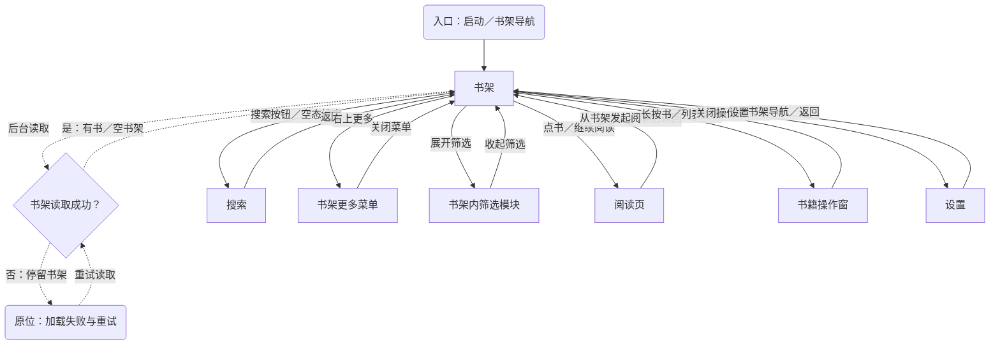

已有状态：封面、列表、空书架、加载中、加载失败、筛选无匹配。

**尺寸与约束**

- 源码：水平几何统一为 L=max(安全左边距,约定左间距)，R=W−max(安全右边距,约定右间距)，A=max(0,R−L)，C=min(内容宽上限,A)，居中时 x=L+(A−C)/2。安全边距取对应源码的 visual/interactive，不能把内容宽、视口宽和设备物理像素混用。
- 源码：书架 W<600 时内容 cap352、左右间距19，列卡宽 w=min(96.656,max(0,(C−16)/3))，列间距 min(30,max(8,(C−3w)/2))，封面高 w×145.443/96.656。W≥600 且有书架数据时内容 cap620、左间距119(17+82+20)、右21，卡宽 w=min(186.672,max(0,(C−16)/3))、列间距 min(30,max(0,(C−3w)/2))、封面高 w×280/186.672；居中公式同水平几何。
- 源码：全屏 Stack，顶部 AppTopBar 叠放而不占 Scroll 的流布局，高58，左右=max(20,interactive safe)、顶内边距6；右侧搜索/更多两目标44×44、圆角22、间距18，图标分别24与44。书架 List 顶部内容偏移58+8=66，ListItem 间距10，关闭滚动条。
- 源码：继续阅读卡宽C、高100、左右内边距16.554、内容间距14、圆角8、边线1；封面62×93；文字列自适应剩余宽并 minWidth=0；阅读胶囊82×40、圆角20。
- 源码：“我的书架”行高38；封面/列表/筛选图标目标视觉34×34、图标20，响应区44×44且向左/上扩5。书籍封面列每行3本；封面下文字列间距6、标题/作者各1行省略，已读百分比仅进度>0显示。列表封面手机48×80、宽屏64×104，详情列高76、行内间距3，章名单行省略，底部两个18高胶囊等分、间隔8；更多按钮打开同书动作。
- 源码：手机及空/加载/失败态底部导航高68、cap360、左右间距15、底=max(15,interactiveSafeBottom)，内边距8，子项高54、水平外边距4、图标24放入30×30框。List 底留68+max(15,safeBottom)+16；有书宽屏用82×332侧栏，left=max(17,safeLeft)、垂直居中、pad8、项66×58、间距6，正文底留max(16,safeBottom)。
- 源码：有封面使用 ImageFit.Cover；书架/详情无封面使用 NoCoverCover，底色 TOK_META_BG、圆角8。以 w、h 为当前封面尺寸：两条横线宽=40/96.96×w、高1，y=52/145.44×h 与92.44/145.44×h；“暂无封面”框宽=72/96.96×w，y=63.57/145.44×h，NotoSerif Bold 字号=15/96.96×w、行高=18.3/96.96×w，水平居中。搜索结果的缺封面另用标题渐变，不复用此组件。
- 源码：empty 保持 cap352 与底部导航，即使宽窗口；头行后间距9；空卡高350、圆角12、边线1。装饰小书72×52、圆角8、旋转±8°；图标框62×62圆角16位于 x=C/2−32,y35，图标32；标题y137、说明y173；主/次按钮 x17、宽C−34、高52、圆角12、y219/y281，文字左14/13。
- 源码：loading/error 为同书架内容区 Scroll；Column 间距16，minHeight=viewportHeight（无值时为窗口高减contentSafeTop），顶部留58、底部留浮动导航内容距离，内容居中。spinner24；失败重试胶囊视觉高36、左右pad18、圆角999、响应区高44/y−4。no-match 在列表当前位置显示说明与清除，不清空既有书架数据。

**排版**

- 源码：首页“书架”为 ReaderNotoSerifSCBold/700/29/38；“我的书架”为 ReaderInter/700/15/18。继续阅读：小标签 Inter/900/13/15.6，书名 NotoSerifBold/700/20/24，作者 Inter/400/14/16.8，阅读 Inter/800/13/15.6；书名和作者单行省略。
- 源码：网格书名 NotoSerifBold/700/15/18.3，作者 Inter/400/12/15，进度 Inter/10；列表书名同15/18.3，作者 NotoSans Regular/12/15、章节11/13.75、胶囊10/12；标签和章节单行省略。侧栏/底栏标签 NotoSans Bold/700/11/18。
- 源码：空卡标题 NotoSans Bold/19，说明 NotoSans Regular/13，按钮 NotoSans Bold/13；未显式声明行高的原生 Text 保留平台字体度量，不能把预览继承行高当生产证据。loading正文 Inter/400/13/19.5；error标题 Inter/700/17/25.5、说明13/19.5、重试 Inter/800/13/13。

**行为与状态**

- 源码：cover/list 同一书架显示方式；点书或继续阅读进入 reader，长按书或列表更多打开 book-actions；右上搜索进入 search，更多打开 shelf-more；底栏/侧栏只有书架、设置。选中当前导航项无操作。
- 源码：empty 只显示导入本地书籍/搜索并加入书架；布局切换和筛选控件禁用。loading 禁止把未完成结果当空书架；error 原内容区重试读书架，旧轮次回调不能覆盖新结果。no-match 由阅读状态/类型筛选产生，清除全部条件恢复原书架投影。
- 源码：书架筛选与视图模式不改变书籍身份；显示方式持久化失败回到已确认值并原位重试；已读/未读/更新徽标由实际书架字段产生，示例书名不是产品固定文案。

**移植适配**

- 迁移：1 vp=1 iOS logical pt=1 Android logical dp；下列字体值是 systemFontScale=1 的 fp 基准，字族/字重由交付字体对应。使用统一文字缩放规则；新增不可见触摸目标最小iOS44×44、Android48×48，源响应区值与视觉值分开保留，邻近目标不得重叠。布局不依赖外层浏览器或物理像素宽度。
- 迁移：保持视觉框、间距和控件顺序；小窗口、分屏或大字体超出可用高度时，原内容区允许滚动。安全区由窗口实时提供，键盘弹出时仍可聚焦输入和访问原有操作；不新增确认、取消中或成功页面。
- 迁移：W<352+38 时按源码公式缩小网格封面；保留3列而非自行改2列。固定82宽侧栏不随文字缩放放大；其标签若不能完整显示，使用单行省略并保留完整 accessibilityLabel。所有新增触摸目标最小iOS44×44/Android48×48；原响应区尺寸仍列在layout中，视觉框不变。加载/失败居中计算必须用手机画布的可用高度，不用固定600。
- 迁移：为原视觉34高布局切换保持已有44响应区；其余小控件扩充不可见触摸区至统一平台最小目标，视觉尺寸不变、相邻目标不可重叠。

来源：[BookshelfShell.ets:53](/Users/minliny/Documents/Reader/Reader-for-HarmonyOS/entry/src/main/ets/features/bookshelf/BookshelfShell.ets:53)、[BookshelfShell.ets:110](/Users/minliny/Documents/Reader/Reader-for-HarmonyOS/entry/src/main/ets/features/bookshelf/BookshelfShell.ets:110)、[BookshelfPage.ets:61](/Users/minliny/Documents/Reader/Reader-for-HarmonyOS/entry/src/main/ets/features/bookshelf/BookshelfPage.ets:61)、[BookshelfPage.ets:325](/Users/minliny/Documents/Reader/Reader-for-HarmonyOS/entry/src/main/ets/features/bookshelf/BookshelfPage.ets:325)、[BookshelfPage.ets:406](/Users/minliny/Documents/Reader/Reader-for-HarmonyOS/entry/src/main/ets/features/bookshelf/BookshelfPage.ets:406)、[BookshelfPage.ets:906](/Users/minliny/Documents/Reader/Reader-for-HarmonyOS/entry/src/main/ets/features/bookshelf/BookshelfPage.ets:906)、[BookshelfPage.ets:1014](/Users/minliny/Documents/Reader/Reader-for-HarmonyOS/entry/src/main/ets/features/bookshelf/BookshelfPage.ets:1014)、[BookshelfPage.ets:1056](/Users/minliny/Documents/Reader/Reader-for-HarmonyOS/entry/src/main/ets/features/bookshelf/BookshelfPage.ets:1056)、[NoCoverCover.ets:19](/Users/minliny/Documents/Reader/Reader-for-HarmonyOS/entry/src/main/ets/features/bookshelf/NoCoverCover.ets:19)、[ShelfBookListDetails.ets:13](/Users/minliny/Documents/Reader/Reader-for-HarmonyOS/entry/src/main/ets/features/bookshelf/ShelfBookListDetails.ets:13)、[BookshelfStatusContent.ets:19](/Users/minliny/Documents/Reader/Reader-for-HarmonyOS/entry/src/main/ets/features/bookshelf/BookshelfStatusContent.ets:19)、[BookshelfEmptyPage.ets:46](/Users/minliny/Documents/Reader/Reader-for-HarmonyOS/entry/src/main/ets/features/bookshelf/BookshelfEmptyPage.ets:46)、[BookshelfEmptyCard.ets:33](/Users/minliny/Documents/Reader/Reader-for-HarmonyOS/entry/src/main/ets/features/bookshelf/BookshelfEmptyCard.ets:33)、[MainTabBar.ets:72](/Users/minliny/Documents/Reader/Reader-for-HarmonyOS/entry/src/main/ets/features/shell/MainTabBar.ets:72)、[MainTabBar.ets:193](/Users/minliny/Documents/Reader/Reader-for-HarmonyOS/entry/src/main/ets/features/shell/MainTabBar.ets:193)、[SurfaceHorizontalGeometry.ts:54](/Users/minliny/Documents/Reader/Reader-for-HarmonyOS/entry/src/main/ets/features/common/SurfaceHorizontalGeometry.ts:54)、[ReaderTypography.ets:56](/Users/minliny/Documents/Reader/Reader-for-HarmonyOS/entry/src/main/ets/features/common/ReaderTypography.ets:56)。

<a id="route-shelf-filter"></a>

#### 书架 · 筛选展开（shelf-filter）

**入口与动作路线**

筛选是在原书架展开的模块，阅读状态与本地／在线来源条件取交集，清除不改变分组，失败仍由书架内容区承接。

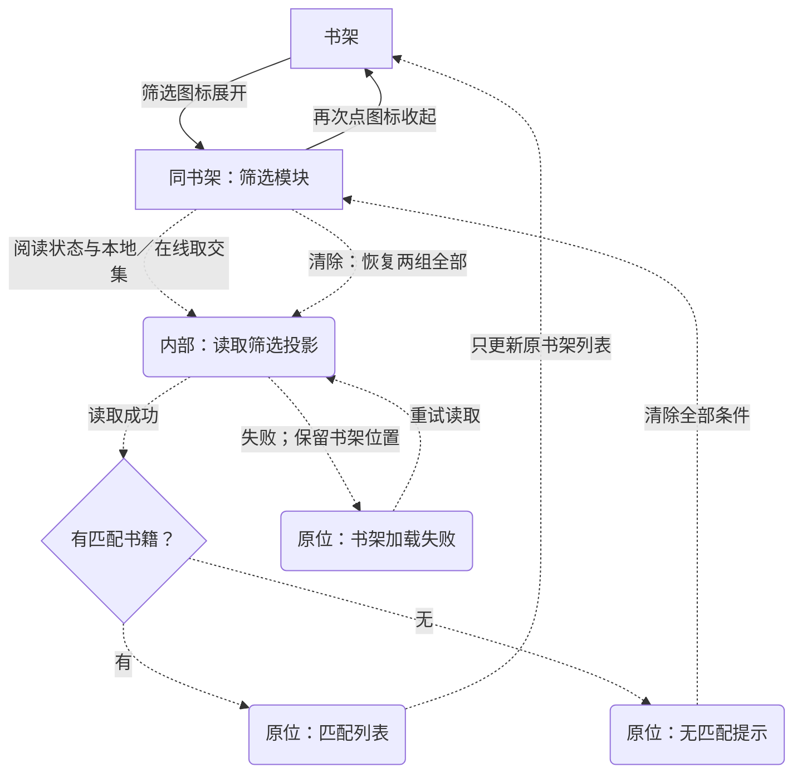

已有状态：全部、在读 · 在线。

**尺寸与约束**

- 源码：水平几何统一为 L=max(安全左边距,约定左间距)，R=W−max(安全右边距,约定右间距)，A=max(0,R−L)，C=min(内容宽上限,A)，居中时 x=L+(A−C)/2。安全边距取对应源码的 visual/interactive，不能把内容宽、视口宽和设备物理像素混用。
- 源码：书架 W<600 时内容 cap352、左右间距19，列卡宽 w=min(96.656,max(0,(C−16)/3))，列间距 min(30,max(8,(C−3w)/2))，封面高 w×145.443/96.656。W≥600 且有书架数据时内容 cap620、左间距119(17+82+20)、右21，卡宽 w=min(186.672,max(0,(C−16)/3))、列间距 min(30,max(0,(C−3w)/2))、封面高 w×280/186.672；居中公式同水平几何。
- 源码：全屏 Stack，顶部 AppTopBar 叠放而不占 Scroll 的流布局，高58，左右=max(20,interactive safe)、顶内边距6；右侧搜索/更多两目标44×44、圆角22、间距18，图标分别24与44。书架 List 顶部内容偏移58+8=66，ListItem 间距10，关闭滚动条。
- 源码：继续阅读卡宽C、高100、左右内边距16.554、内容间距14、圆角8、边线1；封面62×93；文字列自适应剩余宽并 minWidth=0；阅读胶囊82×40、圆角20。
- 源码：“我的书架”行高38；封面/列表/筛选图标目标视觉34×34、图标20，响应区44×44且向左/上扩5。书籍封面列每行3本；封面下文字列间距6、标题/作者各1行省略，已读百分比仅进度>0显示。列表封面手机48×80、宽屏64×104，详情列高76、行内间距3，章名单行省略，底部两个18高胶囊等分、间隔8；更多按钮打开同书动作。
- 源码：手机及空/加载/失败态底部导航高68、cap360、左右间距15、底=max(15,interactiveSafeBottom)，内边距8，子项高54、水平外边距4、图标24放入30×30框。List 底留68+max(15,safeBottom)+16；有书宽屏用82×332侧栏，left=max(17,safeLeft)、垂直居中、pad8、项66×58、间距6，正文底留max(16,safeBottom)。
- 源码：filter 不是新路由或弹窗，是当前书架 List 中头行之后展开的 ListItem。筛选块 Column 间距4；首行标签“筛选”与清除同行，清除高28。阅读状态、书籍类型分别下一行标题/Wrap标签；标签左右pad12、上下5、边线1、圆角999，右/下margin8、maxWidth160、单行省略。
- 源码：default 选中两组“全部”；active 示例选中“在读/在线”，选择项使用 TOK_GREEN 边线/字与 TOK_PRIMARY_SOFT 背景。只有任一条件有效时可清除，禁用opacity0.5。

**排版**

- 源码：筛选及两类标签字号12；筛选胶囊 ReaderInter/500/12/18。Clear字号12，高28。书架其余文字同 bookshelf，包括首页29/38、书架小标题15/18与封面下标题15/18.3。

**行为与状态**

- 源码：default/active 只表示同一模块的条件值；阅读状态“全部、未读、在读、已读”和书籍类型“全部、本地、在线”分别设置条件后交集过滤，选中条件保留，不生成提交反馈页。
- 源码：同一筛选图标展开/收起；“清除”同时重置阅读状态和类型，不改变书籍分组；全部无匹配时复用 bookshelf/no-match 说明与“清除全部条件”。书架继续阅读与底/侧导航布局仍在。

**移植适配**

- 迁移：1 vp=1 iOS logical pt=1 Android logical dp；下列字体值是 systemFontScale=1 的 fp 基准，字族/字重由交付字体对应。使用统一文字缩放规则；新增不可见触摸目标最小iOS44×44、Android48×48，源响应区值与视觉值分开保留，邻近目标不得重叠。布局不依赖外层浏览器或物理像素宽度。
- 迁移：保持视觉框、间距和控件顺序；小窗口、分屏或大字体超出可用高度时，原内容区允许滚动。安全区由窗口实时提供，键盘弹出时仍可聚焦输入和访问原有操作；不新增确认、取消中或成功页面。
- 迁移：标签 Wrap 自然换行；保留每项 max160 与单行省略，不能横向挤压成不可点击目标。胶囊视觉28高，触摸区用不可见扩展实现平台最小值，不能覆盖另一行标签。

来源：[BookshelfPage.ets:447](/Users/minliny/Documents/Reader/Reader-for-HarmonyOS/entry/src/main/ets/features/bookshelf/BookshelfPage.ets:447)、[BookshelfPage.ets:565](/Users/minliny/Documents/Reader/Reader-for-HarmonyOS/entry/src/main/ets/features/bookshelf/BookshelfPage.ets:565)、[BookshelfPage.ets:683](/Users/minliny/Documents/Reader/Reader-for-HarmonyOS/entry/src/main/ets/features/bookshelf/BookshelfPage.ets:683)、[BookshelfPage.ets:906](/Users/minliny/Documents/Reader/Reader-for-HarmonyOS/entry/src/main/ets/features/bookshelf/BookshelfPage.ets:906)。

<a id="route-search"></a>

#### 搜索（search）

**入口与动作路线**

本地和在线结果在原搜索页流式呈现，停止或部分失败保留已返回结果，详情和书源管理返回搜索上下文，历史失败单独原位重试。

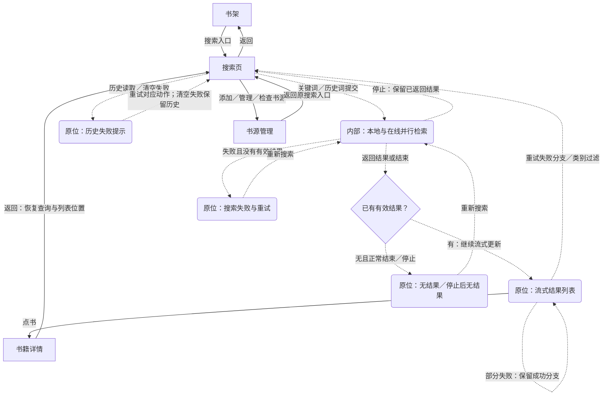

已有状态：最近搜索、搜索中、搜索结果、结果继续返回、部分失败、未添加书源、无可搜索书源、书源读取失败、无结果、停止后无结果、搜索失败、历史读取失败、历史清空失败。

**尺寸与约束**

- 源码：水平几何统一为 L=max(安全左边距,约定左间距)，R=W−max(安全右边距,约定右间距)，A=max(0,R−L)，C=min(内容宽上限,A)，居中时 x=L+(A−C)/2。安全边距取对应源码的 visual/interactive，不能把内容宽、视口宽和设备物理像素混用。
- 源码：全屏 Stack，居中内容 cap620、左右 gap0（仍避开visual safe），header 固定叠放。tablet 是 Index 的 deviceInfo.deviceType===tablet，不能仅用宽600断点代替。phone header52/field36；tablet header56/field40；top8、左右16/20、rowgap10、返回目标32×32/r16/icon20。搜索输入 layoutWeight1/minWidth0、左右pad12/gap8、搜索/清除图标各14，清除只在草稿非空时出现。提交胶囊高36/40、左右pad14/18、圆角999。
- 源码：类别行仅有 results/empty 且 resultGroupNames 非空时出现，高41.5、header下面，横向 Scroll、左右16/20、项间8；胶囊左右10/上下5.5、视觉高23、r999、max160/单行省略。页面标题区总高=52或56+(类别行存在?41.5:0)。
- 源码：initial 历史 Scroll top=header+8、左右18/20、bottom=max(20,safeBottom)。历史标题行高26；关键词胶囊左右14.5/上下7.5、r999、border1、margin右/下8、maxWidth=history内容宽−8；Wrap 显示全部历史。历史读取失败不伪造历史项；清空失败保留原历史。
- 源码：结果统计行初始测量高28.5、上下pad6、左右18/20；List 顶=header+实测统计高、底=max(20,safeBottom)，Lazy 列表按稳定身份流式更新并维持位置。结果行左右18/20、top14/bottom14.5、间距12、bottom border1；封面 phone88×(88×82/60)=120.2667，tablet96×(96×92/68)=129.88235，r6、Cover fit；元数据 minHeight=封面高、minWidth0、上下 space-between。
- 源码：搜索无封面使用141.7°绿色渐变，stops 0.077/0.923 对应 TOK_PRIMARY_GRADIENT_START/TOK_PRIMARY_DARK，书名贴底、左右4/bottom6、maxLines1。标题/作者/可选最新章节各单行省略；简介仅非空时显示，maxLines2；底部标签 Wrap mainGap6/crossGap2、左右6/上下2、r4、上margin5。
- 源码：loading/结果继续返回的稳定actor整体底48，不占结果行；actor内spinner36、间距18、caption行高19.5，caption只在loading opacity1，继续返回时opacity0仍保留其布局位（spinner底距48+18+19.5=85.5）。empty/stopped/no-source/all-disabled 用 search_empty 128×120，正文 Scroll top=header+50/bottom=max(40,safeBottom)，标题距图28/说明距标题10，建议框 phone190/tablet300、pad18.5×14.5、r12/border1。source-error/error 图80，标题距图20、说明8，内容 top=header+96；原页承接重试。
- 源码：空态/无源主次胶囊视觉36高、r999，左右18/18.5，响应44/y−4。error 的重新搜索高40、左右28、响应48/y−4，检查书源36/响应44/y−4。

**排版**

- 源码：输入 ReaderInter/400/14/21；搜索/停止 phone Inter/800/13/13、tablet14/14，停止 spinner13/gap6，空草稿不能提交时opacity0.4。类别标签 Inter/500或700/12/12；历史标题 Inter/700/13/19.5，清空12/18，关键词 Inter/500/13/19.5。
- 源码：统计 Inter/11/16.5；结果标题 NotoSerif Bold/700/15/19.5，作者 Inter/400/12/12，最新 Inter/11/11且opacity0.8，简介 Inter/12/18；源/类型/在架标签 Inter/700/10/15，封面标题 NotoSerif Bold/9/11.7。
- 源码：无结果/无源/错误标题 NotoSerif Bold/700/17/25.5；一般说明 Inter/400/13/21.125；搜索失败说明13/19.5且最多2行；搜索中提示13/19.5；一般空态按钮Inter800/13/13，error主按钮14/14、检查书源700/13/13。

**行为与状态**

- 源码：initial/历史错误 → 输入或历史词开始搜索，本地与当前启用且可搜索在线书源并行。loading 表示尚无结果；searching 保留已返回结果并继续收集；results 收敛显示；partial-error 保留成功分支、只补偿失败/未完成分支。结果类别“全部/本地/在线”过滤已返回集合，不变更检索书源范围。
- 源码：停止请求不再派发新在线书源，但已返回结果保留；无结果时 stopped 显示“已停止搜索”。empty 说明无结果，可添加书源/重新搜索；error 在所有相关失败且无可显示结果时显示实际失败与重试。停止不是清空、不是返回书架。
- 源码：no-source/all-disabled/source-error 只限制在线能力，上方输入仍可搜索本地书籍；分别添加书源、管理书源、重试加载。history-error 显示“搜索历史读取失败/重试读取”，history-clear-error 显示“搜索历史清空失败/重试清空”且保留历史；两者重试不重置当前查询与书源。
- 源码：结果点书进入 detail，返回恢复搜索请求、结果与滚动位置。local 标签源名“本地导入”/类型“本地书籍”/在架“已在书架”；只有字段存在才显示最新章节，Local SearchGateway 没有 latestChapterTitle。发现同书多源显示实际sourceCount，不固定2。
- 源码：搜索 clear 只修改草稿，不能假装已启动新查询；返回按钮回书架。异步回调按requestId/书籍身份拒绝旧结果。当前 dirty 搜索源码属于本基线，浏览器样稿不构成设备验收。

**移植适配**

- 迁移：1 vp=1 iOS logical pt=1 Android logical dp；下列字体值是 systemFontScale=1 的 fp 基准，字族/字重由交付字体对应。使用统一文字缩放规则；新增不可见触摸目标最小iOS44×44、Android48×48，源响应区值与视觉值分开保留，邻近目标不得重叠。布局不依赖外层浏览器或物理像素宽度。
- 迁移：保持视觉框、间距和控件顺序；小窗口、分屏或大字体超出可用高度时，原内容区允许滚动。安全区由窗口实时提供，键盘弹出时仍可聚焦输入和访问原有操作；不新增确认、取消中或成功页面。
- 迁移决定：iOS/Android搜索按当前逻辑窗口宽W≥600映射tablet视觉尺寸；这是跨平台宽度策略，区别于HarmonyOS源deviceInfo.deviceType判定。结果 cap620 与 safe/insets 使用实际窗口计算，不能用外层浏览器viewport mediaquery。大字体统计行必须实测后更新List顶偏移，流式结果不能整列表重挂载。
- 迁移：草稿字段占剩余空间，过窄时允许其文本自身水平滚动，不压缩32返回目标和搜索胶囊。clear14图标扩大不可见触摸区、与输入焦点区协调；搜索结果整卡可点，保持附属标签不独立新增跳转。

来源：[Index.ets:894](/Users/minliny/Documents/Reader/Reader-for-HarmonyOS/entry/src/main/ets/pages/Index.ets:894)、[SearchPage.ets:399](/Users/minliny/Documents/Reader/Reader-for-HarmonyOS/entry/src/main/ets/features/search/SearchPage.ets:399)、[SearchPage.ets:501](/Users/minliny/Documents/Reader/Reader-for-HarmonyOS/entry/src/main/ets/features/search/SearchPage.ets:501)、[ReaderSearchField.ets:89](/Users/minliny/Documents/Reader/Reader-for-HarmonyOS/entry/src/main/ets/features/common/ReaderSearchField.ets:89)、[ReaderSearchField.ets:271](/Users/minliny/Documents/Reader/Reader-for-HarmonyOS/entry/src/main/ets/features/common/ReaderSearchField.ets:271)、[SearchPage.ets:619](/Users/minliny/Documents/Reader/Reader-for-HarmonyOS/entry/src/main/ets/features/search/SearchPage.ets:619)、[SearchPage.ets:709](/Users/minliny/Documents/Reader/Reader-for-HarmonyOS/entry/src/main/ets/features/search/SearchPage.ets:709)、[SearchPage.ets:801](/Users/minliny/Documents/Reader/Reader-for-HarmonyOS/entry/src/main/ets/features/search/SearchPage.ets:801)、[SearchPage.ets:1088](/Users/minliny/Documents/Reader/Reader-for-HarmonyOS/entry/src/main/ets/features/search/SearchPage.ets:1088)、[SearchPage.ets:1167](/Users/minliny/Documents/Reader/Reader-for-HarmonyOS/entry/src/main/ets/features/search/SearchPage.ets:1167)、[SearchPage.ets:1299](/Users/minliny/Documents/Reader/Reader-for-HarmonyOS/entry/src/main/ets/features/search/SearchPage.ets:1299)、[SearchPage.ets:1364](/Users/minliny/Documents/Reader/Reader-for-HarmonyOS/entry/src/main/ets/features/search/SearchPage.ets:1364)、[SearchPage.ets:1396](/Users/minliny/Documents/Reader/Reader-for-HarmonyOS/entry/src/main/ets/features/search/SearchPage.ets:1396)、[SearchPage.ets:1453](/Users/minliny/Documents/Reader/Reader-for-HarmonyOS/entry/src/main/ets/features/search/SearchPage.ets:1453)、[SearchPage.ets:1505](/Users/minliny/Documents/Reader/Reader-for-HarmonyOS/entry/src/main/ets/features/search/SearchPage.ets:1505)、[SearchGateway.ts:446](/Users/minliny/Documents/Reader/Reader-for-HarmonyOS/entry/src/main/ets/features/search/SearchGateway.ts:446)、[SearchOrchestrator.ets:615](/Users/minliny/Documents/Reader/Reader-for-HarmonyOS/entry/src/main/ets/features/search/SearchOrchestrator.ets:615)。

<a id="route-detail"></a>

#### 书籍详情（detail）

**入口与动作路线**

详情返回书架或搜索原入口；加入与取消原位读回；换源未入架成功回目标详情、已入架成功转目标阅读，采集失败关窗转原阅读反馈，提交失败留原窗。

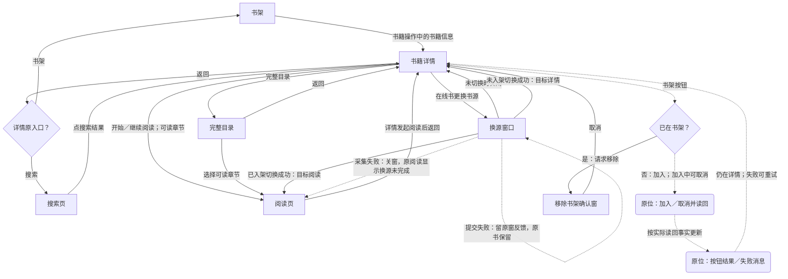

已有状态：在线 · 已在书架、本地书籍、在线 · 未在书架、目录读取中、正在加入、正在取消加入、加入未完成。

**尺寸与约束**

- 源码：水平几何统一为 L=max(安全左边距,约定左间距)，R=W−max(安全右边距,约定右间距)，A=max(0,R−L)，C=min(内容宽上限,A)，居中时 x=L+(A−C)/2。安全边距取对应源码的 visual/interactive，不能把内容宽、视口宽和设备物理像素混用。
- 源码：全屏 Stack，PageBackBar/底部操作叠放，Scroll 顶66、底77+actionBottomOffset，Column 间距8。内容 cap720、左右间距19、visual safe。返回条高58、左右max(20,interactiveSafe)、行gap10，返回44×44/r22，book_detail_back图标24。
- 源码：hero宽C/高152、pad15、r8/border1、行间距14；封面86×122（真实图片r6/无封面r8）；元数据列高122、space-between、minWidth0；书名高25.96、作者17.55，latest/source/group行18。书源行gap8，更换胶囊52×18/r999，文字框52×12；本地disabled/opacity0.4。
- 源码：简介卡 pad15/r8/border1，标题高18、下gap8；phone简介高120.313、正文高64.313/maxLines3；content C≥600 时高98.875、正文42.875/maxLines2，判断内容宽而非设备tablet。
- 源码：章节头行48、左右14/gap12；完整目录视觉94×30/r999/icon20，独立响应区94×44位于 x=C−109,y3，不能缩成30触摸目标。目录最多显示20条；每行高58、左右14、top divider1、单行省略；章节区h=50+58×min(20,条数)，无条目h282、r8/clip、border1/pad1。
- 源码：底部操作宽C、高77、top16/bottom15、行gap10；每按钮视觉高46、r999、宽=max(0,min(355,(C−10)/2))−8，各有左右margin4。底距=max(0,max(15,interactiveSafeBottom)−15)。不是浏览器viewport全宽平均按钮。
- 源码：有封面使用 ImageFit.Cover；书架/详情无封面使用 NoCoverCover，底色 TOK_META_BG、圆角8。以 w、h 为当前封面尺寸：两条横线宽=40/96.96×w、高1，y=52/145.44×h 与92.44/145.44×h；“暂无封面”框宽=72/96.96×w，y=63.57/145.44×h，NotoSerif Bold 字号=15/96.96×w、行高=18.3/96.96×w，水平居中。搜索结果的缺封面另用标题渐变，不复用此组件。

**排版**

- 源码：PageBackBar标题 NotoSerif Bold/700/24/33、maxLines1省略；书名 NotoSerif Bold/700/22/25.96/单行省略，作者 Inter/400/13/17.55；latest/source/group Inter/700/12/15，高18且单行省略。source胶囊 Inter/900/9/12。
- 源码：简介/章节头 Inter/700/15/18，简介正文Inter/400/13/21.45/最多3或2行；完整目录Inter/900/12；章节行 Inter/400/14、未显式 lineHeight，不据浏览器继承行高推导生产值；无目录说明Inter13/21.45/max3；底按钮Inter/900/13/14.3。

**行为与状态**

- 源码：saved 在线已入架显示继续阅读/移除书架/可换源；local 本地书保留同页布局但更换书源禁用。preview 在线未入架显示开始阅读/加入书架；catalog-loading 章节区“正在获取在线目录…”；这项检查不挡开始阅读。
- 源码：adding 同一底按钮改“取消加入”；cancelling 改“正在取消…”且禁用；add-error 在原页显示实际未完成消息。取消后读回 Core 核对持久化事实，不能假定竞态中已入架书被撤销；只有确认加入才更改inBookshelf。
- 源码：移除弹 book-removal，removing 时读/目录/章节操作受保护；章节 navigable!==false 时才可点。目录按钮进入 standalone directory，开始/继续与章节点击进入 reader；返回按当前入口恢复书架或搜索。
- 源码：在线更换书源打开既有 source-switch 选择层；选择后直接执行切换，失败保留原书与目录/阅读位置。没有首图验证、换源提交确认或独立失败跳转。

**移植适配**

- 迁移：1 vp=1 iOS logical pt=1 Android logical dp；下列字体值是 systemFontScale=1 的 fp 基准，字族/字重由交付字体对应。使用统一文字缩放规则；新增不可见触摸目标最小iOS44×44、Android48×48，源响应区值与视觉值分开保留，邻近目标不得重叠。布局不依赖外层浏览器或物理像素宽度。
- 迁移：保持视觉框、间距和控件顺序；小窗口、分屏或大字体超出可用高度时，原内容区允许滚动。安全区由窗口实时提供，键盘弹出时仍可聚焦输入和访问原有操作；不新增确认、取消中或成功页面。
- 迁移：保留152 hero/固定86封面与字号基准；长书名、作者、源名单行省略而非增高卡片。大字体适配时按统一规则放开文字可滚动区域，保留完整辅助标签。章节长标题单行省略；全文目录由原完整目录入口承接。
- 迁移：C不足支持两个按钮时，视觉46高和水平间距公式保持，操作文字可按平台统一策略省略并提供完整accessibilityLabel，不另创确认步骤；主滚动区必须能滚过固定底部77操作区。

来源：[LocalBookDetail.ets:47](/Users/minliny/Documents/Reader/Reader-for-HarmonyOS/entry/src/main/ets/features/bookshelf/LocalBookDetail.ets:47)、[LocalBookDetail.ets:99](/Users/minliny/Documents/Reader/Reader-for-HarmonyOS/entry/src/main/ets/features/bookshelf/LocalBookDetail.ets:99)、[LocalBookDetail.ets:126](/Users/minliny/Documents/Reader/Reader-for-HarmonyOS/entry/src/main/ets/features/bookshelf/LocalBookDetail.ets:126)、[LocalBookDetail.ets:165](/Users/minliny/Documents/Reader/Reader-for-HarmonyOS/entry/src/main/ets/features/bookshelf/LocalBookDetail.ets:165)、[LocalBookDetail.ets:278](/Users/minliny/Documents/Reader/Reader-for-HarmonyOS/entry/src/main/ets/features/bookshelf/LocalBookDetail.ets:278)、[LocalBookDetail.ets:312](/Users/minliny/Documents/Reader/Reader-for-HarmonyOS/entry/src/main/ets/features/bookshelf/LocalBookDetail.ets:312)、[LocalBookDetail.ets:405](/Users/minliny/Documents/Reader/Reader-for-HarmonyOS/entry/src/main/ets/features/bookshelf/LocalBookDetail.ets:405)、[LocalBookDetail.ets:431](/Users/minliny/Documents/Reader/Reader-for-HarmonyOS/entry/src/main/ets/features/bookshelf/LocalBookDetail.ets:431)、[LocalBookDetail.ets:503](/Users/minliny/Documents/Reader/Reader-for-HarmonyOS/entry/src/main/ets/features/bookshelf/LocalBookDetail.ets:503)、[LocalBookDetail.ets:557](/Users/minliny/Documents/Reader/Reader-for-HarmonyOS/entry/src/main/ets/features/bookshelf/LocalBookDetail.ets:557)、[PageBackBar.ets:28](/Users/minliny/Documents/Reader/Reader-for-HarmonyOS/entry/src/main/ets/features/common/PageBackBar.ets:28)、[Index.ets:1269](/Users/minliny/Documents/Reader/Reader-for-HarmonyOS/entry/src/main/ets/pages/Index.ets:1269)。

<a id="route-bookshelf-settings"></a>

#### 书架设置（bookshelf-settings）

**入口与动作路线**

书架设置记住书架或设置来源，显示方式乐观切换并异步保存，失败回到已确认值且在同一卡片重试。

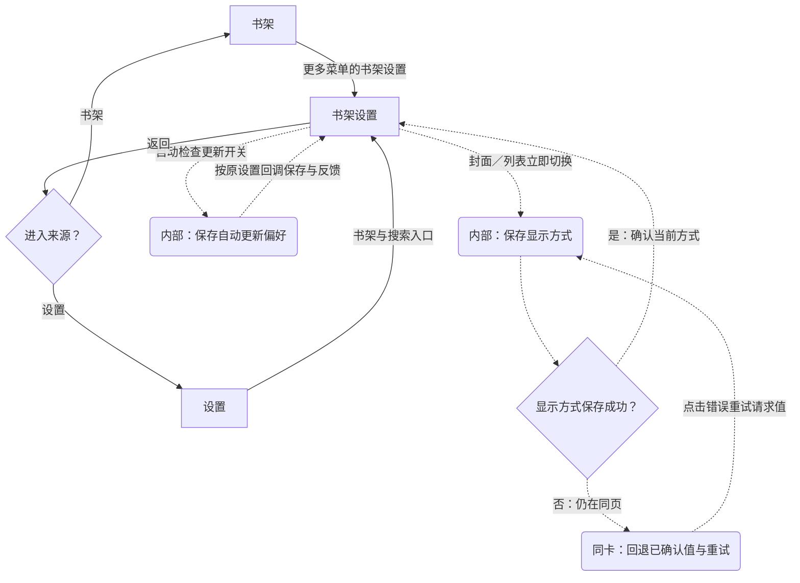

已有状态：封面、列表、显示方式保存失败。

**尺寸与约束**

- 源码：水平几何统一为 L=max(安全左边距,约定左间距)，R=W−max(安全右边距,约定右间距)，A=max(0,R−L)，C=min(内容宽上限,A)，居中时 x=L+(A−C)/2。安全边距取对应源码的 visual/interactive，不能把内容宽、视口宽和设备物理像素混用。
- 源码：Stack 中 Scroll 与58高 PageBackBar 叠放；Scroll top66/bottom=max(16,interactiveSafeBottom)，内容cap720、左右gap19/visual safe。卡pad16/r12/border1，内部Column gap16。自动检查标题layoutWeight1，尾部原生Toggle Switch；说明独立整行；显示方式Row gap12，标签layoutWeight1。
- 源码：封面/列表选项左右pad14/上下10、r20，选中app.action.fill/未选TOK_PAPER；保存错误Text位于同卡下一行，并可点重试requestedMode。Toggle未显式设置宽、高、thumb直径或行高，业务源码不能提供跨平台像素外形。

**排版**

- 源码：标题PageBackBar为NotoSerif Bold/24/33；自动检查/显示方式字号15、说明/保存错误12、选项13。此页Text未声明fontFamily/fontWeight/lineHeight，采用原生默认度量；不能将HTML样稿的Inter或开关34×20当源声明。

**行为与状态**

- 源码：cover/list 立即显示请求方式并异步保存，先读存储确定confirmed；成功更新confirmed；失败回已确认方式，原位“显示方式保存失败，点击重试”。恢复尚未完成时文案“请先在同步设置中重试未完成的恢复”；过时revision/mounted回调忽略。save-error 是相同页面，不独立失败页。
- 源码：自动检查更新开关保存偏好，真正自动检查受书架前台/未阅读等条件；从书架更多或设置入口打开，返回对应来源，不强行回书架。

**移植适配**

- 迁移：1 vp=1 iOS logical pt=1 Android logical dp；下列字体值是 systemFontScale=1 的 fp 基准，字族/字重由交付字体对应。使用统一文字缩放规则；新增不可见触摸目标最小iOS44×44、Android48×48，源响应区值与视觉值分开保留，邻近目标不得重叠。布局不依赖外层浏览器或物理像素宽度。
- 迁移：保持视觉框、间距和控件顺序；小窗口、分屏或大字体超出可用高度时，原内容区允许滚动。安全区由窗口实时提供，键盘弹出时仍可聚焦输入和访问原有操作；不新增确认、取消中或成功页面。
- 迁移：此源使用HarmonyOS原生Switch；iOS/Android若要求外形原样一致，需用项目统一Toggle规范替代系统控件，并单独标记为迁移决定。当前业务源码没有其确切几何，不能声称已经1:1确定。文字字族/行高默认值遵守统一跨平台映射规则。
- 迁移：模式选项自适应宽度并保持14×10内边距；极窄窗口允许整卡横向可访问或文本省略，所有保存/重试逻辑仍在原页，错误消息允许自然换行。

来源：[BookshelfSettingsPage.ets:38](/Users/minliny/Documents/Reader/Reader-for-HarmonyOS/entry/src/main/ets/features/bookshelf/BookshelfSettingsPage.ets:38)、[BookshelfSettingsPage.ets:71](/Users/minliny/Documents/Reader/Reader-for-HarmonyOS/entry/src/main/ets/features/bookshelf/BookshelfSettingsPage.ets:71)、[BookshelfSettingsPage.ets:85](/Users/minliny/Documents/Reader/Reader-for-HarmonyOS/entry/src/main/ets/features/bookshelf/BookshelfSettingsPage.ets:85)、[BookshelfSettingsPage.ets:93](/Users/minliny/Documents/Reader/Reader-for-HarmonyOS/entry/src/main/ets/features/bookshelf/BookshelfSettingsPage.ets:93)、[PageBackBar.ets:28](/Users/minliny/Documents/Reader/Reader-for-HarmonyOS/entry/src/main/ets/features/common/PageBackBar.ets:28)、[Index.ets:1427](/Users/minliny/Documents/Reader/Reader-for-HarmonyOS/entry/src/main/ets/pages/Index.ets:1427)。

<a id="route-multiselect"></a>

#### 批量管理（multiselect）

**入口与动作路线**

批量管理先读入完整书架，确认后原位移除；失败读回成功则回书架提示未完全完成，读回也失败才留在批量管理。

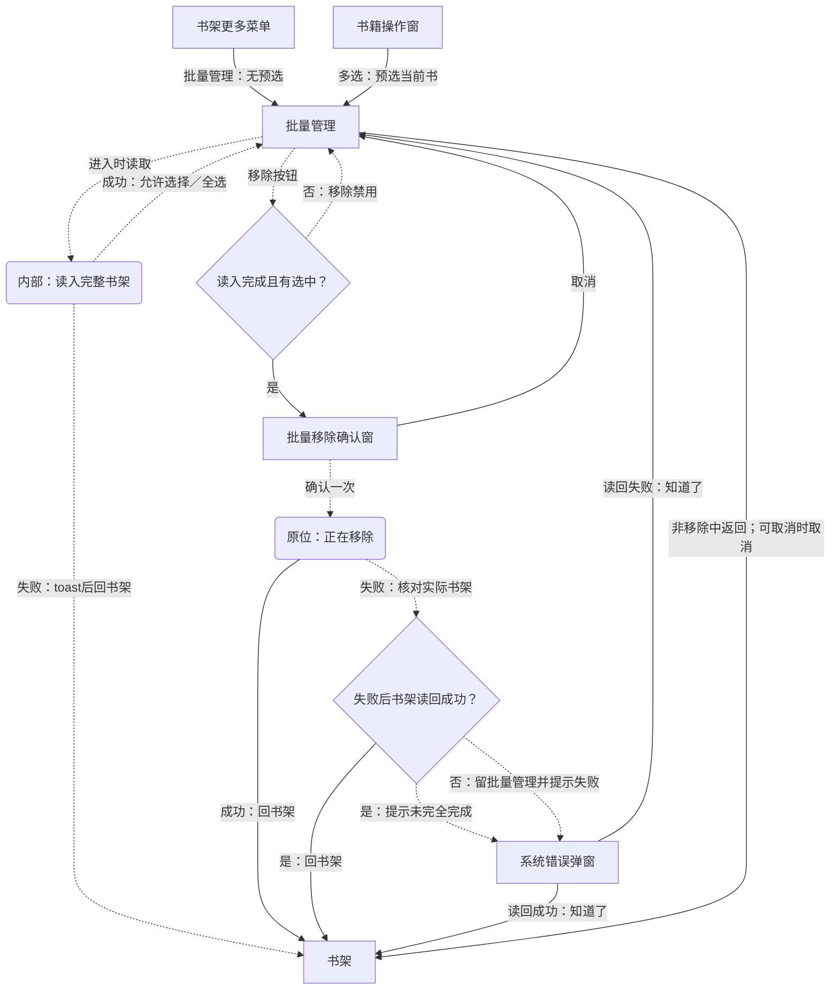

已有状态：已选一本、未选择、全选、列表、读取中、移除中。

**尺寸与约束**

- 源码：全屏Stack，无main-tabs。header58高、左右20/上下8；左右按钮各宽72，标题剩余width居中。List top=58+12=70，行间距12，底偏移=实测removeBarHeight+20，滚动条关闭。手机grid351、卡97×191、封面97×145.44；W≥600时grid622、卡186.67×325.3、封面186.67×280，固定3列、列gap30，整行居中。
- 源码：封面r8、阴影radius26/y8；封面右下选中徽标22×22/r11，right4/bottom4；未选border1.5/阴影radius4/y2，选中橙#F58517/白勾。封面下面Column gap6，标题/作者各maxLines1省略。
- 源码：list 仍用手机48×80封面/r6，即使宽窗口；row宽351/622、高80/行gap12，封面与详情gap12；详情同ShelfBookListDetails高76，选中徽标right2/bottom2位于封面Stack内部，不是整行右下角。
- 源码：removeBar全宽、top border1/上圆角24、paddingtop12/bottom=max(12,interactiveSafeBottom)；触点宽74，图标22、图标文字gap6、字号11/13.31，fallback高度=12+22+6+13.31+bottomInset；禁用opacity0.38。

**排版**

- 源码：标题NotoSerif Bold/700/24/34.49；取消/全选NotoSans Bold/700/13/15.6。网格书名phone NotoSerif Bold/13/16、wide16/19.5；作者phone NotoSans Regular/11/13.5、wide13/16。徽标✓为InterBold14。删除标签InterBold11/13.31；列表文字同ShelfBookListDetails。

**行为与状态**

- 源码：菜单进入默认 none；从特定书籍动作进入 selected 预选该书；all 选中完整当前书架可见身份并将按钮改取消全选；list 用持久化列表方式呈现同一选择模型。选中身份按sourceId/bookId组合键追踪，读回后剔除已不存在身份。
- 源码：loading 尚未完整读书架时不允许取消/全选/点书/移除，底标签正在读取书架；removing 保留当前选中与原列表、底标签正在移除、禁用所有竞争操作；none移除禁用。批量移除先book-removal确认；成功回书架，失败先读回真书架再确定尚未移除集合，不用刷新失败推翻已移除事实。

**移植适配**

- 迁移：1 vp=1 iOS logical pt=1 Android logical dp；下列字体值是 systemFontScale=1 的 fp 基准，字族/字重由交付字体对应。使用统一文字缩放规则；新增不可见触摸目标最小iOS44×44、Android48×48，源响应区值与视觉值分开保留，邻近目标不得重叠。布局不依赖外层浏览器或物理像素宽度。
- 迁移：保持视觉框、间距和控件顺序；小窗口、分屏或大字体超出可用高度时，原内容区允许滚动。安全区由窗口实时提供，键盘弹出时仍可聚焦输入和访问原有操作；不新增确认、取消中或成功页面。
- 源码限制：固定grid351/622不使用安全区宽度公式。W=600时已经切到622宽，内容可能超出窗口；W<351也可能溢出。这是当前实现限制，不是假设其已处理分屏。
- 迁移：保持351/622视觉网格与原600断点；当扣除安全区后不足固定grid时，内容区增加水平滚动并保留垂直滚动，选择状态不重置。大字体保留封面尺寸、卡片至少原height，需要额外文字高度时随内容增长而滚动，不能裁掉选择触点。
- 迁移：22选择徽标仅视觉；整个卡/列表行是选择目标。74宽底动作目标纵向至少平台最小值，保持图标/文字尺寸和安全区底距。

来源：[BookshelfMultiSelectPage.ets:10](/Users/minliny/Documents/Reader/Reader-for-HarmonyOS/entry/src/main/ets/features/bookshelf/BookshelfMultiSelectPage.ets:10)、[BookshelfMultiSelectPage.ets:47](/Users/minliny/Documents/Reader/Reader-for-HarmonyOS/entry/src/main/ets/features/bookshelf/BookshelfMultiSelectPage.ets:47)、[BookshelfMultiSelectPage.ets:54](/Users/minliny/Documents/Reader/Reader-for-HarmonyOS/entry/src/main/ets/features/bookshelf/BookshelfMultiSelectPage.ets:54)、[BookshelfMultiSelectPage.ets:99](/Users/minliny/Documents/Reader/Reader-for-HarmonyOS/entry/src/main/ets/features/bookshelf/BookshelfMultiSelectPage.ets:99)、[BookshelfMultiSelectPage.ets:147](/Users/minliny/Documents/Reader/Reader-for-HarmonyOS/entry/src/main/ets/features/bookshelf/BookshelfMultiSelectPage.ets:147)、[BookshelfMultiSelectPage.ets:213](/Users/minliny/Documents/Reader/Reader-for-HarmonyOS/entry/src/main/ets/features/bookshelf/BookshelfMultiSelectPage.ets:213)、[BookshelfMultiSelectPage.ets:249](/Users/minliny/Documents/Reader/Reader-for-HarmonyOS/entry/src/main/ets/features/bookshelf/BookshelfMultiSelectPage.ets:249)、[BookshelfMultiSelectPage.ets:316](/Users/minliny/Documents/Reader/Reader-for-HarmonyOS/entry/src/main/ets/features/bookshelf/BookshelfMultiSelectPage.ets:316)、[BookshelfMultiSelectPage.ets:366](/Users/minliny/Documents/Reader/Reader-for-HarmonyOS/entry/src/main/ets/features/bookshelf/BookshelfMultiSelectPage.ets:366)、[Index.ets:1460](/Users/minliny/Documents/Reader/Reader-for-HarmonyOS/entry/src/main/ets/pages/Index.ets:1460)、[Index.ets:3892](/Users/minliny/Documents/Reader/Reader-for-HarmonyOS/entry/src/main/ets/pages/Index.ets:3892)。

<a id="route-shelf-more"></a>

#### 书架更多（shelf-more）

**入口与动作路线**

更多菜单先派发所选动作再收拢，检查更新在后台执行，重新打开时由原菜单项显示进度，没有单独更新结果页面。

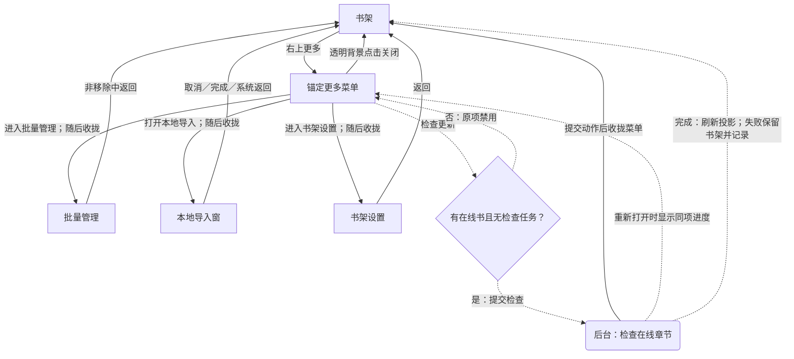

已有状态：菜单、手动检查中、自动检查中、没有在线书籍。

**尺寸与约束**

- 源码：相对右上更多的已测anchor显示，全屏透明点击层；菜单body宽176/r16/border1/阴影radius28/y10，pointer24×12（三角points[0,12;12,0;24,12]），pointer上方区域不算row。4项×50+pointer12=全高212，最小收拢高62。body y12，超高时body内Scroll。
- 源码：Wm=min(176,max(0,overlayW−16)); x=clamp(anchorRight+11−Wm,8,overlayW−Wm−8); y=clamp(anchorBottom−5,0,overlayH−62−8); visibleH=min(panelH,overlayH−y−8); pointerX=clamp(anchorRight−22−x−12,0,Wm−24)。不能固定在浏览器right20/top64来代替真实锚点。
- 源码：每行50、left18/right16/gap16、icon24，文字1行省略；分隔线宽Wm−32/高1、左右16，仅末项不画。项顺序批量管理/本地导入/检查更新/书架设置，图标bookshelf_more_batch/import、settings_gen_refresh、bookshelf_more_settings。

**排版**

- 源码：ReaderNotoSansSC/500/15/22，每行标题maxLines1/ellipsis，禁用更新项opacity0.5并采用muted。

**行为与状态**

- 源码：default 更新可点需有在线书籍且无手动/后台/关闭中任务；updating 文案检查中 done/total；background 正在自动检查；no-online检查更新禁用。其余3项仍可用。菜单透明外部点击关闭。
- 源码：点动作先dispatch onCommit，再启动一次收拢，业务不等待动画结束；展开高度62→212、motion dropdown.menu.expand，reduceMotion立即定位。批量进入multiselect，本地导入local-import，书架设置bookshelf-settings；更新进度更新原菜单项。

**移植适配**

- 迁移：1 vp=1 iOS logical pt=1 Android logical dp；下列字体值是 systemFontScale=1 的 fp 基准，字族/字重由交付字体对应。使用统一文字缩放规则；新增不可见触摸目标最小iOS44×44、Android48×48，源响应区值与视觉值分开保留，邻近目标不得重叠。布局不依赖外层浏览器或物理像素宽度。
- 迁移：保持视觉框、间距和控件顺序；小窗口、分屏或大字体超出可用高度时，原内容区允许滚动。安全区由窗口实时提供，键盘弹出时仍可聚焦输入和访问原有操作；不新增确认、取消中或成功页面。
- 迁移：锚点从实际更多44×44目标测量并在窗口/安全区变化时重新算，三角与body连贯；菜单通过源clamp与内部Scroll适应短窗口。透明点击层不可误用整屏深色scrim；每行50触点满足常用平台最小值。

来源：[BookshelfMoreMenu.ets:5](/Users/minliny/Documents/Reader/Reader-for-HarmonyOS/entry/src/main/ets/features/bookshelf/BookshelfMoreMenu.ets:5)、[BookshelfMoreMenu.ets:60](/Users/minliny/Documents/Reader/Reader-for-HarmonyOS/entry/src/main/ets/features/bookshelf/BookshelfMoreMenu.ets:60)、[BookshelfMoreMenu.ets:137](/Users/minliny/Documents/Reader/Reader-for-HarmonyOS/entry/src/main/ets/features/bookshelf/BookshelfMoreMenu.ets:137)、[BookshelfMoreMenu.ets:172](/Users/minliny/Documents/Reader/Reader-for-HarmonyOS/entry/src/main/ets/features/bookshelf/BookshelfMoreMenu.ets:172)、[BookshelfMoreMenu.ets:193](/Users/minliny/Documents/Reader/Reader-for-HarmonyOS/entry/src/main/ets/features/bookshelf/BookshelfMoreMenu.ets:193)、[BookshelfMoreMenu.ets:215](/Users/minliny/Documents/Reader/Reader-for-HarmonyOS/entry/src/main/ets/features/bookshelf/BookshelfMoreMenu.ets:215)、[BookshelfShell.ets:71](/Users/minliny/Documents/Reader/Reader-for-HarmonyOS/entry/src/main/ets/features/bookshelf/BookshelfShell.ets:71)。

<a id="route-book-actions"></a>

#### 书籍操作（book-actions）

**入口与动作路线**

长按或列表更多打开当前书籍操作窗，选择动作先关闭此窗，再进入多选、详情、默认分组选择或移除确认。

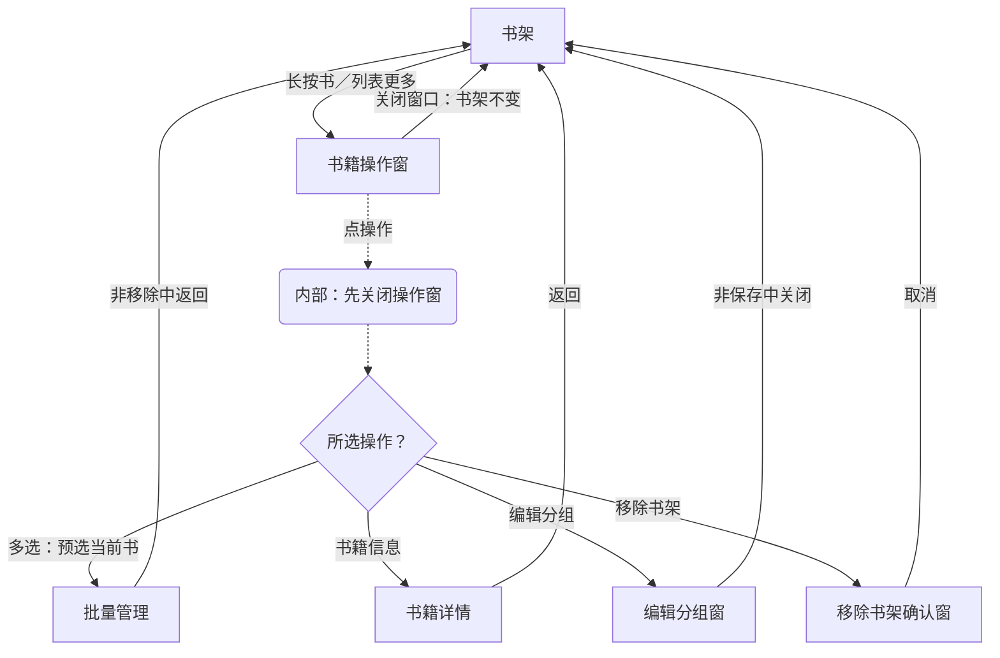

已有状态：操作面板。

**尺寸与约束**

- 源码：书架bindSheet指定高度270、宽=当前shelfContentWidth、prefer CENTER，mask#52000000、outsideInteractive=false、dragBar=false/showClose=false；上圆角24、下0。自定义panel边线1/阴影46/y18/clip；不能画成带关闭X或自动底部贴边的全宽sheet。
- 源码：抓手42×4/r999，x=(C−42)/2、y9；“书籍操作”x14/y34、maxLines1。动作左右14、宽C−28、高40/r12，4项y70/116/162/208，文字left12，顺序多选/书籍信息/编辑分组/移除书架；末项danger背景#1AD6473D，其余primary-soft。

**排版**

- 源码：标题NotoSans Bold/700/17/20.4；按钮NotoSans Bold/700/13/15.6，maxLines1；danger字#D7473E，其余TOK_GREEN。

**行为与状态**

- 源码：default 为当前书籍动作，仅由长按书或列表更多进入；选项先关闭sheet再执行当前书动作。多选预选该身份、书籍信息进入detail、编辑分组打开group-select、移除书架打开book-removal。没有完整分组管理或提交状态页。

**移植适配**

- 迁移：1 vp=1 iOS logical pt=1 Android logical dp；下列字体值是 systemFontScale=1 的 fp 基准，字族/字重由交付字体对应。使用统一文字缩放规则；新增不可见触摸目标最小iOS44×44、Android48×48，源响应区值与视觉值分开保留，邻近目标不得重叠。布局不依赖外层浏览器或物理像素宽度。
- 迁移：保持视觉框、间距和控件顺序；小窗口、分屏或大字体超出可用高度时，原内容区允许滚动。安全区由窗口实时提供，键盘弹出时仍可聚焦输入和访问原有操作；不新增确认、取消中或成功页面。
- 迁移：保持源270高/居中；短窗口不能剪掉末项，允许面板内容滚动并避开安全区。40高按钮扩充不可见响应区至统一最小目标，6间隔不得形成重叠响应；抓手只作视觉，不能凭图片新增可拖拽行为。

来源：[BookshelfPage.ets:279](/Users/minliny/Documents/Reader/Reader-for-HarmonyOS/entry/src/main/ets/features/bookshelf/BookshelfPage.ets:279)、[BookshelfBookActionSheet.ets:11](/Users/minliny/Documents/Reader/Reader-for-HarmonyOS/entry/src/main/ets/features/bookshelf/BookshelfBookActionSheet.ets:11)、[BookshelfBookActionSheet.ets:31](/Users/minliny/Documents/Reader/Reader-for-HarmonyOS/entry/src/main/ets/features/bookshelf/BookshelfBookActionSheet.ets:31)、[BookshelfBookActionSheet.ets:69](/Users/minliny/Documents/Reader/Reader-for-HarmonyOS/entry/src/main/ets/features/bookshelf/BookshelfBookActionSheet.ets:69)。

<a id="route-group-select"></a>

#### 编辑分组（group-select）

**入口与动作路线**

当前仅能选择默认分组，保存中阻止重复操作和关闭，成功关闭刷新书架，失败保留原窗并toast提示。

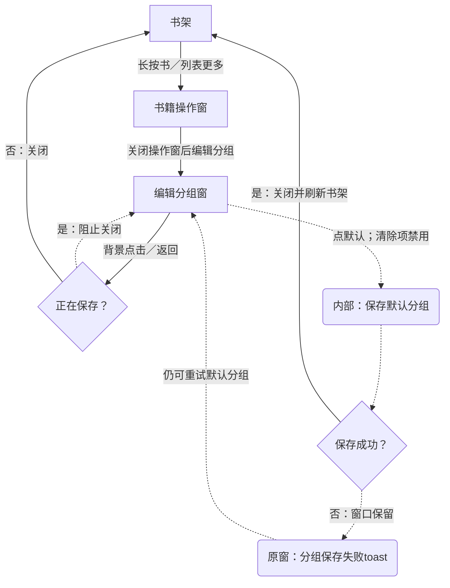

已有状态：默认分组、保存中。

**尺寸与约束**

- 源码：Index居中dialog，mask#52000000、宽75%host、padding20/r20/solid，无shadow/border；标题与body间12，无底部操作行、无顶部关闭X。
- 源码：内部BookshelfGroupSelector Column gap8，paddingtop/bottom8；首行“分组”layoutWeight1/单行省略、清除高28；默认胶囊左右12/上下5、border1/r999、选中TOK_GREEN边线与primary-soft底色，未选card背景。

**排版**

- 源码：dialog标题NotoSans Bold/700/17/20居中；“分组/清除”字号12、family/lineHeight未声明；默认Inter/500/12/18。

**行为与状态**

- 源码：default 当前仅有默认分组；Index未传activeGroup故值为空，清除禁用opacity0.5；选中与否取书籍group是否为空。busy 阻止默认点击与外部mask关闭，保留原按钮/文案而非显示保存页。
- 源码：默认点击保存空group，成功关闭并刷新书架；失败原弹窗保留并toast提示。默认态外部点击可关闭；没有新增分组或完整管理入口。

**移植适配**

- 迁移：1 vp=1 iOS logical pt=1 Android logical dp；下列字体值是 systemFontScale=1 的 fp 基准，字族/字重由交付字体对应。使用统一文字缩放规则；新增不可见触摸目标最小iOS44×44、Android48×48，源响应区值与视觉值分开保留，邻近目标不得重叠。布局不依赖外层浏览器或物理像素宽度。
- 迁移：保持视觉框、间距和控件顺序；小窗口、分屏或大字体超出可用高度时，原内容区允许滚动。安全区由窗口实时提供，键盘弹出时仍可聚焦输入和访问原有操作；不新增确认、取消中或成功页面。
- 迁移：75%host保留相对宽度，safe可用宽不足时将框夹入安全区并允许body滚动；明确此为窄窗补充规则。28高清除/胶囊扩充不可见触摸区，不改变禁用保护。

来源：[Index.ets:1211](/Users/minliny/Documents/Reader/Reader-for-HarmonyOS/entry/src/main/ets/pages/Index.ets:1211)、[ReaderSurfaceSpecs.ets:147](/Users/minliny/Documents/Reader/Reader-for-HarmonyOS/entry/src/main/ets/features/common/ReaderSurfaceSpecs.ets:147)、[BookshelfGroupSelector.ets:16](/Users/minliny/Documents/Reader/Reader-for-HarmonyOS/entry/src/main/ets/features/bookshelf/BookshelfGroupSelector.ets:16)。

<a id="route-local-import"></a>

#### 导入本地书籍（local-import）

**入口与动作路线**

系统多选返回后在同一导入窗执行并显示逐文件结果，取消选择回原窗，异常回选择状态且保留已保存书籍，背景没有关闭动作。

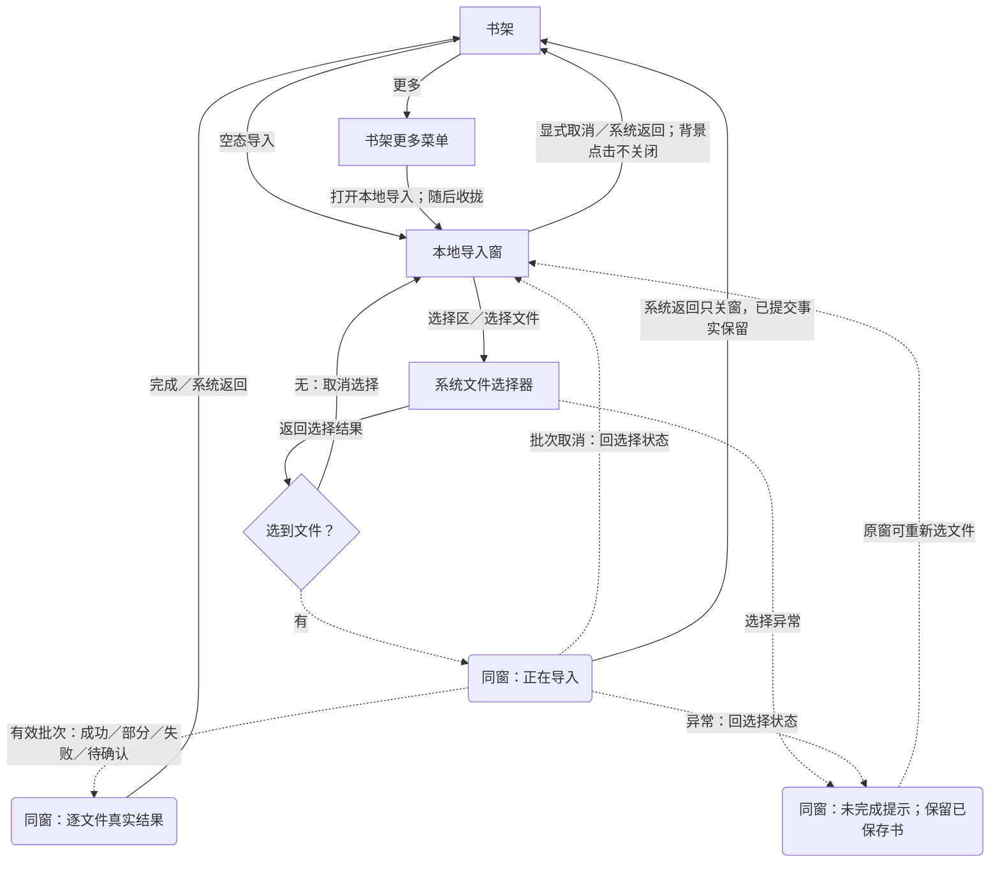

已有状态：选择文件、系统选择中、正在导入、全部完成、部分完成、全部未完成、待确认。

**尺寸与约束**

- 源码：水平几何统一为 L=max(安全左边距,约定左间距)，R=W−max(安全右边距,约定右间距)，A=max(0,R−L)，C=min(内容宽上限,A)，居中时 x=L+(A−C)/2。安全边距取对应源码的 visual/interactive，不能把内容宽、视口宽和设备物理像素混用。
- 源码：全屏居中Stack、遮罩 #661F1B17（不是普通确认框#52000000）；panel cap350、左右gap20/interactive safe/r20、阴影radius50/y25、opaque solid。selection/picker panel固定高399.75；导入/结果采用同一不透明shell过渡，无中途空白页面。
- 源码：selection header左右20/top20/bottom17，title行24.75，divider1；body左右20/top20。选择区宽panel−40、dashed border2/r14，左右pad2/topbottom30；icon圆44/内部glyph20；图标与文字/format Row之间spacing12；4个format标签gap6/r4、pad6×2。信息行图标13/top2/gap8、上margin16。
- 源码：selection 底行top20/bottom20/gap12：主按钮layoutWeight1/高44/r22，icon15/gap8；取消高44、左右21/r22/border1、icon13/gap6。picker 保留相同尺寸，按钮改正在选择…，选择区及主按钮disabled，取消仍在。
- 源码：importing视觉shell高228，halo56/内spinner32，spinner周期1000ms；reduceMotion静止。结果header同24.75标题；summary外pad16，卡minHeight52/r12/border1/pad水平17垂直8，左圆36/icon18、rowgap12，标题与计数gap1；尾部refresh glyph18只是图像。
- 源码：结果逐文件列表r12/border1/clip，每行minHeight61、left/right16/top10/bottom11/行gap12、divider1；文档圆32/glyph16、末状态glyph17；标题单行省略，失败说明最多2行。结果底部完成40高/r20、宽panel−32、左右16、icon14/gap6。
- 源码：结果可用height=窗口H−interactiveSafeTop−interactiveSafeBottom−40。chrome=measuredHeader+measuredSummary+12；footer=实测动作高。compact=(chrome+footer>available)；listBudget=max(0,available−footer−(compact?0:chrome))；listHeight=min(itemsMeasured,listBudget)；panelH=min(available,chrome+footer+itemsMeasured)。常规仅列表滚动，compact时header+summary+items共同滚动，完成动作仍可访问。

**排版**

- 源码：header NotoSerif Bold/700/18/24.75/max1；选择区主文Inter700/13/19.5/letterSpacing−0.0762，次文Inter400/11/16.5/letterSpacing0.0645；format标签Inter700/10/15/letterSpacing0.3672；信息Inter400/11/16.5/letterSpacing0.0645。
- 源码：选择文件Inter800/13/19.5、取消Inter600/13/19.5、letterSpacing−0.0762；导入提示Inter600/14/21、请稍候11/16.5；summary标题Inter700/13/19.5/−0.0762，count11/16.5/0.0645；文件titleInter600/12/18，状态标签Inter700/10/15/0.3672，失败说明11/16.5/max2；完成Inter800/13/19.5/−0.0762。

**行为与状态**

- 源码：selection/picker → 系统多选文件 → importing → result/partial/failed/recovery。选择区与选择文件等价；选择取消回当前弹窗；显式取消关闭，遮罩没有任意点击关闭动作。可见formats TXT/EPUB/MOBI/AZW3；实际native准入还包含AZW/KF8，界面标签不是完整解析实现声明。
- 源码：结果标题按事实：result导入完成，partial部分导入完成，failed导入未完成，recovery部分结果待确认；counts分别真实新增/已在书架/未知/待确认/失败。逐文件记录保留，失败不回滚其他成功文件；refresh图标无onClick，不制造刷新/重试操作。完成关闭原弹窗。
- 源码：关闭/重入与detached导入结果、Core持久化事实分开；失败结果不能当成功，书架读回失败也不能推翻已成功导入。recovery未确认提示结果未确认，请重启后检查书架；普通失败保留真实failureMessage。无新增正在取消导入页。

**移植适配**

- 迁移：1 vp=1 iOS logical pt=1 Android logical dp；下列字体值是 systemFontScale=1 的 fp 基准，字族/字重由交付字体对应。使用统一文字缩放规则；新增不可见触摸目标最小iOS44×44、Android48×48，源响应区值与视觉值分开保留，邻近目标不得重叠。布局不依赖外层浏览器或物理像素宽度。
- 迁移：保持视觉框、间距和控件顺序；小窗口、分屏或大字体超出可用高度时，原内容区允许滚动。安全区由窗口实时提供，键盘弹出时仍可聚焦输入和访问原有操作；不新增确认、取消中或成功页面。
- 源码限制：selection高399.75固定且无自身Scroll，短窗口/大字体可能不足。迁移：正常窗口保持399.75；可用H不足时将同一selection内容放入安全区内Scroll，保留header/body/actions顺序和44高动作，避免系统文件选择器返回后失去焦点。
- 迁移：系统文件选择器用iOS/Android原生文档多选API，对接同一文件准入/逐项结果模型，不模拟无依据成功；新平台路径权限持久化属于平台适配。结果布局必须实测header、summary、footer与文件行，不根据条数硬编码高度。

来源：[LocalImportDialog.ets:35](/Users/minliny/Documents/Reader/Reader-for-HarmonyOS/entry/src/main/ets/features/bookshelf/LocalImportDialog.ets:35)、[LocalImportDialog.ets:90](/Users/minliny/Documents/Reader/Reader-for-HarmonyOS/entry/src/main/ets/features/bookshelf/LocalImportDialog.ets:90)、[LocalImportDialog.ets:134](/Users/minliny/Documents/Reader/Reader-for-HarmonyOS/entry/src/main/ets/features/bookshelf/LocalImportDialog.ets:134)、[LocalImportDialog.ets:267](/Users/minliny/Documents/Reader/Reader-for-HarmonyOS/entry/src/main/ets/features/bookshelf/LocalImportDialog.ets:267)、[LocalImportDialog.ets:298](/Users/minliny/Documents/Reader/Reader-for-HarmonyOS/entry/src/main/ets/features/bookshelf/LocalImportDialog.ets:298)、[LocalImportDialog.ets:352](/Users/minliny/Documents/Reader/Reader-for-HarmonyOS/entry/src/main/ets/features/bookshelf/LocalImportDialog.ets:352)、[LocalImportDialog.ets:413](/Users/minliny/Documents/Reader/Reader-for-HarmonyOS/entry/src/main/ets/features/bookshelf/LocalImportDialog.ets:413)、[LocalImportDialog.ets:488](/Users/minliny/Documents/Reader/Reader-for-HarmonyOS/entry/src/main/ets/features/bookshelf/LocalImportDialog.ets:488)、[LocalImportDialog.ets:521](/Users/minliny/Documents/Reader/Reader-for-HarmonyOS/entry/src/main/ets/features/bookshelf/LocalImportDialog.ets:521)、[LocalImportDialog.ets:552](/Users/minliny/Documents/Reader/Reader-for-HarmonyOS/entry/src/main/ets/features/bookshelf/LocalImportDialog.ets:552)、[LocalImportDialog.ets:563](/Users/minliny/Documents/Reader/Reader-for-HarmonyOS/entry/src/main/ets/features/bookshelf/LocalImportDialog.ets:563)、[LocalImportLayout.ts:13](/Users/minliny/Documents/Reader/Reader-for-HarmonyOS/entry/src/main/ets/features/bookshelf/LocalImportLayout.ts:13)、[BookshelfFlowGateway.ts:204](/Users/minliny/Documents/Reader/Reader-for-HarmonyOS/entry/src/main/ets/features/bookshelf/BookshelfFlowGateway.ts:204)、[Index.ets:6799](/Users/minliny/Documents/Reader/Reader-for-HarmonyOS/entry/src/main/ets/pages/Index.ets:6799)。

<a id="route-book-removal"></a>

#### 移除书架确认（book-removal）

**入口与动作路线**

移除确认只消费一次；取消回原底页，详情移除已确认后退回原入口，批量失败按读回结果决定回书架或保留批量管理。

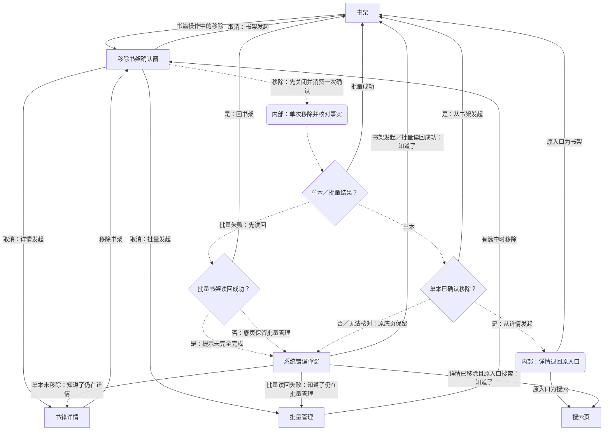

已有状态：在线书籍、本地书籍、批量。

**尺寸与约束**

- 源码：水平几何统一为 L=max(安全左边距,约定左间距)，R=W−max(安全右边距,约定右间距)，A=max(0,R−L)，C=min(内容宽上限,A)，居中时 x=L+(A−C)/2。安全边距取对应源码的 visual/interactive，不能把内容宽、视口宽和设备物理像素混用。
- 源码：共用ReaderDialogSurface book-removal规格，居中width cap306、左右gap20/interactive safe、pad17/r12/border1/shadow。标题与body间16；body后到actions间30；动作并排等分/间距10、高38/r12，响应高44/y−3；没有top-close。普通遮罩#52000000。
- 源码：message Scroll 高=min(max(50,measuredMessageHeight),messageMaxHeight)，maxHeight=max(50,windowH−systemInsets.top−systemInsets.bottom−200×max(1,systemFontScale))；自动滚动条，不省略长书名/本地删除说明。内容高度由实际文本测量，非固定两行。
- 源码：取消使用panel-soft/ink，移除使用注册role app.BookshelfBookActionSheet.actionSlot.fontColor.FFD7473E作实心底色、TOK_CARD_BG_HI作字色（night字色随card变化）；取消是defaultFocus。未明确宽高的系统边缘保护不能用HTMLmax-height viewport来代替。

**排版**

- 源码：标题NotoSans Bold/700/17/20、左对齐；消息NotoSans Regular/400/13、未声明lineHeight；动作NotoSans Bold/700/13/16。长消息自然换行并滚动。

**行为与状态**

- 源码：online 消息说明书源/阅读进度/已缓存正文不删除，可搜索再次加入；local 明确删除应用内解析内容/阅读进度/离线任务、系统原始文件不影响；batch 包含实际选中数量并保留本地原始文件。3个variant是同一确认组件消息差异。
- 源码：取消关闭且无移除；移除确认一次性消费后调用Core。已删除事实与后续刷新失败分开；批量读回真实书架确定部分结果。没有移除成功/提交已确认/正在取消新页面。

**移植适配**

- 迁移：1 vp=1 iOS logical pt=1 Android logical dp；下列字体值是 systemFontScale=1 的 fp 基准，字族/字重由交付字体对应。使用统一文字缩放规则；新增不可见触摸目标最小iOS44×44、Android48×48，源响应区值与视觉值分开保留，邻近目标不得重叠。布局不依赖外层浏览器或物理像素宽度。
- 迁移：保持视觉框、间距和控件顺序；小窗口、分屏或大字体超出可用高度时，原内容区允许滚动。安全区由窗口实时提供，键盘弹出时仍可聚焦输入和访问原有操作；不新增确认、取消中或成功页面。
- 迁移：对话框保持306上限/17内距/38高视觉按钮；消息依照窗口与字体scale实测滚动，actions固定可访问，按钮不可见44触摸区不交叠；焦点按取消默认、移除明确危险操作的原组件语义。

来源：[BookRemovalDialog.ets:23](/Users/minliny/Documents/Reader/Reader-for-HarmonyOS/entry/src/main/ets/features/bookshelf/BookRemovalDialog.ets:23)、[BookRemovalDialog.ets:45](/Users/minliny/Documents/Reader/Reader-for-HarmonyOS/entry/src/main/ets/features/bookshelf/BookRemovalDialog.ets:45)、[ReaderSurfaceSpecs.ets:112](/Users/minliny/Documents/Reader/Reader-for-HarmonyOS/entry/src/main/ets/features/common/ReaderSurfaceSpecs.ets:112)、[ReaderDialogSurface.ets:155](/Users/minliny/Documents/Reader/Reader-for-HarmonyOS/entry/src/main/ets/features/common/ReaderDialogSurface.ets:155)、[ReaderDialogSurface.ets:226](/Users/minliny/Documents/Reader/Reader-for-HarmonyOS/entry/src/main/ets/features/common/ReaderDialogSurface.ets:226)、[Index.ets:3862](/Users/minliny/Documents/Reader/Reader-for-HarmonyOS/entry/src/main/ets/pages/Index.ets:3862)。

<a id="route-settings"></a>

#### 设置首页（settings）

**入口与动作路线**

设置首页当前仅通往通用设置、书源管理和书架设置，底栏可回书架。

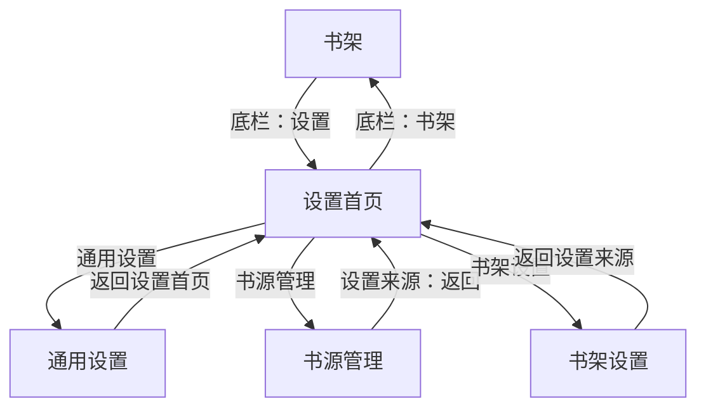

已有状态：当前入口。

**尺寸与约束**

- 【源码】使用实时窗口与安全边界；左右边界各取 max(视觉安全边距,19)，可用宽内将内容居中，宽上限 720；不以 390/760 样本宽代替运行时测量。
- 【源码】全高 SettingsShell：底层纵向 Scroll、顶部浮动 AppTopBar、底部浮动 MainTabBar；滚动内容 top=58+8=66，区块间隔 12，滚动条隐藏。
- 【源码】首页只含一个「设置」CategorySection，内为通用设置、书源管理、书架设置三行；卡片 Fill，高度随内容，1 vp TOK_BORDER，半径 8；内 top=9、bottom=1，标题后 gap=5。
- 【源码】导航行最小高 58，左右内距 12，间隔 12；图标盒 28×28/r14，内图 15×15，尾部箭头 14×14，label 占剩余宽。整行承担点击。
- 【源码】首页内容底留白=68+max(15,交互安全底距)+16；底栏仅「书架 / 设置」，当前设置项抑制重复选择。

**排版**

- 【源码】ReaderInter → InterVariable.ttf；ReaderNotoSansSC → NotoSansSC-VF.otf；ReaderNotoSerifSCBold/Regular → NotoSerifSC-Bold/Regular.ttf。前者许可证为 rawfile/Inter-OFL.txt，后三个共享 rawfile/Noto-OFL.txt。
- 【源码】首页「设置」标题使用 TYPE_APP_HOME_TITLE：ReaderNotoSerifSCBold 700，29 fp / 38 fp。
- 【源码】分节标题 ReaderInter 900，13 fp / 15.6 fp，标题容器高 16，左右 padding 12，单行省略；行 label ReaderInter 800，13 fp / 15.34 fp，TOK_INK，单行省略。
- 【源码】底栏 label ReaderNotoSansSC 700，11 fp / 18 fp；图标从已实现 SVG day/night 资源读取。

**行为与状态**

- 【源码 · default】仅当前 L0 准入入口可见；同步、语言、启动页、权限、关于等受关闭的 product gate 限制，不补画不可达入口。
- 【源码】通用设置只改变 activeSection；书源管理进入 source 路由；书架设置记录 settings 返回来源。点书架底栏返回书架；设置首页无返回按钮。
- 【源码】CategoryRow 使用 ReaderPressFeedback；图标与标题装饰不形成第二套点击 / 状态；无文本输入与键盘。

**移植适配**

- 【新增跨平台适配】几何 1 vp = 1 iOS 逻辑 pt = 1 Android dp；系统字体角色 fp 经各端系统字体缩放API换算：iOS UIFontMetrics逐role，Android fp→sp并用平台非线性转换，禁止用单一倍率乘法或按截图倍率放大。
- 【新增跨平台适配】保留浮动导航、内部滚动留白及三行顺序；系统安全区只应用一次，不再叠加系统导航栏高度。窄窗 label 收缩并单行省略，尾部控件保留固有宽。
- 【新增跨平台适配】在 iOS/Android 使用同一主题注册表及物理字体文件，不能把 ReaderInter 800/900 擅自降为默认系统 medium。

来源：[SettingsPage.ets:134](/Users/minliny/Documents/Reader/Reader-for-HarmonyOS/entry/src/main/ets/features/settings/SettingsPage.ets:134)、[SettingsShell.ets:55](/Users/minliny/Documents/Reader/Reader-for-HarmonyOS/entry/src/main/ets/features/shell/SettingsShell.ets:55)、[SettingsShell.ets:157](/Users/minliny/Documents/Reader/Reader-for-HarmonyOS/entry/src/main/ets/features/shell/SettingsShell.ets:157)、[CategorySection.ets:23](/Users/minliny/Documents/Reader/Reader-for-HarmonyOS/entry/src/main/ets/features/settings/CategorySection.ets:23)、[CategoryRow.ets:26](/Users/minliny/Documents/Reader/Reader-for-HarmonyOS/entry/src/main/ets/features/settings/CategoryRow.ets:26)、[ReaderTypography.ets:56](/Users/minliny/Documents/Reader/Reader-for-HarmonyOS/entry/src/main/ets/features/common/ReaderTypography.ets:56)、[ReaderFloatingBarMetrics.ts:6](/Users/minliny/Documents/Reader/Reader-for-HarmonyOS/entry/src/main/ets/features/common/ReaderFloatingBarMetrics.ts:6)、[ReaderFonts.ets:16](/Users/minliny/Documents/Reader/Reader-for-HarmonyOS/entry/src/main/ets/features/common/ReaderFonts.ets:16)、[ReaderProductScope.ts:17](/Users/minliny/Documents/Reader/Reader-for-HarmonyOS/entry/src/main/ets/app/ReaderProductScope.ts:17)、[Index.ets:1424](/Users/minliny/Documents/Reader/Reader-for-HarmonyOS/entry/src/main/ets/pages/Index.ets:1424)。

<a id="route-general"></a>

#### 通用设置（general）

**入口与动作路线**

主题、开关、缓存和恢复结果均留在通用设置，只有恢复默认会先打开系统确认框。

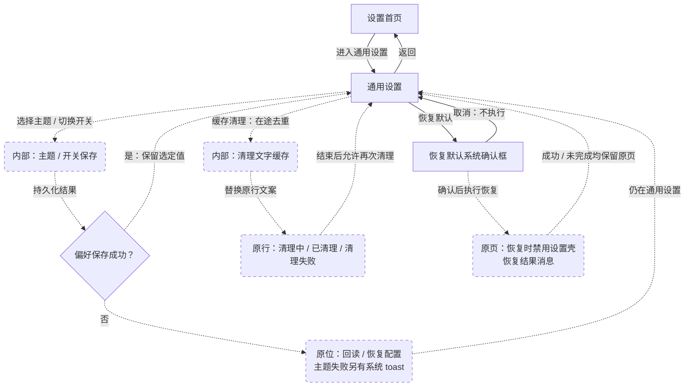

已有状态：默认值、App 浅色选择、App 深色选择、减少动态效果开启、清理中：原行、已清理：原行、清理失败：原行、恢复时禁用原页、恢复成功：原页、恢复未完成：原页。

**尺寸与约束**

- 【源码】使用实时窗口与安全边界；左右边界各取 max(视觉安全边距,19)，可用宽内将内容居中，宽上限 720；不以 390/760 样本宽代替运行时测量。
- 【源码】PageBackBar 高 58，横向间隔 10；左右内距各 max(20,交互安全边距)，返回图标 24×24 在 44×44、半径 22 的目标内；标题单行省略。
- 【源码】全高 Scroll，top=66、卡间距 12、底留白 max(12,交互安全底距)，无主底栏；「基础偏好」「行为与反馈」沿用首页 CategorySection。
- 【源码】App主题行最小高 58、横内距 12、左右两列 gap=12；左列 icon28/内图15＋label Fill；右侧 ReaderSegmentedControl 固定 168×36/r8，1 vp 边框、四边 padding2。三个等分段各高30/r6，选中段独立1 vp描边。
- 【源码】开关绘制 44×24/r999，旋钮 20×20/r10，位置 off=(2,2)、on=(22,2)；明确响应区 x0/y−10/w44/h44，整行也可切换。
- 【源码】缓存行仍高至少58；尾部动作 minWidth66/maxWidth55%/minHeight34，padding左右10、上下8、r6，文案最多两行。整行点击调用清理，忙碌时由 handler 去重。
- 【源码】独立恢复默认卡 minHeight58/r8、左右 padding13/12、gap10；图标盒28，内图15，箭头14。恢复结果 Text 位于此卡后，宽100%、padding12；不是结果路由。

**排版**

- 【源码】ReaderInter → InterVariable.ttf；ReaderNotoSansSC → NotoSansSC-VF.otf；ReaderNotoSerifSCBold/Regular → NotoSerifSC-Bold/Regular.ttf。前者许可证为 rawfile/Inter-OFL.txt，后三个共享 rawfile/Noto-OFL.txt。
- 【源码】子页标题 ReaderNotoSerifSCBold，700，24 fp / 33 fp 行高，TOK_INK；不使用系统导航栏默认标题字体。
- 【源码】区块标题 Inter900 13/15.6；普通行 label Inter800 13/15.34、单行省略。App主题段 Inter Bold 12，单行，源未显式指定段字行高。
- 【源码】缓存动作 Inter800 11/16，居中、最多2行；恢复默认 Inter400 16/19.2、TOK_DANGER、单行；恢复消息12 fp、TOK_MUTED，源未指定行高与字体族。
- 【源码】分段颜色使用 ReaderSegmentedControl 的 SEG_BG/BORDER/SELECTED_BG/SELECTED_BORDER/TEXT_ACTIVE/TEXT_INACTIVE；不能把选中段改成页面主按钮填充色。

**行为与状态**

- 【源码 · default/theme-day/theme-night】选项「跟随 / 浅色 / 深色」映射 system/day/night；选中值来自 readerAppThemeMode。应用主题持久化失败恢复配置并系统 toast「主题保存失败，已恢复原配置」。
- 【源码 · reduce-motion】autoCheckUpdate 默认true、reduceMotion默认false；行与开关都触发同一幂等目标值，先更新当前页，再经 Host 偏好队列保存；失败回读实际快照，当前入口没有新错误页或统一弹窗。
- 【源码 · cache-busy/cache-success/cache-error】「清理文字缓存 → 清理中 → 已清理 / 清理失败」原行文字替换；在途请求重复点击直接返回；结束后允许再次点击。cache.clear scope=cache，无二次确认。
- 【源码 · reset-busy/reset-success/reset-error】先系统确认；执行时整个 SettingsShell.enabled=false，清空旧 resetMessage；成功「已恢复界面与阅读设置」，false返回「恢复未完成，请重试」，异常「恢复未完成，已保留恢复记录；点击恢复默认重试」。保持原子页。
- 【源码】恢复回调只允许当前 mounted/revision 写回；离开页面旧回调不能把新实例改成成功。通用设置返回改变 activeSection 为 home，无输入控件。

**移植适配**

- 【新增跨平台适配】几何 1 vp = 1 iOS 逻辑 pt = 1 Android dp；系统字体角色 fp 经各端系统字体缩放API换算：iOS UIFontMetrics逐role，Android fp→sp并用平台非线性转换，禁止用单一倍率乘法或按截图倍率放大。
- 【新增跨平台适配】保留固定168宽分段、行 label 的剩余宽 / 省略规则和缓存55%上限。较大用户字号不得缩小字级；允许 minHeight 行随内容增高，分段保持源码可见尺寸，触摸区可外扩且不可抢邻段事件。
- 【新增跨平台适配】恢复 busy 应禁用同一页全部交互，包括返回与切换主题；缓存 busy 只去重缓存动作，不人为锁死全页。此差异必须由真实状态控制。

来源：[SettingsPage.ets:152](/Users/minliny/Documents/Reader/Reader-for-HarmonyOS/entry/src/main/ets/features/settings/SettingsPage.ets:152)、[SettingsPage.ets:211](/Users/minliny/Documents/Reader/Reader-for-HarmonyOS/entry/src/main/ets/features/settings/SettingsPage.ets:211)、[SettingsPage.ets:309](/Users/minliny/Documents/Reader/Reader-for-HarmonyOS/entry/src/main/ets/features/settings/SettingsPage.ets:309)、[SettingsPage.ets:351](/Users/minliny/Documents/Reader/Reader-for-HarmonyOS/entry/src/main/ets/features/settings/SettingsPage.ets:351)、[SettingsPage.ets:504](/Users/minliny/Documents/Reader/Reader-for-HarmonyOS/entry/src/main/ets/features/settings/SettingsPage.ets:504)、[SettingsPage.ets:533](/Users/minliny/Documents/Reader/Reader-for-HarmonyOS/entry/src/main/ets/features/settings/SettingsPage.ets:533)、[SettingsOrchestrator.ets:68](/Users/minliny/Documents/Reader/Reader-for-HarmonyOS/entry/src/main/ets/features/settings/SettingsOrchestrator.ets:68)、[ReaderSegmentedControl.ets:6](/Users/minliny/Documents/Reader/Reader-for-HarmonyOS/entry/src/main/ets/features/common/ReaderSegmentedControl.ets:6)、[ReaderToggle.ets:19](/Users/minliny/Documents/Reader/Reader-for-HarmonyOS/entry/src/main/ets/features/common/ReaderToggle.ets:19)、[SettingsShell.ets:75](/Users/minliny/Documents/Reader/Reader-for-HarmonyOS/entry/src/main/ets/features/shell/SettingsShell.ets:75)、[Index.ets:1548](/Users/minliny/Documents/Reader/Reader-for-HarmonyOS/entry/src/main/ets/pages/Index.ets:1548)。

<a id="route-sources"></a>

#### 书源管理（sources）

**入口与动作路线**

书源管理按入口返回设置或搜索，筛选、检测和启停原位处理，新增、登录及工具具有各自实际窗口或页面。

```mermaid
flowchart TD
  Entry["设置首页 / 搜索页"]
  Sources["书源管理"]
  Load("内部：读取 Core 书源列表"):::inline
  Banner("原页：读取失败与重试"):::inline
  Filter("内部：名称 / 域名 / 分组 / 类型 / 状态筛选"):::inline
  Projection("原位：筛选后的书源列表"):::inline
  Tools["批量管理与书源工具"]
  Import["导入书源弹层"]
  Login["Host 登录 / 验证 Web 窗口"]
  Check("内部：单源默认搜索检测"):::inline
  CheckState("原行：检测结果 / 未检测"):::inline
  Toggle("内部：启停更新与会话清理"):::inline
  Entry -->|"管理书源；记录返回来源"| Sources
  Sources -->|"普通返回原来源；不自动重搜"| Entry
  Sources -.->|"进入 / 重读"| Load
  Load -.->|"读取成功：替换列表"| Sources
  Load -.->|"读取失败"| Banner
  Banner -.->|"重试：只读列表"| Load
  Sources -.->|"改变搜索与筛选值"| Filter
  Filter -.->|"重建当前投影"| Projection
  Projection -.->|"仍在同页"| Sources
  Sources -->|"更多 / 批量管理"| Tools
  Tools -->|"返回并重新读列表"| Load
  Sources -->|"新增书源"| Import
  Import -->|"明确关闭"| Sources
  Sources -->|"有登录地址：登录"| Login
  Login -.->|"完成后检测"| Check
  Login -.->|"取消 / 异常：未检测"| CheckState
  Sources -.->|"检测：同源在途去重"| Check
  Check -.->|"通过 / 失败更新原行"| CheckState
  CheckState -.->|"不打开结果页面"| Sources
  Sources -.->|"切换启停"| Toggle
  Toggle -.->|"确认后更新；失败保留原值"| Sources
  classDef inline stroke-dasharray:5 5;
```

已有状态：未检测列表、原页读取中、读取失败与重试、没有书源、筛选后无匹配、实际分组下拉、单源检测中、单源检测通过、单源检测失败、原页导入中、原页导入结果、部分导入结果、原页导入失败。

**尺寸与约束**

- 【源码】使用实时窗口与安全边界；左右边界各取 max(视觉安全边距,19)，可用宽内将内容居中，宽上限 720；不以 390/760 样本宽代替运行时测量。
- 【源码】PageBackBar 高 58，横向间隔 10；左右内距各 max(20,交互安全边距)，返回图标 24×24 在 44×44、半径 22 的目标内；标题单行省略。
- 【源码】全高 List 延伸到浮动栏后，contentStartOffset58，contentEndOffset=44+12+max(16,交互安全底距)；搜索、数量、状态、分组、类别属于首个 ListItem，会随列表滚动；导航与底动作栏浮动。
- 【源码】搜索字段 h38/r8/1 vp边框、左右padding12、图标13、图文gap8；输入框h36，field顶部margin8。数量行 top margin8。
- 【源码】手机状态与分组纵向 gap8；源码 isTablet 时横排 gap20，每组宽 max(0,(contentWidth−20)/2)，高36。状态五chip高32/r16，间隔8；设计宽58/58/58/72/72，各乘 min(1,max(0,controlWidth−32)/318)。
- 【源码】分组 folder15、文字左margin12、select左margin22；select宽=max(0,controlWidth−74)，高36/r8。文字位于(14,10)，可用宽w−42；chevron12×12位于(w−21,12)，开时转180°。
- 【源码】类别横向Scroll高40、top margin8、chip高32/r16、左右padding12、gap8；「全部类型 / 小说 / 漫画 / 音乐/有声 / 下载/文件 / 视频/外部媒体 / 其他/混合」。
- 【源码】源行高70、左padding12、列间gap8、顶部1 vp分隔；信息列Fill可收缩，源名与类别gap6，信息纵gap8。可选登录44×28/r7；检测44×28/r7；状态徽标24×18/r999、圆点7；toggle44×24、触摸44×44。
- 【源码】底栏两等分动作高44/r8、gap10，上margin12、下margin max(16,交互安全底距)；新增图标source_add18×18、图文gap8。空列表卡paddingTop64、内容gap8；筛选0条无额外空匹配文案。
- 【源码】状态banner padding8/top margin8/r7，信息Fill、最多2行；只有 statusKind=error 才显示重试。分组面板在全高根Stack：x/y为实测global坐标减宿主origin，宽同select、每行36/r8、选中行置顶，余项单行省略；透明背景点按关闭。

**排版**

- 【源码】ReaderInter → InterVariable.ttf；ReaderNotoSansSC → NotoSansSC-VF.otf；ReaderNotoSerifSCBold/Regular → NotoSerifSC-Bold/Regular.ttf。前者许可证为 rawfile/Inter-OFL.txt，后三个共享 rawfile/Noto-OFL.txt。
- 【源码】子页标题 ReaderNotoSerifSCBold，700，24 fp / 33 fp 行高，TOK_INK；不使用系统导航栏默认标题字体。
- 【源码】搜索 ReaderInter400 12 fp（未显式行高）；数量 ReaderInter400 10/12.5，单行；状态banner NotoSansSC11/16，错误动作11 Bold。
- 【源码】状态chip NotoSansSC Bold11；分组标题Bold13；分组值 / 面板值 ReaderInter400 12/14.52；类别NotoSansSC11。
- 【源码】源名 NotoSansSC Bold13/15.34、单行省略；类别Regular10/12.5、不可压缩；域名Regular10/12.5、单行省略；检测说明10/12.5、单行省略。登录 / 检测Bold11；底动作Bold13，均单行。
- 【源码】空态标题 ReaderNotoSerifSCBold700 15/22；说明 ReaderInter400 12/18。状态色只按passed/failed/其他三类使用页面STATUS_GOOD/ERROR/MUTED_BG与DOT角色。

**行为与状态**

- 【源码 · default/loading/load-error/empty】读取先清列表并显示「正在读取 Core 书源数据…」；失败显示「书源列表读取失败：{error}」和重试，也满足空卡条件；重试只重新 source.list。无源时数量为0个源 /0启用，loading不画空卡。
- 【源码 · filter-empty/group-open】关键词trim后忽略大小写，匹配name或baseUrl，与group/category/status条件求交；数量显示 filtered/total，启用数量统计完整sources而非已筛选行。分组取实际非空group去重，仅有全部分组时点select不展开；自定义可见但禁用且opacity.45。
- 【源码 · checking/check-passed/check-failed】单源检测在途去重并进入串行chain，默认search L1+L2；检测按钮opacity.62且回调拒绝重入，badge checking仍采用muted色。通过行消息「搜索检测通过 · {duration}ms」，失败保留实际reason。只更新行，不新设页顶banner。
- 【源码】登录仅loginUrl非空显示。onClick仍可到orchestrator；当checkingSourceIds含该源时逻辑拒绝重复登录。取消将该源标unchecked、保存「登录 / 验证已取消」，但unchecked行不绘制checkMessage；完成后继续默认检测，不能宣告已经登录成功。
- 【源码】启停不是乐观开关：source.update确认后才显示新值；提交失败保留原值并banner「书源启停失败：…」。停用后尝试清cookie；清cookie或后续list读回失败仅记录，不撤销已确认启停值。离开页不取消已排队写操作，旧session不能回写新页。
- 【源码 · importing/import-success/import-warning/import-error】JSON弹窗先关闭；原页「正在导入本地书源… / 正在导入在线书源…」。成功/部分成功显示确切计数并刷新sources；已提交但list失败显示warning「Core已导入N但列表刷新失败」，不改称导入失败；错误banner重试仍是读取列表。系统picker取消不制造导入成功或新取消页面。
- 【源码】上方更多与底部批量管理同进sourceTools，新增打开JsonImportDialog；返回来源可为设置或搜索，搜索普通返回恢复原查询而不自动重新检索。

**移植适配**

- 【新增跨平台适配】几何 1 vp = 1 iOS 逻辑 pt = 1 Android dp；系统字体角色 fp 经各端系统字体缩放API换算：iOS UIFontMetrics逐role，Android fp→sp并用平台非线性转换，禁止用单一倍率乘法或按截图倍率放大。
- 【新增跨平台适配】输入键盘出现时更新真实交互安全边界，并保持当前输入焦点、草稿和滚动位置；滚动使当前字段与对应动作可见。源未指定数字键盘或 URL 键盘时，不把平台默认输入类型改为新业务限制。
- 【源码】isTablet由Index的deviceInfo.deviceType===tablet传入，不是窗口达到760即横排；来源列表宽仍按720上限和当前安全区解析。
- 【新增跨平台适配】将各端设备类别适配成明确的tablet flag并保持其原分支；折叠屏 / 窄窗重新量测各组宽，不写死分组面板位置。下拉overlay与列表共用坐标系，滚动或安全区变化须重取锚点。
- 【新增跨平台适配】检测/登录可见28高、筛选32高、分组36高与源一致；需增加可触摸面积时仅扩命中目标，不扩大绘制尺寸或让相邻行接收同一点击。源toggle已明确44×44区域，直接保留。

来源：[SourceManagementPage.ets:126](/Users/minliny/Documents/Reader/Reader-for-HarmonyOS/entry/src/main/ets/features/source/SourceManagementPage.ets:126)、[SourceManagementPage.ets:197](/Users/minliny/Documents/Reader/Reader-for-HarmonyOS/entry/src/main/ets/features/source/SourceManagementPage.ets:197)、[SourceManagementPage.ets:232](/Users/minliny/Documents/Reader/Reader-for-HarmonyOS/entry/src/main/ets/features/source/SourceManagementPage.ets:232)、[SourceManagementPage.ets:280](/Users/minliny/Documents/Reader/Reader-for-HarmonyOS/entry/src/main/ets/features/source/SourceManagementPage.ets:280)、[SourceManagementPage.ets:308](/Users/minliny/Documents/Reader/Reader-for-HarmonyOS/entry/src/main/ets/features/source/SourceManagementPage.ets:308)、[SourceManagementPage.ets:346](/Users/minliny/Documents/Reader/Reader-for-HarmonyOS/entry/src/main/ets/features/source/SourceManagementPage.ets:346)、[SourceManagementPage.ets:382](/Users/minliny/Documents/Reader/Reader-for-HarmonyOS/entry/src/main/ets/features/source/SourceManagementPage.ets:382)、[SourceManagementPage.ets:425](/Users/minliny/Documents/Reader/Reader-for-HarmonyOS/entry/src/main/ets/features/source/SourceManagementPage.ets:425)、[SourceManagementPage.ets:540](/Users/minliny/Documents/Reader/Reader-for-HarmonyOS/entry/src/main/ets/features/source/SourceManagementPage.ets:540)、[SourceManagementPage.ets:619](/Users/minliny/Documents/Reader/Reader-for-HarmonyOS/entry/src/main/ets/features/source/SourceManagementPage.ets:619)、[SourceManagementPage.ets:677](/Users/minliny/Documents/Reader/Reader-for-HarmonyOS/entry/src/main/ets/features/source/SourceManagementPage.ets:677)、[ReaderSearchField.ets:255](/Users/minliny/Documents/Reader/Reader-for-HarmonyOS/entry/src/main/ets/features/common/ReaderSearchField.ets:255)、[ReaderSelect.ets:165](/Users/minliny/Documents/Reader/Reader-for-HarmonyOS/entry/src/main/ets/features/common/ReaderSelect.ets:165)、[ReaderSelectPanel.ets:152](/Users/minliny/Documents/Reader/Reader-for-HarmonyOS/entry/src/main/ets/features/common/ReaderSelectPanel.ets:152)、[ReaderToggle.ets:19](/Users/minliny/Documents/Reader/Reader-for-HarmonyOS/entry/src/main/ets/features/common/ReaderToggle.ets:19)、[SourceOrchestrator.ets:84](/Users/minliny/Documents/Reader/Reader-for-HarmonyOS/entry/src/main/ets/features/source/SourceOrchestrator.ets:84)、[SourceOrchestrator.ets:129](/Users/minliny/Documents/Reader/Reader-for-HarmonyOS/entry/src/main/ets/features/source/SourceOrchestrator.ets:129)、[SourceOrchestrator.ets:214](/Users/minliny/Documents/Reader/Reader-for-HarmonyOS/entry/src/main/ets/features/source/SourceOrchestrator.ets:214)、[SourceOrchestrator.ets:351](/Users/minliny/Documents/Reader/Reader-for-HarmonyOS/entry/src/main/ets/features/source/SourceOrchestrator.ets:351)、[SourceGateway.ts:470](/Users/minliny/Documents/Reader/Reader-for-HarmonyOS/entry/src/main/ets/features/source/SourceGateway.ts:470)、[Index.ets:1630](/Users/minliny/Documents/Reader/Reader-for-HarmonyOS/entry/src/main/ets/pages/Index.ets:1630)。

<a id="route-source-tools"></a>

#### 批量管理与书源工具（source-tools）

**入口与动作路线**

工具页把选择、检测、编辑和调试保留在同页，导出与删除先系统确认，返回书源管理不新增退出页面。

```mermaid
flowchart TD
  Sources["书源管理"]
  Tools["批量管理与书源工具"]
  Feedback("原页：读取 / 操作状态 / 真实错误 / 部分完成数量"):::inline
  Scope("原位：全选 / 清空 / 行选择"):::inline
  Batch("内部：逐源检测 / 启停更新"):::inline
  Progress("原位：检测进度 / 已完成结果"):::inline
  Editor("原位：BookSource JSON 编辑卡"):::inline
  Save("内部：Core 校验保存与首次列表读回"):::inline
  Reconcile("内部：仅重新读取已保存书源"):::inline
  Debug("原位：当前源调试对象与日志"):::inline
  Export["导出凭据系统确认框"]
  Delete["删除书源系统确认框"]
  Sources -->|"更多 / 批量管理"| Tools
  Tools -->|"返回；不新增退出确认"| Sources
  Tools -.->|"进入：已确认列表起帧，再读 Core；结果原位"| Feedback
  Feedback -.->|"仍在工具页"| Tools
  Tools -.->|"非忙碌：改变选择"| Scope
  Scope -.->|"检测保留范围；启停消耗选择"| Batch
  Batch -.->|"检测：逐项发布"| Progress
  Progress -.->|"停止检测：原按钮停止中"| Batch
  Batch -.->|"结束 / 停止保留已完成；启停失败记已完成数"| Feedback
  Tools -.->|"行编辑：读取原始 JSON"| Editor
  Editor -.->|"校验并保存"| Save
  Save -.->|"保存失败 / 已保存读回失败：保留草稿"| Editor
  Editor -.->|"已确认但读回失败：重新读取"| Reconcile
  Reconcile -.->|"读回失败 / 未找到源：保留草稿"| Editor
  Reconcile -.->|"确认源存在：关闭编辑卡"| Feedback
  Save -.->|"保存且读回成功：关闭编辑卡"| Feedback
  Editor -.->|"非忙碌取消：清草稿"| Tools
  Tools -.->|"行调试：当前模式 / 深度 / 关键词"| Debug
  Debug -.->|"结果与错误仍在本页"| Feedback
  Tools -->|"导出全部"| Export
  Scope -->|"导出所选：确认后消耗选择"| Export
  Export -->|"取消：留在工具页"| Tools
  Export -.->|"继续：生成与保存结果"| Feedback
  Scope -->|"删除前消耗并清空选择"| Delete
  Delete -->|"取消：选择保持清空"| Tools
  Delete -.->|"确认删除：结果原位"| Feedback
  classDef inline stroke-dasharray:5 5;
```

已有状态：已读取列表、读取工具数据、读取失败、已选范围、原页检测中、原按钮停止中、原页检测完成、原页保留已完成结果、原页检测中断、本页编辑卡、原页保存中、原页保存失败、已保存但读回失败、原页导出取消、原页导出失败、原页调试失败。

**尺寸与约束**

- 【源码】PageBackBar 高 58，横向间隔 10；左右内距各 max(20,交互安全边距)，返回图标 24×24 在 44×44、半径 22 的目标内；标题单行省略。
- 【源码】工具页全高Scroll，top66、bottom=max(16,交互安全底距)、左右至少19；此页宽上限是实时window.width，宽屏不使用720 cap。卡间距16，顺序状态 / 导出 / 批量 / 非idle检测进度 / 源列表 / 非空editorSourceId编辑卡 / 调试卡。
- 【源码】status卡padding12/r8/1 vp边框、panel-soft；其他卡padding12/r10/1 vp边框。导出、批量、编辑器使用TOK_SURFACE_SOLID；进度、源列表、调试使用TOK_CARD_BG。批量、导出、编辑、调试内容纵gap12；源列表内容gap8。
- 【源码】批量上排3等分按钮、下排4等分按钮，横gap8；action高42/r8/1 vp边框、Fill，disabled opacity.62。每行源高58、左右padding8、内部gap8；选择 / 编辑 / 调试小按钮高30/r7、左右padding10。
- 【源码】源编辑List高度=min(420,max(58,sourceCount×58))；进度结果List高=min(320,max(58,resultCount×58))，两个内部列表均独立滚动且不显示滚动条。空源List仍58高，不补虚构空结果文案。
- 【源码】进度标题 / phase同一Row、gap8；progress轨道与填充高8/r4；当前项最多2行省略；四个counter等分/gap8，各高32/r7。结果最新在前，每行58、左右padding8、下边1 vp。
- 【源码】JSON TextArea宽100%、高320、padding8/r8/1 vp边框；下方取消 / 校验并保存两个等分42高按钮；confirmedRefreshFailed才追加解释文字及重新读取按钮。
- 【源码】调试卡模式与深度是系统Select，同一Row间距12，无显式Select字号或高度；关键词TextInput高40/r8/1 vp边框、左右padding12。调试日志List高=min(360,max(32,logCount×32))，日志自身按内容折行，不硬裁为单行。

**排版**

- 【源码】ReaderInter → InterVariable.ttf；ReaderNotoSansSC → NotoSansSC-VF.otf；ReaderNotoSerifSCBold/Regular → NotoSerifSC-Bold/Regular.ttf。前者许可证为 rawfile/Inter-OFL.txt，后三个共享 rawfile/Noto-OFL.txt。
- 【源码】子页标题 ReaderNotoSerifSCBold，700，24 fp / 33 fp 行高，TOK_INK；不使用系统导航栏默认标题字体。
- 【源码】卡标题 NotoSansSC Bold14，源没有指定行高；状态 NotoSansSC12/18（busy用TOK_PRIMARY_TEXT，否则TOK_MUTED）；说明11/17；技术说明10/16。
- 【源码】源名 / 结果源名NotoSansSC Bold12、单行省略；源URL ReaderInter10、单行省略；可选lastCheckSummary10、单行省略；结果message NotoSansSC10、单行省略；结果状态Bold11，不改成全局成功文案。
- 【源码】批量/action NotoSansSC Bold12；小按钮Bold11；counter / phase Bold11；当前源 NotoSansSC11/17、TOK_INK。进度percent为 round(completed×100/total) 后限制0..100。
- 【源码】JSON monospace11、未指定行高；debugKey NotoSansSC12；检测对象 ReaderInter11、单行省略；日志monospace10/16，state−1用页面错误色，其他TOK_INK。

**行为与状态**

- 【源码 · default/loading/load-error/selected】进入时以原源管理的已确认sources作seed并busy重新读取；成功「已读取 Core 数据」，失败状态卡保持原页。全选 / 清空 / 行选择只接受非busy且无pendingOperation；selectedIds按真实存在源归一化。
- 【源码】busy时所有冲突批量动作、导出全部、行选择 / 编辑 / 调试被guard且opacity.62；未选任何源时清空、导出所选、检测、启停、删除也不可用。返回栏未被此页代码禁用，不新增退出确认。
- 【源码 · check-running/check-stopping/check-complete/check-stopped/check-error】仅running时「停止检测」可点；stopping为「停止中…」且不可点。逐源检测使用immutable selection，实时发布结果；停止保留已完成结果 / 计数，未完成源不伪装失败。完成/已停止/已中断均为原卡phase，结束busy恢复其他操作。
- 【源码】checkMode=search/explore；checkDepth2..5：列表L1+L2、详情追加L3、目录追加L4、正文追加L5。默认搜索/列表，keyword.trim空值交Core默认「我的」；分项能力不支持时报真实错误，不降级为搜索。
- 【源码】批量启停逐源source.update，可形成已提交prefix；失败读回并显示已完成N/total，不能把整批视为原子失败。删除先系统确认，回读后显示删除数与独立cookie清理失败数。
- 【源码 · editor/editor-busy/editor-error/editor-readback-error】本页载入原始BookSource JSON；draft上限16 MiB，busy或pending时更新草稿被逻辑拒绝（TextArea本身未显式disabled）。取消同样被guard。save失败保留草稿；已确认但readback失败保留编辑卡与「重新读取已保存书源」，该动作只source.list，不重复source.import。
- 【源码】sourceId=bookSourceUrl主键必须保持，不能隐式迁移URL。编辑保存且list成功才清editorText并关闭卡；读取已保存数据后若未找到源仍保留草稿供核对。
- 【源码 · export-cancelled/export-error】每次导出先凭据系统确认；Core生成JSON，再系统保存，取消仅状态「已取消导出」；成功含导出数和文件名，错误在原状态卡。
- 【源码 · debug-error】点任一行调试，用当前模式/深度/key执行该源检测；原调试卡显示对象sourceId与逐条日志，失败日志不是另一个错误页。key上限4096，busy/pending时草稿及选择变更被拒绝；系统Select显式disabled，TextInput未显式disabled。

**移植适配**

- 【新增跨平台适配】几何 1 vp = 1 iOS 逻辑 pt = 1 Android dp；系统字体角色 fp 经各端系统字体缩放API换算：iOS UIFontMetrics逐role，Android fp→sp并用平台非线性转换，禁止用单一倍率乘法或按截图倍率放大。
- 【新增跨平台适配】输入键盘出现时更新真实交互安全边界，并保持当前输入焦点、草稿和滚动位置；滚动使当前字段与对应动作可见。源未指定数字键盘或 URL 键盘时，不把平台默认输入类型改为新业务限制。
- 【新增跨平台适配】保持工具页全宽安全边距分支和三个独立滚动列表的高度上限；不要套用源管理720 cap，也不要把源列表、编辑、调试拆为新增路由。JSON编辑使用保留换行的等宽字体输入。
- 【新增跨平台适配】42/30高是源绘制尺寸；触摸扩展可在相邻目标不重叠的范围增至44逻辑单位，不能改变3/4等分布局。高字号下按钮文案允许在独立目标内可读，不以缩小字级挤进固定宽。
- 【新增跨平台适配】平台Select外壳与键盘不是源逐像素指定部分；映射同样选项顺序及2..5深度。编辑忙状态须保持已提交草稿快照，不能接收新文字并误用于在途save；也不能用取消编辑代替停止检测。

来源：[SourceToolsPage.ets:200](/Users/minliny/Documents/Reader/Reader-for-HarmonyOS/entry/src/main/ets/features/source/SourceToolsPage.ets:200)、[SourceToolsPage.ets:253](/Users/minliny/Documents/Reader/Reader-for-HarmonyOS/entry/src/main/ets/features/source/SourceToolsPage.ets:253)、[SourceToolsPage.ets:302](/Users/minliny/Documents/Reader/Reader-for-HarmonyOS/entry/src/main/ets/features/source/SourceToolsPage.ets:302)、[SourceToolsPage.ets:397](/Users/minliny/Documents/Reader/Reader-for-HarmonyOS/entry/src/main/ets/features/source/SourceToolsPage.ets:397)、[SourceToolsPage.ets:432](/Users/minliny/Documents/Reader/Reader-for-HarmonyOS/entry/src/main/ets/features/source/SourceToolsPage.ets:432)、[SourceToolsPage.ets:466](/Users/minliny/Documents/Reader/Reader-for-HarmonyOS/entry/src/main/ets/features/source/SourceToolsPage.ets:466)、[SourceToolsPage.ets:529](/Users/minliny/Documents/Reader/Reader-for-HarmonyOS/entry/src/main/ets/features/source/SourceToolsPage.ets:529)、[SourceToolsPage.ets:574](/Users/minliny/Documents/Reader/Reader-for-HarmonyOS/entry/src/main/ets/features/source/SourceToolsPage.ets:574)、[SourceToolsPage.ets:631](/Users/minliny/Documents/Reader/Reader-for-HarmonyOS/entry/src/main/ets/features/source/SourceToolsPage.ets:631)、[SourceToolsPage.ets:651](/Users/minliny/Documents/Reader/Reader-for-HarmonyOS/entry/src/main/ets/features/source/SourceToolsPage.ets:651)、[SourceToolsPage.ets:736](/Users/minliny/Documents/Reader/Reader-for-HarmonyOS/entry/src/main/ets/features/source/SourceToolsPage.ets:736)、[SourceToolsOrchestrator.ets:141](/Users/minliny/Documents/Reader/Reader-for-HarmonyOS/entry/src/main/ets/features/source/SourceToolsOrchestrator.ets:141)、[SourceToolsOrchestrator.ets:188](/Users/minliny/Documents/Reader/Reader-for-HarmonyOS/entry/src/main/ets/features/source/SourceToolsOrchestrator.ets:188)、[SourceToolsOrchestrator.ets:211](/Users/minliny/Documents/Reader/Reader-for-HarmonyOS/entry/src/main/ets/features/source/SourceToolsOrchestrator.ets:211)、[SourceToolsOrchestrator.ets:266](/Users/minliny/Documents/Reader/Reader-for-HarmonyOS/entry/src/main/ets/features/source/SourceToolsOrchestrator.ets:266)、[SourceToolsOrchestrator.ets:381](/Users/minliny/Documents/Reader/Reader-for-HarmonyOS/entry/src/main/ets/features/source/SourceToolsOrchestrator.ets:381)、[SourceToolsOrchestrator.ets:451](/Users/minliny/Documents/Reader/Reader-for-HarmonyOS/entry/src/main/ets/features/source/SourceToolsOrchestrator.ets:451)、[SourceToolsOrchestrator.ets:466](/Users/minliny/Documents/Reader/Reader-for-HarmonyOS/entry/src/main/ets/features/source/SourceToolsOrchestrator.ets:466)、[SourceToolsOrchestrator.ets:523](/Users/minliny/Documents/Reader/Reader-for-HarmonyOS/entry/src/main/ets/features/source/SourceToolsOrchestrator.ets:523)、[SourceToolsOrchestrator.ets:564](/Users/minliny/Documents/Reader/Reader-for-HarmonyOS/entry/src/main/ets/features/source/SourceToolsOrchestrator.ets:564)、[SourceGateway.ts:346](/Users/minliny/Documents/Reader/Reader-for-HarmonyOS/entry/src/main/ets/features/source/SourceGateway.ts:346)。

<a id="route-source-login"></a>

#### 书源登录 / 验证（source-login）

**入口与动作路线**

登录使用 Host 内的交互 Web 窗口，完成后检测书源，取消或异常回原行未检测状态，没有登录成功页。

```mermaid
flowchart TD
  Sources["书源管理"]
  Allowed{"有登录地址且该源未检测中？"}
  Waiting("原行：等待登录 / 验证"):::inline
  Web["Host 交互 Web 窗口"]
  Check("内部：默认搜索 L1 / L2 检测"):::inline
  Result("原行：检测通过 / 未通过"):::inline
  Cancelled("原行：未检测<br/>取消说明在该状态隐藏"):::inline
  Sources -->|"点登录"| Allowed
  Allowed -->|"否：忽略"| Sources
  Allowed -.->|"是：加入串行任务"| Waiting
  Waiting -->|"打开源的登录地址"| Web
  Web -.->|"完成标记后，任务结束才检测"| Check
  Web -.->|"取消 / 执行异常"| Cancelled
  Check -.->|"返回真实检测结果"| Result
  Check -.->|"执行异常"| Cancelled
  Result -.->|"回到原书源行"| Sources
  Cancelled -.->|"回到原书源行"| Sources
  classDef inline stroke-dasharray:5 5;
```

已有状态：交互 Web 宿主。

**尺寸与约束**

- 【源码】ArkWebExecutionHost的interactive全宽全高，zIndex10000；Web占100%×100%，顶栏绘制在其上方，源不是系统外部浏览器。没有应用底栏。
- 【源码】顶栏Row h56、左右padding18、gap12；左取消、中央Fill Column gap2、右完成。标题和可选currentUrl各单行省略，容器背景及shadow radius8/offsetY2来自ArkWeb页面角色。
- 【源码】Web interactive可聚焦 / touch聚焦 / hit-test，在线图片开启；非interactive背景执行仅1×1、opacity.001、不可聚焦且hit-test None，不能作为第二个可见登录页。

**排版**

- 【源码】顶栏取消与完成14 fp Bold；title15 fp Bold；currentUrl11 fp，未显式字体族 / 行高。此处采用平台文本默认族，不能臆断为Inter或Noto标题。
- 【源码】标题由ReaderRuntimeOwner生成「{sourceName} · 登录 / 验证」；URL使用redactedHttpUrl，非空才显示。四类文本颜色使用ArkWebExecutionHost自己的主题角色。
- 【源码】站点HTML/CSS字体、验证码、表单与加载内容来自真实URL；空白区域是设计稿不制造网站截图的示意，不是应用已实现的空态文案。

**行为与状态**

- 【源码 · default】取消调用cancelInteractive请求取消当前交互任务；完成调用finishInteractive设置当前job.userFinished，执行器再结束并resolve交互Promise；两个动作只作用于当前interactive surface，没有即时登录成功承诺。
- 【源码】SourceOrchestrator进入时行置checking / 等待登录验证，任务进入相同operationChain；完成才执行默认search L1+L2，取消 / 异常标unchecked并记录已取消（unchecked行隐藏该说明）。
- 【源码】Host使用来源profileId及已有会话语义，pagebegin只在当前surface更新已脱敏URL；网络策略可拦截真实request；没有额外登录成功页或第一张图片验证关卡。

**移植适配**

- 【新增跨平台适配】几何 1 vp = 1 iOS 逻辑 pt = 1 Android dp；系统字体角色 fp 经各端系统字体缩放API换算：iOS UIFontMetrics逐role，Android fp→sp并用平台非线性转换，禁止用单一倍率乘法或按截图倍率放大。
- 【新增跨平台适配】用当前端嵌入Web宿主适配器保持同样的source会话隔离、cookie拥有者、完成 / 取消回调和网络策略；不得通过新外部浏览器丢失会话。键盘、站点滚动与网页焦点交给真实Web实例。
- 【新增跨平台适配】56高顶栏之外补安全区只一次；标题/URL保持Fill省略。取消 / 完成源未指定扩展响应区，移植时可只扩触摸区域至44逻辑单位并保持14字号及可见外观。

来源：[ArkWebExecutionHost.ets:46](/Users/minliny/Documents/Reader/Reader-for-HarmonyOS/entry/src/main/ets/app/ArkWebExecutionHost.ets:46)、[ArkWebExecutionHost.ets:60](/Users/minliny/Documents/Reader/Reader-for-HarmonyOS/entry/src/main/ets/app/ArkWebExecutionHost.ets:60)、[ArkWebExecutionHost.ets:118](/Users/minliny/Documents/Reader/Reader-for-HarmonyOS/entry/src/main/ets/app/ArkWebExecutionHost.ets:118)、[ArkWebExecutor.ts:515](/Users/minliny/Documents/Reader/Reader-for-HarmonyOS/entry/src/main/ets/app/ArkWebExecutor.ts:515)、[ReaderRuntimeOwner.ts:354](/Users/minliny/Documents/Reader/Reader-for-HarmonyOS/entry/src/main/ets/app/ReaderRuntimeOwner.ts:354)、[SourceOrchestrator.ets:170](/Users/minliny/Documents/Reader/Reader-for-HarmonyOS/entry/src/main/ets/features/source/SourceOrchestrator.ets:170)、[SourceManagementPage.ets:455](/Users/minliny/Documents/Reader/Reader-for-HarmonyOS/entry/src/main/ets/features/source/SourceManagementPage.ets:455)。

<a id="route-json-import"></a>

#### 导入书源（json-import）

**入口与动作路线**

本地和非空在线提交都先关闭导入弹层再执行真实导入，空地址留框校验，选文件取消不会弹完成框。

```mermaid
flowchart TD
  Sources["书源管理"]
  Dialog["导入书源弹层"]
  Url{"在线地址 trim 后非空？"}
  Validation("原字段：请输入在线 JSON 地址"):::inline
  Picker["系统本地文件选择器"]
  Download("内部：Host 下载在线 JSON"):::inline
  Import("内部：Core 导入校验与列表读回"):::inline
  Status("原页：导入数量 / 部分失败 / 真实错误"):::inline
  Result["书源导入系统结果框"]
  Sources -->|"新增书源"| Dialog
  Dialog -->|"明确关闭；遮罩不注册关闭"| Sources
  Dialog -->|"本地 JSON：先关闭弹层"| Picker
  Picker -->|"取消：无完成结果框"| Sources
  Picker -.->|"选定文件"| Import
  Dialog -->|"在线按钮 / 键盘提交"| Url
  Url -.->|"否：保留弹层"| Validation
  Validation -.->|"编辑即清旧验证消息"| Dialog
  Url -.->|"是：先关闭弹层"| Download
  Download -.->|"取得 JSON"| Import
  Download -.->|"真实下载错误"| Status
  Import -.->|"完成 / 部分成功 / 异常；已确认事实保留"| Status
  Status -->|"仍在书源管理才显示"| Result
  Result -->|"关闭后留在原页"| Sources
  classDef inline stroke-dasharray:5 5;
```

已有状态：本地与在线入口、空在线链接。

**尺寸与约束**

- 【源码】全高居中overlay，背景角色66000000、zIndex200；ReaderDialogSurface json-import宽=min(520,两侧交互安全边界与20边距内可用宽)，四边padding16/r14/1 vp边框，无阴影。
- 【源码】标题Fill、关闭文字52×36；headerGap16，form各组gap16，在线链接Column gap8，bodyActionsGap16，底部action stacked布局、高44/r8/宽100%。
- 【源码】body順序：描述 → 本地JSON按钮h44/r8 → 在线链接label → URL TextInput h44/r8/1 vp边框、左右padding12 → Raw提示 → 条件验证说明；本地按钮是body动作，不是第二个底部按钮。
- 【源码】URL不提供source submitButton以外独立新确认步骤；标题单行省略，说明 / 验证文字按内容折行，源没有截断这些正文的maxLines。关闭按钮为文字「关闭」，不是X图标。

**排版**

- 【源码】ReaderInter → InterVariable.ttf；ReaderNotoSansSC → NotoSansSC-VF.otf；ReaderNotoSerifSCBold/Regular → NotoSerifSC-Bold/Regular.ttf。前者许可证为 rawfile/Inter-OFL.txt，后三个共享 rawfile/Noto-OFL.txt。
- 【源码】标题 ReaderNotoSerifSCBold700 22/28、TOK_INK；关闭NotoSansSC Regular12、TOK_MUTED；描述NotoSansSC12/19、TOK_MUTED。
- 【源码】本地JSON按钮NotoSansSC Bold13；在线label Bold12；URL输入ReaderInter12；Raw提示/空URL错误NotoSansSC10/16，后者TOK_DANGER。底部在线按钮NotoSansSC Bold13/16。

**行为与状态**

- 【源码 · default】从源管理新增打开；关闭调用onDismiss。选本地文件先关闭此框后进入真实系统picker；非空在线提交也先关闭再Host下载 / Core导入。业务提交不能仍停在此框并声称已完成。
- 【源码 · empty-url】trim后空URL不dismiss，原字段下提示「请输入在线 JSON 的 HTTP/HTTPS 地址」；一旦onChange即清旧验证消息。此组件只检查为空，HTTP(S)与JSON准入由后续真实Host/Core负责。
- 【源码】键盘onSubmit和底部从在线链接导入共用submitOnlineImport；源未设特定URL键盘类型、自动聚焦或硬URL正则。overlay背景没有注册mask点击dismiss；只有明确关闭入口。

**移植适配**

- 【新增跨平台适配】几何 1 vp = 1 iOS 逻辑 pt = 1 Android dp；系统字体角色 fp 经各端系统字体缩放API换算：iOS UIFontMetrics逐role，Android fp→sp并用平台非线性转换，禁止用单一倍率乘法或按截图倍率放大。
- 【新增跨平台适配】输入键盘出现时更新真实交互安全边界，并保持当前输入焦点、草稿和滚动位置；滚动使当前字段与对应动作可见。源未指定数字键盘或 URL 键盘时，不把平台默认输入类型改为新业务限制。
- 【源码】json-import usesKeyboardSafeArea=true用于交互左右边界解析；源码表面不是一个已定义纵向键盘推移 / 自动滚动算法。
- 【新增跨平台适配】纵向可用高度减去实际键盘遮挡和安全区；空间不够时表单区域可滚动，标题 / 显式关闭和提交目标可达，保留草稿与条件错误。此是移植补充约束，不能说成ArkUI已实测行为。
- 【新增跨平台适配】保持520 cap、20侧边距及44高提交；关闭的可见52×36不改为X，可仅扩其触摸高度至44。本地选择取消返回原源页，不添加弹窗中取消导入成果。

来源：[JsonImportDialog.ets:46](/Users/minliny/Documents/Reader/Reader-for-HarmonyOS/entry/src/main/ets/features/common/JsonImportDialog.ets:46)、[JsonImportDialog.ets:73](/Users/minliny/Documents/Reader/Reader-for-HarmonyOS/entry/src/main/ets/features/common/JsonImportDialog.ets:73)、[JsonImportDialog.ets:138](/Users/minliny/Documents/Reader/Reader-for-HarmonyOS/entry/src/main/ets/features/common/JsonImportDialog.ets:138)、[JsonImportDialog.ets:152](/Users/minliny/Documents/Reader/Reader-for-HarmonyOS/entry/src/main/ets/features/common/JsonImportDialog.ets:152)、[ReaderSurfaceSpecs.ets:133](/Users/minliny/Documents/Reader/Reader-for-HarmonyOS/entry/src/main/ets/features/common/ReaderSurfaceSpecs.ets:133)、[ReaderDialogSurface.ets:106](/Users/minliny/Documents/Reader/Reader-for-HarmonyOS/entry/src/main/ets/features/common/ReaderDialogSurface.ets:106)、[ReaderDialogSurface.ets:155](/Users/minliny/Documents/Reader/Reader-for-HarmonyOS/entry/src/main/ets/features/common/ReaderDialogSurface.ets:155)、[ReaderDialogSurface.ets:226](/Users/minliny/Documents/Reader/Reader-for-HarmonyOS/entry/src/main/ets/features/common/ReaderDialogSurface.ets:226)、[Index.ets:1812](/Users/minliny/Documents/Reader/Reader-for-HarmonyOS/entry/src/main/ets/pages/Index.ets:1812)。

<a id="route-restore-defaults"></a>

#### 恢复界面与阅读设置（restore-defaults）

**入口与动作路线**

恢复默认经系统确认后在原通用设置执行，成功与未完成均原页反馈，书库和凭据等保留项不删除。

```mermaid
flowchart TD
  General["通用设置"]
  Dialog["恢复界面与阅读设置系统确认框"]
  Current{"页面仍有效且恢复未在途？"}
  Ignore("内部：忽略旧请求，不改变当前页面"):::inline
  Restore("内部：写恢复记录并协调设置恢复<br/>原设置壳禁用"):::inline
  Done{"持久化恢复完成？"}
  Success("原页：已恢复界面与阅读设置"):::inline
  Failure("原页：恢复未完成，可重试<br/>异常保留恢复记录"):::inline
  General -->|"恢复默认"| Dialog
  Dialog -->|"取消：不执行"| General
  Dialog -->|"恢复默认"| Current
  Current -.->|"否"| Ignore
  Current -.->|"是"| Restore
  Restore -.->|"当前实例接收结果"| Done
  Done -.->|"是"| Success
  Done -.->|"否 / 异常"| Failure
  Success -.->|"保留书籍 / 书源 / 进度 / 凭据"| General
  Failure -.->|"原入口可再次确认恢复"| General
  classDef inline stroke-dasharray:5 5;
```

已有状态：系统确认框结构。

**尺寸与约束**

- 【源码】UIContext.showAlertDialog 由系统布局；调用方未指定卡宽、圆角、内距、字级、行高或触摸目标数值。浏览器的结构示意尺寸不是该系统控件的尺寸规范。
- 【源码】一个确认框：「恢复界面与阅读设置」＋完整保留项说明，primary「取消」，secondary「恢复默认」；危险按钮显式TOK_DANGER。

**排版**

- 【源码】标题、正文和按钮文字交给当前系统 AlertDialog；除显式危险动作颜色外，没有调用方字体覆盖。长文本的系统折行不应伪称已由 HTML 像素验证。
- 【源码】正文逐字来自SettingsPage；「界面与阅读设置」不是移除书库、源或凭据的确认。

**行为与状态**

- 【源码 · default】重复请求在resetInFlight时忽略。取消回调不执行恢复；确认只在mounted且发起时revision仍有效时进入performRestoreDefaults。源未显式设置autoCancel，不能宣称有源码指定的mask dismiss政策。
- 【源码】确认后回原general页执行恢复，整个设置壳禁用、消息清空；有 durable pending intent，按Host偏好 / 阅读 / 朗读 / 书架封面 / 外观协调恢复，持久化完成后才成功。
- 【源码】保留书籍、书源、阅读进度、书签、导入字体文件及同步 / 朗读服务凭据；异常保留恢复记录并允许原恢复入口重试。没有提交已确认 / 恢复完成独立路由。

**移植适配**

- 【新增跨平台适配】几何 1 vp = 1 iOS 逻辑 pt = 1 Android dp；系统字体角色 fp 经各端系统字体缩放API换算：iOS UIFontMetrics逐role，Android fp→sp并用平台非线性转换，禁止用单一倍率乘法或按截图倍率放大。
- 【新增跨平台适配】用各端系统确认 / 结果适配器承接相同标题、正文、动作次序与 dismiss 语义；框架默认样式、屏幕阅读器和字号由目标端系统处理。若要求系统外壳逐像素一致，需另行取得原生测量证据，不能从此结构样本推导。
- 【新增跨平台适配】结果回调和离开页面的generation守卫与原逻辑一致；不借用确认框遮挡全页来替代执行期间的显式禁用状态。

来源：[SettingsPage.ets:504](/Users/minliny/Documents/Reader/Reader-for-HarmonyOS/entry/src/main/ets/features/settings/SettingsPage.ets:504)、[SettingsPage.ets:516](/Users/minliny/Documents/Reader/Reader-for-HarmonyOS/entry/src/main/ets/features/settings/SettingsPage.ets:516)、[SettingsPage.ets:108](/Users/minliny/Documents/Reader/Reader-for-HarmonyOS/entry/src/main/ets/features/settings/SettingsPage.ets:108)、[LocalConfigurationReset.ts:66](/Users/minliny/Documents/Reader/Reader-for-HarmonyOS/entry/src/main/ets/features/settings/LocalConfigurationReset.ts:66)、[SettingsOrchestrator.ets:103](/Users/minliny/Documents/Reader/Reader-for-HarmonyOS/entry/src/main/ets/features/settings/SettingsOrchestrator.ets:103)。

<a id="route-source-result"></a>

#### 书源导入结果（source-result）

**入口与动作路线**

导入结果只在当前源页弹出，成功且来自非空关键词搜索时才提供重搜按钮，失败不增加重试导入入口。

```mermaid
flowchart TD
  Completion("内部：导入完成 / 部分成功 / 失败事实"):::inline
  Current{"仍在书源管理？"}
  SearchOrigin{"导入完成且来自搜索、关键词非空？"}
  Ordinary["系统结果框：知道了"]
  SearchDialog["系统结果框：继续管理 / 用新书源搜索"]
  Sources["书源管理"]
  Search["搜索页"]
  Settings["设置首页"]
  Ignore("内部：不弹已离开页面的旧结果"):::inline
  Completion -.->|"展示前检查路由"| Current
  Current -.->|"否"| Ignore
  Current -->|"是"| SearchOrigin
  SearchOrigin -->|"否：含真实导入失败"| Ordinary
  SearchOrigin -->|"是：含部分成功"| SearchDialog
  Ordinary -->|"知道了 / 关闭"| Sources
  SearchDialog -->|"继续管理 / 关闭"| Sources
  SearchDialog -->|"用新书源搜索：恢复关键词并重搜一次"| Search
  Sources -->|"搜索来源普通返回：还原查询，不重搜"| Search
  Sources -->|"设置来源返回"| Settings
  classDef inline stroke-dasharray:5 5;
```

已有状态：普通导入完成、部分导入完成、导入失败、带原关键词的搜索入口。

**尺寸与约束**

- 【源码】UIContext.showAlertDialog 由系统布局；调用方未指定卡宽、圆角、内距、字级、行高或触摸目标数值。浏览器的结构示意尺寸不是该系统控件的尺寸规范。
- 【源码】结果在source路由上用系统对话框autoCancel=true；普通情况一个「知道了」，从搜索且关键词非空为「继续管理 / 用新书源搜索「{keyword}」」。

**排版**

- 【源码】标题、正文和按钮文字交给当前系统 AlertDialog；除显式危险动作颜色外，没有调用方字体覆盖。长文本的系统折行不应伪称已由 HTML 像素验证。
- 【源码】标题为「书源导入完成 / 书源导入失败」；message来自importedCount、failureSummary、refreshWarning或真实Error.message，不以设计fixture数量作产品固定值。

**行为与状态**

- 【源码 · default/partial】成功无warning文案「Core 已导入 N 个书源。」；部分成功追加「失败 M 个书源」；列表readback失败使用「Core 已导入N个书源，但列表刷新失败：…」且保留已确认事实。标题仍是书源导入完成。
- 【源码 · error】真实import异常才走书源导入失败；没有在本系统结果弹窗里新增重试导入按钮；源页banner的重试重新读源列表。
- 【源码 · from-search】仅成功 / 部分成功经搜索来源专用函数且旧keyword非空时提供再次搜索按钮；keyword空退化为普通知道了。继续管理不切路由；用新书源搜索调用returnFromSourceManagement(true)，普通返回false不自动重新检索。
- 【源码】系统结果展示前核对route===source；页面已离开不弹旧结果。picker取消没有completion，不产生该结果框。

**移植适配**

- 【新增跨平台适配】几何 1 vp = 1 iOS 逻辑 pt = 1 Android dp；系统字体角色 fp 经各端系统字体缩放API换算：iOS UIFontMetrics逐role，Android fp→sp并用平台非线性转换，禁止用单一倍率乘法或按截图倍率放大。
- 【新增跨平台适配】用各端系统确认 / 结果适配器承接相同标题、正文、动作次序与 dismiss 语义；框架默认样式、屏幕阅读器和字号由目标端系统处理。若要求系统外壳逐像素一致，需另行取得原生测量证据，不能从此结构样本推导。
- 【新增跨平台适配】保留源页作为背景并复用真实查询keyword；按钮全文必须可读，不能截去「用新书源搜索」动作的目标关键词或把普通返回绑定为自动搜索。

来源：[Index.ets:1824](/Users/minliny/Documents/Reader/Reader-for-HarmonyOS/entry/src/main/ets/pages/Index.ets:1824)、[Index.ets:1871](/Users/minliny/Documents/Reader/Reader-for-HarmonyOS/entry/src/main/ets/pages/Index.ets:1871)、[Index.ets:1891](/Users/minliny/Documents/Reader/Reader-for-HarmonyOS/entry/src/main/ets/pages/Index.ets:1891)、[Index.ets:1756](/Users/minliny/Documents/Reader/Reader-for-HarmonyOS/entry/src/main/ets/pages/Index.ets:1756)、[SourceOrchestrator.ets:264](/Users/minliny/Documents/Reader/Reader-for-HarmonyOS/entry/src/main/ets/features/source/SourceOrchestrator.ets:264)、[SourceOrchestrator.ets:300](/Users/minliny/Documents/Reader/Reader-for-HarmonyOS/entry/src/main/ets/features/source/SourceOrchestrator.ets:300)。

<a id="route-source-export"></a>

#### 书源导出确认（source-export）

**入口与动作路线**

每次导出先确认凭据提示，再由 Core 生成 JSON 并交系统保存，取消和失败只更新工具页状态。

```mermaid
flowchart TD
  Tools["批量管理与书源工具"]
  Allowed{"非忙碌且导出范围有效？"}
  Dialog["导出文件含登录凭据系统确认框"]
  Generate("内部：Core 生成 Legado JSON"):::inline
  Picker["系统文件保存选择器"]
  Saved{"返回文件名？"}
  Result("原状态：已导出数量与文件名 / 已取消导出"):::inline
  Error("原状态：书源导出失败"):::inline
  Tools -->|"导出全部 / 所选"| Allowed
  Allowed -->|"否：不触发"| Tools
  Allowed -->|"是"| Dialog
  Dialog -->|"取消 / 关闭：不导出"| Tools
  Dialog -.->|"继续导出"| Generate
  Generate -->|"真实 JSON，含原静态凭据"| Picker
  Generate -.->|"生成失败"| Error
  Picker -->|"保存返回"| Saved
  Picker -.->|"保存异常"| Error
  Saved -.->|"是：显示导出数与文件名"| Result
  Saved -.->|"否：已取消导出"| Result
  Result -.->|"仍在工具页"| Tools
  Error -.->|"仍在工具页"| Tools
  classDef inline stroke-dasharray:5 5;
```

已有状态：系统确认框结构。

**尺寸与约束**

- 【源码】UIContext.showAlertDialog 由系统布局；调用方未指定卡宽、圆角、内距、字级、行高或触摸目标数值。浏览器的结构示意尺寸不是该系统控件的尺寸规范。
- 【源码】title「导出文件含登录凭据」、完整Cookie / Authorization提示；primary「继续导出」，secondary「取消」，autoCancel=true。不是新的导出配置页。

**排版**

- 【源码】标题、正文和按钮文字交给当前系统 AlertDialog；除显式危险动作颜色外，没有调用方字体覆盖。长文本的系统折行不应伪称已由 HTML 像素验证。
- 【源码】导出警告的技术字段名按SourceToolsPage原文保留，不把凭据提示移到仅设计备注。

**行为与状态**

- 【源码 · default】全量或所选导出每次先调用confirmExportThen；取消 / dismiss不导出，继续才进入实际action。调用方忙碌或所选为0时不能触发对应入口。
- 【源码】确认后工具页busy「正在由 Core 导出书源…」；Core生成JSON后再调用系统保存，拿到filename才显示已导出N及文件名；filename undefined仅显示已取消导出，错误仅原status卡。
- 【源码】Core输出保留原静态Cookie/Authorization，不在Host构造第二份假JSON；无额外提交确认、独立正在取消导出或取消完成页。

**移植适配**

- 【新增跨平台适配】几何 1 vp = 1 iOS 逻辑 pt = 1 Android dp；系统字体角色 fp 经各端系统字体缩放API换算：iOS UIFontMetrics逐role，Android fp→sp并用平台非线性转换，禁止用单一倍率乘法或按截图倍率放大。
- 【新增跨平台适配】用各端系统确认 / 结果适配器承接相同标题、正文、动作次序与 dismiss 语义；框架默认样式、屏幕阅读器和字号由目标端系统处理。若要求系统外壳逐像素一致，需另行取得原生测量证据，不能从此结构样本推导。
- 【新增跨平台适配】文档保存适配器必须区分用户取消、成功文件名、异常三种结果，并在异步owner/session失效时抑制旧UI回写；保留系统保存动作的真实文件归属。

来源：[SourceToolsPage.ets:253](/Users/minliny/Documents/Reader/Reader-for-HarmonyOS/entry/src/main/ets/features/source/SourceToolsPage.ets:253)、[SourceToolsPage.ets:693](/Users/minliny/Documents/Reader/Reader-for-HarmonyOS/entry/src/main/ets/features/source/SourceToolsPage.ets:693)、[SourceToolsPage.ets:719](/Users/minliny/Documents/Reader/Reader-for-HarmonyOS/entry/src/main/ets/features/source/SourceToolsPage.ets:719)、[SourceToolsOrchestrator.ets:188](/Users/minliny/Documents/Reader/Reader-for-HarmonyOS/entry/src/main/ets/features/source/SourceToolsOrchestrator.ets:188)。

<a id="route-source-delete"></a>

#### 删除书源确认（source-delete）

**入口与动作路线**

删除前清空选择，取消不复选；确认后删除与会话清理分别记账，读回失败不会自动撤销已提交删除。

```mermaid
flowchart TD
  Tools["批量管理与书源工具"]
  Selected{"当前工具路由且有有效选择？"}
  Consume("原位：消耗并清空有效选择"):::inline
  Dialog["删除书源系统确认框"]
  Current{"确认时仍在工具路由？"}
  Ignore("内部：不执行旧删除请求"):::inline
  Delete("内部：Core 删除确认"):::inline
  Cleanup("内部：清理相关 Host 登录会话"):::inline
  Read("内部：重新读取书源列表"):::inline
  Result("原状态：删除数与会话清理失败数"):::inline
  Error("原状态：删除失败<br/>已提交删除不自动撤销"):::inline
  Tools -->|"删除所选"| Selected
  Selected -->|"否：不弹框"| Tools
  Selected -.->|"是"| Consume
  Consume -->|"固定本次删除范围"| Dialog
  Dialog -->|"取消 / 关闭：选择保持清空"| Tools
  Dialog -->|"删除"| Current
  Current -.->|"否"| Ignore
  Current -.->|"是"| Delete
  Delete -.->|"Core 确认删除"| Cleanup
  Delete -.->|"真实删除异常"| Error
  Cleanup -.->|"会话清理失败独立计数"| Read
  Read -.->|"读回成功"| Result
  Read -.->|"读回失败"| Error
  Result -.->|"保留工具页"| Tools
  Error -.->|"保留工具页"| Tools
  classDef inline stroke-dasharray:5 5;
```

已有状态：系统确认框结构。

**尺寸与约束**

- 【源码】UIContext.showAlertDialog 由系统布局；调用方未指定卡宽、圆角、内距、字级、行高或触摸目标数值。浏览器的结构示意尺寸不是该系统控件的尺寸规范。
- 【源码】title「删除书源」、正文「确定删除所选 N 个书源吗？相关 Host 登录会话也会清除，删除后无法恢复。」；primary取消，secondary删除、页面危险颜色，autoCancel=true。

**排版**

- 【源码】标题、正文和按钮文字交给当前系统 AlertDialog；除显式危险动作颜色外，没有调用方字体覆盖。长文本的系统折行不应伪称已由 HTML 像素验证。
- 【源码】N是consumeSourceToolsSelection后的有效选择数，非画布样本常量；危险色由Index.requestSourceDelete角色提供。

**行为与状态**

- 【源码 · default】仅route===sourceTools且传入非空有效选择才弹；选择在弹框前已consume并清空，取消不会自动重新选回。确认仍需route===sourceTools才deleteSelected。
- 【源码】确认后状态「正在删除 N 个书源…」，Core删除确认后逐源清Host会话，随后source.list；结果原页「已删除N个书源」及独立会话清理失败数。
- 【源码】Core删除count合法性和Hostcookie清理分别记账；后续list异常仍在原状态「书源删除失败：…」，不能擅自添加自动撤销已提交删除或恢复登录会话流程。

**移植适配**

- 【新增跨平台适配】几何 1 vp = 1 iOS 逻辑 pt = 1 Android dp；系统字体角色 fp 经各端系统字体缩放API换算：iOS UIFontMetrics逐role，Android fp→sp并用平台非线性转换，禁止用单一倍率乘法或按截图倍率放大。
- 【新增跨平台适配】用各端系统确认 / 结果适配器承接相同标题、正文、动作次序与 dismiss 语义；框架默认样式、屏幕阅读器和字号由目标端系统处理。若要求系统外壳逐像素一致，需另行取得原生测量证据，不能从此结构样本推导。
- 【新增跨平台适配】确认选择保存为不可变作用范围，在系统框显示期间不从当前勾选状态重算N；取消与route失效都不执行删除，清理失败不把已删除事实恢复为未删除。

来源：[Index.ets:1919](/Users/minliny/Documents/Reader/Reader-for-HarmonyOS/entry/src/main/ets/pages/Index.ets:1919)、[SourceToolsOrchestrator.ets:404](/Users/minliny/Documents/Reader/Reader-for-HarmonyOS/entry/src/main/ets/features/source/SourceToolsOrchestrator.ets:404)、[SourceGateway.ts:442](/Users/minliny/Documents/Reader/Reader-for-HarmonyOS/entry/src/main/ets/features/source/SourceGateway.ts:442)。

<a id="route-reader"></a>

#### 阅读正文（reader）

**入口与动作路线**

打开书籍先进入阅读壳，正文加载和失败留在原正文区；控制层、换源与退出保存共用该阅读身份。

```mermaid
flowchart TD
  Entry["书架／详情"] -->|"打开阅读"| Reader["阅读页：阅读壳与正文区"]
  Reader -.->|"原位读取正文"| Load("内部：获取并准备正文")
  Load -.-> Ready{"正文可用？"}
  Ready -.->|"是：原位呈现正文"| Reader
  Ready -.->|"否"| Fault("原位：正文失败")
  Fault -.->|"重试"| Load
  Fault -->|"阅读设置"| Controls["阅读控制层"]
  Fault -->|"远程换源"| Switch["换源窗口"]
  Reader -->|"中部点击"| Controls
  Controls -->|"关闭控制层"| Reader
  Reader -->|"远程换源"| Switch
  Switch -->|"已入架成功／普通关闭"| Reader
  Switch -->|"未入架预览成功"| Detail["书籍详情"]
  Switch -->|"获取失败：换源未完成"| Reader
  Reader -.->|"退出请求"| Save("内部：停止朗读并保存位置")
  Save -.-> Saved{"退出保存成功？"}
  Saved -->|"是"| Origin["原入口"]
  Saved -->|"否"| ExitDialog["退出保存失败弹窗"]
  ExitDialog -.->|"重试退出"| Save
  ExitDialog -->|"继续／取消"| Reader
  classDef internal fill:#f6f8f6,stroke:#7a8b80,stroke-dasharray:5 4;
  class Load,Fault,Save internal;
```

已有状态：分页正文、连续正文、正文失败、换源未完成、图像 fragment 缺像素。

**尺寸与约束**

- normal/continuous：同一 ReadingSurface 文字/正文图像 fragment；分页使用已测量物理页，continuous 使用连续 Scroll，控制层覆盖时正文不换成另一页面。
- 实时正文水平边距：未提供 insetProfile 时 compact=max(16,min(28,24×W/390))，expanded=44.44；有配置取 compact/expanded 配置。最终两侧同为 max(配置,safeHorizontal,expanded且无配置时(W-720)/2)。设计 profile32 是 fallback 描述，不能当成实时固定边距。
- 正文 top：metrics ready且statusBarHeight>0时使用实际 informationBottom+8、cutout/system safe top 的最大值；未知 metrics 使用至少 phone72/tablet92.44。bottom=max(phone47.99/tablet56.44,实际 system/cutout/gesture/navigation bottom)。
- 章标题只在当前物理页要求 showChapterTitle 时出现；title track=实测标题高+18。bodyWidth=max(1,W-left-right)，bodyHeight=max(1,H-top-bottom-titleTrack)。
- failed/source-failed：原正文轨道内 Scroll，Column gap20、padding24；标题/动态错误码/重试/阅读设置，远程才有切换书源；source-failed 多“继续当前书源”。没有新路由。
- image-unavailable：图像像素未取得/加载失败时 Blank 高度仍为 fragment.imageHeight；已取得图像使用 fragment 宽高/裁切。未实现单图错误占位字、单图重试或独立离线缺页页。

**排版**

- 默认正文 serif，18fp、lineHeightMultiplier1.96、paragraphSpacing16vp、letterSpacing0fp、indent none、alignment justify；字号12–40，行距倍率1.2–2.8，段距0–32，字距-2–4。
- 章标题 TYPE_READER_CHAPTER_TITLE：NotoSerifSC Bold700/23fp，layout.titleLineHeightFp28.75；字号支持系统 scale，标题必须按实际换行高度先测量后分页。
- 沉浸 time/progress/pageOrdinal：NotoSansSC400/12fp，lineHeight14.4，letterSpacing0，scalePolicy system。错误标题20fp/Medium、错误正文16fp；原 Button 字体/圆角由平台控件决定。

**行为与状态**

- 分页：点击横向前三分之一上一页，后三分之一下一页，中间三分之一控制栏；手势横移8vp最先抢占，向上24vp为上一页，向下48vp为书签预览；长按500ms且移动<8vp可选择文本（设置启用）。continuous另用12vp二维移动slop，tap需<500ms；native List滚动，边界up只在|deltaY|>12且|deltaY|>|deltaX|时选相邻章，Cancel不选章。
- 目标正文取得、测量及 durable progress 成功前保留原内容和位置；分页临近章节加载及未知写入不得伪造新进度成功。初始 failed 的重试重新发起原阅读加载；source-failed 重试原候选。
- 单次页面提交与显示交接分别门禁，旧 generation/内容版本/书籍身份的回调失效；退出/换源/设置重新分页不能复用过期位置。

**移植适配**

- 移植适配：1vp 对应 1 个 iOS 逻辑 pt / Android 逻辑 dp；fp 是支持系统字体缩放的字体单位，不能按屏幕物理像素整体缩放组件。
- 移植适配：保留同一书籍/章节/章内 Unicode scalar 锚点与异步操作身份；原生测量、图片解码、语音、文件选择和系统窗口 API 需平台适配，网页稿不构成平台验收。
- 移植适配：iOS/Android 文字测量必须使用同一字体文件、lineHeight、scalar边界和图像几何；测量结果不同应保留精确锚点重新分页，不能机械复用 HarmonyOS 页号。

来源：[ReadingSurface.ets:346](/Users/minliny/Documents/Reader/Reader-for-HarmonyOS/entry/src/main/ets/features/reading/ReadingSurface.ets:346)、[ReadingSurface.ets:395](/Users/minliny/Documents/Reader/Reader-for-HarmonyOS/entry/src/main/ets/features/reading/ReadingSurface.ets:395)、[ReaderLayoutGeometry.ts:238](/Users/minliny/Documents/Reader/Reader-for-HarmonyOS/entry/src/main/ets/features/reading/ReaderLayoutGeometry.ts:238)、[ReaderAppearanceState.ts:87](/Users/minliny/Documents/Reader/Reader-for-HarmonyOS/entry/src/main/ets/features/reading/ReaderAppearanceState.ts:87)、[ReaderAppearanceState.ts:157](/Users/minliny/Documents/Reader/Reader-for-HarmonyOS/entry/src/main/ets/features/reading/ReaderAppearanceState.ts:157)、[ReaderTypography.ets:102](/Users/minliny/Documents/Reader/Reader-for-HarmonyOS/entry/src/main/ets/features/common/ReaderTypography.ets:102)、[ReaderPageGestureState.ts:55](/Users/minliny/Documents/Reader/Reader-for-HarmonyOS/entry/src/main/ets/features/reading/ReaderPageGestureState.ts:55)、[LocalReadingExperience.ets:13862](/Users/minliny/Documents/Reader/Reader-for-HarmonyOS/entry/src/main/ets/features/reading/LocalReadingExperience.ets:13862)。

<a id="route-directory"></a>

#### 完整目录（directory）

**入口与动作路线**

完整目录首次选章或当前章直接进入阅读壳，已有会话跨章才保留目录待目标提交；无效书签与失败反馈留原目录。

```mermaid
flowchart TD
  Detail["书籍详情"] -->|"完整目录"| Directory["完整目录：目录／书签"]
  Directory -->|"收起／返回"| Detail
  Directory -->|"选章：首次阅读／当前已提交章"| Reader["阅读页：原位读取或显示正文"]
  Directory -.->|"已有会话：选择其他章／跨章锚点"| Target("内部：读取目标并保存位置")
  Directory -->|"有效书签：首次／当前章定位"| Reader
  Target -.-> Committed{"目标提交成功？"}
  Committed -->|"是"| Reader
  Committed -.->|"否"| Failure("原位：保留目录与原页")
  Failure -.->|"重试／重选"| Directory
  Directory -.->|"书签位置无效"| Failure
  Directory -.->|"加载书签"| BookmarkState("原位：加载／空／失败")
  BookmarkState -.->|"重试／切目录"| Directory
  Directory -->|"换源"| Switch["换源窗口"]
  Switch -->|"已入架提交成功"| Reader
  Switch -->|"未入架预览成功"| Detail
  Switch -->|"获取失败：换源未完成"| Reader
  Switch -->|"普通关闭"| Directory
  Directory -->|"更多"| Menu["离线菜单"]
  Menu -->|"关闭"| Directory
  Directory -.->|"章节下载／书签动作"| Mutation("内部：写入并回读事实")
  Mutation -.-> Projection("原位：目录行更新")
  Projection -.-> Directory
  classDef internal fill:#f6f8f6,stroke:#7a8b80,stroke-dasharray:5 4;
  class Target,Failure,BookmarkState,Mutation,Projection internal;
```

已有状态：章节、书签、层级目录、已下载行、书签为空。

**尺寸与约束**

- chapters/bookmarks/hierarchy/downloaded/bookmark-empty：详情可达独立 ReaderFullDirectory；上部书名/章节 topbar，下面 FullDirectoryPanel；不存在阅读 Quick→独立目录当前调用入口。
- Phone panel 最大364宽，水平至少12居中；Tablet 最大720、left27/right13右对齐。设计高736/852，按真实容器安全预算裁剪。topbar 最大360×54（left14/right16/top18）或702×54（left28/right30/top18）。
- Panel 非嵌入时 innerWidth=max(0,panelWidth-26)，contentHeight=max(298,panelHeight-32)，bodyHeight=max(260,contentHeight-38)。body边框1/radius12，tab总高42（41+1 divider），tab36高。
- 工具查询32高，工具点击槽32×32/16icon，gap5；章节列表高=max(117,bodyHeight-143)，章节行40高/radius6，当前行3宽 accent。marker图15×15，各26×rowHeight点击槽，只绘制图标。
- hierarchy：只有真实 navigable 章节可跳转，层级缩进来自 readerDirectoryIndentVp；非 navigable 分组无章节下载/书签动作。downloaded：completed marker换check且禁用，unknown不画下载按钮。
- 当前章节 footer48高，只章节标题+位置，无“当前章节”标签；bookmarks不画该footer。bookmark-empty在原body居中22icon/标题/提示/88×26返回目录；loading20spinner+书签载入中…；失败22icon/动态消息/72×26重试。

**排版**

- 目录tab NotoSansSC600/11fp/16行高，章节行 NotoSansSC500/11fp单行省略。Footer标题11/Bold、位置9；书签标题11/14行高，位置/时间Inter9，摘录Serif9/14行高最多2行。
- 空/失败书签提示 NotoSansSC10/14；原默认失败文案“书签载入失败，请稍后重试”。空标题11/Bold；返回/重试10/Bold。

**行为与状态**

- “目录”“书签”两个tab；重复点当前tab滚到top。查询提交后重投影，顶部/底部/排序取消过期自动定位。用户已滚动后异步加载不抢回当前位置。
- 下载章节仅 missing/cached/failed/cancelled可点；completed不可点，进行中不加暂停/取消窗口。bookmarks undefined不画marker；已有书签按time删除，无书签请求真实章首创建。
- 章节/书签导航 owner 成功提交首屏之后才退出目录到阅读；目标失败保留目录上下文，换源仅远程可点。书签定位核对 book identity、正文版本和位置作用域。

**移植适配**

- 移植适配：1vp 对应 1 个 iOS 逻辑 pt / Android 逻辑 dp；fp 是支持系统字体缩放的字体单位，不能按屏幕物理像素整体缩放组件。
- 移植适配：保留同一书籍/章节/章内 Unicode scalar 锚点与异步操作身份；原生测量、图片解码、语音、文件选择和系统窗口 API 需平台适配，网页稿不构成平台验收。
- 移植适配：使用虚拟列表保留真实行key、层级投影和滚动锚点；独立目录并非控制层 Quick/Full 两个截断数组。

来源：[ReaderFullDirectory.ets:121](/Users/minliny/Documents/Reader/Reader-for-HarmonyOS/entry/src/main/ets/features/reading/ReaderFullDirectory.ets:121)、[ReaderFullDirectory.ets:360](/Users/minliny/Documents/Reader/Reader-for-HarmonyOS/entry/src/main/ets/features/reading/ReaderFullDirectory.ets:360)、[FullDirectoryPanel.ets:425](/Users/minliny/Documents/Reader/Reader-for-HarmonyOS/entry/src/main/ets/features/reading/FullDirectoryPanel.ets:425)、[FullDirectoryPanel.ets:1401](/Users/minliny/Documents/Reader/Reader-for-HarmonyOS/entry/src/main/ets/features/reading/FullDirectoryPanel.ets:1401)、[FullDirectoryPanel.ets:857](/Users/minliny/Documents/Reader/Reader-for-HarmonyOS/entry/src/main/ets/features/reading/FullDirectoryPanel.ets:857)、[ReaderDirectoryChapterRow.ets:29](/Users/minliny/Documents/Reader/Reader-for-HarmonyOS/entry/src/main/ets/features/reading/ReaderDirectoryChapterRow.ets:29)、[ReaderBookmarkRow.ets:41](/Users/minliny/Documents/Reader/Reader-for-HarmonyOS/entry/src/main/ets/features/reading/ReaderBookmarkRow.ets:41)、[ReaderBookmarkEmptyState.ets:18](/Users/minliny/Documents/Reader/Reader-for-HarmonyOS/entry/src/main/ets/features/reading/ReaderBookmarkEmptyState.ets:18)、[Index.ets:4196](/Users/minliny/Documents/Reader/Reader-for-HarmonyOS/entry/src/main/ets/pages/Index.ets:4196)。

<a id="route-reader-controls"></a>

#### 阅读控制首页（reader-controls）

**入口与动作路线**

阅读控制首页承接七个阅读模块与更多、换源入口；模块返回和原位动作不建立新的主页面。

```mermaid
flowchart TD
  Reader["阅读正文"] -->|"中部点击"| Home["阅读控制首页"]
  Home -->|"返回／关闭"| Reader
  Home -->|"目录"| Directory["目录模块"]
  Home -->|"朗读"| Tts["朗读模块"]
  Home -->|"界面"| Appearance["界面模块"]
  Home -->|"设置"| Settings["阅读设置模块"]
  Home -->|"搜索"| Search["正文搜索模块"]
  Home -->|"自动翻页"| AutoPage["自动翻页模块"]
  Home -->|"替换"| Replace["替换规则模块"]
  Directory -->|"Quick返回／重复激活"| Home
  Tts -->|"Quick返回／重复激活"| Home
  Appearance -->|"Quick返回／重复激活"| Home
  Settings -->|"Quick返回／重复激活"| Home
  Search -->|"Quick返回"| Home
  AutoPage -->|"Quick返回"| Home
  Replace -->|"Quick返回"| Home
  Home -->|"更多"| More["阅读更多菜单"]
  More -->|"关闭"| Home
  Home -->|"远程换源"| Switch["换源窗口"]
  Switch -->|"普通关闭"| Home
  Home -.->|"换章／进度／亮度"| LocalAction("内部：处理并原位回读")
  LocalAction -.-> Home
  classDef internal fill:#f6f8f6,stroke:#7a8b80,stroke-dasharray:5 4;
  class LocalAction internal;
```

已有状态：首页、本地书：换源禁用。

**尺寸与约束**

- 同一透明控制层包含 topbar 与 dock，无全屏灰色遮罩；正文保留在下层。Compact 宽度分界 W<600；expanded W>=600。参考窗口 phone390×844/tablet760×960。
- Phone topbar 最大360×54，左右至少15，设计 top19；Tablet 最大702×54，左右至少29。实 top=max(19,safeTop+10)。Back44×42/24 icon，书名与章·源 gap5，换源62×42/20 icon，更多34×42/20 icon；Row gap8。
- 实际 ReaderControlPanel Stage 的 Quick/Full 共用 fullPanelWidth：phone=min(364,W-2×max(13,safeHorizontal))，居中；tablet=min(720,W-max(26,safeHorizontal)-max(14,safeHorizontal))，right=max(14,safeHorizontal)。layout 中另算的 tablet dockWidth340/right25 未被这个 Stage 消费，不能当 live Quick 尺寸。
- Full 高度预算先算 budgetTop=max(88,topbarTop+54+8)，bottomBudget=max(20,safeBottom)，FullH=min(phone736/tablet852,max(0,H-budgetTop-bottomBudget))。实际 Stage 底锚 gap=max(phone19/tablet33,safeBottom)，其 top=H-gap-FullH；QuickH=min(phone330/tablet252,FullH)，Quick top=H-gap-QuickH。无safe时390×844的Full top89，760×960的Full top75。这是当前预算/呈现锚点差异，移植前不得改成88而称原样。
- 同一 p∈[0,1]：shellHeight=QuickH+(FullH-QuickH)×p，shellY=FullH-shellHeight；grabber42×4，x=(W-42)/2，y=shellY+9。
- Content inset=min(13,W/4)；FullContentW=max(0,W-2×inset)，QuickContentW=max(0,FullContentW-52)；ContentY=shellY+29+28p，ContentH=QuickContentH+(max(0,FullH-70)-QuickContentH)p，QuickContentH=min(190,max(0,QuickH-140))。
- Full header 30高，x=inset,y=shellY+19,opacity=p。导航80高，x12,y=shellY+shellHeight-93+20p,opacity=1-p；Full 不保留可点击导航。亮度38×190，沿右侧移出并 opacity=1-p。
- quick/local：首页稳定 Quick，不提供首页 Full 内容。Home主栏190高+brightness38×190，主栏右边距14；内容左12.44/right13.56；首页章节卡108.563+gap6+快捷卡75.438。
- 章节行含上一章/章名/下一章，progress0–100 step0.1；快捷动作搜索/自动翻页/替换，按钮55.438高、24icon、label13高。
- 亮度1–100 step0.1；视觉track8宽、交互24宽，trackH=190-38-10-10-28=104；太阳20、自动pill20（hit24），上下control gap14。local换源opacity0.4/disabled。

**排版**

- Topbar 书名 NotoSerifSC Bold700/16fp，章节·书源 NotoSerifSC Regular400/12fp，换源 NotoSansSC700/12fp；此三项 lineHeight 未指定，沿原字体 AUTO 度量。
- 正文之外阅读控制使用 TOK_READ_INK/MUTED/PRIMARY、TOK_READ_SURFACE、TOK_SURFACE_PANEL/PANEL_SOFT、TOK_LINE/LINE_STRONG；TOK_BORDER_W=1。日夜资源选择实际 SVG 的 theme_night 版本。
- 快捷标签Inter800/11fp/13行高；Topbar维持公共文字角色，标题与候选内容不得混入审计备注。

**行为与状态**

- Quick/Full 是同一个模块的连续布局；Full“收起”（替换为“完成”）回到该模块 Quick。重复点已激活目录/朗读/界面/设置导航回 home；其余点切对应模块。
- 控制层抓手 raw touch 由单个 pointer/epoch 控制；临时层、业务遮挡或 input disabled 时不接管。中途重按暂停现有 clock，新目标从当前已发布位置接续。
- 系统返回按真实可见键盘→临时层→Full收同模块Quick→Quick模块回home→home关闭→退出处理；若正在forward过渡，Back先回该过渡fromLocation。退出须先停止朗读并持久化当前进度。操作内加载与失败留在现有组件。
- 进度拖动走原 owner 提交目标，不在每帧写进度。亮度每个changed MOVE即时交给window-wide合并writer，UP再次提交最后值；CANCEL只撤未发样本，等已发native写入ACK后投影，不承诺回拖前值。退出生命周期释放亮度owner。自动按钮切跟随系统。

**移植适配**

- 移植适配：1vp 对应 1 个 iOS 逻辑 pt / Android 逻辑 dp；fp 是支持系统字体缩放的字体单位，不能按屏幕物理像素整体缩放组件。
- 移植适配：保留同一书籍/章节/章内 Unicode scalar 锚点与异步操作身份；原生测量、图片解码、语音、文件选择和系统窗口 API 需平台适配，网页稿不构成平台验收。

来源：[ReaderLayoutGeometry.ts:309](/Users/minliny/Documents/Reader/Reader-for-HarmonyOS/entry/src/main/ets/features/reading/ReaderLayoutGeometry.ts:309)、[ReaderControlMotionGeometry.ts:103](/Users/minliny/Documents/Reader/Reader-for-HarmonyOS/entry/src/main/ets/features/reading/ReaderControlMotionGeometry.ts:103)、[ReaderControlPanel.ets:669](/Users/minliny/Documents/Reader/Reader-for-HarmonyOS/entry/src/main/ets/features/reading/ReaderControlPanel.ets:669)、[ReaderControlPanel.ets:834](/Users/minliny/Documents/Reader/Reader-for-HarmonyOS/entry/src/main/ets/features/reading/ReaderControlPanel.ets:834)、[ReaderControlPanel.ets:1460](/Users/minliny/Documents/Reader/Reader-for-HarmonyOS/entry/src/main/ets/features/reading/ReaderControlPanel.ets:1460)、[LocalReadingExperience.ets:6106](/Users/minliny/Documents/Reader/Reader-for-HarmonyOS/entry/src/main/ets/features/reading/LocalReadingExperience.ets:6106)、[ReaderControlSessionState.ts:223](/Users/minliny/Documents/Reader/Reader-for-HarmonyOS/entry/src/main/ets/features/reading/ReaderControlSessionState.ts:223)、[ReaderControlGeometry.ts:9](/Users/minliny/Documents/Reader/Reader-for-HarmonyOS/entry/src/main/ets/features/reading/ReaderControlGeometry.ts:9)、[ReaderControlPanel.ets:1568](/Users/minliny/Documents/Reader/Reader-for-HarmonyOS/entry/src/main/ets/features/reading/ReaderControlPanel.ets:1568)、[ReaderControlPanel.ets:1867](/Users/minliny/Documents/Reader/Reader-for-HarmonyOS/entry/src/main/ets/features/reading/ReaderControlPanel.ets:1867)。

<a id="route-reader-directory"></a>

#### 控制栏目录与书签（reader-directory）

**入口与动作路线**

阅读目录的 Quick／Full 是同一模块，返回逐级收回，目标失败保留原形态与位置。

```mermaid
flowchart TD
  Home["阅读控制首页"] -->|"目录"| Quick["目录模块 Quick"]
  Quick -->|"展开"| Full["目录模块 Full"]
  Full -->|"收起／返回"| Quick
  Quick -->|"返回／重复激活"| Home
  Quick -.->|"选章／书签"| Target("内部：读取目标并保存位置")
  Full -.->|"选章／书签"| Target
  Target -.-> Committed{"目标提交成功？"}
  Committed -->|"是：关闭控制层"| Reader["阅读正文"]
  Committed -.->|"否"| Failure["跳转失败弹窗"]
  Failure -.->|"重试原目标"| Target
  Failure -->|"关闭提示"| Form{"原形态 Full？"}
  Form -->|"是"| Full
  Form -->|"否"| Quick
  Quick -.->|"书签加载"| BookmarkState("原位：加载／空／失败")
  Full -.->|"书签加载"| BookmarkState
  BookmarkState -.->|"反馈仍在原模块"| Form
  Full -.->|"下载／书签写入"| Mutation
  Quick -.->|"行下载／书签动作"| Mutation("内部：异步写入与回读")
  Mutation -.-> RowState("原位：行状态")
  RowState -.->|"保留原形态"| Form
  classDef internal fill:#f6f8f6,stroke:#7a8b80,stroke-dasharray:5 4;
  class Target,BookmarkState,Mutation,RowState internal;
```

已有状态：快捷目录、完整目录模块、完整书签、书签为空、书签失败。

**尺寸与约束**

- 同一透明控制层包含 topbar 与 dock，无全屏灰色遮罩；正文保留在下层。Compact 宽度分界 W<600；expanded W>=600。参考窗口 phone390×844/tablet760×960。
- Phone topbar 最大360×54，左右至少15，设计 top19；Tablet 最大702×54，左右至少29。实 top=max(19,safeTop+10)。Back44×42/24 icon，书名与章·源 gap5，换源62×42/20 icon，更多34×42/20 icon；Row gap8。
- 实际 ReaderControlPanel Stage 的 Quick/Full 共用 fullPanelWidth：phone=min(364,W-2×max(13,safeHorizontal))，居中；tablet=min(720,W-max(26,safeHorizontal)-max(14,safeHorizontal))，right=max(14,safeHorizontal)。layout 中另算的 tablet dockWidth340/right25 未被这个 Stage 消费，不能当 live Quick 尺寸。
- Full 高度预算先算 budgetTop=max(88,topbarTop+54+8)，bottomBudget=max(20,safeBottom)，FullH=min(phone736/tablet852,max(0,H-budgetTop-bottomBudget))。实际 Stage 底锚 gap=max(phone19/tablet33,safeBottom)，其 top=H-gap-FullH；QuickH=min(phone330/tablet252,FullH)，Quick top=H-gap-QuickH。无safe时390×844的Full top89，760×960的Full top75。这是当前预算/呈现锚点差异，移植前不得改成88而称原样。
- 同一 p∈[0,1]：shellHeight=QuickH+(FullH-QuickH)×p，shellY=FullH-shellHeight；grabber42×4，x=(W-42)/2，y=shellY+9。
- Content inset=min(13,W/4)；FullContentW=max(0,W-2×inset)，QuickContentW=max(0,FullContentW-52)；ContentY=shellY+29+28p，ContentH=QuickContentH+(max(0,FullH-70)-QuickContentH)p，QuickContentH=min(190,max(0,QuickH-140))。
- Full header 30高，x=inset,y=shellY+19,opacity=p。导航80高，x12,y=shellY+shellHeight-93+20p,opacity=1-p；Full 不保留可点击导航。亮度38×190，沿右侧移出并 opacity=1-p。
- quick/full/bookmarks/bookmark-empty/bookmark-error：同一控件、同一行身份；tab真实名称“章节”“书签”。p=0 toolbar/footer隐藏；p=1工具52高、目录footer48高。
- 章节行高32+8p、书签54+20p；章节listTop48+51p，书签47+52p。listH=max(0,availableH-listTop-(书签?1:1+48p))。
- 章节左右padding16→10；书签15→10；rowWidth=max(0,availableW-2-2padding)。Tab高31→36，font11/line16、icon15、选中underline2高/52%tab宽。
- Full章节 footer有“当前章节”9fp、标题11/Bold、位置9；与独立目录不同。bookmark-empty/error/loading替换同列表viewport，不新增总反馈页面。

**排版**

- Topbar 书名 NotoSerifSC Bold700/16fp，章节·书源 NotoSerifSC Regular400/12fp，换源 NotoSansSC700/12fp；此三项 lineHeight 未指定，沿原字体 AUTO 度量。
- 正文之外阅读控制使用 TOK_READ_INK/MUTED/PRIMARY、TOK_READ_SURFACE、TOK_SURFACE_PANEL/PANEL_SOFT、TOK_LINE/LINE_STRONG；TOK_BORDER_W=1。日夜资源选择实际 SVG 的 theme_night 版本。
- 章节字11/500单行，bookmark正文/metadata同独立目录；所有文字在形态变化时保持实际字体大小，仅box/位置重排，书签标题不缩放。

**行为与状态**

- Quick/Full 是同一个模块的连续布局；Full“收起”（替换为“完成”）回到该模块 Quick。重复点已激活目录/朗读/界面/设置导航回 home；其余点切对应模块。
- 控制层抓手 raw touch 由单个 pointer/epoch 控制；临时层、业务遮挡或 input disabled 时不接管。中途重按暂停现有 clock，新目标从当前已发布位置接续。
- 系统返回按真实可见键盘→临时层→Full收同模块Quick→Quick模块回home→home关闭→退出处理；若正在forward过渡，Back先回该过渡fromLocation。退出须先停止朗读并持久化当前进度。操作内加载与失败留在现有组件。
- Quick/Full保留 leadingRow+fraction 滚动锚点；数据投影与视觉p分别更新。用户滚动取消 pending placement，新源/书籍/查询切换令旧定位ticket失效。
- 未完成目录按既有 onRequireCompleteCatalog补齐；下载/书签回读投影，当前行点击仍沿单一导航owner。

**移植适配**

- 移植适配：1vp 对应 1 个 iOS 逻辑 pt / Android 逻辑 dp；fp 是支持系统字体缩放的字体单位，不能按屏幕物理像素整体缩放组件。
- 移植适配：保留同一书籍/章节/章内 Unicode scalar 锚点与异步操作身份；原生测量、图片解码、语音、文件选择和系统窗口 API 需平台适配，网页稿不构成平台验收。

来源：[ReaderLayoutGeometry.ts:309](/Users/minliny/Documents/Reader/Reader-for-HarmonyOS/entry/src/main/ets/features/reading/ReaderLayoutGeometry.ts:309)、[ReaderControlMotionGeometry.ts:103](/Users/minliny/Documents/Reader/Reader-for-HarmonyOS/entry/src/main/ets/features/reading/ReaderControlMotionGeometry.ts:103)、[ReaderControlPanel.ets:669](/Users/minliny/Documents/Reader/Reader-for-HarmonyOS/entry/src/main/ets/features/reading/ReaderControlPanel.ets:669)、[ReaderControlPanel.ets:834](/Users/minliny/Documents/Reader/Reader-for-HarmonyOS/entry/src/main/ets/features/reading/ReaderControlPanel.ets:834)、[ReaderControlPanel.ets:1460](/Users/minliny/Documents/Reader/Reader-for-HarmonyOS/entry/src/main/ets/features/reading/ReaderControlPanel.ets:1460)、[LocalReadingExperience.ets:6106](/Users/minliny/Documents/Reader/Reader-for-HarmonyOS/entry/src/main/ets/features/reading/LocalReadingExperience.ets:6106)、[ReaderControlSessionState.ts:223](/Users/minliny/Documents/Reader/Reader-for-HarmonyOS/entry/src/main/ets/features/reading/ReaderControlSessionState.ts:223)、[ReaderControlDirectoryContent.ets:276](/Users/minliny/Documents/Reader/Reader-for-HarmonyOS/entry/src/main/ets/features/reading/ReaderControlDirectoryContent.ets:276)、[ReaderControlDirectoryContent.ets:390](/Users/minliny/Documents/Reader/Reader-for-HarmonyOS/entry/src/main/ets/features/reading/ReaderControlDirectoryContent.ets:390)、[ReaderControlDirectoryContent.ets:437](/Users/minliny/Documents/Reader/Reader-for-HarmonyOS/entry/src/main/ets/features/reading/ReaderControlDirectoryContent.ets:437)、[ReaderControlBookmarkGeometry.ts:22](/Users/minliny/Documents/Reader/Reader-for-HarmonyOS/entry/src/main/ets/features/reading/ReaderControlBookmarkGeometry.ts:22)、[ReaderDirectoryChapterRow.ets:29](/Users/minliny/Documents/Reader/Reader-for-HarmonyOS/entry/src/main/ets/features/reading/ReaderDirectoryChapterRow.ets:29)。

<a id="route-reader-tts"></a>

#### 朗读（reader-tts）

**入口与动作路线**

朗读在原模块配置与反馈，启动停止自动翻页并等待真实回调，成功收进阅读页会话胶囊。

```mermaid
flowchart TD
  Home["阅读控制首页"] -->|"朗读"| Module["朗读模块 Quick／Full"]
  Module -->|"展开／收起"| Module
  Module -->|"Quick返回"| Home
  Module -->|"Full配置行"| Choices["朗读配置选项"]
  Choices -->|"选择成功／关闭"| Module
  Module -->|"在线服务信息"| Manager["第三方 TTS 配置"]
  Manager -->|"保存成功／取消"| Module
  Module -->|"播放"| Available{"引擎与音色可用？"}
  Available -.->|"未配置：播放禁用"| Feedback
  Available -.->|"可用"| StopAuto("内部：停止自动翻页并准备朗读")
  StopAuto -.-> Started{"真实朗读已开始？"}
  Started -->|"是"| Capsule["阅读页会话胶囊"]
  Started -.->|"失败"| Feedback("原位：朗读卡状态与错误")
  Feedback -.->|"重试"| Module
  Capsule -->|"打开控制层"| Module
  Capsule -->|"暂停／继续"| Capsule
  Capsule -->|"停止"| Reader["阅读正文"]
  Module -.->|"停止：原模块回读"| Module
  Module -->|"关闭控制层"| Reader
  classDef internal fill:#f6f8f6,stroke:#7a8b80,stroke-dasharray:5 4;
  class StopAuto,Feedback internal;
```

已有状态：快捷、完整、朗读中、已暂停、播放失败、在线 TTS 尚未配置、在线 TTS 已配置。

**尺寸与约束**

- 同一透明控制层包含 topbar 与 dock，无全屏灰色遮罩；正文保留在下层。Compact 宽度分界 W<600；expanded W>=600。参考窗口 phone390×844/tablet760×960。
- Phone topbar 最大360×54，左右至少15，设计 top19；Tablet 最大702×54，左右至少29。实 top=max(19,safeTop+10)。Back44×42/24 icon，书名与章·源 gap5，换源62×42/20 icon，更多34×42/20 icon；Row gap8。
- 实际 ReaderControlPanel Stage 的 Quick/Full 共用 fullPanelWidth：phone=min(364,W-2×max(13,safeHorizontal))，居中；tablet=min(720,W-max(26,safeHorizontal)-max(14,safeHorizontal))，right=max(14,safeHorizontal)。layout 中另算的 tablet dockWidth340/right25 未被这个 Stage 消费，不能当 live Quick 尺寸。
- Full 高度预算先算 budgetTop=max(88,topbarTop+54+8)，bottomBudget=max(20,safeBottom)，FullH=min(phone736/tablet852,max(0,H-budgetTop-bottomBudget))。实际 Stage 底锚 gap=max(phone19/tablet33,safeBottom)，其 top=H-gap-FullH；QuickH=min(phone330/tablet252,FullH)，Quick top=H-gap-QuickH。无safe时390×844的Full top89，760×960的Full top75。这是当前预算/呈现锚点差异，移植前不得改成88而称原样。
- 同一 p∈[0,1]：shellHeight=QuickH+(FullH-QuickH)×p，shellY=FullH-shellHeight；grabber42×4，x=(W-42)/2，y=shellY+9。
- Content inset=min(13,W/4)；FullContentW=max(0,W-2×inset)，QuickContentW=max(0,FullContentW-52)；ContentY=shellY+29+28p，ContentH=QuickContentH+(max(0,FullH-70)-QuickContentH)p，QuickContentH=min(190,max(0,QuickH-140))。
- Full header 30高，x=inset,y=shellY+19,opacity=p。导航80高，x12,y=shellY+shellHeight-93+20p,opacity=1-p；Full 不保留可点击导航。亮度38×190，沿右侧移出并 opacity=1-p。
- quick/playing/paused/error：Quick Playback66高、Timer42高、Speed42高，局部y=13/87/137。只有播放两行label、4 transport、不开启定时pill、语速值与track；当前音色/句子slider/错误文字opacity0。
- full/online/online-configured：Playback198高（seek额外32、error额外24）、Speed147.5高y234、Timer194高y401.5、Engine y615.5高238（online减48）、Detail y873.5（online减48）；seek extra让后续整体下移。
- transport Quick previous/stop/next28×28、toggle36×36；Full previous/next42×42、toggle58×58、stop57×21。图 previous/next14→26、toggle13→20、stop10；只有Full stop绘制“停止”。
- Full waveform宽=innerW-32/28高，当前音色16icon+11fp；totalSlices>1才有句子slider24高。Full播放配置音色52高、5开关+失败策略各48；原type定义session但没有主界面调用入口。
- Engine System/Online两个87高服务卡，20icon、16选中check、gap10；system卡下engine/language各48行；online仅服务信息48行，没有系统语言/引擎行。
- online未配：当前音色/音色值“尚未配置在线服务”，服务info“立即配置”，播放4按钮禁用。online-configured：音色“由在线服务提供”，服务info“已配置 · 编辑”，card副文案真实配置name。
- Full timer六preset（不开启/15/30/45/60分钟/本章结束）36高，custom48高含分秒stepper；speed5preset32高，默认1.00x，范围0.50–2.00 step0.05。

**排版**

- Topbar 书名 NotoSerifSC Bold700/16fp，章节·书源 NotoSerifSC Regular400/12fp，换源 NotoSansSC700/12fp；此三项 lineHeight 未指定，沿原字体 AUTO 度量。
- 正文之外阅读控制使用 TOK_READ_INK/MUTED/PRIMARY、TOK_READ_SURFACE、TOK_SURFACE_PANEL/PANEL_SOFT、TOK_LINE/LINE_STRONG；TOK_BORDER_W=1。日夜资源选择实际 SVG 的 theme_night 版本。
- TTS使用NotoSansSC UI Regular/Medium/Bold角色。Quick播放13/10，Fullsection标题12Bold、status10Medium、speedmeta11Inter；服务标题12Bold/sub10；voicepicker值11；Full stop11Regular。

**行为与状态**

- Quick/Full 是同一个模块的连续布局；Full“收起”（替换为“完成”）回到该模块 Quick。重复点已激活目录/朗读/界面/设置导航回 home；其余点切对应模块。
- 控制层抓手 raw touch 由单个 pointer/epoch 控制；临时层、业务遮挡或 input disabled 时不接管。中途重按暂停现有 clock，新目标从当前已发布位置接续。
- 系统返回按真实可见键盘→临时层→Full收同模块Quick→Quick模块回home→home关闭→退出处理；若正在forward过渡，Back先回该过渡fromLocation。退出须先停止朗读并持久化当前进度。操作内加载与失败留在现有组件。
- activeQueue才可previous/stop/next，idle时opacity0.42；toggle stopping时禁用。只有真实 Host onStart ACK令准备态变playing，失败/paused feedback留在现有卡片。
- 默认zh-CN/person0、followHighlight=true、pauseOnInterruption=true、allowMixing=false、backgroundPlayback=true、keepScreenOn=false、failure stop；全屏常亮/混音受系统音频能力控制。
- 启动TTS先停止自动翻页，成功才把当前控制源组合收进session capsule；暂停/继续/停止以及 next/previous/seek 刷队列generation，旧requestId不可推进位置。
- 音色/引擎/语言/不可用处理值打开已有选择层；在线管理使用bindContentCover真实配置窗口，试听不是播放成功状态。

**移植适配**

- 移植适配：1vp 对应 1 个 iOS 逻辑 pt / Android 逻辑 dp；fp 是支持系统字体缩放的字体单位，不能按屏幕物理像素整体缩放组件。
- 移植适配：保留同一书籍/章节/章内 Unicode scalar 锚点与异步操作身份；原生测量、图片解码、语音、文件选择和系统窗口 API 需平台适配，网页稿不构成平台验收。

来源：[ReaderLayoutGeometry.ts:309](/Users/minliny/Documents/Reader/Reader-for-HarmonyOS/entry/src/main/ets/features/reading/ReaderLayoutGeometry.ts:309)、[ReaderControlMotionGeometry.ts:103](/Users/minliny/Documents/Reader/Reader-for-HarmonyOS/entry/src/main/ets/features/reading/ReaderControlMotionGeometry.ts:103)、[ReaderControlPanel.ets:669](/Users/minliny/Documents/Reader/Reader-for-HarmonyOS/entry/src/main/ets/features/reading/ReaderControlPanel.ets:669)、[ReaderControlPanel.ets:834](/Users/minliny/Documents/Reader/Reader-for-HarmonyOS/entry/src/main/ets/features/reading/ReaderControlPanel.ets:834)、[ReaderControlPanel.ets:1460](/Users/minliny/Documents/Reader/Reader-for-HarmonyOS/entry/src/main/ets/features/reading/ReaderControlPanel.ets:1460)、[LocalReadingExperience.ets:6106](/Users/minliny/Documents/Reader/Reader-for-HarmonyOS/entry/src/main/ets/features/reading/LocalReadingExperience.ets:6106)、[ReaderControlSessionState.ts:223](/Users/minliny/Documents/Reader/Reader-for-HarmonyOS/entry/src/main/ets/features/reading/ReaderControlSessionState.ts:223)、[ReaderControlPlaybackGeometry.ts:46](/Users/minliny/Documents/Reader/Reader-for-HarmonyOS/entry/src/main/ets/features/reading/ReaderControlPlaybackGeometry.ts:46)、[ReaderControlTtsContent.ets:551](/Users/minliny/Documents/Reader/Reader-for-HarmonyOS/entry/src/main/ets/features/reading/ReaderControlTtsContent.ets:551)、[ReaderControlTtsContent.ets:614](/Users/minliny/Documents/Reader/Reader-for-HarmonyOS/entry/src/main/ets/features/reading/ReaderControlTtsContent.ets:614)、[ReaderControlTtsContent.ets:675](/Users/minliny/Documents/Reader/Reader-for-HarmonyOS/entry/src/main/ets/features/reading/ReaderControlTtsContent.ets:675)、[ReaderControlTtsContent.ets:830](/Users/minliny/Documents/Reader/Reader-for-HarmonyOS/entry/src/main/ets/features/reading/ReaderControlTtsContent.ets:830)、[ReaderControlTtsContent.ets:1097](/Users/minliny/Documents/Reader/Reader-for-HarmonyOS/entry/src/main/ets/features/reading/ReaderControlTtsContent.ets:1097)、[ReaderTtsState.ts:5](/Users/minliny/Documents/Reader/Reader-for-HarmonyOS/entry/src/main/ets/features/reading/ReaderTtsState.ts:5)、[ReaderTtsPreferencesState.ts:39](/Users/minliny/Documents/Reader/Reader-for-HarmonyOS/entry/src/main/ets/features/reading/ReaderTtsPreferencesState.ts:39)、[LocalReadingExperience.ets:7879](/Users/minliny/Documents/Reader/Reader-for-HarmonyOS/entry/src/main/ets/features/reading/LocalReadingExperience.ets:7879)。

<a id="route-reader-tts-config"></a>

#### 朗读配置选项（reader-tts-config）

**入口与动作路线**

配置选项是完整朗读模块的临时层，选择失败留层，关闭或进入管理都终止试听。

```mermaid
flowchart TD
  Module["完整朗读模块"] -->|"配置行"| Choices["音色／引擎／语言／失败策略"]
  Choices -.->|"试听"| Audition("内部：试听并核对当前身份")
  Audition -.->|"停止／错误原位"| Choices
  Choices -.->|"选择"| Choose("内部：停止试听并提交选项")
  Choose -.-> Applied{"选项应用成功？"}
  Applied -->|"是：关闭选择层"| Module
  Applied -.->|"否"| Feedback("原位：选项层错误")
  Feedback -.->|"保留并重选"| Choices
  Choices -->|"管理在线 TTS"| Manager["第三方 TTS 配置"]
  Manager -->|"保存／取消"| Module
  Choices -.->|"关闭／返回"| Stop("内部：终止当前试听")
  Stop -.-> Module
  classDef internal fill:#f6f8f6,stroke:#7a8b80,stroke-dasharray:5 4;
  class Audition,Choose,Feedback,Stop internal;
```

已有状态：系统音色、无系统音色、在线服务提供音色、语音引擎、朗读语言、不可用处理。

**尺寸与约束**

- voice/voice-empty/voice-online/engine/language/failure：Full朗读模块临时层，透明outside层；普通选择宽min(260,availableW-16)，voice宽max(0,min(availableW-42,availableW-16))。右距普通13/voice21。
- voice无header；其他40高header+16close（28hit）。voice行54高，其他44高，左右12、gap10；头像34×34，试听44×36/r18，check11×9。
- panelH=max(44,min(header+choices×rowH+message80+manage44+error48,availableH-16))；anchor下面放得下时y=anchorY+2，否则y=anchorY-54-panelH；最终clamp8..availableH-panelH-8。radius14/border0.5/shadow36,y14。
- voice-empty使用已有message+管理在线TTS；voice-online无系统列表，音色语言由在线服务决定；engine包含system及当前配置服务；language从可用voice去重；failure只有停止并提示/跳过不可用内容。

**排版**

- voice名称13/17行高、语言10/14；其余choice12/17；选中Bold，其余Medium。Header12Bold，message12Regular；管理按钮12Medium/44高。

**行为与状态**

- 选择前停止试听，async onChoose 成功后close同identity；失败原位error并保留层。关闭/选择/生命周期/配置identity变化终止 audition；preview generation拒绝旧error回调。
- voice-empty并非下载音色页；session“音频会话”函数选项已定义但主页面无入口，此稿不新增。

**移植适配**

- 移植适配：1vp 对应 1 个 iOS 逻辑 pt / Android 逻辑 dp；fp 是支持系统字体缩放的字体单位，不能按屏幕物理像素整体缩放组件。
- 移植适配：保留同一书籍/章节/章内 Unicode scalar 锚点与异步操作身份；原生测量、图片解码、语音、文件选择和系统窗口 API 需平台适配，网页稿不构成平台验收。
- 移植适配：锚点取滚动后的真实配置行屏幕坐标；选择层不能固定在某个phone像素y，也不能被父Scroll裁掉。

来源：[ReaderControlTtsContent.ets:174](/Users/minliny/Documents/Reader/Reader-for-HarmonyOS/entry/src/main/ets/features/reading/ReaderControlTtsContent.ets:174)、[ReaderControlTtsContent.ets:421](/Users/minliny/Documents/Reader/Reader-for-HarmonyOS/entry/src/main/ets/features/reading/ReaderControlTtsContent.ets:421)、[ReaderTtsConfigOverlay.ets:75](/Users/minliny/Documents/Reader/Reader-for-HarmonyOS/entry/src/main/ets/features/reading/ReaderTtsConfigOverlay.ets:75)、[ReaderTtsConfigOverlay.ets:196](/Users/minliny/Documents/Reader/Reader-for-HarmonyOS/entry/src/main/ets/features/reading/ReaderTtsConfigOverlay.ets:196)、[ReaderTtsConfigOverlay.ets:242](/Users/minliny/Documents/Reader/Reader-for-HarmonyOS/entry/src/main/ets/features/reading/ReaderTtsConfigOverlay.ets:242)、[ReaderTtsConfigOptions.ts:23](/Users/minliny/Documents/Reader/Reader-for-HarmonyOS/entry/src/main/ets/features/reading/ReaderTtsConfigOptions.ts:23)。

<a id="route-reader-tts-manager"></a>

#### 第三方 TTS 配置（reader-tts-manager）

**入口与动作路线**

在线 TTS 配置窗口由完整朗读或选项层打开，保存中禁止关闭，失败保留草稿，结束回完整朗读。

```mermaid
flowchart TD
  Module["完整朗读模块"] -->|"服务信息"| Manager["第三方 TTS 配置窗口"]
  Choices["朗读配置选项"] -->|"管理在线 TTS"| Manager
  Manager -->|"保存"| Valid{"草稿有效？"}
  Valid -.->|"否"| Feedback("原位：错误与草稿")
  Feedback -.->|"修改／重试"| Manager
  Valid -.->|"是"| Save("内部：提交配置：关闭受限")
  Save -.-> Applied{"保存成功？"}
  Applied -->|"是：关闭窗口"| Module
  Applied -.->|"否"| Feedback
  Manager -->|"取消／返回"| Busy{"正在保存？"}
  Busy -->|"否"| Module
  Busy -->|"是：留在窗口"| Manager
  classDef internal fill:#f6f8f6,stroke:#7a8b80,stroke-dasharray:5 4;
  class Save,Feedback internal;
```

已有状态：新增服务、编辑已有服务、原位保存错误、保存中。

**尺寸与约束**

- new/edit/error/busy：真实window content cover底部居中，不是路由。外层左右13、上下padding=min(16,max(0,(usableH-44)/2))；maxW364；H=min(58+440+76,usableH-2padding)。
- 固定header58、footer76，body Scroll；高度<=166时整表（包含header/footer）切单一Scroll，保存取消44点击尺寸仍保留。radius22、border0.5、shadow48/y18；scrim=#661F1B17。
- 5字段服务名称/接口地址/API密钥/发音人或音色/格式；field42高/r10，列gap14、label与field gap6，bodypadding8/18/16。清除密钥在API field下面。格式MP3/WAV/PCM槽36高。
- edit只读回选中在线服务公开元数据，API secret输入仍为空；error保留draft并显11fp最多3行；busy输入、关闭、格式、清除、取消、保存全部禁用opacity0.42。

**排版**

- Header15Bold、labels11Medium、input13Regular（URL/key/voice用Inter）、placeholder13；格式11；footer13（保存Bold，取消Medium），error11Regular。

**行为与状态**

- 草稿只在保存后onPut提交，非空name/URL等验证通过才允许保存；真实成功才关闭，失败保留draft。取消/CANCEL/outside/back均不在busy中关闭；读取已有API密钥被禁止。
- 清除密钥只标记draftClearApiKey，保存前不修改secret；源有onDelete callback但当前managerForm无独立删除入口，此稿不造删除按钮。

**移植适配**

- 移植适配：1vp 对应 1 个 iOS 逻辑 pt / Android 逻辑 dp；fp 是支持系统字体缩放的字体单位，不能按屏幕物理像素整体缩放组件。
- 移植适配：保留同一书籍/章节/章内 Unicode scalar 锚点与异步操作身份；原生测量、图片解码、语音、文件选择和系统窗口 API 需平台适配，网页稿不构成平台验收。
- 移植适配：键盘出现时按剩余usableHeight resize并滚动；恢复原键盘avoid策略。iOS sheet/Android dialog须维持busy dismiss guard及固定footer预算。

来源：[ReaderControlTtsContent.ets:430](/Users/minliny/Documents/Reader/Reader-for-HarmonyOS/entry/src/main/ets/features/reading/ReaderControlTtsContent.ets:430)、[ReaderTtsConfigOverlay.ets:52](/Users/minliny/Documents/Reader/Reader-for-HarmonyOS/entry/src/main/ets/features/reading/ReaderTtsConfigOverlay.ets:52)、[ReaderTtsConfigOverlay.ets:75](/Users/minliny/Documents/Reader/Reader-for-HarmonyOS/entry/src/main/ets/features/reading/ReaderTtsConfigOverlay.ets:75)、[ReaderTtsConfigOverlay.ets:118](/Users/minliny/Documents/Reader/Reader-for-HarmonyOS/entry/src/main/ets/features/reading/ReaderTtsConfigOverlay.ets:118)、[ReaderTtsConfigOverlay.ets:271](/Users/minliny/Documents/Reader/Reader-for-HarmonyOS/entry/src/main/ets/features/reading/ReaderTtsConfigOverlay.ets:271)、[ReaderTtsConfigOverlay.ets:344](/Users/minliny/Documents/Reader/Reader-for-HarmonyOS/entry/src/main/ets/features/reading/ReaderTtsConfigOverlay.ets:344)。

<a id="route-reader-appearance"></a>

#### 阅读界面（reader-appearance）

**入口与动作路线**

界面模块即时应用主题、字体和排版，Full 提供导入与选择层；保存失败提示但保留已接受效果。

```mermaid
flowchart TD
  Home["阅读控制首页"] -->|"界面"| Module["界面模块 Quick／Full"]
  Module -->|"展开／收起"| Module
  Module -->|"Quick返回／重复激活"| Home
  Module -.->|"Quick：主题／字体"| Apply("内部：即时应用并保留阅读锚点")
  Module -.->|"Full：主题／字体／排版"| Apply
  Module -->|"Full：缩进／简繁"| Choice["临时选择层"]
  Choice -->|"选择／关闭"| Module
  Module -->|"Full：导入字体"| Picker["系统文件选择器"]
  Picker -.->|"选文件"| Prepare("内部：验证并注册字体")
  Picker -->|"取消"| Module
  Prepare -.->|"成功／失败原位"| Module
  Apply -.-> Save("内部：异步保存外观")
  Save -.->|"失败"| Feedback("原位：提示：保留当前效果")
  Save -.->|"确认"| Module
  Feedback -.->|"继续设置"| Module
  classDef internal fill:#f6f8f6,stroke:#7a8b80,stroke-dasharray:5 4;
  class Apply,Prepare,Save,Feedback internal;
```

已有状态：快捷、完整。

**尺寸与约束**

- 同一透明控制层包含 topbar 与 dock，无全屏灰色遮罩；正文保留在下层。Compact 宽度分界 W<600；expanded W>=600。参考窗口 phone390×844/tablet760×960。
- Phone topbar 最大360×54，左右至少15，设计 top19；Tablet 最大702×54，左右至少29。实 top=max(19,safeTop+10)。Back44×42/24 icon，书名与章·源 gap5，换源62×42/20 icon，更多34×42/20 icon；Row gap8。
- 实际 ReaderControlPanel Stage 的 Quick/Full 共用 fullPanelWidth：phone=min(364,W-2×max(13,safeHorizontal))，居中；tablet=min(720,W-max(26,safeHorizontal)-max(14,safeHorizontal))，right=max(14,safeHorizontal)。layout 中另算的 tablet dockWidth340/right25 未被这个 Stage 消费，不能当 live Quick 尺寸。
- Full 高度预算先算 budgetTop=max(88,topbarTop+54+8)，bottomBudget=max(20,safeBottom)，FullH=min(phone736/tablet852,max(0,H-budgetTop-bottomBudget))。实际 Stage 底锚 gap=max(phone19/tablet33,safeBottom)，其 top=H-gap-FullH；QuickH=min(phone330/tablet252,FullH)，Quick top=H-gap-QuickH。无safe时390×844的Full top89，760×960的Full top75。这是当前预算/呈现锚点差异，移植前不得改成88而称原样。
- 同一 p∈[0,1]：shellHeight=QuickH+(FullH-QuickH)×p，shellY=FullH-shellHeight；grabber42×4，x=(W-42)/2，y=shellY+9。
- Content inset=min(13,W/4)；FullContentW=max(0,W-2×inset)，QuickContentW=max(0,FullContentW-52)；ContentY=shellY+29+28p，ContentH=QuickContentH+(max(0,FullH-70)-QuickContentH)p，QuickContentH=min(190,max(0,QuickH-140))。
- Full header 30高，x=inset,y=shellY+19,opacity=p。导航80高，x12,y=shellY+shellHeight-93+20p,opacity=1-p；Full 不保留可点击导航。亮度38×190，沿右侧移出并 opacity=1-p。
- quick/full：主题8项4列，日间/暖白/夜间/暖夜/纸纹/青叶纹/靛夜/林夜纹；每个persistent root62.5×24，内部色块46×18，offset8.25/2，圆角6，selected边2，否则1。Full外shell高58.8/gap6，Quick row stride28，Full64.8。
- Full sectionW=fullViewportW-22；theme cellW=(sectionW-22)/4。主题extraRows=max(0,ceil(themeCount/4)-2)，额外Quick28/Full64.8逐行扩高。
- font顺序9槽：系统/宋体/黑体/楷体/仿宋/等宽/思源宋体/霞鹜文楷/导入。常规Quick高27、Full30；Quick4列gap4/row31，Fullgap8/row38；import仅Full显示可点，不占Quick可点入口。
- Full字体按钮radius12，selected底色PRIMARY/不画border；import边虚线。字号/行距/段距/字距、缩进、简繁布局库仅Full；日夜默认按钮74×28/9fp。

**排版**

- Topbar 书名 NotoSerifSC Bold700/16fp，章节·书源 NotoSerifSC Regular400/12fp，换源 NotoSansSC700/12fp；此三项 lineHeight 未指定，沿原字体 AUTO 度量。
- 正文之外阅读控制使用 TOK_READ_INK/MUTED/PRIMARY、TOK_READ_SURFACE、TOK_SURFACE_PANEL/PANEL_SOFT、TOK_LINE/LINE_STRONG；TOK_BORDER_W=1。日夜资源选择实际 SVG 的 theme_night 版本。
- Quick主题标题9/9.9，summary7.5/8；Full标题12/17、summary9/13，主题标签9/13。字体预览实际family12fp，不能把Quick标签压成8fp。

**行为与状态**

- Quick/Full 是同一个模块的连续布局；Full“收起”（替换为“完成”）回到该模块 Quick。重复点已激活目录/朗读/界面/设置导航回 home；其余点切对应模块。
- 控制层抓手 raw touch 由单个 pointer/epoch 控制；临时层、业务遮挡或 input disabled 时不接管。中途重按暂停现有 clock，新目标从当前已发布位置接续。
- 系统返回按真实可见键盘→临时层→Full收同模块Quick→Quick模块回home→home关闭→退出处理；若正在forward过渡，Back先回该过渡fromLocation。退出须先停止朗读并持久化当前进度。操作内加载与失败留在现有组件。
- 主题即时应用并异步保存；字体注册准备成功后按原scalar位置重新分页。设置默认日夜只更新对应选中theme，不造结果页面。
- font Full长按160ms开始reorder，拖动直接跟手，邻居120ms、落位160ms；cancel恢复原order，不提交。导入由原系统选择器验证TTF/OTF后注册。
- 缩进无/1字符/2字符与简繁原文/繁转简/简转繁各打开真实选择层；不是常驻三段button。任何临时选择/字体拖动时禁用原Scroll。

**移植适配**

- 移植适配：1vp 对应 1 个 iOS 逻辑 pt / Android 逻辑 dp；fp 是支持系统字体缩放的字体单位，不能按屏幕物理像素整体缩放组件。
- 移植适配：保留同一书籍/章节/章内 Unicode scalar 锚点与异步操作身份；原生测量、图片解码、语音、文件选择和系统窗口 API 需平台适配，网页稿不构成平台验收。

来源：[ReaderLayoutGeometry.ts:309](/Users/minliny/Documents/Reader/Reader-for-HarmonyOS/entry/src/main/ets/features/reading/ReaderLayoutGeometry.ts:309)、[ReaderControlMotionGeometry.ts:103](/Users/minliny/Documents/Reader/Reader-for-HarmonyOS/entry/src/main/ets/features/reading/ReaderControlMotionGeometry.ts:103)、[ReaderControlPanel.ets:669](/Users/minliny/Documents/Reader/Reader-for-HarmonyOS/entry/src/main/ets/features/reading/ReaderControlPanel.ets:669)、[ReaderControlPanel.ets:834](/Users/minliny/Documents/Reader/Reader-for-HarmonyOS/entry/src/main/ets/features/reading/ReaderControlPanel.ets:834)、[ReaderControlPanel.ets:1460](/Users/minliny/Documents/Reader/Reader-for-HarmonyOS/entry/src/main/ets/features/reading/ReaderControlPanel.ets:1460)、[LocalReadingExperience.ets:6106](/Users/minliny/Documents/Reader/Reader-for-HarmonyOS/entry/src/main/ets/features/reading/LocalReadingExperience.ets:6106)、[ReaderControlSessionState.ts:223](/Users/minliny/Documents/Reader/Reader-for-HarmonyOS/entry/src/main/ets/features/reading/ReaderControlSessionState.ts:223)、[ReaderControlAppearanceGeometry.ts:60](/Users/minliny/Documents/Reader/Reader-for-HarmonyOS/entry/src/main/ets/features/reading/ReaderControlAppearanceGeometry.ts:60)、[ReaderControlAppearanceGeometry.ts:115](/Users/minliny/Documents/Reader/Reader-for-HarmonyOS/entry/src/main/ets/features/reading/ReaderControlAppearanceGeometry.ts:115)、[ReaderControlAppearanceContent.ets:356](/Users/minliny/Documents/Reader/Reader-for-HarmonyOS/entry/src/main/ets/features/reading/ReaderControlAppearanceContent.ets:356)、[ReaderControlAppearanceContent.ets:434](/Users/minliny/Documents/Reader/Reader-for-HarmonyOS/entry/src/main/ets/features/reading/ReaderControlAppearanceContent.ets:434)、[ReaderControlAppearanceContent.ets:583](/Users/minliny/Documents/Reader/Reader-for-HarmonyOS/entry/src/main/ets/features/reading/ReaderControlAppearanceContent.ets:583)、[ReaderControlAppearanceContent.ets:729](/Users/minliny/Documents/Reader/Reader-for-HarmonyOS/entry/src/main/ets/features/reading/ReaderControlAppearanceContent.ets:729)、[ReaderControlAppearanceContent.ets:913](/Users/minliny/Documents/Reader/Reader-for-HarmonyOS/entry/src/main/ets/features/reading/ReaderControlAppearanceContent.ets:913)。

<a id="route-reader-settings"></a>

#### 阅读设置（reader-settings）

**入口与动作路线**

阅读设置保留模块形态，能力不足或进度预存失败拒绝切换，保存失败恢复已确认设置并原位提示。

```mermaid
flowchart TD
  Home["阅读控制首页"] -->|"设置"| Module["阅读设置 Quick／Full"]
  Module -->|"展开／收起"| Module
  Module -->|"Quick返回／重复激活"| Home
  Module -.->|"屏幕／翻页设置"| Guard{"目标能力与进度可用？"}
  Module -.->|"Full：详细开关"| Guard
  Guard -.->|"连续转分页"| Progress("内部：先保存当前锚点")
  Progress -.->|"成功"| Save("内部：应用并保存设置")
  Progress -.->|"失败"| Feedback("原位：提示：保留原设置")
  Guard -.->|"可用／无需预存"| Save
  Guard -.->|"能力不可用"| Feedback
  Save -.-> Confirmed{"保存成功？"}
  Confirmed -.->|"是：回读原模块"| Module
  Confirmed -.->|"否"| Restore("内部：恢复已确认设置")
  Restore -.-> Feedback
  Feedback -.->|"重试／继续"| Module
  classDef internal fill:#f6f8f6,stroke:#7a8b80,stroke-dasharray:5 4;
  class Progress,Save,Feedback,Restore internal;
```

已有状态：快捷、完整。

**尺寸与约束**

- 同一透明控制层包含 topbar 与 dock，无全屏灰色遮罩；正文保留在下层。Compact 宽度分界 W<600；expanded W>=600。参考窗口 phone390×844/tablet760×960。
- Phone topbar 最大360×54，左右至少15，设计 top19；Tablet 最大702×54，左右至少29。实 top=max(19,safeTop+10)。Back44×42/24 icon，书名与章·源 gap5，换源62×42/20 icon，更多34×42/20 icon；Row gap8。
- 实际 ReaderControlPanel Stage 的 Quick/Full 共用 fullPanelWidth：phone=min(364,W-2×max(13,safeHorizontal))，居中；tablet=min(720,W-max(26,safeHorizontal)-max(14,safeHorizontal))，right=max(14,safeHorizontal)。layout 中另算的 tablet dockWidth340/right25 未被这个 Stage 消费，不能当 live Quick 尺寸。
- Full 高度预算先算 budgetTop=max(88,topbarTop+54+8)，bottomBudget=max(20,safeBottom)，FullH=min(phone736/tablet852,max(0,H-budgetTop-bottomBudget))。实际 Stage 底锚 gap=max(phone19/tablet33,safeBottom)，其 top=H-gap-FullH；QuickH=min(phone330/tablet252,FullH)，Quick top=H-gap-QuickH。无safe时390×844的Full top89，760×960的Full top75。这是当前预算/呈现锚点差异，移植前不得改成88而称原样。
- 同一 p∈[0,1]：shellHeight=QuickH+(FullH-QuickH)×p，shellY=FullH-shellHeight；grabber42×4，x=(W-42)/2，y=shellY+9。
- Content inset=min(13,W/4)；FullContentW=max(0,W-2×inset)，QuickContentW=max(0,FullContentW-52)；ContentY=shellY+29+28p，ContentH=QuickContentH+(max(0,FullH-70)-QuickContentH)p，QuickContentH=min(190,max(0,QuickH-140))。
- Full header 30高，x=inset,y=shellY+19,opacity=p。导航80高，x12,y=shellY+shellHeight-93+20p,opacity=1-p；Full 不保留可点击导航。亮度38×190，沿右侧移出并 opacity=1-p。
- quick/full：屏幕方向3项（跟随系统/竖屏/横屏），翻页样式5项（仿真/覆盖/滑动/滚动/无动画），超时5项（跟随系统/1分钟/5分钟/10分钟/始终开启）。
- 屏幕组origin15/5；Quick label y18+54i、248×12，bar y35+54i、248×30；Full label y37+72i、150×16，bar y61+72i、308×33；宽差由actual availableW扣 canonical286→338后补入。
- 3选项Quick x3/84/166、79×24；Full x3/104.66/206.32、98.66×27。5选项Quick x3/52/101/149/198、47×24；Full x3/64/125/186/247、58×27；按宽差重新分配。
- Full新增导航状态栏/排版/控制，parent y263/394/525、height131/131/169，row38高。Quick不绘制新增组，Full children opacity与parent相乘为p²。

**排版**

- Topbar 书名 NotoSerifSC Bold700/16fp，章节·书源 NotoSerifSC Regular400/12fp，换源 NotoSansSC700/12fp；此三项 lineHeight 未指定，沿原字体 AUTO 度量。
- 正文之外阅读控制使用 TOK_READ_INK/MUTED/PRIMARY、TOK_READ_SURFACE、TOK_SURFACE_PANEL/PANEL_SOFT、TOK_LINE/LINE_STRONG；TOK_BORDER_W=1。日夜资源选择实际 SVG 的 theme_night 版本。
- 组title11/16、label10→11/对应label高度，segment9单行居中；toggle label NotoSansSCMedium11/16。

**行为与状态**

- Quick/Full 是同一个模块的连续布局；Full“收起”（替换为“完成”）回到该模块 Quick。重复点已激活目录/朗读/界面/设置导航回 home；其余点切对应模块。
- 控制层抓手 raw touch 由单个 pointer/epoch 控制；临时层、业务遮挡或 input disabled 时不接管。中途重按暂停现有 clock，新目标从当前已发布位置接续。
- 系统返回按真实可见键盘→临时层→Full收同模块Quick→Quick模块回home→home关闭→退出处理；若正在forward过渡，Back先回该过渡fromLocation。退出须先停止朗读并持久化当前进度。操作内加载与失败留在现有组件。
- 默认跟随系统方向、paged+slide、system超时；hideNavigation=false、extendIntoCutout=false、alignPageBottom=false、volumeKeys=false、stopTtsOnScreenOff=false、longPress=true。justifyText由appearance实际alignment掌管，settings兼容字段默认false不另造owner。
- platform unavailable的仿真选项禁用；滚动选择改变navigationMode，其他改变paged transition，需保护原锚点。方向、刘海和导航设置更新真实窗口metrics并按原锚点重排。

**移植适配**

- 移植适配：1vp 对应 1 个 iOS 逻辑 pt / Android 逻辑 dp；fp 是支持系统字体缩放的字体单位，不能按屏幕物理像素整体缩放组件。
- 移植适配：保留同一书籍/章节/章内 Unicode scalar 锚点与异步操作身份；原生测量、图片解码、语音、文件选择和系统窗口 API 需平台适配，网页稿不构成平台验收。

来源：[ReaderLayoutGeometry.ts:309](/Users/minliny/Documents/Reader/Reader-for-HarmonyOS/entry/src/main/ets/features/reading/ReaderLayoutGeometry.ts:309)、[ReaderControlMotionGeometry.ts:103](/Users/minliny/Documents/Reader/Reader-for-HarmonyOS/entry/src/main/ets/features/reading/ReaderControlMotionGeometry.ts:103)、[ReaderControlPanel.ets:669](/Users/minliny/Documents/Reader/Reader-for-HarmonyOS/entry/src/main/ets/features/reading/ReaderControlPanel.ets:669)、[ReaderControlPanel.ets:834](/Users/minliny/Documents/Reader/Reader-for-HarmonyOS/entry/src/main/ets/features/reading/ReaderControlPanel.ets:834)、[ReaderControlPanel.ets:1460](/Users/minliny/Documents/Reader/Reader-for-HarmonyOS/entry/src/main/ets/features/reading/ReaderControlPanel.ets:1460)、[LocalReadingExperience.ets:6106](/Users/minliny/Documents/Reader/Reader-for-HarmonyOS/entry/src/main/ets/features/reading/LocalReadingExperience.ets:6106)、[ReaderControlSessionState.ts:223](/Users/minliny/Documents/Reader/Reader-for-HarmonyOS/entry/src/main/ets/features/reading/ReaderControlSessionState.ts:223)、[ReaderControlSettingsGeometry.ts:52](/Users/minliny/Documents/Reader/Reader-for-HarmonyOS/entry/src/main/ets/features/reading/ReaderControlSettingsGeometry.ts:52)、[ReaderControlSettingsContent.ets:170](/Users/minliny/Documents/Reader/Reader-for-HarmonyOS/entry/src/main/ets/features/reading/ReaderControlSettingsContent.ets:170)、[ReaderControlSettingsContent.ets:245](/Users/minliny/Documents/Reader/Reader-for-HarmonyOS/entry/src/main/ets/features/reading/ReaderControlSettingsContent.ets:245)、[ReaderSettingsState.ts:123](/Users/minliny/Documents/Reader/Reader-for-HarmonyOS/entry/src/main/ets/features/reading/ReaderSettingsState.ts:123)。

<a id="route-reader-search"></a>

#### 内容搜索（reader-search）

**入口与动作路线**

正文查询、结果与加载更多均留在搜索模块，结果定位提交成功才回阅读，失败保留原位置。

```mermaid
flowchart TD
  Home["阅读控制首页"] -->|"搜索"| Quick["正文搜索 Quick"]
  Quick -->|"展开"| Full["正文搜索 Full"]
  Full -->|"收起／返回"| Quick
  Quick -->|"返回"| Home
  Quick -.->|"提交查询"| Query("内部：按阅读身份查询正文")
  Full -.->|"提交查询"| Query
  Query -.-> Results{"有可用结果？"}
  Results -.->|"有"| Rows("原位：结果列表")
  Results -.->|"空／失败"| Feedback("原位：空态或错误")
  Feedback -.->|"新查询／重试"| Query
  Rows -.->|"加载更多"| Query
  Rows -.->|"选择结果"| Locate("内部：读取目标并保存锚点")
  Locate -.-> Ready{"跳转提交成功？"}
  Ready -->|"是：关闭控制层"| Reader["阅读正文"]
  Ready -->|"否：保留原位置"| JumpDialog["跳转失败弹窗"]
  JumpDialog -.->|"重试原目标"| Locate
  JumpDialog -.->|"关闭提示：保留结果"| Rows
  classDef internal fill:#f6f8f6,stroke:#7a8b80,stroke-dasharray:5 4;
  class Query,Rows,Feedback,Locate internal;
```

已有状态：快捷、完整、结果、搜索中、无结果、搜索失败。

**尺寸与约束**

- 同一透明控制层包含 topbar 与 dock，无全屏灰色遮罩；正文保留在下层。Compact 宽度分界 W<600；expanded W>=600。参考窗口 phone390×844/tablet760×960。
- Phone topbar 最大360×54，左右至少15，设计 top19；Tablet 最大702×54，左右至少29。实 top=max(19,safeTop+10)。Back44×42/24 icon，书名与章·源 gap5，换源62×42/20 icon，更多34×42/20 icon；Row gap8。
- 实际 ReaderControlPanel Stage 的 Quick/Full 共用 fullPanelWidth：phone=min(364,W-2×max(13,safeHorizontal))，居中；tablet=min(720,W-max(26,safeHorizontal)-max(14,safeHorizontal))，right=max(14,safeHorizontal)。layout 中另算的 tablet dockWidth340/right25 未被这个 Stage 消费，不能当 live Quick 尺寸。
- Full 高度预算先算 budgetTop=max(88,topbarTop+54+8)，bottomBudget=max(20,safeBottom)，FullH=min(phone736/tablet852,max(0,H-budgetTop-bottomBudget))。实际 Stage 底锚 gap=max(phone19/tablet33,safeBottom)，其 top=H-gap-FullH；QuickH=min(phone330/tablet252,FullH)，Quick top=H-gap-QuickH。无safe时390×844的Full top89，760×960的Full top75。这是当前预算/呈现锚点差异，移植前不得改成88而称原样。
- 同一 p∈[0,1]：shellHeight=QuickH+(FullH-QuickH)×p，shellY=FullH-shellHeight；grabber42×4，x=(W-42)/2，y=shellY+9。
- Content inset=min(13,W/4)；FullContentW=max(0,W-2×inset)，QuickContentW=max(0,FullContentW-52)；ContentY=shellY+29+28p，ContentH=QuickContentH+(max(0,FullH-70)-QuickContentH)p，QuickContentH=min(190,max(0,QuickH-140))。
- Full header 30高，x=inset,y=shellY+19,opacity=p。导航80高，x12,y=shellY+shellHeight-93+20p,opacity=1-p；Full 不保留可点击导航。亮度38×190，沿右侧移出并 opacity=1-p。
- quick/full/results/loading/empty/error：状态在原Resultsviewport，输入+搜索row不移出；无额外全屏成功/错误页面。query空时提示输入，loading正在搜索，error真实动态错误。
- 源field Quick(64.55,-17.45,167,24)→Full(10,9,277,32)，source basisX=2-.448(1-p)、basisY=2+28.443(1-p)，宽差actualW-(286+52p)补到field和action。
- action Quick36×24→Full32×32，16icon；radius8/border1。Quick返回51×24、11icon，仅Quick有。Results开始于queryBottom+1，不保留旧Full空白带。
- 结果row54→72高、borderRadius6；chapter标题11/13.2最多单行，excerpt9/13.95、28高；next batch按钮112×26/r8，loading“正在加载…”、错误“加载失败，重试”、可用“加载更多结果”。

**排版**

- Topbar 书名 NotoSerifSC Bold700/16fp，章节·书源 NotoSerifSC Regular400/12fp，换源 NotoSansSC700/12fp；此三项 lineHeight 未指定，沿原字体 AUTO 度量。
- 正文之外阅读控制使用 TOK_READ_INK/MUTED/PRIMARY、TOK_READ_SURFACE、TOK_SURFACE_PANEL/PANEL_SOFT、TOK_LINE/LINE_STRONG；TOK_BORDER_W=1。日夜资源选择实际 SVG 的 theme_night 版本。
- Input NotoSansSCRegular10fp/AUTO行高；结果文本与按钮遵上述独立字体，不从大标题继承。关键词用原高亮色。

**行为与状态**

- Quick/Full 是同一个模块的连续布局；Full“收起”（替换为“完成”）回到该模块 Quick。重复点已激活目录/朗读/界面/设置导航回 home；其余点切对应模块。
- 控制层抓手 raw touch 由单个 pointer/epoch 控制；临时层、业务遮挡或 input disabled 时不接管。中途重按暂停现有 clock，新目标从当前已发布位置接续。
- 系统返回按真实可见键盘→临时层→Full收同模块Quick→Quick模块回home→home关闭→退出处理；若正在forward过渡，Back先回该过渡fromLocation。退出须先停止朗读并持久化当前进度。操作内加载与失败留在现有组件。
- 提交query/version/book scope请求；新query/owner/lifecycle使旧publication失效，回调不能混入另一章文本。loadingMore禁重复按钮。
- 跳搜索结果核对source/book/chapter/offset/body版本后提交，目标读取/测量/存储完成前不移走原阅读。

**移植适配**

- 移植适配：1vp 对应 1 个 iOS 逻辑 pt / Android 逻辑 dp；fp 是支持系统字体缩放的字体单位，不能按屏幕物理像素整体缩放组件。
- 移植适配：保留同一书籍/章节/章内 Unicode scalar 锚点与异步操作身份；原生测量、图片解码、语音、文件选择和系统窗口 API 需平台适配，网页稿不构成平台验收。

来源：[ReaderLayoutGeometry.ts:309](/Users/minliny/Documents/Reader/Reader-for-HarmonyOS/entry/src/main/ets/features/reading/ReaderLayoutGeometry.ts:309)、[ReaderControlMotionGeometry.ts:103](/Users/minliny/Documents/Reader/Reader-for-HarmonyOS/entry/src/main/ets/features/reading/ReaderControlMotionGeometry.ts:103)、[ReaderControlPanel.ets:669](/Users/minliny/Documents/Reader/Reader-for-HarmonyOS/entry/src/main/ets/features/reading/ReaderControlPanel.ets:669)、[ReaderControlPanel.ets:834](/Users/minliny/Documents/Reader/Reader-for-HarmonyOS/entry/src/main/ets/features/reading/ReaderControlPanel.ets:834)、[ReaderControlPanel.ets:1460](/Users/minliny/Documents/Reader/Reader-for-HarmonyOS/entry/src/main/ets/features/reading/ReaderControlPanel.ets:1460)、[LocalReadingExperience.ets:6106](/Users/minliny/Documents/Reader/Reader-for-HarmonyOS/entry/src/main/ets/features/reading/LocalReadingExperience.ets:6106)、[ReaderControlSessionState.ts:223](/Users/minliny/Documents/Reader/Reader-for-HarmonyOS/entry/src/main/ets/features/reading/ReaderControlSessionState.ts:223)、[ReaderControlSearchGeometry.ts:24](/Users/minliny/Documents/Reader/Reader-for-HarmonyOS/entry/src/main/ets/features/reading/ReaderControlSearchGeometry.ts:24)、[ReaderControlSearchContent.ets:360](/Users/minliny/Documents/Reader/Reader-for-HarmonyOS/entry/src/main/ets/features/reading/ReaderControlSearchContent.ets:360)、[ReaderControlSearchContent.ets:489](/Users/minliny/Documents/Reader/Reader-for-HarmonyOS/entry/src/main/ets/features/reading/ReaderControlSearchContent.ets:489)、[ReaderControlSearchContent.ets:512](/Users/minliny/Documents/Reader/Reader-for-HarmonyOS/entry/src/main/ets/features/reading/ReaderControlSearchContent.ets:512)、[LocalReadingExperience.ets:2233](/Users/minliny/Documents/Reader/Reader-for-HarmonyOS/entry/src/main/ets/features/reading/LocalReadingExperience.ets:2233)。

<a id="route-reader-autopage"></a>

#### 自动翻页（reader-autopage）

**入口与动作路线**

自动翻页启动前确认朗读已停，运行留在阅读页胶囊，逐页提交，暂停保留剩余时间，停止回正文。

```mermaid
flowchart TD
  Home["阅读控制首页"] -->|"自动翻页"| Module["自动翻页 Quick／Full"]
  Module -->|"展开／收起"| Module
  Module -->|"Quick返回"| Home
  Module -.->|"配置定时／间隔"| Configure("内部：更新原有计时配置")
  Configure -.-> Module
  Module -.->|"开始／继续"| StopTts("内部：停止朗读并等待确认")
  StopTts -.-> Stopped{"朗读已停止？"}
  Stopped -.->|"否"| Feedback("原位：提示：不启动")
  Feedback -.-> Module
  Stopped -->|"是"| Capsule["阅读页自动翻页胶囊"]
  Capsule -.->|"计时到期"| Turn("内部：提交一页并等待结果")
  Turn -.->|"成功：继续计时"| Capsule
  Turn -.->|"忙／准备：保留待翻页"| Turn
  Turn -.->|"正文失败／末尾"| Stop("内部：取消计时与待提交")
  Capsule -->|"暂停／继续"| Capsule
  Capsule -.->|"停止"| Stop
  Stop -.-> Reader["阅读正文"]
  Capsule -->|"打开控制层"| Module
  classDef internal fill:#f6f8f6,stroke:#7a8b80,stroke-dasharray:5 4;
  class Configure,StopTts,Feedback,Turn,Stop internal;
```

已有状态：快捷、完整、运行中、已暂停。

**尺寸与约束**

- 同一透明控制层包含 topbar 与 dock，无全屏灰色遮罩；正文保留在下层。Compact 宽度分界 W<600；expanded W>=600。参考窗口 phone390×844/tablet760×960。
- Phone topbar 最大360×54，左右至少15，设计 top19；Tablet 最大702×54，左右至少29。实 top=max(19,safeTop+10)。Back44×42/24 icon，书名与章·源 gap5，换源62×42/20 icon，更多34×42/20 icon；Row gap8。
- 实际 ReaderControlPanel Stage 的 Quick/Full 共用 fullPanelWidth：phone=min(364,W-2×max(13,safeHorizontal))，居中；tablet=min(720,W-max(26,safeHorizontal)-max(14,safeHorizontal))，right=max(14,safeHorizontal)。layout 中另算的 tablet dockWidth340/right25 未被这个 Stage 消费，不能当 live Quick 尺寸。
- Full 高度预算先算 budgetTop=max(88,topbarTop+54+8)，bottomBudget=max(20,safeBottom)，FullH=min(phone736/tablet852,max(0,H-budgetTop-bottomBudget))。实际 Stage 底锚 gap=max(phone19/tablet33,safeBottom)，其 top=H-gap-FullH；QuickH=min(phone330/tablet252,FullH)，Quick top=H-gap-QuickH。无safe时390×844的Full top89，760×960的Full top75。这是当前预算/呈现锚点差异，移植前不得改成88而称原样。
- 同一 p∈[0,1]：shellHeight=QuickH+(FullH-QuickH)×p，shellY=FullH-shellHeight；grabber42×4，x=(W-42)/2，y=shellY+9。
- Content inset=min(13,W/4)；FullContentW=max(0,W-2×inset)，QuickContentW=max(0,FullContentW-52)；ContentY=shellY+29+28p，ContentH=QuickContentH+(max(0,FullH-70)-QuickContentH)p，QuickContentH=min(190,max(0,QuickH-140))。
- Full header 30高，x=inset,y=shellY+19,opacity=p。导航80高，x12,y=shellY+shellHeight-93+20p,opacity=1-p；Full 不保留可点击导航。亮度38×190，沿右侧移出并 opacity=1-p。
- quick/running/paused：原Quick有返回51×24、控制按钮行与速度减/当前/加，timer wheels与Full配置不显示；status在原模块。stopped stop disabled/opacity0.4，running暂停icon，paused继续icon。
- full：content section高度104.39/181.39/149.39，total435.17；Full body design336×665 at14/58，内部content314宽。Timer card138高/r10，wheel34行高、114总高、neighbours1。
- 默认timer15:00、speed8秒、followHighlight=false；分钟0–180，秒0–59，speed2–20 step1。WheelW=max(0,(sectionInnerW-115-15-24)/2)，右wheel x=wheelW+24，中间colon8×22/18fp。TimerWheel仅邻值点击选择，没有滚轮Pan/惯性/吸附。unit8高/8fp，selected两条1vp边线。
- Full speed显示标题/当前值与2–20 slider；Quick显示minus/plus24×24且无slider。Fullslider track4、thumb14；followHighlight开关Full-only。

**排版**

- Topbar 书名 NotoSerifSC Bold700/16fp，章节·书源 NotoSerifSC Regular400/12fp，换源 NotoSansSC700/12fp；此三项 lineHeight 未指定，沿原字体 AUTO 度量。
- 正文之外阅读控制使用 TOK_READ_INK/MUTED/PRIMARY、TOK_READ_SURFACE、TOK_SURFACE_PANEL/PANEL_SOFT、TOK_LINE/LINE_STRONG；TOK_BORDER_W=1。日夜资源选择实际 SVG 的 theme_night 版本。
- 控制section titleInterBold12、status10；prev/next/自动翻页/停止标签Inter9/9行高；speed title/current11→10，current weight900→400；wheel选中17/邻11。

**行为与状态**

- Quick/Full 是同一个模块的连续布局；Full“收起”（替换为“完成”）回到该模块 Quick。重复点已激活目录/朗读/界面/设置导航回 home；其余点切对应模块。
- 控制层抓手 raw touch 由单个 pointer/epoch 控制；临时层、业务遮挡或 input disabled 时不接管。中途重按暂停现有 clock，新目标从当前已发布位置接续。
- 系统返回按真实可见键盘→临时层→Full收同模块Quick→Quick模块回home→home关闭→退出处理；若正在forward过渡，Back先回该过渡fromLocation。退出须先停止朗读并持久化当前进度。操作内加载与失败留在现有组件。
- 开始先停止TTS并等待stop barrier，未停下只原Toast反馈且不启动；running→pause保存剩余页/会话时间，resume从剩余重新定时；stop取消page/session timer与pendingstart并提升generation。
- setSessionTimer/followHighlight仅stopped接受；setSpeed running时重置下一页deadline。awaitingPageCommit期间不发第二次自动翻页；边界EOF停止，同原手动页面commit门禁。

**移植适配**

- 移植适配：1vp 对应 1 个 iOS 逻辑 pt / Android 逻辑 dp；fp 是支持系统字体缩放的字体单位，不能按屏幕物理像素整体缩放组件。
- 移植适配：保留同一书籍/章节/章内 Unicode scalar 锚点与异步操作身份；原生测量、图片解码、语音、文件选择和系统窗口 API 需平台适配，网页稿不构成平台验收。

来源：[ReaderLayoutGeometry.ts:309](/Users/minliny/Documents/Reader/Reader-for-HarmonyOS/entry/src/main/ets/features/reading/ReaderLayoutGeometry.ts:309)、[ReaderControlMotionGeometry.ts:103](/Users/minliny/Documents/Reader/Reader-for-HarmonyOS/entry/src/main/ets/features/reading/ReaderControlMotionGeometry.ts:103)、[ReaderControlPanel.ets:669](/Users/minliny/Documents/Reader/Reader-for-HarmonyOS/entry/src/main/ets/features/reading/ReaderControlPanel.ets:669)、[ReaderControlPanel.ets:834](/Users/minliny/Documents/Reader/Reader-for-HarmonyOS/entry/src/main/ets/features/reading/ReaderControlPanel.ets:834)、[ReaderControlPanel.ets:1460](/Users/minliny/Documents/Reader/Reader-for-HarmonyOS/entry/src/main/ets/features/reading/ReaderControlPanel.ets:1460)、[LocalReadingExperience.ets:6106](/Users/minliny/Documents/Reader/Reader-for-HarmonyOS/entry/src/main/ets/features/reading/LocalReadingExperience.ets:6106)、[ReaderControlSessionState.ts:223](/Users/minliny/Documents/Reader/Reader-for-HarmonyOS/entry/src/main/ets/features/reading/ReaderControlSessionState.ts:223)、[ReaderAutoPageFullState.ts:8](/Users/minliny/Documents/Reader/Reader-for-HarmonyOS/entry/src/main/ets/features/reading/ReaderAutoPageFullState.ts:8)、[ReaderAutoPageMotionGeometry.ts:14](/Users/minliny/Documents/Reader/Reader-for-HarmonyOS/entry/src/main/ets/features/reading/ReaderAutoPageMotionGeometry.ts:14)、[ReaderControlAutoPageContent.ets:303](/Users/minliny/Documents/Reader/Reader-for-HarmonyOS/entry/src/main/ets/features/reading/ReaderControlAutoPageContent.ets:303)、[ReaderControlAutoPageContent.ets:428](/Users/minliny/Documents/Reader/Reader-for-HarmonyOS/entry/src/main/ets/features/reading/ReaderControlAutoPageContent.ets:428)、[ReaderControlAutoPageContent.ets:512](/Users/minliny/Documents/Reader/Reader-for-HarmonyOS/entry/src/main/ets/features/reading/ReaderControlAutoPageContent.ets:512)、[ReaderAutoPageCoordinator.ts:50](/Users/minliny/Documents/Reader/Reader-for-HarmonyOS/entry/src/main/ets/features/reading/ReaderAutoPageCoordinator.ts:50)、[LocalReadingExperience.ets:8539](/Users/minliny/Documents/Reader/Reader-for-HarmonyOS/entry/src/main/ets/features/reading/LocalReadingExperience.ets:8539)。

<a id="route-reader-replace"></a>

#### 替换规则（reader-replace）

**入口与动作路线**

替换规则的编辑、确认与预览都属于原模块，写入未知先回读，不跳独立规则管理页。

```mermaid
flowchart TD
  Home["阅读控制首页"] -->|"替换"| Quick["替换规则 Quick"]
  Quick -->|"展开"| Full["替换规则 Full"]
  Full -->|"完成／返回"| Quick
  Quick -->|"返回"| Home
  Full -->|"新增／编辑"| Editor["规则编辑层"]
  Editor -->|"取消"| Full
  Full -->|"删除／导入"| Confirm["原模块确认层"]
  Confirm -->|"取消"| Full
  Editor -.->|"保存"| Mutation("内部：提交规则并核对结果")
  Confirm -.->|"确认：导入需选文件"| Mutation
  Quick -.->|"启用／停用"| Mutation
  Mutation -.-> Known{"结果已确认？"}
  Known -.->|"成功：回读规则"| Form{"原形态 Full？"}
  Form -->|"是"| Full
  Form -->|"否"| Quick
  Known -.->|"失败／未知"| Feedback("原位：错误／回读核对")
  Feedback -.->|"核对后保留形态"| Form
  Full -->|"预览已保存规则"| Preview["当前章节预览层"]
  Preview -->|"关闭"| Full
  Full -->|"导出"| Export["系统保存位置"]
  Export -->|"完成／取消"| Full
  classDef internal fill:#f6f8f6,stroke:#7a8b80,stroke-dasharray:5 4;
  class Mutation,Feedback internal;
```

已有状态：快捷、完整、新增编辑层、删除确认层、导入确认层、已保存规则预览、写入结果待核对。

**尺寸与约束**

- 同一透明控制层包含 topbar 与 dock，无全屏灰色遮罩；正文保留在下层。Compact 宽度分界 W<600；expanded W>=600。参考窗口 phone390×844/tablet760×960。
- Phone topbar 最大360×54，左右至少15，设计 top19；Tablet 最大702×54，左右至少29。实 top=max(19,safeTop+10)。Back44×42/24 icon，书名与章·源 gap5，换源62×42/20 icon，更多34×42/20 icon；Row gap8。
- 实际 ReaderControlPanel Stage 的 Quick/Full 共用 fullPanelWidth：phone=min(364,W-2×max(13,safeHorizontal))，居中；tablet=min(720,W-max(26,safeHorizontal)-max(14,safeHorizontal))，right=max(14,safeHorizontal)。layout 中另算的 tablet dockWidth340/right25 未被这个 Stage 消费，不能当 live Quick 尺寸。
- Full 高度预算先算 budgetTop=max(88,topbarTop+54+8)，bottomBudget=max(20,safeBottom)，FullH=min(phone736/tablet852,max(0,H-budgetTop-bottomBudget))。实际 Stage 底锚 gap=max(phone19/tablet33,safeBottom)，其 top=H-gap-FullH；QuickH=min(phone330/tablet252,FullH)，Quick top=H-gap-QuickH。无safe时390×844的Full top89，760×960的Full top75。这是当前预算/呈现锚点差异，移植前不得改成88而称原样。
- 同一 p∈[0,1]：shellHeight=QuickH+(FullH-QuickH)×p，shellY=FullH-shellHeight；grabber42×4，x=(W-42)/2，y=shellY+9。
- Content inset=min(13,W/4)；FullContentW=max(0,W-2×inset)，QuickContentW=max(0,FullContentW-52)；ContentY=shellY+29+28p，ContentH=QuickContentH+(max(0,FullH-70)-QuickContentH)p，QuickContentH=min(190,max(0,QuickH-140))。
- Full header 30高，x=inset,y=shellY+19,opacity=p。导航80高，x12,y=shellY+shellHeight-93+20p,opacity=1-p；Full 不保留可点击导航。亮度38×190，沿右侧移出并 opacity=1-p。
- quick/full/editor/delete/import/preview/write-uncertain：同原module层内暂态。Quick header题“替换规则管理”是persistent title、返回51×24、三行窗口投影（不截断rule数组）；Full header完成40×26，toolbar40高。
- Full toolbar新增/导入/导出，20icon、gap6，宽权重100.66/96.67/96.67，radius8/border1。list inset17.55→14，top47.55→64；row28→77、gap0→7、padding5→13。
- rule toggle27×16→44×24，thumb12→20；name12fp不随形态缩放。Quick footer保留已有预览/展开入口，Full有预览已保存规则32高。
- 临时layer覆盖原module viewport，header28高/间距8、Scroll字段。editor名称/匹配/替换/分组/包含范围/排除范围/排序/超时，开关启用/正则/标题/正文/书源导入；原错误、忙、写入结果不确定放原组件。

**排版**

- Topbar 书名 NotoSerifSC Bold700/16fp，章节·书源 NotoSerifSC Regular400/12fp，换源 NotoSansSC700/12fp；此三项 lineHeight 未指定，沿原字体 AUTO 度量。
- 正文之外阅读控制使用 TOK_READ_INK/MUTED/PRIMARY、TOK_READ_SURFACE、TOK_SURFACE_PANEL/PANEL_SOFT、TOK_LINE/LINE_STRONG；TOK_BORDER_W=1。日夜资源选择实际 SVG 的 theme_night 版本。
- rule name NotoSansSC12；toolbar11Bold；layer标题13Bold、body12，editorlabel10/input11；Full完成10Bold，persistent标题14Bold。

**行为与状态**

- Quick/Full 是同一个模块的连续布局；Full“收起”（替换为“完成”）回到该模块 Quick。重复点已激活目录/朗读/界面/设置导航回 home；其余点切对应模块。
- 控制层抓手 raw touch 由单个 pointer/epoch 控制；临时层、业务遮挡或 input disabled 时不接管。中途重按暂停现有 clock，新目标从当前已发布位置接续。
- 系统返回按真实可见键盘→临时层→Full收同模块Quick→Quick模块回home→home关闭→退出处理；若正在forward过渡，Back先回该过渡fromLocation。退出须先停止朗读并持久化当前进度。操作内加载与失败留在现有组件。
- Core确认前不从列表移除/不显示保存成功；unknown write回读核对，不重复提交。import同ID合并覆盖、其他集合不变，preview仅已保存规则，editor未保存draft不能预演。
- 临时layer打开时锁Scroll；mutation/local pending禁取消/返回/重复写。独立rules-management callback仅声明未调用，不增加该页面入口。

**移植适配**

- 移植适配：1vp 对应 1 个 iOS 逻辑 pt / Android 逻辑 dp；fp 是支持系统字体缩放的字体单位，不能按屏幕物理像素整体缩放组件。
- 移植适配：保留同一书籍/章节/章内 Unicode scalar 锚点与异步操作身份；原生测量、图片解码、语音、文件选择和系统窗口 API 需平台适配，网页稿不构成平台验收。

来源：[ReaderLayoutGeometry.ts:309](/Users/minliny/Documents/Reader/Reader-for-HarmonyOS/entry/src/main/ets/features/reading/ReaderLayoutGeometry.ts:309)、[ReaderControlMotionGeometry.ts:103](/Users/minliny/Documents/Reader/Reader-for-HarmonyOS/entry/src/main/ets/features/reading/ReaderControlMotionGeometry.ts:103)、[ReaderControlPanel.ets:669](/Users/minliny/Documents/Reader/Reader-for-HarmonyOS/entry/src/main/ets/features/reading/ReaderControlPanel.ets:669)、[ReaderControlPanel.ets:834](/Users/minliny/Documents/Reader/Reader-for-HarmonyOS/entry/src/main/ets/features/reading/ReaderControlPanel.ets:834)、[ReaderControlPanel.ets:1460](/Users/minliny/Documents/Reader/Reader-for-HarmonyOS/entry/src/main/ets/features/reading/ReaderControlPanel.ets:1460)、[LocalReadingExperience.ets:6106](/Users/minliny/Documents/Reader/Reader-for-HarmonyOS/entry/src/main/ets/features/reading/LocalReadingExperience.ets:6106)、[ReaderControlSessionState.ts:223](/Users/minliny/Documents/Reader/Reader-for-HarmonyOS/entry/src/main/ets/features/reading/ReaderControlSessionState.ts:223)、[ReaderControlReplaceGeometry.ts:37](/Users/minliny/Documents/Reader/Reader-for-HarmonyOS/entry/src/main/ets/features/reading/ReaderControlReplaceGeometry.ts:37)、[ReaderControlReplaceContent.ets:283](/Users/minliny/Documents/Reader/Reader-for-HarmonyOS/entry/src/main/ets/features/reading/ReaderControlReplaceContent.ets:283)、[ReaderControlReplaceContent.ets:334](/Users/minliny/Documents/Reader/Reader-for-HarmonyOS/entry/src/main/ets/features/reading/ReaderControlReplaceContent.ets:334)、[ReaderControlReplaceContent.ets:459](/Users/minliny/Documents/Reader/Reader-for-HarmonyOS/entry/src/main/ets/features/reading/ReaderControlReplaceContent.ets:459)、[ReaderControlPanel.ets:1177](/Users/minliny/Documents/Reader/Reader-for-HarmonyOS/entry/src/main/ets/features/reading/ReaderControlPanel.ets:1177)、[LocalReadingExperience.ets:2246](/Users/minliny/Documents/Reader/Reader-for-HarmonyOS/entry/src/main/ets/features/reading/LocalReadingExperience.ets:2246)。

<a id="route-source-switch"></a>

#### 换源窗口（source-switch）

**入口与动作路线**

未入架预览换源成功回详情，已入架提交成功回阅读；获取失败关窗到阅读原位，提交或事务核对失败留窗。

```mermaid
flowchart TD
  Origin["详情／目录／阅读"] -->|"远程换源"| Window["换源窗口"]
  Window -.->|"发现候选"| Discover("内部：查询启用书源")
  Discover -.-> CandidateState("原位：候选／空／发现失败")
  CandidateState -.->|"显示候选／重新选择"| Window
  CandidateState -.->|"重试发现"| Discover
  Window -->|"直接选目标"| Shelved{"已加入书架？"}
  Shelved -.->|"否"| Preview("内部：获取候选详情")
  Preview -->|"成功：关窗，保留返回来源"| Detail["书籍详情"]
  Preview -->|"获取失败：关窗，换源未完成"| Reader["阅读页"]
  Shelved -.->|"是"| Work("内部：取目录、匹配并提交")
  Work -.-> Outcome{"获取／提交结果？"}
  Outcome -->|"提交成功：直接关窗"| Reader
  Outcome -->|"获取失败：关窗，换源未完成"| Reader
  Outcome -.->|"提交／核对失败：留窗"| Failure("原位：提交失败与事务状态")
  Failure -.->|"待撤销事务：关闭受限"| Rollback("内部：撤销或核对事务")
  Rollback -->|"撤销完成：关窗恢复"| Reader
  Rollback -.->|"失败：保留事务与窗口"| Failure
  Failure -->|"无待撤销事务：普通关闭"| Origin
  Window -->|"未切换：普通关闭"| Origin
  classDef internal fill:#f6f8f6,stroke:#7a8b80,stroke-dasharray:5 4;
  class Discover,CandidateState,Preview,Work,Failure,Rollback internal;
```

已有状态：候选列表、搜索中、正在切换、没有候选、搜索失败、获取失败、事务失败可撤销。

**尺寸与约束**

- candidates/discovering/switching/empty/discovery-error/failure/failure-transaction：同300×385最大窗口，body替换原状态；windowH=min(385,安全区剩余H)，水平宽按safe container收缩，居中安全可用区。
- r20/border1；header34=33+divider1、18换源icon、close20icon/22pill/r8包在44×44hit；sort60×20/r10。columns20高，name=max(0,min(107,W-193))、latency72、chapter100，左10。
- candidate28高含5dot、name自适应、LatencyBar36+文本28（gap4）、chapter100（gap4），divider1；footer22高显示真实source count。超过body的结果用原lazy列表。
- discovering/switching：LoadingProgress36×36与原文案；empty/失败用15标题+动态11消息（消息宽min(240,W-32)）；retry/rollback原动作留body，成功直接关窗。

**排版**

- 换源NotoSerifSCMedium11/12.32；sortInter9/12；columnsInter8；candidate nameInterMedium10/12，latency/chapter9/10；state标题SerifBold15，loadingInter13，feedbackInter11，footerInter8。

**行为与状态**

- 候选直接选取目标目录并匹配章节，源失败提示允许新尝试，不永久禁offline/timeout行；current行不切换。当前源身份source+book必须同时匹配。
- 正在switch或transaction待回滚不可关闭；failure-transaction只能按原transactionId撤销，完成后才解除guard。成功提交目标进度后直接接回阅读，无首图验证/换源已提交/成功确认页面。

**移植适配**

- 移植适配：1vp 对应 1 个 iOS 逻辑 pt / Android 逻辑 dp；fp 是支持系统字体缩放的字体单位，不能按屏幕物理像素整体缩放组件。
- 移植适配：保留同一书籍/章节/章内 Unicode scalar 锚点与异步操作身份；原生测量、图片解码、语音、文件选择和系统窗口 API 需平台适配，网页稿不构成平台验收。
- 移植适配：LoadingProgress为原生系统控件，源码未指定旋转周期或easing，不以CSS spinner周期冒充原生精确参数。

来源：[SourceSwitchWindow.ets:92](/Users/minliny/Documents/Reader/Reader-for-HarmonyOS/entry/src/main/ets/features/source/SourceSwitchWindow.ets:92)、[SourceSwitchWindow.ets:130](/Users/minliny/Documents/Reader/Reader-for-HarmonyOS/entry/src/main/ets/features/source/SourceSwitchWindow.ets:130)、[SourceSwitchWindow.ets:243](/Users/minliny/Documents/Reader/Reader-for-HarmonyOS/entry/src/main/ets/features/source/SourceSwitchWindow.ets:243)、[SourceSwitchWindow.ets:477](/Users/minliny/Documents/Reader/Reader-for-HarmonyOS/entry/src/main/ets/features/source/SourceSwitchWindow.ets:477)、[CandidateRow.ets:36](/Users/minliny/Documents/Reader/Reader-for-HarmonyOS/entry/src/main/ets/features/source/CandidateRow.ets:36)、[Index.ets:5136](/Users/minliny/Documents/Reader/Reader-for-HarmonyOS/entry/src/main/ets/pages/Index.ets:5136)、[Index.ets:5451](/Users/minliny/Documents/Reader/Reader-for-HarmonyOS/entry/src/main/ets/pages/Index.ets:5451)。

<a id="route-reader-more"></a>

#### 阅读更多菜单（reader-more）

**入口与动作路线**

更多动作先关菜单；书籍信息需串行保存退出后回详情，刷新与下载仍在原阅读身份下处理与反馈。

```mermaid
flowchart TD
  Controls["阅读控制层"] -->|"更多"| Menu["阅读更多菜单"]
  Menu -->|"关闭／返回"| Controls
  Menu -.->|"书籍信息：先关菜单"| ExitSave("内部：停止朗读并保存退出位置")
  ExitSave -.-> Exited{"退出保存成功？"}
  Exited -->|"是：打开本书信息"| Detail["书籍详情"]
  Exited -->|"否"| ExitFailure["阅读进度尚未保存"]
  ExitFailure -.->|"重试退出"| ExitSave
  ExitFailure -->|"继续／取消：撤销信息目标"| Reader["阅读正文"]
  Menu -.->|"刷新本章：先关菜单"| Refresh("内部：保留原页并刷新")
  Refresh -.-> Ready{"刷新成功？"}
  Ready -->|"是：仍在原章"| Reader
  Ready -->|"否"| Failure["刷新本章失败弹窗"]
  Failure -.->|"重试"| Refresh
  Failure -->|"关闭提示"| Reader
  Menu -.->|"下载全部章节：先关菜单"| Download("内部：原整书下载队列")
  Download -.-> Feedback("原位：Toast 与目录行状态")
  Feedback -.->|"结果仍在阅读"| Reader
  classDef internal fill:#f6f8f6,stroke:#7a8b80,stroke-dasharray:5 4;
  class ExitSave,Refresh,Download,Feedback internal;
```

已有状态：可用动作、离线操作忙碌。

**尺寸与约束**

- normal/download-busy：原topbar.more 的底部右侧 popup，radius16、arrow24×12、targetSpace8，阴影radius28/y10；真实宽经readerMoreMenuWidth按安全可用宽clamp。
- 三个menu行50高、左右18；labels书籍信息/刷新本章/下载全部章节，busy只把第三行改“正在下载章节…”并禁用。

**排版**

- NotoSansSC Medium15fp；非正文主题独立BookshelfMoreMenu色角色。

**行为与状态**

- menu打开设置temporary layer；点item先close menu，再发业务。新遮挡、inputDisabled、生命周期关闭popup。书籍信息走实际detail路由；刷新保持同章scalar；下载真实队列+Toast，不造下载中心。

**移植适配**

- 移植适配：1vp 对应 1 个 iOS 逻辑 pt / Android 逻辑 dp；fp 是支持系统字体缩放的字体单位，不能按屏幕物理像素整体缩放组件。
- 移植适配：保留同一书籍/章节/章内 Unicode scalar 锚点与异步操作身份；原生测量、图片解码、语音、文件选择和系统窗口 API 需平台适配，网页稿不构成平台验收。
- 移植适配：原HarmonyOS bindPopup箭头与dismiss动画由系统决定，稿件未证明iOS/Android系统popup等像素；须按上述几何定制或逐项复核。

来源：[ReaderControlPanel.ets:1021](/Users/minliny/Documents/Reader/Reader-for-HarmonyOS/entry/src/main/ets/features/reading/ReaderControlPanel.ets:1021)、[ReaderControlPanel.ets:1075](/Users/minliny/Documents/Reader/Reader-for-HarmonyOS/entry/src/main/ets/features/reading/ReaderControlPanel.ets:1075)、[ReaderControlPanel.ets:1531](/Users/minliny/Documents/Reader/Reader-for-HarmonyOS/entry/src/main/ets/features/reading/ReaderControlPanel.ets:1531)。

<a id="route-directory-offline-menu"></a>

#### 完整目录离线菜单（directory-offline-menu）

**入口与动作路线**

离线菜单只连接整书下载与系统清除确认，反馈回原目录，没有下载中心或暂停、取消页面。

```mermaid
flowchart TD
  Directory["完整目录"] -->|"更多"| Menu["目录离线菜单"]
  Menu -->|"关闭／返回"| Directory
  Menu -->|"操作"| Allowed{"远程且无冲突操作？"}
  Allowed -->|"否：不提交"| Directory
  Allowed -.->|"下载整书：先关菜单"| Download("内部：原整书下载队列")
  Download -.-> Feedback("原位：Toast 与目录行回读")
  Feedback -.->|"留在原目录"| Directory
  Allowed -->|"清除离线：先关菜单"| Confirm["清除本书离线确认"]
  Confirm -->|"取消"| Directory
  Confirm -.->|"清除"| Clear("内部：清除并回读离线事实")
  Clear -.->|"完成／失败反馈"| Directory
  classDef internal fill:#f6f8f6,stroke:#7a8b80,stroke-dasharray:5 4;
  class Download,Feedback,Clear internal;
```

已有状态：菜单。

**尺寸与约束**

- normal：独立目录右上more后原menu142×85，radius12/border1，两个42行与1divider，left由目录menu位置计算，top=topbarTop+56。

**排版**

- NotoSansSCMedium13，行内左16，文字TOK_READ_INK，surface TOK_READ_SURFACE。

**行为与状态**

- 点击下载整书或清除本书离线先关menu，再交owner；本地/离线operation busy按owner限制；无暂停、恢复、取消章节下载入口。

**移植适配**

- 移植适配：1vp 对应 1 个 iOS 逻辑 pt / Android 逻辑 dp；fp 是支持系统字体缩放的字体单位，不能按屏幕物理像素整体缩放组件。
- 移植适配：保留同一书籍/章节/章内 Unicode scalar 锚点与异步操作身份；原生测量、图片解码、语音、文件选择和系统窗口 API 需平台适配，网页稿不构成平台验收。
- 移植适配：menu位置保持依附真实more hit区域，不能把浏览器固定20right当作Tablet/iPad布局。

来源：[ReaderFullDirectory.ets:269](/Users/minliny/Documents/Reader/Reader-for-HarmonyOS/entry/src/main/ets/features/reading/ReaderFullDirectory.ets:269)、[ReaderFullDirectory.ets:375](/Users/minliny/Documents/Reader/Reader-for-HarmonyOS/entry/src/main/ets/features/reading/ReaderFullDirectory.ets:375)、[Index.ets:3532](/Users/minliny/Documents/Reader/Reader-for-HarmonyOS/entry/src/main/ets/pages/Index.ets:3532)、[Index.ets:3634](/Users/minliny/Documents/Reader/Reader-for-HarmonyOS/entry/src/main/ets/pages/Index.ets:3634)。

<a id="route-offline-clear"></a>

#### 清除离线确认（offline-clear）

**入口与动作路线**

取消确认不写入，清除只处理本书离线内容，成功回读目录，失败留在原目录并提示。

```mermaid
flowchart TD
  Directory["完整目录"] -->|"离线菜单清除"| Confirm["清除本书离线确认"]
  Confirm -->|"取消／关闭"| Directory
  Confirm -->|"清除"| Allowed{"远程且无进行中操作？"}
  Allowed -->|"否：不写入"| Directory
  Allowed -.->|"是"| Clear("内部：清除正文与图片缓存")
  Clear -.-> Cleared{"清除成功？"}
  Cleared -.->|"是"| Projection("原位：目录离线行改为未缓存")
  Projection -.-> Directory
  Cleared -.->|"否"| Failure["清除离线失败弹窗"]
  Failure -.->|"留原目录"| Directory
  classDef internal fill:#f6f8f6,stroke:#7a8b80,stroke-dasharray:5 4;
  class Clear,Projection internal;
```

已有状态：确认。

**尺寸与约束**

- normal：原生showAlertDialog；标题“清除本书离线内容”，message“将删除本书已下载的正文和图片，书架、阅读进度与书签不会受影响。”primary取消，secondary清除。源码未定义固定dialog宽高/行高/圆角。

**排版**

- 系统AlertDialog默认标题/正文/按钮排版；清除fontColor为主题角色app.Index.requestClearDirectoryBookOffline.showAlertDialog.FFB42318。

**行为与状态**

- autoCancel=true；取消不写；清除调用clearBook后原目录回读offline投影，保留书架/记录/书签。offlineMutationActive时不再开第二个确认。

**移植适配**

- 移植适配：1vp 对应 1 个 iOS 逻辑 pt / Android 逻辑 dp；fp 是支持系统字体缩放的字体单位，不能按屏幕物理像素整体缩放组件。
- 移植适配：保留同一书籍/章节/章内 Unicode scalar 锚点与异步操作身份；原生测量、图片解码、语音、文件选择和系统窗口 API 需平台适配，网页稿不构成平台验收。
- 移植适配：用iOS/Android系统确认框实现同动作/取消语义。其系统字体/屏宽/动画并非源码固定数值，若要求视觉完全同形需另做批准的系统组件适配。

来源：[Index.ets:3634](/Users/minliny/Documents/Reader/Reader-for-HarmonyOS/entry/src/main/ets/pages/Index.ets:3634)。

<a id="route-reader-exit-failure"></a>

#### 退出保存失败（reader-exit-failure）

**入口与动作路线**

退出保存失败弹窗保留原阅读位置，重试成功才退出，继续或取消同时撤销待返回目标。

```mermaid
flowchart TD
  Reader["阅读正文与当前位置"] -.->|"退出请求"| Save("内部：停止朗读并保存进度")
  Save -.-> Saved{"退出保存成功？"}
  Saved -->|"是"| Origin["原入口"]
  Saved -->|"否"| Dialog["阅读进度尚未保存"]
  Dialog -.->|"重试保存并退出"| Save
  Dialog -.->|"继续／取消"| Continue("内部：取消待退出目标并恢复计时")
  Continue -.->|"保留原阅读位置"| Reader
  classDef internal fill:#f6f8f6,stroke:#7a8b80,stroke-dasharray:5 4;
  class Save,Continue internal;
```

已有状态：保存失败。

**尺寸与约束**

- normal：已有系统showAlertDialog title“阅读进度尚未保存”；message“请重试保存后退出。当前阅读位置已保留。”，primary重试保存并退出/secondary继续阅读；dialog无源码固定尺寸。

**排版**

- 系统默认AlertDialog typography，不使用demo通用dialog CSS尺寸当native值。

**行为与状态**

- 失败保持当前阅读位置、重启record clock；取消与继续阅读均取消Host one-shot exit destination。重试只本次持久化退出屏障，真实成功才调用onExit，late回调通过exitAttemptGeneration核对。

**移植适配**

- 移植适配：1vp 对应 1 个 iOS 逻辑 pt / Android 逻辑 dp；fp 是支持系统字体缩放的字体单位，不能按屏幕物理像素整体缩放组件。
- 移植适配：保留同一书籍/章节/章内 Unicode scalar 锚点与异步操作身份；原生测量、图片解码、语音、文件选择和系统窗口 API 需平台适配，网页稿不构成平台验收。
- 移植适配：系统返回/交互关闭必须走相同continueReading，不能关闭模态后仍执行旧pending route。

来源：[LocalReadingExperience.ets:6209](/Users/minliny/Documents/Reader/Reader-for-HarmonyOS/entry/src/main/ets/features/reading/LocalReadingExperience.ets:6209)。

<a id="route-reader-refresh-failure"></a>

#### 刷新与跳转失败（reader-refresh-failure）

**入口与动作路线**

刷新或跳转失败不改变原位置，重试核对原目标身份，关闭提示后可在原上下文重新选择。

```mermaid
flowchart TD
  Context["原阅读／控制模块"] -.->|"刷新／跳转"| Target("内部：读取原目标并提交")
  Target -.-> Committed{"目标提交成功？"}
  Committed -->|"是"| Reader["阅读正文"]
  Committed -->|"否：保留原位置"| Dialog["刷新／跳转失败弹窗"]
  Dialog -->|"关闭提示"| Context
  Dialog -->|"重试"| Current{"原目标身份仍有效？"}
  Current -.->|"是：携原锚点"| Target
  Current -->|"否：不执行过期请求"| Context
  classDef internal fill:#f6f8f6,stroke:#7a8b80,stroke-dasharray:5 4;
  class Target internal;
```

已有状态：刷新失败、跳转失败。

**尺寸与约束**

- refresh/jump：原系统showAlertDialog title“刷新本章失败”/“跳转失败”；message包含真实failureCode+detail，两个动作重试/关闭提示；不改变原阅读与目录状态。

**排版**

- 系统默认AlertDialog typography；稿件错误正文是占位动态message样例，native不硬编码该错误。

**行为与状态**

- 重试核对pending ticket owner仍是该书/控制来源/章节目标，携带原scalar/positionContext/refresh标记；过期retry不执行。关闭提示允许重新选章，无假成功页。

**移植适配**

- 移植适配：1vp 对应 1 个 iOS 逻辑 pt / Android 逻辑 dp；fp 是支持系统字体缩放的字体单位，不能按屏幕物理像素整体缩放组件。
- 移植适配：保留同一书籍/章节/章内 Unicode scalar 锚点与异步操作身份；原生测量、图片解码、语音、文件选择和系统窗口 API 需平台适配，网页稿不构成平台验收。
- 移植适配：保留选择transaction与显示dialog生命周期分离；关闭系统dialog不等于清空失败的阅读上下文。

来源：[LocalReadingExperience.ets:11473](/Users/minliny/Documents/Reader/Reader-for-HarmonyOS/entry/src/main/ets/features/reading/LocalReadingExperience.ets:11473)。

### 动效、手势与中断

#### 公共按压反馈

| 参数 | 值 |
| --- | --- |
| 来源 | 源码事实 |
| 触发 | 按下 / 释放 / touch cancel |
| 几何/属性 | 当前surface与TOK_ACCENT的12%alpha混合，圆角沿ReaderPressFeedback构造值。 |
| 时长 | 事件即时；源码无过渡时长 |
| 曲线 | 无额外补间 |
| 中断 | 松开、取消或禁用恢复原表面；业务selected状态由owner保持。 |
| 减少动态效果 | 保留颜色反馈，不增加空间运动。 |

来源：[ReaderPressFeedback.ets:31](/Users/minliny/Documents/Reader/Reader-for-HarmonyOS/entry/src/main/ets/features/common/ReaderPressFeedback.ets:31)。

#### 控制层打开与关闭

| 参数 | 值 |
| --- | --- |
| 来源 | 当前主线 ReaderControlRuntime + 单一视觉时钟 |
| 触发 | 正文中部tap打开，outside有效tap/返回/关闭请求收回。outside tap时间<500ms、移动<8vp；必须down与up皆位于真实rounded dock/topbar外。 |
| 几何/属性 | 共享visibility v；topbar translateY=-8(1-v)、opacity=v；dock translateY=18(1-v)、opacity=v。关闭冻结当时expansion p及模块内容，组合变换施于父层一次。 |
| 时长 | open220ms / dismiss200ms / restore220ms；中途retarget按剩余视觉距离压缩时间，旧更短continuation不加长。 |
| 曲线 | open/dismiss cubic-bezier(0.2,0,0,1)；触摸接管不ease。 |
| 中断 | 同pointer down暂停clock；重开从关闭capture恢复，被关闭中断的morph在恢复到capture后接续原phase。epoch/ticket/lifecycle不匹配frame无效。outside CANCEL不关闭。 |
| 减少动态效果 | show/dismiss/morph timing=0，接收逻辑目标立即取终态；真实pointer动作和业务提交保护仍保留。 |

来源：[ProductMotionTiming.ts:2](/Users/minliny/Documents/Reader/Reader-for-HarmonyOS/entry/src/main/ets/features/common/ProductMotionTiming.ts:2)、[ReaderControlMotionGeometry.ts:9](/Users/minliny/Documents/Reader/Reader-for-HarmonyOS/entry/src/main/ets/features/reading/ReaderControlMotionGeometry.ts:9)、[ReaderControlPanel.ets:711](/Users/minliny/Documents/Reader/Reader-for-HarmonyOS/entry/src/main/ets/features/reading/ReaderControlPanel.ets:711)、[ReaderControlSessionState.ts:234](/Users/minliny/Documents/Reader/Reader-for-HarmonyOS/entry/src/main/ets/features/reading/ReaderControlSessionState.ts:234)、[LocalReadingExperience.ets:10347](/Users/minliny/Documents/Reader/Reader-for-HarmonyOS/entry/src/main/ets/features/reading/LocalReadingExperience.ets:10347)。

#### Quick 与 Full 同模块形态

| 参数 | 值 |
| --- | --- |
| 来源 | 当前主线 sampleReaderControlMotionComposition + MotionPolicy |
| 触发 | secondary抓手tap（无方向移动，UP-down<500ms）、Full收起/完成、accessibility展开/收起、拖动放手。模块navigate当前duration0。 |
| 几何/属性 | p统一采样shell、header/content/brightness/nav；shell高度Quick→Full、content y29→57、宽差52；nav y+20/opacity1-p，brightness向右移出/opacity1-p。文字不整体scale，data/list/scroll identity保留。 |
| 时长 | LocalReadingExperience.controlTiming初始morphDurationMs320；ReaderControlPanel coordinatedMotion=true且settleDuration>0，ReaderControlRuntime.timedCommand→MotionPolicy给expand nominal320ms / collapse nominal260ms，按实际目标距离裁短且不加长更短continuation；navigate0ms。不能把历史MotionSpec reader.module.switch360ms或shell420/360ms当现行调用。 |
| 曲线 | 自动morph p=t²(3-2t)；morph内部actor几何线性采样同p，不重复ease。内容clarity=smooth(\|2p-1\|)，opacity=.35+.65clarity，blur=2(1-clarity)。 |
| 中断 | 抓手重按取实际发布p，方向逆转同路径可逆；非稳定端点停用module业务输入，p=0/p=1才启用相应原控件。切模块回调只改module，保留opening clock。 |
| 减少动态效果 | nominal0，无自动几何中间帧；仍保留同owner业务与列表身份。 |

来源：[ReaderControlMotionGeometry.ts:103](/Users/minliny/Documents/Reader/Reader-for-HarmonyOS/entry/src/main/ets/features/reading/ReaderControlMotionGeometry.ts:103)、[ReaderControlMotionPolicy.ts:10](/Users/minliny/Documents/Reader/Reader-for-HarmonyOS/entry/src/main/ets/features/reading/ReaderControlMotionPolicy.ts:10)、[ReaderControlMotionPolicy.ts:55](/Users/minliny/Documents/Reader/Reader-for-HarmonyOS/entry/src/main/ets/features/reading/ReaderControlMotionPolicy.ts:55)、[ReaderControlMotionPresentation.ts:27](/Users/minliny/Documents/Reader/Reader-for-HarmonyOS/entry/src/main/ets/features/reading/ReaderControlMotionPresentation.ts:27)、[ReaderControlRuntime.ts:187](/Users/minliny/Documents/Reader/Reader-for-HarmonyOS/entry/src/main/ets/features/reading/ReaderControlRuntime.ts:187)、[LocalReadingExperience.ets:10224](/Users/minliny/Documents/Reader/Reader-for-HarmonyOS/entry/src/main/ets/features/reading/LocalReadingExperience.ets:10224)。

#### 抓手跟手、反向与速度接续

| 参数 | 值 |
| --- | --- |
| 来源 | 当前主线 ReaderControlGestureDriver |
| 触发 | 单pointer屏幕坐标raw down/move/up；方向确认abs(y-anchor)>8vp；持续运动可跨两段Quick/Full/hidden路径。 |
| 几何/属性 | 以真实grabber屏幕Y映射空间p，无EMA/弹簧；超过边界的blockedDelta保留，反向先消耗该残差才回到路径。位置布局变更只rebase axis与velocity，不重置当前sample。 |
| 时长 | release T=nominal×abs(targetProgress-currentProgress)/(1+abs(vY)×nominal/(1000×segmentTravel))；vY为最后两MOVE差/时间×1000，UP间隔按sampleInterval/(sampleInterval+UPgap)衰减。 |
| 曲线 | release continuation ((m-2)t+3-2m)t²+mt，m clamp0..3，起始速度匹配、终点速度0；pointer-owned帧不自动advance。 |
| 中断 | 最近确认方向选destination，非“过一半才完成”；CANCEL不是tap/fling，恢复down前目标与剩余duration；跨segment后用实际sample重建原逻辑目标。新command提升epoch并使旧gesture不再有owner。 |
| 减少动态效果 | automatic continuation=0；手指空间采样仍同路径。 |

来源：[ReaderControlPanel.ets:506](/Users/minliny/Documents/Reader/Reader-for-HarmonyOS/entry/src/main/ets/features/reading/ReaderControlPanel.ets:506)、[ReaderControlGestureDriver.ts:141](/Users/minliny/Documents/Reader/Reader-for-HarmonyOS/entry/src/main/ets/features/reading/ReaderControlGestureDriver.ts:141)、[ReaderControlGestureDriver.ts:238](/Users/minliny/Documents/Reader/Reader-for-HarmonyOS/entry/src/main/ets/features/reading/ReaderControlGestureDriver.ts:238)、[ReaderControlGestureDriver.ts:274](/Users/minliny/Documents/Reader/Reader-for-HarmonyOS/entry/src/main/ets/features/reading/ReaderControlGestureDriver.ts:274)、[ReaderControlMotionPolicy.ts:47](/Users/minliny/Documents/Reader/Reader-for-HarmonyOS/entry/src/main/ets/features/reading/ReaderControlMotionPolicy.ts:47)、[ReaderControlRuntime.ts:117](/Users/minliny/Documents/Reader/Reader-for-HarmonyOS/entry/src/main/ets/features/reading/ReaderControlRuntime.ts:117)。

#### 展开收起中的列表与滚动保护

| 参数 | 值 |
| --- | --- |
| 来源 | 当前主线各目录/书签/搜索/替换/外观共享 morphScroll + clipping |
| 触发 | Quick/Full且Full列表已滚动，目录projection结果/书签结果延迟发布或窗口重排。 |
| 几何/属性 | 保留leading row+fraction与FullScrollOffset；当前viewport/clips与actor几何使用同p，native Scroll补偿不让离屏内容穿越可见区域；目录行32→40、书签54→74。 |
| 时长 | 无独立动画duration；使用控制morph的p。projection、bookmark loading与实际layout到达时间由数据决定。 |
| 曲线 | 空间插值同控制p，row/title字体不scale。 |
| 中断 | 用户滚动立即取消pending自动placement；source/book/query/tab/sessionKey变化使旧定位票据失效；本地列表投影和chapter/bookmark请求分别门禁。 |
| 减少动态效果 | 形态直接终态，但定位与列表身份保护保留。 |

来源：[ReaderControlDirectoryContent.ets:165](/Users/minliny/Documents/Reader/Reader-for-HarmonyOS/entry/src/main/ets/features/reading/ReaderControlDirectoryContent.ets:165)、[ReaderControlDirectoryContent.ets:276](/Users/minliny/Documents/Reader/Reader-for-HarmonyOS/entry/src/main/ets/features/reading/ReaderControlDirectoryContent.ets:276)、[ReaderControlBookmarkGeometry.ts:22](/Users/minliny/Documents/Reader/Reader-for-HarmonyOS/entry/src/main/ets/features/reading/ReaderControlBookmarkGeometry.ts:22)、[ReaderControlMorphScroll.ts:1](/Users/minliny/Documents/Reader/Reader-for-HarmonyOS/entry/src/main/ets/features/reading/ReaderControlMorphScroll.ts:1)、[FullDirectoryPanel.ets:1139](/Users/minliny/Documents/Reader/Reader-for-HarmonyOS/entry/src/main/ets/features/reading/FullDirectoryPanel.ets:1139)。

#### 字体拖动排序

| 参数 | 值 |
| --- | --- |
| 来源 | 当前主线 Full 外观字体库，产品补充交互 |
| 触发 | Full已就绪font cell单指长按160ms，rawMOVE改变held中心，按当前4列网格计算dropIndex。 |
| 几何/属性 | held直接跟手；其它cell位移track从实际当前position起，Full cell列距(width+8)、row38；grid drop取中心，clamp合法slot0..count-1。 |
| 时长 | 邻居shift120ms；release/取消settle160ms；held没有跟手动画延迟。 |
| 曲线 | 邻居与settle cubic-bezier(0,0,.58,1)；按monotonic frame采样 MotionPointTrack。 |
| 中断 | CANCEL恢复原order且不提交；正常up只有order变化才onFontOrderChange。新motionGeneration清除旧track；离开Full、打开临时层或生命周期取消拖动。 |
| 减少动态效果 | 不创建位置track，立即放到目标grid；业务order仍仅正常release提交。 |

来源：[ReaderControlAppearanceContent.ets:130](/Users/minliny/Documents/Reader/Reader-for-HarmonyOS/entry/src/main/ets/features/reading/ReaderControlAppearanceContent.ets:130)、[ReaderControlAppearanceContent.ets:616](/Users/minliny/Documents/Reader/Reader-for-HarmonyOS/entry/src/main/ets/features/reading/ReaderControlAppearanceContent.ets:616)、[ReaderControlAppearanceContent.ets:791](/Users/minliny/Documents/Reader/Reader-for-HarmonyOS/entry/src/main/ets/features/reading/ReaderControlAppearanceContent.ets:791)、[ReaderControlAppearanceContent.ets:882](/Users/minliny/Documents/Reader/Reader-for-HarmonyOS/entry/src/main/ets/features/reading/ReaderControlAppearanceContent.ets:882)、[ReaderControlAppearanceGeometry.ts:145](/Users/minliny/Documents/Reader/Reader-for-HarmonyOS/entry/src/main/ets/features/reading/ReaderControlAppearanceGeometry.ts:145)、[MotionSpec.ets:72](/Users/minliny/Documents/Reader/Reader-for-HarmonyOS/entry/src/main/ets/features/common/MotionSpec.ets:72)。

#### 阅读手势仲裁与书签预览

| 参数 | 值 |
| --- | --- |
| 来源 | 当前主线 ReaderPageGestureState / LocalReadingExperience |
| 触发 | 正文touch；horizontal absX>=8vp优先，absX<8且up>=24vp previous，absX<8且down>=48vp bookmark；longPress>=500ms且最大二维移动<8vp。 |
| 几何/属性 | paged displacement随raw坐标；page progress=min(1,absX/W)。bookmark offset=min(H/2,down/2)，preview有效需peak>=48且currentDown>=peak/2。tap前三分之一previous、后三分之一next、中间control。 |
| 时长 | 跟手无固定duration；click时间<500ms、move<8vp；settle走当前flat/native路径。 |
| 曲线 | 原raw move线性、无跟手缓动。 |
| 中断 | horizontal方向首次抢占后冻结ownership，反转后的UP若原方向signedDistance<8则回退；verticalPrevious UP仍需24。系统CANCEL仅rollback包含书签预览，不执行新page/bookmark提交。 |
| 减少动态效果 | 减少自动settlement视觉，点击/手势ownership与原数据提交条件不改变。 |

来源：[ReaderPageGestureState.ts:55](/Users/minliny/Documents/Reader/Reader-for-HarmonyOS/entry/src/main/ets/features/reading/ReaderPageGestureState.ts:55)、[ReaderPageGestureState.ts:182](/Users/minliny/Documents/Reader/Reader-for-HarmonyOS/entry/src/main/ets/features/reading/ReaderPageGestureState.ts:182)、[ReaderPageGestureState.ts:225](/Users/minliny/Documents/Reader/Reader-for-HarmonyOS/entry/src/main/ets/features/reading/ReaderPageGestureState.ts:225)、[ReaderPageGestureState.ts:271](/Users/minliny/Documents/Reader/Reader-for-HarmonyOS/entry/src/main/ets/features/reading/ReaderPageGestureState.ts:271)、[LocalReadingExperience.ets:12392](/Users/minliny/Documents/Reader/Reader-for-HarmonyOS/entry/src/main/ets/features/reading/LocalReadingExperience.ets:12392)。

#### 平面滑动、覆盖翻页与回退

| 参数 | 值 |
| --- | --- |
| 来源 | 当前主线 ReaderPageTurnStage + ReaderPageSettlementTimeline |
| 触发 | paged slide/cover已准备好相邻页，manual/auto/tts共用requestReaderPageTurn门禁。 |
| 几何/属性 | 驻留两个稳定物理slot，当前/相邻角色切换不卸载目标surface。slide两页X平移；cover遮盖层投射contact阴影radius16/offsetX6。rollback目标offset0；真实位置在durable commit后更新。 |
| 时长 | distance<.01则0；rapid backlog cue30ms；否则T=clamp80..320(distance/max(max(1,W)×2.5,directionalSpeed)×1000)，directionalSpeed仅朝目标的velocity。 |
| 曲线 | position=from+(target-from)×[1-(1-t)³]，单调ease-out，native postFrameCallback逐帧采样。 |
| 中断 | regrab以当前已发布offset重新定触点，旧timeline identity/generation失效；CANCEL/提交失败回原页，未知持久化不能重复写。动画与持久化分别完成才promote，目标slot ready后才释放旧surface。 |
| 减少动态效果 | 无动画选择/减少motion时走现有直接呈现终态路径；仍等同提交与presentation barrier。 |

来源：[ReaderPageSettlementTimeline.ts:8](/Users/minliny/Documents/Reader/Reader-for-HarmonyOS/entry/src/main/ets/features/reading/ReaderPageSettlementTimeline.ts:8)、[ReaderPageTurnStage.ets:34](/Users/minliny/Documents/Reader/Reader-for-HarmonyOS/entry/src/main/ets/features/reading/ReaderPageTurnStage.ets:34)、[ReaderPageTurnStage.ets:95](/Users/minliny/Documents/Reader/Reader-for-HarmonyOS/entry/src/main/ets/features/reading/ReaderPageTurnStage.ets:95)、[LocalReadingExperience.ets:12811](/Users/minliny/Documents/Reader/Reader-for-HarmonyOS/entry/src/main/ets/features/reading/LocalReadingExperience.ets:12811)、[LocalReadingExperience.ets:12895](/Users/minliny/Documents/Reader/Reader-for-HarmonyOS/entry/src/main/ets/features/reading/LocalReadingExperience.ets:12895)、[LocalReadingExperience.ets:13306](/Users/minliny/Documents/Reader/Reader-for-HarmonyOS/entry/src/main/ets/features/reading/LocalReadingExperience.ets:13306)。

#### 原生仿真翻页

| 参数 | 值 |
| --- | --- |
| 来源 | 当前主线native C++ bookturn，不是网页CSS动画 |
| 触发 | 仿真能力可用且paged simulation；gesture mailbox / programmatic profile manual、rapid、automatic。 |
| 几何/属性 | VSync读取最新pointer，把edge直接映射originEdge+displacement并clamp0..W；无edge追赶delay/EMA。tau next起0终1、previous起1终0；commit/rollback按目标tau；theta同release周期归零。 |
| 时长 | gesture settlement0（remaining<=1e-5）或clamp80..320ms(remaining/max(2.5,towardTargetPagesPerSecond))；programmatic manual320ms、rapid30ms、automatic500ms。 |
| 曲线 | gesture settle tau线性；programmatic manual/rapid ease-out1-(1-t)³，automatic smoothstep t²(3-2t)；theta=theta0×(1-smoothstep)。 |
| 中断 | regrab从已呈现native pose取得新generation；一帧最新输入不排旧sample队列。目标slot/texture/ArkUI内容ready分别核对，终帧保留直到接管完成；失败沿现有2Dfallback/回退。 |
| 减少动态效果 | 主owner决定不使用自动仿真时呈现无动画终态；移植必须保留位置/presentation门禁，不把“支持仿真”静态当已可用。 |

来源：[bookturn_motion.h:15](/Users/minliny/Documents/Reader/Reader-for-HarmonyOS/entry/src/main/cpp/bookturn/bookturn_motion.h:15)、[bookturn_motion.cpp:27](/Users/minliny/Documents/Reader/Reader-for-HarmonyOS/entry/src/main/cpp/bookturn/bookturn_motion.cpp:27)、[bookturn_motion.cpp:88](/Users/minliny/Documents/Reader/Reader-for-HarmonyOS/entry/src/main/cpp/bookturn/bookturn_motion.cpp:88)、[bookturn_motion.cpp:119](/Users/minliny/Documents/Reader/Reader-for-HarmonyOS/entry/src/main/cpp/bookturn/bookturn_motion.cpp:119)、[LocalReadingExperience.ets:12656](/Users/minliny/Documents/Reader/Reader-for-HarmonyOS/entry/src/main/ets/features/reading/LocalReadingExperience.ets:12656)、[LocalReadingExperience.ets:12942](/Users/minliny/Documents/Reader/Reader-for-HarmonyOS/entry/src/main/ets/features/reading/LocalReadingExperience.ets:12942)。

#### 自动翻页倒计时与暂停

| 参数 | 值 |
| --- | --- |
| 来源 | 当前主线 ReaderAutoPageCoordinator，业务计时，不是独立页面动画 |
| 触发 | 配置2–20秒interval、0–180分/0–59秒session timer，开始先stop TTS barrier，真实admitStart后开启。 |
| 几何/属性 | pageDeadline=now+remaining×1000；每次schedule delay=max(1,min(1000,deadline-now))；remaining=ceil((deadline-now)/1000)。due只提交一个turn；awaitingPageCommit时不排重复page timer。 |
| 时长 | 默认8秒/page，默认会话15:00；用户配置取真实值，不统一写“6秒/关闭”。native automatic仿真500ms独立于倒计时。 |
| 曲线 | 倒计时离散秒，无动画easing；高亮/翻页使用原正文与页面stage。 |
| 中断 | pause捕获页与会话remaining，清两个timer；resume新deadline不消耗paused时间。stop/dispose/session变化提升generation并取消pendingStart/turn；EOF停止。调整speed running且无pending commit时重置下一页deadline。 |
| 减少动态效果 | 不减少业务倒计时；仅呈现路径使用减少动画，TTS停止门禁不省略。 |

来源：[ReaderAutoPageFullState.ts:24](/Users/minliny/Documents/Reader/Reader-for-HarmonyOS/entry/src/main/ets/features/reading/ReaderAutoPageFullState.ts:24)、[ReaderAutoPageCoordinator.ts:50](/Users/minliny/Documents/Reader/Reader-for-HarmonyOS/entry/src/main/ets/features/reading/ReaderAutoPageCoordinator.ts:50)、[ReaderAutoPageCoordinator.ts:77](/Users/minliny/Documents/Reader/Reader-for-HarmonyOS/entry/src/main/ets/features/reading/ReaderAutoPageCoordinator.ts:77)、[ReaderAutoPageCoordinator.ts:136](/Users/minliny/Documents/Reader/Reader-for-HarmonyOS/entry/src/main/ets/features/reading/ReaderAutoPageCoordinator.ts:136)、[LocalReadingExperience.ets:8539](/Users/minliny/Documents/Reader/Reader-for-HarmonyOS/entry/src/main/ets/features/reading/LocalReadingExperience.ets:8539)。

#### 朗读装饰波形

| 参数 | 值 |
| --- | --- |
| 来源 | 当前主线 ReaderTtsWaveformModel；非真实音量采样 |
| 触发 | 实际TTS playing改变，waveform可见且active非frozen时订阅一个shared native-frame clock。 |
| 几何/属性 | 24条2.5宽/radius2，base heights [7,13,9,18,12,22,15,10,20,14,8,17,11,21,13,9,16,12,19,10,14,8,15,11]；idle高4，color idle42%alpha→TEAL，Row26高。 |
| 时长 | 高度transition300ms、颜色350ms；每bar delay=index×30ms，往返cycle650+(index%5)×110ms。 |
| 曲线 | 高度/颜色cubic(.25,.1,.25,1)；cycle cubic(.42,0,.58,1)，scale=.4+.75easeInOut(alternate)，active opacity=.75+(index%3)×.12。 |
| 中断 | setPlaying先采样当前published姿态再转目标；不可见/冻结/生命周期取消订阅，不停止真实音频。旧frameGeneration无效；Quick/Full同clock，source launch冻结快照不新起周期。 |
| 减少动态效果 | 高度/颜色立即到target，scale=1且不schedule循环；声音业务继续。 |

来源：[ReaderTtsWaveformModel.ts:2](/Users/minliny/Documents/Reader/Reader-for-HarmonyOS/entry/src/main/ets/features/reading/ReaderTtsWaveformModel.ts:2)、[ReaderTtsWaveformModel.ts:28](/Users/minliny/Documents/Reader/Reader-for-HarmonyOS/entry/src/main/ets/features/reading/ReaderTtsWaveformModel.ts:28)、[ReaderTtsWaveform.ets:8](/Users/minliny/Documents/Reader/Reader-for-HarmonyOS/entry/src/main/ets/features/reading/ReaderTtsWaveform.ets:8)、[ReaderTtsWaveform.ets:45](/Users/minliny/Documents/Reader/Reader-for-HarmonyOS/entry/src/main/ets/features/reading/ReaderTtsWaveform.ets:45)、[ReaderTtsWaveform.ets:77](/Users/minliny/Documents/Reader/Reader-for-HarmonyOS/entry/src/main/ets/features/reading/ReaderTtsWaveform.ets:77)。

#### 朗读与自动翻页收进沉浸胶囊

| 参数 | 值 |
| --- | --- |
| 来源 | 当前主线 ReaderSessionLaunchController 的presentation＋独立业务ACK |
| 触发 | 真实Quick/Full TTS或AutoPage播放source已测量且身份有效后开始；目标是原阅读页底部session capsule。 |
| 几何/属性 | 同一source组合沿flight收为24圆点后扩为TTS94/auto96胶囊（localized width可更大）；source clips随flight释放，content scale Quick .084 /Full auto .076 /Full TTS .077，sharp/blur/source→canonical交接；无“已启动成功”页。 |
| 时长 | design timeline3500ms乘当前timeScale .5→1750ms实际；control release350ms、source release700ms、settled1150ms、finished1750ms。flight design200..1400，dotHold1400..1700，expand1700..2300。 |
| 曲线 | flight cubic(.4,0,.2,1)，expand(.2,0,0,1)，easeIn(.42,0,1,1)、easeOut(0,0,.58,1)、easeInOut(.42,0,.58,1)；各track经同一elapsed采样，无独立隐式clock。 |
| 中断 | preparing时按pause只更新desiredPlaying，ACK不伪造paused；failure/stopBarrierFailure/openControl/sourceChanged冻结现pose等待控制owner ready后handoff，stop走exitPending，其它lifecycle释放。late snapshot/ACK由generation+book/content/source身份拒绝。 |
| 减少动态效果 | sample直接design3500终态，取消正在重放；取消该设置不重播已经观察到的launch。数据/音频真实ACK仍必要。 |

来源：[ReaderSessionLaunchPresentation.ts:6](/Users/minliny/Documents/Reader/Reader-for-HarmonyOS/entry/src/main/ets/features/reading/ReaderSessionLaunchPresentation.ts:6)、[ReaderSessionLaunchPresentation.ts:200](/Users/minliny/Documents/Reader/Reader-for-HarmonyOS/entry/src/main/ets/features/reading/ReaderSessionLaunchPresentation.ts:200)、[ReaderSessionLaunchController.ts:6](/Users/minliny/Documents/Reader/Reader-for-HarmonyOS/entry/src/main/ets/features/reading/ReaderSessionLaunchController.ts:6)、[ReaderSessionLaunchController.ts:104](/Users/minliny/Documents/Reader/Reader-for-HarmonyOS/entry/src/main/ets/features/reading/ReaderSessionLaunchController.ts:104)、[ReaderSessionLaunchController.ts:130](/Users/minliny/Documents/Reader/Reader-for-HarmonyOS/entry/src/main/ets/features/reading/ReaderSessionLaunchController.ts:130)、[ReaderSessionLaunchController.ts:159](/Users/minliny/Documents/Reader/Reader-for-HarmonyOS/entry/src/main/ets/features/reading/ReaderSessionLaunchController.ts:159)、[ReaderSessionLaunchCurves.ets:6](/Users/minliny/Documents/Reader/Reader-for-HarmonyOS/entry/src/main/ets/features/reading/ReaderSessionLaunchCurves.ets:6)、[LocalReadingExperience.ets:9935](/Users/minliny/Documents/Reader/Reader-for-HarmonyOS/entry/src/main/ets/features/reading/LocalReadingExperience.ets:9935)。

#### 朗读准备、试听与回调中断

| 参数 | 值 |
| --- | --- |
| 来源 | 当前主线TTS coordinator/配置overlay；业务状态反馈 |
| 触发 | 播放/暂停/恢复/下一句/上一句/seek、语速/音色/引擎改变、试听、音频中断或错误。 |
| 几何/属性 | 播放与定位都携sessionGeneration/utteranceGeneration/requestId/contentVersion；playing仅真实onStart，音色配置选择/试听分别busy与previewId；等待/失败留原卡或选择layer。 |
| 时长 | Host speak接受→onStart watchdog默认15000ms；语音播放时长由真实内容/引擎/rate决定；配置onChoose/onPut/onPreview无固定UI动画时长。 |
| 曲线 | 状态文本/disabled更新无源码专属transition；系统音频回调与LoadingProgress不可套推测curve。 |
| 中断 | stop提升session与utterance generation，取消timer/request；pause/seek提升utterance或position generation，旧complete不能推进新位置；配置close/选择/CANCEL停止试听，错误保持原draft。 |
| 减少动态效果 | 不缩短speak/watchdog/试听业务；只waveform和capsule动画减弱。 |

来源：[ReaderTtsSessionCoordinator.ts:23](/Users/minliny/Documents/Reader/Reader-for-HarmonyOS/entry/src/main/ets/features/reading/ReaderTtsSessionCoordinator.ts:23)、[ReaderTtsSessionCoordinator.ts:1104](/Users/minliny/Documents/Reader/Reader-for-HarmonyOS/entry/src/main/ets/features/reading/ReaderTtsSessionCoordinator.ts:1104)、[ReaderTtsState.ts:235](/Users/minliny/Documents/Reader/Reader-for-HarmonyOS/entry/src/main/ets/features/reading/ReaderTtsState.ts:235)、[ReaderTtsConfigOverlay.ets:229](/Users/minliny/Documents/Reader/Reader-for-HarmonyOS/entry/src/main/ets/features/reading/ReaderTtsConfigOverlay.ets:229)、[ReaderTtsConfigOverlay.ets:242](/Users/minliny/Documents/Reader/Reader-for-HarmonyOS/entry/src/main/ets/features/reading/ReaderTtsConfigOverlay.ets:242)。

#### 章节加载、换源与失败回退

| 参数 | 值 |
| --- | --- |
| 来源 | 当前主线 owner 事务与原位UI，不新增过程页 |
| 触发 | 章节/书签/搜索目标、同章refresh、换源、首次正文加载与准备相邻页。 |
| 几何/属性 | loading只原source-window或existing body/row的反馈；开始不修改可见原页/旧scalar，真实提交后才换内容/关闭窗口；图像无像素仍保留fragment几何。 |
| 时长 | 网络/Core/测量没有固定成功耗时；页面settlement watchdog2000ms、相邻准备重试base250ms按2^count增长封顶2000ms，仅内部时限，不是“等2秒”页面。 |
| 曲线 | 原生LoadingProgress旋转由系统决定，源码没有固定curve/周期；业务完成/失败原位更新。 |
| 中断 | source/content/book/lifecycle/selection token拒旧回调；transaction pending rollback禁close。失败重试携原ticket，未知写入先回读核对；显式cancel不得丢原页/书签/记录。 |
| 减少动态效果 | 加载与事务durable保护不缩短，系统反馈语义保持。 |

来源：[LocalReadingExperience.ets:888](/Users/minliny/Documents/Reader/Reader-for-HarmonyOS/entry/src/main/ets/features/reading/LocalReadingExperience.ets:888)、[LocalReadingExperience.ets:11858](/Users/minliny/Documents/Reader/Reader-for-HarmonyOS/entry/src/main/ets/features/reading/LocalReadingExperience.ets:11858)、[LocalReadingExperience.ets:11473](/Users/minliny/Documents/Reader/Reader-for-HarmonyOS/entry/src/main/ets/features/reading/LocalReadingExperience.ets:11473)、[ReadingSurface.ets:405](/Users/minliny/Documents/Reader/Reader-for-HarmonyOS/entry/src/main/ets/features/reading/ReadingSurface.ets:405)、[SourceSwitchWindow.ets:243](/Users/minliny/Documents/Reader/Reader-for-HarmonyOS/entry/src/main/ets/features/source/SourceSwitchWindow.ets:243)、[Index.ets:5451](/Users/minliny/Documents/Reader/Reader-for-HarmonyOS/entry/src/main/ets/pages/Index.ets:5451)。

#### 亮度跟手与写入取消

| 参数 | 值 |
| --- | --- |
| 来源 | 当前主线 PanGesture + window-wide brightness writer；非额外动画 |
| 触发 | Quick38×190亮度轨道单指pan或tap；轨道104高，交互24宽，百分比1–100/step0.1。Full opacity0禁用整棵亮度子树。 |
| 几何/属性 | preview=round0.1(clamp1..100(startPercent-offsetY/104×99))；tapPercent=1+(1-clamp0..104(localY)/104)×99。每个changed MOVE直接emit，不UP延迟节流；window值使用已复用AOSP HLG映射，非设备nits标定。 |
| 时长 | 跟手无固定动画时长。native lookup/write/ACK实际时长不定，writer合并未发样本且保留已发写入。 |
| 曲线 | 手指坐标线性；UI percent到normalized window brightness使用 ReaderBrightnessCurve 现有HLG曲线，没有视觉easing。 |
| 中断 | CANCEL只撤未发pointer samples，等待已发native写入settle，保持current preview直到最终ACK；新drag/自动按钮/read generation使旧UI ACK失效。退出释放owner，生命周期恢复由shared writer负责。 |
| 减少动态效果 | 不改变亮度真实写入或取消条件；仅Full形态沿控制层减少动画策略。 |

来源：[ReaderControlPanel.ets:1860](/Users/minliny/Documents/Reader/Reader-for-HarmonyOS/entry/src/main/ets/features/reading/ReaderControlPanel.ets:1860)、[ReaderControlPanel.ets:1888](/Users/minliny/Documents/Reader/Reader-for-HarmonyOS/entry/src/main/ets/features/reading/ReaderControlPanel.ets:1888)、[ReaderControlPanel.ets:1904](/Users/minliny/Documents/Reader/Reader-for-HarmonyOS/entry/src/main/ets/features/reading/ReaderControlPanel.ets:1904)、[ReaderBrightnessCurve.ts:28](/Users/minliny/Documents/Reader/Reader-for-HarmonyOS/entry/src/main/ets/features/reading/ReaderBrightnessCurve.ts:28)、[LocalReadingExperience.ets:10886](/Users/minliny/Documents/Reader/Reader-for-HarmonyOS/entry/src/main/ets/features/reading/LocalReadingExperience.ets:10886)、[ReaderBrightnessWriter.ts:72](/Users/minliny/Documents/Reader/Reader-for-HarmonyOS/entry/src/main/ets/app/ReaderBrightnessWriter.ts:72)。

#### 定时输入邻值点击

| 参数 | 值 |
| --- | --- |
| 来源 | 当前主线 ReaderControlTimerWheel；没有滚动动画实现 |
| 触发 | 自动翻页Full定时字段，点击可用上/下邻值；中心当前值不可点。TimerWheel采用固定identity delta=-1/0/+1。 |
| 几何/属性 | AutoPage三行各34高，selected17/800，邻11/600及opacity0.56；unit8高/8fp，列space4。valid bounds分钟0–180/秒0–59；下邻超过max或上邻低于min显示空白且禁用。 |
| 时长 | 无PanGesture、惯性、吸附或固定transition duration；onStep立即由原owner更新value。 |
| 曲线 | 无专属curve。移植若要求原样，不得增加手势滚轮并称已实现行为。 |
| 中断 | interactionEnabled=false或非stopped不接受step；raw CANCEL没有滚轮提交。新value直接投影，无未完成滚动任务。 |
| 减少动态效果 | 无自动动画需缩短；原步进与bounds保留。 |

来源：[ReaderControlTimerWheel.ets:15](/Users/minliny/Documents/Reader/Reader-for-HarmonyOS/entry/src/main/ets/features/reading/ReaderControlTimerWheel.ets:15)、[ReaderControlTimerWheel.ets:24](/Users/minliny/Documents/Reader/Reader-for-HarmonyOS/entry/src/main/ets/features/reading/ReaderControlTimerWheel.ets:24)、[ReaderControlTimerWheel.ets:34](/Users/minliny/Documents/Reader/Reader-for-HarmonyOS/entry/src/main/ets/features/reading/ReaderControlTimerWheel.ets:34)、[ReaderControlAutoPageContent.ets:428](/Users/minliny/Documents/Reader/Reader-for-HarmonyOS/entry/src/main/ets/features/reading/ReaderControlAutoPageContent.ets:428)、[ReaderAutoPageCoordinator.ts:98](/Users/minliny/Documents/Reader/Reader-for-HarmonyOS/entry/src/main/ets/features/reading/ReaderAutoPageCoordinator.ts:98)。

#### 连续阅读滚动与边界章节

| 参数 | 值 |
| --- | --- |
| 来源 | 当前主线 native List + ReaderContinuousReadingStage |
| 触发 | continuous正文垂直滚动；tap侧区/自动翻页/音量键调用scrollPage，中心tap打开controls；边界drag选择相邻章。 |
| 几何/属性 | List隐藏scrollbar、EdgeEffect.Spring、cachedCount6、maintainVisibleContentPosition(true)。Down获取单pointer并取消初始定位；absX或absY>12vp标manual，up stationary且time<500ms才允许TapGesture。 |
| 时长 | scrollPage({animation:!reduceMotion})及EdgeEffect.Spring使用系统实现；源码未指定固定时长/弹簧参数，不能套分页80–320ms。 |
| 曲线 | 原生List默认曲线/惯性/弹簧系数未在源码定义；阅读owner仅负责选章与锚点提交。 |
| 中断 | 系统CANCEL清stationary/touch且不提交章切换。仅up、\|deltaY\|>12并且>absX在真实start/end触发boundary；programmaticScrollPending隔离系统scroll stop，old mountIdentity不能报告新内容。 |
| 减少动态效果 | 程序scrollPage animation=false；不跳过测量、可见scalar或durable progress提交，native边界手势仍按原规则。 |

来源：[ReaderContinuousReadingStage.ets:46](/Users/minliny/Documents/Reader/Reader-for-HarmonyOS/entry/src/main/ets/features/reading/ReaderContinuousReadingStage.ets:46)、[ReaderContinuousReadingStage.ets:294](/Users/minliny/Documents/Reader/Reader-for-HarmonyOS/entry/src/main/ets/features/reading/ReaderContinuousReadingStage.ets:294)、[ReaderContinuousReadingStage.ets:353](/Users/minliny/Documents/Reader/Reader-for-HarmonyOS/entry/src/main/ets/features/reading/ReaderContinuousReadingStage.ets:353)、[ReaderContinuousReadingStage.ets:391](/Users/minliny/Documents/Reader/Reader-for-HarmonyOS/entry/src/main/ets/features/reading/ReaderContinuousReadingStage.ets:391)、[ReaderContinuousReadingStage.ets:694](/Users/minliny/Documents/Reader/Reader-for-HarmonyOS/entry/src/main/ets/features/reading/ReaderContinuousReadingStage.ets:694)、[LocalReadingExperience.ets:13402](/Users/minliny/Documents/Reader/Reader-for-HarmonyOS/entry/src/main/ets/features/reading/LocalReadingExperience.ets:13402)。

#### 胶囊退出与控制owner交接

| 参数 | 值 |
| --- | --- |
| 来源 | 当前主线 LocalReadingExperience.animateTo 与 MotionSpec token |
| 触发 | stop、失败、openControl或sourceChanged后的原session launch终止；handoffPending须先确认原控制source已presented。 |
| 几何/属性 | sessionLaunchStageOpacity→0；stop footer offset→0、exitProgress→1、footerOpacity→1。正常结束release，冻结handoff保留同source module/Scroll并用opening220ms恢复后再淡出proxy。 |
| 时长 | reader.session.capsule.exit token200ms（调用fallback也是200）；control owner恢复用open220ms，不是新的Quick→Full过渡。 |
| 曲线 | 调用Curve.EaseOut，由平台animateTo采样；源码此处没有额外自定义bezier。 |
| 中断 | exitGeneration与launchGeneration双检查onFinish，旧结束回调不能释放新session；source ready后才confirmHandoffReady。finish释放controller并复位chrome owner。 |
| 减少动态效果 | 直接finish，取消proxy与footer动画；真实TTS stop ACK/owner交接仍必需。 |

来源：[MotionSpec.ets:133](/Users/minliny/Documents/Reader/Reader-for-HarmonyOS/entry/src/main/ets/features/common/MotionSpec.ets:133)、[LocalReadingExperience.ets:9922](/Users/minliny/Documents/Reader/Reader-for-HarmonyOS/entry/src/main/ets/features/reading/LocalReadingExperience.ets:9922)、[LocalReadingExperience.ets:9935](/Users/minliny/Documents/Reader/Reader-for-HarmonyOS/entry/src/main/ets/features/reading/LocalReadingExperience.ets:9935)、[LocalReadingExperience.ets:9955](/Users/minliny/Documents/Reader/Reader-for-HarmonyOS/entry/src/main/ets/features/reading/LocalReadingExperience.ets:9955)、[LocalReadingExperience.ets:9967](/Users/minliny/Documents/Reader/Reader-for-HarmonyOS/entry/src/main/ets/features/reading/LocalReadingExperience.ets:9967)。

#### 系统确认与失败对话框

| 参数 | 值 |
| --- | --- |
| 来源 | HarmonyOS showAlertDialog / bindPopup / bindContentCover |
| 触发 | 清除离线、退出保存失败、刷新/跳转失败、更多popup或在线TTS manager。 |
| 几何/属性 | 语义和自定义manager/popup几何由对应specification约束；AlertDialog chrome及系统transition由HarmonyOS负责，源码没有同一通用“结果反馈页”。 |
| 时长 | 源码未给系统AlertDialog/popup/ContentCover固定动画duration；移植适配应按目标系统原生控件复核，不能填200ms假装已实现值。 |
| 曲线 | 系统内部默认curve未证实；源码不显式指定。 |
| 中断 | 清除autoCancel无写；退出cancel=继续阅读；manager busy禁止dismiss；刷新retry需owner ticket current，菜单选择先close再callback。 |
| 减少动态效果 | 目标系统控件响应系统减少动态效果；现源码业务回调/confirm guard不因此省略。 |

来源：[Index.ets:3634](/Users/minliny/Documents/Reader/Reader-for-HarmonyOS/entry/src/main/ets/pages/Index.ets:3634)、[LocalReadingExperience.ets:6209](/Users/minliny/Documents/Reader/Reader-for-HarmonyOS/entry/src/main/ets/features/reading/LocalReadingExperience.ets:6209)、[LocalReadingExperience.ets:11473](/Users/minliny/Documents/Reader/Reader-for-HarmonyOS/entry/src/main/ets/features/reading/LocalReadingExperience.ets:11473)、[ReaderTtsConfigOverlay.ets:71](/Users/minliny/Documents/Reader/Reader-for-HarmonyOS/entry/src/main/ets/features/reading/ReaderTtsConfigOverlay.ets:71)、[ReaderControlPanel.ets:1531](/Users/minliny/Documents/Reader/Reader-for-HarmonyOS/entry/src/main/ets/features/reading/ReaderControlPanel.ets:1531)。

### 参考图与原生验收

[参考图清单](references/manifest.json)记录浏览器设计图、夹具、窗口/主题/文字压力/安全区、源码指纹、截图SHA-256与控件度量。这些图片是移植视觉参考，不是 Harmony / iOS / Android 的运行截图。UI 参数中的原生验证状态均保持未验证。

| 范围 | 门槛 |
| --- | --- |
| 应用画面 | 全部可达页面/组件 × 全部已有状态 × 浅/深色，基准内容窗390×844。使用同一夹具、主题、字体文件和源码指纹。 |
| 响应式 | 全部界面默认状态在320×640、760×960；书架与搜索另查599/600/601边界。有书/无书、封面/列表分别检查。横屏/分屏检查所有固定底部区域。 |
| 系统适配 | 两端实际安全区、手势/三键导航、软键盘/浮动键盘、最大系统字号、屏幕阅读器及减少动态效果。预览中的安全区数字只是压力样本。 |
| 布局门槛 | 基准自绘矩形边界误差≤1逻辑单位；图标形状/资源与颜色token完全一致；固定尺寸、对齐、圆角、按钮数量和文案按逐页规格。阴影/抗锯齿用截图复核，不用全图差异百分比掩盖几何错位。 |
| 文字门槛 | 基准角色字号/字重/字族/显式行高一致；文本起点与基线误差≤1逻辑单位。AUTO行高要各端记录实测值。单行省略/多行上限一致；正文锚点一致，分页页数不是跨端位置身份。 |
| 动效门槛 | 自定义动画起止几何符合源码公式；时长偏差≤一帧（按实际刷新率）；中途反向/打断无闪白/回跳/重复提交。OS键盘动画与系统返回不套自定义时长。 |
| 数据门槛 | 截图不能证明导入/存储/下载/登录成功。逐行为验证成功、失败、取消竞争、迟到回调、离页与恢复，确认失败保留原内容及可重试范围。 |
| 原生记录 | 每条原生记录附平台/OS/机型或模拟器/密度/窗口/安全区/系统字号/主题/减少动态效果/源码commit+dirty指纹/截图或视频。未经记录的格子保持未验证。 |


系统弹窗与键盘比较动作、文案和恢复逻辑，自绘界面比较几何/资产/主题/排版。减少动态效果只取消非必要空间运动，不能跳过业务回执。字体回退及原生文字引擎导致的差异必须记录并校准；不能用浏览器截图通过代替两端“原样还原”验收。

重新生成参数/逻辑稿/浏览器bundle：在 Host 执行 `node docs/ui-design/app-baseline/build.mjs`；生成参考图执行 `node docs/ui-design/app-baseline/render-references.mjs`，复用本机已有 Playwright。生成器会拒绝缺页规格、无效源码引用及缺少或重复的模块路线图。只更新逻辑稿路线、保持已交付 UI 参数与 bundle 时，执行 `node docs/ui-design/app-baseline/generate-delivery.mjs --logic-only`。

<!-- delivery:end -->
