# Reader · 逻辑稿

本稿依据当前已接通的应用源码重建，配套 [UI 稿](index.html)。书名、正文、封面和书源数据是演示夹具。逐模块路线、参数和源码引用由同一份登记生成；画布显示应用内容，审阅说明放在画布外。

Host 基线为 `codex/source-switch-design-20261006 / e16f41addd7e42b574eaa50370fe2e612ed442fc`；当前输入源码无未提交修改。 输入文件及指纹见 [baseline.json](baseline.json)。本次修复核对了审计后更新的源码，旧审计版本与旧参考图不能代表当前应用。登记 41 个界面/组件；数量不代表原生视觉、业务或设备验收。

## 入口与页面关系

矩形表示界面、弹窗或阅读模块；圆角节点表示原位反馈或内部处理；菱形表示条件。箭头标明动作与去向。逐模块规格为每个模块另附路线图。当前主导航是书架、设置；发现、RSS、同步等受产品开关关闭。仅有定义、没有当前可达调用的页面不进入登记。

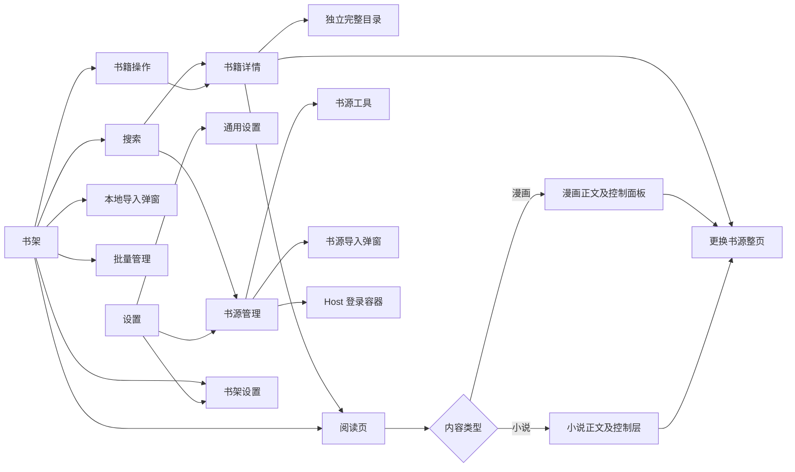

## 书架、搜索与书籍上下文

封面、列表、继续阅读卡和搜索结果携带所选书籍的稳定身份、内容类型与来源。操作菜单、详情、目录和阅读沿用该书籍；返回保留原页面筛选、视图、滚动和草稿。长按后多选预选所按书籍。

书架按内容类型（全部 / 小说 / 漫画）与来源（全部 / 本地 / 在线）组合筛选。搜索同时提供来源和内容类型筛选，保留简介、进度与来源反馈。清除条件不改变封面 / 列表显示方式。空书架、无匹配、加载与读取失败保留原有结构及入口。

书架更多菜单锚定触发按钮。书籍操作采用用户指定的旧漫画 demo 浮层样式，动作和去向依据当前应用。书架设置返回各自进入来源。移除、刷新和保存的未知结果、待确认结果与恢复动作承载在原书架的公共恢复组件中。

本地导入由应用弹窗进入系统文件选择，再在同一弹窗显示进度和逐文件结果。提交与书架重读分别记账，重读失败保留真实提交结果。长结果滚动列表，完成按钮保留在可操作区域。

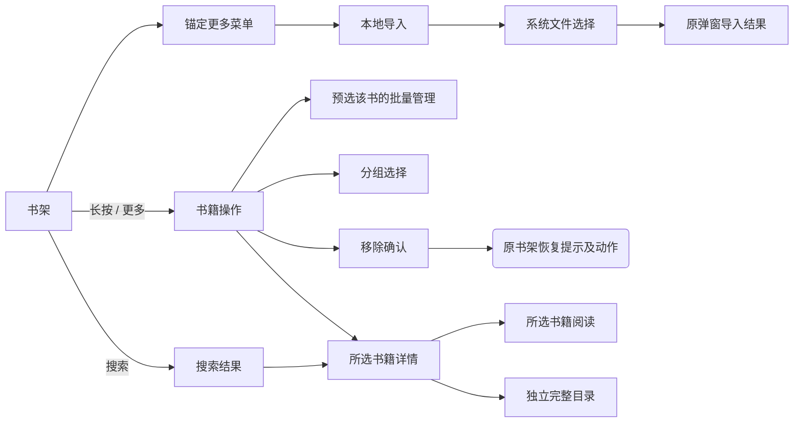

## 小说与漫画目录

小说阅读内目录属于小说控制层，支持 Quick / Full、目录与书签标签、章节层级的独立展开。内容搜索保留搜索框、结果数量、章节与内容片段；选择结果跳转对应位置。

漫画阅读内目录由 MangaReadingSurface 承载：窄窗口用目录面板，宽窗口用侧栏，不套用小说的 Quick / Full 变形或听书模块。漫画常用目录没有书签标签；空目录经现有 guarded 回调打开 ReaderFullDirectory 的兼容入口时，使用该独立组件自己的书签与离线菜单，不改造成普通漫画面板。详情完整目录由 BookDirectoryPage 承载，依据小说 / 漫画走实际分支。各入口和返回关系分别登记。

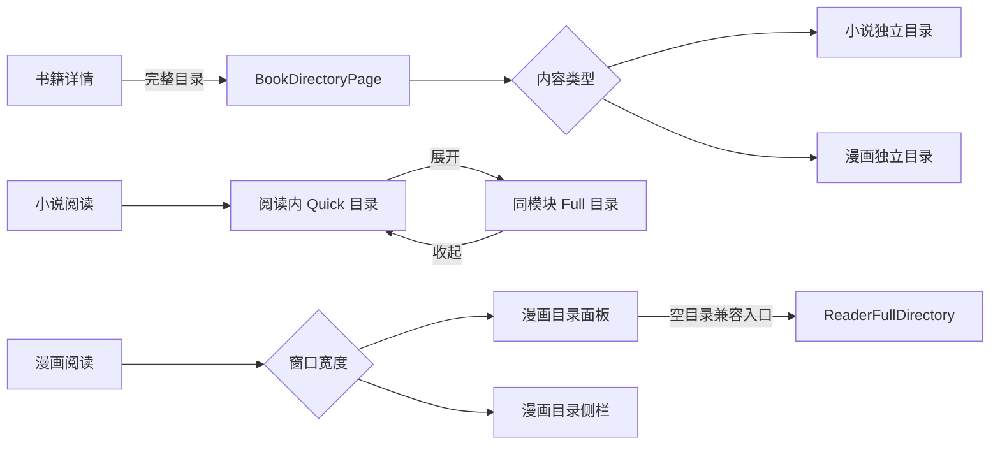

## 小说阅读控制与反馈

控制首页及目录、听书、外观、阅读设置、搜索、自动翻页、替换模块复用应用资产、选中图标、头部、亮度区与导航结构。抓手使用应用已有的会话、手势策略和动效采样，支持连续拖动、展开、收起、关闭与取消恢复。切换形态保留模块值；返回按临时选择层、Full、Quick、控制首页、正文的实际层级消费。

自动翻页保留模式、速度、计时和运行状态，停止留在原模块。听书区分系统 / 在线、未配置、准备、播放、暂停与失败条件；下拉锚定触发项，在线管理保留编辑字段及保存条件。主题、字体排序、替换规则与草稿独立保存，禁用项沿用源码门禁。

本地书籍按实际能力禁用在线换源、刷新和在线下载。退出失败、刷新失败复用实际公共弹窗；取消恢复原阅读状态及控制模块，恢复动作按原回调执行。更多菜单执行动作前关闭自身；提交内部过程不新增产品页面。

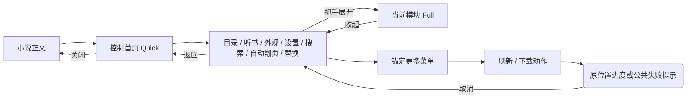

## 漫画阅读与换源

漫画正文由真实 MangaReadingSurface 承载，保留页面位置、方向、适配、页码、亮度和背景的配置。模式、设置、更多、下载使用漫画自己的面板；宽窗口目录侧栏依据实际布局条件显示。下载采用当前接通的章节任务、暂停以及保留 / 清理动作。

小说换源沿当前候选提交路径。漫画换源由原网关匹配章节：匹配成功直接提交，需要选择目标章节时复用 BookDirectoryPage 的漫画选择分支。选择期间忙碌禁止关闭，取消恢复原漫画位置；没有首图验证步骤。

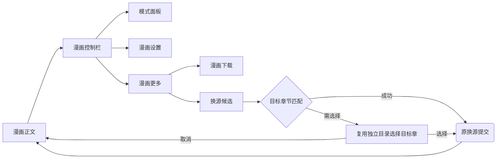

## 设置与书源

主题、自动更新、减少动态效果、缓存与重置任务各有独立状态；切换主题不清除其他偏好，任务结果不覆盖配置。忙碌、未知结果与读回失败使用原页面门禁和公共恢复组件；选择值及恢复动作见逐模块规格。

书源查询、类型、状态、分组、滚动和选择独立。检测、启停和登录作用于实际所选书源。分组弹层按源码触发位置定位；遮罩或系统返回先收起弹层。宽窗口与平板类型是不同输入，不以窗口宽度代替平板分支。

编辑、调试、批量检测与操作各自保存草稿和选择。当前 JSON 导入组件只拦截空白输入，非空提交 Host 解析；演示不增加不同于应用的前置协议规则。提交后关闭原弹窗，原书源页面保留回执、读回失败和重试。在线登录为 Host 容器的映射，demo 不模拟真实认证完成。

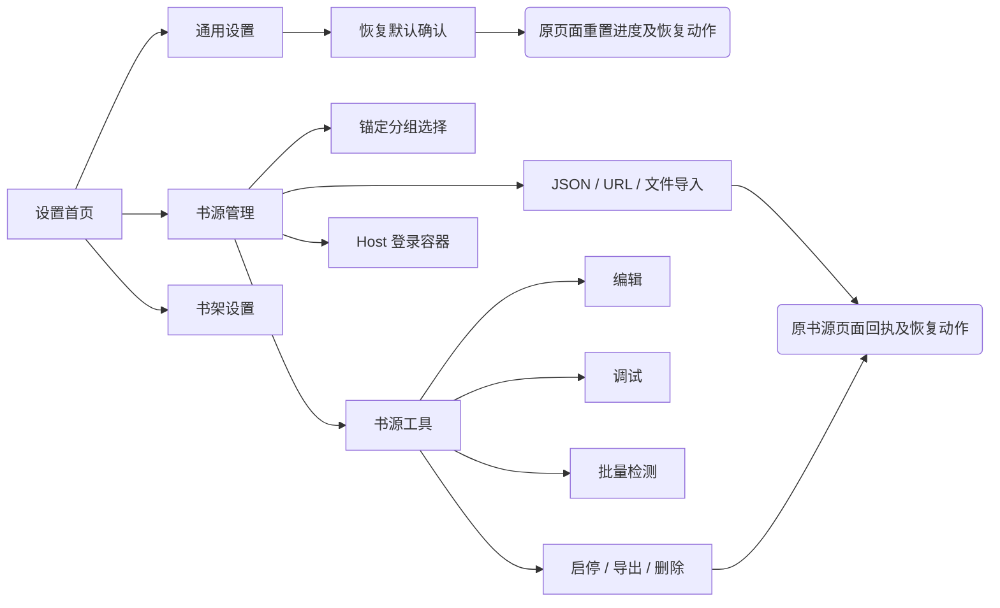

## 演示与验收边界

外部状态按钮选择夹具，画布内入口遵守身份、上下文、返回与交互条件。演示状态仅服务本地预览；网络、解析、提交回执、系统文件选择、在线认证与真实语音由应用 Host 实现。

源码定位、模板结构回归、浏览器视觉与原生验收分别记录。离线回归见 [修复验证](coverage-evidence/repair-verification.json)，原审计与处置见 [审计记录](AUDIT.md)。旧 PNG 保留作历史证据；源码或设计指纹不一致时不能用于本版还原验收。

小说抓手演示复用源码策略与动效采样；漫画抓手按源码拖动阈值关闭、取消回原面板，浏览器释放时直接呈现稳定端点。漫画原生弹簧时序需依照规格实现并验收，不能用该预览证明曲线一致。


<!-- delivery:start -->

## 跨平台交付范围与参数来源

本节与 UI 稿底部的实现规格由同一份参数生成，登记 41 个界面/组件、441 个状态样本；不新增产品页面。

逐页规格分别标明源码事实、用户指定的样式调整和移植决定。“书籍操作”采用用户指定的旧漫画 demo 样式，原生应用尚未同步。iOS / Android 的安全区、字体缩放、触摸与系统界面映射为移植决定；这些设计参数可供原生实现，尚未取得两端原生截图及业务验收。

### 单位、公共组件与平台映射

| 公共布局（源码） | 值 |
| --- | --- |
| 首页顶栏 | 高58；左右max(20,S.left/right)，顶内距6；标题29/38、700、Noto Serif Bold；单行省略。 |
| 返回顶栏 | 高58；返回命中44×44、图标24、圆角22；标题24/33、700；左右max(20,S.left/right)，标题占剩余宽度。 |
| 主导航 | 底栏最大宽360、高68、圆角24、边框1；2项均分；项高54、图标24、文字11/18 700。宽书架侧栏82×332，项66×58。 |
| 弹窗 | 按 ReaderSurfaceSpecs / 各领域组件分别实现，不能统一套352宽/16圆角。book-removal上限306/边距20/padding17/r12；JSON导入上限520/边距20/padding16/r14；默认分组75%宽/padding20/r20。 |
| 按压 | ReaderPressFeedback：TOK_ACCENT的12%alpha混合到本色；按下/取消/松开由控件事件恢复；不擅加缩放或Material波纹。禁用透明度沿各组件值。 |
| 资源 | 使用资产清单对应SVG与主题变体，contain保持viewBox比例；选中主导航仍用outline，禁止替成filled。字体与OFL许可一起打包。 |

| 移植决定 | 规则 |
| --- | --- |
| 单位 | 尺寸：1 vp 对应 1 iOS pt / Android dp；基准字号：1 fp 对应 1 pt / sp。像素按屏幕密度换算，禁止把整张 390 稿缩放铺满。 |
| 坐标 | W/H 为当前应用窗口；S=(top,right,bottom,left) 为运行时安全区。普通页上界避开 S.top；背景铺满窗口。横向边距 max(原边距,S.left/right)，不重复相加。 |
| 底部 | 浮动主导航底距 B=max(15,S.bottom)，内容尾部留白=68+B+16；没有主导航的操作条用 max(原底距,S.bottom)。内容能滚到最后一项。 |
| 键盘 | K 是键盘遮挡的底部高度；可编辑页有效底界 H-max(S.bottom,K)。输入框、确认按钮和错误文案在此范围内；浮动键盘按遮挡矩形滚动避让。安全区只能消费一次。 |
| 阅读 | 纸面背景及图片绘制可延伸至窗口边缘；正文、元信息、控制栏与命中区按阅读几何和实时安全区定位。全屏切换重新测量，保留文本锚点。 |
| 宽度 | 书架源码按W≥600进入宽版；搜索源码由deviceInfo的tablet决定。移植决定统一以可用窗口W≥600选择搜索宽版，避免分屏仍套设备大屏布局；只有有书书架显示侧栏。其他页面不自动改双栏。 |
| 触摸 | 保持图标视觉尺寸；移植的最小触摸目标 iOS 44×44、Android 48×48。优先整行/整卡命中；紧邻小控件重排间距，禁止命中区相互重叠。 |
| 返回 | 阅读控制内：临时层→模块 Full→同模块 Quick→控制首页→隐藏控制层→退出。忙状态按各模块真实 guard 决定，不能统一禁用所有返回；设置恢复只禁页面控件，Index 系统返回仍能回首页。IME 是否先消费系统返回由各端验证；交互式返回提交前不写业务结果。 |
| 系统界面 | 文件选择/保存、系统确认、登录 Web 容器、语音服务和亮度由各端 Host 实现相同意图及结果。系统弹窗与键盘使用本端外观；应用自绘表面保留当前主题/字体/SVG。 |
| 系统栏 | 自绘顶栏/浮动导航不叠加目标系统默认导航栏；系统状态栏/导航区背景延续当前paper。浅色背景使用深色系统glyph、深色使用浅色glyph，主题/全屏变化由Host重新应用并测量。 |
| 可访问性 | 整行开关作为一个语义节点，暴露名称/开关值/禁用/选中；装饰SVG不单独朗读，纯图标动作有完整中文名称。弹窗焦点进入标题及第一项，关闭返回原触发控件；异步失败读原提示，不抢走草稿焦点。 |
| 减少动态效果 | 移植effectiveReduceMotion=应用已存偏好 OR 系统减少动态效果。移除非必要位移/周期波形，保留颜色与状态反馈；业务计时/取消/回滚仍按回执处理。 |
| 语言与输入 | 交付基准为当前zh-CN文案与简体中文字形；保留书名/来源/正文中的其他Unicode字符。URL/JSON/密钥沿原字段输入语义；输入法composition期间不提交半成品查询，原未开放语言设置不新增入口。 |
| 生命周期 | 进入后台、旋转、分屏、键盘切换不重新执行导入/删除/换源；草稿、选中项、原结果与阅读锚点归 owner 保留。迟到回调按原调用链拒绝覆盖新上下文。 |


平台依据：[Apple safeAreaLayoutGuide](https://developer.apple.com/documentation/uikit/uiview/safearealayoutguide)、[Apple UIFontMetrics](https://developer.apple.com/documentation/uikit/uifontmetrics)、[Apple 触摸与可访问性](https://developer.apple.com/design/human-interface-guidelines/accessibility)、[Apple keyboard layout guide](https://developer.apple.com/documentation/uikit/adjusting-your-layout-with-keyboard-layout-guide)、[Android WindowInsets](https://developer.android.com/develop/ui/compose/system/insets)、[Android 字体非线性缩放](https://developer.android.com/about/versions/14/features#non-linear-font-scaling)、[Android 触摸与语义](https://developer.android.com/develop/ui/compose/accessibility/api-defaults)。

安全区/键盘预览使用下列测试输入，不绑定实际设备型号；上线读取 OS 实时值。

| 样本 | 窗口 | 上 / 右 / 下 / 左 |
| --- | --- | --- |
| 基准内容窗 390 × 844 | 390×844 | 0 / 0 / 0 / 0 |
| 窄窗 320 × 640 | 320×640 | 0 / 0 / 0 / 0 |
| iOS 安全区样本 393 × 852 | 393×852 | 59 / 0 / 34 / 0 |
| Android 手势样本 360 × 800 | 360×800 | 24 / 0 / 24 / 0 |
| Android 三键样本 360 × 800 | 360×800 | 24 / 0 / 48 / 0 |
| 横屏安全区样本 844 × 390 | 844×390 | 0 / 59 / 21 / 59 |
| 宽窗 760 × 960 | 760×960 | 0 / 0 / 0 / 0 |
| 平板类型样本 760 × 960 | 760×960 | 0 / 0 / 0 / 0 |
| 分屏 600 × 640 | 600×640 | 24 / 0 / 24 / 0 |


### 排版、换行与资产

| 规则 | 交付约束 |
| --- | --- |
| 基准 | scale=1；使用同一文件和真实字重。显式lineHeight与字号分别传入；AUTO保持AUTO，不能拿fontSize×1.5代替。字距未设置时保持默认，不追加tracking。 |
| iOS缩放 | 系统角色用UIFontMetrics按角色映射：首页/页面→title1/title2；section→headline；tab/元信息/小字段→caption1；其余→body。阅读正文由已保存appearance字号/行距拥有，系统缩放不再乘一次。 |
| Android缩放 | 系统角色用sp及平台sp换算，行高也用sp；尺寸/边距用dp。Android非线性字体缩放不可用单一fontScale乘法复制。阅读正文appearance字号转dp物理度量，避免双重缩放。 |
| 回退 | Inter缺少的CJK先回退当前Noto Sans SC；Noto Serif缺字→Noto Sans SC→平台CJK/emoji。自带文件加载失败改平台字体并记录校准未通过，不静默宣称像素还原。HarmonyOS Sans只能在Harmony使用；两端对应系统sans，此槽单独原生校准。 |
| 换行 | UI单行按源码maxLines=1尾部省略；说明/错误按字段约束自动换行，URL允许字符边界断行。正文保留段落/硬换行，不插全角空格假冒缩进；禁则/塑形复用平台文本引擎。 |
| 大字体适配 | 按缩放后实测文字撑高行/按钮/顶栏；动作行无法容纳则换行或纵排。可滚动正文区域承担溢出；长书名仍可省略，动作标签、确认与错误不裁切。此为移植规则，非现有Harmony已验收行为。 |
| 位置保护 | 字体、宽度或系统栏变化前保留Core文本锚点，重新测量后恢复；不以旧页码/滚动像素作为唯一位置。预览压力倍率1/1.3/2只检查溢出，不冒充原生Dynamic Type曲线。 |


字体角色直接从 ReaderTypography.ets 提取；null 行高代表 AUTO；null 字族、字重或字号保留原生继承，inline role由所属正文提供尺寸。下表之外的领域文字由逐页规格给定。

| 角色 | 字族 | 字号 / 行高 | 字重 | 缩放owner |
| --- | --- | --- | --- | --- |
| TYPE_APP_HOME_TITLE | ReaderNotoSerifSCBold | 29 / 38 | 700 | system |
| TYPE_PAGE_TITLE | ReaderNotoSerifSCBold | 24 / 33 | 700 | system |
| TYPE_SECTION_HEADING | ReaderInter | 13 / 15.6 | 900 | system |
| TYPE_MAIN_TAB_LABEL | ReaderNotoSansSCUIBold | 11 / 18 | 700 | system |
| TYPE_SELECT_APPEARANCE_VALUE | ReaderNotoSansSC | 12 / 14.4 | 700 | system |
| TYPE_SELECT_SETTINGS_VALUE | ReaderNotoSansSC | 13 / 15.6 | 400 | system |
| TYPE_SELECT_SOURCE_GROUP_VALUE | ReaderInter | 12 / 14.52 | 400 | system |
| TYPE_SELECT_DEFAULT_VALUE | ReaderNotoSansSC | 12 / AUTO | 700 | system |
| TYPE_SELECT_OPTION | ReaderNotoSansSC | 12 / AUTO | 400 | system |
| TYPE_SETTINGS_SELECT_TITLE | ReaderNotoSansSC | 12 / 14.4 | 400 | system |
| TYPE_SETTINGS_SELECT_PHONE_OPTION | ReaderNotoSansSC | 15 / 18 | 400 | system |
| TYPE_SETTINGS_SELECT_PHONE_CANCEL | ReaderNotoSansSC | 15 / 18 | 400 | system |
| TYPE_SETTINGS_SELECT_TABLET_OPTION | ReaderNotoSansSC | 14 / 16.8 | 400 | system |
| TYPE_SEARCH_BOOK_INPUT | ReaderInter | 14 / 21 | 400 | system |
| TYPE_SEARCH_SOURCE_INPUT | ReaderInter | 12 / AUTO | 400 | system |
| TYPE_SEARCH_DIRECTORY_INPUT | ReaderNotoSansSC | 10 / AUTO | 400 | system |
| TYPE_SEARCH_READER_QUICK_INPUT | ReaderInter | 10 / AUTO | 400 | system |
| TYPE_SEARCH_RSS_HINT | ReaderInter | 14 / AUTO | 400 | system |
| TYPE_SEARCH_RESULT_COVER_TITLE | ReaderNotoSerifSCBold | 9 / 11.7 | 700 | system |
| TYPE_SEARCH_RESULT_TITLE | ReaderNotoSerifSCBold | 15 / 19.5 | 700 | system |
| TYPE_SEARCH_RESULT_AUTHOR | ReaderInter | 12 / 12 | 400 | system |
| TYPE_SEARCH_RESULT_CHAPTER | ReaderInter | 11 / 11 | 400 | system |
| TYPE_SEARCH_RESULT_INTRO | ReaderInter | 12 / 18 | 400 | system |
| TYPE_SEARCH_RESULT_TAG | ReaderInter | 10 / 15 | 700 | system |
| TYPE_READER_CHAPTER_TITLE | ReaderNotoSerifSCBold | 23 / AUTO | 700 | system |
| TYPE_READER_CONTROL_BOOK_TITLE | ReaderNotoSerifSCBold | 16 / 19.2 | 700 | system |
| TYPE_READER_CONTROL_CHAPTER_SOURCE | ReaderNotoSerifSCRegular | 12 / 14.4 | 400 | system |
| TYPE_READER_CONTROL_SOURCE_ACTION | ReaderNotoSansSC | 12 / 14.4 | 700 | system |
| TYPE_READER_CONTROL_CHAPTER_TITLE | ReaderInter | 13 / 16.25 | 700 | system |
| TYPE_SHELF_LIST_TITLE | ReaderNotoSerifSCBold | 15 / 18 | 700 | system |
| TYPE_SHELF_LIST_AUTHOR | ReaderNotoSansSCUIRegular | 11 / 14 | 400 | system |
| TYPE_SHELF_LIST_CHAPTER | ReaderNotoSansSCUIRegular | 11 / 14 | 400 | system |
| TYPE_SHELF_LIST_STATUS | ReaderNotoSansSCUIRegular | 11 / 14 | 400 | system |
| TYPE_SHELF_METADATA_TAG | ReaderNotoSansSCUIRegular | 9 / 16 | 400 | system |
| TYPE_SHELF_CONTINUE_LABEL | ReaderInter | 11 / 18 | 500 | system |
| TYPE_SHELF_CONTINUE_TITLE | ReaderNotoSerifSCBold | 16 / 23 | 700 | system |
| TYPE_SHELF_CONTINUE_AUTHOR | ReaderInter | 11 / 15 | 400 | system |
| TYPE_SHELF_ACTION | ReaderInter | 12 / 16 | 700 | system |
| TYPE_SOURCE_SWITCH_NAME | ReaderInter | 10 / 12 | 500 | system |
| TYPE_SOURCE_SWITCH_LATENCY | ReaderInter | 9 / 10 | 400 | system |
| TYPE_SOURCE_SWITCH_CHAPTER | ReaderInter | 9 / 10 | 500 | system |
| TYPE_SOURCE_MANAGEMENT_META | ReaderNotoSansSC | 10 / 12.5 | 400 | system |
| TYPE_SOURCE_TOOLS_HEADING | ReaderNotoSansSC | 14 / AUTO | 700 | system |
| TYPE_SOURCE_TOOLS_ACTION | ReaderNotoSansSC | 12 / AUTO | 700 | system |
| TYPE_SOURCE_TOOLS_COMPACT_ACTION | ReaderNotoSansSC | 11 / AUTO | 700 | system |
| TYPE_SOURCE_TOOLS_BODY | ReaderNotoSansSC | 12 / AUTO | 继承 | system |
| TYPE_SOURCE_TOOLS_HINT | ReaderNotoSansSC | 11 / AUTO | 继承 | system |
| TYPE_SOURCE_TOOLS_CAPTION | ReaderNotoSansSC | 10 / AUTO | 继承 | system |
| TYPE_SOURCE_TOOLS_NOTE | ReaderNotoSansSC | 10 / 16 | 继承 | system |
| TYPE_SOURCE_TOOLS_DESCRIPTION | ReaderNotoSansSC | 11 / 17 | 继承 | system |
| TYPE_SOURCE_TOOLS_STATUS | ReaderNotoSansSC | 12 / 18 | 继承 | system |
| TYPE_SOURCE_TOOLS_URL | ReaderInter | 10 / AUTO | 继承 | system |
| TYPE_SOURCE_TOOLS_DEBUG_ID | ReaderInter | 11 / AUTO | 继承 | system |
| TYPE_SOURCE_TOOLS_CODE_INPUT | monospace | 11 / AUTO | 继承 | system |
| TYPE_SOURCE_TOOLS_DEBUG_LOG | monospace | 10 / 16 | 继承 | system |
| TYPE_SOURCE_TOOLS_INHERITED_META | 继承 | 10 / AUTO | 继承 | system |
| TYPE_RULES_MANAGEMENT_HEADING | ReaderNotoSansSC | 14 / AUTO | 700 | system |
| TYPE_RULES_MANAGEMENT_INPUT | ReaderNotoSansSC | 12 / AUTO | 400 | system |
| TYPE_RULES_MANAGEMENT_ACTION | ReaderNotoSansSC | 12 / AUTO | 700 | system |
| TYPE_SHELF_MANAGEMENT_NOTE | ReaderNotoSansSC | 10 / 16 | 400 | system |
| TYPE_SHELF_MANAGEMENT_STATUS | ReaderNotoSansSC | 12 / 18 | 400 | system |
| TYPE_SHELF_MANAGEMENT_BODY | ReaderNotoSansSC | 12 / AUTO | 400 | system |
| TYPE_SHELF_MANAGEMENT_BODY_MUTED | ReaderNotoSansSC | 11 / AUTO | 400 | system |
| TYPE_SHELF_MANAGEMENT_META | ReaderNotoSansSC | 10 / AUTO | 400 | system |
| TYPE_SHELF_MANAGEMENT_GROUP_TITLE | ReaderNotoSansSC | 13 / AUTO | 700 | system |
| TYPE_SHELF_MANAGEMENT_ROW_ACTION | ReaderNotoSansSC | 11 / AUTO | 400 | system |
| TYPE_SHELF_MANAGEMENT_BOOK_TITLE | ReaderNotoSansSC | 12 / AUTO | 700 | system |
| TYPE_SHELF_MANAGEMENT_HEADING | ReaderNotoSerifSCBold | 16 / AUTO | 700 | system |
| TYPE_SHELF_MANAGEMENT_BUTTON | ReaderNotoSansSC | 12 / AUTO | 700 | system |
| TYPE_SHELF_MANAGEMENT_SMALL_ACTION | ReaderNotoSansSC | 10 / AUTO | 400 | system |
| TYPE_READER_IMMERSIVE_TIME | ReaderNotoSansSC | 12 / 14.4 | 400 | system |
| TYPE_READER_IMMERSIVE_PROGRESS | ReaderNotoSansSC | 12 / 14.4 | 400 | system |
| TYPE_READER_IMMERSIVE_PAGE_ORDINAL | ReaderNotoSansSC | 12 / 14.4 | 400 | system |
| TYPE_READER_SESSION_LABEL | ReaderNotoSansSC | 10 / 12.5 | 700 | system |
| TYPE_READER_SESSION_COUNTDOWN | ReaderNotoSansSC | 8 / 8 | 900 | system |
| TYPE_FORM_BODY | ReaderNotoSansSC | 13 / AUTO | 400 | system |
| TYPE_FORM_LABEL_ACTION | ReaderNotoSansSC | 13 / AUTO | 700 | system |
| TYPE_FORM_STATE_BODY | ReaderNotoSansSC | 14 / AUTO | 继承 | system |
| TYPE_SHELF_EMPTY_TITLE | ReaderNotoSansSC | 19 / AUTO | 700 | system |
| TYPE_APP_SECTION_LABEL | ReaderInter | 15 / 18 | 700 | system |
| TYPE_APP_INHERITED_BODY | 继承 | 12 / AUTO | 继承 | system |
| TYPE_APP_FILTER_OPTION | ReaderInter | 12 / 18 | 500 | system |
| TYPE_SHELF_SELECTION_ACTION | ReaderNotoSansSC | 13 / 15.6 | 700 | system |
| TYPE_SHELF_SELECTION_HEADING | ReaderNotoSerifSCBold | 24 / 34.49 | 700 | system |
| TYPE_SHELF_SELECTION_CHECK | ReaderInter | 14 / AUTO | 700 | system |
| TYPE_SHELF_SELECTION_REMOVE | ReaderInter | 11 / 13.31 | 700 | system |
| TYPE_APP_INHERITED_STATE | 继承 | 14 / AUTO | 继承 | system |
| TYPE_APP_COMPACT_BADGE | ReaderInter | 10 / AUTO | 700 | system |
| TYPE_APP_INHERITED_LABEL | 继承 | 15 / AUTO | 继承 | system |
| TYPE_APP_INHERITED_OPTION | 继承 | 13 / AUTO | 继承 | system |
| TYPE_SHELF_STATE_TITLE | ReaderInter | 17 / 25.5 | 700 | system |
| TYPE_APP_BODY | ReaderInter | 13 / 19.5 | 400 | system |
| TYPE_APP_PRIMARY_ACTION | ReaderInter | 13 / 13 | 800 | system |
| TYPE_BOOK_DETAIL_TITLE | ReaderNotoSerifSCBold | 22 / 25.96 | 700 | system |
| TYPE_BOOK_DETAIL_AUTHOR | ReaderInter | 13 / 17.55 | 400 | system |
| TYPE_BOOK_DETAIL_META | ReaderInter | 12 / 15 | 700 | system |
| TYPE_BOOK_DETAIL_SOURCE_ACTION | ReaderInter | 9 / 12 | 900 | system |
| TYPE_BOOK_DETAIL_DESCRIPTION | ReaderInter | 13 / 21.45 | 400 | system |
| TYPE_APP_COMPACT_PRIMARY_ACTION | ReaderInter | 12 / AUTO | 900 | system |
| TYPE_BOOK_DETAIL_EMPTY | ReaderInter | 13 / 21.45 | 继承 | system |
| TYPE_BOOK_DIRECTORY_ENTRY | ReaderInter | 14 / AUTO | 400 | system |
| TYPE_BOOK_DETAIL_ACTION | ReaderInter | 13 / 14.3 | 900 | system |
| TYPE_FILE_IMPORT_TITLE | ReaderNotoSerifSCBold | 18 / 24.75 | 700 | system |
| TYPE_FILE_IMPORT_LABEL | ReaderInter | 13 / 19.5 | 700 | system |
| TYPE_FILE_IMPORT_HINT | ReaderInter | 11 / 16.5 | 400 | system |
| TYPE_FILE_IMPORT_ACTION | ReaderInter | 13 / 19.5 | 800 | system |
| TYPE_FILE_IMPORT_CANCEL | ReaderInter | 13 / 19.5 | 600 | system |
| TYPE_FILE_IMPORT_PROGRESS | ReaderInter | 14 / 21 | 600 | system |
| TYPE_FILE_IMPORT_WAIT | ReaderInter | 11 / 16.5 | 400 | system |
| TYPE_FILE_IMPORT_NAME | ReaderInter | 12 / 18 | 600 | system |
| TYPE_APP_INHERITED_HINT | 继承 | 11 / AUTO | 继承 | system |
| TYPE_FILE_IMPORT_BADGE | ReaderInter | 10 / 15 | 700 | system |
| TYPE_JSON_IMPORT_DESCRIPTION | ReaderNotoSansSC | 12 / 19 | 继承 | system |
| TYPE_FORM_ACTION | ReaderNotoSansSC | 12 / AUTO | 700 | system |
| TYPE_FORM_URL_INPUT | ReaderInter | 12 / AUTO | 继承 | system |
| TYPE_FORM_NOTE | ReaderNotoSansSC | 10 / 16 | 继承 | system |
| TYPE_DIALOG_ACTION | ReaderNotoSansSC | 13 / 16 | 700 | system |
| TYPE_APP_SEGMENT_LABEL | ReaderInter | 12 / AUTO | 700 | system |
| TYPE_SELECT_LIBRARY_VALUE | ReaderNotoSansSCUIRegular | 11 / 15 | 400 | system |
| TYPE_DISCOVER_SOURCE_META | ReaderInter | 11 / 13.2 | 600 | system |
| TYPE_DISCOVER_CATEGORY | ReaderInter | 12 / 15.6 | 800 | system |
| TYPE_DISCOVER_FILTER_LABEL | ReaderInter | 12 / 15.6 | 900 | system |
| TYPE_DISCOVER_FILTER_VALUE | ReaderInter | 11 / 15.56 | 800 | system |
| TYPE_DISCOVER_RANK_TITLE | ReaderInter | 15 / 18.75 | 700 | system |
| TYPE_DISCOVER_STATE_TITLE | ReaderInter | 14 / 18 | 800 | system |
| TYPE_DISCOVER_STATUS | ReaderInter | 12 / 15 | 400 | system |
| TYPE_APP_SMALL_LABEL | ReaderInter | 11 / AUTO | 700 | system |
| TYPE_DISCOVER_AUTHOR | ReaderInter | 11 / 15.56 | 700 | system |
| TYPE_DISCOVER_INTRO | ReaderInter | 12 / 17.4 | 400 | system |
| TYPE_RSS_SOURCE_TITLE | ReaderInter | 13 / AUTO | 700 | system |
| TYPE_RSS_META | ReaderInter | 10 / AUTO | 400 | system |
| TYPE_RSS_LINK_ACTION | ReaderInter | 11 / AUTO | 900 | system |
| TYPE_RSS_ARTICLE_TITLE | ReaderInter | 20 / 26 | 700 | system |
| TYPE_APP_SMALL_ACTION | ReaderInter | 11 / AUTO | 800 | system |
| TYPE_RSS_ARTICLE_BODY | ReaderInter | 15 / 26 | 400 | system |
| TYPE_RSS_BOTTOM_ACTION | ReaderInter | 13 / AUTO | 900 | system |
| TYPE_RSS_HOME_TITLE | ReaderNotoSerifSCBold | 29 / 41 | 700 | system |
| TYPE_RSS_REFRESH_STATUS | ReaderInter | 12 / AUTO | 800 | system |
| TYPE_RSS_SECTION_HEADING | ReaderInter | 15 / AUTO | 700 | system |
| TYPE_RSS_UNREAD_COUNT | ReaderInter | 16 / AUTO | 900 | system |
| TYPE_RSS_ENTRY_TITLE | ReaderInter | 13 / 16.25 | 700 | system |
| TYPE_RSS_ENTRY_DESCRIPTION | ReaderInter | 11 / 15.95 | 400 | system |
| TYPE_RSS_STATE_TITLE | ReaderInter | 17 / 21.25 | 700 | system |
| TYPE_RSS_STATE_BODY | ReaderInter | 12 / 18.6 | 400 | system |
| TYPE_RSS_ERROR_REASON | ReaderInter | 11 / AUTO | 400 | system |
| TYPE_RSS_STATE_ACTION | ReaderInter | 13 / AUTO | 800 | system |
| TYPE_FORM_STATUS | ReaderNotoSansSC | 12 / 18 | 继承 | system |
| TYPE_FORM_HINT | ReaderNotoSansSC | 11 / AUTO | 继承 | system |
| TYPE_FORM_SECTION_HEADING | ReaderNotoSansSC | 14 / AUTO | 700 | system |
| TYPE_FORM_INPUT | ReaderNotoSansSC | 12 / AUTO | 继承 | system |
| TYPE_SEARCH_HISTORY_STATUS | ReaderInter | 13 / 20 | 继承 | system |
| TYPE_SEARCH_HISTORY_HEADING | ReaderInter | 13 / 19.5 | 700 | system |
| TYPE_SEARCH_HISTORY_KEYWORD | ReaderInter | 13 / 19.5 | 500 | system |
| TYPE_SEARCH_PROGRESS_META | ReaderInter | 11 / 16.5 | 400 | system |
| TYPE_SEARCH_RESULT_COUNT | ReaderInter | 11 / 16.5 | 700 | system |
| TYPE_SEARCH_STATE_TITLE | ReaderNotoSerifSCBold | 17 / 25.5 | 700 | system |
| TYPE_SEARCH_STATE_DESCRIPTION | ReaderInter | 13 / 21.125 | 400 | system |
| TYPE_SEARCH_SUGGESTION_HEADING | ReaderInter | 12 / 18 | 700 | system |
| TYPE_APP_SECONDARY_ACTION | ReaderInter | 13 / 13 | 700 | system |
| TYPE_SEARCH_SUGGESTION_BODY | ReaderInter | 12 / 19.5 | 400 | system |
| TYPE_SEARCH_RETRY_ACTION | ReaderInter | 14 / 14 | 800 | system |
| TYPE_APP_ROW_LABEL | ReaderInter | 13 / 15.34 | 800 | system |
| TYPE_RULES_INHERITED_DESCRIPTION | 继承 | 11 / 17 | 继承 | system |
| TYPE_RULES_INHERITED_NOTE | 继承 | 10 / 16 | 继承 | system |
| TYPE_RULES_ENTITY_TITLE | 继承 | 12 / AUTO | 700 | system |
| TYPE_APP_INHERITED_CAPTION | 继承 | 10 / AUTO | 继承 | system |
| TYPE_RULES_COMPACT_ACTION | 继承 | 11 / AUTO | 700 | system |
| TYPE_SETTINGS_CACHE_ACTION | ReaderInter | 11 / 16 | 800 | system |
| TYPE_SETTINGS_DANGER_LABEL | ReaderInter | 16 / 19.2 | 400 | system |
| TYPE_SOURCE_MANAGEMENT_COUNT | ReaderInter | 10 / 12.5 | 400 | system |
| TYPE_SOURCE_MANAGEMENT_STATUS | ReaderNotoSansSC | 11 / 16 | 继承 | system |
| TYPE_FORM_COMPACT_ACTION | ReaderNotoSansSC | 11 / AUTO | 700 | system |
| TYPE_SOURCE_STATE_TITLE | ReaderNotoSerifSCBold | 15 / 22 | 700 | system |
| TYPE_SOURCE_MANAGEMENT_TITLE | ReaderNotoSansSC | 13 / 15.34 | 700 | system |
| TYPE_SOURCE_SWITCH_HEADING | ReaderNotoSerifSCRegular | 11 / 12.32 | 500 | system |
| TYPE_SOURCE_SWITCH_SORT | ReaderInter | 9 / 12 | 400 | system |
| TYPE_SOURCE_SWITCH_COLUMN | ReaderInter | 8 / AUTO | 400 | system |
| TYPE_APP_LOADING_BODY | ReaderInter | 13 / 20 | 400 | system |
| TYPE_SOURCE_SWITCH_MESSAGE | ReaderInter | 11 / 16 | 400 | system |
| TYPE_SOURCE_SWITCH_RECOVERY | ReaderInter | 12 / 12 | 700 | system |
| TYPE_SOURCE_SWITCH_FOOTER | ReaderInter | 8 / 12 | 400 | system |
| TYPE_SYNC_MUTED_HEADING | ReaderInter | 11 / AUTO | 900 | system |
| TYPE_SYNC_INPUT | ReaderInter | 12 / AUTO | 600 | system |
| TYPE_SYNC_CONFLICT_META | ReaderInter | 11 / 17 | 继承 | system |
| TYPE_SYNC_ROW_LABEL | ReaderInter | 13 / AUTO | 600 | system |
| TYPE_SYNC_BACKUP_ACTION | ReaderInter | 13 / 16 | 700 | system |
| TYPE_SYNC_HISTORY_STATUS | ReaderInter | 12 / AUTO | 400 | system |
| TYPE_SHELF_SELECTION_TITLE | ReaderNotoSerifSCBold | 13 / 16 | 700 | system |
| TYPE_SHELF_SELECTION_TITLE_WIDE | ReaderNotoSerifSCBold | 16 / 19.5 | 700 | system |
| TYPE_SHELF_SELECTION_AUTHOR | ReaderNotoSansSC | 11 / 13.5 | 400 | system |
| TYPE_SHELF_SELECTION_AUTHOR_WIDE | ReaderNotoSansSC | 13 / 16 | 400 | system |
| TYPE_SHELF_COVER_PLACEHOLDER | ReaderNotoSerifSCBold | 15 / 18.3 | 700 | system |
| TYPE_SEARCH_FIELD_ACTION | ReaderInter | 13 / 13 | 800 | system |
| TYPE_SEARCH_FIELD_ACTION_WIDE | ReaderInter | 14 / 14 | 800 | system |
| TYPE_SEARCH_SCOPE_LABEL | ReaderInter | 12 / 12 | 500 | system |
| TYPE_SEARCH_SCOPE_SELECTED | ReaderInter | 12 / 12 | 700 | system |
| TYPE_SELECT_APPEARANCE_LIBRARY_OPTION_REGULAR | ReaderNotoSansSCUIRegular | 11 / 13 | 400 | system |
| TYPE_SELECT_APPEARANCE_LIBRARY_OPTION_SELECTED | ReaderNotoSansSCUIBold | 11 / 13 | 700 | system |
| TYPE_READER_DIRECTORY_HEADING | ReaderNotoSansSC | 14 / 20 | 700 | system |
| TYPE_READER_DIRECTORY_COLLAPSE | ReaderNotoSansSC | 10 / 14 | 700 | system |
| TYPE_READER_DIRECTORY_TAB | ReaderNotoSansSC | 11 / 16 | 600 | system |
| TYPE_READER_DIRECTORY_TITLE_INTER | ReaderInter | 11 / AUTO | 500 | system |
| TYPE_READER_DIRECTORY_CURRENT_TITLE | ReaderNotoSansSC | 11 / AUTO | 700 | system |
| TYPE_READER_DIRECTORY_POSITION_INTER | ReaderInter | 9 / AUTO | 400 | system |
| TYPE_READER_BOOKMARK_EMPTY_TITLE | ReaderNotoSansSC | 13 / 16 | 700 | system |
| TYPE_READER_BOOKMARK_BODY | ReaderNotoSansSC | 10 / 14 | 继承 | system |
| TYPE_READER_BOOKMARK_ACTION | ReaderNotoSansSC | 10 / AUTO | 700 | system |
| TYPE_READER_BOOKMARK_LOADING | ReaderNotoSansSC | 10 / AUTO | 继承 | system |
| TYPE_READER_BOOKMARK_CHAPTER | ReaderNotoSansSC | 11 / 14 | 500 | system |
| TYPE_READER_BOOKMARK_META | ReaderInter | 9 / AUTO | 继承 | system |
| TYPE_READER_BOOKMARK_PENDING | 继承 | 8 / AUTO | 继承 | system |
| TYPE_READER_BOOKMARK_PENDING_LEGACY | ReaderInter | 8 / AUTO | 继承 | system |
| TYPE_READER_BOOKMARK_EXCERPT | ReaderNotoSerifSCRegular | 9 / 14 | 400 | system |
| TYPE_READER_BOOKMARK_EXCERPT_LEGACY | ReaderNotoSerifSCRegular | 9 / 13 | 400 | system |
| TYPE_READER_DIRECTORY_TAB_COMPACT | ReaderNotoSansSC | 11 / 16 | 500 | system |
| TYPE_READER_DIRECTORY_POSITION | ReaderNotoSansSC | 9 / AUTO | 继承 | system |
| TYPE_READER_DIRECTORY_TITLE | ReaderNotoSansSC | 11 / AUTO | 500 | system |
| TYPE_READER_DIRECTORY_TAB_LEGACY | ReaderInter | 10 / AUTO | 500 | system |
| TYPE_READER_DIRECTORY_TITLE_LEGACY | ReaderInter | 11 / 12.32 | 500 | system |
| TYPE_READER_DIRECTORY_DISCLOSURE | 继承 | 18 / AUTO | 继承 | system |
| TYPE_READER_DIRECTORY_RULE_HEADING | 继承 | 14 / AUTO | 700 | system |
| TYPE_READER_DIRECTORY_BOOK_TITLE | ReaderNotoSerifSCBold | 16 / AUTO | 700 | system |
| TYPE_READER_DIRECTORY_CHAPTER | ReaderNotoSerifSCRegular | 12 / AUTO | 400 | system |
| TYPE_READER_DIRECTORY_SOURCE_ACTION | ReaderInter | 12 / AUTO | 800 | system |
| TYPE_READER_DIRECTORY_OFFLINE_ACTION | ReaderNotoSansSC | 13 / AUTO | 500 | system |
| TYPE_READER_APPEARANCE_FULL_COMPAT_HEADER_LABEL | ReaderNotoSansSC | 14 / 20 | 700 | system |
| TYPE_READER_APPEARANCE_FULL_COMPAT_HEADER_COLLAPSE | ReaderNotoSansSC | 10 / 13 | 700 | system |
| TYPE_READER_APPEARANCE_FULL_COMPAT_THEME_LIBRARY_LABEL | ReaderNotoSansSC | 12 / 17 | 700 | system |
| TYPE_READER_APPEARANCE_FULL_COMPAT_THEME_LIBRARY_META | ReaderNotoSansSC | 10 / 13 | 500 | system |
| TYPE_READER_APPEARANCE_FULL_COMPAT_FULL_THEME_CARD_VALUE | ReaderNotoSansSC | 9 / 13 | 400 | system |
| TYPE_READER_APPEARANCE_FULL_COMPAT_THEME_ACTION_VALUE | ReaderNotoSansSC | 9 / 13 | 700 | system |
| TYPE_READER_APPEARANCE_FULL_COMPAT_FONT_LIBRARY_LABEL | ReaderNotoSansSC | 12 / 14.4 | 700 | system |
| TYPE_READER_APPEARANCE_FULL_COMPAT_FONT_LIBRARY_LABEL_SECONDARY | ReaderNotoSansSC | 10 / AUTO | 500 | system |
| TYPE_READER_APPEARANCE_FULL_COMPAT_FULL_FONT_CELL_PREVIEW | 继承 | 10 / AUTO | 400 | system |
| TYPE_READER_APPEARANCE_FULL_COMPAT_TYPOGRAPHY_LIBRARY_LABEL | ReaderNotoSansSC | 12 / 17 | 700 | system |
| TYPE_READER_APPEARANCE_FULL_COMPAT_TYPOGRAPHY_LIBRARY_LABEL_SECONDARY | ReaderNotoSansSC | 10 / 14 | 500 | system |
| TYPE_READER_APPEARANCE_FULL_COMPAT_INDENT_ROW_LABEL | ReaderNotoSansSC | 10 / 14 | 700 | system |
| TYPE_READER_APPEARANCE_FULL_COMPAT_INDENT_OPTION_LABEL | ReaderNotoSansSC | 9 / AUTO | 继承 | system |
| TYPE_READER_APPEARANCE_FULL_COMPAT_SELECT_FIELD_VALUE | ReaderNotoSansSC | 10 / 14 | 700 | system |
| TYPE_READER_APPEARANCE_FULL_COMPAT_SELECT_FIELD_VALUE_SECONDARY | ReaderNotoSansSC | 10 / AUTO | 700 | system |
| TYPE_READER_APPEARANCE_FULL_COMPAT_STEPPER_ROW_VALUE | ReaderNotoSansSC | 11 / 16 | 500 | system |
| TYPE_READER_APPEARANCE_FULL_COMPAT_STEPPER_ROW_VALUE_SECONDARY | ReaderInter | 11 / AUTO | 700 | system |
| TYPE_READER_APPEARANCE_FULL_COMPAT_STEP_BUTTON_VALUE | ReaderInter | 10 / 14 | 700 | system |
| TYPE_READER_APPEARANCE_QUICK_COMPAT_THEME_SECTION_LABEL | ReaderNotoSansSC | 9 / 9.9 | 700 | system |
| TYPE_READER_APPEARANCE_QUICK_COMPAT_FONT_SECTION_LABEL | ReaderNotoSansSC | 9 / 9.9 | 700 | system |
| TYPE_READER_APPEARANCE_QUICK_COMPAT_COMPACT_FONT_CELL_PREVIEW | 继承 | 8 / 10 | 400 | system |
| TYPE_READER_APPEARANCE_SHARED_COMPAT_SHARED_THEME_HEADER_LABEL | ReaderNotoSansSC | 9 / 9.9 | 700 | system |
| TYPE_READER_APPEARANCE_SHARED_COMPAT_SHARED_THEME_HEADER_META | ReaderNotoSansSC | 7.5 / 8 | 500 | system |
| TYPE_READER_APPEARANCE_SHARED_COMPAT_SHARED_FONT_HEADER_LABEL | ReaderNotoSansSC | 9 / 9.9 | 700 | system |
| TYPE_READER_APPEARANCE_SHARED_COMPAT_SHARED_FONT_CELL_PREVIEW | 继承 | 8 / 10 | 400 | system |
| TYPE_READER_AUTO_PAGE_FULL_COMPAT_HEADER_LABEL | ReaderInter | 14 / 16.8 | 700 | system |
| TYPE_READER_AUTO_PAGE_FULL_COMPAT_HEADER_COLLAPSE | ReaderInter | 10 / 13 | 700 | system |
| TYPE_READER_AUTO_PAGE_FULL_COMPAT_COLLAPSED_BACK_ACTOR_BACK | ReaderNotoSansSC | 10 / 10 | 700 | system |
| TYPE_READER_AUTO_PAGE_FULL_COMPAT_CONTROL_SECTION_LABEL | ReaderInter | 12 / 14.4 | 700 | system |
| TYPE_READER_AUTO_PAGE_FULL_COMPAT_CONTROL_SECTION_LABEL_SECONDARY | ReaderInter | 10 / 12 | 500 | system |
| TYPE_READER_AUTO_PAGE_FULL_COMPAT_CHAPTER_BUTTON_VALUE | ReaderInter | 9 / 9 | 700 | system |
| TYPE_READER_AUTO_PAGE_FULL_COMPAT_RUNNING_BUTTON_LABEL | ReaderInter | 9 / 9 | 800 | system |
| TYPE_READER_AUTO_PAGE_FULL_COMPAT_STOP_BUTTON_LABEL | ReaderInter | 9 / 9 | 700 | system |
| TYPE_READER_AUTO_PAGE_FULL_COMPAT_TIMER_SECTION_LABEL | ReaderInter | 12 / 14.4 | 700 | system |
| TYPE_READER_AUTO_PAGE_FULL_COMPAT_TIMER_SECTION_META | ReaderInter | 10 / 12 | 500 | system |
| TYPE_READER_AUTO_PAGE_FULL_COMPAT_TIMER_SECTION_LABEL_SECONDARY | ReaderInter | 11 / 11 | 700 | system |
| TYPE_READER_AUTO_PAGE_FULL_COMPAT_TIMER_SECTION_LABEL_TERTIARY | ReaderInter | 18 / 22 | 800 | system |
| TYPE_READER_AUTO_PAGE_FULL_COMPAT_TIMER_WHEEL_VALUE | ReaderInter | 8 / 8 | 700 | system |
| TYPE_READER_AUTO_PAGE_FULL_COMPAT_DETAILS_SECTION_LABEL | ReaderInter | 12 / 14.4 | 700 | system |
| TYPE_READER_AUTO_PAGE_FULL_COMPAT_DETAILS_SECTION_LABEL_SECONDARY | ReaderInter | 10 / 12 | 500 | system |
| TYPE_READER_AUTO_PAGE_FULL_COMPAT_SPEED_ROW_LABEL | ReaderInter | 10 / 13 | 700 | system |
| TYPE_READER_AUTO_PAGE_FULL_COMPAT_SPEED_ROW_LABEL_SECONDARY | ReaderInter | 10 / 13 | 400 | system |
| TYPE_READER_AUTO_PAGE_FULL_COMPAT_SPEED_ROW_LABEL_TERTIARY | ReaderInter | 9 / 13 | 400 | system |
| TYPE_READER_AUTO_PAGE_FULL_COMPAT_FOLLOW_HIGHLIGHT_ROW_LABEL | ReaderInter | 10 / 13 | 700 | system |
| TYPE_READER_AUTO_PAGE_QUICK_COMPAT_HEADER_BACK | ReaderNotoSansSC | 10 / 10 | 700 | system |
| TYPE_READER_AUTO_PAGE_QUICK_COMPAT_CHAPTER_CONTROL_VALUE | ReaderNotoSansSC | 9 / 9 | 700 | system |
| TYPE_READER_AUTO_PAGE_QUICK_COMPAT_RUNNING_CONTROL_LABEL | ReaderNotoSansSC | 9 / 9 | 700 | system |
| TYPE_READER_AUTO_PAGE_QUICK_COMPAT_STOP_CONTROL_LABEL | ReaderNotoSansSC | 9 / 9 | 700 | system |
| TYPE_READER_AUTO_PAGE_QUICK_COMPAT_SPEED_CONTROL_LABEL | ReaderNotoSansSC | 11 / AUTO | 700 | system |
| TYPE_READER_AUTO_PAGE_QUICK_COMPAT_SPEED_CONTROL_VALUE | ReaderNotoSansSC | 11 / 11 | 900 | system |
| TYPE_READER_AUTO_PAGE_QUICK_COMPAT_SPEED_BUTTON_LABEL | ReaderInter | 18 / 18 | 800 | system |
| TYPE_READER_APPEARANCE_RETAINED_THEME_HEADERS_LABEL | ReaderNotoSansSCUIBold | 9 / 9.9 | 700 | system |
| TYPE_READER_APPEARANCE_RETAINED_THEME_HEADERS_META | ReaderNotoSansSCUIRegular | 7.5 / 8 | 400 | system |
| TYPE_READER_APPEARANCE_RETAINED_THEME_HEADERS_LABEL_SECONDARY | ReaderNotoSansSCUIBold | 12 / 17 | 700 | system |
| TYPE_READER_APPEARANCE_RETAINED_THEME_HEADERS_META_SECONDARY | ReaderNotoSansSCUIRegular | 9 / 13 | 400 | system |
| TYPE_READER_APPEARANCE_RETAINED_THEME_SHELL_VALUE | ReaderNotoSansSCUIRegular | 9 / 13 | 400 | system |
| TYPE_READER_APPEARANCE_RETAINED_THEME_ACTION_VALUE | ReaderNotoSansSCUIBold | 9 / 13 | 700 | system |
| TYPE_READER_APPEARANCE_RETAINED_FONT_HEADERS_LABEL | ReaderNotoSansSCUIBold | 9 / 9.9 | 700 | system |
| TYPE_READER_APPEARANCE_RETAINED_FONT_HEADERS_LABEL_SECONDARY | ReaderNotoSansSCUIMedium | 13 / AUTO | 500 | system |
| TYPE_READER_APPEARANCE_RETAINED_FONT_HEADERS_LABEL_TERTIARY | ReaderNotoSansSCUIRegular | 10 / AUTO | 400 | system |
| TYPE_READER_APPEARANCE_RETAINED_FONT_CELL_PREVIEW | 继承 | 12 / AUTO | 400 | system |
| TYPE_READER_APPEARANCE_RETAINED_LAYOUT_LIBRARY_LABEL | ReaderNotoSansSCUIMedium | 13 / 17 | 500 | system |
| TYPE_READER_APPEARANCE_RETAINED_LAYOUT_LIBRARY_LABEL_SECONDARY | ReaderNotoSansSCUIRegular | 10 / 13 | 400 | system |
| TYPE_READER_APPEARANCE_RETAINED_SELECT_FIELD_VALUE | ReaderNotoSansSCUIRegular | 12 / 18 | 400 | system |
| TYPE_READER_APPEARANCE_RETAINED_STEPPER_ROW_VALUE | ReaderNotoSansSCUIRegular | 12 / 18 | 400 | system |
| TYPE_READER_APPEARANCE_RETAINED_STEPPER_ROW_VALUE_SECONDARY | ReaderNotoSansSCUIMedium | 11 / AUTO | 500 | system |
| TYPE_READER_APPEARANCE_RETAINED_STEP_BUTTON_VALUE | ReaderNotoSansSCUIRegular | 15 / AUTO | 400 | system |
| TYPE_READER_AUTO_PAGE_RETAINED_QUICK_HEADER_LABEL | ReaderInter | 11 / AUTO | 700 | system |
| TYPE_READER_AUTO_PAGE_RETAINED_QUICK_HEADER_META | ReaderInter | 10 / AUTO | 继承 | system |
| TYPE_READER_AUTO_PAGE_RETAINED_QUICK_BACK_BACK | ReaderNotoSansSC | 10 / AUTO | 700 | system |
| TYPE_READER_AUTO_PAGE_RETAINED_MODULE_HEADER_VALUE | ReaderInter | 12 / AUTO | 700 | system |
| TYPE_READER_AUTO_PAGE_RETAINED_MODULE_HEADER_META | ReaderInter | 10 / AUTO | 继承 | system |
| TYPE_READER_AUTO_PAGE_RETAINED_CHAPTER_BUTTON_VALUE | ReaderInter | 9 / 9 | 700 | system |
| TYPE_READER_AUTO_PAGE_RETAINED_RUNNING_BUTTON_LABEL | ReaderInter | 9 / 9 | 800 | system |
| TYPE_READER_AUTO_PAGE_RETAINED_STOP_BUTTON_LABEL | ReaderInter | 9 / 9 | 700 | system |
| TYPE_READER_AUTO_PAGE_RETAINED_TIMER_SECTION_LABEL | ReaderInter | 12 / 14.4 | 700 | system |
| TYPE_READER_AUTO_PAGE_RETAINED_TIMER_SECTION_META | ReaderInter | 10 / 12 | 500 | system |
| TYPE_READER_AUTO_PAGE_RETAINED_TIMER_SECTION_LABEL_SECONDARY | ReaderInter | 11 / 11 | 700 | system |
| TYPE_READER_AUTO_PAGE_RETAINED_TIMER_SECTION_LABEL_TERTIARY | ReaderInter | 18 / 22 | 800 | system |
| TYPE_READER_AUTO_PAGE_RETAINED_SPEED_STEP_BUTTON_VALUE | ReaderInter | 18 / 18 | 继承 | system |
| TYPE_READER_AUTO_PAGE_RETAINED_SPEED_ROW_LABEL | ReaderInter | 9 / 13 | 继承 | system |
| TYPE_READER_AUTO_PAGE_RETAINED_FOLLOW_HIGHLIGHT_ROW_LABEL | ReaderInter | 10 / 13 | 700 | system |
| TYPE_READER_CONTROLS_RETAINED_CONTROL_HEADER_VALUE | 继承 | 14 / AUTO | 700 | system |
| TYPE_READER_CONTROLS_RETAINED_CONTROL_HEADER_COLLAPSE | 继承 | 10 / AUTO | 700 | system |
| TYPE_READER_CONTROLS_RETAINED_REPLACE_HEADER_LABEL | ReaderNotoSansSC | 14 / 16.8 | 700 | system |
| TYPE_READER_CONTROLS_RETAINED_REPLACE_HEADER_LABEL_SECONDARY | ReaderNotoSansSC | 10 / AUTO | 700 | system |
| TYPE_READER_CONTROLS_RETAINED_QUICK_ACTION_LABEL | ReaderInter | 11 / 13 | 800 | system |
| TYPE_READER_CONTROLS_RETAINED_PROGRESS_ROW_LABEL | ReaderInter | 9 / 9 | 400 | system |
| TYPE_READER_CONTROLS_RETAINED_BRIGHTNESS_RAIL_LABEL | ReaderInter | 13 / 13 | 500 | system |
| TYPE_READER_CONTROLS_RETAINED_MODULE_BUTTON_LABEL | ReaderNotoSansSCUIBold | 10 / 15 | 700 | system |
| TYPE_READER_REPLACE_RETAINED_QUICK_BACK_BACK | ReaderNotoSansSC | 10 / AUTO | 700 | system |
| TYPE_READER_REPLACE_RETAINED_TOOLBAR_BUTTON_LABEL | ReaderNotoSansSC | 11 / AUTO | 700 | system |
| TYPE_READER_REPLACE_RETAINED_RULE_ROW_PATTERN | ReaderNotoSansSC | 9 / AUTO | 继承 | system |
| TYPE_READER_REPLACE_RETAINED_RULE_ROW_META | ReaderNotoSansSC | 8 / AUTO | 继承 | system |
| TYPE_READER_REPLACE_RETAINED_STATUS_CONTENT_STATUS | ReaderNotoSansSC | 10 / AUTO | 继承 | system |
| TYPE_READER_REPLACE_RETAINED_TEXT_ACTION_LABEL | ReaderNotoSansSC | 11 / AUTO | 继承 | system |
| TYPE_READER_REPLACE_RETAINED_TEMPORARY_OVERLAY_BACK | ReaderNotoSansSC | 11 / AUTO | 继承 | system |
| TYPE_READER_REPLACE_RETAINED_TEMPORARY_OVERLAY_VALUE | ReaderNotoSansSC | 13 / AUTO | 700 | system |
| TYPE_READER_REPLACE_RETAINED_TEMPORARY_OVERLAY_TITLE | ReaderNotoSansSC | 12 / AUTO | 继承 | system |
| TYPE_READER_REPLACE_RETAINED_TEMPORARY_OVERLAY_LABEL | ReaderNotoSansSC | 12 / AUTO | 继承 | system |
| TYPE_READER_REPLACE_RETAINED_TEMPORARY_OVERLAY_STATUS | ReaderNotoSansSC | 11 / AUTO | 继承 | system |
| TYPE_READER_REPLACE_RETAINED_TEMPORARY_OVERLAY_LABEL_SECONDARY | ReaderNotoSansSC | 11 / AUTO | 继承 | system |
| TYPE_READER_REPLACE_RETAINED_EDITOR_ACTIONS_CANCEL | ReaderNotoSansSC | 11 / AUTO | 继承 | system |
| TYPE_READER_REPLACE_RETAINED_EDITOR_ACTIONS_SAVE | ReaderNotoSansSC | 11 / AUTO | 继承 | system |
| TYPE_READER_REPLACE_RETAINED_EDITOR_FIELDS_LABEL | ReaderNotoSansSC | 10 / AUTO | 继承 | system |
| TYPE_READER_REPLACE_RETAINED_EDITOR_TEXT_LABEL | ReaderNotoSansSC | 10 / AUTO | 继承 | system |
| TYPE_READER_REPLACE_RETAINED_EDITOR_TEXT_INPUT | ReaderNotoSansSC | 11 / AUTO | 继承 | system |
| TYPE_READER_REPLACE_RETAINED_EDITOR_FLAG_LABEL | ReaderNotoSansSC | 12 / AUTO | 继承 | system |
| TYPE_READER_REPLACE_RETAINED_PREVIEW_CONTENT_TITLE | ReaderNotoSansSC | 12 / AUTO | 继承 | system |
| TYPE_READER_REPLACE_RETAINED_PREVIEW_CONTENT_LABEL | ReaderNotoSansSC | 10 / AUTO | 继承 | system |
| TYPE_READER_REPLACE_RETAINED_PREVIEW_CONTENT_LABEL_SECONDARY | ReaderNotoSansSC | 11 / AUTO | 700 | system |
| TYPE_READER_REPLACE_RETAINED_PREVIEW_CONTENT_VALUE | ReaderNotoSansSC | 12 / AUTO | 继承 | system |
| TYPE_READER_SEARCH_RETAINED_SEARCH_FIELD_INPUT | ReaderNotoSansSC | 10 / AUTO | 400 | system |
| TYPE_READER_SEARCH_RETAINED_QUICK_BACK_BACK | ReaderInter | 10 / AUTO | 700 | system |
| TYPE_READER_SEARCH_RETAINED_RESULTS_BODY_STATUS | ReaderNotoSansSC | 11 / AUTO | 继承 | system |
| TYPE_READER_SEARCH_RETAINED_LOAD_MORE_ACTION_STATUS | ReaderNotoSansSC | 9 / AUTO | 继承 | system |
| TYPE_READER_SEARCH_RETAINED_RESULT_ROW_TITLE | ReaderNotoSansSC | 11 / 13.2 | 500 | system |
| TYPE_READER_SEARCH_RETAINED_RESULT_SNIPPET_SNIPPET | ReaderNotoSansSC | 9 / 13.95 | 继承 | system |
| TYPE_READER_SETTINGS_RETAINED_SCREEN_GROUP_LABEL | ReaderNotoSansSC | 11 / 16 | 700 | system |
| TYPE_READER_SETTINGS_RETAINED_SEGMENT_ROW_VALUE | ReaderNotoSansSC | 9 / AUTO | 500 | system |
| TYPE_READER_SETTINGS_RETAINED_ADDED_GROUP_LABEL | ReaderNotoSansSC | 11 / 16 | 700 | system |
| TYPE_READER_SETTINGS_RETAINED_TOGGLE_ROW_LABEL | ReaderNotoSansSC | 11 / 16 | 500 | system |
| TYPE_READER_SETTINGS_RETAINED_JUSTIFY_TOGGLE_ROW_LABEL | ReaderNotoSansSC | 11 / 16 | 500 | system |
| TYPE_READER_TIMER_RETAINED_BUILD_VALUE | ReaderInter | 8 / AUTO | 700 | system |
| TYPE_READER_TTS_RETAINED_MODULE_HEADER_VALUE | ReaderNotoSansSCUIBold | 12 / AUTO | 700 | system |
| TYPE_READER_TTS_RETAINED_QUICK_LABEL_VALUE | ReaderNotoSansSCUIRegular | 10 / AUTO | 400 | system |
| TYPE_READER_TTS_RETAINED_PLAYBACK_LABEL | ReaderNotoSansSCUIMedium | 11 / AUTO | 500 | system |
| TYPE_READER_TTS_RETAINED_PLAYBACK_STATUS | ReaderNotoSansSCUIRegular | 10 / 12 | 400 | system |
| TYPE_READER_TTS_RETAINED_ROUND_CONTROL_LABEL | ReaderNotoSansSCUIRegular | 11 / AUTO | 400 | system |
| TYPE_READER_TTS_RETAINED_TIMER_META | ReaderNotoSansSCUIRegular | 11 / AUTO | 400 | system |
| TYPE_READER_TTS_RETAINED_TIMER_LABEL | ReaderNotoSansSCUIMedium | 12 / AUTO | 500 | system |
| TYPE_READER_TTS_RETAINED_TIMER_LABEL_SECONDARY | ReaderNotoSansSCUIRegular | 9 / AUTO | 400 | system |
| TYPE_READER_TTS_RETAINED_TIMER_PRESET_VALUE | ReaderNotoSansSCUIMedium | 12 / AUTO | 500 | system |
| TYPE_READER_TTS_RETAINED_TIMER_STEPPER_VALUE | ReaderNotoSansSCUIBold | 14 / AUTO | 700 | system |
| TYPE_READER_TTS_RETAINED_SPEED_VALUE | ReaderInter | 12 / AUTO | 继承 | system |
| TYPE_READER_TTS_RETAINED_SPEED_VALUE_SECONDARY | ReaderInter | 9 / AUTO | 继承 | system |
| TYPE_READER_TTS_RETAINED_RATE_PRESET_VALUE | ReaderNotoSansSCUIRegular | 12 / AUTO | 400 | system |
| TYPE_READER_TTS_RETAINED_TTS_SERVICE_TYPE_TAB_VALUE | ReaderNotoSansSCUIBold | 12 / AUTO | 700 | system |
| TYPE_READER_TTS_RETAINED_TTS_SERVICE_TYPE_TAB_VALUE_SECONDARY | ReaderNotoSansSCUIRegular | 10 / AUTO | 400 | system |
| TYPE_READER_TTS_RETAINED_TTS_CLOSED_CONFIG_ROW_VALUE | ReaderNotoSansSCUIRegular | 12 / AUTO | 400 | system |
| TYPE_READER_TTS_RETAINED_SECTION_HEADER_LABEL | ReaderNotoSansSCUIBold | 12 / AUTO | 700 | system |
| TYPE_READER_TTS_RETAINED_SECTION_HEADER_META | ReaderNotoSansSCUIRegular | 10 / AUTO | 400 | system |
| TYPE_READER_TTS_RETAINED_VOICE_SELECTOR_ROW_LABEL | ReaderNotoSansSCUIMedium | 12 / AUTO | 500 | system |
| TYPE_READER_TTS_RETAINED_TTS_SELECT_VALUE_FIELD_VALUE | ReaderNotoSansSCUIBold | 10 / AUTO | 700 | system |
| TYPE_READER_TTS_RETAINED_TTS_SELECT_VALUE_FIELD_VALUE_SECONDARY | ReaderNotoSansSCUIRegular | 12 / AUTO | 400 | system |
| TYPE_READER_TTS_RETAINED_TOGGLE_ROW_VALUE | ReaderNotoSansSCUIMedium | 12 / AUTO | 500 | system |
| TYPE_READER_TTS_RETAINED_ONLINE_SERVICE_INFO_ROW_LABEL | ReaderNotoSansSCUIMedium | 12 / AUTO | 500 | system |
| TYPE_READER_TTS_RETAINED_ONLINE_SERVICE_INFO_ROW_VALUE | ReaderNotoSansSCUIMedium | 11 / AUTO | 500 | system |
| TYPE_READER_SEARCH_QUICK_COMPAT_SEARCH_HEADER_BACK | ReaderInter | 10 / AUTO | 600 | system |
| TYPE_READER_SEARCH_QUICK_COMPAT_SEARCH_HEADER_LABEL | ReaderInter | 10 / AUTO | 700 | system |
| TYPE_READER_SEARCH_QUICK_COMPAT_RESULTS_BODY_STATUS | ReaderInter | 10 / AUTO | 400 | system |
| TYPE_READER_SEARCH_QUICK_COMPAT_RESULT_ROW_TITLE | ReaderInter | 10 / AUTO | 700 | system |
| TYPE_READER_SEARCH_QUICK_COMPAT_RESULT_SNIPPET_SNIPPET | ReaderNotoSansSC | 8 / 10 | 400 | system |
| TYPE_READER_REPLACE_QUICK_COMPAT_HEADER_LABEL | ReaderNotoSansSC | 13 / 14.04 | 700 | system |
| TYPE_READER_REPLACE_QUICK_COMPAT_RULE_BODY_LABEL | ReaderNotoSansSC | 9 / AUTO | 400 | system |
| TYPE_READER_REPLACE_QUICK_COMPAT_RULE_ROW_TITLE | ReaderNotoSansSC | 9 / 13 | 500 | system |
| TYPE_READER_REPLACE_QUICK_COMPAT_FOOTER_BUTTON_VALUE | ReaderNotoSansSC | 8 / AUTO | 500 | system |
| TYPE_READER_SEARCH_FULL_COMPAT_HEADER_LABEL | ReaderNotoSansSC | 14 / AUTO | 700 | system |
| TYPE_READER_SEARCH_FULL_COMPAT_HEADER_COLLAPSE | ReaderNotoSansSC | 10 / AUTO | 700 | system |
| TYPE_READER_SEARCH_FULL_COMPAT_RESULTS_BODY_STATUS | ReaderNotoSansSC | 12 / AUTO | 400 | system |
| TYPE_READER_SEARCH_FULL_COMPAT_RESULT_ROW_TITLE | ReaderNotoSansSC | 12 / AUTO | 700 | system |
| TYPE_READER_SEARCH_FULL_COMPAT_RESULT_SNIPPET_SNIPPET | ReaderNotoSansSC | 10 / 14 | 400 | system |
| TYPE_READER_SETTINGS_FULL_COMPAT_HEADER_LABEL | ReaderNotoSansSC | 14 / 16.8 | 700 | system |
| TYPE_READER_SETTINGS_FULL_COMPAT_HEADER_COLLAPSE | ReaderNotoSansSC | 10 / AUTO | 700 | system |
| TYPE_READER_SETTINGS_FULL_COMPAT_FULL_SEGMENT_ROW_VALUE | ReaderNotoSansSC | 11 / AUTO | 500 | system |
| TYPE_READER_SETTINGS_FULL_COMPAT_FULL_SEGMENT_OPTION_VALUE | ReaderNotoSansSC | 9 / AUTO | 500 | system |
| TYPE_READER_SETTINGS_FULL_COMPAT_SECTION_TITLE_LABEL | ReaderNotoSansSC | 12 / 14.4 | 700 | system |
| TYPE_READER_SETTINGS_FULL_COMPAT_TOGGLE_ROW_LABEL | ReaderNotoSansSC | 11 / 13.2 | 500 | system |
| TYPE_READER_SETTINGS_FULL_COMPAT_JUSTIFY_TOGGLE_ROW_LABEL | ReaderNotoSansSC | 11 / 13.2 | 500 | system |
| TYPE_READER_SETTINGS_QUICK_COMPAT_SEGMENT_ROW_VALUE | ReaderNotoSansSC | 10 / 12 | 500 | system |
| TYPE_READER_SETTINGS_QUICK_COMPAT_SEGMENT_OPTION_VALUE | ReaderNotoSansSC | 9 / AUTO | 继承 | system |
| TYPE_READER_TTS_CONFIG_BUILD_STATUS | ReaderNotoSansSCUIRegular | 12 / AUTO | 400 | system |
| TYPE_READER_TTS_CONFIG_BUILD_LABEL | ReaderNotoSansSCUIMedium | 12 / AUTO | 500 | system |
| TYPE_READER_TTS_CONFIG_CHOICE_ROW_VALUE | ReaderNotoSansSCUIBold | 14 / AUTO | 700 | system |
| TYPE_READER_TTS_CONFIG_CHOICE_ROW_VALUE_SECONDARY | ReaderNotoSansSCUIRegular | 10 / 14 | 400 | system |
| TYPE_READER_TTS_CONFIG_CHOICE_ROW_VALUE_TERTIARY | 继承 | 11 / AUTO | 继承 | system |
| TYPE_READER_TTS_CONFIG_MANAGER_FORM_LABEL | ReaderNotoSansSCUIMedium | 11 / AUTO | 500 | system |
| TYPE_READER_TTS_CONFIG_MANAGER_FORM_INPUT | ReaderNotoSansSCUIRegular | 13 / AUTO | 400 | system |
| TYPE_READER_TTS_CONFIG_MANAGER_FORM_INPUT_SECONDARY | ReaderInter | 13 / AUTO | 继承 | system |
| TYPE_READER_TTS_CONFIG_MANAGER_FORM_VALUE | ReaderNotoSansSCUIMedium | 10 / AUTO | 500 | system |
| TYPE_READER_TTS_CONFIG_MANAGER_FORM_STATUS | ReaderNotoSansSCUIRegular | 11 / AUTO | 400 | system |
| TYPE_READER_TTS_CONFIG_MANAGER_FOOTER_CANCEL | ReaderNotoSansSCUIMedium | 13 / AUTO | 500 | system |
| TYPE_READER_TTS_CONFIG_MANAGER_FOOTER_SAVE | ReaderNotoSansSCUIBold | 13 / AUTO | 700 | system |
| TYPE_READER_TTS_CONFIG_FORMAT_CHOICE_LABEL | ReaderNotoSansSCUIMedium | 11 / AUTO | 500 | system |
| TYPE_READER_TTS_FULL_COMPAT_HEADER_LABEL | ReaderInter | 14 / 17 | 700 | system |
| TYPE_READER_TTS_FULL_COMPAT_HEADER_COLLAPSE | ReaderInter | 10 / 13 | 700 | system |
| TYPE_READER_TTS_FULL_COMPAT_PLAYBACK_SECTION_LABEL | ReaderInter | 12 / AUTO | 700 | system |
| TYPE_READER_TTS_FULL_COMPAT_PLAYBACK_SECTION_STATUS | ReaderInter | 10 / AUTO | 500 | system |
| TYPE_READER_TTS_FULL_COMPAT_PLAYBACK_SECTION_STATUS_SECONDARY | ReaderNotoSansSC | 10 / AUTO | 继承 | system |
| TYPE_READER_TTS_FULL_COMPAT_TIMER_SECTION_LABEL | ReaderInter | 12 / AUTO | 700 | system |
| TYPE_READER_TTS_FULL_COMPAT_TIMER_SECTION_META | ReaderInter | 10 / AUTO | 500 | system |
| TYPE_READER_TTS_FULL_COMPAT_TIMER_SUMMARY_BLOCK_LABEL | ReaderInter | 10 / AUTO | 继承 | system |
| TYPE_READER_TTS_FULL_COMPAT_TIMER_SUMMARY_BLOCK_META | ReaderInter | 20 / 22 | 800 | system |
| TYPE_READER_TTS_FULL_COMPAT_TIMER_WHEELS_LABEL | ReaderInter | 18 / AUTO | 800 | system |
| TYPE_READER_TTS_FULL_COMPAT_TIMER_WHEEL_VALUE | ReaderInter | 12 / AUTO | 500 | system |
| TYPE_READER_TTS_FULL_COMPAT_TIMER_WHEEL_VALUE_SECONDARY | ReaderInter | 17 / AUTO | 800 | system |
| TYPE_READER_TTS_FULL_COMPAT_TIMER_WHEEL_VALUE_TERTIARY | ReaderInter | 9 / AUTO | 700 | system |
| TYPE_READER_TTS_FULL_COMPAT_RATE_SECTION_LABEL | ReaderInter | 12 / AUTO | 700 | system |
| TYPE_READER_TTS_FULL_COMPAT_RATE_SECTION_VALUE | ReaderInter | 10 / AUTO | 继承 | system |
| TYPE_READER_TTS_FULL_COMPAT_RATE_SECTION_VALUE_SECONDARY | ReaderInter | 9 / AUTO | 继承 | system |
| TYPE_READER_TTS_FULL_COMPAT_TTS_CONFIG_HEADER_LABEL | ReaderInter | 12 / AUTO | 700 | system |
| TYPE_READER_TTS_FULL_COMPAT_TTS_CONFIG_HEADER_LABEL_SECONDARY | ReaderInter | 10 / AUTO | 继承 | system |
| TYPE_READER_TTS_FULL_COMPAT_TTS_SERVICE_TYPE_TAB_VALUE | ReaderNotoSansSC | 12 / 15.6 | 900 | system |
| TYPE_READER_TTS_FULL_COMPAT_TTS_SERVICE_TYPE_TAB_VALUE_SECONDARY | ReaderNotoSansSC | 10 / 13 | 700 | system |
| TYPE_READER_TTS_FULL_COMPAT_TTS_CLOSED_CONFIG_ROW_LABEL | ReaderNotoSansSC | 12 / 15.6 | 700 | system |
| TYPE_READER_TTS_FULL_COMPAT_SECTION_HEADER_LABEL | ReaderInter | 12 / AUTO | 700 | system |
| TYPE_READER_TTS_FULL_COMPAT_SECTION_HEADER_META | ReaderInter | 10 / AUTO | 继承 | system |
| TYPE_READER_TTS_FULL_COMPAT_SELECTOR_ROW_LABEL | ReaderNotoSansSC | 12 / AUTO | 700 | system |
| TYPE_READER_TTS_FULL_COMPAT_TTS_SELECT_VALUE_FIELD_VALUE | ReaderNotoSansSC | 12 / 14.4 | 700 | system |
| TYPE_READER_TTS_FULL_COMPAT_TOGGLE_ROW_LABEL | ReaderNotoSansSC | 11 / AUTO | 700 | system |
| TYPE_READER_TTS_QUICK_COMPAT_PLAYBACK_ROW_VALUE | ReaderNotoSansSC | 12 / 12 | 700 | system |
| TYPE_READER_TTS_QUICK_COMPAT_TIMER_ROW_LABEL | ReaderNotoSansSC | 12 / 12 | 700 | system |
| TYPE_READER_TTS_QUICK_COMPAT_TIMER_ROW_VALUE | ReaderInter | 12 / AUTO | 700 | system |
| TYPE_READER_TTS_QUICK_COMPAT_RATE_ROW_LABEL | ReaderNotoSansSC | 12 / 12 | 700 | system |
| TYPE_READER_TTS_QUICK_COMPAT_RATE_ROW_VALUE | ReaderInter | 12 / 12 | 700 | system |
| TYPE_READER_THEME_SUMMARY_PHONE | ReaderNotoSansSC | 7.5 / 8 | 500 | system |
| TYPE_READER_THEME_SUMMARY_TABLET | ReaderNotoSansSC | 8 / 8 | 500 | system |
| TYPE_READER_TIMER_WHEEL_SELECTED | ReaderInter | 17 / 17 | 800 | system |
| TYPE_READER_TIMER_WHEEL_NEIGHBOUR | ReaderInter | 11 / 11 | 600 | system |
| TYPE_READER_TIMER_WHEEL_RETAINED_SELECTED | ReaderInter | 17 / AUTO | 800 | system |
| TYPE_READER_TIMER_WHEEL_RETAINED_NEIGHBOUR | ReaderInter | 11 / AUTO | 600 | system |
| TYPE_READER_AUTO_SPEED_LABEL_QUICK | ReaderInter | 11 / 13 | 700 | system |
| TYPE_READER_AUTO_SPEED_LABEL_FULL | ReaderInter | 10 / 13 | 700 | system |
| TYPE_READER_AUTO_SPEED_VALUE_QUICK | ReaderInter | 11 / 13 | 900 | system |
| TYPE_READER_AUTO_SPEED_VALUE_FULL | ReaderInter | 10 / 13 | 400 | system |
| TYPE_READER_CONTROL_HEADER_INTER | ReaderInter | 14 / 16.8 | 700 | system |
| TYPE_READER_CONTROL_HEADER_UI | ReaderNotoSansSCUIBold | 14 / 20 | 700 | system |
| TYPE_READER_CONTROL_COLLAPSE_INTER | ReaderInter | 10 / 12 | 700 | system |
| TYPE_READER_CONTROL_COLLAPSE_UI | ReaderNotoSansSCUIBold | 10 / 14 | 700 | system |
| TYPE_READER_REPLACE_RULE_NAME | ReaderNotoSansSC | 12 / AUTO | 700 | system |
| TYPE_READER_SETTINGS_SEGMENT_LABEL_QUICK | ReaderNotoSansSC | 10 / AUTO | 700 | system |
| TYPE_READER_SETTINGS_SEGMENT_LABEL_FULL | ReaderNotoSansSC | 11 / AUTO | 700 | system |
| TYPE_READER_TTS_SECTION_SPEED_META | ReaderInter | 11 / 14 | 500 | system |
| TYPE_READER_TTS_SECTION_META | ReaderNotoSansSCUIMedium | 10 / 14 | 500 | system |
| TYPE_READER_TTS_QUICK_PLAYBACK_LABEL | ReaderNotoSansSCUIBold | 13 / AUTO | 700 | system |
| TYPE_READER_TTS_QUICK_SETTING_LABEL | ReaderNotoSansSCUIBold | 12 / AUTO | 700 | system |
| TYPE_READER_TTS_MANAGER_TITLE | ReaderNotoSansSCUIBold | 15 / AUTO | 700 | system |
| TYPE_READER_TTS_CONFIGURATION_TITLE | ReaderNotoSansSCUIBold | 12 / AUTO | 700 | system |
| TYPE_READER_TTS_CHOICE_REGULAR | ReaderNotoSansSCUIMedium | 12 / 17 | 500 | system |
| TYPE_READER_TTS_CHOICE_SELECTED | ReaderNotoSansSCUIBold | 12 / 17 | 700 | system |
| TYPE_READER_TTS_VOICE_REGULAR | ReaderNotoSansSCUIMedium | 13 / 17 | 500 | system |
| TYPE_READER_TTS_VOICE_SELECTED | ReaderNotoSansSCUIBold | 13 / 17 | 700 | system |
| TYPE_READER_INDENT_OPTION_REGULAR | ReaderNotoSansSC | 9 / AUTO | 500 | system |
| TYPE_READER_INDENT_OPTION_SELECTED | ReaderNotoSansSC | 9 / AUTO | 700 | system |
| TYPE_READER_SETTINGS_OPTION_REGULAR | ReaderNotoSansSC | 9 / AUTO | 500 | system |
| TYPE_READER_SETTINGS_OPTION_SELECTED | ReaderNotoSansSC | 9 / AUTO | 700 | system |
| TYPE_READER_SNIPPET_INLINE_REGULAR | 继承 | 继承 / AUTO | 400 | inherited |
| TYPE_READER_SNIPPET_INLINE_MATCH | 继承 | 继承 / AUTO | 700 | inherited |
| TYPE_READER_SNIPPET_NOTO_REGULAR | ReaderNotoSansSC | 继承 / AUTO | 400 | inherited |
| TYPE_READER_SNIPPET_NOTO_MATCH | ReaderNotoSansSC | 继承 / AUTO | 700 | inherited |
| TYPE_READER_READING_FAILURE_TITLE | 继承 | 20 / AUTO | 500 | system |
| TYPE_READER_READING_FAILURE_DETAIL | 继承 | 16 / AUTO | 继承 | system |
| TYPE_READER_SEARCH_RETAINED_SEARCH_FIELD_PLACEHOLDER | ReaderNotoSansSC | 10 / AUTO | 继承 | system |


| 字体文件 | SHA-256 | 许可 |
| --- | --- | --- |
| InterVariable.ttf | 4989b125924991b90d05b2d16e0e388c48f7d5bb8b30539bbf9c755278d0ccaf | Inter-OFL.txt |
| LXGWWenKaiGBLite-Regular.ttf | 1675c708cce181871d9a8adc987f35a0cabc6ff980685cd99f05d2655ea08c4c | LXGWWenKaiGBLite-OFL.txt |
| LXGWWenKaiLite-Regular.ttf | 140c99ba4e28e817cec49bf82a0c5fcdc4fe633fb9dfda16d0ee8d59a8545f15 | LXGWWenKaiLite-OFL.txt |
| NotoSansSC-UIBold.otf | 995b908ebac24174fae7965b03324f21371dfe57bbfbe2794116d71ddde262cd | Noto-OFL.txt |
| NotoSansSC-UIMedium.otf | 319a7e09915410a00906741980b6afabe5fe23ae3b46052570b9cdd2b20c715d | Noto-OFL.txt |
| NotoSansSC-UIRegular.otf | 26903423458d18bb9be20b12f7982a604118e10f10c62c83b45d10f04dfb939e | Noto-OFL.txt |
| NotoSansSC-VF.otf | d13ed01ec8aa45d6178999b648e96fb92150683e9f8e2a581f2acf208dcbe44b | Noto-OFL.txt |
| NotoSerifSC-Bold.ttf | 3fb07709c24ed05993636d0b137917ea0bae5cf976f157d5e258fd068399a894 | Noto-OFL.txt |
| NotoSerifSC-Regular.ttf | 9502147ceba7b5bc7fd3415083f6a5d133f22d8f9efb4974d4b85f3a97ea2d3a | Noto-OFL.txt |
| ReaderMangaSans550.otf | c2028eca8a27dff3f67c59de85007c8eb30a4ce46b93cf9d139f00d6bcdac909 | ZhuqueFangsong-OFL.txt |
| ReaderMangaSans600.otf | 6829ecf59c4da77c541030f3d9385d7cca521b6acb2068f982f2cd84c1298d54 | ZhuqueFangsong-OFL.txt |
| ReaderMangaSans900.otf | 7c32c5d463417d843e28ac55c4dcc04e78f45502536e704f5395badda0a26d11 | ZhuqueFangsong-OFL.txt |
| SarasaMonoSC-Regular.ttf | 95718854631c2386845e618aa5bc37908e5fb8a919eb56e40f70e1170d80af94 | SarasaGothic-OFL.txt |
| ZhuqueFangsong-Regular.ttf | 558c62730844fe54ba220146ed62f859d4e2880188d92d985f8921c6e3743bc4 | ZhuqueFangsong-OFL.txt |


原 SVG、完整主题RGBA、字体和许可文件路径以及文件指纹在 [delivery.json](delivery.json)；各端打包原文件与许可。UI 的“文字/换行”页提供中文、标点、数字、长书名、URL、扩展字样本。缺字回退、AUTO 行高及系统字族各端须记录实测结果。

### 逐页尺寸、状态与适配

| 路线索引 | 模块 |
| --- | --- |
| 书架与搜索 | [书架](#route-bookshelf) · [书架 · 筛选展开](#route-shelf-filter) · [搜索](#route-search) · [书籍详情](#route-detail) · [书架设置](#route-bookshelf-settings) · [批量管理](#route-multiselect) · [书架更多](#route-shelf-more) · [书籍操作](#route-book-actions) · [编辑分组](#route-group-select) · [导入本地书籍](#route-local-import) · [移除书架确认](#route-book-removal) |
| 设置与书源 | [设置首页](#route-settings) · [通用设置](#route-general) · [书源管理](#route-sources) · [批量管理与书源工具](#route-source-tools) · [书源登录 / 验证](#route-source-login) · [导入书源](#route-json-import) · [恢复界面与阅读设置](#route-restore-defaults) · [书源导入结果](#route-source-result) · [书源导出确认](#route-source-export) · [删除书源确认](#route-source-delete) |
| 阅读与离线 | [阅读正文](#route-reader) · [详情独立目录](#route-directory) · [阅读控制首页](#route-reader-controls) · [控制栏目录与书签](#route-reader-directory) · [朗读](#route-reader-tts) · [朗读配置选项](#route-reader-tts-config) · [第三方 TTS 配置](#route-reader-tts-manager) · [阅读界面](#route-reader-appearance) · [阅读设置](#route-reader-settings) · [内容搜索](#route-reader-search) · [自动翻页](#route-reader-autopage) · [替换规则](#route-reader-replace) · [换源页面](#route-source-switch) · [小说更多面板](#route-reader-more) · [漫画阅读方式](#route-manga-mode) · [漫画阅读设置](#route-manga-settings) · [漫画更多面板](#route-manga-more) · [漫画下载操作](#route-manga-downloads) · [退出保存失败](#route-reader-exit-failure) · [阅读恢复与跳转提示](#route-reader-refresh-failure) |

<a id="route-bookshelf"></a>

#### 书架（bookshelf）

**入口与动作路线**

书架保持同一稳定身份和滚动位置；内容/来源筛选与视图投影本地更新，异步持久化及移除receipt反馈由原位恢复组件承接。

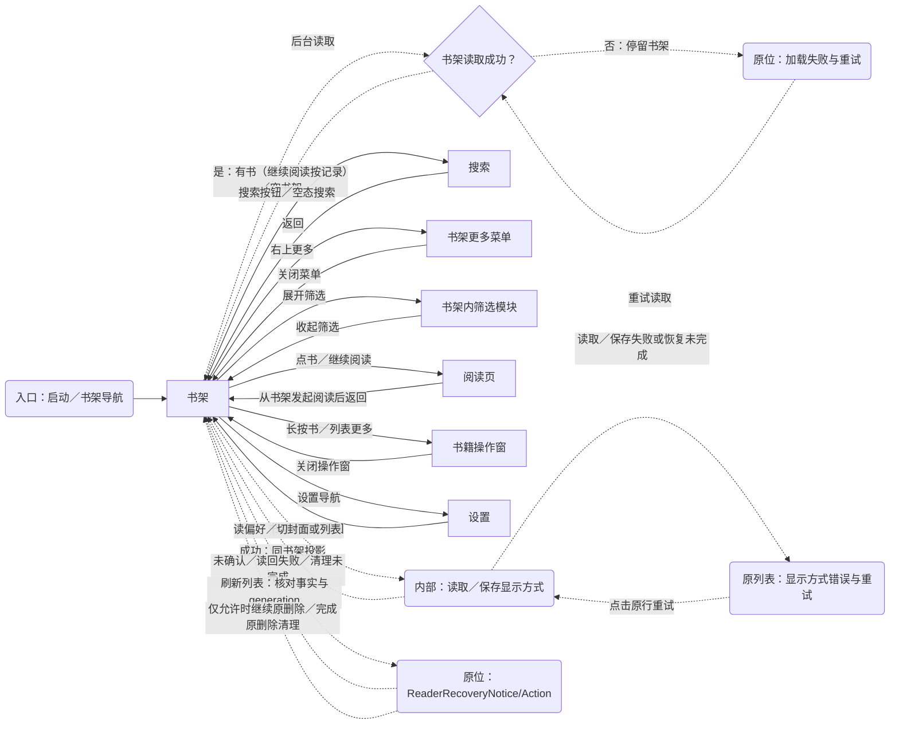

已有状态：封面、列表、小说 · 在线 · 筛选已收起、小说 · 在线 · 列表 · 筛选已收起、有书 · 无阅读记录 · 封面、有书 · 无阅读记录 · 列表、空书架、加载中、加载失败、筛选无匹配、显示方式读取失败、显示方式保存失败、恢复尚未完成、原删除待核对、原删除清理未完成、确认结果后刷新未完成、本地EPUB文件清理未完成。

**尺寸与约束**

- 源码：水平几何统一为 L=max(安全左边距,约定左间距)，R=W−max(安全右边距,约定右间距)，A=max(0,R−L)，C=min(内容宽上限,A)，居中时 x=L+(A−C)/2。安全边距取对应源码的 visual/interactive，不能把内容宽、视口宽和设备物理像素混用。
- 源码：书架 W<600 时内容 cap352、左右间距19，列卡宽 w=min(96.656,max(0,(C−16)/3))，列间距 min(30,max(8,(C−3w)/2))，封面高 w×145.443/96.656。W≥600 且有书架数据时内容 cap620、左间距119(17+82+20)、右21，卡宽 w=min(186.672,max(0,(C−16)/3))、列间距 min(30,max(0,(C−3w)/2))、封面高 w×280/186.672；居中公式同水平几何。
- 源码：全屏 Stack，顶部floating AppTopBar叠放，父left/right=max(16,interactive safe)、top8；表面52高、内距水平4、r18/border1/shadow18/y5；左搜索44×44/icon24、右更多44×44/rc_dots24，标题19/28居中。书架 List 顶部内容偏移58+8=66，ListItem 间距10，关闭滚动条。
- 源码：继续阅读标签独立在卡上方、间距6。卡宽C、高100、左右内边距12、内容间距12、圆角18、边线1；封面48×72/r8；文字列72高/gap2居中，书名/作者/阅读位置，minWidth0；阅读54×40/r12。
- 源码：“我的书架”行高38；封面/列表/筛选图标目标视觉34×34、图标20，响应区44×44且向左/上扩5。书籍封面列每行3本；封面下文字列间距6、标题/作者各1行省略，已读百分比仅进度>0显示。书架列表封面手机48×72、宽屏64×104，详情列高72/gap2，标题行18、右侧内容/来源标签各min30×16/pad4/r4/border0.5/gap6；作者和阅读位置单行，最新章节与进度同行gap8，底部3高线性进度条；更多按钮打开同书动作。
- 源码：手机及空/加载/失败态底部导航高68、cap360、左右间距15、底=max(15,interactiveSafeBottom)，内边距8，子项高54、水平外边距4、图标24放入30×30框。List 底留68+max(15,safeBottom)+16；有书宽屏用82×332侧栏，left=max(17,safeLeft)、垂直居中、pad8、项66×58、间距6，正文底留max(16,safeBottom)。
- 源码：有封面使用 ImageFit.Cover；书架/详情无封面使用 NoCoverCover，底色 TOK_META_BG、圆角8。以 w、h 为当前封面尺寸：两条横线宽=40/96.96×w、高1，y=52/145.44×h 与92.44/145.44×h；“暂无封面”框宽=72/96.96×w，y=63.57/145.44×h，NotoSerif Bold 字号=15/96.96×w、行高=18.3/96.96×w，水平居中。搜索结果的缺封面另用标题渐变，不复用此组件。
- 源码：empty 保持 cap352 与底部导航，即使宽窗口；头行后间距9；空卡高350、圆角12、边线1。装饰小书72×52、圆角8、旋转±8°；图标框62×62圆角16位于 x=C/2−32,y35，图标32；标题y137、说明y173；主/次按钮 x17、宽C−34、高52、圆角12、y219/y281，文字左14/13。
- 源码：loading/error 为同书架内容区 Scroll；Column 间距16，minHeight=viewportHeight（无值时为窗口高减contentSafeTop），顶部留58、底部留浮动导航内容距离，内容居中。spinner24；失败重试胶囊视觉高36、左右pad18、圆角999、响应区高44/y−4。no-match 在列表当前位置显示说明与清除，不清空既有书架数据。
- 源码：no-continue/no-continue-list 为封面/列表已填充书架且 continueReading===undefined；省略整个100高继续阅读ListItem，“我的书架”直接成为首个ListItem，不留其占位。view-read-error/view-save-error/view-restore-pending 在筛选模块（若展开）之后、书籍列表之前插入ReaderRecoveryNotice ListItem；正文padding12、字号12/muted，可恢复时用ReaderRecoveryAction“刷新显示方式”，高36/pad12/r6/primary-soft。

**排版**

- 源码：首页“书架”为 ReaderNotoSerifSCBold/700/29/38；“我的书架”为 ReaderInter/700/15/18。继续阅读：上方标签Inter/500/11/18，书名NotoSerifBold/700/16/23，作者/位置Inter/400/11/15，阅读Inter/700/12/16；书名和作者单行省略。
- 源码：网格书名NotoSerifBold/700/15/18，作者与进度NotoSans UI Regular/400/11/14；列表书名NotoSerifBold15/18，作者/阅读位置/最新/进度静态NotoSans UI Regular11/14，内容/来源标签9/16；标签和章节单行省略。侧栏/底栏标签 NotoSans Bold/700/11/18。
- 源码：空卡标题 NotoSans Bold/19，说明 NotoSans Regular/13，按钮 NotoSans Bold/13；未显式声明行高的原生 Text 保留平台字体度量，不能把预览继承行高当生产证据。loading正文 Inter/400/13/19.5；error标题 Inter/700/17/25.5、说明13/19.5、重试 Inter/800/13/13。
- 源码：书架恢复正文字号12/muted，长message自然换行；compact恢复动作NotoSansSC Bold11/700、高36/r6，消息与动作实测参与原布局。书架移除receipt反馈在shell内容上方，非系统AlertDialog。

**行为与状态**

- 源码：cover/list 同一书架显示方式；点书或继续阅读进入 reader，长按书或列表更多打开 book-actions；右上搜索进入 search，更多打开 shelf-more；底栏/侧栏只有书架、设置。选中当前导航项无操作。
- 源码：empty 只显示导入本地书籍/搜索并加入书架；布局切换和筛选控件禁用。loading 禁止把未完成结果当空书架；error 原内容区重试读书架，旧轮次回调不能覆盖新结果。no-match 由内容类型/来源筛选产生，清除全部条件恢复原书架投影。
- 源码：书架筛选与视图模式不改变书籍身份；显示方式持久化失败回到已确认值并原位重试；阅读进度/更新徽标由实际书架字段产生，示例书名不是产品固定文案。
- 源码：无阅读记录时仍显示书籍和原布局控制；封面/列表切换保留无阅读记录条件，不凭切换显示方式增加继续阅读卡。view-read-error文案“显示方式读取失败，点击重试”，点击重读偏好；view-save-error文案“显示方式保存失败，点击重试”，点击重试requestedMode；BOOKSHELF_RESTORE_PENDING文案“请先在同步设置中重试未完成的恢复”，共用ReaderRecoveryAction仍调用retryViewMode，不从此行虚构新同步入口。
- 源码：收起筛选仅改变filterRowVisible，不清条件或显示方式；filtered-cover/filtered-list 是小说与在线条件保留、模块收起的原书架。稿件封面/列表与展开/收起动作只演示原投影，不写Core；保存成功/失败样本由外部状态选择承接。

**移植适配**

- 迁移：1 vp=1 iOS logical pt=1 Android logical dp；下列字体值是 systemFontScale=1 的 fp 基准，字族/字重由交付字体对应。使用统一文字缩放规则；新增不可见触摸目标最小iOS44×44、Android48×48，源响应区值与视觉值分开保留，邻近目标不得重叠。布局不依赖外层浏览器或物理像素宽度。
- 迁移：保持视觉框、间距和控件顺序；小窗口、分屏或大字体超出可用高度时，原内容区允许滚动。安全区由窗口实时提供，键盘弹出时仍可聚焦输入和访问原有操作；不新增确认、取消中或成功页面。
- 迁移：W<352+38 时按源码公式缩小网格封面；保留3列而非自行改2列。固定82宽侧栏不随文字缩放放大；其标签若不能完整显示，使用单行省略并保留完整 accessibilityLabel。所有新增触摸目标最小iOS44×44/Android48×48；原响应区尺寸仍列在layout中，视觉框不变。加载/失败居中计算必须用手机画布的可用高度，不用固定600。
- 迁移：为原视觉34高布局切换保持已有44响应区；其余小控件扩充不可见触摸区至统一平台最小目标，视觉尺寸不变、相邻目标不可重叠。

来源：[BookshelfShell.ets:116](/Users/minliny/Documents/Reader/.reader-isolated/source-switch-design-20261006/Reader-for-HarmonyOS/entry/src/main/ets/features/bookshelf/BookshelfShell.ets:116)、[BookshelfShell.ets:127](/Users/minliny/Documents/Reader/.reader-isolated/source-switch-design-20261006/Reader-for-HarmonyOS/entry/src/main/ets/features/bookshelf/BookshelfShell.ets:127)、[BookshelfShell.ets:218](/Users/minliny/Documents/Reader/.reader-isolated/source-switch-design-20261006/Reader-for-HarmonyOS/entry/src/main/ets/features/bookshelf/BookshelfShell.ets:218)、[AppTopBar.ets:37](/Users/minliny/Documents/Reader/.reader-isolated/source-switch-design-20261006/Reader-for-HarmonyOS/entry/src/main/ets/features/common/AppTopBar.ets:37)、[BookshelfPage.ets:389](/Users/minliny/Documents/Reader/.reader-isolated/source-switch-design-20261006/Reader-for-HarmonyOS/entry/src/main/ets/features/bookshelf/BookshelfPage.ets:389)、[BookshelfPage.ets:900](/Users/minliny/Documents/Reader/.reader-isolated/source-switch-design-20261006/Reader-for-HarmonyOS/entry/src/main/ets/features/bookshelf/BookshelfPage.ets:900)、[BookshelfPage.ets:854](/Users/minliny/Documents/Reader/.reader-isolated/source-switch-design-20261006/Reader-for-HarmonyOS/entry/src/main/ets/features/bookshelf/BookshelfPage.ets:854)、[BookshelfPage.ets:1097](/Users/minliny/Documents/Reader/.reader-isolated/source-switch-design-20261006/Reader-for-HarmonyOS/entry/src/main/ets/features/bookshelf/BookshelfPage.ets:1097)、[BookshelfEmptyCard.ets:34](/Users/minliny/Documents/Reader/.reader-isolated/source-switch-design-20261006/Reader-for-HarmonyOS/entry/src/main/ets/features/bookshelf/BookshelfEmptyCard.ets:34)、[BookshelfEmptyPage.ets:47](/Users/minliny/Documents/Reader/.reader-isolated/source-switch-design-20261006/Reader-for-HarmonyOS/entry/src/main/ets/features/bookshelf/BookshelfEmptyPage.ets:47)、[NoCoverCover.ets:20](/Users/minliny/Documents/Reader/.reader-isolated/source-switch-design-20261006/Reader-for-HarmonyOS/entry/src/main/ets/features/bookshelf/NoCoverCover.ets:20)、[ShelfBookListDetails.ets:18](/Users/minliny/Documents/Reader/.reader-isolated/source-switch-design-20261006/Reader-for-HarmonyOS/entry/src/main/ets/features/bookshelf/ShelfBookListDetails.ets:18)、[Index.ets:4435](/Users/minliny/Documents/Reader/.reader-isolated/source-switch-design-20261006/Reader-for-HarmonyOS/entry/src/main/ets/pages/Index.ets:4435)、[ReaderRecoveryNotice.ets:14](/Users/minliny/Documents/Reader/.reader-isolated/source-switch-design-20261006/Reader-for-HarmonyOS/entry/src/main/ets/features/common/ReaderRecoveryNotice.ets:14)、[ReaderRecoveryAction.ets:14](/Users/minliny/Documents/Reader/.reader-isolated/source-switch-design-20261006/Reader-for-HarmonyOS/entry/src/main/ets/features/common/ReaderRecoveryAction.ets:14)。

<a id="route-shelf-filter"></a>

#### 书架 · 筛选展开（shelf-filter）

**入口与动作路线**

内容类型与来源是当前已实现的两组筛选，在同一书架内取交集；封面/列表切换、展开/收起保持条件，清除不改分组。

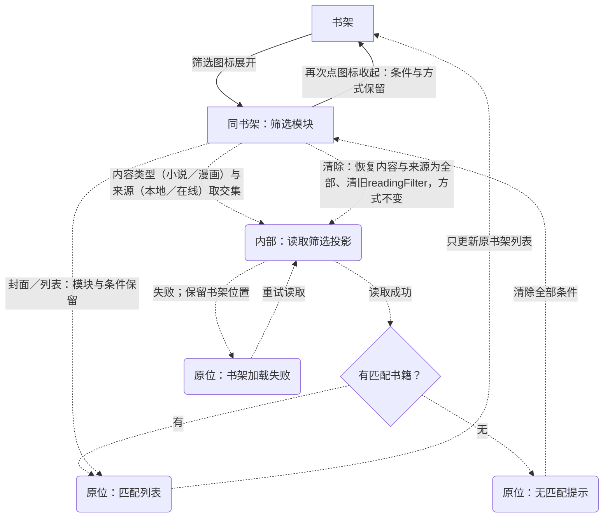

已有状态：全部 · 封面、小说 · 在线 · 封面、全部 · 列表、小说 · 在线 · 列表。

**尺寸与约束**

- 源码：水平几何统一为 L=max(安全左边距,约定左间距)，R=W−max(安全右边距,约定右间距)，A=max(0,R−L)，C=min(内容宽上限,A)，居中时 x=L+(A−C)/2。安全边距取对应源码的 visual/interactive，不能把内容宽、视口宽和设备物理像素混用。
- 源码：书架 W<600 时内容 cap352、左右间距19，列卡宽 w=min(96.656,max(0,(C−16)/3))，列间距 min(30,max(8,(C−3w)/2))，封面高 w×145.443/96.656。W≥600 且有书架数据时内容 cap620、左间距119(17+82+20)、右21，卡宽 w=min(186.672,max(0,(C−16)/3))、列间距 min(30,max(0,(C−3w)/2))、封面高 w×280/186.672；居中公式同水平几何。
- 源码：全屏 Stack，顶部floating AppTopBar叠放，父left/right=max(16,interactive safe)、top8；表面52高、内距水平4、r18/border1/shadow18/y5；左搜索44×44/icon24、右更多44×44/rc_dots24，标题19/28居中。书架 List 顶部内容偏移58+8=66，ListItem 间距10，关闭滚动条。
- 源码：继续阅读标签独立在卡上方、间距6。卡宽C、高100、左右内边距12、内容间距12、圆角18、边线1；封面48×72/r8；文字列72高/gap2居中，书名/作者/阅读位置，minWidth0；阅读54×40/r12。
- 源码：“我的书架”行高38；封面/列表/筛选图标目标视觉34×34、图标20，响应区44×44且向左/上扩5。书籍封面列每行3本；封面下文字列间距6、标题/作者各1行省略，已读百分比仅进度>0显示。书架列表封面手机48×72、宽屏64×104，详情列高72/gap2，标题行18、右侧内容/来源标签各min30×16/pad4/r4/border0.5/gap6；作者和阅读位置单行，最新章节与进度同行gap8，底部3高线性进度条；更多按钮打开同书动作。
- 源码：手机及空/加载/失败态底部导航高68、cap360、左右间距15、底=max(15,interactiveSafeBottom)，内边距8，子项高54、水平外边距4、图标24放入30×30框。List 底留68+max(15,safeBottom)+16；有书宽屏用82×332侧栏，left=max(17,safeLeft)、垂直居中、pad8、项66×58、间距6，正文底留max(16,safeBottom)。
- 源码：filter 不是新路由或弹窗，是当前书架 List 中头行之后展开的 ListItem。筛选块 Column 间距4；首行标签“筛选”与清除同行，清除高28。内容类型、来源分别下一行标题/Wrap标签；标签左右pad12、上下5、边线1、圆角999，右/下margin8、maxWidth160、单行省略。
- 源码：default 选中两组“全部”；active 示例选中“小说/在线”，选择项使用TOK_PRIMARY_DARK边线/实心层及TOK_ON_PRIMARY文字。只有任一条件有效时可清除，禁用opacity0.5。

**排版**

- 源码：筛选及两类标签字号12；筛选胶囊 ReaderInter/500/12/18。Clear字号12，高28。书架其余文字同 bookshelf，包括浮动首页19/28、书架小标题15/18与封面下标题15/18。

**行为与状态**

- 源码：default/active 只表示同一模块的条件值；内容类型“全部、小说、漫画”和来源“全部、本地、在线”分别设置条件后交集过滤，选中条件保留，不生成提交反馈页。
- 源码：default-list/active-list 保留相同展开模块与条件，仅将下方投影切为列表；再次点筛选图标只收起原模块，分别回原全部/条件仍有效的封面或列表。清除只恢复两组全部，不改变显示方式。
- 源码：同一筛选图标展开/收起；“清除”重置内容类型与来源并清理旧readingFilter，不改变书籍分组；全部无匹配时复用 bookshelf/no-match 说明与“清除全部条件”。书架继续阅读与底/侧导航布局仍在。

**移植适配**

- 迁移：1 vp=1 iOS logical pt=1 Android logical dp；下列字体值是 systemFontScale=1 的 fp 基准，字族/字重由交付字体对应。使用统一文字缩放规则；新增不可见触摸目标最小iOS44×44、Android48×48，源响应区值与视觉值分开保留，邻近目标不得重叠。布局不依赖外层浏览器或物理像素宽度。
- 迁移：保持视觉框、间距和控件顺序；小窗口、分屏或大字体超出可用高度时，原内容区允许滚动。安全区由窗口实时提供，键盘弹出时仍可聚焦输入和访问原有操作；不新增确认、取消中或成功页面。
- 迁移：标签 Wrap 自然换行；保留每项 max160 与单行省略，不能横向挤压成不可点击目标。胶囊视觉28高，触摸区用不可见扩展实现平台最小值，不能覆盖另一行标签。

来源：[BookshelfPage.ets:636](/Users/minliny/Documents/Reader/.reader-isolated/source-switch-design-20261006/Reader-for-HarmonyOS/entry/src/main/ets/features/bookshelf/BookshelfPage.ets:636)、[BookshelfPage.ets:660](/Users/minliny/Documents/Reader/.reader-isolated/source-switch-design-20261006/Reader-for-HarmonyOS/entry/src/main/ets/features/bookshelf/BookshelfPage.ets:660)、[BookshelfPage.ets:686](/Users/minliny/Documents/Reader/.reader-isolated/source-switch-design-20261006/Reader-for-HarmonyOS/entry/src/main/ets/features/bookshelf/BookshelfPage.ets:686)、[BookshelfPage.ets:761](/Users/minliny/Documents/Reader/.reader-isolated/source-switch-design-20261006/Reader-for-HarmonyOS/entry/src/main/ets/features/bookshelf/BookshelfPage.ets:761)、[BookshelfPage.ets:1259](/Users/minliny/Documents/Reader/.reader-isolated/source-switch-design-20261006/Reader-for-HarmonyOS/entry/src/main/ets/features/bookshelf/BookshelfPage.ets:1259)。

<a id="route-search"></a>

#### 搜索（search）

**入口与动作路线**

本地/在线并行，来源与内容类型只过滤已返回结果；筛选无匹配保持results和实际请求状态，草稿、返回与列表位置按真实生命周期保留。

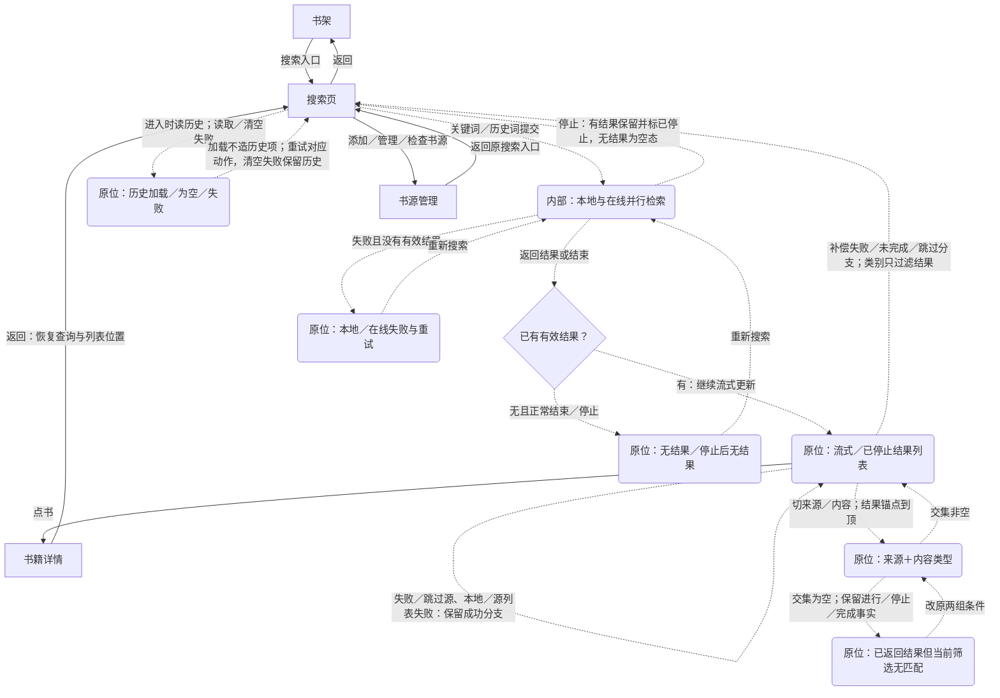

已有状态：最近搜索、历史读取中、无草稿 · 无搜索历史、搜索中、搜索结果、结果继续返回、停止后保留结果、已返回结果 · 当前筛选无匹配、书源列表失败 · 保留本地结果、本地检索失败 · 保留在线结果、结果 · 部分书源失败、结果 · 跳过近期不可用书源、未添加书源、无可搜索书源、书源读取失败、无结果、无结果 · 部分书源失败、停止后无结果、书源搜索失败、本地检索未完成、历史读取失败、历史清空失败。

**尺寸与约束**

- 源码：水平几何统一为 L=max(安全左边距,约定左间距)，R=W−max(安全右边距,约定右间距)，A=max(0,R−L)，C=min(内容宽上限,A)，居中时 x=L+(A−C)/2。安全边距取对应源码的 visual/interactive，不能把内容宽、视口宽和设备物理像素混用。
- 源码：全屏 Stack，居中内容 cap620、左右 gap0（仍避开visual safe），header 固定叠放。tablet 是 Index 的 deviceInfo.deviceType===tablet，不能仅用宽600断点代替。phone header52/field36；tablet header56/field40；top8、左右16/20、rowgap10、返回目标32×32/r16/icon20。搜索输入 layoutWeight1/minWidth0、左右pad12/gap8、搜索/清除图标各14，清除只在草稿非空时出现。提交胶囊高36/40、左右pad14/18、圆角999。
- 源码：results/empty时header下面有来源与内容类型两行，各41.5，标签固定宽51/11号17行高、Row gap8；各自横向Scroll、左右16/20、项间8；胶囊左右10/上下5.5、视觉高23、r999、max160/单行省略。当前源码存在偏移风险：build画两行共83，但searchHeaderHeight仍只加41.5；未通过运行时验证，不能据此声称两行已正确避让。
- 源码：initial 历史 Scroll top=header+8、左右18/20、bottom=max(20,safeBottom)。历史标题行高26；关键词胶囊左右14.5/上下7.5、r999、border1、margin右/下8、maxWidth=history内容宽−8；Wrap 显示全部历史。历史读取失败不伪造历史项；清空失败保留原历史。
- 源码：history-loading 在同一历史Scroll显示“正在读取搜索历史”，Inter400/13/20、TOK_MUTED；entryHistory初始化为空，因此不显示最近搜索、清空记录或关键词。idle 是已读取而history.length===0的同一初始页，历史区域留空，无额外“暂无历史”说明或空卡。
- 源码：结果统计行初始测量高28.5、上下pad6、左右18/20；List 顶=header+实测统计高、底=max(20,safeBottom)，Lazy 列表按稳定身份流式更新并维持位置。结果行左右18/20、top14/bottom14.5、间距12、bottom border1；封面 phone88×(88×82/60)=120.2667，tablet96×(96×92/68)=129.88235，r6、Cover fit；元数据 minHeight=封面高、minWidth0、上下 space-between。
- 源码：搜索无封面使用141.7°绿色渐变，stops 0.077/0.923 对应 TOK_PRIMARY_GRADIENT_START/TOK_PRIMARY_DARK，书名贴底、左右4/bottom6、maxLines1。标题/作者/可选最新章节各单行省略；简介仅非空时显示，maxLines2；底部标签 Wrap mainGap6/crossGap2、左右6/上下2、r4、上margin5。
- 源码：loading/结果继续返回的稳定actor整体底48，不占结果行；actor内spinner36、间距18、caption行高19.5，caption只在loading opacity1，继续返回时opacity0仍保留其布局位（spinner底距48+18+19.5=85.5）。empty/stopped/no-source/all-disabled 用 search_empty 128×120，正文 Scroll top=header+50/bottom=max(40,safeBottom)，标题距图28/说明距标题10，建议框 phone190/tablet300、pad18.5×14.5、r12/border1。source-error/error 图80，标题距图20、说明8，内容 top=header+96；原页承接重试。
- 源码：空态/无源/历史失败主次胶囊视觉36高、r999，左右18/18.5，响应44/y−4；主app.action.fill/on-primary无border，次TOK_CARD_BG/TOK_MUTED与border1。error 的重新搜索高40、左右28、响应48/y−4，检查书源36/响应44/y−4。

**排版**

- 源码：输入 ReaderInter/400/14/21；搜索/停止 phone Inter/800/13/13、tablet14/14，停止 spinner13/gap6，空草稿不能提交时opacity0.4。来源/内容类型胶囊Inter/500或700/12/12；选中app.action.fill/绿色边线/on-primary，未选paper/border/ink；历史标题 Inter/700/13/19.5，清空12/18，关键词 Inter/500/13/19.5。
- 源码：统计 Inter/11/16.5；结果标题 NotoSerif Bold/700/15/19.5，作者 Inter/400/12/12，最新 Inter/11/11且opacity0.8，简介 Inter/12/18；源/类型/在架标签 Inter/700/10/15，封面标题 NotoSerif Bold/9/11.7。
- 源码：stopped-results统计“ · 已停止,已搜索 completed/total 个书源”；failed-sources统计“ · 失败 N 个书源”并在停止返回/已完成时加“，重试”；skipped-sources统计“ · 跳过 N 个近期不可用书源，重试”。均Inter400/11/16.5/max1省略、TOK_MUTED；失败/跳过Text可点onRetry。分支读取失败说明字号12，TOK_MUTED；正常源码位于同一统计Row，List顶距使用实测Row高度。
- 源码：无结果/无源/错误标题 NotoSerif Bold/700/17/25.5；一般说明 Inter/400/13/21.125；搜索失败说明13/19.5且最多2行；搜索中提示13/19.5；一般空态按钮Inter800/13/13，error主按钮14/14、检查书源700/13/13。

**行为与状态**

- 源码：initial/历史错误 → 输入或历史词开始搜索，本地与当前启用且可搜索在线书源并行。loading 表示尚无结果；searching 保留已返回结果并继续收集；results 收敛显示；partial-error 保留成功分支、只补偿失败/未完成分支。结果类别“全部/本地/在线”过滤已返回集合，不变更检索书源范围。
- 源码：停止请求不再派发新在线书源，但已返回结果保留；无结果时 stopped 显示“已停止搜索”。empty 说明无结果，可添加书源/重新搜索；error 在所有相关失败且无可显示结果时显示实际失败与重试。停止不是清空、不是返回书架。
- 源码：stopped-results 保留有效结果并说明已完成源数量，不画成empty；failed-sources 与 skipped-sources 保留同一结果列表，补偿重试覆盖失败/未完成分支及近期不可用而跳过的源，不重复已成功分支。empty-partial-error 表示部分在线书源失败、其余分支成功但无结果，空态原位显示失败说明并重试，不当全部相关失败。
- 源码：local-partial-error 保留成功在线结果并显示“本地检索：{真实消息}”；partial-error 的sourceList失败保留成功本地结果，显示“书源列表：{真实消息}”。无有效结果且localSearchFailed时local-error标题“本地检索未完成”，说明来自同一localFailureMessage；检查书源是原errorContent仍有的入口，不宣称可修复本地读取错误。所有标题/计数/消息都随真实presentation变化。
- 源码：no-source/all-disabled/source-error 只限制在线能力，上方输入仍可搜索本地书籍；分别添加书源、管理书源、重试加载。history-error 显示“搜索历史读取失败/重试读取”，history-clear-error 显示“搜索历史清空失败/重试清空”且保留历史；两者重试不重置当前查询与书源。
- 源码：结果点书进入 detail，返回恢复搜索请求、结果与滚动位置。local 标签源名“本地导入”/类型“本地书籍”/在架“已在书架”；只有字段存在才显示最新章节，Local SearchGateway 没有 latestChapterTitle。发现同书多源显示实际sourceCount，不固定2。
- 源码：来源全部/本地/在线与内容类型全部类型/小说/漫画独立取交集。原统计显示当前可见组数；已返回结果过滤为空时仍为results，显示当前筛选下无匹配说明，分别保留搜索中/已停止/已结束事实，不冒充全请求无结果。切换筛选重置结果锚点到顶部，草稿不变。源码：搜索 clear 只修改草稿，不能假装已启动新查询；返回按钮回书架。异步回调按requestId/书籍身份拒绝旧结果。当前 dirty 搜索源码属于本基线，浏览器样稿不构成设备验收。

**移植适配**

- 迁移：1 vp=1 iOS logical pt=1 Android logical dp；下列字体值是 systemFontScale=1 的 fp 基准，字族/字重由交付字体对应。使用统一文字缩放规则；新增不可见触摸目标最小iOS44×44、Android48×48，源响应区值与视觉值分开保留，邻近目标不得重叠。布局不依赖外层浏览器或物理像素宽度。
- 迁移：保持视觉框、间距和控件顺序；小窗口、分屏或大字体超出可用高度时，原内容区允许滚动。安全区由窗口实时提供，键盘弹出时仍可聚焦输入和访问原有操作；不新增确认、取消中或成功页面。
- 迁移决定：iOS/Android搜索按当前逻辑窗口宽W≥600映射tablet视觉尺寸；这是跨平台宽度策略，区别于HarmonyOS源deviceInfo.deviceType判定。稿件修正：header在results/empty按52/56+83预留，以避免当前原生offset公式漏掉第二行；这是迁移修正，源风险另记。结果 cap620 与 safe/insets 使用实际窗口计算，不能用外层浏览器viewport mediaquery。稿件统计置于独立固定lane、自然实测高度参与List剩余空间，spinner置于独立全视口bottom48，不能滚入结果行。大字体统计行必须实测后更新List顶偏移，流式结果不能整列表重挂载。
- 迁移：草稿字段占剩余空间，过窄时允许其文本自身水平滚动，不压缩32返回目标和搜索胶囊。clear14图标扩大不可见触摸区、与输入焦点区协调；搜索结果整卡可点，保持附属标签不独立新增跳转。

来源：[SearchPage.ets:416](/Users/minliny/Documents/Reader/.reader-isolated/source-switch-design-20261006/Reader-for-HarmonyOS/entry/src/main/ets/features/search/SearchPage.ets:416)、[SearchPage.ets:555](/Users/minliny/Documents/Reader/.reader-isolated/source-switch-design-20261006/Reader-for-HarmonyOS/entry/src/main/ets/features/search/SearchPage.ets:555)、[SearchPage.ets:713](/Users/minliny/Documents/Reader/.reader-isolated/source-switch-design-20261006/Reader-for-HarmonyOS/entry/src/main/ets/features/search/SearchPage.ets:713)、[SearchPage.ets:753](/Users/minliny/Documents/Reader/.reader-isolated/source-switch-design-20261006/Reader-for-HarmonyOS/entry/src/main/ets/features/search/SearchPage.ets:753)、[SearchPage.ets:535](/Users/minliny/Documents/Reader/.reader-isolated/source-switch-design-20261006/Reader-for-HarmonyOS/entry/src/main/ets/features/search/SearchPage.ets:535)、[SearchPage.ets:543](/Users/minliny/Documents/Reader/.reader-isolated/source-switch-design-20261006/Reader-for-HarmonyOS/entry/src/main/ets/features/search/SearchPage.ets:543)、[SearchPage.ets:852](/Users/minliny/Documents/Reader/.reader-isolated/source-switch-design-20261006/Reader-for-HarmonyOS/entry/src/main/ets/features/search/SearchPage.ets:852)、[SearchPage.ets:976](/Users/minliny/Documents/Reader/.reader-isolated/source-switch-design-20261006/Reader-for-HarmonyOS/entry/src/main/ets/features/search/SearchPage.ets:976)、[SearchPage.ets:1147](/Users/minliny/Documents/Reader/.reader-isolated/source-switch-design-20261006/Reader-for-HarmonyOS/entry/src/main/ets/features/search/SearchPage.ets:1147)、[SearchPage.ets:1227](/Users/minliny/Documents/Reader/.reader-isolated/source-switch-design-20261006/Reader-for-HarmonyOS/entry/src/main/ets/features/search/SearchPage.ets:1227)、[SearchPage.ets:1303](/Users/minliny/Documents/Reader/.reader-isolated/source-switch-design-20261006/Reader-for-HarmonyOS/entry/src/main/ets/features/search/SearchPage.ets:1303)、[SearchPage.ets:1391](/Users/minliny/Documents/Reader/.reader-isolated/source-switch-design-20261006/Reader-for-HarmonyOS/entry/src/main/ets/features/search/SearchPage.ets:1391)、[ReaderControlSpecs.ets:25](/Users/minliny/Documents/Reader/.reader-isolated/source-switch-design-20261006/Reader-for-HarmonyOS/entry/src/main/ets/features/common/ReaderControlSpecs.ets:25)、[ReaderControlSpecs.ets:117](/Users/minliny/Documents/Reader/.reader-isolated/source-switch-design-20261006/Reader-for-HarmonyOS/entry/src/main/ets/features/common/ReaderControlSpecs.ets:117)、[ReaderControlSpecs.ets:247](/Users/minliny/Documents/Reader/.reader-isolated/source-switch-design-20261006/Reader-for-HarmonyOS/entry/src/main/ets/features/common/ReaderControlSpecs.ets:247)。

<a id="route-detail"></a>

#### 书籍详情（detail）

**入口与动作路线**

按当前书籍身份绘制小说/漫画真实详情结构；简介与卷组是本书局部状态，完整目录保留详情在其下，条目index原样传到阅读。

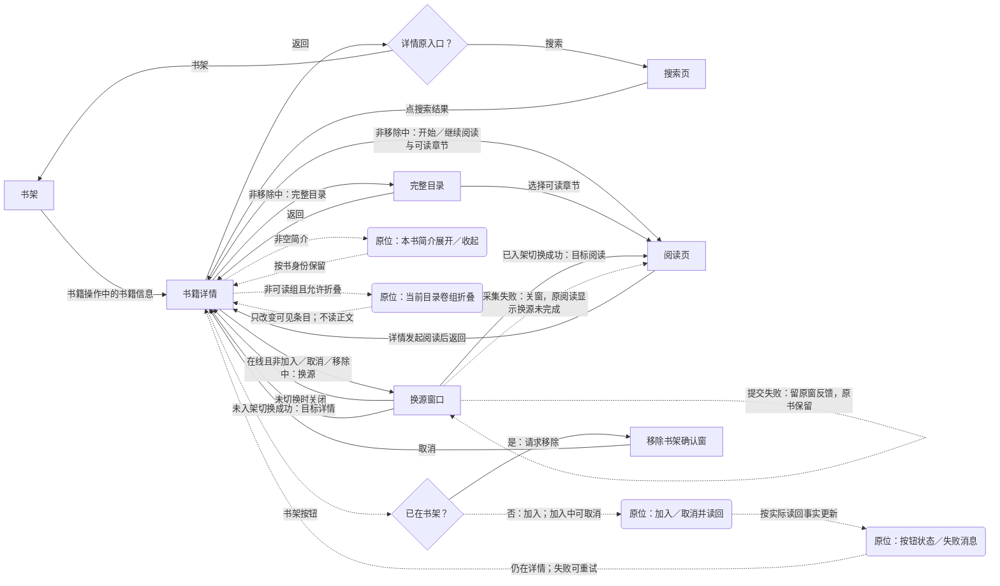

已有状态：在线 · 已在书架、本地书籍、漫画 · 已有阅读位置、漫画 · 尚未开始、在线 · 未在书架、目录读取中、空目录、目录未完成、目录无可读条目、目录含不可读卷标题、正在加入、正在取消加入、正在移除、加入未完成。

**尺寸与约束**

- 源码：水平几何统一为 L=max(安全左边距,约定左间距)，R=W−max(安全右边距,约定右间距)，A=max(0,R−L)，C=min(内容宽上限,A)，居中时 x=L+(A−C)/2。安全边距取对应源码的 visual/interactive，不能把内容宽、视口宽和设备物理像素混用。
- 源码（9b70ff4e）：一个全视口Scroll，内容cap720、左右20/visual safe、Column gap24，top=interactiveSafeTop+76、bottom=interactiveSafeBottom+104。顶部floating PageBackBar由父容器left/right16+visual safe、top=interactiveSafeTop+8定位；栏52高、左右内部4、返回44/icon24、对称尾部空位44、r18/border1/shadow18/y5，标题居中。
- 源码：hero无固定卡片边线/背景/152高度。小说封面84×122/r8、行gap18/minHeight122；漫画104×150/r10、gap16/minHeight150；有图ImageFit.Cover，缺图NoCoverCover。元数据Column gap8/minWidth0；24/34书名最多2行，作者13/20单行。标签10/18/pad水平7/border0.5/r4，内容/来源标签各一项。
- 源码：小说当前来源和最新章节是hero之后的独立readingFacts，Column gap9；来源13/20、源行gap12、仅sourceSwitchEnabled时有32高/pad12/r10换源。漫画来源/最新留hero，分别12/18、11/18；换源28高/pad10/r9；独立上次读到卡pad14×12、r12/border1，small10/16、下gap6、位置行13/20与尾页数11/20、rowgap8；无mangaPosition显示尚未开始阅读和—。
- 源码：简介不再是固定高度卡。标题15/bold、Column gap8；正文NotoSans13/24，收起maxLines3、展开maxLines10000。简介非空才有展开/收起32高、12号按钮；漫画简介上下pad16及上下边线1，小说无额外内距/边线。
- 源码：目录自然高度、无282固定空卡。头行min44/gap8：目录或章节目录15/bold，可读数11；漫画还报告卷组数。完整目录视觉94×30/r999/icon20/pad11，独立94×44响应。预览最多20行；可读行min58、卷组min44、left依据level与前组为10/26或漫画10+min(4,level−1)×16，right10/topbottom10、bottom divider0.5。当前漫画章节有正在读和active-soft/r8，非可读卷组用card底色/r8及24宽折叠箭头。
- 源码：底部dock cap680、左右30/visual safe居中，bottom=interactiveSafeBottom+12；68高/pad9/r24/border1/clip、日间shadow18/y5。Row gap12，主阅读按钮flex/48高/r16，次书架按钮94×48/r16；不是旧77高/两条等宽胶囊。

**排版**

- 源码：floating标题静态NotoSans UI Bold/700/19/28居中；书名NotoSerifBold24/34/max2，作者NotoSans13/20/max1。简介NotoSans13/24；目录行NotoSans14/22，组Medium、可读Regular；折叠符号18、正在读11。
- 源码：主按钮静态NotoSans UI Bold14/700，次按钮UI Medium12/500；已入架次字muted，未入架green；次底surface-panel-soft与line边线，主TOK_PRIMARY_DARK/on-primary。移除中主opacity0.5，次受removalEnabled/removing/cancellingAdd保护时opacity0.4。

**行为与状态**

- 源码：真实sourceId/bookId/contentKind随详情、完整目录及阅读入口传递，详情在独立目录下保留同一滚动实例，返回恢复。完整目录是Index.externalDirectory的BookDirectoryPage，非阅读Quick/Full面板；条目index保持原目录索引。
- 源码：saved在线已入架、local本地已入架、preview在线未入架；小说阅读文案依inBookshelf，漫画依mangaPosition。漫画尚未开始没有虚构页码/章名。目录空态由loadingMessage优先，其次readingBlockedReason，再暂无章节信息；加载或无可读内容不另开新页面。
- 源码：非可读卷标题不能进入reader；小说组点击折叠后续直到下一组，漫画仅实际group可折叠。collapsedGroups按book身份重置、toc变化校验原title/level/navigable；可读条目点击原index，移除期间阻止两类操作。
- 源码：简介展开/收起只改变本书局部展示。adding仍能阅读/完整目录；cancelling禁书架次操作；adding/cancelling/removing不出现换源按钮。本地不出现换源。removing禁阅读、目录、条目及重复书架操作。
- 源码：换源候选直接切换；未入架成功回目标详情，已入架成功转目标阅读；采集失败关窗进入原阅读的现有反馈，提交/核对失败保留换源窗。无首图验证、提交确认页。
- 源码：移除确认只消费一次；9b70的BookshelfHost receipt决定实际事实并退回原入口。未确认、读回或清理未完成由原书架ReaderRecoveryNotice/Action承接，旧批量移除系统AlertDialog样本已撤销。

**移植适配**

- 迁移：1 vp=1 iOS logical pt=1 Android logical dp；下列字体值是 systemFontScale=1 的 fp 基准，字族/字重由交付字体对应。使用统一文字缩放规则；新增不可见触摸目标最小iOS44×44、Android48×48，源响应区值与视觉值分开保留，邻近目标不得重叠。布局不依赖外层浏览器或物理像素宽度。
- 迁移：保持视觉框、间距和控件顺序；小窗口、分屏或大字体超出可用高度时，原内容区允许滚动。安全区由窗口实时提供，键盘弹出时仍可聚焦输入和访问原有操作；不新增确认、取消中或成功页面。
- 迁移：保留动态hero/简介/目录结构，不能把残留未使用CHAPTER_SECTION_HEIGHT=282常量当布局。低高度时主Scroll绕过52浮动返回条与68浮动dock；大字体让正文/条目自然增高，标题max2/作者max1及原交互保持。
- 演示布局：非阅读页面的app-screen已避开顶部安全区，详情栏内部只再加8、正文只加76，不重复叠加safeTop；全视口绝对坐标仍对应源码safeTop+8与safeTop+76。200%压力样本栏最小高76、返回槽垂直居中，正文从内部100开始，保留栏后16留白；压力倍率是交付检查样本，不冒充原生字体缩放曲线。
- 演示：book上下文确定小说/漫画布局、封面与真实预选；简介和卷组使用按book.id隔离的局部choice。浏览器示例图像只是封面fixture，不声明Core接受SVG。后台加入/取消/移除结果仍由外部状态样本表达，原生事实/产物/视觉/用户验收分别验证。

来源：[LocalBookDetail.ets:92](/Users/minliny/Documents/Reader/.reader-isolated/source-switch-design-20261006/Reader-for-HarmonyOS/entry/src/main/ets/features/bookshelf/LocalBookDetail.ets:92)、[LocalBookDetail.ets:132](/Users/minliny/Documents/Reader/.reader-isolated/source-switch-design-20261006/Reader-for-HarmonyOS/entry/src/main/ets/features/bookshelf/LocalBookDetail.ets:132)、[LocalBookDetail.ets:195](/Users/minliny/Documents/Reader/.reader-isolated/source-switch-design-20261006/Reader-for-HarmonyOS/entry/src/main/ets/features/bookshelf/LocalBookDetail.ets:195)、[LocalBookDetail.ets:237](/Users/minliny/Documents/Reader/.reader-isolated/source-switch-design-20261006/Reader-for-HarmonyOS/entry/src/main/ets/features/bookshelf/LocalBookDetail.ets:237)、[LocalBookDetail.ets:255](/Users/minliny/Documents/Reader/.reader-isolated/source-switch-design-20261006/Reader-for-HarmonyOS/entry/src/main/ets/features/bookshelf/LocalBookDetail.ets:255)、[LocalBookDetail.ets:293](/Users/minliny/Documents/Reader/.reader-isolated/source-switch-design-20261006/Reader-for-HarmonyOS/entry/src/main/ets/features/bookshelf/LocalBookDetail.ets:293)、[LocalBookDetail.ets:328](/Users/minliny/Documents/Reader/.reader-isolated/source-switch-design-20261006/Reader-for-HarmonyOS/entry/src/main/ets/features/bookshelf/LocalBookDetail.ets:328)、[LocalBookDetail.ets:397](/Users/minliny/Documents/Reader/.reader-isolated/source-switch-design-20261006/Reader-for-HarmonyOS/entry/src/main/ets/features/bookshelf/LocalBookDetail.ets:397)、[PageBackBar.ets:32](/Users/minliny/Documents/Reader/.reader-isolated/source-switch-design-20261006/Reader-for-HarmonyOS/entry/src/main/ets/features/common/PageBackBar.ets:32)、[Index.ets:1482](/Users/minliny/Documents/Reader/.reader-isolated/source-switch-design-20261006/Reader-for-HarmonyOS/entry/src/main/ets/pages/Index.ets:1482)、[Index.ets:1525](/Users/minliny/Documents/Reader/.reader-isolated/source-switch-design-20261006/Reader-for-HarmonyOS/entry/src/main/ets/pages/Index.ets:1525)、[Index.ets:4405](/Users/minliny/Documents/Reader/.reader-isolated/source-switch-design-20261006/Reader-for-HarmonyOS/entry/src/main/ets/pages/Index.ets:4405)。

<a id="route-bookshelf-settings"></a>

#### 书架设置（bookshelf-settings）

**入口与动作路线**

书架设置记住书架或设置来源，显示方式乐观切换并异步保存，失败回到已确认值且在同一卡片重试。

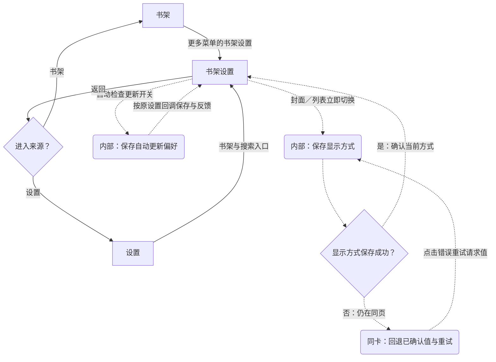

已有状态：封面、列表、显示方式保存失败、自动检查关闭。

**尺寸与约束**

- 源码：水平几何统一为 L=max(安全左边距,约定左间距)，R=W−max(安全右边距,约定右间距)，A=max(0,R−L)，C=min(内容宽上限,A)，居中时 x=L+(A−C)/2。安全边距取对应源码的 visual/interactive，不能把内容宽、视口宽和设备物理像素混用。
- 源码：Stack 中 Scroll 与58高 PageBackBar 叠放；Scroll top66/bottom=max(16,interactiveSafeBottom)，内容cap720、左右gap19/visual safe。卡pad16/r12/border1，内部Column gap16。自动检查标题layoutWeight1，尾部原生Toggle Switch；说明独立整行；显示方式Row gap12，标签layoutWeight1。
- 源码：封面/列表选项左右pad14/上下10、r20，选中app.action.fill/未选TOK_PAPER；保存错误Text位于同卡下一行，并可点重试requestedMode。Toggle未显式设置宽、高、thumb直径或行高，业务源码不能提供跨平台像素外形。

**排版**

- 源码：标题PageBackBar为NotoSerif Bold/24/33；自动检查/显示方式字号15、说明/保存错误12、选项13。此页Text未声明fontFamily/fontWeight/lineHeight，采用原生默认度量；不能将HTML样稿的Inter或开关34×20当源声明。

**行为与状态**

- 源码：cover/list 立即显示请求方式并异步保存，先读存储确定confirmed；成功更新confirmed；失败回已确认方式，原位“显示方式保存失败，点击重试”。恢复尚未完成时文案“请先在同步设置中重试未完成的恢复”；过时revision/mounted回调忽略。save-error 是相同页面，不独立失败页。
- 源码：自动检查更新开关保存偏好，真正自动检查受书架前台/未阅读等条件；从书架更多或设置入口打开，返回对应来源，不强行回书架。

**移植适配**

- 迁移：1 vp=1 iOS logical pt=1 Android logical dp；下列字体值是 systemFontScale=1 的 fp 基准，字族/字重由交付字体对应。使用统一文字缩放规则；新增不可见触摸目标最小iOS44×44、Android48×48，源响应区值与视觉值分开保留，邻近目标不得重叠。布局不依赖外层浏览器或物理像素宽度。
- 迁移：保持视觉框、间距和控件顺序；小窗口、分屏或大字体超出可用高度时，原内容区允许滚动。安全区由窗口实时提供，键盘弹出时仍可聚焦输入和访问原有操作；不新增确认、取消中或成功页面。
- 迁移：此源使用HarmonyOS原生Switch；iOS/Android若要求外形原样一致，需用项目统一Toggle规范替代系统控件，并单独标记为迁移决定。当前业务源码没有其确切几何，不能声称已经1:1确定。文字字族/行高默认值遵守统一跨平台映射规则。
- 迁移：模式选项自适应宽度并保持14×10内边距；极窄窗口允许整卡横向可访问或文本省略，所有保存/重试逻辑仍在原页，错误消息允许自然换行。

来源：[BookshelfSettingsPage.ets:88](/Users/minliny/Documents/Reader/.reader-isolated/source-switch-design-20261006/Reader-for-HarmonyOS/entry/src/main/ets/features/bookshelf/BookshelfSettingsPage.ets:88)、[BookshelfSettingsPage.ets:75](/Users/minliny/Documents/Reader/.reader-isolated/source-switch-design-20261006/Reader-for-HarmonyOS/entry/src/main/ets/features/bookshelf/BookshelfSettingsPage.ets:75)、[BookshelfSettingsPage.ets:143](/Users/minliny/Documents/Reader/.reader-isolated/source-switch-design-20261006/Reader-for-HarmonyOS/entry/src/main/ets/features/bookshelf/BookshelfSettingsPage.ets:143)、[PageBackBar.ets:32](/Users/minliny/Documents/Reader/.reader-isolated/source-switch-design-20261006/Reader-for-HarmonyOS/entry/src/main/ets/features/common/PageBackBar.ets:32)、[ReaderRecoveryNotice.ets:14](/Users/minliny/Documents/Reader/.reader-isolated/source-switch-design-20261006/Reader-for-HarmonyOS/entry/src/main/ets/features/common/ReaderRecoveryNotice.ets:14)、[ReaderRecoveryAction.ets:14](/Users/minliny/Documents/Reader/.reader-isolated/source-switch-design-20261006/Reader-for-HarmonyOS/entry/src/main/ets/features/common/ReaderRecoveryAction.ets:14)。

<a id="route-multiselect"></a>

#### 批量管理（multiselect）

**入口与动作路线**

预选按当前书籍稳定身份、全选按当前可见集合；有效移除outcome返回书架，receipt未完成事实使用原书架共用恢复组件。

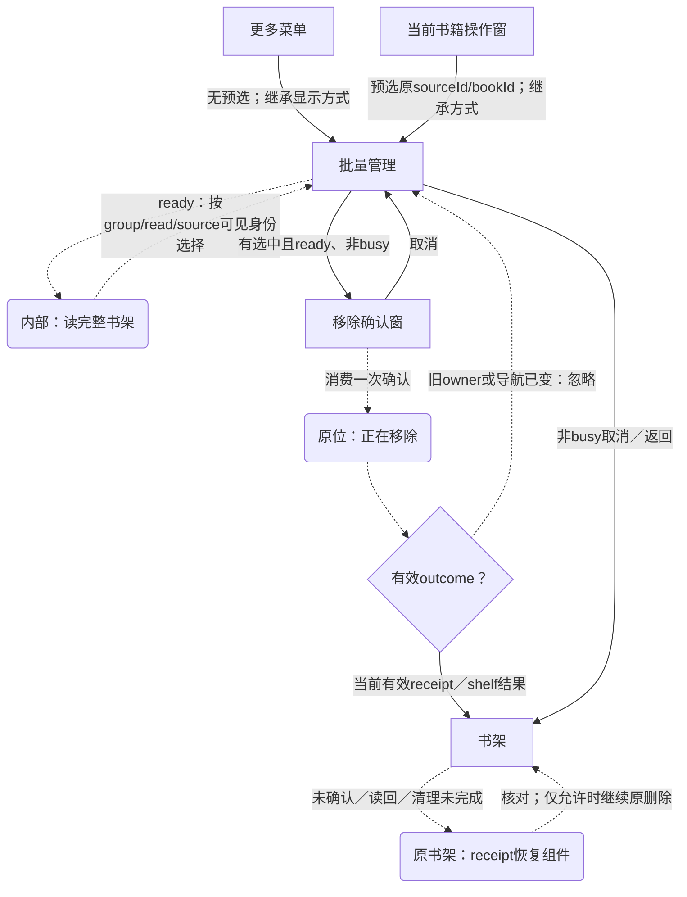

已有状态：已选一本、未选择、全选、列表、读取中、移除中。

**尺寸与约束**

- 源码：全屏Stack，无main-tabs。header58高、左右20/上下8；左右按钮各宽72，标题剩余width居中。List top=58+12=70，行间距12，底偏移=实测removeBarHeight+20，滚动条关闭。手机grid351、卡97×191、封面97×145.44；W≥600时grid622、卡186.67×325.3、封面186.67×280，固定3列、列gap30，整行居中。
- 源码：封面r8、阴影radius26/y8；封面右下选中徽标22×22/r11，right4/bottom4；未选border1.5/阴影radius4/y2，选中橙#F58517/白勾。封面下面Column gap6，标题/作者各maxLines1省略。
- 源码：list 仍用手机48×80封面/r6，即使宽窗口；row宽351/622、高80/行gap12，封面与详情gap12；详情同当前ShelfBookListDetails高72，包含内容/来源tag、阅读位置和线性进度条，选中徽标right2/bottom2位于封面Stack内部，不是整行右下角。
- 源码：removeBar全宽、top border1/上圆角24、paddingtop12/bottom=max(12,interactiveSafeBottom)；触点宽74，图标22、图标文字gap6、字号11/13.31，fallback高度=12+22+6+13.31+bottomInset；禁用opacity0.38。

**排版**

- 源码：标题NotoSerif Bold/700/24/34.49；取消/全选NotoSans Bold/700/13/15.6。网格书名phone NotoSerif Bold/13/16、wide16/19.5；作者phone NotoSans Regular/11/13.5、wide13/16。徽标✓为InterBold14。删除标签InterBold11/13.31；列表文字同ShelfBookListDetails。

**行为与状态**

- 源码：菜单进入默认 none；从特定书籍动作进入 selected 预选该书；all 选中当前group/read/source过滤后的可见身份并将按钮改取消全选；list 用持久化列表方式呈现同一选择模型。选中身份按sourceId/bookId组合键追踪，读回后剔除已不存在身份。
- 源码：loading 尚未完整读书架时不允许取消/全选/点书/移除，底标签正在读取书架；removing 保留当前选中与原列表、底标签正在移除、禁用所有竞争操作；none移除禁用。批量移除先book-removal确认；有效outcome后回书架，未确认/刷新失败/清理未完成由原书架receipt恢复组件表达，不再显示旧批量移除系统AlertDialog；已执行事实以Core receipt为准。

**移植适配**

- 迁移：1 vp=1 iOS logical pt=1 Android logical dp；下列字体值是 systemFontScale=1 的 fp 基准，字族/字重由交付字体对应。使用统一文字缩放规则；新增不可见触摸目标最小iOS44×44、Android48×48，源响应区值与视觉值分开保留，邻近目标不得重叠。布局不依赖外层浏览器或物理像素宽度。
- 迁移：保持视觉框、间距和控件顺序；小窗口、分屏或大字体超出可用高度时，原内容区允许滚动。安全区由窗口实时提供，键盘弹出时仍可聚焦输入和访问原有操作；不新增确认、取消中或成功页面。
- 源码限制：固定grid351/622不使用安全区宽度公式。W=600时已经切到622宽，内容可能超出窗口；W<351也可能溢出。这是当前实现限制，不是假设其已处理分屏。
- 迁移：保持351/622视觉网格与原600断点；当扣除安全区后不足固定grid时，内容区增加水平滚动并保留垂直滚动，选择状态不重置。大字体保留封面尺寸、卡片至少原height，需要额外文字高度时随内容增长而滚动，不能裁掉选择触点。
- 迁移：批量管理顶栏仍固定在列表外；基准58高、两侧各72宽保持原样。字体压力下标题保留单行省略，左右操作不收缩且保持对称槽，槽宽max(72,4em)可容纳取消全选；栏按标题实际行高加上下各8自然增高，List在实测栏底再留12，不用固定70或通用86去覆盖专用布局。
- 迁移：22选择徽标仅视觉；整个卡/列表行是选择目标。74宽底动作目标纵向至少平台最小值，保持图标/文字尺寸和安全区底距。

来源：[BookshelfMultiSelectPage.ets:55](/Users/minliny/Documents/Reader/.reader-isolated/source-switch-design-20261006/Reader-for-HarmonyOS/entry/src/main/ets/features/bookshelf/BookshelfMultiSelectPage.ets:55)、[BookshelfMultiSelectPage.ets:48](/Users/minliny/Documents/Reader/.reader-isolated/source-switch-design-20261006/Reader-for-HarmonyOS/entry/src/main/ets/features/bookshelf/BookshelfMultiSelectPage.ets:48)、[BookshelfMultiSelectPage.ets:250](/Users/minliny/Documents/Reader/.reader-isolated/source-switch-design-20261006/Reader-for-HarmonyOS/entry/src/main/ets/features/bookshelf/BookshelfMultiSelectPage.ets:250)、[BookshelfMultiSelectPage.ets:298](/Users/minliny/Documents/Reader/.reader-isolated/source-switch-design-20261006/Reader-for-HarmonyOS/entry/src/main/ets/features/bookshelf/BookshelfMultiSelectPage.ets:298)、[ShelfBookListDetails.ets:18](/Users/minliny/Documents/Reader/.reader-isolated/source-switch-design-20261006/Reader-for-HarmonyOS/entry/src/main/ets/features/bookshelf/ShelfBookListDetails.ets:18)、[Index.ets:4353](/Users/minliny/Documents/Reader/.reader-isolated/source-switch-design-20261006/Reader-for-HarmonyOS/entry/src/main/ets/pages/Index.ets:4353)、[Index.ets:4369](/Users/minliny/Documents/Reader/.reader-isolated/source-switch-design-20261006/Reader-for-HarmonyOS/entry/src/main/ets/pages/Index.ets:4369)。

<a id="route-shelf-more"></a>

#### 书架更多（shelf-more）

**入口与动作路线**

更多菜单先派发所选动作再收拢，检查更新在后台执行，重新打开时由原菜单项显示进度，没有单独更新结果页面。

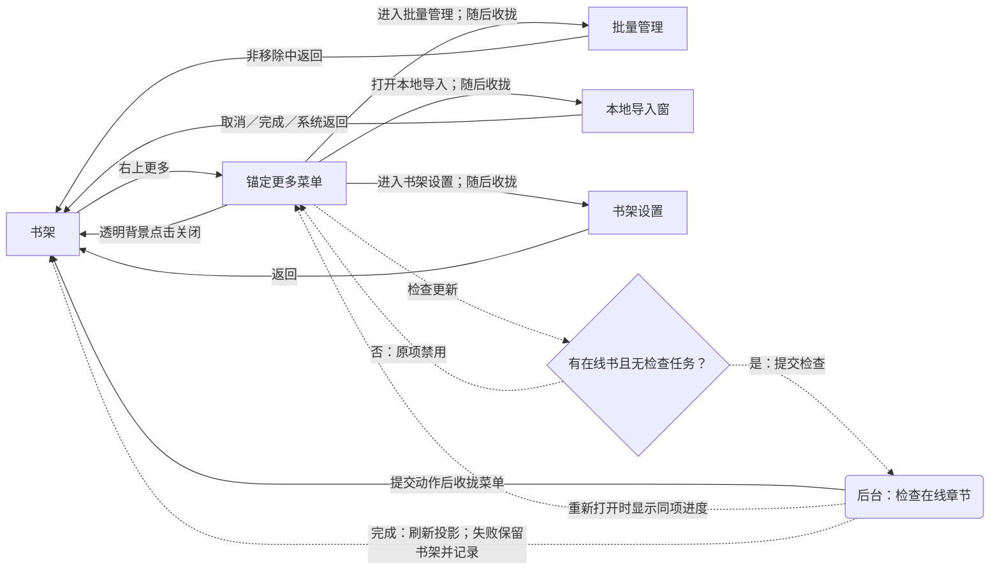

已有状态：菜单、手动检查中、自动检查中、没有在线书籍。

**尺寸与约束**

- 源码：相对右上更多的已测anchor显示，全屏透明点击层；菜单body宽176/r16/border1/阴影radius28/y10，pointer24×12（三角points[0,12;12,0;24,12]），pointer上方区域不算row。4项×50+pointer12=全高212，最小收拢高62。body y12，超高时body内Scroll。
- 源码：Wm=min(176,max(0,overlayW−16)); x=clamp(anchorRight+11−Wm,8,overlayW−Wm−8); y=clamp(anchorBottom−5,0,overlayH−62−8); visibleH=min(panelH,overlayH−y−8); pointerX=clamp(anchorRight−22−x−12,0,Wm−24)。不能固定在浏览器right20/top64来代替真实锚点。
- 源码：每行50、left18/right16/gap16、icon24，文字1行省略；分隔线宽Wm−32/高1、左右16，仅末项不画。项顺序批量管理/本地导入/检查更新/书架设置，图标bookshelf_more_batch/import、settings_gen_refresh、bookshelf_more_settings。

**排版**

- 源码：ReaderNotoSansSC/500/15/22，每行标题maxLines1/ellipsis，禁用更新项opacity0.5并采用muted。

**行为与状态**

- 源码：default 更新可点需有在线书籍且无手动/后台/关闭中任务；updating 文案检查中 done/total；background 正在自动检查；no-online检查更新禁用。其余3项仍可用。菜单透明外部点击关闭。
- 源码：点动作先dispatch onCommit，再启动一次收拢，业务不等待动画结束；展开高度62→212、motion dropdown.menu.expand，reduceMotion立即定位。批量进入multiselect，本地导入local-import，书架设置bookshelf-settings；更新进度更新原菜单项。

**移植适配**

- 迁移：1 vp=1 iOS logical pt=1 Android logical dp；下列字体值是 systemFontScale=1 的 fp 基准，字族/字重由交付字体对应。使用统一文字缩放规则；新增不可见触摸目标最小iOS44×44、Android48×48，源响应区值与视觉值分开保留，邻近目标不得重叠。布局不依赖外层浏览器或物理像素宽度。
- 迁移：保持视觉框、间距和控件顺序；小窗口、分屏或大字体超出可用高度时，原内容区允许滚动。安全区由窗口实时提供，键盘弹出时仍可聚焦输入和访问原有操作；不新增确认、取消中或成功页面。
- 迁移：锚点从实际更多44×44目标测量并在窗口/安全区变化时重新算，三角与body连贯；菜单通过源clamp与内部Scroll适应短窗口。透明点击层不可误用整屏深色scrim；每行50触点满足常用平台最小值。

来源：[BookshelfMoreMenu.ets:75](/Users/minliny/Documents/Reader/.reader-isolated/source-switch-design-20261006/Reader-for-HarmonyOS/entry/src/main/ets/features/bookshelf/BookshelfMoreMenu.ets:75)、[BookshelfMoreMenu.ets:186](/Users/minliny/Documents/Reader/.reader-isolated/source-switch-design-20261006/Reader-for-HarmonyOS/entry/src/main/ets/features/bookshelf/BookshelfMoreMenu.ets:186)、[BookshelfMoreMenu.ets:191](/Users/minliny/Documents/Reader/.reader-isolated/source-switch-design-20261006/Reader-for-HarmonyOS/entry/src/main/ets/features/bookshelf/BookshelfMoreMenu.ets:191)、[BookshelfMoreMenu.ets:200](/Users/minliny/Documents/Reader/.reader-isolated/source-switch-design-20261006/Reader-for-HarmonyOS/entry/src/main/ets/features/bookshelf/BookshelfMoreMenu.ets:200)、[BookshelfShell.ets:218](/Users/minliny/Documents/Reader/.reader-isolated/source-switch-design-20261006/Reader-for-HarmonyOS/entry/src/main/ets/features/bookshelf/BookshelfShell.ets:218)。

<a id="route-book-actions"></a>

#### 书籍操作（book-actions）

**入口与动作路线**

长按或列表更多打开当前书籍操作窗，选择动作先关闭此窗，再进入多选、详情、默认分组选择或移除确认。

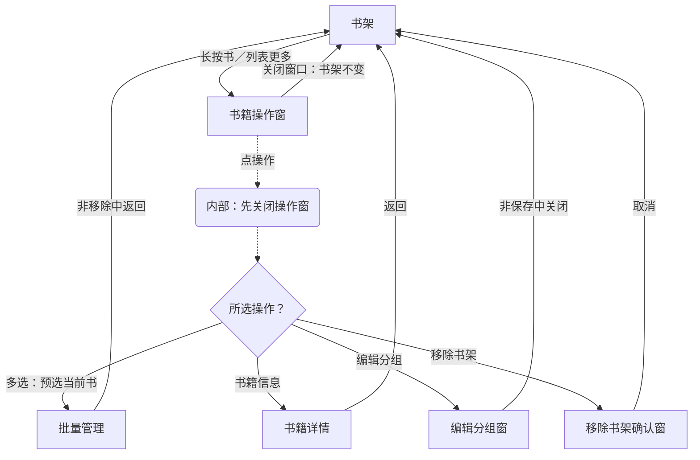

已有状态：在线书籍操作、本地书籍操作。

**尺寸与约束**

- 源码参数：当前书架bindSheet传入高度270、宽=当前shelfContentWidth、preferType CENTER，mask#52000000、outsideInteractive=false、dragBar=false/showClose=false；上圆角24、下0，自定义panel边线1/阴影46/y18/clip。本机SDK common.d.ts:15690–15700约定W<600 vp仅支持bottom，W≥600支持bottom/center/popup，因此CENTER是请求参数，不能据此认定手机实际居中；当前原生运行位置、平台最终尺寸仍未验。
- 源码基线：抓手42×4/r999、y9；标题“书籍操作”x14/y34；四项左右14、高40/r12，y70/116/162/208，文字left12，末项danger背景#1AD6473D，其余primary-soft。以下用户调整是本次稿件的目标样式，本稿保留用户批准的4197视觉例外，原生外形采用共用ReaderBoundedSurface，仍需分别验收。
- 用户调整：参考原4197漫画demo的book-menu（原evidence/2026-10-02-manga-ui-demo，已按清理要求移除；只读留存原稿Prototype.tsx:140–148、prototype.css:101–106、styles.css:638–697）。手机竖屏采用贴可用视口左右和底部的整幅面板，无额外悬浮外边距；上圆角22、下0，无panel边线，遮罩rgba(0,0,0,0.34)，阴影0/−16/48/rgba(0,0,0,0.2)。表面暖纸#FFFCF8、夜间#282C25，夜间阴影0/−16/48/#0006。
- 用户调整：顶部抓手区高30，抓手42×5/r999居中，日间#C9C9C4、夜间#565E50；标题区左18、右60（避让关闭按钮）、下14，标题保留“书籍操作”。右上关闭目标36×36/r12、top24/right12，叉图标18；内容左右18、底24；iOS底部内容留max(24,safeBottom)，Android面板宿主底部避开safeBottom，安全区不重复消费。四项保持多选/书籍信息/编辑分组/移除书架，每行53高、平铺整行点击、左右文字与17×17右箭头、间隔线1；行间gap0，无独立胶囊背景。默认内容自然高度约307，minHeight260；maxHeight=min(安全可用H,max(260,窗口H×0.5))，可用高度不足260时服从可用高度，标题和关闭按钮保留、动作内容区滚动。

**排版**

- 源码基线：标题NotoSans Bold/700/17/20.4；按钮NotoSans Bold/700/13/15.6，maxLines1；danger字#D7473E，其余TOK_GREEN。
- 用户调整：参考漫画demo的Reader Sans（NotoSansSC）字族；标题900/18/27，操作文字400/13/19.5。正文日间#1F1B17、夜间#EAE7DE；关闭图标复用当前import_cancel及夜间SVG（日间#756F69、夜间#BAAD9C）；箭头复用当前rc_chevron_right及夜间SVG，不新增或改绘图标；分隔线日间#E7E0D5、夜间#3B4036。参考稿移除行沿用普通正文颜色，本次四项采用同一行样式；文字缩放后行高至少53并随正文自然增高。

**行为与状态**

- 源码：default/local 为在线或本地当前书籍，菜单布局/文案/项目完全相同，仅目标详情与移除说明依书籍身份变化。只有长按书或列表更多进入；选项先关闭sheet再执行当前书动作。多选预选该身份、书籍信息进入对应已入架detail、编辑分组打开group-select、移除书架打开book-removal。取消目标窗口或从详情/多选返回只回书架，不重新打开已消费的操作窗。没有完整分组管理或提交状态页。
- 用户调整：只采用旧漫画demo的视觉外壳和列表行；其原book-menu仅有书籍信息/移除书架两项，本稿继续使用当前应用四项业务。新增可见关闭按钮复用现有关闭动作；遮罩点击/Escape沿用稿件已有关闭逻辑，不改变返回或动作消费。抓手仅为视觉，不新增拖拽、业务等待或反馈页面。

**移植适配**

- 迁移：1 vp=1 iOS logical pt=1 Android logical dp；下列字体值是 systemFontScale=1 的 fp 基准，字族/字重由交付字体对应。使用统一文字缩放规则；新增不可见触摸目标最小iOS44×44、Android48×48，源响应区值与视觉值分开保留，邻近目标不得重叠。布局不依赖外层浏览器或物理像素宽度。
- 迁移：保持视觉框、间距和控件顺序；小窗口、分屏或大字体超出可用高度时，原内容区允许滚动。安全区由窗口实时提供，键盘弹出时仍可聚焦输入和访问原有操作；不新增确认、取消中或成功页面。
- 设计适配：手机竖屏按上述底部面板；横屏或宽屏采用安全区域内cap620居中面板、四角22，按可用高度限制并让动作区滚动，关闭按钮始终可达。这是本次迁移设计决定，旧漫画demo没有已完成的book-menu横屏/宽屏方案，也不代表当前原生已实现。
- 迁移：53高整行触点满足常用平台最小目标；关闭按钮36视觉框扩充不可见响应区至iOS44×44/Android48×48，避开标题和相邻目标。底部、横向安全区与窗口变化实时计算；字体压力或短窗口不能裁掉任一业务动作。

来源：[BookshelfPage.ets:327](/Users/minliny/Documents/Reader/.reader-isolated/source-switch-design-20261006/Reader-for-HarmonyOS/entry/src/main/ets/features/bookshelf/BookshelfPage.ets:327)、[BookshelfBookActionSheet.ets:25](/Users/minliny/Documents/Reader/.reader-isolated/source-switch-design-20261006/Reader-for-HarmonyOS/entry/src/main/ets/features/bookshelf/BookshelfBookActionSheet.ets:25)、[ReaderSheetActionList.ets:41](/Users/minliny/Documents/Reader/.reader-isolated/source-switch-design-20261006/Reader-for-HarmonyOS/entry/src/main/ets/features/common/ReaderSheetActionList.ets:41)、[ReaderSurfaceSpecs.ets:311](/Users/minliny/Documents/Reader/.reader-isolated/source-switch-design-20261006/Reader-for-HarmonyOS/entry/src/main/ets/features/common/ReaderSurfaceSpecs.ets:311)。

<a id="route-group-select"></a>

#### 编辑分组（group-select）

**入口与动作路线**

默认分组操作只有confirmedCurrent关闭窗口；未确认留原窗复用核对与允许继续的原操作，不显示额外结果页。

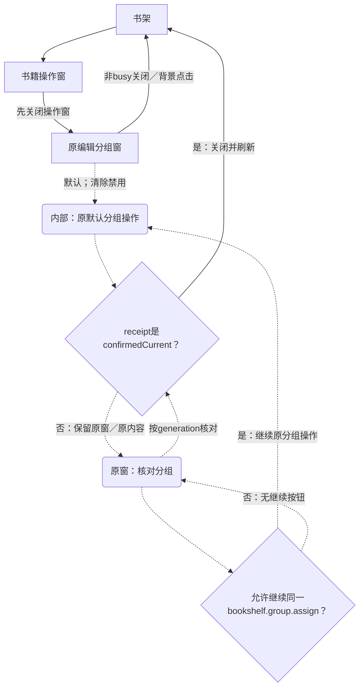

已有状态：默认分组、保存中、原分组待核对、原分组允许继续。

**尺寸与约束**

- 源码：Index居中dialog，mask#52000000、宽75%host、padding20/r20/solid，无shadow/border；标题与body间12，无底部操作行、无顶部关闭X。
- 源码：内部BookshelfGroupSelector Column gap8，paddingtop/bottom8；首行“分组”layoutWeight1/单行省略、清除高28；默认胶囊左右12/上下5、border1/r999、选中TOK_GREEN边线与primary-soft底色，未选card背景。

**排版**

- 源码：dialog标题NotoSans Bold/700/17/20居中；“分组/清除”字号12、family/lineHeight未声明；默认Inter/500/12/18。

**行为与状态**

- 源码：default 当前仅有默认分组；Index未传activeGroup故值为空，清除禁用opacity0.5；选中与否取书籍group是否为空。busy 阻止默认点击与外部mask关闭，保留原按钮/文案而非显示保存页。
- 源码：默认点击保存空group，成功关闭并刷新书架；confirmedCurrent关闭并刷新；receipt未确认/读回未完成留原窗，ReaderRecoveryNotice“核对分组”，只有对应bookshelf.group.assign允许继续原操作才显示“继续原分组操作”；未确认期间默认选项被mutationBlocked保护。异常toast为分组操作暂不可用，请重新打开核对。默认态外部点击可关闭；没有新增分组或完整管理入口。

**移植适配**

- 迁移：1 vp=1 iOS logical pt=1 Android logical dp；下列字体值是 systemFontScale=1 的 fp 基准，字族/字重由交付字体对应。使用统一文字缩放规则；新增不可见触摸目标最小iOS44×44、Android48×48，源响应区值与视觉值分开保留，邻近目标不得重叠。布局不依赖外层浏览器或物理像素宽度。
- 迁移：保持视觉框、间距和控件顺序；小窗口、分屏或大字体超出可用高度时，原内容区允许滚动。安全区由窗口实时提供，键盘弹出时仍可聚焦输入和访问原有操作；不新增确认、取消中或成功页面。
- 迁移：75%host保留相对宽度，safe可用宽不足时将框夹入安全区并允许body滚动；明确此为窄窗补充规则。28高清除/胶囊扩充不可见触摸区，不改变禁用保护。

来源：[BookshelfGroupSelector.ets:16](/Users/minliny/Documents/Reader/.reader-isolated/source-switch-design-20261006/Reader-for-HarmonyOS/entry/src/main/ets/features/bookshelf/BookshelfGroupSelector.ets:16)、[Index.ets:1742](/Users/minliny/Documents/Reader/.reader-isolated/source-switch-design-20261006/Reader-for-HarmonyOS/entry/src/main/ets/pages/Index.ets:1742)、[Index.ets:1760](/Users/minliny/Documents/Reader/.reader-isolated/source-switch-design-20261006/Reader-for-HarmonyOS/entry/src/main/ets/pages/Index.ets:1760)、[Index.ets:1775](/Users/minliny/Documents/Reader/.reader-isolated/source-switch-design-20261006/Reader-for-HarmonyOS/entry/src/main/ets/pages/Index.ets:1775)、[Index.ets:1824](/Users/minliny/Documents/Reader/.reader-isolated/source-switch-design-20261006/Reader-for-HarmonyOS/entry/src/main/ets/pages/Index.ets:1824)、[ReaderRecoveryNotice.ets:14](/Users/minliny/Documents/Reader/.reader-isolated/source-switch-design-20261006/Reader-for-HarmonyOS/entry/src/main/ets/features/common/ReaderRecoveryNotice.ets:14)、[ReaderRecoveryAction.ets:14](/Users/minliny/Documents/Reader/.reader-isolated/source-switch-design-20261006/Reader-for-HarmonyOS/entry/src/main/ets/features/common/ReaderRecoveryAction.ets:14)。

<a id="route-local-import"></a>

#### 导入本地书籍（local-import）

**入口与动作路线**

同一原生弹窗承接选择、导入和逐文件结果；短窗/多文件按实测预算切常规或compact结构，receipt核对位于原footer，不新增结果确认页。

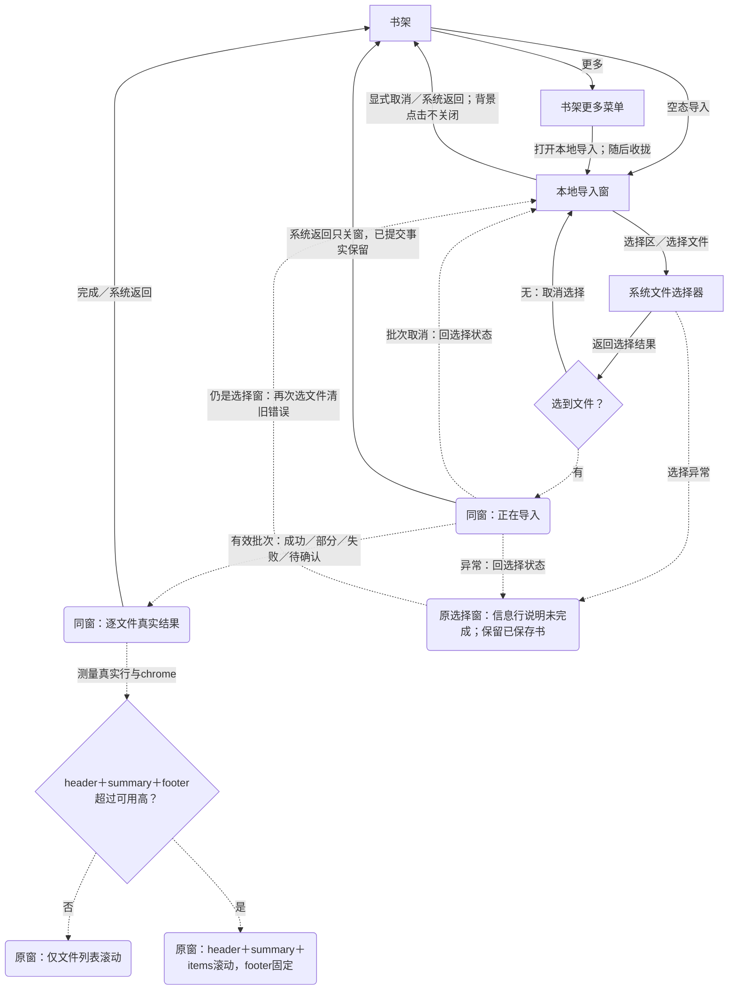

已有状态：选择文件、异常后返回选择窗、系统选择中、正在导入、全部完成、部分完成、全部未完成、待确认、20个文件结果。

**尺寸与约束**

- 源码：水平几何统一为 L=max(安全左边距,约定左间距)，R=W−max(安全右边距,约定右间距)，A=max(0,R−L)，C=min(内容宽上限,A)，居中时 x=L+(A−C)/2。安全边距取对应源码的 visual/interactive，不能把内容宽、视口宽和设备物理像素混用。
- 源码：全屏居中Stack、遮罩 #661F1B17（不是普通确认框#52000000）；panel cap350、左右gap20/interactive safe/r20、阴影radius50/y25、opaque solid。selection/picker panel固定高399.75；导入/结果采用同一不透明shell过渡，无中途空白页面。
- 源码：selection header左右20/top20/bottom17，title行24.75，divider1；body左右20/top20。选择区宽panel−40、dashed border2/r14，左右pad2/topbottom30；icon圆44/内部glyph20；图标与文字/format Row之间spacing12；4个format标签gap6/r4、pad6×2。信息行图标13/top2/gap8、上margin16。
- 源码：selection 底行top20/bottom20/gap12：主按钮layoutWeight1/高44/r22，icon15/gap8；取消高44、左右21/r22/border1、icon13/gap6。picker 保留相同尺寸，按钮改正在选择…，选择区及主按钮disabled，取消仍在。
- 源码：importing视觉shell高228，halo56/内spinner32，spinner周期1000ms；reduceMotion静止。结果header同24.75标题；summary外pad16，卡minHeight52/r12/border1/pad水平17垂直8，左圆36/icon18、rowgap12，标题与计数gap1；尾部refresh glyph18只是图像。
- 源码：结果逐文件列表r12/border1/clip，每行minHeight61、left/right16/top10/bottom11/行gap12、divider1；文档圆32/glyph16、末状态glyph17；标题单行省略，失败说明最多2行。结果底部完成40高/r20、宽panel−32、左右16、icon14/gap6。
- 源码：结果可用height=窗口H−interactiveSafeTop−interactiveSafeBottom−40。chrome=measuredHeader+measuredSummary+12；footer=实测动作高。compact=(chrome+footer>available)；listBudget=max(0,available−footer−(compact?0:chrome))；listHeight=min(itemsMeasured+2,listBudget)；panelH=min(available,chrome+footer+itemsMeasured+2)。常规仅列表滚动，compact时header+summary+items共同滚动，完成动作仍可访问。

**排版**

- 源码：header NotoSerif Bold/700/18/24.75/max1；选择区主文Inter700/13/19.5/letterSpacing−0.0762，次文Inter400/11/16.5/letterSpacing0.0645；format标签Inter700/10/15/letterSpacing0.3672；信息Inter400/11/16.5/letterSpacing0.0645。
- 源码：选择文件Inter800/13/19.5、取消Inter600/13/19.5、letterSpacing−0.0762；导入提示Inter600/14/21、请稍候11/16.5；summary标题Inter700/13/19.5/−0.0762，count11/16.5/0.0645；文件titleInter600/12/18，状态标签Inter700/10/15/0.3672，失败说明11/16.5/max2；完成Inter800/13/19.5/−0.0762。

**行为与状态**

- 源码：selection/picker → 系统多选文件 → importing → result/partial/failed/recovery。选择区与选择文件等价；选择取消回当前弹窗；显式取消关闭，遮罩没有任意点击关闭动作。可见formats TXT/EPUB/MOBI/AZW3；实际native准入还包含AZW/KF8，界面标签不是完整解析实现声明。
- 源码：selection-error 是picker或导入调用抛异常后回fileSelection；复用原选择窗、主按钮仍“选择文件”、取消仍可点。信息图标13后的原Text改为“导入未完成，请重试；已成功保存的书籍会保留”（Inter400/11/16.5），不画成逐文件failed结果。再次选文件先清旧failureMessage并进入pickerOpening；未选文件/批次取消也回同一选择窗。
- 源码：结果标题按事实：result导入完成，partial部分导入完成，failed导入未完成，recovery部分结果待确认；counts分别真实新增/已在书架/未知/待确认/失败。逐文件记录保留，失败不回滚其他成功文件；refresh图标无onClick，不制造图标刷新操作。recovery可在footer完成按钮之前显示共用ReaderRecoveryNotice/Action，按generation调用原reconcile；完成关闭原弹窗。
- 源码：关闭/重入与detached导入结果、Core持久化事实分开；失败结果不能当成功，书架读回失败也不能推翻已成功导入。recoveryPending行显示真实failure.message，footer提供原reconcile核对；普通失败保留真实failureMessage。无新增正在取消导入页。

**移植适配**

- 迁移：1 vp=1 iOS logical pt=1 Android logical dp；下列字体值是 systemFontScale=1 的 fp 基准，字族/字重由交付字体对应。使用统一文字缩放规则；新增不可见触摸目标最小iOS44×44、Android48×48，源响应区值与视觉值分开保留，邻近目标不得重叠。布局不依赖外层浏览器或物理像素宽度。
- 迁移：保持视觉框、间距和控件顺序；小窗口、分屏或大字体超出可用高度时，原内容区允许滚动。安全区由窗口实时提供，键盘弹出时仍可聚焦输入和访问原有操作；不新增确认、取消中或成功页面。
- 源码限制：selection高399.75固定且无自身Scroll，短窗口/大字体可能不足。迁移：正常窗口保持399.75；可用H不足时将同一selection内容放入安全区内Scroll，保留header/body/actions顺序和44高动作，避免系统文件选择器返回后失去焦点。
- 迁移：系统文件选择器用iOS/Android原生文档多选API，对接同一文件准入/逐项结果模型，不模拟无依据成功；新平台路径权限持久化属于平台适配。结果布局必须实测header、summary、footer与自然文件行，不根据条数硬编码高度。演示result/partial/failed/recovery及20文件long-result均使用同一测量接口；compact时仅chrome共享滚动，footer始终独立。

来源：[LocalImportDialog.ets:100](/Users/minliny/Documents/Reader/.reader-isolated/source-switch-design-20261006/Reader-for-HarmonyOS/entry/src/main/ets/features/bookshelf/LocalImportDialog.ets:100)、[LocalImportDialog.ets:140](/Users/minliny/Documents/Reader/.reader-isolated/source-switch-design-20261006/Reader-for-HarmonyOS/entry/src/main/ets/features/bookshelf/LocalImportDialog.ets:140)、[LocalImportDialog.ets:267](/Users/minliny/Documents/Reader/.reader-isolated/source-switch-design-20261006/Reader-for-HarmonyOS/entry/src/main/ets/features/bookshelf/LocalImportDialog.ets:267)、[LocalImportDialog.ets:277](/Users/minliny/Documents/Reader/.reader-isolated/source-switch-design-20261006/Reader-for-HarmonyOS/entry/src/main/ets/features/bookshelf/LocalImportDialog.ets:277)、[LocalImportDialog.ets:291](/Users/minliny/Documents/Reader/.reader-isolated/source-switch-design-20261006/Reader-for-HarmonyOS/entry/src/main/ets/features/bookshelf/LocalImportDialog.ets:291)、[LocalImportDialog.ets:305](/Users/minliny/Documents/Reader/.reader-isolated/source-switch-design-20261006/Reader-for-HarmonyOS/entry/src/main/ets/features/bookshelf/LocalImportDialog.ets:305)、[LocalImportDialog.ets:315](/Users/minliny/Documents/Reader/.reader-isolated/source-switch-design-20261006/Reader-for-HarmonyOS/entry/src/main/ets/features/bookshelf/LocalImportDialog.ets:315)、[LocalImportDialog.ets:371](/Users/minliny/Documents/Reader/.reader-isolated/source-switch-design-20261006/Reader-for-HarmonyOS/entry/src/main/ets/features/bookshelf/LocalImportDialog.ets:371)、[LocalImportDialog.ets:518](/Users/minliny/Documents/Reader/.reader-isolated/source-switch-design-20261006/Reader-for-HarmonyOS/entry/src/main/ets/features/bookshelf/LocalImportDialog.ets:518)、[LocalImportLayout.ts:13](/Users/minliny/Documents/Reader/.reader-isolated/source-switch-design-20261006/Reader-for-HarmonyOS/entry/src/main/ets/features/bookshelf/LocalImportLayout.ts:13)。

<a id="route-book-removal"></a>

#### 移除书架确认（book-removal）

**入口与动作路线**

确认只消费一次，取消保留原底页；后端receipt与刷新/清理分开记录，未完成由原书架恢复组件表达，不新建移除Alert或结果页。

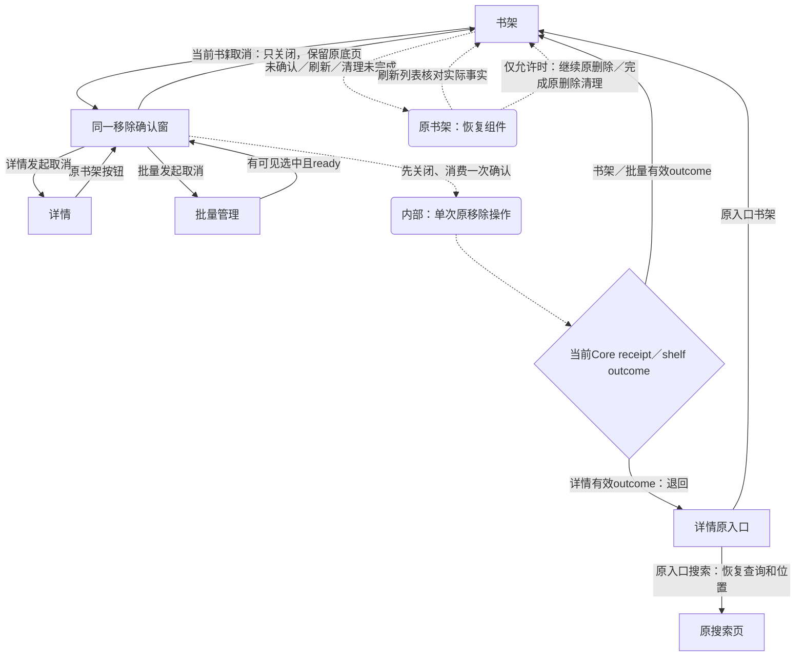

已有状态：在线书籍、本地书籍、批量。

**尺寸与约束**

- 源码：水平几何统一为 L=max(安全左边距,约定左间距)，R=W−max(安全右边距,约定右间距)，A=max(0,R−L)，C=min(内容宽上限,A)，居中时 x=L+(A−C)/2。安全边距取对应源码的 visual/interactive，不能把内容宽、视口宽和设备物理像素混用。
- 源码：共用ReaderDialogSurface book-removal规格，居中width cap306、左右gap20/interactive safe、pad17/r12/border1/shadow。标题与body间16；body后到actions间30；动作并排等分/间距10、高38/r12，响应高44/y−3；没有top-close。普通遮罩#52000000。
- 源码：message Scroll 高=min(max(50,measuredMessageHeight),messageMaxHeight)，maxHeight=max(50,windowH−systemInsets.top−systemInsets.bottom−200×max(1,systemFontScale))；自动滚动条，不省略长书名/本地删除说明。内容高度由实际文本测量，非固定两行。
- 源码：取消使用panel-soft/ink，移除使用注册role app.BookshelfBookActionSheet.actionSlot.fontColor.FFD7473E作实心底色、TOK_CARD_BG_HI作字色（night字色随card变化）；取消是defaultFocus。未明确宽高的系统边缘保护不能用HTMLmax-height viewport来代替。

**排版**

- 源码：标题NotoSans Bold/700/17/20、左对齐；消息NotoSans Regular/400/13、未声明lineHeight；动作NotoSans Bold/700/13/16。长消息自然换行并滚动。

**行为与状态**

- 源码：online 消息说明书源/阅读进度/已缓存正文不删除，可搜索再次加入；local 明确删除应用内解析内容/阅读进度/离线任务、系统原始文件不影响；batch 包含实际选中数量并保留本地原始文件。3个variant是同一确认组件消息差异。
- 源码：取消关闭且无移除；移除确认一次性消费后调用Core。Core receipt确认与读回/清理分开；BookshelfHost对未确认原删除保留可读回和允许继续的原操作。没有移除成功/提交已确认/正在取消新页面。
- 源码：确认底页按当前书架/详情/multiselect来源保留。取消只关闭当前确认，不能凭空进入详情或重开已关闭的书籍操作窗。移除先关闭确认再派发；真实后端结果用原忙碌状态和返回原书架后的ReaderRecoveryNotice/Action承接，预览的移除动作不执行Core。

**移植适配**

- 迁移：1 vp=1 iOS logical pt=1 Android logical dp；下列字体值是 systemFontScale=1 的 fp 基准，字族/字重由交付字体对应。使用统一文字缩放规则；新增不可见触摸目标最小iOS44×44、Android48×48，源响应区值与视觉值分开保留，邻近目标不得重叠。布局不依赖外层浏览器或物理像素宽度。
- 迁移：保持视觉框、间距和控件顺序；小窗口、分屏或大字体超出可用高度时，原内容区允许滚动。安全区由窗口实时提供，键盘弹出时仍可聚焦输入和访问原有操作；不新增确认、取消中或成功页面。
- 迁移：对话框保持306上限/17内距/38高视觉按钮；消息依照窗口与字体scale实测滚动，actions固定可访问，按钮不可见44触摸区不交叠；焦点按取消默认、移除明确危险操作的原组件语义。

来源：[BookRemovalDialog.ets:24](/Users/minliny/Documents/Reader/.reader-isolated/source-switch-design-20261006/Reader-for-HarmonyOS/entry/src/main/ets/features/bookshelf/BookRemovalDialog.ets:24)、[BookRemovalDialog.ets:46](/Users/minliny/Documents/Reader/.reader-isolated/source-switch-design-20261006/Reader-for-HarmonyOS/entry/src/main/ets/features/bookshelf/BookRemovalDialog.ets:46)、[Index.ets:4324](/Users/minliny/Documents/Reader/.reader-isolated/source-switch-design-20261006/Reader-for-HarmonyOS/entry/src/main/ets/pages/Index.ets:4324)、[Index.ets:4353](/Users/minliny/Documents/Reader/.reader-isolated/source-switch-design-20261006/Reader-for-HarmonyOS/entry/src/main/ets/pages/Index.ets:4353)、[Index.ets:4369](/Users/minliny/Documents/Reader/.reader-isolated/source-switch-design-20261006/Reader-for-HarmonyOS/entry/src/main/ets/pages/Index.ets:4369)、[Index.ets:4435](/Users/minliny/Documents/Reader/.reader-isolated/source-switch-design-20261006/Reader-for-HarmonyOS/entry/src/main/ets/pages/Index.ets:4435)、[ReaderRecoveryNotice.ets:14](/Users/minliny/Documents/Reader/.reader-isolated/source-switch-design-20261006/Reader-for-HarmonyOS/entry/src/main/ets/features/common/ReaderRecoveryNotice.ets:14)、[ReaderRecoveryAction.ets:14](/Users/minliny/Documents/Reader/.reader-isolated/source-switch-design-20261006/Reader-for-HarmonyOS/entry/src/main/ets/features/common/ReaderRecoveryAction.ets:14)。

<a id="route-settings"></a>

#### 设置首页（settings）

**入口与动作路线**

设置首页当前仅通往通用设置、书源管理和书架设置；通用设置恢复在途时系统返回首页，原设置壳仍禁用触摸直至任务结束。

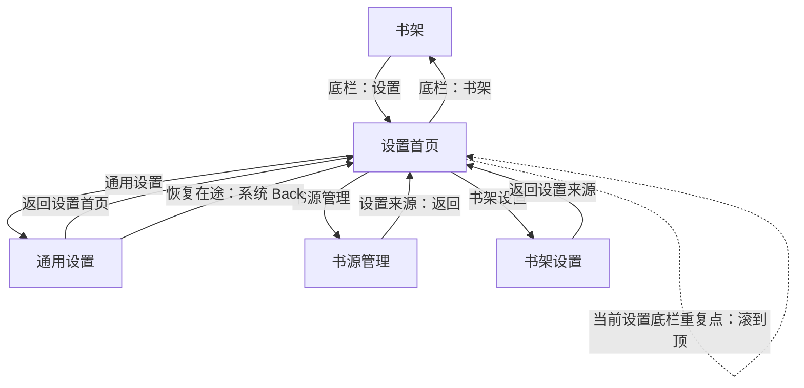

已有状态：当前入口、原位读取设置、设置已确认：读回中、读取失败：刷新设置、保存未确认：保留当前选择、清理结果未确认：原位核对、原清理可继续、原清理核对中。

**尺寸与约束**

- 【源码】使用实时窗口与安全边界；左右边界各取 max(视觉安全边距,19)，可用宽内将内容居中，宽上限 720；不以 390/760 样本宽代替运行时测量。
- 【源码】全高 SettingsShell：底层纵向 Scroll、顶部浮动 AppTopBar、底部浮动 MainTabBar；滚动内容 top=58+8=66，区块间隔 12，滚动条隐藏。
- 【源码】首页只含一个「设置」CategorySection，内为通用设置、书源管理、书架设置三行；卡片 Fill，高度随内容，1 vp TOK_BORDER，半径 8；内 top=9、bottom=1，标题后 gap=5。
- 【源码】导航行最小高 58，左右内距 12，间隔 12；图标盒 28×28/r14，内图 15×15，尾部箭头 14×14，label 占剩余宽。整行承担点击。
- 【源码】首页内容底留白=68+max(15,交互安全底距)+16；底栏仅「书架 / 设置」，当前设置项不重复导航，tapBottomScrollTop开启时重复点当前项将首页Scroll滚到顶部。

**排版**

- 【源码】ReaderInter → InterVariable.ttf；ReaderNotoSansSC → NotoSansSC-VF.otf；ReaderNotoSerifSCBold/Regular → NotoSerifSC-Bold/Regular.ttf。前者许可证为 rawfile/Inter-OFL.txt，后三个共享 rawfile/Noto-OFL.txt。
- 【源码】首页「设置」标题使用 TYPE_APP_HOME_TITLE：ReaderNotoSerifSCBold 700，29 fp / 38 fp。
- 【源码】分节标题 ReaderInter 900，13 fp / 15.6 fp，标题容器高 16，左右 padding 12，单行省略；行 label ReaderInter 800，13 fp / 15.34 fp，TOK_INK，单行省略。
- 【源码】底栏 label ReaderNotoSansSC 700，11 fp / 18 fp；图标从已实现 SVG day/night 资源读取。

**行为与状态**

- 【源码 · default】仅当前 L0 准入入口可见；同步、语言、启动页、权限、关于等受关闭的 product gate 限制，不补画不可达入口。
- 【源码】通用设置只改变 activeSection；书源管理进入 source 路由；书架设置记录 settings 返回来源。点书架底栏返回书架；设置首页无返回按钮。
- 【源码】CategoryRow 使用 ReaderPressFeedback；图标与标题装饰不形成第二套点击 / 状态；无文本输入与键盘。operationFeedback位于首页区块前，按当前receipt/readFacts显示消息及恢复动作。
- 【源码】general与home共用同一SettingsPage实例；恢复尚在途时系统返回home，SettingsShell仍禁用首页三行与底栏触摸控件，直到原实例接收恢复结果。

**移植适配**

- 【新增跨平台适配】几何 1 vp = 1 iOS 逻辑 pt = 1 Android dp；系统字体角色 fp 经各端系统字体缩放API换算：iOS UIFontMetrics逐role，Android fp→sp并用平台非线性转换，禁止用单一倍率乘法或按截图倍率放大。
- 【新增跨平台适配】保留浮动导航、内部滚动留白及三行顺序；系统安全区只应用一次，不再叠加系统导航栏高度。窄窗 label 收缩并单行省略，尾部控件保留固有宽。
- 【新增跨平台适配】在 iOS/Android 使用同一主题注册表及物理字体文件，不能把 ReaderInter 800/900 擅自降为默认系统 medium。

来源：[SettingsPage.ets:247](/Users/minliny/Documents/Reader/.reader-isolated/source-switch-design-20261006/Reader-for-HarmonyOS/entry/src/main/ets/features/settings/SettingsPage.ets:247)、[Index.ets:1883](/Users/minliny/Documents/Reader/.reader-isolated/source-switch-design-20261006/Reader-for-HarmonyOS/entry/src/main/ets/pages/Index.ets:1883)、[SettingsPage.ets:177](/Users/minliny/Documents/Reader/.reader-isolated/source-switch-design-20261006/Reader-for-HarmonyOS/entry/src/main/ets/features/settings/SettingsPage.ets:177)、[SettingsShell.ets:57](/Users/minliny/Documents/Reader/.reader-isolated/source-switch-design-20261006/Reader-for-HarmonyOS/entry/src/main/ets/features/shell/SettingsShell.ets:57)、[SettingsShell.ets:168](/Users/minliny/Documents/Reader/.reader-isolated/source-switch-design-20261006/Reader-for-HarmonyOS/entry/src/main/ets/features/shell/SettingsShell.ets:168)、[CategorySection.ets:15](/Users/minliny/Documents/Reader/.reader-isolated/source-switch-design-20261006/Reader-for-HarmonyOS/entry/src/main/ets/features/settings/CategorySection.ets:15)、[CategoryRow.ets:27](/Users/minliny/Documents/Reader/.reader-isolated/source-switch-design-20261006/Reader-for-HarmonyOS/entry/src/main/ets/features/settings/CategoryRow.ets:27)、[ReaderTypography.ets:90](/Users/minliny/Documents/Reader/.reader-isolated/source-switch-design-20261006/Reader-for-HarmonyOS/entry/src/main/ets/features/common/ReaderTypography.ets:90)、[ReaderFloatingBarMetrics.ts:6](/Users/minliny/Documents/Reader/.reader-isolated/source-switch-design-20261006/Reader-for-HarmonyOS/entry/src/main/ets/features/common/ReaderFloatingBarMetrics.ts:6)、[ReaderFonts.ets:21](/Users/minliny/Documents/Reader/.reader-isolated/source-switch-design-20261006/Reader-for-HarmonyOS/entry/src/main/ets/features/common/ReaderFonts.ets:21)、[ReaderProductScope.ts:17](/Users/minliny/Documents/Reader/.reader-isolated/source-switch-design-20261006/Reader-for-HarmonyOS/entry/src/main/ets/app/ReaderProductScope.ts:17)、[Index.ets:1712](/Users/minliny/Documents/Reader/.reader-isolated/source-switch-design-20261006/Reader-for-HarmonyOS/entry/src/main/ets/pages/Index.ets:1712)。

<a id="route-general"></a>

#### 通用设置（general）

**入口与动作路线**

通用设置的保存、缓存、恢复反馈均原位；恢复忙时禁用壳内触摸控件，系统 Back 仍按 Index 返回设置首页。

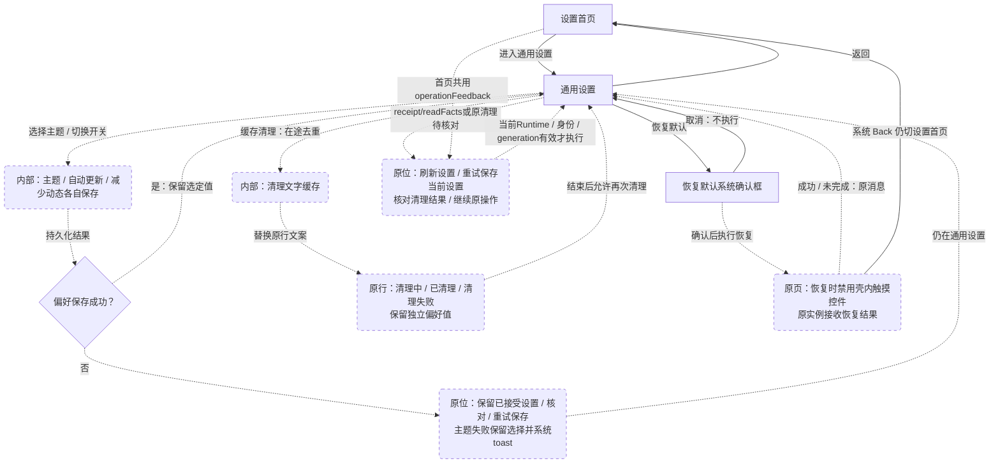

已有状态：默认值、原位读取设置、设置已确认：读回中、读取失败：刷新设置、保存未确认：保留当前选择、清理结果未确认：原位核对、原清理可继续、原清理核对中、App 浅色选择、App 深色选择、减少动态效果开启、自动检查更新关闭、清理中：原行、已清理：原行、清理失败：原行、恢复时禁用原页、恢复成功：原页、异常保留恢复记录：原页、未完成可重试：原页。

**尺寸与约束**

- 【源码】使用实时窗口与安全边界；左右边界各取 max(视觉安全边距,19)，可用宽内将内容居中，宽上限 720；不以 390/760 样本宽代替运行时测量。
- 【源码】PageBackBar 高 58，横向间隔 10；左右内距各 max(20,交互安全边距)，返回图标 24×24 在 44×44、半径 22 的目标内；标题单行省略。
- 【源码】全高 Scroll，top=66、卡间距 12、底留白 max(12,交互安全底距)，无主底栏；「基础偏好」「行为与反馈」沿用首页 CategorySection。
- 【源码】App主题行最小高 58、横内距 12、左右两列 gap=12；左列 icon28/内图15＋label Fill；右侧 ReaderSegmentedControl 固定 168×36/r8，1 vp 边框、四边 padding2。三个等分段各高30/r6，选中段独立1 vp描边。
- 【源码】开关绘制 44×24/r999，旋钮 20×20/r10，位置 off=(2,2)、on=(22,2)；明确响应区 x0/y−10/w44/h44，整行也可切换。
- 【源码】缓存行仍高至少58；尾部动作 minWidth66/maxWidth55%/minHeight34，padding左右10、上下8、r6，文案最多两行。整行点击调用清理，忙碌时由 handler 去重。
- 【源码】独立恢复默认卡 minHeight58/r8、左右 padding13/12、gap10；图标盒28，内图15，箭头14。恢复结果 Text 位于此卡后，宽100%、padding12；不是结果路由。

**排版**

- 【源码】ReaderInter → InterVariable.ttf；ReaderNotoSansSC → NotoSansSC-VF.otf；ReaderNotoSerifSCBold/Regular → NotoSerifSC-Bold/Regular.ttf。前者许可证为 rawfile/Inter-OFL.txt，后三个共享 rawfile/Noto-OFL.txt。
- 【源码】子页标题 ReaderNotoSerifSCBold，700，24 fp / 33 fp 行高，TOK_INK；不使用系统导航栏默认标题字体。
- 【源码】区块标题 Inter900 13/15.6；普通行 label Inter800 13/15.34、单行省略。App主题段 Inter Bold 12，单行，源未显式指定段字行高。
- 【源码】缓存动作 Inter800 11/16，居中、最多2行；恢复默认 Inter400 16/19.2、TOK_DANGER、单行；恢复消息12 fp、TOK_MUTED，源未指定行高与字体族。
- 【源码】分段颜色使用 ReaderSegmentedControl 的 SEG_BG/BORDER/SELECTED_BG/SELECTED_BORDER/TEXT_ACTIVE/TEXT_INACTIVE；不能把选中段改成页面主按钮填充色。

**行为与状态**

- 【源码 · default/theme-day/theme-night】选项「跟随 / 浅色 / 深色」映射 system/day/night；选中值来自 readerAppThemeMode。当前主题保存失败保留已接受选择，并由仍有效的页面显示系统toast「主题保存尚未确认，当前选择已保留，请稍后重试」。
- 【源码 · auto-check-off/reduce-motion】autoCheckUpdate默认true、reduceMotion默认false；行与开关走同一目标值，页面展示Settings owner已接受快照，不自行绘制尚未接受的乐观镜像。refreshing或confirmation=unknown时开关拒绝新输入；核对与重试保存当前设置保留已接受偏好。
- 【源码 · cache-busy/cache-success/cache-error/cache-unknown/cache-continuable/cache-reconcile-busy】原行按busy / confirmed / unknown / undispatched显示「清理中 / 已清理 / 结果未确认 / 清理失败」。在途去重，unknown再点原清理只提示，不重新派发；原操作消息和「核对清理结果 / 继续原操作」按canRetry及canContinueOriginal显示。核对为读取原回执，只有显式继续才能继续原清理。
- 【源码 · reset-busy/reset-success/reset-error/reset-incomplete】先系统确认；执行时整个 SettingsShell.enabled=false，清空旧 resetMessage，壳内返回 / 主题 / 行动作等 UI 触摸控件均不可用；成功「已恢复界面与阅读设置」，false返回「恢复未完成，请重试」，异常「恢复未完成，已保留恢复记录；点击恢复默认重试」。
- 【源码】恢复回调只允许当前 mounted/revision 写回；新页面实例不接收旧回调。Index 系统 Back 在 general 分支仍将 activeSection 改为 home，没有 resetInFlight guard；同一个 SettingsPage 仍 mounted 时，恢复继续并由该实例接收结果。通用设置无输入控件。
- 【演示】App主题、自动检查更新、减少动态效果分别保存，缓存结果和恢复任务另存；点击一项保留其他值。App主题选择同步画布配色，跟随采用当前系统配色；恢复成功样本才恢复偏好默认值。画布外任务样本不执行实际偏好写入或缓存清理。
- 【源码】operationFeedback在通用设置恢复卡之后。receipt/readFacts决定原消息及「刷新设置」，canRetryAccepted显示「重试保存当前设置」；缓存恢复独立追加消息及动作。动作捕获当前Runtime、页面临时身份与generation，退役回调不操作新实例；同一反馈亦出现在设置首页。

**移植适配**

- 【新增跨平台适配】几何 1 vp = 1 iOS 逻辑 pt = 1 Android dp；系统字体角色 fp 经各端系统字体缩放API换算：iOS UIFontMetrics逐role，Android fp→sp并用平台非线性转换，禁止用单一倍率乘法或按截图倍率放大。
- 【新增跨平台适配】保留固定168宽分段、行 label 的剩余宽 / 省略规则和缓存55%上限。较大用户字号不得缩小字级；允许 minHeight 行随内容增高，分段保持源码可见尺寸，触摸区可外扩且不可抢邻段事件。
- 【新增跨平台适配】恢复 busy 只复现设置壳的触摸控件禁用；系统 Back / 系统返回手势保留 Index 原路由分支，不把 UI 按钮禁用扩展成导航拦截。缓存 busy 只去重缓存动作。

来源：[SettingsPage.ets:247](/Users/minliny/Documents/Reader/.reader-isolated/source-switch-design-20261006/Reader-for-HarmonyOS/entry/src/main/ets/features/settings/SettingsPage.ets:247)、[SettingsPage.ets:438](/Users/minliny/Documents/Reader/.reader-isolated/source-switch-design-20261006/Reader-for-HarmonyOS/entry/src/main/ets/features/settings/SettingsPage.ets:438)、[SettingsCacheCleanupOwner.ts:45](/Users/minliny/Documents/Reader/.reader-isolated/source-switch-design-20261006/Reader-for-HarmonyOS/entry/src/main/ets/features/settings/SettingsCacheCleanupOwner.ts:45)、[ReaderRecoveryAction.ets:15](/Users/minliny/Documents/Reader/.reader-isolated/source-switch-design-20261006/Reader-for-HarmonyOS/entry/src/main/ets/features/common/ReaderRecoveryAction.ets:15)、[SettingsPage.ets:174](/Users/minliny/Documents/Reader/.reader-isolated/source-switch-design-20261006/Reader-for-HarmonyOS/entry/src/main/ets/features/settings/SettingsPage.ets:174)、[SettingsPage.ets:196](/Users/minliny/Documents/Reader/.reader-isolated/source-switch-design-20261006/Reader-for-HarmonyOS/entry/src/main/ets/features/settings/SettingsPage.ets:196)、[SettingsPage.ets:304](/Users/minliny/Documents/Reader/.reader-isolated/source-switch-design-20261006/Reader-for-HarmonyOS/entry/src/main/ets/features/settings/SettingsPage.ets:304)、[SettingsPage.ets:402](/Users/minliny/Documents/Reader/.reader-isolated/source-switch-design-20261006/Reader-for-HarmonyOS/entry/src/main/ets/features/settings/SettingsPage.ets:402)、[SettingsPage.ets:463](/Users/minliny/Documents/Reader/.reader-isolated/source-switch-design-20261006/Reader-for-HarmonyOS/entry/src/main/ets/features/settings/SettingsPage.ets:463)、[SettingsPage.ets:652](/Users/minliny/Documents/Reader/.reader-isolated/source-switch-design-20261006/Reader-for-HarmonyOS/entry/src/main/ets/features/settings/SettingsPage.ets:652)、[SettingsPage.ets:681](/Users/minliny/Documents/Reader/.reader-isolated/source-switch-design-20261006/Reader-for-HarmonyOS/entry/src/main/ets/features/settings/SettingsPage.ets:681)、[SettingsOrchestrator.ets:136](/Users/minliny/Documents/Reader/.reader-isolated/source-switch-design-20261006/Reader-for-HarmonyOS/entry/src/main/ets/features/settings/SettingsOrchestrator.ets:136)、[ReaderSegmentedControl.ets:3](/Users/minliny/Documents/Reader/.reader-isolated/source-switch-design-20261006/Reader-for-HarmonyOS/entry/src/main/ets/features/common/ReaderSegmentedControl.ets:3)、[ReaderToggle.ets:20](/Users/minliny/Documents/Reader/.reader-isolated/source-switch-design-20261006/Reader-for-HarmonyOS/entry/src/main/ets/features/common/ReaderToggle.ets:20)、[SettingsShell.ets:77](/Users/minliny/Documents/Reader/.reader-isolated/source-switch-design-20261006/Reader-for-HarmonyOS/entry/src/main/ets/features/shell/SettingsShell.ets:77)、[Index.ets:808](/Users/minliny/Documents/Reader/.reader-isolated/source-switch-design-20261006/Reader-for-HarmonyOS/entry/src/main/ets/pages/Index.ets:808)、[Index.ets:2226](/Users/minliny/Documents/Reader/.reader-isolated/source-switch-design-20261006/Reader-for-HarmonyOS/entry/src/main/ets/pages/Index.ets:2226)。

<a id="route-sources"></a>

#### 书源管理（sources）

**入口与动作路线**

书源管理按入口返回设置或搜索，筛选、检测和启停原位处理，新增、登录及工具具有各自实际窗口或页面。

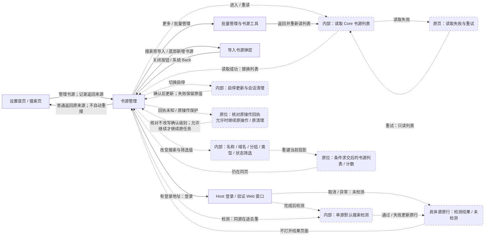

已有状态：未检测列表、原位读取中：保留已有列表、已确认：原位刷新中、已确认：刷新失败、回执未确认：核对、未确认回执：读取中、原操作保护：核对 / 继续、Core已确认：继续原清理、原操作核对中、原页读取中、读取失败与重试、没有书源、筛选后无匹配、实际分组下拉、单源检测中、原行等待登录 / 验证、单源检测通过、单源检测失败、原页本地导入中、原页在线导入中、原页导入结果、部分导入结果、原页导入失败、已导入但列表刷新失败、部分导入后列表刷新失败、启停失败：保留原值、已确认停用值。

**尺寸与约束**

- 【源码】使用实时窗口与安全边界；左右边界各取 max(视觉安全边距,19)，可用宽内将内容居中，宽上限 720；不以 390/760 样本宽代替运行时测量。
- 【源码】PageBackBar 高 58，横向间隔 10；左右内距各 max(20,交互安全边距)，返回图标 24×24 在 44×44、半径 22 的目标内；标题单行省略。
- 【源码】全高 List 延伸到浮动栏后，contentStartOffset58，contentEndOffset=44+12+max(16,交互安全底距)；搜索、数量、状态、分组、类别属于首个 ListItem，会随列表滚动；导航与底动作栏浮动。
- 【源码】搜索Row h44、top margin8，左搜索字段Fill（绘制h38/r8/1 vp边框、左右padding12、图标13、图文gap8，输入h36），右导入入口40×40/r12、source_add18、主色背景，Row gap8。两处新增入口都打开同一JsonImportDialog。数量行top margin8。
- 【源码】手机状态与分组纵向 gap8；源码 isTablet 时横排 gap20，每组宽 max(0,(contentWidth−20)/2)，高36。状态五chip高32/r16，间隔8；设计宽58/58/58/72/72，各乘 min(1,max(0,controlWidth−32)/318)。
- 【源码】分组 folder15、文字左margin12、select左margin22；select宽=max(0,controlWidth−74)，高36/r8。文字位于(14,10)，可用宽w−42；chevron12×12位于(w−21,12)，开时转180°。
- 【源码】类别横向Scroll高40、top margin8、chip高32/r16、左右padding12、gap8；「全部类型 / 小说 / 漫画 / 音乐/有声 / 下载/文件 / 视频/外部媒体 / 其他/混合」。
- 【源码】源行高76、左padding0/右8、列间gap8、顶部1 vp分隔；左36×40/r10/panel-soft图标盒内folder20×20。信息列Fill可收缩，源名与类别gap6，信息纵gap8。可选登录44×28/r7；检测44×28/r7；状态徽标24×18/r999、圆点7；toggle44×24、触摸44×44。
- 【源码】底部宿主Row高48，两个等分动作实际绘制高44/r8、gap10、垂直居中；上margin12、下margin max(16,交互安全底距)。新增图标source_add18×18、图文gap8。空列表卡paddingTop64、内容gap8；筛选0条无额外空匹配文案。
- 【源码】状态banner padding8/top margin8/r7，信息Fill、最多2行；只有 statusKind=error 才显示重试。分组面板在全高根Stack：x/y为实测global坐标减宿主origin，宽同select、每行36/r8、选中行置顶，余项单行省略；透明背景点按关闭。

**排版**

- 【源码】ReaderInter → InterVariable.ttf；ReaderNotoSansSC → NotoSansSC-VF.otf；ReaderNotoSerifSCBold/Regular → NotoSerifSC-Bold/Regular.ttf。前者许可证为 rawfile/Inter-OFL.txt，后三个共享 rawfile/Noto-OFL.txt。
- 【源码】子页标题 ReaderNotoSerifSCBold，700，24 fp / 33 fp 行高，TOK_INK；不使用系统导航栏默认标题字体。
- 【源码】搜索 ReaderInter400 12 fp（未显式行高）；数量 ReaderInter400 10/12.5，单行；状态banner NotoSansSC11/16，错误动作11 Bold。
- 【源码】状态chip NotoSansSC Bold11；分组标题Bold13；分组值 / 面板值 ReaderInter400 12/14.52；类别NotoSansSC11。
- 【源码】源名 NotoSansSC Bold13/15.34、单行省略；类别Regular10/12.5、不可压缩；域名Regular10/12.5、单行省略；检测说明10/12.5、单行省略。登录 / 检测Bold11；底动作Bold13，均单行。
- 【源码】空态标题 ReaderNotoSerifSCBold700 15/22；说明 ReaderInter400 12/18。状态色只按passed/failed/其他三类使用页面STATUS_GOOD/ERROR/MUTED_BG与DOT角色。

**行为与状态**

- 【源码 · default/loading/load-error/empty】读取先清列表并显示「正在读取 Core 书源数据…」；失败显示「书源列表读取失败：{error}」和重试，也满足空卡条件；重试只重新 source.list。无源时数量为0个源 /0启用，loading不画空卡。
- 【源码 · filter-empty/group-open】关键词trim后忽略大小写，匹配name或baseUrl，与group/category/status条件求交；数量显示 filtered/total，启用数量统计完整sources而非已筛选行。分组取实际非空group去重，仅有全部分组时点select不展开；自定义可见但禁用且opacity.45。
- 【源码 · checking/check-passed/check-failed】单源检测在途去重并进入串行chain，默认search L1+L2；检测按钮opacity.62且回调拒绝重入，badge checking仍采用muted色。通过行消息「搜索检测通过 · {duration}ms」，失败保留实际reason。只更新行，不新设页顶banner。
- 【源码 · login-waiting】登录仅loginUrl非空显示。请求进入串行 chain 后原行 checking、说明「等待登录 / 验证」；onClick仍可到orchestrator，当checkingSourceIds含该源时拒绝重复登录。取消将该源标unchecked、保存「登录 / 验证已取消」，但unchecked行不绘制checkMessage；完成后继续默认检测。
- 【源码】启停不是乐观开关：source.update确认后才显示新值；提交失败保留原值并banner「书源启停失败：…」。停用后尝试清cookie；清cookie或后续list读回失败仅记录，不撤销已确认启停值。离开页不取消已排队写操作，旧session不能回写新页。
- 【源码 · importing/import-online/import-success/import-warning/import-error/import-refresh-warning/import-refresh-warning-partial】JSON弹窗先关闭；原页「正在导入本地书源… / 正在导入在线书源…」。成功 / 部分成功显示确切计数并刷新sources；Core 已提交但 list 失败显示 warning「Core 已导入 N 个书源，但列表刷新失败：{error}」，保留此前可见列表和已确认导入事实，系统结果标题仍「书源导入完成」。只有 error banner 的重试重新读取列表；系统picker取消不制造完成或新取消页面。
- 【源码】上方更多与底部批量管理同进sourceTools，新增打开JsonImportDialog；返回来源可为设置或搜索，搜索普通返回恢复原查询而不自动重新检索。
- 【演示】每行绑定具体sourceId；关键词、状态、类型与分组即时求交，计数按当前投影更新。检测样本及确认后的启停值作用于所选源，保留其他源状态；分组面板使用实测trigger左上坐标和同宽，点透明背景或提交选择后收起。
- 【源码 · receipt-refreshing/receipt-refresh-failed/receipt-unknown/original-unknown/original-cleanup/original-busy】statusBanner优先显示当前receipt/readFacts，允许核对时重试调用onReconcile而非新写入；original.blocked时替换为ReaderRecoveryNotice及「核对原操作回执」，canRetryOriginal才有「继续原操作 / 继续原清理」。该源管理owner存在unknown或blocked时启停控件禁用；在途刷新和原操作busy也拒绝新启停。列表读取不能把unknown变成confirmed。

**移植适配**

- 【新增跨平台适配】几何 1 vp = 1 iOS 逻辑 pt = 1 Android dp；系统字体角色 fp 经各端系统字体缩放API换算：iOS UIFontMetrics逐role，Android fp→sp并用平台非线性转换，禁止用单一倍率乘法或按截图倍率放大。
- 【新增跨平台适配】输入键盘出现时更新真实交互安全边界，并保持当前输入焦点、草稿和滚动位置；滚动使当前字段与对应动作可见。源未指定数字键盘或 URL 键盘时，不把平台默认输入类型改为新业务限制。
- 【源码】isTablet由Index的deviceInfo.deviceType===tablet传入，不是窗口达到760即横排；来源列表宽仍按720上限和当前安全区解析。
- 【新增跨平台适配】将各端设备类别适配成明确的tablet flag并保持其原分支；折叠屏 / 窄窗重新量测各组宽，不写死分组面板位置。下拉overlay与列表共用坐标系，滚动或安全区变化须重取锚点。
- 【新增跨平台适配】检测/登录可见28高、筛选32高、分组36高与源一致；需增加可触摸面积时仅扩命中目标，不扩大绘制尺寸或让相邻行接收同一点击。源toggle已明确44×44区域，直接保留。

来源：[Index.ets:1968](/Users/minliny/Documents/Reader/.reader-isolated/source-switch-design-20261006/Reader-for-HarmonyOS/entry/src/main/ets/pages/Index.ets:1968)、[SourceManagementPage.ets:323](/Users/minliny/Documents/Reader/.reader-isolated/source-switch-design-20261006/Reader-for-HarmonyOS/entry/src/main/ets/features/source/SourceManagementPage.ets:323)、[SourceManagementPage.ets:610](/Users/minliny/Documents/Reader/.reader-isolated/source-switch-design-20261006/Reader-for-HarmonyOS/entry/src/main/ets/features/source/SourceManagementPage.ets:610)、[ReaderRecoveryNotice.ets:16](/Users/minliny/Documents/Reader/.reader-isolated/source-switch-design-20261006/Reader-for-HarmonyOS/entry/src/main/ets/features/common/ReaderRecoveryNotice.ets:16)、[ReaderRecoveryAction.ets:15](/Users/minliny/Documents/Reader/.reader-isolated/source-switch-design-20261006/Reader-for-HarmonyOS/entry/src/main/ets/features/common/ReaderRecoveryAction.ets:15)、[SourceManagementPage.ets:195](/Users/minliny/Documents/Reader/.reader-isolated/source-switch-design-20261006/Reader-for-HarmonyOS/entry/src/main/ets/features/source/SourceManagementPage.ets:195)、[SourceManagementPage.ets:255](/Users/minliny/Documents/Reader/.reader-isolated/source-switch-design-20261006/Reader-for-HarmonyOS/entry/src/main/ets/features/source/SourceManagementPage.ets:255)、[SourceManagementPage.ets:338](/Users/minliny/Documents/Reader/.reader-isolated/source-switch-design-20261006/Reader-for-HarmonyOS/entry/src/main/ets/features/source/SourceManagementPage.ets:338)、[SourceManagementPage.ets:385](/Users/minliny/Documents/Reader/.reader-isolated/source-switch-design-20261006/Reader-for-HarmonyOS/entry/src/main/ets/features/source/SourceManagementPage.ets:385)、[SourceManagementPage.ets:405](/Users/minliny/Documents/Reader/.reader-isolated/source-switch-design-20261006/Reader-for-HarmonyOS/entry/src/main/ets/features/source/SourceManagementPage.ets:405)、[SourceManagementPage.ets:427](/Users/minliny/Documents/Reader/.reader-isolated/source-switch-design-20261006/Reader-for-HarmonyOS/entry/src/main/ets/features/source/SourceManagementPage.ets:427)、[SourceManagementPage.ets:458](/Users/minliny/Documents/Reader/.reader-isolated/source-switch-design-20261006/Reader-for-HarmonyOS/entry/src/main/ets/features/source/SourceManagementPage.ets:458)、[SourceManagementPage.ets:502](/Users/minliny/Documents/Reader/.reader-isolated/source-switch-design-20261006/Reader-for-HarmonyOS/entry/src/main/ets/features/source/SourceManagementPage.ets:502)、[SourceManagementPage.ets:618](/Users/minliny/Documents/Reader/.reader-isolated/source-switch-design-20261006/Reader-for-HarmonyOS/entry/src/main/ets/features/source/SourceManagementPage.ets:618)、[SourceManagementPage.ets:667](/Users/minliny/Documents/Reader/.reader-isolated/source-switch-design-20261006/Reader-for-HarmonyOS/entry/src/main/ets/features/source/SourceManagementPage.ets:667)、[SourceManagementPage.ets:725](/Users/minliny/Documents/Reader/.reader-isolated/source-switch-design-20261006/Reader-for-HarmonyOS/entry/src/main/ets/features/source/SourceManagementPage.ets:725)、[ReaderSearchField.ets:255](/Users/minliny/Documents/Reader/.reader-isolated/source-switch-design-20261006/Reader-for-HarmonyOS/entry/src/main/ets/features/common/ReaderSearchField.ets:255)、[ReaderSelect.ets:166](/Users/minliny/Documents/Reader/.reader-isolated/source-switch-design-20261006/Reader-for-HarmonyOS/entry/src/main/ets/features/common/ReaderSelect.ets:166)、[ReaderSelectPanel.ets:155](/Users/minliny/Documents/Reader/.reader-isolated/source-switch-design-20261006/Reader-for-HarmonyOS/entry/src/main/ets/features/common/ReaderSelectPanel.ets:155)、[ReaderToggle.ets:20](/Users/minliny/Documents/Reader/.reader-isolated/source-switch-design-20261006/Reader-for-HarmonyOS/entry/src/main/ets/features/common/ReaderToggle.ets:20)、[SourceOrchestrator.ets:139](/Users/minliny/Documents/Reader/.reader-isolated/source-switch-design-20261006/Reader-for-HarmonyOS/entry/src/main/ets/features/source/SourceOrchestrator.ets:139)、[SourceOrchestrator.ets:238](/Users/minliny/Documents/Reader/.reader-isolated/source-switch-design-20261006/Reader-for-HarmonyOS/entry/src/main/ets/features/source/SourceOrchestrator.ets:238)、[SourceOrchestrator.ets:321](/Users/minliny/Documents/Reader/.reader-isolated/source-switch-design-20261006/Reader-for-HarmonyOS/entry/src/main/ets/features/source/SourceOrchestrator.ets:321)、[SourceOrchestrator.ets:411](/Users/minliny/Documents/Reader/.reader-isolated/source-switch-design-20261006/Reader-for-HarmonyOS/entry/src/main/ets/features/source/SourceOrchestrator.ets:411)、[SourceOrchestrator.ets:425](/Users/minliny/Documents/Reader/.reader-isolated/source-switch-design-20261006/Reader-for-HarmonyOS/entry/src/main/ets/features/source/SourceOrchestrator.ets:425)、[SourceOrchestrator.ets:466](/Users/minliny/Documents/Reader/.reader-isolated/source-switch-design-20261006/Reader-for-HarmonyOS/entry/src/main/ets/features/source/SourceOrchestrator.ets:466)、[SourceGateway.ts:601](/Users/minliny/Documents/Reader/.reader-isolated/source-switch-design-20261006/Reader-for-HarmonyOS/entry/src/main/ets/features/source/SourceGateway.ts:601)、[Index.ets:2378](/Users/minliny/Documents/Reader/.reader-isolated/source-switch-design-20261006/Reader-for-HarmonyOS/entry/src/main/ets/pages/Index.ets:2378)、[Index.ets:2609](/Users/minliny/Documents/Reader/.reader-isolated/source-switch-design-20261006/Reader-for-HarmonyOS/entry/src/main/ets/pages/Index.ets:2609)。

<a id="route-source-tools"></a>

#### 批量管理与书源工具（source-tools）

**入口与动作路线**

源记录、编辑草稿、批检进度和调试日志独立保存；操作仅改变实际发布字段，导出与删除使用系统确认框，新进入工具页才重置临时会话。

```mermaid
flowchart LR
  Sources["书源管理"]
  Tools["批量管理与书源工具"]
  Feedback("原页：忙状态 / 结果 / 已完成前缀 / 清会话失败数<br/>未发布字段保持原快照"):::inline
  Scope("原位：全选 / 清空 / 行选择"):::inline
  Batch("内部：逐源检测 / 启停更新"):::inline
  Progress("原位：初始无结果 / 逐源结果 / 停止保留前缀<br/>独立保留本次范围 / 模式 / 深度"):::inline
  Editor("原位：BookSource JSON 当前卡与草稿"):::inline
  Save("内部：Core 校验保存与首次列表读回"):::inline
  Reconcile("内部：仅重新读取已保存书源"):::inline
  Debug("原位：最近已完成源对象 / 空日志或逐条日志"):::inline
  Export["导出凭据系统确认框"]
  Delete["删除书源系统确认框"]
  Sources -->|"更多 / 批量管理"| Tools
  Tools -->|"返回；不新增退出确认"| Sources
  Tools -.->|"进入：已确认列表起帧，再读 Core；结果原位"| Feedback
  Feedback -.->|"仍在工具页"| Tools
  Tools -.->|"非忙碌：改变选择"| Scope
  Scope -.->|"检测冻结范围与配置；启停消耗选择"| Batch
  Batch -.->|"检测：逐项发布"| Progress
  Progress -.->|"停止检测：原按钮停止中"| Batch
  Batch -.->|"结束 / 停止保留已完成；启停失败记已完成数"| Feedback
  Tools -.->|"行编辑：读原始 JSON；已有卡先保留"| Editor
  Editor -.->|"另一源读取失败保留旧稿；成功才替换"| Editor
  Editor -.->|"校验并保存"| Save
  Save -.->|"保存失败 / 已保存读回失败：保留草稿与重读入口"| Editor
  Editor -.->|"已确认但读回失败：重新读取"| Reconcile
  Reconcile -.->|"重读忙时禁用动作；失败 / 未找到仍保留草稿"| Editor
  Reconcile -.->|"确认源存在：关闭编辑卡"| Feedback
  Save -.->|"保存且读回成功：关闭编辑卡"| Feedback
  Editor -.->|"非忙碌取消：清草稿"| Tools
  Tools -.->|"行调试：冻结此次模式 / 深度 / 关键词"| Debug
  Debug -.->|"结果 / 日志仍在本页；改Select不改旧结果"| Feedback
  Tools -->|"导出全部"| Export
  Scope -->|"导出所选：确认后消耗选择"| Export
  Export -->|"取消：留在工具页"| Tools
  Export -.->|"继续：生成与保存结果"| Feedback
  Scope -->|"删除前消耗并清空选择"| Delete
  Delete -->|"取消：选择保持清空"| Tools
  Delete -.->|"确认删除：结果原位"| Feedback
  Recovery("原位：刷新列表 / 核对原操作回执<br/>允许时继续原操作 / 原清理"):::inline
  Feedback -.->|"回执 / 原操作尚待核对"| Recovery
  Recovery -.->|"未确认期间禁新写入，保留列表与草稿"| Tools
  classDef inline stroke-dasharray:5 5;
```

已有状态：已读取列表、原位读取中：保留已有列表、已确认：原位刷新中、已确认：刷新失败、回执未确认：核对、未确认回执：读取中、原操作保护：核对 / 继续、Core已确认：继续原清理、原操作核对中、原保存未确认：保留草稿、列表读回不能确认原保存、读取工具数据、读取失败、已选范围、原页清空选择、批检初始：无结果、首源检测：无结果、原页检测中、原按钮停止中、原页检测全部通过、原页未通过 / 检测错误、原页保留已完成结果、原页停止：尚无完成结果、原页检测中断、读取原始 JSON：原页、原始 JSON 读取失败、读取另一源中：保留旧卡草稿、读取另一源失败：保留旧卡草稿、读取另一源成功：替换原始 JSON、本页编辑卡、原页保存中、原页保存失败、已保存但读回失败、重新读取中：保留草稿、重读未找到源：保留草稿、重读确认：关闭编辑卡、保存及读回成功：原页、取消编辑：原页、原页导出中、原页导出数与文件名、原页导出取消、原页导出失败、原页批量启用中、原页批量启用结果、原页批量停用中、原页批量停用结果、已完成前缀：批量更新中断、已完成前缀：回读也失败、原页删除中、原页删除计数、已删除：会话清理失败独立计数、删除后列表读取失败：原页、调试卡配置与空日志、原调试卡检测中、原调试卡通过与日志、原调试卡未通过与日志、原页调试失败。

**尺寸与约束**

- 【源码】PageBackBar 高 58，横向间隔 10；左右内距各 max(20,交互安全边距)，返回图标 24×24 在 44×44、半径 22 的目标内；标题单行省略。
- 【源码】工具页全高Scroll，top66、bottom=max(16,交互安全底距)、左右至少19；此页宽上限是实时window.width，宽屏不使用720 cap。卡间距16，顺序状态 / 条件恢复动作 / 导出 / 批量 / 非idle检测进度 / 源列表 / 非空editorSourceId编辑卡 / 调试卡。
- 【源码】status卡padding12/r8/1 vp边框、panel-soft；其他卡padding12/r10/1 vp边框。导出、批量、编辑器使用TOK_SURFACE_SOLID；进度、源列表、调试使用TOK_CARD_BG。批量、导出、编辑、调试内容纵gap12；源列表内容gap8。
- 【源码】批量上排3等分按钮、下排4等分按钮，横gap8；action高42/r8/1 vp边框、Fill，disabled opacity.62。每行源高58、左右padding8、内部gap8；选择 / 编辑 / 调试小按钮高30/r7、左右padding10。
- 【源码】源编辑List高度=min(420,max(58,sourceCount×58))；进度结果List高=min(320,max(58,resultCount×58))，两个内部列表均独立滚动且不显示滚动条。空源List仍58高，不补虚构空结果文案。
- 【源码】进度标题 / phase同一Row、gap8，标题Fill；卡内纵gap12，progress轨道与填充高8/r4；当前项仅 currentSourceName 非空显示、最多2行省略；四个counter等分/gap8，各高32/r7。没有结果时显示「每个书源完成后，结果会立即出现在这里。」；有结果才显示实时结果标题和独立List，最新在前，每行58、左右padding8、下边1 vp。
- 【源码】JSON TextArea宽100%、高320、padding8/r8/1 vp边框；下方取消 / 校验并保存两个等分42高按钮；confirmedRefreshFailed才追加解释文字及重新读取按钮。
- 【源码】调试卡模式与深度是系统Select，同一Row间距12，无显式Select字号或高度；关键词TextInput高40/r8/1 vp边框、左右padding12。debugSourceId非空才显示「最近一次检测详情」及对象，否则「书源调试」。日志List始终存在，高=min(360,max(32,logCount×32))，空日志仍留32高；日志自身按内容折行，不硬裁为单行。

**排版**

- 【源码】ReaderInter → InterVariable.ttf；ReaderNotoSansSC → NotoSansSC-VF.otf；ReaderNotoSerifSCBold/Regular → NotoSerifSC-Bold/Regular.ttf。前者许可证为 rawfile/Inter-OFL.txt，后三个共享 rawfile/Noto-OFL.txt。
- 【源码】子页标题 ReaderNotoSerifSCBold，700，24 fp / 33 fp 行高，TOK_INK；不使用系统导航栏默认标题字体。
- 【源码】卡标题 NotoSansSC Bold14，源没有指定行高；状态 NotoSansSC12/18（busy用TOK_PRIMARY_TEXT，否则TOK_MUTED）；说明11/17；技术说明10/16。
- 【源码】源名 / 结果源名NotoSansSC Bold12、单行省略；源URL ReaderInter10、单行省略；可选lastCheckSummary10、单行省略；结果message NotoSansSC10、单行省略；结果状态Bold11，不改成全局成功文案。
- 【源码】批量/action NotoSansSC Bold12；小按钮Bold11；counter / phase Bold11；当前源 NotoSansSC11/17、TOK_INK。进度percent为 round(completed×100/total) 后限制0..100。
- 【源码】通过counter用TOK_PRIMARY_DARK，未通过counter用app.SourceToolsPage.batchCheckCard.batchCounter.FFA8584D，错误counter用其FF9A6A1F角色，剩余用TOK_MUTED；phase仅failed用app.SourceToolsPage.batchCheckCard.fontColor.FFA8584D，其他TOK_PRIMARY_TEXT。结果通过用TOK_PRIMARY_TEXT，未通过 / 错误分别用batchResultRow的FFA8584D / FF9A6A1F角色；不得统一为同一种成功或错误色。
- 【源码】JSON monospace11、未指定行高；debugKey NotoSansSC12；检测对象 ReaderInter11、单行省略；日志monospace10/16，state−1用页面错误色，其他TOK_INK。
- 【源码】每条日志逐字格式「{index+1}. [{state}] {message}」，state−1用app.SourceToolsPage.debugLogRow.fontColor.FFA8584D，其他TOK_INK；JSON已确认读回失败解释NotoSansSC10/16、TOK_MUTED。日志内容、URL、计数、trace、时间在预览中均为外部标注的示例数据，排版及状态条件来自源码。

**行为与状态**

- 【源码 · default/loading/load-error/selected】每次真实进入 tools 均重置 EMPTY 快照：选择为0、无编辑卡 / 草稿 / 调试对象 / 日志，默认 search / depth2 / keyword「我的」；以原源管理的已确认sources作seed并busy重新读取，成功「已读取 Core 数据」，失败状态卡保持原页。全选 / 清空 / 行选择只接受非busy且无pendingOperation；selectedIds按真实存在源归一化。画布外 selected 样本用两源范围，不改变真实入口为空的事实。
- 【源码】busy时所有冲突批量动作、导出全部、行选择 / 编辑 / 调试被guard且opacity.62；未选任何源时清空、导出所选、检测、启停、删除也不可用。返回栏未被此页代码禁用，不新增退出确认。
- 【源码 · check-initial/check-first/check-running/check-stopping/check-complete/check-mixed/check-stopped/check-stopped-empty/check-error】初始running、currentIndex=0、结果空；首源开始后当前项出现，首结果未返回前仍为空。仅running时「停止检测」可点；stopping为「停止中…」且不可点。检测保留选择范围并逐源发布passed / failed / error；单源异常记检测错误并继续，外层异常才phase=failed。停止保留已完成前缀 / 计数，无结果停止不伪造完成项。所有phase均原卡状态，结束busy恢复其他操作。
- 【源码】checkMode=search/explore；checkDepth2..5：列表L1+L2、详情追加L3、目录追加L4、正文追加L5。默认搜索/列表，keyword.trim空值交Core默认「我的」；分项能力不支持时报真实错误，不降级为搜索。
- 【源码】执行时使用该次 mode / depth / key，busy拒绝配置更改；结束后 Select 可以配置下一次检测，但只更新 checkMode / checkDepth，不改旧 statusMessage、debugLogs 或 batch结果。历史summary / 结果文案来自 outcome.mode / levelsPassed，不能随当前Select重算成新的通过事实。预览分别冻结批检和单源调试的范围、模式与深度，保留两类结果各自的配置快照。
- 【源码 · enable-busy/enable-success/disable-busy/disable-success/update-partial/update-error】启停在执行前consume并清空选择；状态「正在启用 / 停用 N 个书源…」，逐源source.update形成已提交prefix，全部读回成功「已启用 / 停用 N 个书源」。更新异常但回读成功为「批量更新中断：已完成 N/total；{error}」；回读也失败为「批量更新书源失败（已完成 N/total）：{error}」。停用后cookie清理失败只日志，不撤销已确认启停事实。
- 【源码 · delete-busy/delete-success/delete-cleanup-warning/delete-error】删除弹框前consume并清空选择，取消仍保持清空；确认后原状态「正在删除 N 个书源…」，回读成功「已删除 N 个书源」，Host清会话失败追加「；M 个 Host 登录会话清理失败」。Core删除 / 回读异常仅原状态「书源删除失败：{error}」，不自动撤销已确认删除。
- 【源码 · editor-loading/editor-load-error/editor/editor-busy/editor-error/editor-readback-error】先原状态「正在读取原始 BookSource…」，读取成功才显示本页原始JSON卡；读取失败只原状态「书源读取失败：{error}」。draft上限16 MiB，busy或pending时更新草稿被逻辑拒绝（TextArea本身未显式disabled）；取消 / 保存按钮busy禁用。保存失败保留草稿；已确认但readback失败保留编辑卡与重读解释 / 按钮，只source.list不重复source.import。
- 【源码 · editor-switch-loading/editor-switch-error/editor-switch-success】已有编辑卡时点击同源或另一源的「编辑」，openEditor起始只更新 busy / status，不先清 editorSourceId / editorText / editorReadback；原卡、草稿和已确认重读说明保持，动作busy禁用。读取异常保留原卡及用户草稿，仅显示原状态读取失败；读取成功才将 editorSourceId / editorText 替换为目标源原始JSON，并清 editorReadback。不存在换源前丢弃草稿确认框。
- 【源码】sourceId=bookSourceUrl主键必须保持，不能隐式迁移URL。编辑保存且list成功才清editorText并关闭卡；读取已保存数据后若未找到源仍保留草稿供核对。
- 【源码 · editor-reread-busy/editor-reread-not-found/editor-reread-success/editor-saved/editor-cancelled】重读时原状态「正在读取已保存书源…」，原草稿 / 解释 / 按钮保持，三个编辑动作busy禁用。list返回但没有该sourceId为「已确认，但当前列表未找到该书源；草稿保留供核对」，仍留卡；重读异常继续已确认刷新失败状态。找到该源才清草稿 / 关卡并「已确认，当前读取结果可用」；首次保存读回成功「书源已由 Core 校验并保存」；非busy取消清草稿 / 关卡并「已取消编辑」。
- 【源码 · export-busy/export-success/export-cancelled/export-error】每次先凭据系统确认；全量导出不清选择，所选导出确认继续后才consume选择，确认取消保留选择。原状态「正在由 Core 导出书源…」，Core生成JSON后系统保存；成功「已导出 N 个书源：{filename}」，filename undefined为「已取消导出」，异常「书源导出失败：{error}」。busy禁用冲突操作，结果不独立成页。
- 【源码 · debug-busy/debug-passed/debug-failed/debug-error】点任一行调试，用当前模式 / 深度 / key执行该源检测；开始即设置对象并清日志，原状态「正在检测所选能力…」。通过 / 未通过summary含所选模式、实际通过级别、耗时 / trace或failureReason及同次Host证据数；异常只原状态。批检开始清对象 / 日志，每完成一源才换成该源的最新对象 / 日志，当前正在检测源不替换上一已完成源日志。key上限4096，busy/pending时草稿及选择变更被拒绝；系统Select显式disabled，TextInput未显式disabled。
- 【源码 / 演示】source列表值、编辑卡及草稿、批检进度、调试对象及日志各自保留；导出、启停、删除、编辑与调试结果仅更新该操作实际发布的字段。删除和已确认启停保留到后续操作及返回源管理；新进入工具会话才按EMPTY快照重置工具临时状态，源记录仍来自已确认列表。
- 【源码 · receipt-unknown/editor-save-unknown/editor-reread-unknown/original-unknown/original-cleanup/original-busy】状态卡依次优先original.blocked.message、recovery.message、statusMessage，卡后显示ReaderRecoveryAction。unknown或original保护禁用写入、行编辑和校验保存；原编辑保存unknown或original保护时取消也禁用，original保护时JSON输入readonly。普通读取不能确认先前保存，保留草稿；核对原操作回执与显式继续原操作/原清理均绑定当前generation，未确认状态不能擅自恢复为成功。
- 【源码】导出系统框通过ReaderNativeAlertOwner捕获当前mount、exportRevision、sourceListRevision及selectionRevision；删除框同样捕获当前路由宿主和列表/选择revision。显示期间作用范围变化或旧页面退役后不执行已过期动作。

**移植适配**

- 【新增跨平台适配】几何 1 vp = 1 iOS 逻辑 pt = 1 Android dp；系统字体角色 fp 经各端系统字体缩放API换算：iOS UIFontMetrics逐role，Android fp→sp并用平台非线性转换，禁止用单一倍率乘法或按截图倍率放大。
- 【新增跨平台适配】输入键盘出现时更新真实交互安全边界，并保持当前输入焦点、草稿和滚动位置；滚动使当前字段与对应动作可见。源未指定数字键盘或 URL 键盘时，不把平台默认输入类型改为新业务限制。
- 【新增跨平台适配】保持工具页全宽安全边距分支和三个独立滚动列表的高度上限；不要套用源管理720 cap，也不要把源列表、编辑、调试拆为新增路由。JSON编辑使用保留换行的等宽字体输入。
- 【新增跨平台适配】42/30高是源绘制尺寸；触摸扩展可在相邻目标不重叠的范围增至44逻辑单位，不能改变3/4等分布局。高字号下按钮文案允许在独立目标内可读，不以缩小字级挤进固定宽。
- 【新增跨平台适配】平台Select外壳与键盘不是源逐像素指定部分；映射同样选项顺序及2..5深度。保留每次检测的结果配置快照，不因下一次Select选择改写历史结果。编辑忙状态须保持既有草稿，读取另一源成功后才替换当前source/draft，失败不提前清草稿；不能接收新文字并误用于在途save，也不能用取消编辑代替停止检测。

来源：[Index.ets:1929](/Users/minliny/Documents/Reader/.reader-isolated/source-switch-design-20261006/Reader-for-HarmonyOS/entry/src/main/ets/pages/Index.ets:1929)、[SourceToolsPage.ets:485](/Users/minliny/Documents/Reader/.reader-isolated/source-switch-design-20261006/Reader-for-HarmonyOS/entry/src/main/ets/features/source/SourceToolsPage.ets:485)、[SourceToolsPage.ets:614](/Users/minliny/Documents/Reader/.reader-isolated/source-switch-design-20261006/Reader-for-HarmonyOS/entry/src/main/ets/features/source/SourceToolsPage.ets:614)、[SourceToolsPage.ets:716](/Users/minliny/Documents/Reader/.reader-isolated/source-switch-design-20261006/Reader-for-HarmonyOS/entry/src/main/ets/features/source/SourceToolsPage.ets:716)、[SourceToolsOrchestrator.ets:764](/Users/minliny/Documents/Reader/.reader-isolated/source-switch-design-20261006/Reader-for-HarmonyOS/entry/src/main/ets/features/source/SourceToolsOrchestrator.ets:764)、[RulesMutationOwner.ts:315](/Users/minliny/Documents/Reader/.reader-isolated/source-switch-design-20261006/Reader-for-HarmonyOS/entry/src/main/ets/features/settings/RulesMutationOwner.ts:315)、[SourceToolsPage.ets:231](/Users/minliny/Documents/Reader/.reader-isolated/source-switch-design-20261006/Reader-for-HarmonyOS/entry/src/main/ets/features/source/SourceToolsPage.ets:231)、[SourceToolsPage.ets:285](/Users/minliny/Documents/Reader/.reader-isolated/source-switch-design-20261006/Reader-for-HarmonyOS/entry/src/main/ets/features/source/SourceToolsPage.ets:285)、[SourceToolsPage.ets:334](/Users/minliny/Documents/Reader/.reader-isolated/source-switch-design-20261006/Reader-for-HarmonyOS/entry/src/main/ets/features/source/SourceToolsPage.ets:334)、[SourceToolsPage.ets:374](/Users/minliny/Documents/Reader/.reader-isolated/source-switch-design-20261006/Reader-for-HarmonyOS/entry/src/main/ets/features/source/SourceToolsPage.ets:374)、[SourceToolsPage.ets:381](/Users/minliny/Documents/Reader/.reader-isolated/source-switch-design-20261006/Reader-for-HarmonyOS/entry/src/main/ets/features/source/SourceToolsPage.ets:381)、[SourceToolsPage.ets:429](/Users/minliny/Documents/Reader/.reader-isolated/source-switch-design-20261006/Reader-for-HarmonyOS/entry/src/main/ets/features/source/SourceToolsPage.ets:429)、[SourceToolsPage.ets:507](/Users/minliny/Documents/Reader/.reader-isolated/source-switch-design-20261006/Reader-for-HarmonyOS/entry/src/main/ets/features/source/SourceToolsPage.ets:507)、[SourceToolsPage.ets:541](/Users/minliny/Documents/Reader/.reader-isolated/source-switch-design-20261006/Reader-for-HarmonyOS/entry/src/main/ets/features/source/SourceToolsPage.ets:541)、[SourceToolsPage.ets:604](/Users/minliny/Documents/Reader/.reader-isolated/source-switch-design-20261006/Reader-for-HarmonyOS/entry/src/main/ets/features/source/SourceToolsPage.ets:604)、[SourceToolsPage.ets:620](/Users/minliny/Documents/Reader/.reader-isolated/source-switch-design-20261006/Reader-for-HarmonyOS/entry/src/main/ets/features/source/SourceToolsPage.ets:620)、[SourceToolsPage.ets:639](/Users/minliny/Documents/Reader/.reader-isolated/source-switch-design-20261006/Reader-for-HarmonyOS/entry/src/main/ets/features/source/SourceToolsPage.ets:639)、[SourceToolsPage.ets:666](/Users/minliny/Documents/Reader/.reader-isolated/source-switch-design-20261006/Reader-for-HarmonyOS/entry/src/main/ets/features/source/SourceToolsPage.ets:666)、[SourceToolsPage.ets:687](/Users/minliny/Documents/Reader/.reader-isolated/source-switch-design-20261006/Reader-for-HarmonyOS/entry/src/main/ets/features/source/SourceToolsPage.ets:687)、[SourceToolsPage.ets:707](/Users/minliny/Documents/Reader/.reader-isolated/source-switch-design-20261006/Reader-for-HarmonyOS/entry/src/main/ets/features/source/SourceToolsPage.ets:707)、[SourceToolsPage.ets:753](/Users/minliny/Documents/Reader/.reader-isolated/source-switch-design-20261006/Reader-for-HarmonyOS/entry/src/main/ets/features/source/SourceToolsPage.ets:753)、[SourceToolsOrchestrator.ets:183](/Users/minliny/Documents/Reader/.reader-isolated/source-switch-design-20261006/Reader-for-HarmonyOS/entry/src/main/ets/features/source/SourceToolsOrchestrator.ets:183)、[SourceToolsOrchestrator.ets:259](/Users/minliny/Documents/Reader/.reader-isolated/source-switch-design-20261006/Reader-for-HarmonyOS/entry/src/main/ets/features/source/SourceToolsOrchestrator.ets:259)、[SourceToolsOrchestrator.ets:282](/Users/minliny/Documents/Reader/.reader-isolated/source-switch-design-20261006/Reader-for-HarmonyOS/entry/src/main/ets/features/source/SourceToolsOrchestrator.ets:282)、[SourceToolsOrchestrator.ets:303](/Users/minliny/Documents/Reader/.reader-isolated/source-switch-design-20261006/Reader-for-HarmonyOS/entry/src/main/ets/features/source/SourceToolsOrchestrator.ets:303)、[SourceToolsOrchestrator.ets:425](/Users/minliny/Documents/Reader/.reader-isolated/source-switch-design-20261006/Reader-for-HarmonyOS/entry/src/main/ets/features/source/SourceToolsOrchestrator.ets:425)、[SourceToolsOrchestrator.ets:448](/Users/minliny/Documents/Reader/.reader-isolated/source-switch-design-20261006/Reader-for-HarmonyOS/entry/src/main/ets/features/source/SourceToolsOrchestrator.ets:448)、[SourceToolsOrchestrator.ets:462](/Users/minliny/Documents/Reader/.reader-isolated/source-switch-design-20261006/Reader-for-HarmonyOS/entry/src/main/ets/features/source/SourceToolsOrchestrator.ets:462)、[SourceToolsOrchestrator.ets:484](/Users/minliny/Documents/Reader/.reader-isolated/source-switch-design-20261006/Reader-for-HarmonyOS/entry/src/main/ets/features/source/SourceToolsOrchestrator.ets:484)、[SourceToolsOrchestrator.ets:501](/Users/minliny/Documents/Reader/.reader-isolated/source-switch-design-20261006/Reader-for-HarmonyOS/entry/src/main/ets/features/source/SourceToolsOrchestrator.ets:501)、[SourceToolsOrchestrator.ets:580](/Users/minliny/Documents/Reader/.reader-isolated/source-switch-design-20261006/Reader-for-HarmonyOS/entry/src/main/ets/features/source/SourceToolsOrchestrator.ets:580)、[SourceToolsOrchestrator.ets:632](/Users/minliny/Documents/Reader/.reader-isolated/source-switch-design-20261006/Reader-for-HarmonyOS/entry/src/main/ets/features/source/SourceToolsOrchestrator.ets:632)、[SourceToolsOrchestrator.ets:644](/Users/minliny/Documents/Reader/.reader-isolated/source-switch-design-20261006/Reader-for-HarmonyOS/entry/src/main/ets/features/source/SourceToolsOrchestrator.ets:644)、[SourceGateway.ts:443](/Users/minliny/Documents/Reader/.reader-isolated/source-switch-design-20261006/Reader-for-HarmonyOS/entry/src/main/ets/features/source/SourceGateway.ts:443)、[Index.ets:2430](/Users/minliny/Documents/Reader/.reader-isolated/source-switch-design-20261006/Reader-for-HarmonyOS/entry/src/main/ets/pages/Index.ets:2430)、[Index.ets:2737](/Users/minliny/Documents/Reader/.reader-isolated/source-switch-design-20261006/Reader-for-HarmonyOS/entry/src/main/ets/pages/Index.ets:2737)。

<a id="route-source-login"></a>

#### 书源登录 / 验证（source-login）

**入口与动作路线**

登录使用 Host 内的交互 Web 窗口，完成后检测书源，取消或异常回原行未检测状态，没有登录成功页。

```mermaid
flowchart TD
  Sources["书源管理"]
  Allowed{"有登录地址且该源未检测中？"}
  Waiting("原行：等待登录 / 验证"):::inline
  Web["Host Web 窗口：标题 / 可选当前 URL"]
  Check("内部：默认搜索 L1 / L2 检测"):::inline
  Result("原行：检测通过 / 未通过"):::inline
  Cancelled("原行：未检测<br/>取消说明在该状态隐藏"):::inline
  Sources -->|"点登录"| Allowed
  Allowed -->|"否：忽略"| Sources
  Allowed -.->|"是：加入串行任务"| Waiting
  Waiting -->|"打开源的登录地址"| Web
  Web -.->|"完成标记后，任务结束才检测"| Check
  Web -.->|"取消 / 执行异常"| Cancelled
  Check -.->|"返回真实检测结果"| Result
  Check -.->|"执行异常"| Cancelled
  Result -.->|"回到原书源行"| Sources
  Cancelled -.->|"回到原书源行"| Sources
  classDef inline stroke-dasharray:5 5;
```

已有状态：Host 顶栏含当前 URL、尚无当前 URL、长 URL 单行省略。

**尺寸与约束**

- 【源码】ArkWebExecutionHost的interactive全宽全高，zIndex10000；Web占100%×100%，顶栏绘制在其上方，源不是系统外部浏览器。没有应用底栏。
- 【源码】顶栏Row h56、左右padding18、gap12；左取消、中央Fill Column gap2、右完成。标题和可选currentUrl各单行省略，容器背景及shadow radius8/offsetY2来自ArkWeb页面角色。
- 【源码 · default/starting/long-url】currentUrl 初始为空时只显示标题；pagebegin更新非空脱敏URL后在标题下显示第二行，gap2；长URL仅本行末尾省略，不换行或另占网站内容区域。
- 【源码】Web interactive可聚焦 / touch聚焦 / hit-test，在线图片开启；非interactive背景执行仅1×1、opacity.001、不可聚焦且hit-test None，不能作为第二个可见登录页。

**排版**

- 【源码】顶栏取消与完成14 fp Bold；title15 fp Bold；currentUrl11 fp，未显式字体族 / 行高。此处采用平台文本默认族，不能臆断为Inter或Noto标题。
- 【源码】标题由ReaderRuntimeOwner生成「{sourceName} · 登录 / 验证」；URL使用redactedHttpUrl，非空才显示。四类文本颜色使用ArkWebExecutionHost自己的主题角色。
- 【源码】站点HTML/CSS字体、验证码、表单与加载内容来自真实URL；空白区域是设计稿不制造网站截图的示意，不是应用已实现的空态文案。

**行为与状态**

- 【源码 · default】取消调用cancelInteractive请求取消当前交互任务；完成调用finishInteractive设置当前job.userFinished，执行器再结束并resolve交互Promise；两个动作只作用于当前interactive surface，没有即时登录成功承诺。
- 【源码】SourceOrchestrator进入时行置checking / 等待登录验证，任务进入相同operationChain；完成才执行默认search L1+L2，取消 / 异常标unchecked并记录已取消（unchecked行隐藏该说明）。
- 【源码】Host使用来源profileId及已有会话语义，pagebegin只在当前surface更新已脱敏URL；网络策略可拦截真实request；没有额外登录成功页或第一张图片验证关卡。

**移植适配**

- 【新增跨平台适配】几何 1 vp = 1 iOS 逻辑 pt = 1 Android dp；系统字体角色 fp 经各端系统字体缩放API换算：iOS UIFontMetrics逐role，Android fp→sp并用平台非线性转换，禁止用单一倍率乘法或按截图倍率放大。
- 【新增跨平台适配】用当前端嵌入Web宿主适配器保持同样的source会话隔离、cookie拥有者、完成 / 取消回调和网络策略；不得通过新外部浏览器丢失会话。键盘、站点滚动与网页焦点交给真实Web实例。
- 【新增跨平台适配】常规字级沿用56高顶栏，顶部安全区只应用一次；左右内距各取max(18,对应安全边界)。标题/URL保持Fill单行省略，取消 / 完成保留固有宽、单行且不参与压缩。取消 / 完成源未指定扩展响应区，移植时可仅扩触摸区域至44逻辑单位。
- 【新增跨平台适配 / 压力预览】130%与200%时顶栏按标题、可选URL及动作的真实行高增长，最小56；Web区域从顶栏下缘开始占剩余高度，避免增高文字覆盖网页。该补充不是ArkWeb当前固定56覆层已经实现的行为，各端按其字体缩放曲线测量，不能照搬浏览器文字倍率。

来源：[ArkWebExecutionHost.ets:46](/Users/minliny/Documents/Reader/.reader-isolated/source-switch-design-20261006/Reader-for-HarmonyOS/entry/src/main/ets/app/ArkWebExecutionHost.ets:46)、[ArkWebExecutionHost.ets:60](/Users/minliny/Documents/Reader/.reader-isolated/source-switch-design-20261006/Reader-for-HarmonyOS/entry/src/main/ets/app/ArkWebExecutionHost.ets:60)、[ArkWebExecutionHost.ets:95](/Users/minliny/Documents/Reader/.reader-isolated/source-switch-design-20261006/Reader-for-HarmonyOS/entry/src/main/ets/app/ArkWebExecutionHost.ets:95)、[ArkWebExecutionHost.ets:118](/Users/minliny/Documents/Reader/.reader-isolated/source-switch-design-20261006/Reader-for-HarmonyOS/entry/src/main/ets/app/ArkWebExecutionHost.ets:118)、[ArkWebExecutionHost.ets:125](/Users/minliny/Documents/Reader/.reader-isolated/source-switch-design-20261006/Reader-for-HarmonyOS/entry/src/main/ets/app/ArkWebExecutionHost.ets:125)、[ArkWebExecutor.ts:515](/Users/minliny/Documents/Reader/.reader-isolated/source-switch-design-20261006/Reader-for-HarmonyOS/entry/src/main/ets/app/ArkWebExecutor.ts:515)、[ReaderRuntimeOwner.ts:613](/Users/minliny/Documents/Reader/.reader-isolated/source-switch-design-20261006/Reader-for-HarmonyOS/entry/src/main/ets/app/ReaderRuntimeOwner.ts:613)、[SourceOrchestrator.ets:278](/Users/minliny/Documents/Reader/.reader-isolated/source-switch-design-20261006/Reader-for-HarmonyOS/entry/src/main/ets/features/source/SourceOrchestrator.ets:278)、[SourceManagementPage.ets:543](/Users/minliny/Documents/Reader/.reader-isolated/source-switch-design-20261006/Reader-for-HarmonyOS/entry/src/main/ets/features/source/SourceManagementPage.ets:543)。

<a id="route-json-import"></a>

#### 导入书源（json-import）

**入口与动作路线**

关闭按钮与到达 Index 的系统 Back 可关闭导入弹层，遮罩不关闭；提交先关闭再导入，空地址保留原字段校验，文件选择取消无完成框。

```mermaid
flowchart TD
  Sources["书源管理"]
  Dialog["导入书源弹层"]
  Url{"在线地址 trim 后非空？"}
  Validation("原字段：请输入在线 JSON 地址"):::inline
  Picker["系统本地文件选择器"]
  Download("内部：Host 下载在线 JSON"):::inline
  Import("内部：Core 导入校验与列表读回"):::inline
  Status("原页：导入数量 / 部分失败 / 已导入刷新失败 / 错误"):::inline
  Result["书源导入系统结果框"]
  Sources -->|"新增书源：新实例空URL / 空验证"| Dialog
  Dialog -->|"关闭按钮 / 系统 Back；遮罩不关闭"| Sources
  Dialog -->|"本地 JSON：先关闭弹层"| Picker
  Picker -->|"取消：无完成结果框"| Sources
  Picker -.->|"选定文件"| Import
  Dialog -->|"在线按钮 / 键盘提交"| Url
  Url -.->|"否：保留弹层"| Validation
  Validation -.->|"编辑即清旧验证消息"| Dialog
  Url -.->|"是：先关闭弹层"| Download
  Download -.->|"取得 JSON"| Import
  Download -.->|"真实下载错误"| Status
  Import -.->|"完成 / 部分成功 / 异常；已确认事实保留"| Status
  Status -->|"仍在书源管理才显示"| Result
  Result -->|"关闭后留在原页"| Sources
  classDef inline stroke-dasharray:5 5;
```

已有状态：本地与在线入口、空在线链接。

**尺寸与约束**

- 【源码】全高居中overlay，背景角色66000000、zIndex200；ReaderDialogSurface json-import宽=min(520,两侧交互安全边界与20边距内可用宽)，四边padding16/r14/1 vp边框，无阴影。
- 【源码】标题Fill、关闭文字52×36；headerGap16，form各组gap16，在线链接Column gap8，bodyActionsGap16，底部action stacked布局、高44/r8/宽100%。
- 【源码】body順序：描述 → 本地JSON按钮h44/r8 → 在线链接label → URL TextInput h44/r8/1 vp边框、左右padding12 → Raw提示 → 条件验证说明；本地按钮是body动作，不是第二个底部按钮。
- 【源码】URL不提供source submitButton以外独立新确认步骤；标题单行省略，说明 / 验证文字按内容折行，源没有截断这些正文的maxLines。关闭按钮为文字「关闭」，不是X图标。

**排版**

- 【源码】ReaderInter → InterVariable.ttf；ReaderNotoSansSC → NotoSansSC-VF.otf；ReaderNotoSerifSCBold/Regular → NotoSerifSC-Bold/Regular.ttf。前者许可证为 rawfile/Inter-OFL.txt，后三个共享 rawfile/Noto-OFL.txt。
- 【源码】标题 ReaderNotoSerifSCBold700 22/28、TOK_INK；关闭NotoSansSC Regular12、TOK_MUTED；描述NotoSansSC12/19、TOK_MUTED。
- 【源码】本地JSON按钮NotoSansSC Bold13；在线label Bold12；URL输入ReaderInter12；Raw提示/空URL错误NotoSansSC10/16，后者TOK_DANGER。底部在线按钮NotoSansSC Bold13/16。

**行为与状态**

- 【源码 · default】从源管理新增打开；关闭调用onDismiss。选本地文件先关闭此框后进入真实系统picker；非空在线提交也先关闭再Host下载 / Core导入。业务提交不能仍停在此框并声称已完成。
- 【源码 · empty-url】trim后空URL不dismiss，原字段下提示「请输入在线 JSON 的 HTTP/HTTPS 地址」；一旦onChange即清旧验证消息。此组件只检查为空，HTTP(S)与JSON准入由后续真实Host/Core负责。
- 【源码】ReaderFormField form-url的onSubmit和底部在线按钮共用submitOnlineImport；源未设特定URL键盘类型、自动聚焦或硬URL正则。overlay背景没有注册mask点击dismiss；「关闭」按钮调用onDismiss，Index.onBackPress发现jsonImportVisible时dismissJsonImport并消费系统 Back。Index按jsonImportGeneration挂载并检查当前Runtime、导航generation和源宿主身份，旧弹层动作不能提交到新来源。
- 【源码 / 演示】关闭即卸载此弹层；再次打开初始化空URL及空验证消息。输入变化清验证，Enter与底部按钮复用同一trim空值门禁，非空先关闭并交Host/Core；预览仅在画布外说明后续真实操作，不制造已导入结果。

**移植适配**

- 【新增跨平台适配】几何 1 vp = 1 iOS 逻辑 pt = 1 Android dp；系统字体角色 fp 经各端系统字体缩放API换算：iOS UIFontMetrics逐role，Android fp→sp并用平台非线性转换，禁止用单一倍率乘法或按截图倍率放大。
- 【新增跨平台适配】输入键盘出现时更新真实交互安全边界，并保持当前输入焦点、草稿和滚动位置；滚动使当前字段与对应动作可见。源未指定数字键盘或 URL 键盘时，不把平台默认输入类型改为新业务限制。
- 【源码】json-import usesKeyboardSafeArea=true用于交互左右边界解析；源码表面不是一个已定义纵向键盘推移 / 自动滚动算法。
- 【新增跨平台适配】纵向可用高度减去实际键盘遮挡和安全区；空间不够时表单区域可滚动，标题 / 显式关闭和提交目标可达，保留草稿与条件错误。此是移植补充约束，不能说成ArkUI已实测行为。
- 【新增跨平台适配】保持520 cap、20侧边距及44高提交；常规字级关闭文字目标52×36，文字保留单行且不改为X。高字号时目标高度容纳实际行高，200%压力预览取44高；其余平台按字体缩放曲线测量。本地选择取消返回原源页，不添加弹窗中取消导入成果。
- 【新增跨平台适配】分别保留遮罩不关闭、显式关闭与系统 Back 关闭语义；IME先消费返回还是将事件传至Index属于原生验证边界，未取得证据前不得宣称第一次系统返回必定只收起键盘或必定关闭弹层。

来源：[Index.ets:2527](/Users/minliny/Documents/Reader/.reader-isolated/source-switch-design-20261006/Reader-for-HarmonyOS/entry/src/main/ets/pages/Index.ets:2527)、[ReaderControlSpecs.ets:334](/Users/minliny/Documents/Reader/.reader-isolated/source-switch-design-20261006/Reader-for-HarmonyOS/entry/src/main/ets/features/common/ReaderControlSpecs.ets:334)、[JsonImportDialog.ets:49](/Users/minliny/Documents/Reader/.reader-isolated/source-switch-design-20261006/Reader-for-HarmonyOS/entry/src/main/ets/features/common/JsonImportDialog.ets:49)、[JsonImportDialog.ets:76](/Users/minliny/Documents/Reader/.reader-isolated/source-switch-design-20261006/Reader-for-HarmonyOS/entry/src/main/ets/features/common/JsonImportDialog.ets:76)、[JsonImportDialog.ets:125](/Users/minliny/Documents/Reader/.reader-isolated/source-switch-design-20261006/Reader-for-HarmonyOS/entry/src/main/ets/features/common/JsonImportDialog.ets:125)、[JsonImportDialog.ets:130](/Users/minliny/Documents/Reader/.reader-isolated/source-switch-design-20261006/Reader-for-HarmonyOS/entry/src/main/ets/features/common/JsonImportDialog.ets:130)、[ReaderSurfaceSpecs.ets:139](/Users/minliny/Documents/Reader/.reader-isolated/source-switch-design-20261006/Reader-for-HarmonyOS/entry/src/main/ets/features/common/ReaderSurfaceSpecs.ets:139)、[ReaderDialogSurface.ets:107](/Users/minliny/Documents/Reader/.reader-isolated/source-switch-design-20261006/Reader-for-HarmonyOS/entry/src/main/ets/features/common/ReaderDialogSurface.ets:107)、[ReaderDialogSurface.ets:156](/Users/minliny/Documents/Reader/.reader-isolated/source-switch-design-20261006/Reader-for-HarmonyOS/entry/src/main/ets/features/common/ReaderDialogSurface.ets:156)、[ReaderDialogSurface.ets:227](/Users/minliny/Documents/Reader/.reader-isolated/source-switch-design-20261006/Reader-for-HarmonyOS/entry/src/main/ets/features/common/ReaderDialogSurface.ets:227)、[Index.ets:734](/Users/minliny/Documents/Reader/.reader-isolated/source-switch-design-20261006/Reader-for-HarmonyOS/entry/src/main/ets/pages/Index.ets:734)、[Index.ets:2597](/Users/minliny/Documents/Reader/.reader-isolated/source-switch-design-20261006/Reader-for-HarmonyOS/entry/src/main/ets/pages/Index.ets:2597)。

<a id="route-restore-defaults"></a>

#### 恢复界面与阅读设置（restore-defaults）

**入口与动作路线**

系统确认后执行恢复并禁用设置壳触摸控件；系统 Back 仍可回设置首页，当前实例接收结果，书库及凭据不删除。

```mermaid
flowchart TD
  General["通用设置"]
  Settings["设置首页"]
  Dialog["恢复界面与阅读设置系统确认框"]
  Current{"页面仍有效且恢复未在途？"}
  Ignore("内部：忽略旧请求，不改变当前页面"):::inline
  Restore("内部：写恢复记录并协调设置恢复<br/>壳内触摸控件禁用"):::inline
  Done{"持久化恢复完成？"}
  Success("原页：已恢复界面与阅读设置"):::inline
  Failure("原页：恢复未完成，可重试<br/>异常保留恢复记录"):::inline
  General -->|"恢复默认"| Dialog
  Dialog -->|"取消：不执行"| General
  Dialog -->|"恢复默认"| Current
  Current -.->|"否"| Ignore
  Current -.->|"是"| Restore
  Restore -.->|"当前实例接收结果"| Done
  Restore -->|"系统 Back：仍切设置首页"| Settings
  Done -.->|"是"| Success
  Done -.->|"否 / 异常"| Failure
  Success -.->|"保留书籍 / 书源 / 进度 / 凭据"| General
  Failure -.->|"原入口可再次确认恢复"| General
  classDef inline stroke-dasharray:5 5;
```

已有状态：系统确认框结构。

**尺寸与约束**

- 【源码】UIContext.showAlertDialog 由系统布局；调用方未指定卡宽、圆角、内距、字级、行高或触摸目标数值。浏览器的结构示意尺寸不是该系统控件的尺寸规范。
- 【源码】一个确认框：「恢复界面与阅读设置」＋完整保留项说明，primary「取消」，secondary「恢复默认」；危险按钮显式TOK_DANGER。

**排版**

- 【源码】标题、正文和按钮文字交给当前系统 AlertDialog；除显式危险动作颜色外，没有调用方字体覆盖。长文本的系统折行不应伪称已由 HTML 像素验证。
- 【源码】正文逐字来自SettingsPage；「界面与阅读设置」不是移除书库、源或凭据的确认。

**行为与状态**

- 【源码 · default】重复请求在resetInFlight时忽略。取消回调不执行恢复；确认只在mounted且发起时revision仍有效时进入performRestoreDefaults。源未显式设置autoCancel，不能宣称有源码指定的mask dismiss政策。
- 【源码】确认后在general执行恢复，整个设置壳触摸控件禁用、消息清空；Index系统Back仍可从general切设置首页，没有resetInFlight拦截。该实例仍mounted时恢复继续；真正离开组件后的旧回调受mounted/revision守卫。durable pending intent按Host偏好 / 阅读 / 朗读 / 书架封面 / 外观协调恢复，持久化完成后才成功。
- 【源码】保留书籍、书源、阅读进度、书签、导入字体文件及同步 / 朗读服务凭据；异常保留恢复记录并允许原恢复入口重试。没有提交已确认 / 恢复完成独立路由。

**移植适配**

- 【新增跨平台适配】几何 1 vp = 1 iOS 逻辑 pt = 1 Android dp；系统字体角色 fp 经各端系统字体缩放API换算：iOS UIFontMetrics逐role，Android fp→sp并用平台非线性转换，禁止用单一倍率乘法或按截图倍率放大。
- 【新增跨平台适配】用各端系统确认 / 结果适配器承接相同标题、正文、动作次序与 dismiss 语义；框架默认样式、屏幕阅读器和字号由目标端系统处理。若要求系统外壳逐像素一致，需另行取得原生测量证据，不能从此结构样本推导。
- 【新增跨平台适配】结果回调和离开页面的generation守卫与原逻辑一致；不借用确认框遮挡全页来替代执行期间的显式禁用状态。

来源：[SettingsPage.ets:652](/Users/minliny/Documents/Reader/.reader-isolated/source-switch-design-20261006/Reader-for-HarmonyOS/entry/src/main/ets/features/settings/SettingsPage.ets:652)、[SettingsPage.ets:664](/Users/minliny/Documents/Reader/.reader-isolated/source-switch-design-20261006/Reader-for-HarmonyOS/entry/src/main/ets/features/settings/SettingsPage.ets:664)、[SettingsPage.ets:150](/Users/minliny/Documents/Reader/.reader-isolated/source-switch-design-20261006/Reader-for-HarmonyOS/entry/src/main/ets/features/settings/SettingsPage.ets:150)、[SettingsPage.ets:174](/Users/minliny/Documents/Reader/.reader-isolated/source-switch-design-20261006/Reader-for-HarmonyOS/entry/src/main/ets/features/settings/SettingsPage.ets:174)、[LocalConfigurationReset.ts:73](/Users/minliny/Documents/Reader/.reader-isolated/source-switch-design-20261006/Reader-for-HarmonyOS/entry/src/main/ets/features/settings/LocalConfigurationReset.ts:73)、[SettingsOrchestrator.ets:175](/Users/minliny/Documents/Reader/.reader-isolated/source-switch-design-20261006/Reader-for-HarmonyOS/entry/src/main/ets/features/settings/SettingsOrchestrator.ets:175)、[Index.ets:808](/Users/minliny/Documents/Reader/.reader-isolated/source-switch-design-20261006/Reader-for-HarmonyOS/entry/src/main/ets/pages/Index.ets:808)。

<a id="route-source-result"></a>

#### 书源导入结果（source-result）

**入口与动作路线**

已确认导入但刷新失败仍按导入完成显示 warning；当前源页且成功来自非空搜索关键词时才有重搜按钮，异常只有普通结果框。

```mermaid
flowchart TD
  Completion("内部：导入完成 / 部分成功 / 已确认刷新失败 / 导入失败"):::inline
  Current{"仍在书源管理？"}
  SearchOrigin{"导入完成且来自搜索、关键词非空？"}
  Ordinary["系统结果框：知道了"]
  SearchDialog["系统结果框：继续管理 / 用新书源搜索"]
  Sources["书源管理"]
  Search["搜索页"]
  Settings["设置首页"]
  Ignore("内部：不弹已离开页面的旧结果"):::inline
  Completion -.->|"展示前检查路由"| Current
  Current -.->|"否"| Ignore
  Current -->|"是"| SearchOrigin
  SearchOrigin -->|"否：含真实导入失败"| Ordinary
  SearchOrigin -->|"是：含部分成功 / 已确认刷新失败"| SearchDialog
  Ordinary -->|"知道了 / 关闭"| Sources
  SearchDialog -->|"继续管理 / 关闭"| Sources
  SearchDialog -->|"用新书源搜索：恢复关键词并重搜一次"| Search
  Sources -->|"搜索来源普通返回：还原查询，不重搜"| Search
  Sources -->|"设置来源返回"| Settings
  classDef inline stroke-dasharray:5 5;
```

已有状态：普通导入完成、部分导入完成、已导入但列表刷新失败、部分导入后刷新失败、导入失败、带原关键词的搜索入口、搜索来源：已导入但刷新失败。

**尺寸与约束**

- 【源码】UIContext.showAlertDialog 由系统布局；调用方未指定卡宽、圆角、内距、字级、行高或触摸目标数值。浏览器的结构示意尺寸不是该系统控件的尺寸规范。
- 【源码】结果在source路由上用系统对话框autoCancel=true；普通情况一个「知道了」，从搜索且关键词非空为「继续管理 / 用新书源搜索「{keyword}」」。

**排版**

- 【源码】标题、正文和按钮文字交给当前系统 AlertDialog；除显式危险动作颜色外，没有调用方字体覆盖。长文本的系统折行不应伪称已由 HTML 像素验证。
- 【源码】标题为「书源导入完成 / 书源导入失败」；message来自importedCount、failureSummary、refreshWarning或真实Error.message，不以设计fixture数量作产品固定值。

**行为与状态**

- 【源码 · default/partial/committed-refresh-failure/committed-refresh-failure-partial】成功无warning文案「Core 已导入 N 个书源。」；部分成功追加「，失败 M 个书源」。已确认但列表readback失败使用「Core 已导入 N 个书源，但列表刷新失败：{error}」；无部分失败时句末「。」，有部分失败时追加同样failureSummary，标题仍「书源导入完成」，源页同步保留warning而非error。
- 【源码 · error】真实import异常才走书源导入失败；没有在本系统结果弹窗里新增重试导入按钮；源页banner的重试重新读源列表。
- 【源码 · from-search/from-search-refresh-failure】仅成功 / 部分成功（含已确认刷新失败）经搜索来源专用函数且旧keyword非空时提供再次搜索按钮；keyword空退化为普通知道了。继续管理不切路由；用新书源搜索调用returnFromSourceManagement(true)，普通返回false不自动重新检索。
- 【源码】系统结果展示前核对route===source；页面已离开不弹旧结果。picker取消没有completion，不产生该结果框。

**移植适配**

- 【新增跨平台适配】几何 1 vp = 1 iOS 逻辑 pt = 1 Android dp；系统字体角色 fp 经各端系统字体缩放API换算：iOS UIFontMetrics逐role，Android fp→sp并用平台非线性转换，禁止用单一倍率乘法或按截图倍率放大。
- 【新增跨平台适配】用各端系统确认 / 结果适配器承接相同标题、正文、动作次序与 dismiss 语义；框架默认样式、屏幕阅读器和字号由目标端系统处理。若要求系统外壳逐像素一致，需另行取得原生测量证据，不能从此结构样本推导。
- 【新增跨平台适配】保留源页作为背景并复用真实查询keyword；按钮全文必须可读，不能截去「用新书源搜索」动作的目标关键词或把普通返回绑定为自动搜索。

来源：[Index.ets:2609](/Users/minliny/Documents/Reader/.reader-isolated/source-switch-design-20261006/Reader-for-HarmonyOS/entry/src/main/ets/pages/Index.ets:2609)、[Index.ets:2665](/Users/minliny/Documents/Reader/.reader-isolated/source-switch-design-20261006/Reader-for-HarmonyOS/entry/src/main/ets/pages/Index.ets:2665)、[Index.ets:2708](/Users/minliny/Documents/Reader/.reader-isolated/source-switch-design-20261006/Reader-for-HarmonyOS/entry/src/main/ets/pages/Index.ets:2708)、[Index.ets:2462](/Users/minliny/Documents/Reader/.reader-isolated/source-switch-design-20261006/Reader-for-HarmonyOS/entry/src/main/ets/pages/Index.ets:2462)、[SourceOrchestrator.ets:372](/Users/minliny/Documents/Reader/.reader-isolated/source-switch-design-20261006/Reader-for-HarmonyOS/entry/src/main/ets/features/source/SourceOrchestrator.ets:372)、[SourceOrchestrator.ets:411](/Users/minliny/Documents/Reader/.reader-isolated/source-switch-design-20261006/Reader-for-HarmonyOS/entry/src/main/ets/features/source/SourceOrchestrator.ets:411)、[SourceOrchestrator.ets:425](/Users/minliny/Documents/Reader/.reader-isolated/source-switch-design-20261006/Reader-for-HarmonyOS/entry/src/main/ets/features/source/SourceOrchestrator.ets:425)。

<a id="route-source-export"></a>

#### 书源导出确认（source-export）

**入口与动作路线**

每次导出先确认凭据提示，再由 Core 生成 JSON 并交系统保存，取消和失败只更新工具页状态。

```mermaid
flowchart TD
  Tools["批量管理与书源工具"]
  Allowed{"非忙碌且导出范围有效？"}
  Dialog["导出文件含登录凭据系统确认框"]
  Generate("内部：busy：Core 生成 Legado JSON"):::inline
  Picker["系统文件保存选择器"]
  Saved{"返回文件名？"}
  Result("原状态：已导出数量与文件名 / 已取消导出"):::inline
  Error("原状态：书源导出失败"):::inline
  Tools -->|"导出全部 / 所选"| Allowed
  Allowed -->|"否：不触发"| Tools
  Allowed -->|"是"| Dialog
  Dialog -->|"取消 / 关闭：不导出，保留选择"| Tools
  Dialog -.->|"继续；所选导出此时清选择"| Generate
  Generate -->|"真实 JSON，含原静态凭据"| Picker
  Generate -.->|"生成失败"| Error
  Picker -->|"保存返回"| Saved
  Picker -.->|"保存异常"| Error
  Saved -.->|"是：显示导出数与文件名"| Result
  Saved -.->|"否：已取消导出"| Result
  Result -.->|"仍在工具页"| Tools
  Error -.->|"仍在工具页"| Tools
  classDef inline stroke-dasharray:5 5;
```

已有状态：系统确认框结构。

**尺寸与约束**

- 【源码】UIContext.showAlertDialog 由系统布局；调用方未指定卡宽、圆角、内距、字级、行高或触摸目标数值。浏览器的结构示意尺寸不是该系统控件的尺寸规范。
- 【源码】title「导出文件含登录凭据」、完整Cookie / Authorization提示；primary「继续导出」，secondary「取消」，autoCancel=true。不是新的导出配置页。

**排版**

- 【源码】标题、正文和按钮文字交给当前系统 AlertDialog；除显式危险动作颜色外，没有调用方字体覆盖。长文本的系统折行不应伪称已由 HTML 像素验证。
- 【源码】导出警告的技术字段名按SourceToolsPage原文保留，不把凭据提示移到仅设计备注。

**行为与状态**

- 【源码 · default】全量或所选导出每次先调用confirmExportThen；取消 / dismiss不导出，继续才进入实际action。调用方忙碌或所选为0时不能触发对应入口。
- 【源码】确认后工具页busy「正在由 Core 导出书源…」；Core生成JSON后再调用系统保存，拿到filename才显示已导出N及文件名；filename undefined仅显示已取消导出，错误仅原status卡。
- 【源码】Core输出保留原静态Cookie/Authorization，不在Host构造第二份假JSON；无额外提交确认、独立正在取消导出或取消完成页。

**移植适配**

- 【新增跨平台适配】几何 1 vp = 1 iOS 逻辑 pt = 1 Android dp；系统字体角色 fp 经各端系统字体缩放API换算：iOS UIFontMetrics逐role，Android fp→sp并用平台非线性转换，禁止用单一倍率乘法或按截图倍率放大。
- 【新增跨平台适配】用各端系统确认 / 结果适配器承接相同标题、正文、动作次序与 dismiss 语义；框架默认样式、屏幕阅读器和字号由目标端系统处理。若要求系统外壳逐像素一致，需另行取得原生测量证据，不能从此结构样本推导。
- 【新增跨平台适配】文档保存适配器必须区分用户取消、成功文件名、异常三种结果，并在异步owner/session失效时抑制旧UI回写；保留系统保存动作的真实文件归属。

来源：[SourceToolsPage.ets:285](/Users/minliny/Documents/Reader/.reader-isolated/source-switch-design-20261006/Reader-for-HarmonyOS/entry/src/main/ets/features/source/SourceToolsPage.ets:285)、[SourceToolsPage.ets:722](/Users/minliny/Documents/Reader/.reader-isolated/source-switch-design-20261006/Reader-for-HarmonyOS/entry/src/main/ets/features/source/SourceToolsPage.ets:722)、[SourceToolsPage.ets:732](/Users/minliny/Documents/Reader/.reader-isolated/source-switch-design-20261006/Reader-for-HarmonyOS/entry/src/main/ets/features/source/SourceToolsPage.ets:732)、[SourceToolsOrchestrator.ets:259](/Users/minliny/Documents/Reader/.reader-isolated/source-switch-design-20261006/Reader-for-HarmonyOS/entry/src/main/ets/features/source/SourceToolsOrchestrator.ets:259)。

<a id="route-source-delete"></a>

#### 删除书源确认（source-delete）

**入口与动作路线**

删除前清空选择，取消不复选；确认后删除与会话清理分别记账，读回失败不会自动撤销已提交删除。

```mermaid
flowchart TD
  Tools["批量管理与书源工具"]
  Selected{"当前工具路由且有有效选择？"}
  Consume("原位：消耗并清空有效选择"):::inline
  Dialog["删除书源系统确认框"]
  Current{"确认时仍在工具路由？"}
  Ignore("内部：不执行旧删除请求"):::inline
  Delete("busy：Core 删除确认"):::inline
  Cleanup("内部：清理相关 Host 登录会话"):::inline
  Read("内部：重新读取书源列表"):::inline
  Result("原状态：已删除数；会话清理失败独立计数"):::inline
  Error("原状态：删除失败<br/>已提交删除不自动撤销"):::inline
  Tools -->|"删除所选"| Selected
  Selected -->|"否：不弹框"| Tools
  Selected -.->|"是"| Consume
  Consume -->|"固定本次删除范围"| Dialog
  Dialog -->|"取消 / 关闭：选择保持清空"| Tools
  Dialog -->|"删除"| Current
  Current -.->|"否"| Ignore
  Current -.->|"是"| Delete
  Delete -.->|"Core 确认删除"| Cleanup
  Delete -.->|"真实删除异常"| Error
  Cleanup -.->|"会话清理失败独立计数"| Read
  Read -.->|"读回成功"| Result
  Read -.->|"读回失败"| Error
  Result -.->|"保留工具页"| Tools
  Error -.->|"保留工具页"| Tools
  classDef inline stroke-dasharray:5 5;
```

已有状态：系统确认框结构。

**尺寸与约束**

- 【源码】UIContext.showAlertDialog 由系统布局；调用方未指定卡宽、圆角、内距、字级、行高或触摸目标数值。浏览器的结构示意尺寸不是该系统控件的尺寸规范。
- 【源码】title「删除书源」、正文「确定删除所选 N 个书源吗？相关 Host 登录会话也会清除，删除后无法恢复。」；primary取消，secondary删除、页面危险颜色，autoCancel=true。

**排版**

- 【源码】标题、正文和按钮文字交给当前系统 AlertDialog；除显式危险动作颜色外，没有调用方字体覆盖。长文本的系统折行不应伪称已由 HTML 像素验证。
- 【源码】N是consumeSourceToolsSelection后的有效选择数，非画布样本常量；危险色由Index.requestSourceDelete角色提供。

**行为与状态**

- 【源码 · default】仅route===sourceTools且传入非空有效选择才弹；选择在弹框前已consume并清空，取消不会自动重新选回。确认仍需route===sourceTools才deleteSelected。
- 【源码】确认后状态「正在删除 N 个书源…」，Core删除确认后逐源清Host会话，随后source.list；结果原页「已删除N个书源」及独立会话清理失败数。
- 【源码】Core删除count合法性和Hostcookie清理分别记账；后续list异常仍在原状态「书源删除失败：…」，不能擅自添加自动撤销已提交删除或恢复登录会话流程。

**移植适配**

- 【新增跨平台适配】几何 1 vp = 1 iOS 逻辑 pt = 1 Android dp；系统字体角色 fp 经各端系统字体缩放API换算：iOS UIFontMetrics逐role，Android fp→sp并用平台非线性转换，禁止用单一倍率乘法或按截图倍率放大。
- 【新增跨平台适配】用各端系统确认 / 结果适配器承接相同标题、正文、动作次序与 dismiss 语义；框架默认样式、屏幕阅读器和字号由目标端系统处理。若要求系统外壳逐像素一致，需另行取得原生测量证据，不能从此结构样本推导。
- 【新增跨平台适配】确认选择保存为不可变作用范围，在系统框显示期间不从当前勾选状态重算N；取消与route失效都不执行删除，清理失败不把已删除事实恢复为未删除。

来源：[Index.ets:2737](/Users/minliny/Documents/Reader/.reader-isolated/source-switch-design-20261006/Reader-for-HarmonyOS/entry/src/main/ets/pages/Index.ets:2737)、[SourceToolsOrchestrator.ets:448](/Users/minliny/Documents/Reader/.reader-isolated/source-switch-design-20261006/Reader-for-HarmonyOS/entry/src/main/ets/features/source/SourceToolsOrchestrator.ets:448)、[SourceGateway.ts:555](/Users/minliny/Documents/Reader/.reader-isolated/source-switch-design-20261006/Reader-for-HarmonyOS/entry/src/main/ets/features/source/SourceGateway.ts:555)。

<a id="route-reader"></a>

#### 阅读正文（reader）

**入口与动作路线**

ReaderShell按contentKind挂文本与漫画两个owner；各自控制栏和状态保留真实来源，图片样例不等于设备验收。

```mermaid
flowchart TD
  Entry["书架／详情／独立目录"] --> Kind{"contentKind"}
  Kind -->|"text"| Reader["文本 ReadingExperience"]
  Kind -->|"manga"| Manga["MangaReadingSurface"]
  Reader -->|"中部点按"| TextControls["小说 ReaderControlPanel"]
  Manga -->|"点按图像"| MangaControls["漫画顶部／底部控制"]
  TextControls -->|"关闭"| Reader
  MangaControls -->|"隐藏控制"| Manga
  Manga -.->|"话末／书末"| End["原正文完成浮层"]
  End -->|"下一话／目录"| MangaControls
```

已有状态：分页正文、连续正文、正文失败、换源未完成、图像 fragment 缺像素、漫画正文、文本内图像 fragment：有像素、原生正文选区、书签手势预览、书签取消预览、页角书签已填充、朗读准备胶囊、朗读胶囊、朗读暂停胶囊、自动翻页胶囊、自动翻页暂停胶囊、漫画话末、漫画书末、漫画图片加载、漫画主错误与重试、漫画相邻错误保留槽、漫画位置需确认、漫画内容更新需首图恢复、漫画书源需登录。

**尺寸与约束**

- normal/continuous：同一 ReadingSurface 文字/正文图像 fragment；分页使用已测量物理页，continuous 使用连续 Scroll，控制层覆盖时正文不换成另一页面。
- 实时正文水平边距：未提供 insetProfile 时 compact=max(16,min(28,24×W/390))，expanded=44.44；有配置取 compact/expanded 配置。最终两侧同为 max(配置,safeHorizontal,expanded且无配置时(W-720)/2)。设计 profile32 是 fallback 描述，不能当成实时固定边距。
- 正文 top：metrics ready且statusBarHeight>0时使用实际 informationBottom+8、cutout/system safe top 的最大值；未知 metrics 使用至少 phone72/tablet92.44。bottom=max(phone47.99/tablet56.44,实际 system/cutout/gesture/navigation bottom)。
- 章标题只在当前物理页要求 showChapterTitle 时出现；title track=实测标题高+18。bodyWidth=max(1,W-left-right)，bodyHeight=max(1,H-top-bottom-titleTrack)。
- failed/source-failed：原正文轨道内 Scroll，Column gap20、padding24；标题/动态错误码/重试/阅读设置，远程才有切换书源；source-failed 多“继续当前书源”。没有新路由。
- 当前ReaderShell按contentKind区分文本与漫画：文本ReadingSurface的image fragment成功时Image、缺像素时Blank保留imageHeight；漫画使用已接通的MangaReadingSurface。稿件正向图像为原创样例，不作为真实加载取证。漫画primary error row显示本次加载错误/重试，相邻错误只保留测量槽；不新增独立失败页。
- text-selection：原生手柄/默认编辑菜单由系统生成，源未固定宽高/r/完整组成；UI只示范选区与COPY项目，平台外观为评审近似，不能声明为iOS/Android已验收几何。
- 页角书签 topAccessory24×24；clock/title同一实测安全区slot，clock侧够宽放其左方gap5，否则进title lane。Y=rowTop+max(0,(rowHeight−24)/2)，取消预览opacity.35；该槽不接收点击。
- 书签下拉实时位移 bookmarkOffsetY=min(viewportHeight/2,max(0,currentOffsetY)/2)。ReaderPageTurnStage整体translateY，只有top-info以−translateY反向补偿；正文和bottom-info随之下移，页角Accessory在Host独立固定。稿件preview静态样本downward96vp→48vp；cancel样本先peak96vp后回拉downward24vp→12vp，24<96/2所以预览取消/opacity.35；filled静止样本offset0。样本距离只是评审取值，公式与48vp门槛来自源码。
- 会话胶囊 minW TTS94/auto96，高24/r12/border1、paddingX6；leading16×16、gap4、pause16×16位于W−20/y4、icon8、TTS耳机11；hit rect y−10/h44、shadow8/y3/#12463423。X=max(visualLeft,footerRight−sessionW)，Y=footerTop+max(0,(24−sessionH)/2)，底栏右侧进度槽给它预留W+5。
- 漫画与文本按ReaderShell.contentKind分开挂载。竖向连续/横向分页、图片适配及页锚点由MangaReadingSurface/controller持有；小说朗读/替换/仿真设置不成为漫画控制入口。
- persistentDirectory条件：有限W/H且W>=600，deviceIsTablet或W>=900或H>=600；左列W<=700取168，否则258。Phone横屏保留图片canvas，仅使用右侧panel；图片stage始终按剩余width布局。
- Top floating chrome：left/right16，top=interactiveSafeTop+10，height52/r18/border1；左右88，back44/换源44，中心title17SerifBold/sub11。Bottom最大560，左右16，bottom=interactiveSafeBottom+12，padding13/14/11，progress48、nav55，三个图标22/标签11。
- Phone panel最大snap：目录.78H、mode/settings.67H、more/downloads.5H；max(260,round(H*snap))只是上限，内容不强制填空。grabber30高/42×5；title18/26 static900，close36×36 top24/right12；surface顶角22，scrim #57000000。
- wide panel贴右满高、无灰scrim；W<=700取min(320,.85W)，否则clamp(.45W,240,persistent?340:320)。header66/15static600/24line，close34，bottom22；目录wide没有phone搜索工具。
- 漫画图片列表根据真实row.width/height与fileUri作ImageFit.Fill；缺像素时LoadingProgress24或一个primary错误/重试。稿件原创scene只提供正向像素，不证明Core、传输、解码或真机验收。
- 漫画话末/书末均在原正文底部浮层：完成icon24、type11/19、title23SerifBold、提示13、下一话/返回目录44高；底留48，仍保留右下页码。
- 漫画图片等待保留真实测量槽/24LoadingProgress；一个primary failed slot只显示MangaUserError文案与原重试，相邻failed slot为Blank。recovering/内容替换恢复/login需要通过controlsPresentedForWindow保留顶部/底部chrome，44高确认位置/新版首图/登录动作仍在原阅读视口，opened=false底部页位置为“—”且seek/previous/next禁用；无新恢复页面。

**排版**

- 默认正文 serif，18fp、lineHeightMultiplier1.96、paragraphSpacing16vp、letterSpacing0fp、indent none、alignment justify；字号12–40，行距倍率1.2–2.8，段距0–32，字距-2–4。
- 章标题 TYPE_READER_CHAPTER_TITLE：NotoSerifSC Bold700/23fp，layout.titleLineHeightFp28.75；字号支持系统 scale，标题必须按实际换行高度先测量后分页。
- 沉浸 time/chapter/progress：NotoSansSC400/12fp、14.4行高。top实际bookTitle/clock；bottom 左侧绑定 page-owned 当前章节标题，右侧绑定全书阅读百分比。顶部 lane 使用真实 WindowInsets 状态栏高度与文字测量（含上下8vp留白）取较大值，正文同步避让；不再把页码作为底栏右槽。胶囊label NotoSansSC700/10fp/12.5，countdown900/8fp/8、baselineOffset−0.65fp。错误标题20fp/Medium、正文16fp；原Button样式由平台控件决定。

**行为与状态**

- 分页：点击横向前三分之一上一页，后三分之一下一页，中间三分之一控制栏；手势横移8vp最先抢占，向上24vp为上一页，向下48vp为书签预览；长按500ms且移动<8vp可选择文本（设置启用）。continuous另用12vp二维移动slop，tap需<500ms；native List滚动，边界up只在|deltaY|>12且|deltaY|>|deltaX|时选相邻章，Cancel不选章。
- 目录/书签/搜索/refresh/换源业务目标保留原页到目标位置提交；coldFirstPaint与合格ordinary先publish可见正文，随后异步persist，不把所有翻页写成等待durable。初始失败重试原加载，换源失败重试原候选。
- ordinary资格：sourceSwitchTransactionId/pendingControlSelection为空，gateway.canPersistPresentedProgress=true，positionMigration为空或unchanged。Gateway还要求pendingSourceSwitchResolver为空、无pending switch、Core支持reading.progress.compareAndSet.v1；不是只判断同章。普通测量另核对paged/selection/lifecycle/chapter/layout signature。
- coldFirstPaint要求旧visiblePage/fragments尚未发布，无pendingControlSelection/sourceSwitchTransactionId/gateway pending switch；Local:5874先publish，:5886才persist。prepared ordinary:12684先完成普通呈现交接并异步persistPresentedPageTurn，late receipt只更新仍有效confirmed progress，不回退/重放另一页。
- 原生选区门控：configured&&mounted&&!exitRequested&&pageReady，且controlVisible/controlObscured/interactionBlocked/pageTurnActive/autoPageActive/ttsActive全false。owner变化关闭旧选区，返回不恢复旧range。onCreateMenu保留系统items，只接管COPY；UTF-16 range扣syntheticPrefixLength并裁到可见原文，不复制首行显示缩进。禁用后消费过期COPY，失败原Toast“复制失败，请重试”；没有自造批注/书签/朗读菜单。
- 页角书签只在control未显示/未遮挡且下拉offset>0或filled时绘制。松手添加/移除仅accessibilityText，不画文字。目录bookmarks undefined不能推断为空，也不能写入；真实确认后回读。
- 胶囊tts preparing/playing/paused和auto playing/paused，点击只onToggle暂停/继续；准备期只desiredPlaying。控制层仍正文中部tap打开，停止在原模块；翻页输入非idle忽略toggle，controlVisible/obscured/block/exit/未ready不展示胶囊。
- 单次页面提交与显示交接分别门禁，旧 generation/内容版本/书籍身份的回调失效；退出/换源/设置重新分页不能复用过期位置。

**移植适配**

- 移植适配：1vp 对应 1 个 iOS 逻辑 pt / Android 逻辑 dp；fp 是支持系统字体缩放的字体单位，不能按屏幕物理像素整体缩放组件。
- 移植适配：保留同一书籍/章节/章内 Unicode scalar 锚点与异步操作身份；原生测量、图片解码、语音、文件选择和系统窗口 API 需平台适配，网页稿不构成平台验收。
- 移植适配：iOS/Android 文字测量必须使用同一字体文件、lineHeight、scalar边界和图像几何；测量结果不同应保留精确锚点重新分页，不能机械复用 HarmonyOS 页号。

来源：[ReadingSurface.ets:346](/Users/minliny/Documents/Reader/.reader-isolated/source-switch-design-20261006/Reader-for-HarmonyOS/entry/src/main/ets/features/reading/ReadingSurface.ets:346)、[ReadingSurface.ets:395](/Users/minliny/Documents/Reader/.reader-isolated/source-switch-design-20261006/Reader-for-HarmonyOS/entry/src/main/ets/features/reading/ReadingSurface.ets:395)、[ReaderLayoutGeometry.ts:238](/Users/minliny/Documents/Reader/.reader-isolated/source-switch-design-20261006/Reader-for-HarmonyOS/entry/src/main/ets/features/reading/ReaderLayoutGeometry.ts:238)、[ReaderAppearanceState.ts:87](/Users/minliny/Documents/Reader/.reader-isolated/source-switch-design-20261006/Reader-for-HarmonyOS/entry/src/main/ets/features/reading/ReaderAppearanceState.ts:87)、[ReaderAppearanceState.ts:157](/Users/minliny/Documents/Reader/.reader-isolated/source-switch-design-20261006/Reader-for-HarmonyOS/entry/src/main/ets/features/reading/ReaderAppearanceState.ts:157)、[ReaderTypography.ets:284](/Users/minliny/Documents/Reader/.reader-isolated/source-switch-design-20261006/Reader-for-HarmonyOS/entry/src/main/ets/features/common/ReaderTypography.ets:284)、[ReaderPageGestureState.ts:55](/Users/minliny/Documents/Reader/.reader-isolated/source-switch-design-20261006/Reader-for-HarmonyOS/entry/src/main/ets/features/reading/ReaderPageGestureState.ts:55)、[LocalReadingExperience.ets:13644](/Users/minliny/Documents/Reader/.reader-isolated/source-switch-design-20261006/Reader-for-HarmonyOS/entry/src/main/ets/features/reading/LocalReadingExperience.ets:13644)、[ReaderTextSelectionPolicy.ts:22](/Users/minliny/Documents/Reader/.reader-isolated/source-switch-design-20261006/Reader-for-HarmonyOS/entry/src/main/ets/features/reading/ReaderTextSelectionPolicy.ts:22)、[ReadingSurface.ets:226](/Users/minliny/Documents/Reader/.reader-isolated/source-switch-design-20261006/Reader-for-HarmonyOS/entry/src/main/ets/features/reading/ReadingSurface.ets:226)、[ReaderTextSelectionProjection.ts:2](/Users/minliny/Documents/Reader/.reader-isolated/source-switch-design-20261006/Reader-for-HarmonyOS/entry/src/main/ets/features/reading/ReaderTextSelectionProjection.ts:2)、[LocalReadingExperience.ets:5889](/Users/minliny/Documents/Reader/.reader-isolated/source-switch-design-20261006/Reader-for-HarmonyOS/entry/src/main/ets/features/reading/LocalReadingExperience.ets:5889)、[LocalReadingExperience.ets:12461](/Users/minliny/Documents/Reader/.reader-isolated/source-switch-design-20261006/Reader-for-HarmonyOS/entry/src/main/ets/features/reading/LocalReadingExperience.ets:12461)、[LocalReadingExperience.ets:12489](/Users/minliny/Documents/Reader/.reader-isolated/source-switch-design-20261006/Reader-for-HarmonyOS/entry/src/main/ets/features/reading/LocalReadingExperience.ets:12489)、[ReadingSessionFlowGateway.ts:996](/Users/minliny/Documents/Reader/.reader-isolated/source-switch-design-20261006/Reader-for-HarmonyOS/entry/src/main/ets/features/reading/ReadingSessionFlowGateway.ts:996)、[LocalReadingExperience.ets:12179](/Users/minliny/Documents/Reader/.reader-isolated/source-switch-design-20261006/Reader-for-HarmonyOS/entry/src/main/ets/features/reading/LocalReadingExperience.ets:12179)、[LocalReadingExperience.ets:2113](/Users/minliny/Documents/Reader/.reader-isolated/source-switch-design-20261006/Reader-for-HarmonyOS/entry/src/main/ets/features/reading/LocalReadingExperience.ets:2113)、[ReaderPageGestureState.ts:305](/Users/minliny/Documents/Reader/.reader-isolated/source-switch-design-20261006/Reader-for-HarmonyOS/entry/src/main/ets/features/reading/ReaderPageGestureState.ts:305)、[ReaderPageTurnStage.ets:311](/Users/minliny/Documents/Reader/.reader-isolated/source-switch-design-20261006/Reader-for-HarmonyOS/entry/src/main/ets/features/reading/ReaderPageTurnStage.ets:311)、[ReaderPageTurnStage.ets:370](/Users/minliny/Documents/Reader/.reader-isolated/source-switch-design-20261006/Reader-for-HarmonyOS/entry/src/main/ets/features/reading/ReaderPageTurnStage.ets:370)、[ReaderPageChromeLayout.ts:188](/Users/minliny/Documents/Reader/.reader-isolated/source-switch-design-20261006/Reader-for-HarmonyOS/entry/src/main/ets/features/reading/ReaderPageChromeLayout.ts:188)、[ReaderSessionCapsule.ets:123](/Users/minliny/Documents/Reader/.reader-isolated/source-switch-design-20261006/Reader-for-HarmonyOS/entry/src/main/ets/features/reading/ReaderSessionCapsule.ets:123)、[ReaderSessionCapsuleModel.ts:33](/Users/minliny/Documents/Reader/.reader-isolated/source-switch-design-20261006/Reader-for-HarmonyOS/entry/src/main/ets/features/reading/ReaderSessionCapsuleModel.ts:33)、[ReaderTypography.ets:293](/Users/minliny/Documents/Reader/.reader-isolated/source-switch-design-20261006/Reader-for-HarmonyOS/entry/src/main/ets/features/common/ReaderTypography.ets:293)、[ReaderShell.ets:167](/Users/minliny/Documents/Reader/.reader-isolated/source-switch-design-20261006/Reader-for-HarmonyOS/entry/src/main/ets/features/shell/ReaderShell.ets:167)、[MangaReadingSurface.ets:1353](/Users/minliny/Documents/Reader/.reader-isolated/source-switch-design-20261006/Reader-for-HarmonyOS/entry/src/main/ets/features/manga/MangaReadingSurface.ets:1353)、[MangaReadingSurface.ets:1418](/Users/minliny/Documents/Reader/.reader-isolated/source-switch-design-20261006/Reader-for-HarmonyOS/entry/src/main/ets/features/manga/MangaReadingSurface.ets:1418)、[MangaReadingSurface.ets:1806](/Users/minliny/Documents/Reader/.reader-isolated/source-switch-design-20261006/Reader-for-HarmonyOS/entry/src/main/ets/features/manga/MangaReadingSurface.ets:1806)、[MangaReadingSurface.ets:948](/Users/minliny/Documents/Reader/.reader-isolated/source-switch-design-20261006/Reader-for-HarmonyOS/entry/src/main/ets/features/manga/MangaReadingSurface.ets:948)、[MangaReadingSurface.ets:1426](/Users/minliny/Documents/Reader/.reader-isolated/source-switch-design-20261006/Reader-for-HarmonyOS/entry/src/main/ets/features/manga/MangaReadingSurface.ets:1426)、[MangaReadingSurface.ets:1506](/Users/minliny/Documents/Reader/.reader-isolated/source-switch-design-20261006/Reader-for-HarmonyOS/entry/src/main/ets/features/manga/MangaReadingSurface.ets:1506)、[MangaUserError.ts:10](/Users/minliny/Documents/Reader/.reader-isolated/source-switch-design-20261006/Reader-for-HarmonyOS/entry/src/main/ets/features/manga/MangaUserError.ts:10)。

<a id="route-directory"></a>

#### 详情独立目录（directory）

**入口与动作路线**

当前BookDirectoryPage按内容类型绘制小说与漫画独立目录；Core节点与proof共用，漫画页码与目录章索引分开。

```mermaid
flowchart TD
  Detail["书籍详情"] -->|"完整目录"| Guard{"无活跃阅读会话？"}
  Guard -->|"是"| Directory["详情独立目录"]
  Guard -->|"否：入口不执行"| Detail
  Directory -->|"返回"| Detail
  Directory -->|"选择真实目标"| Reader["本次阅读壳"]
  Directory -.->|"查询／排序／行下载／书签写入"| Facts("原位：目录事实回读")
  Facts -.-> Directory
  Directory -->|"本书目录层级规则"| Txt{"local TXT／local且Core支持？"}
  Txt -->|"是"| Rules["原目录展开规则区"]
  Txt -.->|"否：不显示入口"| Facts
  Rules -.->|"编辑：旧预览失效"| Draft("原位：规则草稿")
  Draft -.->|"预览：核对0–31／规则边界"| Preview("原位：预览或错误")
  Preview -.->|"ready才允许应用"| Apply("内部：Core应用并回读")
  Apply -.->|"成功／失败：保持正文和分章"| Rules
  Rules -->|"收起／返回：不等busy"| Directory
  Directory --> Kind{"contentKind=manga?"}
  Kind -->|"是"| Manga["漫画浮动返回栏／126工具卡／自然高目录／48页脚"]
  Kind -->|"否"| Standard["小说standardPage／目录工具／40行"]
  Manga -.->|"下载管理"| Popup["已有漫画下载popup"]
  Standard -.->|"操作结果待核对"| Recovery["共用恢复notice/action"]
```

已有状态：小说目录、共享层级数据、分组折叠、漫画独立目录、漫画独立层级目录、漫画分组折叠、漫画尚未开始阅读、已下载行、离线/书签投影未准入、查询无结果、无目录、本地 TXT 规则入口、规则读取中、原位规则编辑、删除全部规则、添加规则草稿、草稿参数错误、预览已就绪、预览/应用忙碌、预览失败、读取失败、格式能力拒绝、Core 已确认应用、书签回执待核对、部分书签已确认、离线回执待核对、旧缓存清理未确认、允许继续原离线操作。

**尺寸与约束**

- 小说详情独立目录实际入口是Index挂载BookDirectoryPage.standardPage：58vp PageBackBar“目录”在y0；没有书名/章节topbar、抓手、阅读sheet、书签tab、当前章节footer、换源或离线菜单。小说LocalReadingExperience未调用onOpenDirectory；漫画空目录fallback有guarded ReaderFullDirectory路由，不能与详情页或小说Full模块合并。
- contentFrame=resolveHorizontalFrame(W,safeLeft,safeRight,new SurfaceWidthSpec(720,20,20,center))；工具区x=frame.left/y58。Toolbar50高，paddingX10/top9/gap5，field32高、4工具槽32×32/16icon/r8；Column末尾1divider，实测toolsHeight动态预算列表。
- 列表同frame宽，row40/r6/listPaddingX10/Y0，contentStartInset=58+toolsHeight+5，contentEndInset=max(12,safeBottom)+5。currentChapterIndex=−1，无current highlight；空态14fp居中，top padding58+toolsHeight+20。query非空且原目录有数据为“没有匹配的章节”，否则catalogMessage或“暂无章节信息”。
- 真实目录矩阵：小说详情standardPage、ReaderControlDirectoryContent Quick/Full；漫画详情mangaPage、MangaReadingSurface phone章节sheet/wide右面板/左常驻catalog，以及空目录fallback允许的ReaderFullDirectory。Core树身份共用，视觉宿主和能力门控分别保留。
- Core v2 group标题/34×rowHeight箭头（18fp ⌄/›）折叠；target须真实chapterIndex/offset/proof才能跳转；disabled文字READ_MUTED，无下载/书签。zero-based depth映射level=depth+1，缩进min(3,level−1)×12。unknown离线不画download，bookmarks undefined不画marker；marker15图配26×40槽，仅图标。
- 本书层级规则仅sourceId=local && bookKind trim/lowercase为txt/local && Core reading.directory.view.v2。点击按钮展开原tools区，bodypadding10/gap8，标题14Bold/说明11；原说明是产品文案，不是设计备注。无独立规则页。
- 规则pattern输入40高/12fp，下一行gap8：层级11+64×40输入+原生Select（已有标题/章首独立行/章尾独立行/独立行边界）+删除。规则Scroll=min(240,ruleCount×94)；添加/预览/应用原Button，message11。预览最多256nodes、Scroll120高/11fp；规则上限32、整数层级0–31。
- loading/load-error/unavailable/editor/empty/preview/busy/error/applied都在展开区。读取失败“当前规则读取失败，请关闭后重试”；格式拒绝“层级规则适用于 TXT；本书使用格式自带目录”；预览失败“规则预览失败，现有目录保持原样”；apply成功“目录层级规则已应用，正文和分章保持原样”。样例node统计为占位。
- 当前BookDirectoryPage.contentKind=manga才进入漫画独立目录：floating/centered PageBackBar在safeTop+8，contentFrame中心max720/左右20；工具卡top=safeTop+66、height126/r14、bookTitle18/24+条目卷组11/16、搜索话/卷toolbar、定位当前24。
- 漫画目录list top=safeTop+200，bottom=safeBottom+72；target自然高至少58、group至少48（fallback group44），真实Core树承载卷组/target/disabled/descendantCount；current标签正在读，无章节首书签图标。Footer48/r14/border1，左右contentFrame/bottom=max(12,safeBottom)+12，chapter位置与pageOrdinal/total分开显示。
- 漫画目录下载入口是已有ReaderMangaDownloadPopup：anchor44/icon20，BottomLeft、无箭头，宽min(240,availableWidth)、maxH340、padding8；Core下载动作投影/读取中/错误复用MangaDownloadOperationsPanel，不造另一确认页面。
- 小说standardPage的目录toolbar内可出现ReaderDirectoryRecoverySurface：书签/离线两有限恢复族，复用ReaderRecoveryNotice+ReaderRecoveryAction；带presentationId/generation核对，offlineBlocked时禁行下载。

**排版**

- PageBackBar title NotoSerifSCBold700/24fp/33，Back44×44/24icon，两侧safe最少20。章节NotoSansSC500/11单行省略，Core组/target同字体，disabled只换颜色。
- 规则Select/添加/删除/预览/应用为HarmonyOS原生控件，源未定义全部字体/r/minWidth；网页相似外观不能当精确跨平台交付值。

**行为与状态**

- openFullDirectory只在route=detail&&!readingSessionActive&&detailBook存在&&无书架移除操作时允许；当前详情独立页选章开始本次阅读壳，正文可用不是进壳前置条件。onDirectoryChapterSelected另有active-session/current章分支，但当前detail入口不能冒充reader独立目录路径。返回详情，无Quick→独立页入口。
- 查询/排序/边缘定位保留同List owner/Core原index；新identity重建key，旧row callback核对mounted/admittedIdentity/data snapshot/navigable。用户Scroll取消待placement。group只折叠，disabled不发target请求。
- 规则get/preview/apply携bookId+generation+mounted shouldCancel；编辑/添加/删除令previewReady=false并丢旧预览，不能应用旧结果。apply要求loaded&&!busy&&previewReady；preview要求loaded&&!busy。busy禁三个操作按钮，输入/边界编辑依源码仍可使请求失效；返回页/收起规则无busy guard，离开取消发布。
- 规则只调整导航层级，Core处理正则和边界，不改变TXT正文/分章；删除全部规则仍先preview再apply恢复默认。onApplied增加rulesRevision重投影。小说standardPage章行下载仅missing/cached/failed/cancelled可发；completed禁用，undefined书签不画marker。漫画已保留话仍能打开下载管理。
- 新Core回执恢复在原standardPage tools区消费ReaderRecoveryNotice/ReaderRecoveryAction；bookmark部分确认、unknown、offline unknown、旧全局clear互斥和canContinueOriginal分别按原receipt/generation保护。unknown清理令chapterDownloadEnabled=false；纯列表读取不构成写入确认。

**移植适配**

- 移植适配：1vp 对应 1 个 iOS 逻辑 pt / Android 逻辑 dp；fp 是支持系统字体缩放的字体单位，不能按屏幕物理像素整体缩放组件。
- 移植适配：保留同一书籍/章节/章内 Unicode scalar 锚点与异步操作身份；原生测量、图片解码、语音、文件选择和系统窗口 API 需平台适配，网页稿不构成平台验收。
- 移植适配：保留详情目录与阅读控制两种owner；维持真实target proof、正文/分章保护、Core规则预览与失效机制。

来源：[Index.ets:1516](/Users/minliny/Documents/Reader/.reader-isolated/source-switch-design-20261006/Reader-for-HarmonyOS/entry/src/main/ets/pages/Index.ets:1516)、[Index.ets:4620](/Users/minliny/Documents/Reader/.reader-isolated/source-switch-design-20261006/Reader-for-HarmonyOS/entry/src/main/ets/pages/Index.ets:4620)、[Index.ets:4515](/Users/minliny/Documents/Reader/.reader-isolated/source-switch-design-20261006/Reader-for-HarmonyOS/entry/src/main/ets/pages/Index.ets:4515)、[BookDirectoryPage.ets:127](/Users/minliny/Documents/Reader/.reader-isolated/source-switch-design-20261006/Reader-for-HarmonyOS/entry/src/main/ets/features/bookshelf/BookDirectoryPage.ets:127)、[BookDirectoryPage.ets:170](/Users/minliny/Documents/Reader/.reader-isolated/source-switch-design-20261006/Reader-for-HarmonyOS/entry/src/main/ets/features/bookshelf/BookDirectoryPage.ets:170)、[BookDirectoryPage.ets:547](/Users/minliny/Documents/Reader/.reader-isolated/source-switch-design-20261006/Reader-for-HarmonyOS/entry/src/main/ets/features/bookshelf/BookDirectoryPage.ets:547)、[BookDirectoryPage.ets:681](/Users/minliny/Documents/Reader/.reader-isolated/source-switch-design-20261006/Reader-for-HarmonyOS/entry/src/main/ets/features/bookshelf/BookDirectoryPage.ets:681)、[ReaderDirectoryToolbar.ets:41](/Users/minliny/Documents/Reader/.reader-isolated/source-switch-design-20261006/Reader-for-HarmonyOS/entry/src/main/ets/features/reading/ReaderDirectoryToolbar.ets:41)、[ReaderDirectoryRules.ets:41](/Users/minliny/Documents/Reader/.reader-isolated/source-switch-design-20261006/Reader-for-HarmonyOS/entry/src/main/ets/features/reading/ReaderDirectoryRules.ets:41)、[ReaderDirectoryRules.ets:88](/Users/minliny/Documents/Reader/.reader-isolated/source-switch-design-20261006/Reader-for-HarmonyOS/entry/src/main/ets/features/reading/ReaderDirectoryRules.ets:88)、[ReaderDirectoryRules.ets:181](/Users/minliny/Documents/Reader/.reader-isolated/source-switch-design-20261006/Reader-for-HarmonyOS/entry/src/main/ets/features/reading/ReaderDirectoryRules.ets:181)、[ReaderDirectoryNavigationList.ets:671](/Users/minliny/Documents/Reader/.reader-isolated/source-switch-design-20261006/Reader-for-HarmonyOS/entry/src/main/ets/features/reading/ReaderDirectoryNavigationList.ets:671)、[ReaderDirectoryChapterRow.ets:30](/Users/minliny/Documents/Reader/.reader-isolated/source-switch-design-20261006/Reader-for-HarmonyOS/entry/src/main/ets/features/reading/ReaderDirectoryChapterRow.ets:30)、[PageBackBar.ets:32](/Users/minliny/Documents/Reader/.reader-isolated/source-switch-design-20261006/Reader-for-HarmonyOS/entry/src/main/ets/features/common/PageBackBar.ets:32)、[BookDirectoryPage.ets:123](/Users/minliny/Documents/Reader/.reader-isolated/source-switch-design-20261006/Reader-for-HarmonyOS/entry/src/main/ets/features/bookshelf/BookDirectoryPage.ets:123)、[BookDirectoryPage.ets:229](/Users/minliny/Documents/Reader/.reader-isolated/source-switch-design-20261006/Reader-for-HarmonyOS/entry/src/main/ets/features/bookshelf/BookDirectoryPage.ets:229)、[BookDirectoryPage.ets:416](/Users/minliny/Documents/Reader/.reader-isolated/source-switch-design-20261006/Reader-for-HarmonyOS/entry/src/main/ets/features/bookshelf/BookDirectoryPage.ets:416)、[ReaderDirectoryRecoverySurface.ets:53](/Users/minliny/Documents/Reader/.reader-isolated/source-switch-design-20261006/Reader-for-HarmonyOS/entry/src/main/ets/features/reading/ReaderDirectoryRecoverySurface.ets:53)、[ReadingDirectoryRecovery.ts:23](/Users/minliny/Documents/Reader/.reader-isolated/source-switch-design-20261006/Reader-for-HarmonyOS/entry/src/main/ets/features/reading/ReadingDirectoryRecovery.ts:23)、[ReaderRecoveryNotice.ets:14](/Users/minliny/Documents/Reader/.reader-isolated/source-switch-design-20261006/Reader-for-HarmonyOS/entry/src/main/ets/features/common/ReaderRecoveryNotice.ets:14)、[ReaderRecoveryAction.ets:17](/Users/minliny/Documents/Reader/.reader-isolated/source-switch-design-20261006/Reader-for-HarmonyOS/entry/src/main/ets/features/common/ReaderRecoveryAction.ets:17)。

<a id="route-reader-controls"></a>

#### 阅读控制首页（reader-controls）

**入口与动作路线**

文本控制首页承接七个小说模块与更多/换源；漫画使用独立顶部/底部chrome及目录/方式/设置/更多宿主，关闭返回原阅读。

```mermaid
flowchart LR
  Reader["阅读正文"] <-->|"中部点击 / 返回关闭"| Home["阅读控制首页"]
  Home <-->|"目录<br/>重复激活"| Directory["目录模块"]
  Home <-->|"朗读<br/>重复激活"| Tts["朗读模块"]
  Home <-->|"界面<br/>重复激活"| Appearance["界面模块"]
  Home <-->|"设置<br/>重复激活"| Settings["阅读设置模块"]
  Home <-->|"搜索 / Quick返回"| Search["正文搜索模块"]
  Home <-->|"自动翻页 / 系统Back或导航"| AutoPage["自动翻页模块"]
  Home <-->|"替换 / Quick返回"| Replace["替换规则模块"]
  Home <-->|"更多 / 关闭"| More["小说更多面板"]
  Home <-->|"远程换源 / 普通关闭"| Switch["更换书源整页"]
  Home -.->|"换章 / 进度 / 亮度"| LocalAction("内部：处理并原位回读")
  LocalAction -.-> Home
  classDef internal fill:#f6f8f6,stroke:#7a8b80,stroke-dasharray:5 4;
  class LocalAction internal;
  MangaReader["漫画正文"] <-->|"点按／隐藏"| MangaControls["漫画控制栏"]
  MangaControls -->|"目录"| MangaDirectory["章节sheet／wide右侧目录"]
  MangaControls -->|"阅读方式"| Mode["漫画阅读方式"]
  MangaControls -->|"设置"| MangaSettings["漫画设置"]
  MangaControls -->|"更多"| MangaMore["漫画更多sheet"]
```

已有状态：首页、本地书：换源禁用。

**尺寸与约束**

- 小说使用同一透明控制层包含 topbar 与 dock，无全屏灰色遮罩；正文保留在下层。Compact 宽度分界 W<600；expanded W>=600。参考窗口 phone390×844/tablet760×960。
- Phone topbar 最大360×54，左右至少15，设计 top19；Tablet 最大702×54，左右至少29。实 top=max(19,safeTop+10)。Back44×42/24 icon，书名与章·源 gap5，换源62×42/20 icon，更多34×42/20 icon；Row gap8。
- 实际 ReaderControlPanel Stage 的 Quick/Full 共用 fullPanelWidth：phone=min(364,W-2×max(13,safeHorizontal))，居中；tablet=min(720,W-max(26,safeHorizontal)-max(14,safeHorizontal))，right=max(14,safeHorizontal)。layout 中另算的 tablet dockWidth340/right25 未被这个 Stage 消费，不能当 live Quick 尺寸。
- Full 高度预算先算 budgetTop=max(88,topbarTop+54+8)，bottomBudget=max(20,safeBottom)，FullH=min(phone736/tablet852,max(0,H-budgetTop-bottomBudget))。实际 Stage 底锚 gap=max(phone19/tablet33,safeBottom)，其 top=H-gap-FullH；QuickH=min(phone330/tablet252,FullH)，Quick top=H-gap-QuickH。无safe时390×844的Full top89，760×960的Full top75。这是当前预算/呈现锚点差异，移植前不得改成88而称原样。
- 同一 p∈[0,1]：shellHeight=QuickH+(FullH-QuickH)×p，shellY=FullH-shellHeight；grabber42×4，x=(W-42)/2，y=shellY+9。
- Content inset=min(13,W/4)；FullContentW=max(0,W-2×inset)，QuickContentW=max(0,FullContentW-52)；ContentY=shellY+29+28p，ContentH=QuickContentH+(max(0,FullH-70)-QuickContentH)p，QuickContentH=min(190,max(0,QuickH-140))。
- Full header 30高，x=inset,y=shellY+19,opacity=p；普通title x24/y5、UIBold14/20，收起40×26/right0/y2、UIBold10/14/primary色。search/autoPage按HeaderGeometry补(1,1)、宽减2，Inter title14/16.8/y6.5、收起10/12；replace完成另走独立HeaderGeometry。导航80高，x12,y=shellY+shellHeight-93+20p,opacity=1-p；Full 不保留可点击导航。亮度38×190，沿右侧移出并 opacity=1-p。
- quick/local：首页稳定 Quick，不提供首页 Full 内容。Home主栏190高+brightness38×190，主栏右边距14；内容左12.44/right13.56；首页章节卡108.563+gap6+快捷卡75.438。
- 章节行含上一章/章名/下一章，progress0–100 step0.1；快捷动作搜索/自动翻页/替换，按钮55.438高、24icon、label13高。
- 亮度1–100 step0.1；视觉track8宽、交互24宽，trackH=190-38-10-10-28=104；太阳20、自动pill20（hit24），上下control gap14。local换源opacity0.4/disabled。
- 漫画与文本按ReaderShell.contentKind分开挂载。竖向连续/横向分页、图片适配及页锚点由MangaReadingSurface/controller持有；小说朗读/替换/仿真设置不成为漫画控制入口。
- persistentDirectory条件：有限W/H且W>=600，deviceIsTablet或W>=900或H>=600；左列W<=700取168，否则258。Phone横屏保留图片canvas，仅使用右侧panel；图片stage始终按剩余width布局。
- Top floating chrome：left/right16，top=interactiveSafeTop+10，height52/r18/border1；左右88，back44/换源44，中心title17SerifBold/sub11。Bottom最大560，左右16，bottom=interactiveSafeBottom+12，padding13/14/11，progress48、nav55，三个图标22/标签11。
- Phone panel最大snap：目录.78H、mode/settings.67H、more/downloads.5H；max(260,round(H*snap))只是上限，内容不强制填空。grabber30高/42×5；title18/26 static900，close36×36 top24/right12；surface顶角22，scrim #57000000。
- wide panel贴右满高、无灰scrim；W<=700取min(320,.85W)，否则clamp(.45W,240,persistent?340:320)。header66/15static600/24line，close34，bottom22；目录wide没有phone搜索工具。

**排版**

- Topbar 书名 NotoSerifSC Bold700/16fp/19.2，章节·书源 NotoSerifSC Regular400/12fp/14.4，换源 NotoSansSC700/12fp/14.4；三项字距0，按各自角色显式行高，标题列高45/gap5、换源gap3.75/icon顶margin1.25。
- 正文之外阅读控制使用 TOK_READ_INK/MUTED/PRIMARY、TOK_READ_SURFACE、TOK_SURFACE_PANEL/PANEL_SOFT、TOK_LINE/LINE_STRONG；TOK_BORDER_W=1。日夜资源选择实际 SVG 的 theme_night 版本。
- 快捷标签Inter800/11fp/13行高；Topbar维持公共文字角色，标题与候选内容不得混入审计备注。

**行为与状态**

- Quick/Full 是同一个模块的连续布局；小说Full“收起”（替换为“完成”）回到该模块 Quick。重复点已激活目录/朗读/界面/设置导航回 home；其余点切对应模块。
- 控制层抓手 raw touch 由单个 pointer/epoch 控制；临时层、业务遮挡或 input disabled 时不接管。中途重按暂停现有 clock，新目标从当前已发布位置接续。
- IME先消费系统Back的真实顺序各端待核验；应用收到Back后临时层→Full收同模块Quick→Quick模块回home→home关闭→退出处理。若正在forward过渡，Back先回该过渡fromLocation；退出须先停止朗读并持久化当前进度。操作内加载与失败留在现有组件。
- 进度拖动走原 owner 提交目标，不在每帧写进度。亮度每个changed MOVE即时交给window-wide合并writer，UP再次提交最后值；CANCEL只撤未发样本，等已发native写入ACK后投影，不承诺回拖前值。退出生命周期释放亮度owner。自动按钮切跟随系统。

**移植适配**

- 移植适配：1vp 对应 1 个 iOS 逻辑 pt / Android 逻辑 dp；fp 是支持系统字体缩放的字体单位，不能按屏幕物理像素整体缩放组件。
- 移植适配：保留同一书籍/章节/章内 Unicode scalar 锚点与异步操作身份；原生测量、图片解码、语音、文件选择和系统窗口 API 需平台适配，网页稿不构成平台验收。

来源：[ReaderLayoutGeometry.ts:309](/Users/minliny/Documents/Reader/.reader-isolated/source-switch-design-20261006/Reader-for-HarmonyOS/entry/src/main/ets/features/reading/ReaderLayoutGeometry.ts:309)、[ReaderControlMotionGeometry.ts:103](/Users/minliny/Documents/Reader/.reader-isolated/source-switch-design-20261006/Reader-for-HarmonyOS/entry/src/main/ets/features/reading/ReaderControlMotionGeometry.ts:103)、[ReaderControlPanel.ets:675](/Users/minliny/Documents/Reader/.reader-isolated/source-switch-design-20261006/Reader-for-HarmonyOS/entry/src/main/ets/features/reading/ReaderControlPanel.ets:675)、[ReaderControlPanel.ets:840](/Users/minliny/Documents/Reader/.reader-isolated/source-switch-design-20261006/Reader-for-HarmonyOS/entry/src/main/ets/features/reading/ReaderControlPanel.ets:840)、[ReaderControlPanel.ets:1462](/Users/minliny/Documents/Reader/.reader-isolated/source-switch-design-20261006/Reader-for-HarmonyOS/entry/src/main/ets/features/reading/ReaderControlPanel.ets:1462)、[LocalReadingExperience.ets:6136](/Users/minliny/Documents/Reader/.reader-isolated/source-switch-design-20261006/Reader-for-HarmonyOS/entry/src/main/ets/features/reading/LocalReadingExperience.ets:6136)、[ReaderControlSessionState.ts:223](/Users/minliny/Documents/Reader/.reader-isolated/source-switch-design-20261006/Reader-for-HarmonyOS/entry/src/main/ets/features/reading/ReaderControlSessionState.ts:223)、[ReaderControlGeometry.ts:9](/Users/minliny/Documents/Reader/.reader-isolated/source-switch-design-20261006/Reader-for-HarmonyOS/entry/src/main/ets/features/reading/ReaderControlGeometry.ts:9)、[ReaderControlPanel.ets:1580](/Users/minliny/Documents/Reader/.reader-isolated/source-switch-design-20261006/Reader-for-HarmonyOS/entry/src/main/ets/features/reading/ReaderControlPanel.ets:1580)、[ReaderControlPanel.ets:1880](/Users/minliny/Documents/Reader/.reader-isolated/source-switch-design-20261006/Reader-for-HarmonyOS/entry/src/main/ets/features/reading/ReaderControlPanel.ets:1880)、[MangaReadingSurface.ets:1483](/Users/minliny/Documents/Reader/.reader-isolated/source-switch-design-20261006/Reader-for-HarmonyOS/entry/src/main/ets/features/manga/MangaReadingSurface.ets:1483)、[MangaReadingSurface.ets:1524](/Users/minliny/Documents/Reader/.reader-isolated/source-switch-design-20261006/Reader-for-HarmonyOS/entry/src/main/ets/features/manga/MangaReadingSurface.ets:1524)。

<a id="route-reader-directory"></a>

#### 控制栏目录与书签（reader-directory）

**入口与动作路线**

小说Quick/Full共用目录模块；当前漫画用自己的章节sheet与宽屏常驻目录。两者仍按Core节点/proof选章。

```mermaid
flowchart TD
  Home["阅读控制首页"] -->|"目录"| Quick["目录模块 Quick"]
  Quick -->|"展开"| Full["目录模块 Full"]
  Full -->|"收起／返回"| Quick
  Quick -->|"系统Back／重复激活"| Home
  Quick -.->|"选章／书签"| Target("内部：读取目标并保存位置")
  Full -.->|"选章／书签"| Target
  Target -.-> Committed{"目标提交成功？"}
  Committed -->|"是：关闭控制层"| Reader["阅读正文"]
  Committed -.->|"否"| Failure["跳转失败弹窗"]
  Failure -.->|"重试原目标"| Target
  Failure -->|"关闭提示"| Form{"原形态 Full？"}
  Form -->|"是"| Full
  Form -->|"否"| Quick
  Quick -.->|"书签加载"| BookmarkState("原位：加载／空／失败")
  Full -.->|"书签加载"| BookmarkState
  BookmarkState -.->|"反馈仍在原模块"| Form
  Full -.->|"下载／书签写入"| Mutation
  Quick -.->|"行下载／书签动作"| Mutation("内部：异步写入与回读")
  Mutation -.-> RowState("原位：行状态")
  RowState -.->|"保留原形态"| Form
  classDef internal fill:#f6f8f6,stroke:#7a8b80,stroke-dasharray:5 4;
  class Target,BookmarkState,Mutation,RowState internal;
  MangaControls["漫画控制栏"] --> Sheet["漫画快捷章节sheet／wide右侧panel"]
  Sheet -->|"关闭"| MangaControls
  MangaBody["宽屏漫画正文"] --- Persistent["左常驻catalog"]
  Sheet -.->|"group折叠／query／排序"| MangaView["原漫画目录投影"]
  Sheet -.->|"target proof"| MangaTarget["核对当前章并提交漫画目标"]
  MangaTarget -->|"成功"| MangaBody
  Sheet -.->|"admittedEntries空且query空"| Fallback["打开完整目录入口"]
  Fallback --> Guard{"活跃reading且detailToc非空？"}
  Guard -->|"是"| External["ReaderFullDirectory／通用FullDirectoryPanel"]
  Guard -->|"否：入口不执行"| Sheet
  External -->|"关闭"| MangaControls
```

已有状态：小说 Quick、小说 Full、层级 Quick、层级 Full、分组折叠 Quick、分组折叠 Full、漫画章节面板、漫画宽屏宿主样例、漫画面板层级、漫画宽屏层级宿主、漫画面板分组折叠、漫画宽屏宿主分组折叠、书签 Quick、书签 Full、书签加载 Quick、书签加载 Full、书签为空 Quick、书签为空 Full、书签失败 Quick、书签失败 Full、待确认书签 Quick、待确认书签 Full、搜索无结果、快捷查询无结果、快捷无章节、快捷行标记尚未准入、无章节信息、漫画空目录fallback：完整目录、fallback完整目录书签、fallback完整目录离线菜单、行标记尚未准入。

**尺寸与约束**

- 小说使用同一透明控制层包含 topbar 与 dock，无全屏灰色遮罩；正文保留在下层。Compact 宽度分界 W<600；expanded W>=600。参考窗口 phone390×844/tablet760×960。
- Phone topbar 最大360×54，左右至少15，设计 top19；Tablet 最大702×54，左右至少29。实 top=max(19,safeTop+10)。Back44×42/24 icon，书名与章·源 gap5，换源62×42/20 icon，更多34×42/20 icon；Row gap8。
- 实际 ReaderControlPanel Stage 的 Quick/Full 共用 fullPanelWidth：phone=min(364,W-2×max(13,safeHorizontal))，居中；tablet=min(720,W-max(26,safeHorizontal)-max(14,safeHorizontal))，right=max(14,safeHorizontal)。layout 中另算的 tablet dockWidth340/right25 未被这个 Stage 消费，不能当 live Quick 尺寸。
- Full 高度预算先算 budgetTop=max(88,topbarTop+54+8)，bottomBudget=max(20,safeBottom)，FullH=min(phone736/tablet852,max(0,H-budgetTop-bottomBudget))。实际 Stage 底锚 gap=max(phone19/tablet33,safeBottom)，其 top=H-gap-FullH；QuickH=min(phone330/tablet252,FullH)，Quick top=H-gap-QuickH。无safe时390×844的Full top89，760×960的Full top75。这是当前预算/呈现锚点差异，移植前不得改成88而称原样。
- 同一 p∈[0,1]：shellHeight=QuickH+(FullH-QuickH)×p，shellY=FullH-shellHeight；grabber42×4，x=(W-42)/2，y=shellY+9。
- Content inset=min(13,W/4)；FullContentW=max(0,W-2×inset)，QuickContentW=max(0,FullContentW-52)；ContentY=shellY+29+28p，ContentH=QuickContentH+(max(0,FullH-70)-QuickContentH)p，QuickContentH=min(190,max(0,QuickH-140))。
- Full header 30高，x=inset,y=shellY+19,opacity=p；普通title x24/y5、UIBold14/20，收起40×26/right0/y2、UIBold10/14/primary色。search/autoPage按HeaderGeometry补(1,1)、宽减2，Inter title14/16.8/y6.5、收起10/12；replace完成另走独立HeaderGeometry。导航80高，x12,y=shellY+shellHeight-93+20p,opacity=1-p；Full 不保留可点击导航。亮度38×190，沿右侧移出并 opacity=1-p。
- 小说quick/full、hierarchy、bookmark loading/empty/error/pending：同一控件、同一行身份；漫画另用MangaReadingSurface章节sheet/常驻目录与BookDirectoryPage漫画分支，不借用小说tab；tab真实名称“章节”“书签”。p=0 toolbar/footer隐藏；p=1工具52高、目录footer48高。
- 章节行高32+8p、书签54+20p；章节listTop48+51p，书签47+52p。listH=max(0,availableH-listTop-(书签?1:1+48p))。
- 章节左右padding16→10；书签15→10；rowWidth=max(0,availableW-2-2padding)。Tab高31→36，font11/line16、icon15、选中underline2高/52%tab宽。
- 小说独立详情目录入口current=-1无footer；当前漫画详情目录按独立chapterIndex/pageOrdinal显示48高footer；Full控制目录footer有“当前章节”9fp、标题11/Bold、位置9；与独立目录不同。bookmark-empty/error/loading替换同列表viewport，不新增总反馈页面。
- 小说Quick/Full共用ReaderControlDirectoryContent；Core group/target/disabled控制动作。漫画采用自己的宿主，chapterStartBookmarkCreationEnabled=false，无小说书签tab。书签标题同box含position/time/pending，摘录带1vp色条，Full74/Quick54；undefined投影只loading20spinner+10fp“书签载入中…”，未准入不冒充空。
- 漫画：phone章节sheet的搜索框44高/icon17、marginBottom17，定位/排序38高/top6/bottom29，列表H=min(330,max(0,panelContentH-228))；wide右面板没有phone工具，列表填满剩余空间。漫画无书签tab、无小说Quick/Full连续morph。既有manga-full样本指宽屏宿主展示，不是phone造出的Full控制页。
- 漫画常驻catalog：顶部80，书名18/26（W<=700取16），章节目录10/17；目标行48高，group44且非首group间隔12，默认level>1 left28（narrow20），current static550/12（narrow11）与正在读9（narrow8）。普通sheet target phone58/wide50，group48/13static600，折叠箭头16/180ms ease。
- 漫画empty fallback可出现“打开完整目录”，只在admittedEntries为空且query为空；Index.openReaderControlDirectory还要求活跃阅读会话/detailToc非空/route=reading。该条件路由ReaderFullDirectory（generic FullDirectoryPanel），不是直接把漫画sheet变成小说Full模块。
- guarded ReaderFullDirectory独立渲染：topbar phone左右14/16（wide28/30）、top=max(18,safeTop)、54高；panel top=topbarTop+70、phone364/左右12居中，wide720/left>=27/right13，H=min(736/852,H-top-max20safeBottom)，header30/静态抓手42×4（不是小说控制grabber），body含章节/书签tabs、search工具、40行与48当前章footer。顶部离线菜单142×85、两项42高。漫画chapterStartBookmarkCreationEnabled=false，已有bookmark仍可读/删。

**排版**

- Topbar 书名 NotoSerifSC Bold700/16fp/19.2，章节·书源 NotoSerifSC Regular400/12fp/14.4，换源 NotoSansSC700/12fp/14.4；三项字距0，按各自角色显式行高，标题列高45/gap5、换源gap3.75/icon顶margin1.25。
- 正文之外阅读控制使用 TOK_READ_INK/MUTED/PRIMARY、TOK_READ_SURFACE、TOK_SURFACE_PANEL/PANEL_SOFT、TOK_LINE/LINE_STRONG；TOK_BORDER_W=1。日夜资源选择实际 SVG 的 theme_night 版本。
- 章节字11/500单行，bookmark标题11/14、位置/时间Inter9、摘录Serif9/14两行、待确认8；仅本控制模块有书签tab；所有文字在形态变化时保持实际字体大小，仅box/位置重排，书签标题不缩放。

**行为与状态**

- Quick/Full 是同一个模块的连续布局；小说Full“收起”（替换为“完成”）回到该模块 Quick。重复点已激活目录/朗读/界面/设置导航回 home；其余点切对应模块。
- 控制层抓手 raw touch 由单个 pointer/epoch 控制；临时层、业务遮挡或 input disabled 时不接管。中途重按暂停现有 clock，新目标从当前已发布位置接续。
- IME先消费系统Back的真实顺序各端待核验；应用收到Back后临时层→Full收同模块Quick→Quick模块回home→home关闭→退出处理。若正在forward过渡，Back先回该过渡fromLocation；退出须先停止朗读并持久化当前进度。操作内加载与失败留在现有组件。
- Quick/Full保留 leadingRow+fraction 滚动锚点；数据投影与视觉p分别更新。用户滚动取消 pending placement，新源/书籍/查询切换令旧定位ticket失效。
- 未完成目录按既有 onRequireCompleteCatalog补齐；下载/书签回读投影，当前行点击仍沿单一导航owner。

**移植适配**

- 移植适配：1vp 对应 1 个 iOS 逻辑 pt / Android 逻辑 dp；fp 是支持系统字体缩放的字体单位，不能按屏幕物理像素整体缩放组件。
- 移植适配：保留同一书籍/章节/章内 Unicode scalar 锚点与异步操作身份；原生测量、图片解码、语音、文件选择和系统窗口 API 需平台适配，网页稿不构成平台验收。

来源：[ReaderLayoutGeometry.ts:309](/Users/minliny/Documents/Reader/.reader-isolated/source-switch-design-20261006/Reader-for-HarmonyOS/entry/src/main/ets/features/reading/ReaderLayoutGeometry.ts:309)、[ReaderControlMotionGeometry.ts:103](/Users/minliny/Documents/Reader/.reader-isolated/source-switch-design-20261006/Reader-for-HarmonyOS/entry/src/main/ets/features/reading/ReaderControlMotionGeometry.ts:103)、[ReaderControlPanel.ets:675](/Users/minliny/Documents/Reader/.reader-isolated/source-switch-design-20261006/Reader-for-HarmonyOS/entry/src/main/ets/features/reading/ReaderControlPanel.ets:675)、[ReaderControlPanel.ets:840](/Users/minliny/Documents/Reader/.reader-isolated/source-switch-design-20261006/Reader-for-HarmonyOS/entry/src/main/ets/features/reading/ReaderControlPanel.ets:840)、[ReaderControlPanel.ets:1462](/Users/minliny/Documents/Reader/.reader-isolated/source-switch-design-20261006/Reader-for-HarmonyOS/entry/src/main/ets/features/reading/ReaderControlPanel.ets:1462)、[LocalReadingExperience.ets:6136](/Users/minliny/Documents/Reader/.reader-isolated/source-switch-design-20261006/Reader-for-HarmonyOS/entry/src/main/ets/features/reading/LocalReadingExperience.ets:6136)、[ReaderControlSessionState.ts:223](/Users/minliny/Documents/Reader/.reader-isolated/source-switch-design-20261006/Reader-for-HarmonyOS/entry/src/main/ets/features/reading/ReaderControlSessionState.ts:223)、[ReaderControlDirectoryContent.ets:277](/Users/minliny/Documents/Reader/.reader-isolated/source-switch-design-20261006/Reader-for-HarmonyOS/entry/src/main/ets/features/reading/ReaderControlDirectoryContent.ets:277)、[ReaderControlDirectoryContent.ets:391](/Users/minliny/Documents/Reader/.reader-isolated/source-switch-design-20261006/Reader-for-HarmonyOS/entry/src/main/ets/features/reading/ReaderControlDirectoryContent.ets:391)、[ReaderControlDirectoryContent.ets:438](/Users/minliny/Documents/Reader/.reader-isolated/source-switch-design-20261006/Reader-for-HarmonyOS/entry/src/main/ets/features/reading/ReaderControlDirectoryContent.ets:438)、[ReaderControlBookmarkGeometry.ts:22](/Users/minliny/Documents/Reader/.reader-isolated/source-switch-design-20261006/Reader-for-HarmonyOS/entry/src/main/ets/features/reading/ReaderControlBookmarkGeometry.ts:22)、[ReaderDirectoryChapterRow.ets:30](/Users/minliny/Documents/Reader/.reader-isolated/source-switch-design-20261006/Reader-for-HarmonyOS/entry/src/main/ets/features/reading/ReaderDirectoryChapterRow.ets:30)、[ReaderBookmarkRow.ets:42](/Users/minliny/Documents/Reader/.reader-isolated/source-switch-design-20261006/Reader-for-HarmonyOS/entry/src/main/ets/features/reading/ReaderBookmarkRow.ets:42)、[ReaderBookmarkLoadingState.ets:15](/Users/minliny/Documents/Reader/.reader-isolated/source-switch-design-20261006/Reader-for-HarmonyOS/entry/src/main/ets/features/reading/ReaderBookmarkLoadingState.ets:15)、[ReaderDirectoryNavigationList.ets:671](/Users/minliny/Documents/Reader/.reader-isolated/source-switch-design-20261006/Reader-for-HarmonyOS/entry/src/main/ets/features/reading/ReaderDirectoryNavigationList.ets:671)、[MangaReadingSurface.ets:1642](/Users/minliny/Documents/Reader/.reader-isolated/source-switch-design-20261006/Reader-for-HarmonyOS/entry/src/main/ets/features/manga/MangaReadingSurface.ets:1642)、[MangaReadingSurface.ets:1651](/Users/minliny/Documents/Reader/.reader-isolated/source-switch-design-20261006/Reader-for-HarmonyOS/entry/src/main/ets/features/manga/MangaReadingSurface.ets:1651)、[MangaReadingSurface.ets:1678](/Users/minliny/Documents/Reader/.reader-isolated/source-switch-design-20261006/Reader-for-HarmonyOS/entry/src/main/ets/features/manga/MangaReadingSurface.ets:1678)、[MangaReadingDirectoryFallback.ets:265](/Users/minliny/Documents/Reader/.reader-isolated/source-switch-design-20261006/Reader-for-HarmonyOS/entry/src/main/ets/features/manga/MangaReadingDirectoryFallback.ets:265)、[ReaderDirectoryNavigationList.ets:576](/Users/minliny/Documents/Reader/.reader-isolated/source-switch-design-20261006/Reader-for-HarmonyOS/entry/src/main/ets/features/reading/ReaderDirectoryNavigationList.ets:576)、[Index.ets:4642](/Users/minliny/Documents/Reader/.reader-isolated/source-switch-design-20261006/Reader-for-HarmonyOS/entry/src/main/ets/pages/Index.ets:4642)、[ReaderFullDirectory.ets:163](/Users/minliny/Documents/Reader/.reader-isolated/source-switch-design-20261006/Reader-for-HarmonyOS/entry/src/main/ets/features/reading/ReaderFullDirectory.ets:163)、[ReaderFullDirectory.ets:339](/Users/minliny/Documents/Reader/.reader-isolated/source-switch-design-20261006/Reader-for-HarmonyOS/entry/src/main/ets/features/reading/ReaderFullDirectory.ets:339)、[ReaderFullDirectory.ets:413](/Users/minliny/Documents/Reader/.reader-isolated/source-switch-design-20261006/Reader-for-HarmonyOS/entry/src/main/ets/features/reading/ReaderFullDirectory.ets:413)、[FullDirectoryPanel.ets:271](/Users/minliny/Documents/Reader/.reader-isolated/source-switch-design-20261006/Reader-for-HarmonyOS/entry/src/main/ets/features/reading/FullDirectoryPanel.ets:271)、[ReaderShell.ets:282](/Users/minliny/Documents/Reader/.reader-isolated/source-switch-design-20261006/Reader-for-HarmonyOS/entry/src/main/ets/features/shell/ReaderShell.ets:282)。

<a id="route-reader-tts"></a>

#### 朗读（reader-tts）

**入口与动作路线**

朗读配置与反馈留原模块，启动需真实回调；胶囊仅暂停／继续，正文中部开控制层，停止从朗读模块执行。

```mermaid
flowchart TD
  Home["阅读控制首页"] -->|"朗读"| Module["朗读模块 Quick／Full"]
  Module -->|"展开／收起"| Module
  Module -->|"系统Back"| Home
  Module -->|"Full配置行"| Choices["朗读配置选项"]
  Choices -->|"选择成功／关闭"| Module
  Module -.->|"System／Online仅切tab"| Module
  Module -->|"在线服务信息"| Manager["第三方 TTS 配置"]
  Manager -->|"保存成功／取消"| Module
  Module -->|"播放"| Available{"引擎与音色可用？"}
  Available -.->|"未配置：播放禁用"| Feedback
  Available -.->|"可用"| StopAuto("内部：停止自动翻页并准备朗读")
  StopAuto -.-> Started{"真实朗读已开始？"}
  Started -->|"是"| Capsule["阅读页会话胶囊"]
  Started -.->|"失败"| Feedback("原位：朗读卡状态与错误")
  Feedback -.->|"重试"| Module
  Capsule -->|"暂停／继续"| Capsule
  Reader["阅读正文"] -->|"中部点击"| Home
  Module -.->|"停止：原模块回读"| Module
  Module -->|"关闭控制层"| Reader
  classDef internal fill:#f6f8f6,stroke:#7a8b80,stroke-dasharray:5 4;
  class StopAuto,Feedback internal;
```

已有状态：快捷未开始、完整未开始、快捷朗读中、快捷暂停、快捷失败、完整朗读中、完整暂停、完整失败、完整准备、快捷准备、快捷在线未配置、快捷在线已配置、快捷在线播放、在线未配置、在线已配置、在线完整朗读中、快捷恢复准备、完整恢复准备、快捷中断、完整中断、快捷检查可用性、完整检查可用性、快捷完成、完整完成、快捷停止中、完整停止中、快捷引擎不可用、完整引擎不可用。

**尺寸与约束**

- 小说使用同一透明控制层包含 topbar 与 dock，无全屏灰色遮罩；正文保留在下层。Compact 宽度分界 W<600；expanded W>=600。参考窗口 phone390×844/tablet760×960。
- Phone topbar 最大360×54，左右至少15，设计 top19；Tablet 最大702×54，左右至少29。实 top=max(19,safeTop+10)。Back44×42/24 icon，书名与章·源 gap5，换源62×42/20 icon，更多34×42/20 icon；Row gap8。
- 实际 ReaderControlPanel Stage 的 Quick/Full 共用 fullPanelWidth：phone=min(364,W-2×max(13,safeHorizontal))，居中；tablet=min(720,W-max(26,safeHorizontal)-max(14,safeHorizontal))，right=max(14,safeHorizontal)。layout 中另算的 tablet dockWidth340/right25 未被这个 Stage 消费，不能当 live Quick 尺寸。
- Full 高度预算先算 budgetTop=max(88,topbarTop+54+8)，bottomBudget=max(20,safeBottom)，FullH=min(phone736/tablet852,max(0,H-budgetTop-bottomBudget))。实际 Stage 底锚 gap=max(phone19/tablet33,safeBottom)，其 top=H-gap-FullH；QuickH=min(phone330/tablet252,FullH)，Quick top=H-gap-QuickH。无safe时390×844的Full top89，760×960的Full top75。这是当前预算/呈现锚点差异，移植前不得改成88而称原样。
- 同一 p∈[0,1]：shellHeight=QuickH+(FullH-QuickH)×p，shellY=FullH-shellHeight；grabber42×4，x=(W-42)/2，y=shellY+9。
- Content inset=min(13,W/4)；FullContentW=max(0,W-2×inset)，QuickContentW=max(0,FullContentW-52)；ContentY=shellY+29+28p，ContentH=QuickContentH+(max(0,FullH-70)-QuickContentH)p，QuickContentH=min(190,max(0,QuickH-140))。
- Full header 30高，x=inset,y=shellY+19,opacity=p；普通title x24/y5、UIBold14/20，收起40×26/right0/y2、UIBold10/14/primary色。search/autoPage按HeaderGeometry补(1,1)、宽减2，Inter title14/16.8/y6.5、收起10/12；replace完成另走独立HeaderGeometry。导航80高，x12,y=shellY+shellHeight-93+20p,opacity=1-p；Full 不保留可点击导航。亮度38×190，沿右侧移出并 opacity=1-p。
- quick/playing/paused/error与Full播放/暂停/错误/准备、在线组合在同模块；Quick Playback66高、Timer42高、Speed42高，局部y=13/87/137。只有播放两行label、4 transport、不开启定时pill、语速值与track；当前音色/句子slider/错误文字opacity0。
- full/online/online-configured：Playback198高（seek额外32、error额外24）、Speed147.5高y234、Timer194高y401.5、Engine y615.5高238（online减48）、Detail y873.5（online减48）；seek extra让后续整体下移。
- transport Quick previous/stop/next28×28、toggle36×36；Full previous/next42×42、toggle58×58、stop57×21。图 previous/next14→26、toggle13→20、stop10；只有Full stop绘制“停止”。
- Full waveform宽=innerW-32/28高，当前音色16icon+11fp；totalSlices>1才有句子slider24高。Full播放配置音色52高、5开关+失败策略各48；原type定义session但没有主界面调用入口。
- Engine System/Online两个87高服务卡，20icon、16选中check、gap10；system卡下engine/language各48行；online仅服务信息48行，没有系统语言/引擎行。
- online未配：当前音色/音色值“尚未配置在线服务”，服务info“立即配置”，播放4按钮禁用。online-configured：音色“由在线服务提供”，服务info“已配置 · 编辑”，card副文案真实配置name。
- Full timer六preset（不开启/15/30/45/60分钟/本章结束）36高，custom48高含分秒stepper；speed5preset32高，默认1.00x，范围0.50–2.00 step0.05。

**排版**

- Topbar 书名 NotoSerifSC Bold700/16fp/19.2，章节·书源 NotoSerifSC Regular400/12fp/14.4，换源 NotoSansSC700/12fp/14.4；三项字距0，按各自角色显式行高，标题列高45/gap5、换源gap3.75/icon顶margin1.25。
- 正文之外阅读控制使用 TOK_READ_INK/MUTED/PRIMARY、TOK_READ_SURFACE、TOK_SURFACE_PANEL/PANEL_SOFT、TOK_LINE/LINE_STRONG；TOK_BORDER_W=1。日夜资源选择实际 SVG 的 theme_night 版本。
- TTS使用NotoSansSC UI Regular/Medium/Bold角色。Quick播放13/10，Fullsection标题12Bold、status10Medium、speedmeta11Inter；服务标题12Bold/sub10；voicepicker值11；Full stop11Regular。

**行为与状态**

- Quick/Full 是同一个模块的连续布局；小说Full“收起”（替换为“完成”）回到该模块 Quick。重复点已激活目录/朗读/界面/设置导航回 home；其余点切对应模块。
- 控制层抓手 raw touch 由单个 pointer/epoch 控制；临时层、业务遮挡或 input disabled 时不接管。中途重按暂停现有 clock，新目标从当前已发布位置接续。
- IME先消费系统Back的真实顺序各端待核验；应用收到Back后临时层→Full收同模块Quick→Quick模块回home→home关闭→退出处理。若正在forward过渡，Back先回该过渡fromLocation；退出须先停止朗读并持久化当前进度。操作内加载与失败留在现有组件。
- activeQueue=preparing/playing/paused/resuming/interrupted；activelySpeaking=preparing/playing/resuming，三者toggle均显示pause。probing(探测)/completed/stopping/unavailable在原状态标签体现；previous/stop/next仅activeQueue允许，idle时opacity0.42，stopping时toggle禁用。只有真实 Host onStart ACK令准备态变playing，失败/paused feedback留在现有卡片。
- 默认zh-CN/person0、followHighlight=true、pauseOnInterruption=true、allowMixing=false、backgroundPlayback=true、keepScreenOn=false、failure stop；全屏常亮/混音受系统音频能力控制。
- 启动TTS先停止自动翻页，成功才把当前控制源组合收进session capsule；暂停/继续/停止以及 next/previous/seek 刷队列generation，旧requestId不可推进位置。
- System/Online服务卡只切serviceTab并留原模块；在线未配置时播放禁用，点服务信息才开管理。音色/引擎/语言/不可用处理值各带12chevron，voice含24徽章/30高pill；Quick timer pill含8×4chevron。四种值打开已有选择层；在线管理使用bindContentCover真实配置窗口，试听不是播放成功状态。

**移植适配**

- 移植适配：1vp 对应 1 个 iOS 逻辑 pt / Android 逻辑 dp；fp 是支持系统字体缩放的字体单位，不能按屏幕物理像素整体缩放组件。
- 移植适配：保留同一书籍/章节/章内 Unicode scalar 锚点与异步操作身份；原生测量、图片解码、语音、文件选择和系统窗口 API 需平台适配，网页稿不构成平台验收。

来源：[ReaderLayoutGeometry.ts:309](/Users/minliny/Documents/Reader/.reader-isolated/source-switch-design-20261006/Reader-for-HarmonyOS/entry/src/main/ets/features/reading/ReaderLayoutGeometry.ts:309)、[ReaderControlMotionGeometry.ts:103](/Users/minliny/Documents/Reader/.reader-isolated/source-switch-design-20261006/Reader-for-HarmonyOS/entry/src/main/ets/features/reading/ReaderControlMotionGeometry.ts:103)、[ReaderControlPanel.ets:675](/Users/minliny/Documents/Reader/.reader-isolated/source-switch-design-20261006/Reader-for-HarmonyOS/entry/src/main/ets/features/reading/ReaderControlPanel.ets:675)、[ReaderControlPanel.ets:840](/Users/minliny/Documents/Reader/.reader-isolated/source-switch-design-20261006/Reader-for-HarmonyOS/entry/src/main/ets/features/reading/ReaderControlPanel.ets:840)、[ReaderControlPanel.ets:1462](/Users/minliny/Documents/Reader/.reader-isolated/source-switch-design-20261006/Reader-for-HarmonyOS/entry/src/main/ets/features/reading/ReaderControlPanel.ets:1462)、[LocalReadingExperience.ets:6136](/Users/minliny/Documents/Reader/.reader-isolated/source-switch-design-20261006/Reader-for-HarmonyOS/entry/src/main/ets/features/reading/LocalReadingExperience.ets:6136)、[ReaderControlSessionState.ts:223](/Users/minliny/Documents/Reader/.reader-isolated/source-switch-design-20261006/Reader-for-HarmonyOS/entry/src/main/ets/features/reading/ReaderControlSessionState.ts:223)、[ReaderControlPlaybackGeometry.ts:46](/Users/minliny/Documents/Reader/.reader-isolated/source-switch-design-20261006/Reader-for-HarmonyOS/entry/src/main/ets/features/reading/ReaderControlPlaybackGeometry.ts:46)、[ReaderControlTtsContent.ets:553](/Users/minliny/Documents/Reader/.reader-isolated/source-switch-design-20261006/Reader-for-HarmonyOS/entry/src/main/ets/features/reading/ReaderControlTtsContent.ets:553)、[ReaderControlTtsContent.ets:616](/Users/minliny/Documents/Reader/.reader-isolated/source-switch-design-20261006/Reader-for-HarmonyOS/entry/src/main/ets/features/reading/ReaderControlTtsContent.ets:616)、[ReaderControlTtsContent.ets:677](/Users/minliny/Documents/Reader/.reader-isolated/source-switch-design-20261006/Reader-for-HarmonyOS/entry/src/main/ets/features/reading/ReaderControlTtsContent.ets:677)、[ReaderControlTtsContent.ets:832](/Users/minliny/Documents/Reader/.reader-isolated/source-switch-design-20261006/Reader-for-HarmonyOS/entry/src/main/ets/features/reading/ReaderControlTtsContent.ets:832)、[ReaderControlTtsContent.ets:1099](/Users/minliny/Documents/Reader/.reader-isolated/source-switch-design-20261006/Reader-for-HarmonyOS/entry/src/main/ets/features/reading/ReaderControlTtsContent.ets:1099)、[ReaderTtsState.ts:5](/Users/minliny/Documents/Reader/.reader-isolated/source-switch-design-20261006/Reader-for-HarmonyOS/entry/src/main/ets/features/reading/ReaderTtsState.ts:5)、[ReaderTtsPreferencesState.ts:39](/Users/minliny/Documents/Reader/.reader-isolated/source-switch-design-20261006/Reader-for-HarmonyOS/entry/src/main/ets/features/reading/ReaderTtsPreferencesState.ts:39)、[LocalReadingExperience.ets:7730](/Users/minliny/Documents/Reader/.reader-isolated/source-switch-design-20261006/Reader-for-HarmonyOS/entry/src/main/ets/features/reading/LocalReadingExperience.ets:7730)。

<a id="route-reader-tts-config"></a>

#### 朗读配置选项（reader-tts-config）

**入口与动作路线**

完整朗读的配置临时层保留原播放形态；busy禁用本层关闭按钮，应用收到系统Back仍清层并停止试听；进入管理替换选项层，管理关闭直接回朗读。

```mermaid
flowchart TD
  Module["完整朗读模块"] -->|"配置行"| Choices["音色／引擎／语言／失败策略"]
  Choices -.->|"试听"| Audition("内部：试听并核对当前身份")
  Audition -.->|"停止／错误原位"| Choices
  Choices -.->|"选择"| Choose("内部：停止试听并提交选项")
  Choose -.->|"系统Back：忙时仍清层，晚回调失效"| Stop
  Choose -.-> Applied{"选项应用成功？"}
  Applied -->|"是：关闭选择层"| Module
  Applied -.->|"否"| Feedback("原位：选项层错误")
  Feedback -.->|"保留并重选"| Choices
  Choices -->|"管理在线 TTS"| Manager["第三方 TTS 配置"]
  Manager -->|"保存／取消"| Module
  Choices -.->|"关闭按钮空闲时／系统Back"| Stop("内部：终止当前试听")
  Stop -.-> Module
  classDef internal fill:#f6f8f6,stroke:#7a8b80,stroke-dasharray:5 4;
  class Audition,Choose,Feedback,Stop internal;
```

已有状态：系统音色、音色试听状态、音色选择忙碌、音色选择/试听错误、无系统音色、在线音色说明、语音引擎、引擎选择忙碌、引擎选择失败、朗读语言、语言选择忙碌、语言选择失败、不可用处理、失败策略选择忙碌、失败策略选择错误。

**尺寸与约束**

- voice/voice-empty/voice-online/engine/language/failure：Full朗读模块临时层，透明outside层；普通选择宽min(260,availableW-16)，voice宽max(0,min(availableW-42,availableW-16))。右距普通13/voice21。
- voice无header；其他40高header+16close（28hit）。voice行54高，其他44高，左右12、gap10；头像34×34，试听44×36/r18，check11×9。
- panelH=max(44,min(header+choices×rowH+message80+manage44+error48,availableH-16))；anchor下面放得下时y=anchorY+2，否则y=anchorY-54-panelH；最终clamp8..availableH-panelH-8。radius14/border0.5/shadow36,y14。
- voice-empty使用已有message+管理在线TTS；voice-online无系统列表，音色语言由在线服务决定；engine包含system及当前配置服务；language从可用voice去重；failure只有停止并提示/跳过不可用内容。

**排版**

- voice名称13/17行高、语言10/14；其余choice12/17；选中Bold，其余Medium。Header12Bold，message12Regular；管理按钮12Medium/44高。

**行为与状态**

- engine/language/voice/failure分别打开field，只在Full可达。选择先停止试听，onChoose置busy禁行/关闭按钮/管理，真实成功才close同identity，失败error留层。系统Back到达阅读owner时先dismissTemporaryRevision清临时层，即使普通选择busy也可清层；旧generation回调不能更新已卸载层。试听previewId同按钮变停止，Back直接关层并停止试听。管理窗口另有bindContentCover busy dismiss guard，不套普通选项层规则。关闭/选择/生命周期/配置identity变化终止 audition；preview generation拒绝旧error回调。
- voice-empty并非下载音色页；session“音频会话”函数选项已定义但主页面无入口，此稿不新增。

**移植适配**

- 移植适配：1vp 对应 1 个 iOS 逻辑 pt / Android 逻辑 dp；fp 是支持系统字体缩放的字体单位，不能按屏幕物理像素整体缩放组件。
- 移植适配：保留同一书籍/章节/章内 Unicode scalar 锚点与异步操作身份；原生测量、图片解码、语音、文件选择和系统窗口 API 需平台适配，网页稿不构成平台验收。
- 移植适配：锚点取滚动后的真实配置行屏幕坐标；选择层不能固定在某个phone像素y，也不能被父Scroll裁掉。

来源：[ReaderControlTtsContent.ets:176](/Users/minliny/Documents/Reader/.reader-isolated/source-switch-design-20261006/Reader-for-HarmonyOS/entry/src/main/ets/features/reading/ReaderControlTtsContent.ets:176)、[ReaderControlTtsContent.ets:423](/Users/minliny/Documents/Reader/.reader-isolated/source-switch-design-20261006/Reader-for-HarmonyOS/entry/src/main/ets/features/reading/ReaderControlTtsContent.ets:423)、[ReaderTtsConfigOverlay.ets:91](/Users/minliny/Documents/Reader/.reader-isolated/source-switch-design-20261006/Reader-for-HarmonyOS/entry/src/main/ets/features/reading/ReaderTtsConfigOverlay.ets:91)、[ReaderTtsConfigOverlay.ets:155](/Users/minliny/Documents/Reader/.reader-isolated/source-switch-design-20261006/Reader-for-HarmonyOS/entry/src/main/ets/features/reading/ReaderTtsConfigOverlay.ets:155)、[ReaderTtsConfigOverlay.ets:260](/Users/minliny/Documents/Reader/.reader-isolated/source-switch-design-20261006/Reader-for-HarmonyOS/entry/src/main/ets/features/reading/ReaderTtsConfigOverlay.ets:260)、[ReaderTtsConfigOptions.ts:23](/Users/minliny/Documents/Reader/.reader-isolated/source-switch-design-20261006/Reader-for-HarmonyOS/entry/src/main/ets/features/reading/ReaderTtsConfigOptions.ts:23)、[LocalReadingExperience.ets:6138](/Users/minliny/Documents/Reader/.reader-isolated/source-switch-design-20261006/Reader-for-HarmonyOS/entry/src/main/ets/features/reading/LocalReadingExperience.ets:6138)、[LocalReadingExperience.ets:9980](/Users/minliny/Documents/Reader/.reader-isolated/source-switch-design-20261006/Reader-for-HarmonyOS/entry/src/main/ets/features/reading/LocalReadingExperience.ets:9980)、[ReaderControlTtsContent.ets:93](/Users/minliny/Documents/Reader/.reader-isolated/source-switch-design-20261006/Reader-for-HarmonyOS/entry/src/main/ets/features/reading/ReaderControlTtsContent.ets:93)、[ReaderControlTtsContent.ets:167](/Users/minliny/Documents/Reader/.reader-isolated/source-switch-design-20261006/Reader-for-HarmonyOS/entry/src/main/ets/features/reading/ReaderControlTtsContent.ets:167)。

<a id="route-reader-tts-manager"></a>

#### 第三方 TTS 配置（reader-tts-manager）

**入口与动作路线**

在线 TTS 配置窗口由完整朗读或选项层打开，保存中禁止关闭，失败保留草稿，结束回完整朗读。

```mermaid
flowchart TD
  Module["完整朗读模块"] -->|"服务信息"| Manager["第三方 TTS 配置窗口"]
  Choices["朗读配置选项"] -->|"管理在线 TTS"| Manager
  Manager -->|"保存"| Valid{"草稿有效？"}
  Valid -.->|"否"| Feedback("原位：错误与草稿")
  Feedback -.->|"修改／重试"| Manager
  Valid -.->|"是"| Save("内部：提交配置：关闭受限")
  Save -.-> Applied{"保存成功？"}
  Applied -->|"是：关闭窗口"| Module
  Applied -.->|"否"| Feedback
  Manager -->|"取消／返回"| Busy{"正在保存？"}
  Busy -->|"否"| Module
  Busy -->|"是：留在窗口"| Manager
  classDef internal fill:#f6f8f6,stroke:#7a8b80,stroke-dasharray:5 4;
  class Save,Feedback internal;
```

已有状态：新增服务、编辑服务、保存错误、保存中。

**尺寸与约束**

- new/edit/error/busy：真实window content cover底部居中，不是路由。外层左右13、上下padding=min(16,max(0,(usableH-44)/2))；maxW364；H=min(58+440+76,usableH-2padding)。
- 固定header58、footer76，body Scroll；高度<=166时整表（包含header/footer）切单一Scroll，保存取消44点击尺寸仍保留。radius22、border0.5、shadow48/y18；scrim=#661F1B17。
- 5字段服务名称/接口地址/API密钥/发音人或音色/格式；field42高/r10，列gap14、label与field gap6，bodypadding8/18/16。清除密钥在API field下面。格式MP3/WAV/PCM槽36高。
- edit只读回选中在线服务公开元数据，API secret输入仍为空；error保留draft并显11fp最多3行；busy输入、关闭、格式、清除、取消、保存全部禁用opacity0.42。

**排版**

- Header15Bold、labels11Medium、input13Regular（URL/key/voice用Inter）、placeholder13；格式11；footer13（保存Bold，取消Medium），error11Regular。

**行为与状态**

- 草稿只在保存后onPut提交，非空name/URL等验证通过才允许保存；真实成功才关闭，失败保留draft。取消/CANCEL/outside/back均不在busy中关闭；读取已有API密钥被禁止。
- 清除密钥只标记draftClearApiKey，保存前不修改secret；源有onDelete callback但当前managerForm无独立删除入口，此稿不造删除按钮。

**移植适配**

- 移植适配：1vp 对应 1 个 iOS 逻辑 pt / Android 逻辑 dp；fp 是支持系统字体缩放的字体单位，不能按屏幕物理像素整体缩放组件。
- 移植适配：保留同一书籍/章节/章内 Unicode scalar 锚点与异步操作身份；原生测量、图片解码、语音、文件选择和系统窗口 API 需平台适配，网页稿不构成平台验收。
- 移植适配：键盘出现时按剩余usableHeight resize并滚动；恢复原键盘avoid策略。iOS sheet/Android dialog须维持busy dismiss guard及固定footer预算。

来源：[ReaderControlTtsContent.ets:432](/Users/minliny/Documents/Reader/.reader-isolated/source-switch-design-20261006/Reader-for-HarmonyOS/entry/src/main/ets/features/reading/ReaderControlTtsContent.ets:432)、[ReaderTtsConfigOverlay.ets:59](/Users/minliny/Documents/Reader/.reader-isolated/source-switch-design-20261006/Reader-for-HarmonyOS/entry/src/main/ets/features/reading/ReaderTtsConfigOverlay.ets:59)、[ReaderTtsConfigOverlay.ets:91](/Users/minliny/Documents/Reader/.reader-isolated/source-switch-design-20261006/Reader-for-HarmonyOS/entry/src/main/ets/features/reading/ReaderTtsConfigOverlay.ets:91)、[ReaderTtsConfigOverlay.ets:131](/Users/minliny/Documents/Reader/.reader-isolated/source-switch-design-20261006/Reader-for-HarmonyOS/entry/src/main/ets/features/reading/ReaderTtsConfigOverlay.ets:131)、[ReaderTtsConfigOverlay.ets:289](/Users/minliny/Documents/Reader/.reader-isolated/source-switch-design-20261006/Reader-for-HarmonyOS/entry/src/main/ets/features/reading/ReaderTtsConfigOverlay.ets:289)、[ReaderTtsConfigOverlay.ets:347](/Users/minliny/Documents/Reader/.reader-isolated/source-switch-design-20261006/Reader-for-HarmonyOS/entry/src/main/ets/features/reading/ReaderTtsConfigOverlay.ets:347)。

<a id="route-reader-appearance"></a>

#### 阅读界面（reader-appearance）

**入口与动作路线**

界面模块即时应用主题、字体和排版，Full 提供导入与选择层；保存失败提示但保留已接受效果。

```mermaid
flowchart TD
  Home["阅读控制首页"] -->|"界面"| Module["界面模块 Quick／Full"]
  Module -->|"展开／收起"| Module
  Module -->|"系统Back／重复激活"| Home
  Module -.->|"Quick：主题／字体"| Apply("内部：即时应用并保留阅读锚点")
  Module -.->|"Full：主题／字体／排版"| Apply
  Module -->|"Full：缩进／简繁"| Choice["临时选择层"]
  Choice -->|"选择／关闭"| Module
  Module -->|"Full：导入字体"| Picker["系统文件选择器"]
  Picker -.->|"选文件"| Prepare("内部：验证并注册字体")
  Picker -->|"取消"| Module
  Prepare -.->|"成功／失败原位"| Module
  Apply -.-> Save("内部：异步保存外观")
  Save -.->|"失败"| Feedback("原位：提示：保留当前效果")
  Save -.->|"确认"| Module
  Feedback -.->|"继续设置"| Module
  classDef internal fill:#f6f8f6,stroke:#7a8b80,stroke-dasharray:5 4;
  class Apply,Prepare,Save,Feedback internal;
```

已有状态：快捷、完整、缩进临时选项、简繁临时选项。

**尺寸与约束**

- 小说使用同一透明控制层包含 topbar 与 dock，无全屏灰色遮罩；正文保留在下层。Compact 宽度分界 W<600；expanded W>=600。参考窗口 phone390×844/tablet760×960。
- Phone topbar 最大360×54，左右至少15，设计 top19；Tablet 最大702×54，左右至少29。实 top=max(19,safeTop+10)。Back44×42/24 icon，书名与章·源 gap5，换源62×42/20 icon，更多34×42/20 icon；Row gap8。
- 实际 ReaderControlPanel Stage 的 Quick/Full 共用 fullPanelWidth：phone=min(364,W-2×max(13,safeHorizontal))，居中；tablet=min(720,W-max(26,safeHorizontal)-max(14,safeHorizontal))，right=max(14,safeHorizontal)。layout 中另算的 tablet dockWidth340/right25 未被这个 Stage 消费，不能当 live Quick 尺寸。
- Full 高度预算先算 budgetTop=max(88,topbarTop+54+8)，bottomBudget=max(20,safeBottom)，FullH=min(phone736/tablet852,max(0,H-budgetTop-bottomBudget))。实际 Stage 底锚 gap=max(phone19/tablet33,safeBottom)，其 top=H-gap-FullH；QuickH=min(phone330/tablet252,FullH)，Quick top=H-gap-QuickH。无safe时390×844的Full top89，760×960的Full top75。这是当前预算/呈现锚点差异，移植前不得改成88而称原样。
- 同一 p∈[0,1]：shellHeight=QuickH+(FullH-QuickH)×p，shellY=FullH-shellHeight；grabber42×4，x=(W-42)/2，y=shellY+9。
- Content inset=min(13,W/4)；FullContentW=max(0,W-2×inset)，QuickContentW=max(0,FullContentW-52)；ContentY=shellY+29+28p，ContentH=QuickContentH+(max(0,FullH-70)-QuickContentH)p，QuickContentH=min(190,max(0,QuickH-140))。
- Full header 30高，x=inset,y=shellY+19,opacity=p；普通title x24/y5、UIBold14/20，收起40×26/right0/y2、UIBold10/14/primary色。search/autoPage按HeaderGeometry补(1,1)、宽减2，Inter title14/16.8/y6.5、收起10/12；replace完成另走独立HeaderGeometry。导航80高，x12,y=shellY+shellHeight-93+20p,opacity=1-p；Full 不保留可点击导航。亮度38×190，沿右侧移出并 opacity=1-p。
- quick/full：主题8项4列，日间/暖白/夜间/暖夜/纸纹/青叶纹/靛夜/林夜纹；每个persistent root62.5×24，内部色块46×18，offset8.25/2，圆角6，selected边2，否则1。Full外shell高58.8/gap6，Quick row stride28，Full64.8。
- Full sectionW=fullViewportW-22；theme cellW=(sectionW-22)/4。主题extraRows=max(0,ceil(themeCount/4)-2)，额外Quick28/Full64.8逐行扩高。
- font顺序9槽：系统/宋体/黑体/楷体/仿宋/等宽/思源宋体/霞鹜文楷/导入。常规Quick高27、Full30；Quick4列gap4/row31，Fullgap8/row38；import仅Full显示可点，不占Quick可点入口。
- Full字体按钮radius12，selected底色PRIMARY/不画border；import边虚线。字号/行距/段距/字距、缩进、简繁布局库仅Full；日夜默认按钮74×28/9fp。
- ReaderSelectPanel appearanceLibrary：menu104宽/H=25×max(1,n)+8，padding3/r9/border1；行25/paddingX9、font11/13、check11×9。锚点right=layout.x+sectionW−12，top=layout.y+localY+5.5−nativeScrollOffset，localY缩进38/简繁80；below=top+35，放不下改top−5−H，X=right−104/Y均clampviewport。

**排版**

- Topbar 书名 NotoSerifSC Bold700/16fp/19.2，章节·书源 NotoSerifSC Regular400/12fp/14.4，换源 NotoSansSC700/12fp/14.4；三项字距0，按各自角色显式行高，标题列高45/gap5、换源gap3.75/icon顶margin1.25。
- 正文之外阅读控制使用 TOK_READ_INK/MUTED/PRIMARY、TOK_READ_SURFACE、TOK_SURFACE_PANEL/PANEL_SOFT、TOK_LINE/LINE_STRONG；TOK_BORDER_W=1。日夜资源选择实际 SVG 的 theme_night 版本。
- Quick主题标题9/9.9，summary7.5/8；Full标题12/17、summary9/13，主题标签9/13。字体预览实际family12fp，不能把Quick标签压成8fp。
- 当前字体预览system=HarmonyOS Sans（平台字体，网页使用浏览器可用family/fallback）；sans映射实际ReaderNotoSansSCUIRegular，其他槽映射打包字体。native未ready时也回HarmonyOS Sans/opacity.65；字体ready后按实际slot显示。

**行为与状态**

- Quick/Full 是同一个模块的连续布局；小说Full“收起”（替换为“完成”）回到该模块 Quick。重复点已激活目录/朗读/界面/设置导航回 home；其余点切对应模块。
- 控制层抓手 raw touch 由单个 pointer/epoch 控制；临时层、业务遮挡或 input disabled 时不接管。中途重按暂停现有 clock，新目标从当前已发布位置接续。
- IME先消费系统Back的真实顺序各端待核验；应用收到Back后临时层→Full收同模块Quick→Quick模块回home→home关闭→退出处理。若正在forward过渡，Back先回该过渡fromLocation；退出须先停止朗读并持久化当前进度。操作内加载与失败留在现有组件。
- 主题即时应用并异步保存；字体注册准备成功后按原scalar位置重新分页。设置默认日夜只更新对应选中theme，不造结果页面。
- font Full长按160ms开始reorder，拖动直接跟手，邻居120ms、落位160ms；cancel恢复原order，不提交。导入由原系统选择器验证TTF/OTF后注册。
- 缩进无/1字符/2字符与简繁原文/繁转简/简转繁各打开真实选择层；不是常驻三段button。任何临时选择/字体拖动时禁用原Scroll。
- onCommit立即提交不可变choice+selectionId，收起完成只卸载；外部关闭不选，Scroll在临时层锁住，返回保留原Full形态。

**移植适配**

- 移植适配：1vp 对应 1 个 iOS 逻辑 pt / Android 逻辑 dp；fp 是支持系统字体缩放的字体单位，不能按屏幕物理像素整体缩放组件。
- 移植适配：保留同一书籍/章节/章内 Unicode scalar 锚点与异步操作身份；原生测量、图片解码、语音、文件选择和系统窗口 API 需平台适配，网页稿不构成平台验收。

来源：[ReaderLayoutGeometry.ts:309](/Users/minliny/Documents/Reader/.reader-isolated/source-switch-design-20261006/Reader-for-HarmonyOS/entry/src/main/ets/features/reading/ReaderLayoutGeometry.ts:309)、[ReaderControlMotionGeometry.ts:103](/Users/minliny/Documents/Reader/.reader-isolated/source-switch-design-20261006/Reader-for-HarmonyOS/entry/src/main/ets/features/reading/ReaderControlMotionGeometry.ts:103)、[ReaderControlPanel.ets:675](/Users/minliny/Documents/Reader/.reader-isolated/source-switch-design-20261006/Reader-for-HarmonyOS/entry/src/main/ets/features/reading/ReaderControlPanel.ets:675)、[ReaderControlPanel.ets:840](/Users/minliny/Documents/Reader/.reader-isolated/source-switch-design-20261006/Reader-for-HarmonyOS/entry/src/main/ets/features/reading/ReaderControlPanel.ets:840)、[ReaderControlPanel.ets:1462](/Users/minliny/Documents/Reader/.reader-isolated/source-switch-design-20261006/Reader-for-HarmonyOS/entry/src/main/ets/features/reading/ReaderControlPanel.ets:1462)、[LocalReadingExperience.ets:6136](/Users/minliny/Documents/Reader/.reader-isolated/source-switch-design-20261006/Reader-for-HarmonyOS/entry/src/main/ets/features/reading/LocalReadingExperience.ets:6136)、[ReaderControlSessionState.ts:223](/Users/minliny/Documents/Reader/.reader-isolated/source-switch-design-20261006/Reader-for-HarmonyOS/entry/src/main/ets/features/reading/ReaderControlSessionState.ts:223)、[ReaderControlAppearanceGeometry.ts:60](/Users/minliny/Documents/Reader/.reader-isolated/source-switch-design-20261006/Reader-for-HarmonyOS/entry/src/main/ets/features/reading/ReaderControlAppearanceGeometry.ts:60)、[ReaderControlAppearanceGeometry.ts:115](/Users/minliny/Documents/Reader/.reader-isolated/source-switch-design-20261006/Reader-for-HarmonyOS/entry/src/main/ets/features/reading/ReaderControlAppearanceGeometry.ts:115)、[ReaderControlAppearanceContent.ets:373](/Users/minliny/Documents/Reader/.reader-isolated/source-switch-design-20261006/Reader-for-HarmonyOS/entry/src/main/ets/features/reading/ReaderControlAppearanceContent.ets:373)、[ReaderControlAppearanceContent.ets:451](/Users/minliny/Documents/Reader/.reader-isolated/source-switch-design-20261006/Reader-for-HarmonyOS/entry/src/main/ets/features/reading/ReaderControlAppearanceContent.ets:451)、[ReaderControlAppearanceContent.ets:600](/Users/minliny/Documents/Reader/.reader-isolated/source-switch-design-20261006/Reader-for-HarmonyOS/entry/src/main/ets/features/reading/ReaderControlAppearanceContent.ets:600)、[ReaderControlAppearanceContent.ets:748](/Users/minliny/Documents/Reader/.reader-isolated/source-switch-design-20261006/Reader-for-HarmonyOS/entry/src/main/ets/features/reading/ReaderControlAppearanceContent.ets:748)、[ReaderControlAppearanceContent.ets:932](/Users/minliny/Documents/Reader/.reader-isolated/source-switch-design-20261006/Reader-for-HarmonyOS/entry/src/main/ets/features/reading/ReaderControlAppearanceContent.ets:932)、[ReaderSelectPanel.ets:150](/Users/minliny/Documents/Reader/.reader-isolated/source-switch-design-20261006/Reader-for-HarmonyOS/entry/src/main/ets/features/common/ReaderSelectPanel.ets:150)、[ReaderSelectPanel.ets:263](/Users/minliny/Documents/Reader/.reader-isolated/source-switch-design-20261006/Reader-for-HarmonyOS/entry/src/main/ets/features/common/ReaderSelectPanel.ets:263)、[ReaderSelectAppearanceStyle.ts:7](/Users/minliny/Documents/Reader/.reader-isolated/source-switch-design-20261006/Reader-for-HarmonyOS/entry/src/main/ets/features/common/ReaderSelectAppearanceStyle.ts:7)、[ReaderControlAppearanceContent.ets:552](/Users/minliny/Documents/Reader/.reader-isolated/source-switch-design-20261006/Reader-for-HarmonyOS/entry/src/main/ets/features/reading/ReaderControlAppearanceContent.ets:552)、[ReaderAppearanceRenderStyle.ts:44](/Users/minliny/Documents/Reader/.reader-isolated/source-switch-design-20261006/Reader-for-HarmonyOS/entry/src/main/ets/features/reading/ReaderAppearanceRenderStyle.ts:44)。

<a id="route-reader-settings"></a>

#### 阅读设置（reader-settings）

**入口与动作路线**

阅读设置保留模块形态，能力不足或进度预存失败拒绝切换，保存失败恢复已确认设置并原位提示。

```mermaid
flowchart TD
  Home["阅读控制首页"] -->|"设置"| Module["阅读设置 Quick／Full"]
  Module -->|"展开／收起"| Module
  Module -->|"系统Back／重复激活"| Home
  Module -.->|"屏幕／翻页设置"| Guard{"目标能力与进度可用？"}
  Module -.->|"Full：详细开关"| Guard
  Guard -.->|"连续转分页"| Progress("内部：先保存当前锚点")
  Progress -.->|"成功"| Save("内部：应用并保存设置")
  Progress -.->|"失败"| Feedback("原位：提示：保留原设置")
  Guard -.->|"可用／无需预存"| Save
  Guard -.->|"能力不可用"| Feedback
  Save -.-> Confirmed{"保存成功？"}
  Confirmed -.->|"是：回读原模块"| Module
  Confirmed -.->|"否"| Restore("内部：恢复已确认设置")
  Restore -.-> Feedback
  Feedback -.->|"重试／继续"| Module
  classDef internal fill:#f6f8f6,stroke:#7a8b80,stroke-dasharray:5 4;
  class Progress,Save,Feedback,Restore internal;
```

已有状态：快捷、完整、仿真不可用 Quick、仿真不可用 Full。

**尺寸与约束**

- 小说使用同一透明控制层包含 topbar 与 dock，无全屏灰色遮罩；正文保留在下层。Compact 宽度分界 W<600；expanded W>=600。参考窗口 phone390×844/tablet760×960。
- Phone topbar 最大360×54，左右至少15，设计 top19；Tablet 最大702×54，左右至少29。实 top=max(19,safeTop+10)。Back44×42/24 icon，书名与章·源 gap5，换源62×42/20 icon，更多34×42/20 icon；Row gap8。
- 实际 ReaderControlPanel Stage 的 Quick/Full 共用 fullPanelWidth：phone=min(364,W-2×max(13,safeHorizontal))，居中；tablet=min(720,W-max(26,safeHorizontal)-max(14,safeHorizontal))，right=max(14,safeHorizontal)。layout 中另算的 tablet dockWidth340/right25 未被这个 Stage 消费，不能当 live Quick 尺寸。
- Full 高度预算先算 budgetTop=max(88,topbarTop+54+8)，bottomBudget=max(20,safeBottom)，FullH=min(phone736/tablet852,max(0,H-budgetTop-bottomBudget))。实际 Stage 底锚 gap=max(phone19/tablet33,safeBottom)，其 top=H-gap-FullH；QuickH=min(phone330/tablet252,FullH)，Quick top=H-gap-QuickH。无safe时390×844的Full top89，760×960的Full top75。这是当前预算/呈现锚点差异，移植前不得改成88而称原样。
- 同一 p∈[0,1]：shellHeight=QuickH+(FullH-QuickH)×p，shellY=FullH-shellHeight；grabber42×4，x=(W-42)/2，y=shellY+9。
- Content inset=min(13,W/4)；FullContentW=max(0,W-2×inset)，QuickContentW=max(0,FullContentW-52)；ContentY=shellY+29+28p，ContentH=QuickContentH+(max(0,FullH-70)-QuickContentH)p，QuickContentH=min(190,max(0,QuickH-140))。
- Full header 30高，x=inset,y=shellY+19,opacity=p；普通title x24/y5、UIBold14/20，收起40×26/right0/y2、UIBold10/14/primary色。search/autoPage按HeaderGeometry补(1,1)、宽减2，Inter title14/16.8/y6.5、收起10/12；replace完成另走独立HeaderGeometry。导航80高，x12,y=shellY+shellHeight-93+20p,opacity=1-p；Full 不保留可点击导航。亮度38×190，沿右侧移出并 opacity=1-p。
- quick/full：屏幕方向3项（跟随系统/竖屏/横屏），翻页样式5项（仿真/覆盖/滑动/滚动/无动画），超时5项（跟随系统/1分钟/5分钟/10分钟/始终开启）。
- 屏幕组origin15/5；Quick label y18+54i、248×12，bar y35+54i、248×30；Full label y37+72i、150×16，bar y61+72i、308×33；宽差由actual availableW扣 canonical286→338后补入。
- 3选项Quick x3/84/166、79×24；Full x3/104.66/206.32、98.66×27。5选项Quick x3/52/101/149/198、47×24；Full x3/64/125/186/247、58×27；按宽差重新分配。
- Full新增导航状态栏/排版/控制，parent y263/394/525、height131/131/169，row38高。Quick不绘制新增组，Full children opacity与parent相乘为p²。

**排版**

- Topbar 书名 NotoSerifSC Bold700/16fp/19.2，章节·书源 NotoSerifSC Regular400/12fp/14.4，换源 NotoSansSC700/12fp/14.4；三项字距0，按各自角色显式行高，标题列高45/gap5、换源gap3.75/icon顶margin1.25。
- 正文之外阅读控制使用 TOK_READ_INK/MUTED/PRIMARY、TOK_READ_SURFACE、TOK_SURFACE_PANEL/PANEL_SOFT、TOK_LINE/LINE_STRONG；TOK_BORDER_W=1。日夜资源选择实际 SVG 的 theme_night 版本。
- 组title11/16、label10→11/对应label高度，segment9单行居中；toggle label NotoSansSCMedium11/16。

**行为与状态**

- Quick/Full 是同一个模块的连续布局；小说Full“收起”（替换为“完成”）回到该模块 Quick。重复点已激活目录/朗读/界面/设置导航回 home；其余点切对应模块。
- 控制层抓手 raw touch 由单个 pointer/epoch 控制；临时层、业务遮挡或 input disabled 时不接管。中途重按暂停现有 clock，新目标从当前已发布位置接续。
- IME先消费系统Back的真实顺序各端待核验；应用收到Back后临时层→Full收同模块Quick→Quick模块回home→home关闭→退出处理。若正在forward过渡，Back先回该过渡fromLocation；退出须先停止朗读并持久化当前进度。操作内加载与失败留在现有组件。
- 默认跟随系统方向、paged+slide、system超时；hideNavigation=false、extendIntoCutout=false、alignPageBottom=false、volumeKeys=false、stopTtsOnScreenOff=false、longPress=true。justifyText由appearance实际alignment掌管，settings兼容字段默认false不另造owner。
- platform unavailable的仿真选项禁用；滚动选择改变navigationMode，其他改变paged transition，需保护原锚点。方向、刘海和导航设置更新真实窗口metrics并按原锚点重排。

**移植适配**

- 移植适配：1vp 对应 1 个 iOS 逻辑 pt / Android 逻辑 dp；fp 是支持系统字体缩放的字体单位，不能按屏幕物理像素整体缩放组件。
- 移植适配：保留同一书籍/章节/章内 Unicode scalar 锚点与异步操作身份；原生测量、图片解码、语音、文件选择和系统窗口 API 需平台适配，网页稿不构成平台验收。

来源：[ReaderLayoutGeometry.ts:309](/Users/minliny/Documents/Reader/.reader-isolated/source-switch-design-20261006/Reader-for-HarmonyOS/entry/src/main/ets/features/reading/ReaderLayoutGeometry.ts:309)、[ReaderControlMotionGeometry.ts:103](/Users/minliny/Documents/Reader/.reader-isolated/source-switch-design-20261006/Reader-for-HarmonyOS/entry/src/main/ets/features/reading/ReaderControlMotionGeometry.ts:103)、[ReaderControlPanel.ets:675](/Users/minliny/Documents/Reader/.reader-isolated/source-switch-design-20261006/Reader-for-HarmonyOS/entry/src/main/ets/features/reading/ReaderControlPanel.ets:675)、[ReaderControlPanel.ets:840](/Users/minliny/Documents/Reader/.reader-isolated/source-switch-design-20261006/Reader-for-HarmonyOS/entry/src/main/ets/features/reading/ReaderControlPanel.ets:840)、[ReaderControlPanel.ets:1462](/Users/minliny/Documents/Reader/.reader-isolated/source-switch-design-20261006/Reader-for-HarmonyOS/entry/src/main/ets/features/reading/ReaderControlPanel.ets:1462)、[LocalReadingExperience.ets:6136](/Users/minliny/Documents/Reader/.reader-isolated/source-switch-design-20261006/Reader-for-HarmonyOS/entry/src/main/ets/features/reading/LocalReadingExperience.ets:6136)、[ReaderControlSessionState.ts:223](/Users/minliny/Documents/Reader/.reader-isolated/source-switch-design-20261006/Reader-for-HarmonyOS/entry/src/main/ets/features/reading/ReaderControlSessionState.ts:223)、[ReaderControlSettingsGeometry.ts:52](/Users/minliny/Documents/Reader/.reader-isolated/source-switch-design-20261006/Reader-for-HarmonyOS/entry/src/main/ets/features/reading/ReaderControlSettingsGeometry.ts:52)、[ReaderControlSettingsContent.ets:172](/Users/minliny/Documents/Reader/.reader-isolated/source-switch-design-20261006/Reader-for-HarmonyOS/entry/src/main/ets/features/reading/ReaderControlSettingsContent.ets:172)、[ReaderControlSettingsContent.ets:247](/Users/minliny/Documents/Reader/.reader-isolated/source-switch-design-20261006/Reader-for-HarmonyOS/entry/src/main/ets/features/reading/ReaderControlSettingsContent.ets:247)、[ReaderSettingsState.ts:128](/Users/minliny/Documents/Reader/.reader-isolated/source-switch-design-20261006/Reader-for-HarmonyOS/entry/src/main/ets/features/reading/ReaderSettingsState.ts:128)。

<a id="route-reader-search"></a>

#### 内容搜索（reader-search）

**入口与动作路线**

正文查询、结果与加载更多均留在搜索模块，结果定位提交成功才回阅读，失败保留原位置。

```mermaid
flowchart TD
  Home["阅读控制首页"] -->|"搜索"| Quick["正文搜索 Quick"]
  Quick -->|"展开"| Full["正文搜索 Full"]
  Full -->|"收起／返回"| Quick
  Quick -->|"返回"| Home
  Quick -.->|"提交查询"| Query("内部：按阅读身份查询正文")
  Full -.->|"提交查询"| Query
  Query -.-> Results{"有可用结果？"}
  Results -.->|"有"| Rows("原位：结果列表")
  Results -.->|"空／失败"| Feedback("原位：空态或错误")
  Feedback -.->|"新查询／重试"| Query
  Rows -.->|"加载更多"| Query
  Rows -.->|"选择结果"| Locate("内部：读取目标并保存锚点")
  Locate -.-> Ready{"跳转提交成功？"}
  Ready -->|"是：关闭控制层"| Reader["阅读正文"]
  Ready -->|"否：保留原位置"| JumpDialog["跳转失败弹窗"]
  JumpDialog -.->|"重试原目标"| Locate
  JumpDialog -.->|"关闭提示：保留结果"| Rows
  classDef internal fill:#f6f8f6,stroke:#7a8b80,stroke-dasharray:5 4;
  class Query,Rows,Feedback,Locate internal;
```

已有状态：快捷、完整、结果、搜索中、无结果、搜索失败、结果加载更多中、加载更多失败、结果全部加载、完整结果、完整搜索中、完整无结果、完整搜索失败、完整加载更多中、完整加载更多失败、完整结果全部加载。

**尺寸与约束**

- 小说使用同一透明控制层包含 topbar 与 dock，无全屏灰色遮罩；正文保留在下层。Compact 宽度分界 W<600；expanded W>=600。参考窗口 phone390×844/tablet760×960。
- Phone topbar 最大360×54，左右至少15，设计 top19；Tablet 最大702×54，左右至少29。实 top=max(19,safeTop+10)。Back44×42/24 icon，书名与章·源 gap5，换源62×42/20 icon，更多34×42/20 icon；Row gap8。
- 实际 ReaderControlPanel Stage 的 Quick/Full 共用 fullPanelWidth：phone=min(364,W-2×max(13,safeHorizontal))，居中；tablet=min(720,W-max(26,safeHorizontal)-max(14,safeHorizontal))，right=max(14,safeHorizontal)。layout 中另算的 tablet dockWidth340/right25 未被这个 Stage 消费，不能当 live Quick 尺寸。
- Full 高度预算先算 budgetTop=max(88,topbarTop+54+8)，bottomBudget=max(20,safeBottom)，FullH=min(phone736/tablet852,max(0,H-budgetTop-bottomBudget))。实际 Stage 底锚 gap=max(phone19/tablet33,safeBottom)，其 top=H-gap-FullH；QuickH=min(phone330/tablet252,FullH)，Quick top=H-gap-QuickH。无safe时390×844的Full top89，760×960的Full top75。这是当前预算/呈现锚点差异，移植前不得改成88而称原样。
- 同一 p∈[0,1]：shellHeight=QuickH+(FullH-QuickH)×p，shellY=FullH-shellHeight；grabber42×4，x=(W-42)/2，y=shellY+9。
- Content inset=min(13,W/4)；FullContentW=max(0,W-2×inset)，QuickContentW=max(0,FullContentW-52)；ContentY=shellY+29+28p，ContentH=QuickContentH+(max(0,FullH-70)-QuickContentH)p，QuickContentH=min(190,max(0,QuickH-140))。
- Full header 30高，x=inset,y=shellY+19,opacity=p；普通title x24/y5、UIBold14/20，收起40×26/right0/y2、UIBold10/14/primary色。search/autoPage按HeaderGeometry补(1,1)、宽减2，Inter title14/16.8/y6.5、收起10/12；replace完成另走独立HeaderGeometry。导航80高，x12,y=shellY+shellHeight-93+20p,opacity=1-p；Full 不保留可点击导航。亮度38×190，沿右侧移出并 opacity=1-p。
- Quick与Full各自覆盖idle/results/loading/empty/error/more-loading/more-error/complete，局部choices的查询与加载状态不依赖形态：状态在原Resultsviewport，输入+搜索row不移出；无额外全屏成功/错误页面。query空时提示输入，loading正在搜索，error真实动态错误。
- 源field Quick(64.55,-17.45,167,24)→Full(10,9,277,32)，source basisX=2-.448(1-p)、basisY=2+28.443(1-p)，宽差actualW-(286+52p)补到field和action。
- action Quick36×24→Full32×32，16icon；radius8/border1。Quick返回51×24、11icon，仅Quick有：Row gap4、仅左padding8，Inter70010/AUTO，primary文字、PANEL_SOFT底色；图标与标签不压缩、标签单行。Results开始于queryBottom+1，不保留旧Full空白带。
- 结果row54→72高、borderRadius6；chapter标题11/13.2最多单行，excerpt9/13.95、28高；next batch按钮112×26/r8，loading“正在加载…”、错误“加载失败，重试”、可用“加载更多结果”。

**排版**

- Topbar 书名 NotoSerifSC Bold700/16fp/19.2，章节·书源 NotoSerifSC Regular400/12fp/14.4，换源 NotoSansSC700/12fp/14.4；三项字距0，按各自角色显式行高，标题列高45/gap5、换源gap3.75/icon顶margin1.25。
- 正文之外阅读控制使用 TOK_READ_INK/MUTED/PRIMARY、TOK_READ_SURFACE、TOK_SURFACE_PANEL/PANEL_SOFT、TOK_LINE/LINE_STRONG；TOK_BORDER_W=1。日夜资源选择实际 SVG 的 theme_night 版本。
- Input NotoSansSCRegular10fp/AUTO行高；结果文本与按钮遵上述独立字体，不从大标题继承。关键词用原高亮色。

**行为与状态**

- Quick/Full 是同一个模块的连续布局；小说Full“收起”（替换为“完成”）回到该模块 Quick。重复点已激活目录/朗读/界面/设置导航回 home；其余点切对应模块。
- 控制层抓手 raw touch 由单个 pointer/epoch 控制；临时层、业务遮挡或 input disabled 时不接管。中途重按暂停现有 clock，新目标从当前已发布位置接续。
- IME先消费系统Back的真实顺序各端待核验；应用收到Back后临时层→Full收同模块Quick→Quick模块回home→home关闭→退出处理。若正在forward过渡，Back先回该过渡fromLocation；退出须先停止朗读并持久化当前进度。操作内加载与失败留在现有组件。
- 提交query/version/book scope请求；新query/owner/lifecycle使旧publication失效，回调不能混入另一章文本。loadingMore禁重复按钮。
- 跳搜索结果核对source/book/chapter/offset/body版本后提交，目标读取/测量/存储完成前不移走原阅读。

**移植适配**

- 移植适配：1vp 对应 1 个 iOS 逻辑 pt / Android 逻辑 dp；fp 是支持系统字体缩放的字体单位，不能按屏幕物理像素整体缩放组件。
- 移植适配：保留同一书籍/章节/章内 Unicode scalar 锚点与异步操作身份；原生测量、图片解码、语音、文件选择和系统窗口 API 需平台适配，网页稿不构成平台验收。

来源：[ReaderLayoutGeometry.ts:309](/Users/minliny/Documents/Reader/.reader-isolated/source-switch-design-20261006/Reader-for-HarmonyOS/entry/src/main/ets/features/reading/ReaderLayoutGeometry.ts:309)、[ReaderControlMotionGeometry.ts:103](/Users/minliny/Documents/Reader/.reader-isolated/source-switch-design-20261006/Reader-for-HarmonyOS/entry/src/main/ets/features/reading/ReaderControlMotionGeometry.ts:103)、[ReaderControlPanel.ets:675](/Users/minliny/Documents/Reader/.reader-isolated/source-switch-design-20261006/Reader-for-HarmonyOS/entry/src/main/ets/features/reading/ReaderControlPanel.ets:675)、[ReaderControlPanel.ets:840](/Users/minliny/Documents/Reader/.reader-isolated/source-switch-design-20261006/Reader-for-HarmonyOS/entry/src/main/ets/features/reading/ReaderControlPanel.ets:840)、[ReaderControlPanel.ets:1462](/Users/minliny/Documents/Reader/.reader-isolated/source-switch-design-20261006/Reader-for-HarmonyOS/entry/src/main/ets/features/reading/ReaderControlPanel.ets:1462)、[LocalReadingExperience.ets:6136](/Users/minliny/Documents/Reader/.reader-isolated/source-switch-design-20261006/Reader-for-HarmonyOS/entry/src/main/ets/features/reading/LocalReadingExperience.ets:6136)、[ReaderControlSessionState.ts:223](/Users/minliny/Documents/Reader/.reader-isolated/source-switch-design-20261006/Reader-for-HarmonyOS/entry/src/main/ets/features/reading/ReaderControlSessionState.ts:223)、[ReaderControlSearchGeometry.ts:24](/Users/minliny/Documents/Reader/.reader-isolated/source-switch-design-20261006/Reader-for-HarmonyOS/entry/src/main/ets/features/reading/ReaderControlSearchGeometry.ts:24)、[ReaderControlSearchContent.ets:363](/Users/minliny/Documents/Reader/.reader-isolated/source-switch-design-20261006/Reader-for-HarmonyOS/entry/src/main/ets/features/reading/ReaderControlSearchContent.ets:363)、[ReaderControlSearchContent.ets:481](/Users/minliny/Documents/Reader/.reader-isolated/source-switch-design-20261006/Reader-for-HarmonyOS/entry/src/main/ets/features/reading/ReaderControlSearchContent.ets:481)、[ReaderControlSearchContent.ets:504](/Users/minliny/Documents/Reader/.reader-isolated/source-switch-design-20261006/Reader-for-HarmonyOS/entry/src/main/ets/features/reading/ReaderControlSearchContent.ets:504)、[LocalReadingExperience.ets:2264](/Users/minliny/Documents/Reader/.reader-isolated/source-switch-design-20261006/Reader-for-HarmonyOS/entry/src/main/ets/features/reading/LocalReadingExperience.ets:2264)。

<a id="route-reader-autopage"></a>

#### 自动翻页（reader-autopage）

**入口与动作路线**

自动翻页先等TTS停止；控制模块stop保留同模块/形态，胶囊只暂停继续。Quick没有挂载返回按钮。

```mermaid
flowchart TD
  Home["阅读控制首页"] -->|"自动翻页"| Module["自动翻页 Quick／Full"]
  Module -->|"展开／收起"| Module
  Module -->|"系统Back"| Home
  Module -.->|"配置定时／间隔"| Configure("内部：更新原有计时配置")
  Configure -.-> Module
  Module -.->|"开始／继续"| StopTts("内部：停止朗读并等待确认")
  StopTts -.-> Stopped{"朗读已停止？"}
  Stopped -.->|"否"| Feedback("原位：提示：不启动")
  Feedback -.-> Module
  Stopped -->|"是"| Capsule["阅读页自动翻页胶囊"]
  Capsule -.->|"计时到期"| Turn("内部：提交一页并等待结果")
  Turn -.->|"成功：继续计时"| Capsule
  Turn -.->|"忙／准备：保留待翻页"| Turn
  Turn -.->|"正文失败／末尾"| Stop("内部：取消计时与待提交")
  Capsule -->|"暂停／继续"| Capsule
  Module -.->|"停止"| Stop
  Stop -.->|"从模块停止：保留原形态"| Module
  Stop -.->|"正文计时失败／末尾：原正文停止"| Reader["阅读正文"]
  Reader -->|"中部点击"| Home["阅读控制首页"]
  Home -->|"自动翻页"| Module
  classDef internal fill:#f6f8f6,stroke:#7a8b80,stroke-dasharray:5 4;
  class Configure,StopTts,Feedback,Turn,Stop internal;
```

已有状态：快捷、完整、运行中、已暂停、完整运行中、完整已暂停。

**尺寸与约束**

- 小说使用同一透明控制层包含 topbar 与 dock，无全屏灰色遮罩；正文保留在下层。Compact 宽度分界 W<600；expanded W>=600。参考窗口 phone390×844/tablet760×960。
- Phone topbar 最大360×54，左右至少15，设计 top19；Tablet 最大702×54，左右至少29。实 top=max(19,safeTop+10)。Back44×42/24 icon，书名与章·源 gap5，换源62×42/20 icon，更多34×42/20 icon；Row gap8。
- 实际 ReaderControlPanel Stage 的 Quick/Full 共用 fullPanelWidth：phone=min(364,W-2×max(13,safeHorizontal))，居中；tablet=min(720,W-max(26,safeHorizontal)-max(14,safeHorizontal))，right=max(14,safeHorizontal)。layout 中另算的 tablet dockWidth340/right25 未被这个 Stage 消费，不能当 live Quick 尺寸。
- Full 高度预算先算 budgetTop=max(88,topbarTop+54+8)，bottomBudget=max(20,safeBottom)，FullH=min(phone736/tablet852,max(0,H-budgetTop-bottomBudget))。实际 Stage 底锚 gap=max(phone19/tablet33,safeBottom)，其 top=H-gap-FullH；QuickH=min(phone330/tablet252,FullH)，Quick top=H-gap-QuickH。无safe时390×844的Full top89，760×960的Full top75。这是当前预算/呈现锚点差异，移植前不得改成88而称原样。
- 同一 p∈[0,1]：shellHeight=QuickH+(FullH-QuickH)×p，shellY=FullH-shellHeight；grabber42×4，x=(W-42)/2，y=shellY+9。
- Content inset=min(13,W/4)；FullContentW=max(0,W-2×inset)，QuickContentW=max(0,FullContentW-52)；ContentY=shellY+29+28p，ContentH=QuickContentH+(max(0,FullH-70)-QuickContentH)p，QuickContentH=min(190,max(0,QuickH-140))。
- Full header 30高，x=inset,y=shellY+19,opacity=p；普通title x24/y5、UIBold14/20，收起40×26/right0/y2、UIBold10/14/primary色。search/autoPage按HeaderGeometry补(1,1)、宽减2，Inter title14/16.8/y6.5、收起10/12；replace完成另走独立HeaderGeometry。导航80高，x12,y=shellY+shellHeight-93+20p,opacity=1-p；Full 不保留可点击导航。亮度38×190，沿右侧移出并 opacity=1-p。
- quick/running/paused及Full对应状态：原Quick挂载24高自动翻页/状态header、控制按钮行与速度减/当前/加，timer wheels与Full配置不显示。quickBack虽然定义，但normalContent/launchSourceContent均未调用，因此没有Quick返回按钮；返回沿系统Back/控制导航。stopped stop disabled/opacity0.4，running暂停icon，paused继续icon。
- full：content section高度104.39/181.39/149.39，total435.17；Full body design336×665 at14/58，内部content314宽。Timer card138高/r10，wheel34行高、114总高、neighbours1。
- 默认timer15:00、speed8秒、followHighlight=false；分钟0–180，秒0–59，speed2–20 step1。WheelW=max(0,(sectionInnerW-115-15-24)/2)，右wheel x=wheelW+24，中间colon8×22/18fp。TimerWheel仅邻值点击选择，没有滚轮Pan/惯性/吸附。unit8高/8fp，selected两条1vp边线。
- Full speed显示标题/当前值与2–20 slider；Quick显示minus/plus24×24且无slider。Fullslider track4、thumb14；followHighlight开关Full-only。

**排版**

- Topbar 书名 NotoSerifSC Bold700/16fp/19.2，章节·书源 NotoSerifSC Regular400/12fp/14.4，换源 NotoSansSC700/12fp/14.4；三项字距0，按各自角色显式行高，标题列高45/gap5、换源gap3.75/icon顶margin1.25。
- 正文之外阅读控制使用 TOK_READ_INK/MUTED/PRIMARY、TOK_READ_SURFACE、TOK_SURFACE_PANEL/PANEL_SOFT、TOK_LINE/LINE_STRONG；TOK_BORDER_W=1。日夜资源选择实际 SVG 的 theme_night 版本。
- 控制section titleInterBold12、status10；prev/next/自动翻页/停止标签Inter9/9行高；speed title/current11→10，current weight900→400；wheel选中17/邻11。

**行为与状态**

- Quick/Full 是同一个模块的连续布局；小说Full“收起”（替换为“完成”）回到该模块 Quick。重复点已激活目录/朗读/界面/设置导航回 home；其余点切对应模块。
- 控制层抓手 raw touch 由单个 pointer/epoch 控制；临时层、业务遮挡或 input disabled 时不接管。中途重按暂停现有 clock，新目标从当前已发布位置接续。
- IME先消费系统Back的真实顺序各端待核验；应用收到Back后临时层→Full收同模块Quick→Quick模块回home→home关闭→退出处理。若正在forward过渡，Back先回该过渡fromLocation；退出须先停止朗读并持久化当前进度。操作内加载与失败留在现有组件。
- 开始先停止TTS并等待stop barrier，未停下只原Toast反馈且不启动；running→pause保存剩余页/会话时间，resume从剩余重新定时；stop取消page/session timer与pendingstart并提升generation。
- setSessionTimer/followHighlight仅stopped接受；setSpeed running时重置下一页deadline。awaitingPageCommit期间不发第二次自动翻页；边界EOF停止，同原手动页面commit门禁。

**移植适配**

- 移植适配：1vp 对应 1 个 iOS 逻辑 pt / Android 逻辑 dp；fp 是支持系统字体缩放的字体单位，不能按屏幕物理像素整体缩放组件。
- 移植适配：保留同一书籍/章节/章内 Unicode scalar 锚点与异步操作身份；原生测量、图片解码、语音、文件选择和系统窗口 API 需平台适配，网页稿不构成平台验收。

来源：[ReaderLayoutGeometry.ts:309](/Users/minliny/Documents/Reader/.reader-isolated/source-switch-design-20261006/Reader-for-HarmonyOS/entry/src/main/ets/features/reading/ReaderLayoutGeometry.ts:309)、[ReaderControlMotionGeometry.ts:103](/Users/minliny/Documents/Reader/.reader-isolated/source-switch-design-20261006/Reader-for-HarmonyOS/entry/src/main/ets/features/reading/ReaderControlMotionGeometry.ts:103)、[ReaderControlPanel.ets:675](/Users/minliny/Documents/Reader/.reader-isolated/source-switch-design-20261006/Reader-for-HarmonyOS/entry/src/main/ets/features/reading/ReaderControlPanel.ets:675)、[ReaderControlPanel.ets:840](/Users/minliny/Documents/Reader/.reader-isolated/source-switch-design-20261006/Reader-for-HarmonyOS/entry/src/main/ets/features/reading/ReaderControlPanel.ets:840)、[ReaderControlPanel.ets:1462](/Users/minliny/Documents/Reader/.reader-isolated/source-switch-design-20261006/Reader-for-HarmonyOS/entry/src/main/ets/features/reading/ReaderControlPanel.ets:1462)、[LocalReadingExperience.ets:6136](/Users/minliny/Documents/Reader/.reader-isolated/source-switch-design-20261006/Reader-for-HarmonyOS/entry/src/main/ets/features/reading/LocalReadingExperience.ets:6136)、[ReaderControlSessionState.ts:223](/Users/minliny/Documents/Reader/.reader-isolated/source-switch-design-20261006/Reader-for-HarmonyOS/entry/src/main/ets/features/reading/ReaderControlSessionState.ts:223)、[ReaderAutoPageFullState.ts:8](/Users/minliny/Documents/Reader/.reader-isolated/source-switch-design-20261006/Reader-for-HarmonyOS/entry/src/main/ets/features/reading/ReaderAutoPageFullState.ts:8)、[ReaderAutoPageMotionGeometry.ts:14](/Users/minliny/Documents/Reader/.reader-isolated/source-switch-design-20261006/Reader-for-HarmonyOS/entry/src/main/ets/features/reading/ReaderAutoPageMotionGeometry.ts:14)、[ReaderControlAutoPageContent.ets:305](/Users/minliny/Documents/Reader/.reader-isolated/source-switch-design-20261006/Reader-for-HarmonyOS/entry/src/main/ets/features/reading/ReaderControlAutoPageContent.ets:305)、[ReaderControlAutoPageContent.ets:430](/Users/minliny/Documents/Reader/.reader-isolated/source-switch-design-20261006/Reader-for-HarmonyOS/entry/src/main/ets/features/reading/ReaderControlAutoPageContent.ets:430)、[ReaderControlAutoPageContent.ets:514](/Users/minliny/Documents/Reader/.reader-isolated/source-switch-design-20261006/Reader-for-HarmonyOS/entry/src/main/ets/features/reading/ReaderControlAutoPageContent.ets:514)、[ReaderAutoPageCoordinator.ts:50](/Users/minliny/Documents/Reader/.reader-isolated/source-switch-design-20261006/Reader-for-HarmonyOS/entry/src/main/ets/features/reading/ReaderAutoPageCoordinator.ts:50)、[LocalReadingExperience.ets:8249](/Users/minliny/Documents/Reader/.reader-isolated/source-switch-design-20261006/Reader-for-HarmonyOS/entry/src/main/ets/features/reading/LocalReadingExperience.ets:8249)。

<a id="route-reader-replace"></a>

#### 替换规则（reader-replace）

**入口与动作路线**

Quick/Full沿同一完整rule集合：Quick固定窗口不滚动，Full只列表滚动。临时层覆盖当前viewport并锁底层滚动；预览保留来源形态。操作需稳定端点与readyInput，pending禁本层取消按钮；系统Back先消费IME，其后忙时也清层，晚回调失效而已发Core写入仍需真实回执核对。没有独立管理或成功确认页；当前为源码对照，非原生视觉验收。

```mermaid
flowchart TD
  Home["阅读控制首页"] -->|"替换"| Quick["替换规则 Quick：三行窗口、禁止滚动"]
  Quick -->|"完整管理／抓手展开：同一完整rule集合"| Full["替换规则 Full：toolbar固定、列表滚动"]
  Full -->|"完成／系统Back：收起"| Quick
  Quick -->|"返回"| Home
  Full -->|"新增／编辑：readyInput"| Editor["原viewport：8字段＋5flag编辑层"]
  Full -->|"删除：readyInput"| Delete["原viewport：所选规则删除确认层"]
  Full -->|"导入：readyInput"| Import["原viewport：导入合并确认层"]
  Editor -->|"返回／取消按钮：无pending"| Full
  Delete -->|"取消按钮：无pending"| Full
  Import -->|"取消按钮：无pending"| Full
  Editor -.->|"保存：Full＋readyInput"| Write("内部：原规则操作与回执")
  Delete -.->|"确认删除：readyInput"| Write
  Import -->|"选择文件并导入"| File["系统JSON文件选择"]
  File -->|"取消：无提交、关闭确认层"| Full
  File -.->|"选定文件：同ID合并覆盖"| Write
  Quick -.->|"启用／停用：readyInput"| Write
  Full -.->|"启用／停用：readyInput"| Write
  Write -.-> Outcome{"原操作确认结果？"}
  Outcome -.->|"已确认：采用Core规则／删除／导入投影"| Return("内部：保留来源Quick／Full；完成写入的临时层关闭")
  Return -->|"来源Quick"| Quick
  Return -->|"来源Full"| Full
  Outcome -.->|"失败／未知：不移除原rule、不重复提交"| Feedback("原位：规则列表或当前临时层错误与核对")
  Feedback -.->|"operationId原回执核对；保留editor draft"| Reconcile("内部：核对原操作；普通list回读不证明未知失败")
  Reconcile -.-> Outcome
  Quick -->|"预览效果：不展开"| Preview["原viewport：当前章节预览层"]
  Full -->|"列表尾部：预览已保存规则"| Preview
  Preview -.->|"只载入已保存规则"| PreviewState("原位：加载／错误与重试；成功显示章名、计数、替换前／后")
  PreviewState -.-> Preview
  Preview -->|"取消按钮：无pending"| PreviewOrigin{"原预览来源形态？"}
  PreviewOrigin -->|"Quick"| Quick
  PreviewOrigin -->|"Full"| Full
  Full -->|"导出：readyInput"| Export["系统保存JSON位置"]
  Export -->|"完成／取消：保留原形态"| Full
  Editor -->|"系统Back：IME先消费，其后忙时仍清层"| Full
  Delete -->|"系统Back：忙时仍清层"| Full
  Import -->|"系统Back：忙时仍清层"| Full
  Preview -->|"系统Back：忙时仍清层"| PreviewOrigin
  classDef internal fill:#f6f8f6,stroke:#7a8b80,stroke-dasharray:5 4;
  class Write,Return,Feedback,Reconcile,PreviewState internal;
```

已有状态：快捷、完整、快捷加载、完整加载、快捷载入失败、完整载入失败、快捷操作忙碌、完整操作忙碌、新增编辑层、已有规则编辑、编辑保存失败、编辑提交中、编辑结果待核对、删除确认、删除错误、删除提交中、导入确认、导入错误、导入进行中、Quick 已保存规则预览、Quick 预览加载、Quick 预览错误/重试、Full 已保存规则预览、Full 预览加载、Full 预览错误/重试、完整写入待核对、快捷写入待核对、快捷无规则、完整无规则。

**尺寸与约束**

- 小说使用同一透明控制层包含 topbar 与 dock，无全屏灰色遮罩；正文保留在下层。Compact 宽度分界 W<600；expanded W>=600。参考窗口 phone390×844/tablet760×960。
- Phone topbar 最大360×54，左右至少15，设计 top19；Tablet 最大702×54，左右至少29。实 top=max(19,safeTop+10)。Back44×42/24 icon，书名与章·源 gap5，换源62×42/20 icon，更多34×42/20 icon；Row gap8。
- 实际 ReaderControlPanel Stage 的 Quick/Full 共用 fullPanelWidth：phone=min(364,W-2×max(13,safeHorizontal))，居中；tablet=min(720,W-max(26,safeHorizontal)-max(14,safeHorizontal))，right=max(14,safeHorizontal)。layout 中另算的 tablet dockWidth340/right25 未被这个 Stage 消费，不能当 live Quick 尺寸。
- Full 高度预算先算 budgetTop=max(88,topbarTop+54+8)，bottomBudget=max(20,safeBottom)，FullH=min(phone736/tablet852,max(0,H-budgetTop-bottomBudget))。实际 Stage 底锚 gap=max(phone19/tablet33,safeBottom)，其 top=H-gap-FullH；QuickH=min(phone330/tablet252,FullH)，Quick top=H-gap-QuickH。无safe时390×844的Full top89，760×960的Full top75。这是当前预算/呈现锚点差异，移植前不得改成88而称原样。
- 同一 p∈[0,1]：shellHeight=QuickH+(FullH-QuickH)×p，shellY=FullH-shellHeight；grabber42×4，x=(W-42)/2，y=shellY+9。
- Content inset=min(13,W/4)；FullContentW=max(0,W-2×inset)，QuickContentW=max(0,FullContentW-52)；ContentY=shellY+29+28p，ContentH=QuickContentH+(max(0,FullH-70)-QuickContentH)p，QuickContentH=min(190,max(0,QuickH-140))。
- Full header 30高，x=inset,y=shellY+19,opacity=p；普通title x24/y5、UIBold14/20，收起40×26/right0/y2、UIBold10/14/primary色。search/autoPage按HeaderGeometry补(1,1)、宽减2，Inter title14/16.8/y6.5、收起10/12；replace完成另走独立HeaderGeometry。导航80高，x12,y=shellY+shellHeight-93+20p,opacity=1-p；Full 不保留可点击导航。亮度38×190，沿右侧移出并 opacity=1-p。
- ReaderControlReplaceContent是原控制栏的一个viewport，底TOK_SURFACE_PANEL、TOK_LINE边框/r12；Quick/Full始终挂载同一完整rule集合，不另开管理页面。Quick只显示固定三行窗口投影，原生禁止用户滚动；Full才允许列表滚动，临时层打开时暂停底层列表滚动。缩短窗口仍按实际availableHeight裁切，不保证三行都可见。
- 替换模块头是viewport的兄弟，wrapper30高且始终可见。Quick题“替换规则管理”位于header-local(66.55,29.55)/208×14；图标与完成动作opacity0。Full标题(25,7.5)/84×17、16图标(1,8)、完成40×26位于(headerWidth−41,3)/r8/TOK_READ_ACTIVE_SOFT；完成只在p=1启用并收回Quick。标题70014/16.8，完成70010/AUTO。
- Quick返回在viewport-local(10.1,14.55)，51×24/r8/TOK_SURFACE_PANEL_SOFT；11返回icon在文字前，Row gap5/居中/无padding，NotoSansSC70010/AUTO、TOK_READ_PRIMARY。Full返回actor移到y28.55并隐藏；不套搜索返回的左padding8。
- Full toolbar在viewport-local(14,14)，宽availableWidth−28、高40；新增/导入/导出之间gap8，三项宽权重100.66/96.67/96.67。每项icon20在11Bold文字前、内部gap6/居中/r8；新增底TOK_READ_PRIMARY/白字、其余底TOK_READ_ELEVATED/TOK_READ_INK字与TOK_LINE边框。Quick toolbar隐藏。
- List Quick x17.55/y47.55/宽availableWidth−36/高max(0,availableHeight−106)，普通190高viewport给84高三行窗口；Full x14/y64/宽availableWidth−28/高max(0,availableHeight−77)，只列表内滚动，toolbar不随滚动。row高28→77、行间距0→7、padding5→13，底TOK_READ_ELEVATED/TOK_LINE边框/r8。
- 规则行按actor坐标排布：开关x=rowPadding并在rowHeight内垂直居中；名称x=rowPadding+toggleWidth+10、y=5.5+5.5p、高17、宽max(0,listWidth−2rowPadding−toggleWidth−10−75p)，70012/AUTO单行省略。Full pattern/meta列同名称x、y32、宽max(0,listWidth−155)/高34/内部gap4；pattern9/TOK_READ_MUTED，scope摘要8/TOK_READ_PRIMARY，均单行省略，Quick隐藏。编辑/删除各30×30/r6/20icon，内部gap5，组宽65位于(listWidth−78,(rowHeight−30)/2)，仅Full显示。
- 规则开关Quick27×16/thumb12、Full44×24/thumb20；thumb离边2，off x2、on x=trackWidth−2−thumbSize、垂直居中，不叠加flex末端定位与translate。轨道无边框，active TOK_READ_PRIMARY；规则thumb为纯白，off用app.ReaderControlReplaceContent.ruleRow.paint.FFC9C5BE（日#C9C5BE/夜#5C6065）。
- Quick footer位于(17.55,145)，宽availableWidth−35.1/高28，预览效果/完整管理各layoutWeight1、gap6；按钮28/r6/paddingX6/TOK_READ_ACTIVE_SOFT/TOK_READ_PRIMARY。Full列表尾部另有32高Row承载28高“预览当前章节已保存规则”按钮，随列表滚动；不把32容器高度当按钮高度。
- 列表无规则或有errorMessage/localError时statusContent在原列表中，Column gap4/minHeight76/垂直居中；状态10/TOK_READ_MUTED/maxLines3，错误带原操作的28高核对按钮。已有规则伴错误还在列表顶叠放height=min(84,listHeight)的TOK_SURFACE_SOLID/r8状态块，规则集合继续保留。单独mutationPending只禁用相关动作，不新增列表外等待状态条。
- editor/delete/import-confirm/preview覆盖当前module viewport：ReaderBoundedSurface宽高等availableWidth/Height、padding12/r12/TOK_SURFACE_SOLID；Column gap8。Header28/内部gap8、13Bold标题layoutWeight1；editor前置38×28纯文字“返回”11/AUTO居中/TOK_READ_PRIMARY，无icon；其余在标题后有28高取消textAction。Body为剩余高度的独立Scroll、Column gap8，底层列表锁滚动；只有editor有36高footer，取消/保存各layoutWeight1、gap8/r6/11。
- editor含8个单行字段：名称/匹配内容/替换为（可留空）/分组/包含书名与书源范围/排除范围/排序/执行超时。label10/TOK_READ_MUTED，字段36/r6/11/TOK_READ_INK、TOK_SURFACE_PANEL_SOFT底/TOK_LINE边框；label-input gap3。5项flag行32高/gap10/无额外行分隔线，label12/TOK_READ_INK，默认44×24/thumb20开关，thumb TOK_READ_ELEVATED、off日#AAA39A/夜#5C6065。取消footer底TOK_SURFACE_PANEL_SOFT；保存底TOK_READ_PRIMARY/白字。
- 新增draft沿state.defaultScope、order=末条order+1（无条目0），默认启用/正则/正文=true，标题/书源导入=false、timeout=3000ms；编辑回填被选规则的全部字段。删除文案使用被选规则名，导入确认保留合并说明，预览body显示真实chapterTitle、stored/enabled count、可选“仅展示截取片段”、替换前/后。错误11/TOK_READ_MUTED、pending11“正在等待确认…”与未知原操作核对按钮均留在本临时层，不增设成功页。

**排版**

- Topbar 书名 NotoSerifSC Bold700/16fp/19.2，章节·书源 NotoSerifSC Regular400/12fp/14.4，换源 NotoSansSC700/12fp/14.4；三项字距0，按各自角色显式行高，标题列高45/gap5、换源gap3.75/icon顶margin1.25。
- 正文之外阅读控制使用 TOK_READ_INK/MUTED/PRIMARY、TOK_READ_SURFACE、TOK_SURFACE_PANEL/PANEL_SOFT、TOK_LINE/LINE_STRONG；TOK_BORDER_W=1。日夜资源选择实际 SVG 的 theme_night 版本。
- NotoSansSC：persistent标题70014/16.8；rule name70012/AUTO；toolbar70011/AUTO；pattern9/AUTO、scope8/AUTO继承字重；Full完成和Quick返回70010/AUTO。临时层标题70013/AUTO；body/flag/预览章节与正文12/AUTO；label/count/helper10/AUTO；input/返回/操作/错误/pending11/AUTO；替换前/后标签70011/AUTO。当前仅源码和稿件结构对照，不构成原生视觉验收。

**行为与状态**

- Quick/Full 是同一个模块的连续布局；小说Full“收起”（替换为“完成”）回到该模块 Quick。重复点已激活目录/朗读/界面/设置导航回 home；其余点切对应模块。
- 控制层抓手 raw touch 由单个 pointer/epoch 控制；临时层、业务遮挡或 input disabled 时不接管。中途重按暂停现有 clock，新目标从当前已发布位置接续。
- IME先消费系统Back的真实顺序各端待核验；应用收到Back后临时层→Full收同模块Quick→Quick模块回home→home关闭→退出处理。若正在forward过渡，Back先回该过渡fromLocation；退出须先停止朗读并持久化当前进度。操作内加载与失败留在现有组件。
- readyInput仅在稳定Quick或Full、status=ready且无mutationPending/localPending/writeBlocked/writeUncertain/canonicalReloadRequired成立。所有rule toggle/preview沿此门禁；新增/编辑/删除/导入/导出额外要求Full，Core确认前不乐观移除规则或显示保存成功。Quick完整管理只要求Quick且无state.mutationPending，触发同owner展开。
- Quick预览直接preview()而不展开，Full预览也覆盖当前viewport；关闭恢复来源形态。预览只使用已保存规则，章/书籍/selection或presentation变更令旧结果失效。保存/删除/导入正常完成才清临时层；导入先系统选择文件，同ID合并覆盖、其他集合不变，取消文件选择不提交；导出使用系统保存位置。
- 临时层按钮取消/返回仅在无localPending/state.mutationPending时启用。输入要求Full且无pending/writeBlocked/writeUncertain，flag及保存/确认动作另要求readyInput。未知写入通过operationId/原回执核对，普通列表回读不证明未知写入失败，不重复提交；核对保留原editor及draft。
- 应用接收系统Back时先消费实际IME，再在controlTemporaryLayer可见时增加dismissTemporaryRevision并清层，忙时也清层；已发Core写入不会因清层而宣称撤销。没有临时层时Full返回收Quick，Quick返回home，home再关闭回正文。展开/收起离开稳定端点也清临时层，sessionKey变化清层并重置列表scroll；旧presentation回调不得回写新层。独立rules-management callback没有当前模块调用，不增加入口。
- writeUncertain不锁形态：Quick完整管理只检查quickInput&&!mutationPending，Full完成/抓手归控制owner；quick-write-uncertain与write-uncertain保留同未知状态，预览与写入仍禁用，纯列表读取不能冒充写入确认。

**移植适配**

- 移植适配：1vp 对应 1 个 iOS 逻辑 pt / Android 逻辑 dp；fp 是支持系统字体缩放的字体单位，不能按屏幕物理像素整体缩放组件。
- 移植适配：保留同一书籍/章节/章内 Unicode scalar 锚点与异步操作身份；原生测量、图片解码、语音、文件选择和系统窗口 API 需平台适配，网页稿不构成平台验收。

来源：[ReaderLayoutGeometry.ts:309](/Users/minliny/Documents/Reader/.reader-isolated/source-switch-design-20261006/Reader-for-HarmonyOS/entry/src/main/ets/features/reading/ReaderLayoutGeometry.ts:309)、[ReaderControlMotionGeometry.ts:103](/Users/minliny/Documents/Reader/.reader-isolated/source-switch-design-20261006/Reader-for-HarmonyOS/entry/src/main/ets/features/reading/ReaderControlMotionGeometry.ts:103)、[ReaderControlPanel.ets:675](/Users/minliny/Documents/Reader/.reader-isolated/source-switch-design-20261006/Reader-for-HarmonyOS/entry/src/main/ets/features/reading/ReaderControlPanel.ets:675)、[ReaderControlPanel.ets:840](/Users/minliny/Documents/Reader/.reader-isolated/source-switch-design-20261006/Reader-for-HarmonyOS/entry/src/main/ets/features/reading/ReaderControlPanel.ets:840)、[ReaderControlPanel.ets:1462](/Users/minliny/Documents/Reader/.reader-isolated/source-switch-design-20261006/Reader-for-HarmonyOS/entry/src/main/ets/features/reading/ReaderControlPanel.ets:1462)、[LocalReadingExperience.ets:6136](/Users/minliny/Documents/Reader/.reader-isolated/source-switch-design-20261006/Reader-for-HarmonyOS/entry/src/main/ets/features/reading/LocalReadingExperience.ets:6136)、[ReaderControlSessionState.ts:223](/Users/minliny/Documents/Reader/.reader-isolated/source-switch-design-20261006/Reader-for-HarmonyOS/entry/src/main/ets/features/reading/ReaderControlSessionState.ts:223)、[ReaderControlReplaceGeometry.ts:30](/Users/minliny/Documents/Reader/.reader-isolated/source-switch-design-20261006/Reader-for-HarmonyOS/entry/src/main/ets/features/reading/ReaderControlReplaceGeometry.ts:30)、[ReaderControlReplaceGeometry.ts:48](/Users/minliny/Documents/Reader/.reader-isolated/source-switch-design-20261006/Reader-for-HarmonyOS/entry/src/main/ets/features/reading/ReaderControlReplaceGeometry.ts:48)、[ReaderControlReplaceContent.ets:170](/Users/minliny/Documents/Reader/.reader-isolated/source-switch-design-20261006/Reader-for-HarmonyOS/entry/src/main/ets/features/reading/ReaderControlReplaceContent.ets:170)、[ReaderControlReplaceContent.ets:191](/Users/minliny/Documents/Reader/.reader-isolated/source-switch-design-20261006/Reader-for-HarmonyOS/entry/src/main/ets/features/reading/ReaderControlReplaceContent.ets:191)、[ReaderControlReplaceContent.ets:228](/Users/minliny/Documents/Reader/.reader-isolated/source-switch-design-20261006/Reader-for-HarmonyOS/entry/src/main/ets/features/reading/ReaderControlReplaceContent.ets:228)、[ReaderControlReplaceContent.ets:245](/Users/minliny/Documents/Reader/.reader-isolated/source-switch-design-20261006/Reader-for-HarmonyOS/entry/src/main/ets/features/reading/ReaderControlReplaceContent.ets:245)、[ReaderControlReplaceContent.ets:289](/Users/minliny/Documents/Reader/.reader-isolated/source-switch-design-20261006/Reader-for-HarmonyOS/entry/src/main/ets/features/reading/ReaderControlReplaceContent.ets:289)、[ReaderControlReplaceContent.ets:340](/Users/minliny/Documents/Reader/.reader-isolated/source-switch-design-20261006/Reader-for-HarmonyOS/entry/src/main/ets/features/reading/ReaderControlReplaceContent.ets:340)、[ReaderControlReplaceContent.ets:352](/Users/minliny/Documents/Reader/.reader-isolated/source-switch-design-20261006/Reader-for-HarmonyOS/entry/src/main/ets/features/reading/ReaderControlReplaceContent.ets:352)、[ReaderControlReplaceContent.ets:375](/Users/minliny/Documents/Reader/.reader-isolated/source-switch-design-20261006/Reader-for-HarmonyOS/entry/src/main/ets/features/reading/ReaderControlReplaceContent.ets:375)、[ReaderControlReplaceContent.ets:433](/Users/minliny/Documents/Reader/.reader-isolated/source-switch-design-20261006/Reader-for-HarmonyOS/entry/src/main/ets/features/reading/ReaderControlReplaceContent.ets:433)、[ReaderControlReplaceContent.ets:451](/Users/minliny/Documents/Reader/.reader-isolated/source-switch-design-20261006/Reader-for-HarmonyOS/entry/src/main/ets/features/reading/ReaderControlReplaceContent.ets:451)、[ReaderControlReplaceContent.ets:472](/Users/minliny/Documents/Reader/.reader-isolated/source-switch-design-20261006/Reader-for-HarmonyOS/entry/src/main/ets/features/reading/ReaderControlReplaceContent.ets:472)、[ReaderControlReplaceContent.ets:489](/Users/minliny/Documents/Reader/.reader-isolated/source-switch-design-20261006/Reader-for-HarmonyOS/entry/src/main/ets/features/reading/ReaderControlReplaceContent.ets:489)、[ReaderControlReplaceContent.ets:507](/Users/minliny/Documents/Reader/.reader-isolated/source-switch-design-20261006/Reader-for-HarmonyOS/entry/src/main/ets/features/reading/ReaderControlReplaceContent.ets:507)、[ReaderControlReplaceContent.ets:540](/Users/minliny/Documents/Reader/.reader-isolated/source-switch-design-20261006/Reader-for-HarmonyOS/entry/src/main/ets/features/reading/ReaderControlReplaceContent.ets:540)、[ReaderControlReplaceContent.ets:547](/Users/minliny/Documents/Reader/.reader-isolated/source-switch-design-20261006/Reader-for-HarmonyOS/entry/src/main/ets/features/reading/ReaderControlReplaceContent.ets:547)、[ReaderControlReplaceContent.ets:582](/Users/minliny/Documents/Reader/.reader-isolated/source-switch-design-20261006/Reader-for-HarmonyOS/entry/src/main/ets/features/reading/ReaderControlReplaceContent.ets:582)、[ReaderControlReplaceState.ts:171](/Users/minliny/Documents/Reader/.reader-isolated/source-switch-design-20261006/Reader-for-HarmonyOS/entry/src/main/ets/features/reading/ReaderControlReplaceState.ts:171)、[ReaderControlSwitchTrack.ets:13](/Users/minliny/Documents/Reader/.reader-isolated/source-switch-design-20261006/Reader-for-HarmonyOS/entry/src/main/ets/features/reading/ReaderControlSwitchTrack.ets:13)、[ReaderControlPanel.ets:1178](/Users/minliny/Documents/Reader/.reader-isolated/source-switch-design-20261006/Reader-for-HarmonyOS/entry/src/main/ets/features/reading/ReaderControlPanel.ets:1178)、[ReaderControlPanel.ets:1434](/Users/minliny/Documents/Reader/.reader-isolated/source-switch-design-20261006/Reader-for-HarmonyOS/entry/src/main/ets/features/reading/ReaderControlPanel.ets:1434)、[LocalReadingExperience.ets:2278](/Users/minliny/Documents/Reader/.reader-isolated/source-switch-design-20261006/Reader-for-HarmonyOS/entry/src/main/ets/features/reading/LocalReadingExperience.ets:2278)、[LocalReadingExperience.ets:6132](/Users/minliny/Documents/Reader/.reader-isolated/source-switch-design-20261006/Reader-for-HarmonyOS/entry/src/main/ets/features/reading/LocalReadingExperience.ets:6132)、[LocalReadingExperience.ets:9979](/Users/minliny/Documents/Reader/.reader-isolated/source-switch-design-20261006/Reader-for-HarmonyOS/entry/src/main/ets/features/reading/LocalReadingExperience.ets:9979)、[LocalReadingExperience.ets:10287](/Users/minliny/Documents/Reader/.reader-isolated/source-switch-design-20261006/Reader-for-HarmonyOS/entry/src/main/ets/features/reading/LocalReadingExperience.ets:10287)、[LocalReadingExperience.ets:10303](/Users/minliny/Documents/Reader/.reader-isolated/source-switch-design-20261006/Reader-for-HarmonyOS/entry/src/main/ets/features/reading/LocalReadingExperience.ets:10303)、[LocalReadingExperience.ets:10319](/Users/minliny/Documents/Reader/.reader-isolated/source-switch-design-20261006/Reader-for-HarmonyOS/entry/src/main/ets/features/reading/LocalReadingExperience.ets:10319)、[ReaderBoundedSurface.ets:29](/Users/minliny/Documents/Reader/.reader-isolated/source-switch-design-20261006/Reader-for-HarmonyOS/entry/src/main/ets/features/common/ReaderBoundedSurface.ets:29)、[ReaderBoundedSurface.ets:83](/Users/minliny/Documents/Reader/.reader-isolated/source-switch-design-20261006/Reader-for-HarmonyOS/entry/src/main/ets/features/common/ReaderBoundedSurface.ets:83)、[ReaderBoundedSurfaceHeader.ets:42](/Users/minliny/Documents/Reader/.reader-isolated/source-switch-design-20261006/Reader-for-HarmonyOS/entry/src/main/ets/features/common/ReaderBoundedSurfaceHeader.ets:42)、[ReaderBoundedSurfaceActions.ets:54](/Users/minliny/Documents/Reader/.reader-isolated/source-switch-design-20261006/Reader-for-HarmonyOS/entry/src/main/ets/features/common/ReaderBoundedSurfaceActions.ets:54)、[ReaderBoundedSurfaceActions.ets:103](/Users/minliny/Documents/Reader/.reader-isolated/source-switch-design-20261006/Reader-for-HarmonyOS/entry/src/main/ets/features/common/ReaderBoundedSurfaceActions.ets:103)、[ReaderControlSpecs.ets:319](/Users/minliny/Documents/Reader/.reader-isolated/source-switch-design-20261006/Reader-for-HarmonyOS/entry/src/main/ets/features/common/ReaderControlSpecs.ets:319)、[ReaderFormField.ets:17](/Users/minliny/Documents/Reader/.reader-isolated/source-switch-design-20261006/Reader-for-HarmonyOS/entry/src/main/ets/features/common/ReaderFormField.ets:17)、[ReaderTypography.ets:216](/Users/minliny/Documents/Reader/.reader-isolated/source-switch-design-20261006/Reader-for-HarmonyOS/entry/src/main/ets/features/common/ReaderTypography.ets:216)、[ReaderTypography.ets:716](/Users/minliny/Documents/Reader/.reader-isolated/source-switch-design-20261006/Reader-for-HarmonyOS/entry/src/main/ets/features/common/ReaderTypography.ets:716)、[ReaderTypography.ets:727](/Users/minliny/Documents/Reader/.reader-isolated/source-switch-design-20261006/Reader-for-HarmonyOS/entry/src/main/ets/features/common/ReaderTypography.ets:727)。

<a id="route-source-switch"></a>

#### 换源页面（source-switch）

**入口与动作路线**

小说候选直接切换；漫画先内部prepare，无匹配目标章时使用已有漫画目录选章。准备可取消、commitStarted禁取消，成功才更换目标，不新增验证/成功页。

```mermaid
flowchart TD
  Origin["详情／阅读控制层"] -->|"远程换源"| Window["更换书源整页"]
  Window -.->|"发现候选"| Discover("内部：查询启用书源")
  Discover -.-> CandidateState("原位：候选／空／发现失败")
  CandidateState -.->|"显示候选／重新选择"| Window
  CandidateState -.->|"重试发现"| Discover
  Window -->|"直接选目标"| Shelved{"已加入书架？"}
  Shelved -.->|"否"| Preview("内部：获取候选详情")
  Preview -->|"成功：关窗，保留返回来源"| Detail["书籍详情"]
  Preview -->|"获取失败：关窗，换源未完成"| Reader["阅读页"]
  Shelved -.->|"是"| Work("内部：取目录、匹配并提交")
  Work -.-> Outcome{"获取／提交结果？"}
  Outcome -->|"提交成功：直接关窗"| Reader
  Outcome -->|"获取失败：关窗，换源未完成"| Reader
  Outcome -.->|"提交／核对失败：留窗"| Failure("原位：提交失败与事务状态")
  Failure -.->|"待撤销事务：关闭受限"| Rollback("内部：撤销或核对事务")
  Rollback -->|"撤销完成：关窗恢复"| Reader
  Rollback -.->|"失败：保留事务与窗口"| Failure
  Failure -->|"无待撤销事务：普通关闭"| Origin
  Window -->|"未切换：普通关闭"| Origin
  classDef internal fill:#f6f8f6,stroke:#7a8b80,stroke-dasharray:5 4;
  class Discover,CandidateState,Preview,Work,Failure,Rollback internal;
  Origin -->|"漫画"| MangaPrepare["准备目标漫画session/proposal"]
  MangaPrepare --> Matched{"能匹配目标章？"}
  Matched -->|"是"| MangaCommit["原漫画位置保护后提交目标"]
  Matched -->|"否"| MangaPick["BookDirectoryPage漫画目录：选择目标章"]
  MangaPick -->|"选章/proof"| MangaCommit
  MangaPick -->|"取消"| Origin
  MangaCommit -->|"确认成功"| Reader
  MangaPick -->|"准备期间返回仍可取消"| MangaCancel["原换源候选与原阅读位置"]
  MangaPick -.->|"准备选章／内部首图核验"| MangaPrepared["同目录保留：prepareSelected"]
  MangaPrepared -->|"commitStarted"| MangaCommit["原子提交：关闭受限"]
  MangaCommit -->|"真实完成"| Reader
  MangaPrepared -->|"取消：晚回调失效"| MangaCancel
```

已有状态：候选列表、搜索中、正在切换、没有候选、搜索失败、提交/核对失败、事务失败可撤销、漫画换源：选择目标章、漫画目标准备中（可取消）、漫画目标原子提交中。

**尺寸与约束**

- 当前原生SourceSwitchWindow仍是全视口TOK_PAPER整页承载。本轮是用户授权的小说设计预览：同一HTML入口默认direct，可在direct / confirm / grouped三布局间比较；设计选择器属于预览工具，不进入应用画布。candidates/discovering/switching/empty/discovery-error/failure/failure-transaction保留同一书籍上下文和候选状态，三版接入不代表原生已实现。
- 小说三版共用flat58平面导航：导航区58高，左44×44响应区复用现有返回箭头，标题“更换书源”，右侧44×44“重查”或“停止”；正文依owner已消费的safeTop避让，不重复添加顶部安全区。移除小说稿旧52高/r18浮动返回栏和close图标。漫画继续原52高/r18浮动返回栏、原关闭和重查动作。
- 小说三版书籍信息共用48×72/r6书架列表封面与四字段：书名16/22SerifBold、作者12/17、最新章节12/17、当前书源12/17；gap12、padding水平18/顶12/底16，信息列自然高/min72/gap3并横向拉伸限制长文本。book.latestChapter兼容既有book.chapter，不读取reader-chapter-index；候选最新章节各自独立，未知保留“待解析”，不拿当前阅读章节补齐。信息区已列当前来源，候选最多展示7个不同的其他源，不重复加入当前source+book复合身份。四字段及源名/章节保留转义后的完整title。漫画继续原书籍信息和候选展示。
- direct：候选直接点选，两行自然高/min58，padding水平18/垂直8、rowspace8；首行来源14/20 Medium，次行独立“最新”与来源章节12/17 Regular，文字列gap3。右侧搜索耗时及状态12/18、列min48随字号增宽、chevron12；失败/超时与章节分开，错误用现有日夜TOK_DANGER色，异常候选保留重试。
- confirm：候选行保留两行/min58，以单选标记表达本次草稿选择；点行只选择，列表底部footer提供44高提交按钮，未选择或切换中禁提交。footer与列表都避让safeBottom，列表末项不能被提交区遮住。仅明确提交后进入switching，不额外增加成功页。
- grouped：按普通查找结果与读取异常分组，来源行自然高/min52；异常来源保留自身最新章节或“待解析”，单独显示失败/超时与重试动作。分组标签是本次结果状态，不显示速度等级、评分或可靠性结论。普通结果点选沿direct路线，异常重试留在本组等待结果。
- 查找状态自然高/min28，字号放大向下扩展；13加载图标、12/18状态和11/16“搜索耗时”说明。数值表示书源搜索请求耗时，不宣称正文读取速度、首图速度或评分。switching保留候选，仅选中来源显示忙碌并禁其他选择；结果不确定/事务失败保留原恢复区域，发现为空也保留书籍上下文。
- 漫画目标章节选择复用BookDirectoryPage.mangaPage完整目录；未开始页脚为“尚未开始阅读”/“—”、定位当前禁用，无本书/本话下载；准备和原子提交沿同一目录，源码没有新过程标题或结果页。

**排版**

- 小说flat58导航复用Reader页标题和现有返回箭头；信息栏书名SerifBold70016/22，作者、最新章节、当前书源NotoSansSCUIRegular40012/17。三版候选来源NotoSansSC50014/20、最新章40012/17、搜索耗时及状态40012/18；漫画继续原标题18SerifBold/AUTO、信息栏21SerifBold与Regular12/AUTO及原候选样式。

**行为与状态**

- 小说设计预览默认direct；direct点候选直接进入原切换状态，confirm点候选只更新单选草稿、footer44提交后切换，grouped普通查找结果沿direct路线且异常组提供重试。三版保留同一书籍与候选身份，7个其他来源不含当前源；失败/超时仍可重试，不用未知最新章节或搜索耗时推断可读性。预览使用夹具，选单和状态变化不执行真实Core写入。
- 原业务路线仍为未入架获取候选详情、成功回目标详情并保留返回来源；已入架获取目标目录、匹配章节并提交、成功回阅读。当前源按source+book复合身份排除；最新来源章节独立读取，未知显示待解析，不随阅读位置改写。
- 原查找按sourceId+bookUrl复合身份增量发布或更新，输入期间暂停排序；停止保留已发现来源。当前预览的发现数据仍为夹具，不以三版接入宣称真实增量发现通过。采集失败在阅读原位反馈，提交或核对失败留列表；小说switching禁关闭，漫画继续准备可取消、commitStarted禁取消及原选章路线。事务失败沿原transactionId撤销，不新增首图验证或成功确认独立页。
- 当前漫画另沿MangaSourceSwitchGateway准备目标：无法匹配已读章时显示已有BookDirectoryPage漫画目录选择目标章（current=-1/page=-1、无下载/书签）；prepareSelected忙时Back仍取消并回原source candidates，commitStarted才禁Back。选择核对原位置和presentation generation，内部首图核验与原子进度CAS完成后采用target，不存在用户可见验证或提交已确认页。

**移植适配**

- 移植适配：1vp 对应 1 个 iOS 逻辑 pt / Android 逻辑 dp；fp 是支持系统字体缩放的字体单位，不能按屏幕物理像素整体缩放组件。
- 移植适配：保留同一书籍/章节/章内 Unicode scalar 锚点与异步操作身份；原生测量、图片解码、语音、文件选择和系统窗口 API 需平台适配，网页稿不构成平台验收。
- 小说三版设计预览：导航与操作响应区保留44×44，confirm底部提交高44；标题省略不挤出返回/重查，行高随字号自然增高，safeTop只消费一次，safeBottom同时约束列表和footer。漫画继续原展示；加载动效与浏览器稿不是原生验收。

来源：[SourceSwitchWindow.ets:78](/Users/minliny/Documents/Reader/.reader-isolated/source-switch-design-20261006/Reader-for-HarmonyOS/entry/src/main/ets/features/source/SourceSwitchWindow.ets:78)、[SourceSwitchWindow.ets:184](/Users/minliny/Documents/Reader/.reader-isolated/source-switch-design-20261006/Reader-for-HarmonyOS/entry/src/main/ets/features/source/SourceSwitchWindow.ets:184)、[SourceSwitchWindow.ets:333](/Users/minliny/Documents/Reader/.reader-isolated/source-switch-design-20261006/Reader-for-HarmonyOS/entry/src/main/ets/features/source/SourceSwitchWindow.ets:333)、[SourceSwitchWindow.ets:364](/Users/minliny/Documents/Reader/.reader-isolated/source-switch-design-20261006/Reader-for-HarmonyOS/entry/src/main/ets/features/source/SourceSwitchWindow.ets:364)、[SourceSwitchWindow.ets:386](/Users/minliny/Documents/Reader/.reader-isolated/source-switch-design-20261006/Reader-for-HarmonyOS/entry/src/main/ets/features/source/SourceSwitchWindow.ets:386)、[SourceSwitchWindow.ets:410](/Users/minliny/Documents/Reader/.reader-isolated/source-switch-design-20261006/Reader-for-HarmonyOS/entry/src/main/ets/features/source/SourceSwitchWindow.ets:410)、[SourceSwitchWindow.ets:432](/Users/minliny/Documents/Reader/.reader-isolated/source-switch-design-20261006/Reader-for-HarmonyOS/entry/src/main/ets/features/source/SourceSwitchWindow.ets:432)、[SourceSwitchWindow.ets:471](/Users/minliny/Documents/Reader/.reader-isolated/source-switch-design-20261006/Reader-for-HarmonyOS/entry/src/main/ets/features/source/SourceSwitchWindow.ets:471)、[SourceSwitchWindow.ets:486](/Users/minliny/Documents/Reader/.reader-isolated/source-switch-design-20261006/Reader-for-HarmonyOS/entry/src/main/ets/features/source/SourceSwitchWindow.ets:486)、[Index.ets:5017](/Users/minliny/Documents/Reader/.reader-isolated/source-switch-design-20261006/Reader-for-HarmonyOS/entry/src/main/ets/pages/Index.ets:5017)、[Index.ets:5182](/Users/minliny/Documents/Reader/.reader-isolated/source-switch-design-20261006/Reader-for-HarmonyOS/entry/src/main/ets/pages/Index.ets:5182)、[Index.ets:5451](/Users/minliny/Documents/Reader/.reader-isolated/source-switch-design-20261006/Reader-for-HarmonyOS/entry/src/main/ets/pages/Index.ets:5451)、[Index.ets:5480](/Users/minliny/Documents/Reader/.reader-isolated/source-switch-design-20261006/Reader-for-HarmonyOS/entry/src/main/ets/pages/Index.ets:5480)、[Index.ets:5509](/Users/minliny/Documents/Reader/.reader-isolated/source-switch-design-20261006/Reader-for-HarmonyOS/entry/src/main/ets/pages/Index.ets:5509)、[Index.ets:5182](/Users/minliny/Documents/Reader/.reader-isolated/source-switch-design-20261006/Reader-for-HarmonyOS/entry/src/main/ets/pages/Index.ets:5182)、[Index.ets:5239](/Users/minliny/Documents/Reader/.reader-isolated/source-switch-design-20261006/Reader-for-HarmonyOS/entry/src/main/ets/pages/Index.ets:5239)、[Index.ets:1561](/Users/minliny/Documents/Reader/.reader-isolated/source-switch-design-20261006/Reader-for-HarmonyOS/entry/src/main/ets/pages/Index.ets:1561)。

<a id="route-reader-more"></a>

#### 小说更多面板（reader-more）

**入口与动作路线**

用户指定共用漫画更多sheet的承载样式；小说三项业务仍先关面板，刷新与下载反馈保留原控制模块，书籍信息须退出保存成功才回详情。

```mermaid
flowchart TD
  Controls["阅读控制层"] -->|"更多"| Menu["小说更多面板"]
  Menu -->|"遮罩／关闭／下拉／返回"| Controls
  Menu -.->|"书籍信息：先关菜单"| ExitSave("内部：停止朗读并保存退出位置")
  ExitSave -.-> Exited{"退出保存成功？"}
  Exited -->|"是：打开本书信息"| Detail["书籍详情"]
  Exited -->|"否"| ExitFailure["阅读进度尚未保存"]
  ExitFailure -.->|"重试退出"| ExitSave
  ExitFailure -->|"继续／取消：撤销信息目标"| Reader["阅读正文"]
  Menu -.->|"刷新本章：先关菜单"| Refresh("内部：保留原页并刷新")
  Refresh -.-> Ready{"刷新成功？"}
  Ready -->|"是：原章／原控制模块"| Controls
  Ready -->|"否"| Failure["刷新本章失败弹窗"]
  Failure -.->|"重试"| Refresh
  Failure -->|"关闭提示"| Controls
  Menu -.->|"下载全部章节：先关菜单"| Download("内部：原整书下载队列")
  Download -.-> Feedback("原位：Toast 与目录行状态")
  Feedback -.->|"原控制模块保持"| Controls
  classDef internal fill:#f6f8f6,stroke:#7a8b80,stroke-dasharray:5 4;
  class ExitSave,Refresh,Download,Feedback internal;
```

已有状态：可用动作、离线操作忙碌。

**尺寸与约束**

- 用户指定重绘：共用漫画moreSheet壳。Phone从底部展示、顶部圆角22、阴影向上；抓手区30/条42×5、header40/标题18、右36×36关闭/18icon；内容左右18/下24、三行48高/r14/间距8。底部避让safeBottom。
- 沿漫画稿尺寸门禁：W>=600或横向窗口用widePanel；右侧贴边、上下撑满、圆角0、左分隔线，宽度沿共享frame公式（240–340，窄窗上限320或85%）。header66/下间距17，关闭34×34；内容左右20（W<=700用16）/下22。宽面板不接管抓手下拉，也不为小说增加漫画常驻目录。内容超高时在面板内滚动。
- normal/download-busy均使用三项小说业务：书籍信息、刷新本章、下载全部章节；busy只改第三项“正在下载章节…”并禁用，本地书籍也禁第三项。不给小说增加漫画的换源/下载本话/移入书架等项目。

**排版**

- 采用漫画moreSheet的phone标题ReaderMangaSans900/18/26、wide标题ReaderMangaSans600/15/24；操作ReaderNotoSansSCUIRegular/13/18、居中、行间距沿漫画稿8。底色与文字使用同一漫画sheet日夜色，小说独立跟随应用scheme，不被漫画阅读底色选择污染。

**行为与状态**

- 点击遮罩、关闭或phone下拉收起回原小说控制模块；弹层焦点与背景隔离和漫画sheet一致。动作均先关面板再执行原业务；书籍信息先串行退出保存，真实成功才去详情；保存失败仍原退出失败Alert。刷新同章scalar、下载原队列+Toast，不新增成功/取消确认页。

**移植适配**

- 移植适配：1vp 对应 1 个 iOS 逻辑 pt / Android 逻辑 dp；fp 是支持系统字体缩放的字体单位，不能按屏幕物理像素整体缩放组件。
- 移植适配：保留同一书籍/章节/章内 Unicode scalar 锚点与异步操作身份；原生测量、图片解码、语音、文件选择和系统窗口 API 需平台适配，网页稿不构成平台验收。
- 样式调整记录：当前HarmonyOS源码ReaderControlPanel仍bindPopup；这里是用户明确要求的稿件重绘，不宣称原生已变更。phone下拉采用现有单向sheet适配，release稳定端点，未声称ArkUI spring已验收。

来源：[ReaderControlPanel.ets:1062](/Users/minliny/Documents/Reader/.reader-isolated/source-switch-design-20261006/Reader-for-HarmonyOS/entry/src/main/ets/features/reading/ReaderControlPanel.ets:1062)、[ReaderControlPanel.ets:1068](/Users/minliny/Documents/Reader/.reader-isolated/source-switch-design-20261006/Reader-for-HarmonyOS/entry/src/main/ets/features/reading/ReaderControlPanel.ets:1068)、[ReaderControlPanel.ets:1078](/Users/minliny/Documents/Reader/.reader-isolated/source-switch-design-20261006/Reader-for-HarmonyOS/entry/src/main/ets/features/reading/ReaderControlPanel.ets:1078)、[ReaderControlPanel.ets:1539](/Users/minliny/Documents/Reader/.reader-isolated/source-switch-design-20261006/Reader-for-HarmonyOS/entry/src/main/ets/features/reading/ReaderControlPanel.ets:1539)、[MangaReadingSurface.ets:1792](/Users/minliny/Documents/Reader/.reader-isolated/source-switch-design-20261006/Reader-for-HarmonyOS/entry/src/main/ets/features/manga/MangaReadingSurface.ets:1792)、[Index.ets:4773](/Users/minliny/Documents/Reader/.reader-isolated/source-switch-design-20261006/Reader-for-HarmonyOS/entry/src/main/ets/pages/Index.ets:4773)、[Index.ets:4796](/Users/minliny/Documents/Reader/.reader-isolated/source-switch-design-20261006/Reader-for-HarmonyOS/entry/src/main/ets/pages/Index.ets:4796)。

<a id="route-manga-mode"></a>

#### 漫画阅读方式（manga-mode）

**入口与动作路线**

阅读方式使用已接通MangaReadingSurface/共用面板；原owner处理实际偏好与下载，错误和忙碌保留原组件。

```mermaid
flowchart TD
  Controls["漫画控制栏／原目录"] -->|"阅读方式"| Panel["阅读方式原面板"]
  Panel -->|"关闭／返回"| Controls
  Panel -.->|"当前owner callback"| Work["身份核对后提交与回读"]
  Work -.->|"保留状态／原位反馈"| Panel
```

已有状态：阅读方式。

**尺寸与约束**

- 漫画与文本按ReaderShell.contentKind分开挂载。竖向连续/横向分页、图片适配及页锚点由MangaReadingSurface/controller持有；小说朗读/替换/仿真设置不成为漫画控制入口。
- persistentDirectory条件：有限W/H且W>=600，deviceIsTablet或W>=900或H>=600；左列W<=700取168，否则258。Phone横屏保留图片canvas，仅使用右侧panel；图片stage始终按剩余width布局。
- Top floating chrome：left/right16，top=interactiveSafeTop+10，height52/r18/border1；左右88，back44/换源44，中心title17SerifBold/sub11。Bottom最大560，左右16，bottom=interactiveSafeBottom+12，padding13/14/11，progress48、nav55，三个图标22/标签11。
- Phone panel最大snap：目录.78H、mode/settings.67H、more/downloads.5H；max(260,round(H*snap))只是上限，内容不强制填空。grabber30高/42×5；title18/26 static900，close36×36 top24/right12；surface顶角22，scrim #57000000。
- wide panel贴右满高、无灰scrim；W<=700取min(320,.85W)，否则clamp(.45W,240,persistent?340:320)。header66/15static600/24line，close34，bottom22；目录wide没有phone搜索工具。
- 阅读模式两槽43高/r12/gap8，图18，选中green/白字；图片适配三行46高，原标签跟随书源/适合屏幕/完整图片，选中check18。

**排版**

- 正文UI使用实际静态ReaderMangaSans550/600/900与NotoSansSCUIRegular；字体按当前打包资源映射。

**行为与状态**

- direction仅vertical/horizontal；fit source/width/contain在同owner更新并保留可见锚点，真实资源重新布局完成后保存，不转小说模块。

**移植适配**

- 移植适配：1vp 对应 1 个 iOS 逻辑 pt / Android 逻辑 dp；fp 是支持系统字体缩放的字体单位，不能按屏幕物理像素整体缩放组件。
- 移植适配：保留同一书籍/章节/章内 Unicode scalar 锚点与异步操作身份；原生测量、图片解码、语音、文件选择和系统窗口 API 需平台适配，网页稿不构成平台验收。

来源：[MangaReadingSurface.ets:1718](/Users/minliny/Documents/Reader/.reader-isolated/source-switch-design-20261006/Reader-for-HarmonyOS/entry/src/main/ets/features/manga/MangaReadingSurface.ets:1718)。

<a id="route-manga-settings"></a>

#### 漫画阅读设置（manga-settings）

**入口与动作路线**

漫画阅读设置使用已接通MangaReadingSurface/共用面板；原owner处理实际偏好与下载，错误和忙碌保留原组件。

```mermaid
flowchart TD
  Controls["漫画控制栏／原目录"] -->|"漫画阅读设置"| Panel["漫画阅读设置原面板"]
  Panel -->|"关闭／返回"| Controls
  Panel -.->|"当前owner callback"| Work["身份核对后提交与回读"]
  Work -.->|"保留状态／原位反馈"| Panel
```

已有状态：漫画设置。

**尺寸与约束**

- 漫画与文本按ReaderShell.contentKind分开挂载。竖向连续/横向分页、图片适配及页锚点由MangaReadingSurface/controller持有；小说朗读/替换/仿真设置不成为漫画控制入口。
- persistentDirectory条件：有限W/H且W>=600，deviceIsTablet或W>=900或H>=600；左列W<=700取168，否则258。Phone横屏保留图片canvas，仅使用右侧panel；图片stage始终按剩余width布局。
- Top floating chrome：left/right16，top=interactiveSafeTop+10，height52/r18/border1；左右88，back44/换源44，中心title17SerifBold/sub11。Bottom最大560，左右16，bottom=interactiveSafeBottom+12，padding13/14/11，progress48、nav55，三个图标22/标签11。
- Phone panel最大snap：目录.78H、mode/settings.67H、more/downloads.5H；max(260,round(H*snap))只是上限，内容不强制填空。grabber30高/42×5；title18/26 static900，close36×36 top24/right12；surface顶角22，scrim #57000000。
- wide panel贴右满高、无灰scrim；W<=700取min(320,.85W)，否则clamp(.45W,240,persistent?340:320)。header66/15static600/24line，close34，bottom22；目录wide没有phone搜索工具。
- 阅读底色暖纸/深墨43高；亮度20–100/step1/24高，页码toggle38×23/46row；恢复默认36高。

**排版**

- 正文UI使用实际静态ReaderMangaSans550/600/900与NotoSansSCUIRegular；字体按当前打包资源映射。

**行为与状态**

- 初始fit source、direction vertical、background跟原偏好（夜间默认ink）、brightness由系统读取（样例50）。恢复默认实际为vertical+width+页码true+brightness78，不重置background。

**移植适配**

- 移植适配：1vp 对应 1 个 iOS 逻辑 pt / Android 逻辑 dp；fp 是支持系统字体缩放的字体单位，不能按屏幕物理像素整体缩放组件。
- 移植适配：保留同一书籍/章节/章内 Unicode scalar 锚点与异步操作身份；原生测量、图片解码、语音、文件选择和系统窗口 API 需平台适配，网页稿不构成平台验收。

来源：[MangaReadingSurface.ets:1762](/Users/minliny/Documents/Reader/.reader-isolated/source-switch-design-20261006/Reader-for-HarmonyOS/entry/src/main/ets/features/manga/MangaReadingSurface.ets:1762)、[MangaReadingSurface.ets:1330](/Users/minliny/Documents/Reader/.reader-isolated/source-switch-design-20261006/Reader-for-HarmonyOS/entry/src/main/ets/features/manga/MangaReadingSurface.ets:1330)。

<a id="route-manga-more"></a>

#### 漫画更多面板（manga-more）

**入口与动作路线**

漫画更多使用已接通MangaReadingSurface/共用面板；原owner处理实际偏好与下载，错误和忙碌保留原组件。

```mermaid
flowchart TD
  Controls["漫画控制栏／原目录"] -->|"漫画更多"| Panel["漫画更多原面板"]
  Panel -->|"关闭／返回"| Controls
  Panel -.->|"当前owner callback"| Work["身份核对后提交与回读"]
  Work -.->|"保留状态／原位反馈"| Panel
```

已有状态：可用动作、离线阅读。

**尺寸与约束**

- 漫画与文本按ReaderShell.contentKind分开挂载。竖向连续/横向分页、图片适配及页锚点由MangaReadingSurface/controller持有；小说朗读/替换/仿真设置不成为漫画控制入口。
- persistentDirectory条件：有限W/H且W>=600，deviceIsTablet或W>=900或H>=600；左列W<=700取168，否则258。Phone横屏保留图片canvas，仅使用右侧panel；图片stage始终按剩余width布局。
- Top floating chrome：left/right16，top=interactiveSafeTop+10，height52/r18/border1；左右88，back44/换源44，中心title17SerifBold/sub11。Bottom最大560，左右16，bottom=interactiveSafeBottom+12，padding13/14/11，progress48、nav55，三个图标22/标签11。
- Phone panel最大snap：目录.78H、mode/settings.67H、more/downloads.5H；max(260,round(H*snap))只是上限，内容不强制填空。grabber30高/42×5；title18/26 static900，close36×36 top24/right12；surface顶角22，scrim #57000000。
- wide panel贴右满高、无灰scrim；W<=700取min(320,.85W)，否则clamp(.45W,240,persistent?340:320)。header66/15static600/24line，close34，bottom22；目录wide没有phone搜索工具。
- 操作按钮48高/r14：更换书源、重新打开本话/本卷、漫画详情、按下载能力显示下载本话/全部/管理、加入/移出书架。

**排版**

- 正文UI使用实际静态ReaderMangaSans550/600/900与NotoSansSCUIRegular；字体按当前打包资源映射。

**行为与状态**

- 打开详情/刷新/下载/书架操作串行closePanel；opened且!offline才允许重新打开，online接口不可用不伪造成功。

**移植适配**

- 移植适配：1vp 对应 1 个 iOS 逻辑 pt / Android 逻辑 dp；fp 是支持系统字体缩放的字体单位，不能按屏幕物理像素整体缩放组件。
- 移植适配：保留同一书籍/章节/章内 Unicode scalar 锚点与异步操作身份；原生测量、图片解码、语音、文件选择和系统窗口 API 需平台适配，网页稿不构成平台验收。

来源：[MangaReadingSurface.ets:1792](/Users/minliny/Documents/Reader/.reader-isolated/source-switch-design-20261006/Reader-for-HarmonyOS/entry/src/main/ets/features/manga/MangaReadingSurface.ets:1792)。

<a id="route-manga-downloads"></a>

#### 漫画下载操作（manga-downloads）

**入口与动作路线**

阅读sheet与详情目录240×最大340 popup复用下载内容，scope/generation与原宿主分别保留；Core投影决定动作，下载队列不在网页执行。

```mermaid
flowchart TD
  Controls["漫画阅读：更多／目录行"] --> Sheet["MangaReadingSurface下载sheet"]
  DetailDirectory["漫画详情独立目录"] -->|"顶部菜单／行管理设scope"| Popup["ReaderMangaDownloadPopup：BottomLeft／无箭头"]
  Sheet --> Shared["MangaDownloadOperationsPanel：loading／error／Core动作"]
  Popup --> Shared
  Shared -.->|"动作与generation"| Work["原owner提交、身份核对、回读"]
  Work -.->|"仍有效才发布"| Shared
  Sheet -->|"关闭"| Controls
  Popup -->|"关闭"| DetailDirectory
```

已有状态：本书动作样例、本话未下载、本话已保留、下载进行中、下载已暂停、读取动作中、读取失败、独立目录本书下载popup、独立目录本话下载popup、独立目录保留本话popup、目录下载读取中、目录下载读取失败。

**尺寸与约束**

- 漫画与文本按ReaderShell.contentKind分开挂载。竖向连续/横向分页、图片适配及页锚点由MangaReadingSurface/controller持有；小说朗读/替换/仿真设置不成为漫画控制入口。
- persistentDirectory条件：有限W/H且W>=600，deviceIsTablet或W>=900或H>=600；左列W<=700取168，否则258。Phone横屏保留图片canvas，仅使用右侧panel；图片stage始终按剩余width布局。
- Top floating chrome：left/right16，top=interactiveSafeTop+10，height52/r18/border1；左右88，back44/换源44，中心title17SerifBold/sub11。Bottom最大560，左右16，bottom=interactiveSafeBottom+12，padding13/14/11，progress48、nav55，三个图标22/标签11。
- Phone panel最大snap：目录.78H、mode/settings.67H、more/downloads.5H；max(260,round(H*snap))只是上限，内容不强制填空。grabber30高/42×5；title18/26 static900，close36×36 top24/right12；surface顶角22，scrim #57000000。
- wide panel贴右满高、无灰scrim；W<=700取min(320,.85W)，否则clamp(.45W,240,persistent?340:320)。header66/15static600/24line，close34，bottom22；目录wide没有phone搜索工具。
- MangaDownloadOperationsPanel只有Core投影提供的48高操作按钮/gap8；loading/error在同sheet或catalog popup。章节/书籍范围不混，pause与resume互斥。

**排版**

- 正文UI使用实际静态ReaderMangaSans550/600/900与NotoSansSCUIRegular；字体按当前打包资源映射。

**行为与状态**

- MangaDownloadActionsGateway.actions投影：未完成可下载，queued/inProgress可暂停，paused可继续；有效任务可取消，retained可解除保留/删除下载，本话retained且非active/paused可更新，本书可清普通阅读缓存。原owner提交并回读，网页不改本机队列/缓存。

**移植适配**

- 移植适配：1vp 对应 1 个 iOS 逻辑 pt / Android 逻辑 dp；fp 是支持系统字体缩放的字体单位，不能按屏幕物理像素整体缩放组件。
- 移植适配：保留同一书籍/章节/章内 Unicode scalar 锚点与异步操作身份；原生测量、图片解码、语音、文件选择和系统窗口 API 需平台适配，网页稿不构成平台验收。

来源：[MangaDownloadOperationsPanel.ets:17](/Users/minliny/Documents/Reader/.reader-isolated/source-switch-design-20261006/Reader-for-HarmonyOS/entry/src/main/ets/features/manga/MangaDownloadOperationsPanel.ets:17)、[MangaDownloadActionsGateway.ts:107](/Users/minliny/Documents/Reader/.reader-isolated/source-switch-design-20261006/Reader-for-HarmonyOS/entry/src/main/ets/features/manga/MangaDownloadActionsGateway.ts:107)、[MangaReadingSurface.ets:1270](/Users/minliny/Documents/Reader/.reader-isolated/source-switch-design-20261006/Reader-for-HarmonyOS/entry/src/main/ets/features/manga/MangaReadingSurface.ets:1270)。

<a id="route-reader-exit-failure"></a>

#### 退出保存失败（reader-exit-failure）

**入口与动作路线**

退出保存失败弹窗保留原阅读位置，重试成功才退出，继续或取消同时撤销待返回目标。

```mermaid
flowchart TD
  Reader["阅读正文与当前位置"] -.->|"退出请求"| Save("内部：停止朗读并保存进度")
  Save -.-> Saved{"退出保存成功？"}
  Saved -->|"是"| Origin["原入口"]
  Saved -->|"否"| Dialog["阅读进度尚未保存"]
  Dialog -.->|"重试保存并退出"| Save
  Dialog -.->|"继续／取消"| Continue("内部：取消待退出目标并恢复计时")
  Continue -.->|"保留原阅读位置"| Reader
  classDef internal fill:#f6f8f6,stroke:#7a8b80,stroke-dasharray:5 4;
  class Save,Continue internal;
```

已有状态：保存失败。

**尺寸与约束**

- normal：已有系统showAlertDialog title“阅读进度尚未保存”；message“请重试保存后退出。当前阅读位置已保留。”，primary重试保存并退出/secondary继续阅读；dialog无源码固定尺寸。

**排版**

- 系统默认AlertDialog typography，不使用demo通用dialog CSS尺寸当native值。

**行为与状态**

- 失败保持当前阅读位置、重启record clock；取消与继续阅读均取消Host one-shot exit destination。重试只本次持久化退出屏障，真实成功才调用onExit，late回调通过exitAttemptGeneration核对。

**移植适配**

- 移植适配：1vp 对应 1 个 iOS 逻辑 pt / Android 逻辑 dp；fp 是支持系统字体缩放的字体单位，不能按屏幕物理像素整体缩放组件。
- 移植适配：保留同一书籍/章节/章内 Unicode scalar 锚点与异步操作身份；原生测量、图片解码、语音、文件选择和系统窗口 API 需平台适配，网页稿不构成平台验收。
- 移植适配：系统返回/交互关闭必须走相同continueReading，不能关闭模态后仍执行旧pending route。

来源：[LocalReadingExperience.ets:6239](/Users/minliny/Documents/Reader/.reader-isolated/source-switch-design-20261006/Reader-for-HarmonyOS/entry/src/main/ets/features/reading/LocalReadingExperience.ets:6239)。

<a id="route-reader-refresh-failure"></a>

#### 阅读恢复与跳转提示（reader-refresh-failure）

**入口与动作路线**

复用六类真实系统Alert；缓存/progress/page不可自动取消，触发与重试各核对原身份/generation，ordinary不套未知业务目标弹窗。

```mermaid
flowchart TD
  Context["原阅读／控制上下文"] -.->|"刷新／业务目标跳转"| Target("内部：读取原目标并提交")
  Target -.-> Confirmed{"目标已提交？"}
  Confirmed -->|"是"| Reader["阅读正文"]
  Confirmed -->|"否：保留原位置"| Failure["刷新／跳转失败Alert"]
  Failure -.->|"重试：核对原ticket"| Target
  Failure -->|"关闭提示"| Context
  Context -->|"缓存异常且未保留／未刷新"| Cache["需要重新验证本章缓存"]
  Cache -.->|"刷新原章／保留并请求退出"| Recovery("内部：按原身份恢复或保存退出")
  Context -->|"规则／简繁更新后anchor读取失败"| Position["阅读位置恢复失败"]
  Position -.->|"重试恢复：同book／lifecycle／selection"| Recovery
  Context -->|"非ordinary持久化观察unknown"| Unknown["正在确认阅读进度"]
  Unknown -.->|"重新确认：不重复写入"| Reconcile("内部：串行核对原／目标位置")
  Reconcile -.->|"仍未知：保留Alert"| Unknown
  Reconcile -.->|"已确认：继续原交接"| Recovery
  Context -.->|"仿真watchdog：slots／surface交接未完成"| Fallback("内部：原2D fallback")
  Fallback -->|"仍未完成且generation有效"| Page["正在恢复页面"]
  Page -.->|"重新显示当前generation"| Fallback
  Recovery -.->|"确认后更新／失败保留"| Context
  Fallback -.->|"完成原呈现交接"| Reader
```

已有状态：刷新失败、跳转失败、缓存需重新验证、规则变更后位置恢复失败、提交结果待确认、仿真页面恢复。

**尺寸与约束**

- refresh/jump：标题“刷新本章失败”/“跳转失败”，动态failureCode/detail，重试/关闭提示。
- cache-verify：标题“需要重新验证本章缓存”，message=error.message，autoCancel=false，刷新本章/保留缓存并返回。
- position-restore：标题“阅读位置恢复失败”，message“正文规则已更新，阅读位置尚未确认。请重试恢复。”，confirm重试恢复，autoCancel未显式设false。
- progress-unknown：标题“正在确认阅读进度”，message“暂时无法确认保存结果。页面已保留，确认完成后继续翻页。”，autoCancel=false，primary重新确认。
- page-recovery：标题“正在恢复页面”，message“阅读位置已保留，可以重新显示当前页面。”，autoCancel=false，primary重新显示；都是原系统Alert，源未固定窗口宽高/r/字体。

**排版**

- 系统默认Alert排版；网页system-dialog外观仅评审近似，动态error.message是样例。

**行为与状态**

- 刷新/跳转重试核对pending ticket与书籍/目标/context/refresh标记，过期不执行；失败保持原页和控制模块形态，关闭提示允许重选。
- 缓存实际入口：RemoteChapterCacheRefreshError→openChapter catch，仅!error.refreshPreserved&&!refreshContent才requestCachedChapterRefresh；刷新accepted核对selection后以refreshContent=true重开同章/context；保留缓存并返回resolve(false)后beginExit，仍需退出保存保护。
- 规则变更恢复实际入口：替换保存/启停/删除后的Local:10484及简繁保存后:9073→reloadMigratedContentPosition；仅同source/book/lifecycle/selection有效且进度读取失败/非restored才Alert。重试读取Core映射后的anchor/版本，不套旧数字offset。
- 进度核对实际入口：prepared非ordinary的Local:12699持久化观察unknown→12753；核对prepared/lifecycle/settlement及本generation未通知，reconciliationPending禁重复。重新确认串行读回核对目标/原anchor，未知不重复写；合格ordinary分支不走此Alert。
- 页面恢复实际入口：仿真watchdog slots未确认/surfaceHidden/logicalPromoted→requestBookTurn2DFallback；mounted&&!exitRequested&&settlementActive&&generation有效，立即fallback仍不能完成才Alert。重新显示只操作当前generation，保留terminal/位置，不导航新页。

**移植适配**

- 移植适配：1vp 对应 1 个 iOS 逻辑 pt / Android 逻辑 dp；fp 是支持系统字体缩放的字体单位，不能按屏幕物理像素整体缩放组件。
- 移植适配：保留同一书籍/章节/章内 Unicode scalar 锚点与异步操作身份；原生测量、图片解码、语音、文件选择和系统窗口 API 需平台适配，网页稿不构成平台验收。
- 移植适配：cache/progress/page三类autoCancel=false禁止outside/Escape直接关闭；其他沿系统默认取消。保留原业务generation，关闭模态不能伪造成功。

来源：[LocalReadingExperience.ets:4239](/Users/minliny/Documents/Reader/.reader-isolated/source-switch-design-20261006/Reader-for-HarmonyOS/entry/src/main/ets/features/reading/LocalReadingExperience.ets:4239)、[LocalReadingExperience.ets:4254](/Users/minliny/Documents/Reader/.reader-isolated/source-switch-design-20261006/Reader-for-HarmonyOS/entry/src/main/ets/features/reading/LocalReadingExperience.ets:4254)、[LocalReadingExperience.ets:8755](/Users/minliny/Documents/Reader/.reader-isolated/source-switch-design-20261006/Reader-for-HarmonyOS/entry/src/main/ets/features/reading/LocalReadingExperience.ets:8755)、[LocalReadingExperience.ets:10240](/Users/minliny/Documents/Reader/.reader-isolated/source-switch-design-20261006/Reader-for-HarmonyOS/entry/src/main/ets/features/reading/LocalReadingExperience.ets:10240)、[LocalReadingExperience.ets:10565](/Users/minliny/Documents/Reader/.reader-isolated/source-switch-design-20261006/Reader-for-HarmonyOS/entry/src/main/ets/features/reading/LocalReadingExperience.ets:10565)、[LocalReadingExperience.ets:11250](/Users/minliny/Documents/Reader/.reader-isolated/source-switch-design-20261006/Reader-for-HarmonyOS/entry/src/main/ets/features/reading/LocalReadingExperience.ets:11250)、[LocalReadingExperience.ets:12461](/Users/minliny/Documents/Reader/.reader-isolated/source-switch-design-20261006/Reader-for-HarmonyOS/entry/src/main/ets/features/reading/LocalReadingExperience.ets:12461)、[LocalReadingExperience.ets:12528](/Users/minliny/Documents/Reader/.reader-isolated/source-switch-design-20261006/Reader-for-HarmonyOS/entry/src/main/ets/features/reading/LocalReadingExperience.ets:12528)、[LocalReadingExperience.ets:7041](/Users/minliny/Documents/Reader/.reader-isolated/source-switch-design-20261006/Reader-for-HarmonyOS/entry/src/main/ets/features/reading/LocalReadingExperience.ets:7041)、[LocalReadingExperience.ets:12779](/Users/minliny/Documents/Reader/.reader-isolated/source-switch-design-20261006/Reader-for-HarmonyOS/entry/src/main/ets/features/reading/LocalReadingExperience.ets:12779)。

### 动效、手势与中断

#### 公共按压反馈

| 参数 | 值 |
| --- | --- |
| 来源 | 源码事实 |
| 触发 | 按下 / 释放 / touch cancel |
| 几何/属性 | 当前surface与TOK_ACCENT的12%alpha混合，圆角沿ReaderPressFeedback构造值。 |
| 时长 | 事件即时；源码无过渡时长 |
| 曲线 | 无额外补间 |
| 中断 | 松开、取消或禁用恢复原表面；业务selected状态由owner保持。 |
| 减少动态效果 | 保留颜色反馈，不增加空间运动。 |

来源：[ReaderPressFeedback.ets:31](/Users/minliny/Documents/Reader/.reader-isolated/source-switch-design-20261006/Reader-for-HarmonyOS/entry/src/main/ets/features/common/ReaderPressFeedback.ets:31)。

#### 控制层打开与关闭

| 参数 | 值 |
| --- | --- |
| 来源 | 当前主线 ReaderControlRuntime + 单一视觉时钟 |
| 触发 | 正文中部tap打开，outside有效tap/返回/关闭请求收回。outside tap时间<500ms、移动<8vp；必须down与up皆位于真实rounded dock/topbar外。 |
| 几何/属性 | 共享visibility v；topbar translateY=-8(1-v)、opacity=v；dock translateY=18(1-v)、opacity=v。关闭冻结当时expansion p及模块内容，组合变换施于父层一次。 |
| 时长 | open220ms / dismiss200ms / restore220ms；中途retarget按剩余视觉距离压缩时间，旧更短continuation不加长。 |
| 曲线 | open/dismiss cubic-bezier(0.2,0,0,1)；触摸接管不ease。 |
| 中断 | 同pointer down暂停clock；重开从关闭capture恢复，被关闭中断的morph在恢复到capture后接续原phase。epoch/ticket/lifecycle不匹配frame无效。outside CANCEL不关闭。 |
| 减少动态效果 | show/dismiss/morph timing=0，接收逻辑目标立即取终态；真实pointer动作和业务提交保护仍保留。 |

来源：[ProductMotionTiming.ts:2](/Users/minliny/Documents/Reader/.reader-isolated/source-switch-design-20261006/Reader-for-HarmonyOS/entry/src/main/ets/features/common/ProductMotionTiming.ts:2)、[ReaderControlMotionGeometry.ts:9](/Users/minliny/Documents/Reader/.reader-isolated/source-switch-design-20261006/Reader-for-HarmonyOS/entry/src/main/ets/features/reading/ReaderControlMotionGeometry.ts:9)、[ReaderControlPanel.ets:717](/Users/minliny/Documents/Reader/.reader-isolated/source-switch-design-20261006/Reader-for-HarmonyOS/entry/src/main/ets/features/reading/ReaderControlPanel.ets:717)、[ReaderControlSessionState.ts:234](/Users/minliny/Documents/Reader/.reader-isolated/source-switch-design-20261006/Reader-for-HarmonyOS/entry/src/main/ets/features/reading/ReaderControlSessionState.ts:234)、[LocalReadingExperience.ets:10062](/Users/minliny/Documents/Reader/.reader-isolated/source-switch-design-20261006/Reader-for-HarmonyOS/entry/src/main/ets/features/reading/LocalReadingExperience.ets:10062)。

#### Quick 与 Full 同模块形态

| 参数 | 值 |
| --- | --- |
| 来源 | 当前主线 sampleReaderControlMotionComposition + MotionPolicy |
| 触发 | secondary抓手tap（无方向移动，UP-down<500ms）、Full收起/完成、accessibility展开/收起、拖动放手。模块navigate当前duration0。 |
| 几何/属性 | p统一采样shell、header/content/brightness/nav；shell高度Quick→Full、content y29→57、宽差52；nav y+20/opacity1-p，brightness向右移出/opacity1-p。文字不整体scale，data/list/scroll identity保留。 |
| 时长 | LocalReadingExperience.controlTiming初始morphDurationMs320；ReaderControlPanel coordinatedMotion=true且settleDuration>0，ReaderControlRuntime.timedCommand→MotionPolicy给expand nominal320ms / collapse nominal260ms，按实际目标距离裁短且不加长更短continuation；navigate0ms。不能把历史MotionSpec reader.module.switch360ms或shell420/360ms当现行调用。 |
| 曲线 | 自动morph p=t²(3-2t)；morph内部actor几何线性采样同p，不重复ease。内容clarity=smooth(\|2p-1\|)，opacity=.35+.65clarity，blur=2(1-clarity)。 |
| 中断 | 抓手重按取实际发布p，方向逆转同路径可逆；非稳定端点停用module业务输入，p=0/p=1才启用相应原控件。切模块回调只改module，保留opening clock。 |
| 减少动态效果 | nominal0，无自动几何中间帧；仍保留同owner业务与列表身份。 |

来源：[ReaderControlMotionGeometry.ts:103](/Users/minliny/Documents/Reader/.reader-isolated/source-switch-design-20261006/Reader-for-HarmonyOS/entry/src/main/ets/features/reading/ReaderControlMotionGeometry.ts:103)、[ReaderControlMotionPolicy.ts:10](/Users/minliny/Documents/Reader/.reader-isolated/source-switch-design-20261006/Reader-for-HarmonyOS/entry/src/main/ets/features/reading/ReaderControlMotionPolicy.ts:10)、[ReaderControlMotionPolicy.ts:55](/Users/minliny/Documents/Reader/.reader-isolated/source-switch-design-20261006/Reader-for-HarmonyOS/entry/src/main/ets/features/reading/ReaderControlMotionPolicy.ts:55)、[ReaderControlMotionPresentation.ts:27](/Users/minliny/Documents/Reader/.reader-isolated/source-switch-design-20261006/Reader-for-HarmonyOS/entry/src/main/ets/features/reading/ReaderControlMotionPresentation.ts:27)、[ReaderControlRuntime.ts:187](/Users/minliny/Documents/Reader/.reader-isolated/source-switch-design-20261006/Reader-for-HarmonyOS/entry/src/main/ets/features/reading/ReaderControlRuntime.ts:187)、[LocalReadingExperience.ets:9939](/Users/minliny/Documents/Reader/.reader-isolated/source-switch-design-20261006/Reader-for-HarmonyOS/entry/src/main/ets/features/reading/LocalReadingExperience.ets:9939)。

#### 抓手跟手、反向与速度接续

| 参数 | 值 |
| --- | --- |
| 来源 | 当前主线 ReaderControlGestureDriver |
| 触发 | 单pointer屏幕坐标raw down/move/up；方向确认abs(y-anchor)>8vp；持续运动可跨两段Quick/Full/hidden路径。 |
| 几何/属性 | 以真实grabber屏幕Y映射空间p，无EMA/弹簧；超过边界的blockedDelta保留，反向先消耗该残差才回到路径。位置布局变更只rebase axis与velocity，不重置当前sample。 |
| 时长 | release T=nominal×abs(targetProgress-currentProgress)/(1+abs(vY)×nominal/(1000×segmentTravel))；vY为最后两MOVE差/时间×1000，UP间隔按sampleInterval/(sampleInterval+UPgap)衰减。 |
| 曲线 | release continuation ((m-2)t+3-2m)t²+mt，m clamp0..3，起始速度匹配、终点速度0；pointer-owned帧不自动advance。 |
| 中断 | 最近确认方向选destination，非“过一半才完成”；CANCEL不是tap/fling，恢复down前目标与剩余duration；跨segment后用实际sample重建原逻辑目标。新command提升epoch并使旧gesture不再有owner。 |
| 减少动态效果 | automatic continuation=0；手指空间采样仍同路径。 |

来源：[ReaderControlPanel.ets:512](/Users/minliny/Documents/Reader/.reader-isolated/source-switch-design-20261006/Reader-for-HarmonyOS/entry/src/main/ets/features/reading/ReaderControlPanel.ets:512)、[ReaderControlGestureDriver.ts:141](/Users/minliny/Documents/Reader/.reader-isolated/source-switch-design-20261006/Reader-for-HarmonyOS/entry/src/main/ets/features/reading/ReaderControlGestureDriver.ts:141)、[ReaderControlGestureDriver.ts:238](/Users/minliny/Documents/Reader/.reader-isolated/source-switch-design-20261006/Reader-for-HarmonyOS/entry/src/main/ets/features/reading/ReaderControlGestureDriver.ts:238)、[ReaderControlGestureDriver.ts:274](/Users/minliny/Documents/Reader/.reader-isolated/source-switch-design-20261006/Reader-for-HarmonyOS/entry/src/main/ets/features/reading/ReaderControlGestureDriver.ts:274)、[ReaderControlMotionPolicy.ts:47](/Users/minliny/Documents/Reader/.reader-isolated/source-switch-design-20261006/Reader-for-HarmonyOS/entry/src/main/ets/features/reading/ReaderControlMotionPolicy.ts:47)、[ReaderControlRuntime.ts:117](/Users/minliny/Documents/Reader/.reader-isolated/source-switch-design-20261006/Reader-for-HarmonyOS/entry/src/main/ets/features/reading/ReaderControlRuntime.ts:117)。

#### 展开收起中的列表与滚动保护

| 参数 | 值 |
| --- | --- |
| 来源 | 当前主线各目录/书签/搜索/替换/外观共享 morphScroll + clipping |
| 触发 | Quick/Full且Full列表已滚动，目录projection结果/书签结果延迟发布或窗口重排。 |
| 几何/属性 | 保留leading row+fraction与FullScrollOffset；当前viewport/clips与actor几何使用同p，native Scroll补偿不让离屏内容穿越可见区域；目录行32→40、书签54→74。 |
| 时长 | 无独立动画duration；使用控制morph的p。projection、bookmark loading与实际layout到达时间由数据决定。 |
| 曲线 | 空间插值同控制p，row/title字体不scale。 |
| 中断 | 用户滚动立即取消pending自动placement；source/book/query/tab/sessionKey变化使旧定位票据失效；本地列表投影和chapter/bookmark请求分别门禁。 |
| 减少动态效果 | 形态直接终态，但定位与列表身份保护保留。 |

来源：[ReaderControlDirectoryContent.ets:166](/Users/minliny/Documents/Reader/.reader-isolated/source-switch-design-20261006/Reader-for-HarmonyOS/entry/src/main/ets/features/reading/ReaderControlDirectoryContent.ets:166)、[ReaderControlDirectoryContent.ets:277](/Users/minliny/Documents/Reader/.reader-isolated/source-switch-design-20261006/Reader-for-HarmonyOS/entry/src/main/ets/features/reading/ReaderControlDirectoryContent.ets:277)、[ReaderControlBookmarkGeometry.ts:22](/Users/minliny/Documents/Reader/.reader-isolated/source-switch-design-20261006/Reader-for-HarmonyOS/entry/src/main/ets/features/reading/ReaderControlBookmarkGeometry.ts:22)、[ReaderControlMorphScroll.ts:1](/Users/minliny/Documents/Reader/.reader-isolated/source-switch-design-20261006/Reader-for-HarmonyOS/entry/src/main/ets/features/reading/ReaderControlMorphScroll.ts:1)、[FullDirectoryPanel.ets:1148](/Users/minliny/Documents/Reader/.reader-isolated/source-switch-design-20261006/Reader-for-HarmonyOS/entry/src/main/ets/features/reading/FullDirectoryPanel.ets:1148)。

#### 字体拖动排序

| 参数 | 值 |
| --- | --- |
| 来源 | 当前主线 Full 外观字体库，产品补充交互 |
| 触发 | Full已就绪font cell单指长按160ms，rawMOVE改变held中心，按当前4列网格计算dropIndex。 |
| 几何/属性 | held直接跟手；其它cell位移track从实际当前position起，Full cell列距(width+8)、row38；grid drop取中心，clamp合法slot0..count-1。 |
| 时长 | 邻居shift120ms；release/取消settle160ms；held没有跟手动画延迟。 |
| 曲线 | 邻居与settle cubic-bezier(0,0,.58,1)；按monotonic frame采样 MotionPointTrack。 |
| 中断 | CANCEL恢复原order且不提交；正常up只有order变化才onFontOrderChange。新motionGeneration清除旧track；离开Full、打开临时层或生命周期取消拖动。 |
| 减少动态效果 | 不创建位置track，立即放到目标grid；业务order仍仅正常release提交。 |

来源：[ReaderControlAppearanceContent.ets:132](/Users/minliny/Documents/Reader/.reader-isolated/source-switch-design-20261006/Reader-for-HarmonyOS/entry/src/main/ets/features/reading/ReaderControlAppearanceContent.ets:132)、[ReaderControlAppearanceContent.ets:633](/Users/minliny/Documents/Reader/.reader-isolated/source-switch-design-20261006/Reader-for-HarmonyOS/entry/src/main/ets/features/reading/ReaderControlAppearanceContent.ets:633)、[ReaderControlAppearanceContent.ets:810](/Users/minliny/Documents/Reader/.reader-isolated/source-switch-design-20261006/Reader-for-HarmonyOS/entry/src/main/ets/features/reading/ReaderControlAppearanceContent.ets:810)、[ReaderControlAppearanceContent.ets:901](/Users/minliny/Documents/Reader/.reader-isolated/source-switch-design-20261006/Reader-for-HarmonyOS/entry/src/main/ets/features/reading/ReaderControlAppearanceContent.ets:901)、[ReaderControlAppearanceGeometry.ts:145](/Users/minliny/Documents/Reader/.reader-isolated/source-switch-design-20261006/Reader-for-HarmonyOS/entry/src/main/ets/features/reading/ReaderControlAppearanceGeometry.ts:145)、[MotionSpec.ets:72](/Users/minliny/Documents/Reader/.reader-isolated/source-switch-design-20261006/Reader-for-HarmonyOS/entry/src/main/ets/features/common/MotionSpec.ets:72)。

#### 阅读手势仲裁与书签预览

| 参数 | 值 |
| --- | --- |
| 来源 | 当前主线 ReaderPageGestureState / LocalReadingExperience |
| 触发 | 正文touch；horizontal absX>=8vp优先，absX<8且up>=24vp previous，absX<8且down>=48vp bookmark；longPress>=500ms且最大二维移动<8vp。 |
| 几何/属性 | paged displacement随raw坐标；page progress=min(1,absX/W)。bookmark offset=min(H/2,down/2)，preview有效需peak>=48且currentDown>=peak/2。tap前三分之一previous、后三分之一next、中间control。 |
| 时长 | 跟手无固定duration；click时间<500ms、move<8vp；settle走当前flat/native路径。 |
| 曲线 | 原raw move线性、无跟手缓动。 |
| 中断 | horizontal方向首次抢占后冻结ownership，反转后的UP若原方向signedDistance<8则回退；verticalPrevious UP仍需24。系统CANCEL仅rollback包含书签预览，不执行新page/bookmark提交。 |
| 减少动态效果 | 减少自动settlement视觉，点击/手势ownership与原数据提交条件不改变。 |

来源：[ReaderPageGestureState.ts:55](/Users/minliny/Documents/Reader/.reader-isolated/source-switch-design-20261006/Reader-for-HarmonyOS/entry/src/main/ets/features/reading/ReaderPageGestureState.ts:55)、[ReaderPageGestureState.ts:182](/Users/minliny/Documents/Reader/.reader-isolated/source-switch-design-20261006/Reader-for-HarmonyOS/entry/src/main/ets/features/reading/ReaderPageGestureState.ts:182)、[ReaderPageGestureState.ts:225](/Users/minliny/Documents/Reader/.reader-isolated/source-switch-design-20261006/Reader-for-HarmonyOS/entry/src/main/ets/features/reading/ReaderPageGestureState.ts:225)、[ReaderPageGestureState.ts:271](/Users/minliny/Documents/Reader/.reader-isolated/source-switch-design-20261006/Reader-for-HarmonyOS/entry/src/main/ets/features/reading/ReaderPageGestureState.ts:271)、[LocalReadingExperience.ets:12169](/Users/minliny/Documents/Reader/.reader-isolated/source-switch-design-20261006/Reader-for-HarmonyOS/entry/src/main/ets/features/reading/LocalReadingExperience.ets:12169)。

#### 平面滑动、覆盖翻页与回退

| 参数 | 值 |
| --- | --- |
| 来源 | 当前主线 ReaderPageTurnStage + ReaderPageSettlementTimeline |
| 触发 | paged slide/cover已准备好相邻页，manual/auto/tts共用requestReaderPageTurn门禁。 |
| 几何/属性 | 驻留两个稳定物理slot，当前/相邻角色切换不卸载目标surface。slide两页X平移；cover遮盖层投射contact阴影radius16/offsetX6。rollback目标offset0；合格ordinary展示先行、persistPresentedProgress异步确认；业务目标/非ordinary仍等durable交接。 |
| 时长 | distance<.01则0；rapid backlog cue30ms；否则T=clamp80..320(distance/max(max(1,W)×2.5,directionalSpeed)×1000)，directionalSpeed仅朝目标的velocity。 |
| 曲线 | position=from+(target-from)×[1-(1-t)³]，单调ease-out，native postFrameCallback逐帧采样。 |
| 中断 | regrab以当前已发布offset重新定触点，旧timeline identity/generation失效；CANCEL/提交失败回原页，未知持久化不能重复写。presentation barrier仍独立；ordinary展示不等CAS receipt，非ordinary才等真实持久化结果，目标slot ready后才释放旧surface。 |
| 减少动态效果 | 无动画选择/减少motion时走现有直接呈现终态路径；仍等同提交与presentation barrier。 |

来源：[ReaderPageSettlementTimeline.ts:8](/Users/minliny/Documents/Reader/.reader-isolated/source-switch-design-20261006/Reader-for-HarmonyOS/entry/src/main/ets/features/reading/ReaderPageSettlementTimeline.ts:8)、[ReaderPageTurnStage.ets:34](/Users/minliny/Documents/Reader/.reader-isolated/source-switch-design-20261006/Reader-for-HarmonyOS/entry/src/main/ets/features/reading/ReaderPageTurnStage.ets:34)、[ReaderPageTurnStage.ets:96](/Users/minliny/Documents/Reader/.reader-isolated/source-switch-design-20261006/Reader-for-HarmonyOS/entry/src/main/ets/features/reading/ReaderPageTurnStage.ets:96)、[LocalReadingExperience.ets:12588](/Users/minliny/Documents/Reader/.reader-isolated/source-switch-design-20261006/Reader-for-HarmonyOS/entry/src/main/ets/features/reading/LocalReadingExperience.ets:12588)、[LocalReadingExperience.ets:12672](/Users/minliny/Documents/Reader/.reader-isolated/source-switch-design-20261006/Reader-for-HarmonyOS/entry/src/main/ets/features/reading/LocalReadingExperience.ets:12672)、[LocalReadingExperience.ets:13083](/Users/minliny/Documents/Reader/.reader-isolated/source-switch-design-20261006/Reader-for-HarmonyOS/entry/src/main/ets/features/reading/LocalReadingExperience.ets:13083)。

#### 原生仿真翻页

| 参数 | 值 |
| --- | --- |
| 来源 | 当前主线native C++ bookturn，不是网页CSS动画 |
| 触发 | 仿真能力可用且paged simulation；gesture mailbox / programmatic profile manual、rapid、automatic。 |
| 几何/属性 | VSync读取最新pointer，把edge直接映射originEdge+displacement并clamp0..W；无edge追赶delay/EMA。tau next起0终1、previous起1终0；commit/rollback按目标tau；theta同release周期归零。 |
| 时长 | gesture settlement0（remaining<=1e-5）或clamp80..320ms(remaining/max(2.5,towardTargetPagesPerSecond))；programmatic manual320ms、rapid30ms、automatic500ms。 |
| 曲线 | gesture settle tau线性；programmatic manual/rapid ease-out1-(1-t)³，automatic smoothstep t²(3-2t)；theta=theta0×(1-smoothstep)。 |
| 中断 | regrab从已呈现native pose取得新generation；一帧最新输入不排旧sample队列。目标slot/texture/ArkUI内容ready分别核对，终帧保留直到接管完成；失败沿现有2Dfallback/回退。 |
| 减少动态效果 | 主owner决定不使用自动仿真时呈现无动画终态；移植必须保留位置/presentation门禁，不把“支持仿真”静态当已可用。 |

来源：[bookturn_motion.h:15](/Users/minliny/Documents/Reader/.reader-isolated/source-switch-design-20261006/Reader-for-HarmonyOS/entry/src/main/cpp/bookturn/bookturn_motion.h:15)、[bookturn_motion.cpp:27](/Users/minliny/Documents/Reader/.reader-isolated/source-switch-design-20261006/Reader-for-HarmonyOS/entry/src/main/cpp/bookturn/bookturn_motion.cpp:27)、[bookturn_motion.cpp:88](/Users/minliny/Documents/Reader/.reader-isolated/source-switch-design-20261006/Reader-for-HarmonyOS/entry/src/main/cpp/bookturn/bookturn_motion.cpp:88)、[bookturn_motion.cpp:119](/Users/minliny/Documents/Reader/.reader-isolated/source-switch-design-20261006/Reader-for-HarmonyOS/entry/src/main/cpp/bookturn/bookturn_motion.cpp:119)、[LocalReadingExperience.ets:12433](/Users/minliny/Documents/Reader/.reader-isolated/source-switch-design-20261006/Reader-for-HarmonyOS/entry/src/main/ets/features/reading/LocalReadingExperience.ets:12433)、[LocalReadingExperience.ets:12719](/Users/minliny/Documents/Reader/.reader-isolated/source-switch-design-20261006/Reader-for-HarmonyOS/entry/src/main/ets/features/reading/LocalReadingExperience.ets:12719)。

#### 自动翻页倒计时与暂停

| 参数 | 值 |
| --- | --- |
| 来源 | 当前主线 ReaderAutoPageCoordinator，业务计时，不是独立页面动画 |
| 触发 | 配置2–20秒interval、0–180分/0–59秒session timer，开始先stop TTS barrier，真实admitStart后开启。 |
| 几何/属性 | pageDeadline=now+remaining×1000；每次schedule delay=max(1,min(1000,deadline-now))；remaining=ceil((deadline-now)/1000)。due只提交一个turn；awaitingPageCommit时不排重复page timer。 |
| 时长 | 默认8秒/page，默认会话15:00；用户配置取真实值，不统一写“6秒/关闭”。native automatic仿真500ms独立于倒计时。 |
| 曲线 | 倒计时离散秒，无动画easing；高亮/翻页使用原正文与页面stage。 |
| 中断 | pause捕获页与会话remaining，清两个timer；resume新deadline不消耗paused时间。stop/dispose/session变化提升generation并取消pendingStart/turn；EOF停止。调整speed running且无pending commit时重置下一页deadline。 |
| 减少动态效果 | 不减少业务倒计时；仅呈现路径使用减少动画，TTS停止门禁不省略。 |

来源：[ReaderAutoPageFullState.ts:24](/Users/minliny/Documents/Reader/.reader-isolated/source-switch-design-20261006/Reader-for-HarmonyOS/entry/src/main/ets/features/reading/ReaderAutoPageFullState.ts:24)、[ReaderAutoPageCoordinator.ts:50](/Users/minliny/Documents/Reader/.reader-isolated/source-switch-design-20261006/Reader-for-HarmonyOS/entry/src/main/ets/features/reading/ReaderAutoPageCoordinator.ts:50)、[ReaderAutoPageCoordinator.ts:77](/Users/minliny/Documents/Reader/.reader-isolated/source-switch-design-20261006/Reader-for-HarmonyOS/entry/src/main/ets/features/reading/ReaderAutoPageCoordinator.ts:77)、[ReaderAutoPageCoordinator.ts:136](/Users/minliny/Documents/Reader/.reader-isolated/source-switch-design-20261006/Reader-for-HarmonyOS/entry/src/main/ets/features/reading/ReaderAutoPageCoordinator.ts:136)、[LocalReadingExperience.ets:8249](/Users/minliny/Documents/Reader/.reader-isolated/source-switch-design-20261006/Reader-for-HarmonyOS/entry/src/main/ets/features/reading/LocalReadingExperience.ets:8249)。

#### 朗读装饰波形

| 参数 | 值 |
| --- | --- |
| 来源 | 当前主线 ReaderTtsWaveformModel；非真实音量采样 |
| 触发 | 实际TTS playing改变，waveform可见且active非frozen时订阅一个shared native-frame clock。 |
| 几何/属性 | 24条2.5宽/radius2，base heights [7,13,9,18,12,22,15,10,20,14,8,17,11,21,13,9,16,12,19,10,14,8,15,11]；idle高4，color idle42%alpha→TEAL，Row26高。 |
| 时长 | 高度transition300ms、颜色350ms；每bar delay=index×30ms，往返cycle650+(index%5)×110ms。 |
| 曲线 | 高度/颜色cubic(.25,.1,.25,1)；cycle cubic(.42,0,.58,1)，scale=.4+.75easeInOut(alternate)，active opacity=.75+(index%3)×.12。 |
| 中断 | setPlaying先采样当前published姿态再转目标；不可见/冻结/生命周期取消订阅，不停止真实音频。旧frameGeneration无效；Quick/Full同clock，source launch冻结快照不新起周期。 |
| 减少动态效果 | 高度/颜色立即到target，scale=1且不schedule循环；声音业务继续。 |

来源：[ReaderTtsWaveformModel.ts:2](/Users/minliny/Documents/Reader/.reader-isolated/source-switch-design-20261006/Reader-for-HarmonyOS/entry/src/main/ets/features/reading/ReaderTtsWaveformModel.ts:2)、[ReaderTtsWaveformModel.ts:28](/Users/minliny/Documents/Reader/.reader-isolated/source-switch-design-20261006/Reader-for-HarmonyOS/entry/src/main/ets/features/reading/ReaderTtsWaveformModel.ts:28)、[ReaderTtsWaveform.ets:8](/Users/minliny/Documents/Reader/.reader-isolated/source-switch-design-20261006/Reader-for-HarmonyOS/entry/src/main/ets/features/reading/ReaderTtsWaveform.ets:8)、[ReaderTtsWaveform.ets:45](/Users/minliny/Documents/Reader/.reader-isolated/source-switch-design-20261006/Reader-for-HarmonyOS/entry/src/main/ets/features/reading/ReaderTtsWaveform.ets:45)、[ReaderTtsWaveform.ets:77](/Users/minliny/Documents/Reader/.reader-isolated/source-switch-design-20261006/Reader-for-HarmonyOS/entry/src/main/ets/features/reading/ReaderTtsWaveform.ets:77)。

#### 朗读与自动翻页收进沉浸胶囊

| 参数 | 值 |
| --- | --- |
| 来源 | 当前主线 ReaderSessionLaunchController 的presentation＋独立业务ACK |
| 触发 | 真实Quick/Full TTS或AutoPage播放source已测量且身份有效后开始；目标是原阅读页底部session capsule。 |
| 几何/属性 | 同一source组合沿flight收为24圆点后扩为TTS94/auto96胶囊（localized width可更大）；source clips随flight释放，content scale Quick .084 /Full auto .076 /Full TTS .077，sharp/blur/source→canonical交接；无“已启动成功”页。 |
| 时长 | design timeline3500ms乘当前timeScale .5→1750ms实际；control release350ms、source release700ms、settled1150ms、finished1750ms。flight design200..1400，dotHold1400..1700，expand1700..2300。 |
| 曲线 | flight cubic(.4,0,.2,1)，expand(.2,0,0,1)，easeIn(.42,0,1,1)、easeOut(0,0,.58,1)、easeInOut(.42,0,.58,1)；各track经同一elapsed采样，无独立隐式clock。 |
| 中断 | preparing时按pause只更新desiredPlaying，ACK不伪造paused；failure/stopBarrierFailure/openControl/sourceChanged冻结现pose等待控制owner ready后handoff，stop走exitPending，其它lifecycle释放。late snapshot/ACK由generation+book/content/source身份拒绝。 |
| 减少动态效果 | sample直接design3500终态，取消正在重放；取消该设置不重播已经观察到的launch。数据/音频真实ACK仍必要。 |

来源：[ReaderSessionLaunchPresentation.ts:6](/Users/minliny/Documents/Reader/.reader-isolated/source-switch-design-20261006/Reader-for-HarmonyOS/entry/src/main/ets/features/reading/ReaderSessionLaunchPresentation.ts:6)、[ReaderSessionLaunchPresentation.ts:200](/Users/minliny/Documents/Reader/.reader-isolated/source-switch-design-20261006/Reader-for-HarmonyOS/entry/src/main/ets/features/reading/ReaderSessionLaunchPresentation.ts:200)、[ReaderSessionLaunchController.ts:6](/Users/minliny/Documents/Reader/.reader-isolated/source-switch-design-20261006/Reader-for-HarmonyOS/entry/src/main/ets/features/reading/ReaderSessionLaunchController.ts:6)、[ReaderSessionLaunchController.ts:104](/Users/minliny/Documents/Reader/.reader-isolated/source-switch-design-20261006/Reader-for-HarmonyOS/entry/src/main/ets/features/reading/ReaderSessionLaunchController.ts:104)、[ReaderSessionLaunchController.ts:130](/Users/minliny/Documents/Reader/.reader-isolated/source-switch-design-20261006/Reader-for-HarmonyOS/entry/src/main/ets/features/reading/ReaderSessionLaunchController.ts:130)、[ReaderSessionLaunchController.ts:159](/Users/minliny/Documents/Reader/.reader-isolated/source-switch-design-20261006/Reader-for-HarmonyOS/entry/src/main/ets/features/reading/ReaderSessionLaunchController.ts:159)、[ReaderSessionLaunchCurves.ets:6](/Users/minliny/Documents/Reader/.reader-isolated/source-switch-design-20261006/Reader-for-HarmonyOS/entry/src/main/ets/features/reading/ReaderSessionLaunchCurves.ets:6)、[LocalReadingExperience.ets:9650](/Users/minliny/Documents/Reader/.reader-isolated/source-switch-design-20261006/Reader-for-HarmonyOS/entry/src/main/ets/features/reading/LocalReadingExperience.ets:9650)。

#### 朗读准备、试听与回调中断

| 参数 | 值 |
| --- | --- |
| 来源 | 当前主线TTS coordinator/配置overlay；业务状态反馈 |
| 触发 | 播放/暂停/恢复/下一句/上一句/seek、语速/音色/引擎改变、试听、音频中断或错误。 |
| 几何/属性 | 播放与定位都携sessionGeneration/utteranceGeneration/requestId/contentVersion；playing仅真实onStart，音色配置选择/试听分别busy与previewId；等待/失败留原卡或选择layer。 |
| 时长 | Host speak接受→onStart watchdog默认15000ms；语音播放时长由真实内容/引擎/rate决定；配置onChoose/onPut/onPreview无固定UI动画时长。 |
| 曲线 | 状态文本/disabled更新无源码专属transition；系统音频回调与LoadingProgress不可套推测curve。 |
| 中断 | stop提升session与utterance generation，取消timer/request；pause/seek提升utterance或position generation，旧complete不能推进新位置；配置close/选择/CANCEL停止试听，错误保持原draft。 |
| 减少动态效果 | 不缩短speak/watchdog/试听业务；只waveform和capsule动画减弱。 |

来源：[ReaderTtsSessionCoordinator.ts:24](/Users/minliny/Documents/Reader/.reader-isolated/source-switch-design-20261006/Reader-for-HarmonyOS/entry/src/main/ets/features/reading/ReaderTtsSessionCoordinator.ts:24)、[ReaderTtsSessionCoordinator.ts:1142](/Users/minliny/Documents/Reader/.reader-isolated/source-switch-design-20261006/Reader-for-HarmonyOS/entry/src/main/ets/features/reading/ReaderTtsSessionCoordinator.ts:1142)、[ReaderTtsState.ts:235](/Users/minliny/Documents/Reader/.reader-isolated/source-switch-design-20261006/Reader-for-HarmonyOS/entry/src/main/ets/features/reading/ReaderTtsState.ts:235)、[ReaderTtsConfigOverlay.ets:247](/Users/minliny/Documents/Reader/.reader-isolated/source-switch-design-20261006/Reader-for-HarmonyOS/entry/src/main/ets/features/reading/ReaderTtsConfigOverlay.ets:247)、[ReaderTtsConfigOverlay.ets:260](/Users/minliny/Documents/Reader/.reader-isolated/source-switch-design-20261006/Reader-for-HarmonyOS/entry/src/main/ets/features/reading/ReaderTtsConfigOverlay.ets:260)。

#### 章节加载、换源与失败回退

| 参数 | 值 |
| --- | --- |
| 来源 | 当前主线 owner 事务与原位UI，不新增过程页 |
| 触发 | 章节/书签/搜索目标、同章refresh、换源、首次正文加载与准备相邻页。 |
| 几何/属性 | loading只原source-window或existing body/row的反馈；开始不修改可见原页/旧scalar，业务目标提交后才换内容/关窗；coldFirstPaint及合格ordinary先publish后异步persist，late回执不重放/回退；图像无像素仍保留fragment几何。 |
| 时长 | 网络/Core/测量没有固定成功耗时；页面settlement watchdog2000ms、相邻准备重试base250ms按2^count增长封顶2000ms，仅内部时限，不是“等2秒”页面。 |
| 曲线 | 原生LoadingProgress旋转由系统决定，源码没有固定curve/周期；业务完成/失败原位更新。 |
| 中断 | source/content/book/lifecycle/selection token拒旧回调；transaction pending rollback禁close。失败重试携原ticket，未知写入先回读核对；显式cancel不得丢原页/书签/记录。 |
| 减少动态效果 | 加载与事务durable保护不缩短，系统反馈语义保持。 |

来源：[LocalReadingExperience.ets:903](/Users/minliny/Documents/Reader/.reader-isolated/source-switch-design-20261006/Reader-for-HarmonyOS/entry/src/main/ets/features/reading/LocalReadingExperience.ets:903)、[LocalReadingExperience.ets:11635](/Users/minliny/Documents/Reader/.reader-isolated/source-switch-design-20261006/Reader-for-HarmonyOS/entry/src/main/ets/features/reading/LocalReadingExperience.ets:11635)、[LocalReadingExperience.ets:11250](/Users/minliny/Documents/Reader/.reader-isolated/source-switch-design-20261006/Reader-for-HarmonyOS/entry/src/main/ets/features/reading/LocalReadingExperience.ets:11250)、[ReadingSurface.ets:405](/Users/minliny/Documents/Reader/.reader-isolated/source-switch-design-20261006/Reader-for-HarmonyOS/entry/src/main/ets/features/reading/ReadingSurface.ets:405)、[SourceSwitchWindow.ets:481](/Users/minliny/Documents/Reader/.reader-isolated/source-switch-design-20261006/Reader-for-HarmonyOS/entry/src/main/ets/features/source/SourceSwitchWindow.ets:481)、[Index.ets:5480](/Users/minliny/Documents/Reader/.reader-isolated/source-switch-design-20261006/Reader-for-HarmonyOS/entry/src/main/ets/pages/Index.ets:5480)。

#### 亮度跟手与写入取消

| 参数 | 值 |
| --- | --- |
| 来源 | 当前主线 PanGesture + window-wide brightness writer；非额外动画 |
| 触发 | Quick38×190亮度轨道单指pan或tap；轨道104高，交互24宽，百分比1–100/step0.1。Full opacity0禁用整棵亮度子树。 |
| 几何/属性 | preview=round0.1(clamp1..100(startPercent-offsetY/104×99))；tapPercent=1+(1-clamp0..104(localY)/104)×99。每个changed MOVE直接emit，不UP延迟节流；window值使用已复用AOSP HLG映射，非设备nits标定。 |
| 时长 | 跟手无固定动画时长。native lookup/write/ACK实际时长不定，writer合并未发样本且保留已发写入。 |
| 曲线 | 手指坐标线性；UI percent到normalized window brightness使用 ReaderBrightnessCurve 现有HLG曲线，没有视觉easing。 |
| 中断 | CANCEL只撤未发pointer samples，等待已发native写入settle，保持current preview直到最终ACK；新drag/自动按钮/read generation使旧UI ACK失效。退出释放owner，生命周期恢复由shared writer负责。 |
| 减少动态效果 | 不改变亮度真实写入或取消条件；仅Full形态沿控制层减少动画策略。 |

来源：[ReaderControlPanel.ets:1873](/Users/minliny/Documents/Reader/.reader-isolated/source-switch-design-20261006/Reader-for-HarmonyOS/entry/src/main/ets/features/reading/ReaderControlPanel.ets:1873)、[ReaderControlPanel.ets:1901](/Users/minliny/Documents/Reader/.reader-isolated/source-switch-design-20261006/Reader-for-HarmonyOS/entry/src/main/ets/features/reading/ReaderControlPanel.ets:1901)、[ReaderControlPanel.ets:1917](/Users/minliny/Documents/Reader/.reader-isolated/source-switch-design-20261006/Reader-for-HarmonyOS/entry/src/main/ets/features/reading/ReaderControlPanel.ets:1917)、[ReaderBrightnessCurve.ts:28](/Users/minliny/Documents/Reader/.reader-isolated/source-switch-design-20261006/Reader-for-HarmonyOS/entry/src/main/ets/features/reading/ReaderBrightnessCurve.ts:28)、[LocalReadingExperience.ets:10661](/Users/minliny/Documents/Reader/.reader-isolated/source-switch-design-20261006/Reader-for-HarmonyOS/entry/src/main/ets/features/reading/LocalReadingExperience.ets:10661)、[ReaderBrightnessWriter.ts:72](/Users/minliny/Documents/Reader/.reader-isolated/source-switch-design-20261006/Reader-for-HarmonyOS/entry/src/main/ets/app/ReaderBrightnessWriter.ts:72)。

#### 定时输入邻值点击

| 参数 | 值 |
| --- | --- |
| 来源 | 当前主线 ReaderControlTimerWheel；没有滚动动画实现 |
| 触发 | 自动翻页Full定时字段，点击可用上/下邻值；中心当前值不可点。TimerWheel采用固定identity delta=-1/0/+1。 |
| 几何/属性 | AutoPage三行各34高，selected17/800，邻11/600及opacity0.56；unit8高/8fp，列space4。valid bounds分钟0–180/秒0–59；下邻超过max或上邻低于min显示空白且禁用。 |
| 时长 | 无PanGesture、惯性、吸附或固定transition duration；onStep立即由原owner更新value。 |
| 曲线 | 无专属curve。移植若要求原样，不得增加手势滚轮并称已实现行为。 |
| 中断 | interactionEnabled=false或非stopped不接受step；raw CANCEL没有滚轮提交。新value直接投影，无未完成滚动任务。 |
| 减少动态效果 | 无自动动画需缩短；原步进与bounds保留。 |

来源：[ReaderControlTimerWheel.ets:17](/Users/minliny/Documents/Reader/.reader-isolated/source-switch-design-20261006/Reader-for-HarmonyOS/entry/src/main/ets/features/reading/ReaderControlTimerWheel.ets:17)、[ReaderControlTimerWheel.ets:24](/Users/minliny/Documents/Reader/.reader-isolated/source-switch-design-20261006/Reader-for-HarmonyOS/entry/src/main/ets/features/reading/ReaderControlTimerWheel.ets:24)、[ReaderControlTimerWheel.ets:34](/Users/minliny/Documents/Reader/.reader-isolated/source-switch-design-20261006/Reader-for-HarmonyOS/entry/src/main/ets/features/reading/ReaderControlTimerWheel.ets:34)、[ReaderControlAutoPageContent.ets:430](/Users/minliny/Documents/Reader/.reader-isolated/source-switch-design-20261006/Reader-for-HarmonyOS/entry/src/main/ets/features/reading/ReaderControlAutoPageContent.ets:430)、[ReaderAutoPageCoordinator.ts:98](/Users/minliny/Documents/Reader/.reader-isolated/source-switch-design-20261006/Reader-for-HarmonyOS/entry/src/main/ets/features/reading/ReaderAutoPageCoordinator.ts:98)。

#### 连续阅读滚动与边界章节

| 参数 | 值 |
| --- | --- |
| 来源 | 当前主线 native List + ReaderContinuousReadingStage |
| 触发 | continuous正文垂直滚动；tap侧区/自动翻页/音量键调用scrollPage，中心tap打开controls；边界drag选择相邻章。 |
| 几何/属性 | List隐藏scrollbar、EdgeEffect.Spring、cachedCount6、maintainVisibleContentPosition(true)。Down获取单pointer并取消初始定位；absX或absY>12vp标manual，up stationary且time<500ms才允许TapGesture。 |
| 时长 | scrollPage({animation:!reduceMotion})及EdgeEffect.Spring使用系统实现；源码未指定固定时长/弹簧参数，不能套分页80–320ms。 |
| 曲线 | 原生List默认曲线/惯性/弹簧系数未在源码定义；阅读owner仅负责选章与锚点提交。 |
| 中断 | 系统CANCEL清stationary/touch且不提交章切换。仅up、\|deltaY\|>12并且>absX在真实start/end触发boundary；programmaticScrollPending隔离系统scroll stop，old mountIdentity不能报告新内容。 |
| 减少动态效果 | 程序scrollPage animation=false；不跳过测量、可见scalar或durable progress提交，native边界手势仍按原规则。 |

来源：[ReaderContinuousReadingStage.ets:46](/Users/minliny/Documents/Reader/.reader-isolated/source-switch-design-20261006/Reader-for-HarmonyOS/entry/src/main/ets/features/reading/ReaderContinuousReadingStage.ets:46)、[ReaderContinuousReadingStage.ets:294](/Users/minliny/Documents/Reader/.reader-isolated/source-switch-design-20261006/Reader-for-HarmonyOS/entry/src/main/ets/features/reading/ReaderContinuousReadingStage.ets:294)、[ReaderContinuousReadingStage.ets:353](/Users/minliny/Documents/Reader/.reader-isolated/source-switch-design-20261006/Reader-for-HarmonyOS/entry/src/main/ets/features/reading/ReaderContinuousReadingStage.ets:353)、[ReaderContinuousReadingStage.ets:391](/Users/minliny/Documents/Reader/.reader-isolated/source-switch-design-20261006/Reader-for-HarmonyOS/entry/src/main/ets/features/reading/ReaderContinuousReadingStage.ets:391)、[ReaderContinuousReadingStage.ets:694](/Users/minliny/Documents/Reader/.reader-isolated/source-switch-design-20261006/Reader-for-HarmonyOS/entry/src/main/ets/features/reading/ReaderContinuousReadingStage.ets:694)、[LocalReadingExperience.ets:13179](/Users/minliny/Documents/Reader/.reader-isolated/source-switch-design-20261006/Reader-for-HarmonyOS/entry/src/main/ets/features/reading/LocalReadingExperience.ets:13179)。

#### 胶囊退出与控制owner交接

| 参数 | 值 |
| --- | --- |
| 来源 | 当前主线 LocalReadingExperience.animateTo 与 MotionSpec token |
| 触发 | stop、失败、openControl或sourceChanged后的原session launch终止；handoffPending须先确认原控制source已presented。 |
| 几何/属性 | sessionLaunchStageOpacity→0；stop footer offset→0、exitProgress→1、footerOpacity→1。正常结束release，冻结handoff保留同source module/Scroll并用opening220ms恢复后再淡出proxy。 |
| 时长 | reader.session.capsule.exit token200ms（调用fallback也是200）；control owner恢复用open220ms，不是新的Quick→Full过渡。 |
| 曲线 | 调用Curve.EaseOut，由平台animateTo采样；源码此处没有额外自定义bezier。 |
| 中断 | exitGeneration与launchGeneration双检查onFinish，旧结束回调不能释放新session；source ready后才confirmHandoffReady。finish释放controller并复位chrome owner。 |
| 减少动态效果 | 直接finish，取消proxy与footer动画；真实TTS stop ACK/owner交接仍必需。 |

来源：[MotionSpec.ets:133](/Users/minliny/Documents/Reader/.reader-isolated/source-switch-design-20261006/Reader-for-HarmonyOS/entry/src/main/ets/features/common/MotionSpec.ets:133)、[LocalReadingExperience.ets:9637](/Users/minliny/Documents/Reader/.reader-isolated/source-switch-design-20261006/Reader-for-HarmonyOS/entry/src/main/ets/features/reading/LocalReadingExperience.ets:9637)、[LocalReadingExperience.ets:9650](/Users/minliny/Documents/Reader/.reader-isolated/source-switch-design-20261006/Reader-for-HarmonyOS/entry/src/main/ets/features/reading/LocalReadingExperience.ets:9650)、[LocalReadingExperience.ets:9670](/Users/minliny/Documents/Reader/.reader-isolated/source-switch-design-20261006/Reader-for-HarmonyOS/entry/src/main/ets/features/reading/LocalReadingExperience.ets:9670)、[LocalReadingExperience.ets:9682](/Users/minliny/Documents/Reader/.reader-isolated/source-switch-design-20261006/Reader-for-HarmonyOS/entry/src/main/ets/features/reading/LocalReadingExperience.ets:9682)。

#### 系统确认与失败对话框

| 参数 | 值 |
| --- | --- |
| 来源 | HarmonyOS showAlertDialog / bindPopup / bindContentCover |
| 触发 | 清除离线、退出保存失败、刷新/跳转失败、原生更多popup或在线TTS manager。小说更多稿件已按用户要求改用漫画sheet，见reader-more规格。 |
| 几何/属性 | 语义和自定义manager/popup几何由对应specification约束；小说更多稿件共用漫画sheet壳，原生仍bindPopup。AlertDialog chrome及系统transition由HarmonyOS负责，源码没有同一通用“结果反馈页”。 |
| 时长 | 源码未给系统AlertDialog/popup/ContentCover固定动画duration；移植适配应按目标系统原生控件复核，不能填200ms假装已实现值。 |
| 曲线 | 系统内部默认curve未证实；源码不显式指定。 |
| 中断 | 清除autoCancel无写；退出cancel=继续阅读；manager busy禁止dismiss；刷新retry需owner ticket current，菜单选择先close再callback。 |
| 减少动态效果 | 目标系统控件响应系统减少动态效果；现源码业务回调/confirm guard不因此省略。 |

来源：[Index.ets:4126](/Users/minliny/Documents/Reader/.reader-isolated/source-switch-design-20261006/Reader-for-HarmonyOS/entry/src/main/ets/pages/Index.ets:4126)、[LocalReadingExperience.ets:6239](/Users/minliny/Documents/Reader/.reader-isolated/source-switch-design-20261006/Reader-for-HarmonyOS/entry/src/main/ets/features/reading/LocalReadingExperience.ets:6239)、[LocalReadingExperience.ets:11250](/Users/minliny/Documents/Reader/.reader-isolated/source-switch-design-20261006/Reader-for-HarmonyOS/entry/src/main/ets/features/reading/LocalReadingExperience.ets:11250)、[ReaderTtsConfigOverlay.ets:78](/Users/minliny/Documents/Reader/.reader-isolated/source-switch-design-20261006/Reader-for-HarmonyOS/entry/src/main/ets/features/reading/ReaderTtsConfigOverlay.ets:78)、[ReaderControlPanel.ets:1539](/Users/minliny/Documents/Reader/.reader-isolated/source-switch-design-20261006/Reader-for-HarmonyOS/entry/src/main/ets/features/reading/ReaderControlPanel.ets:1539)。

#### 外观临时选项展开／收起

| 参数 | 值 |
| --- | --- |
| 来源 | ReaderSelectPanel + 共享 MotionSpec 当前源码 |
| 触发 | Full缩进／简繁触发；选择、outside关闭或Back关闭。 |
| 几何/属性 | 同一panel expandedHeight由OPTION_H36收起值到appearanceLibrary fullH=25n+8，chevronAngle0到−180；选项层固定锚点、不新增主路由。 |
| 时长 | expand160ms／collapse120ms；业务onCommit立即执行，finish只卸载。 |
| 曲线 | expand cubic-bezier(.16,1,.3,1)，collapse cubic-bezier(.5,0,1,1)。 |
| 中断 | selectionId改变使generation失效并重置closeInFlight；收起capture当前value/options防止业务回读换字；重复选择/关闭被closeInFlight阻挡，旧finish不卸载新层。 |
| 减少动态效果 | 直接取展开／收起高度与chevron终态，仍即时commit并按当前identity卸载。 |

来源：[ReaderSelectPanel.ets:242](/Users/minliny/Documents/Reader/.reader-isolated/source-switch-design-20261006/Reader-for-HarmonyOS/entry/src/main/ets/features/common/ReaderSelectPanel.ets:242)、[ReaderSelectPanel.ets:263](/Users/minliny/Documents/Reader/.reader-isolated/source-switch-design-20261006/Reader-for-HarmonyOS/entry/src/main/ets/features/common/ReaderSelectPanel.ets:263)、[ReaderSelectPanel.ets:276](/Users/minliny/Documents/Reader/.reader-isolated/source-switch-design-20261006/Reader-for-HarmonyOS/entry/src/main/ets/features/common/ReaderSelectPanel.ets:276)、[MotionSpec.ets:154](/Users/minliny/Documents/Reader/.reader-isolated/source-switch-design-20261006/Reader-for-HarmonyOS/entry/src/main/ets/features/common/MotionSpec.ets:154)、[MotionSpec.ets:157](/Users/minliny/Documents/Reader/.reader-isolated/source-switch-design-20261006/Reader-for-HarmonyOS/entry/src/main/ets/features/common/MotionSpec.ets:157)。

### 参考图与原生验收

[参考图清单](references/manifest.json)保留浏览器设计图、夹具、度量和指纹。当前图片状态为 **NOT_GENERATED**；仅当源码和设计指纹同时一致时才能用作本版参考。本次修复未重新生成浏览器图，历史图片不能代表修复后的视觉效果。它们也不是 Harmony / iOS / Android 运行截图，原生验证仍未完成。

| 范围 | 门槛 |
| --- | --- |
| 应用画面 | 全部可达页面/组件 × 全部已有状态 × 浅/深色，基准内容窗390×844。使用同一夹具、主题、字体文件和源码指纹。 |
| 响应式 | 全部界面默认状态在320×640、760×960；书架与搜索另查599/600/601边界。有书/无书、封面/列表分别检查。横屏/分屏检查所有固定底部区域。 |
| 系统适配 | 两端实际安全区、手势/三键导航、软键盘/浮动键盘、最大系统字号、屏幕阅读器及减少动态效果。预览中的安全区数字只是压力样本。 |
| 布局门槛 | 基准自绘矩形边界误差≤1逻辑单位；图标形状/资源与颜色token完全一致；固定尺寸、对齐、圆角、按钮数量和文案按逐页规格。阴影/抗锯齿用截图复核，不用全图差异百分比掩盖几何错位。 |
| 文字门槛 | 基准角色字号/字重/字族/显式行高一致；文本起点与基线误差≤1逻辑单位。AUTO行高要各端记录实测值。单行省略/多行上限一致；正文锚点一致，分页页数不是跨端位置身份。 |
| 动效门槛 | 自定义动画起止几何符合源码公式；时长偏差≤一帧（按实际刷新率）；中途反向/打断无闪白/回跳/重复提交。OS键盘动画与系统返回不套自定义时长。 |
| 数据门槛 | 截图不能证明导入/存储/下载/登录成功。逐行为验证成功、失败、取消竞争、迟到回调、离页与恢复；事务目标保留原内容及可重试范围，符合准入的 ordinary 阅读允许先呈现后异步保存。 |
| 原生记录 | 每条原生记录附平台/OS/机型或模拟器/密度/窗口/安全区/系统字号/主题/减少动态效果/源码commit+dirty指纹/截图或视频。未经记录的格子保持未验证。 |


系统弹窗与键盘比较动作、文案和恢复逻辑，自绘界面比较几何/资产/主题/排版。减少动态效果只取消非必要空间运动，不能跳过业务回执。字体回退及原生文字引擎导致的差异必须记录并校准；不能用浏览器截图通过代替两端“原样还原”验收。

重新生成参数/逻辑稿/浏览器bundle：在 Host 执行 `node docs/ui-design/app-baseline/build.mjs`；生成参考图执行 `node docs/ui-design/app-baseline/render-references.mjs`，复用本机已有 Playwright。生成器会拒绝缺页规格、无效源码引用及缺少或重复的模块路线图。只更新逻辑稿路线、保持已交付 UI 参数与 bundle 时，执行 `node docs/ui-design/app-baseline/generate-delivery.mjs --logic-only`。

<!-- delivery:end -->
